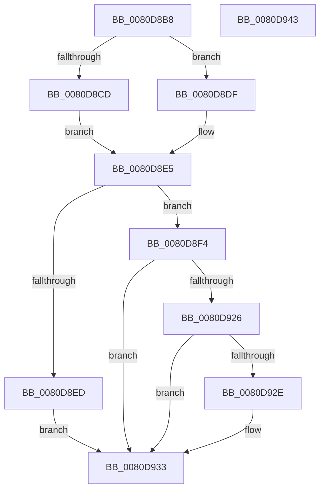

# MiHotRemovePartitionPageRun

- RVA: `0x0080D8B8`–`0x0080D944` (길이 `140` bytes)
- VA: `0x000000014080D8B8`
- 실행 섹션: `PAGE`
- PDB 이름 있음: `예`; PDB Function 태그: `아니요`
- unwind 정보 RVA: `0x0005C788`
- 디코드: `37`개 명령, `140/140` bytes 표시
- 미해석 바이트: `0` (있으면 어셈블리에 `.byte`로 보존)

> 이 문서는 커널 이미지의 기계어와 PDB 기호를 분석해 생성했습니다. 4번과 5번은 함수 원형과 자료형을 바이너리 사용 방식에서 추정한 C 해석이며 원본 소스 복구 결과는 아닙니다.

## 1. Dependencies

- 직접 호출 지점: **1**; 고유 호출 대상: **1**
- 직접 호출자로 확인된 함수: **1**
- RIP 상대 이미지 참조: **2**

### Outgoing calls
- `0x0080D939` → [MiRemovePhysicalMemory](../7F/MiRemovePhysicalMemory_function_007FAD3C.md) (function, `0x007FAD3C`)

### Direct callers
- [MiActOnPartitionNodePages](../../text/68/MiActOnPartitionNodePages_function_0068F7F4.md) at `0x0069005C`

### Static image references
- `0x0080D909` → RVA `0x00E38D00` (`.data`; read)
- `0x0080D910` → RVA `0x00E30088` (`.data`; read)

## 2. Other-region calls and transfers

- 다른 실행 섹션으로 향하는 call: **0**
- 별도 외부 분기/꼬리 이동을 확인하지 못했습니다.

## 3. Assembly (complete function range)

```asm
0080D8B8  48 83 EC 28                     sub rsp, 0x28
0080D8BC  4C 8B DA                        mov r11, rdx
0080D8BF  4C 8B D1                        mov r10, rcx
0080D8C2  B8 00 02 00 00                  mov eax, 0x200
0080D8C7  41 83 F8 03                     cmp r8d, 3
0080D8CB  75 12                           jne 0x14080d8df
0080D8CD  41 F7 D9                        neg r9d
0080D8D0  45 1B C0                        sbb r8d, r8d
0080D8D3  44 23 C0                        and r8d, eax
0080D8D6  41 81 C0 20 00 01 00            add r8d, 0x10020
0080D8DD  EB 06                           jmp 0x14080d8e5
0080D8DF  41 B8 20 00 10 00               mov r8d, 0x100020
0080D8E5  8B 54 24 50                     mov edx, dword ptr [rsp + 0x50]
0080D8E9  85 D0                           test eax, edx
0080D8EB  74 07                           je 0x14080d8f4
0080D8ED  41 0F BA E8 13                  bts r8d, 0x13
0080D8F2  EB 3F                           jmp 0x14080d933
0080D8F4  48 8D 04 49                     lea rax, [rcx + rcx*2]
0080D8F8  48 03 C0                        add rax, rax
0080D8FB  48 B9 28 00 00 00 00 DE FF FF   movabs rcx, 0xffffde0000000028
0080D905  48 8B 04 C1                     mov rax, qword ptr [rcx + rax*8]
0080D909  4C 8D 0D F0 B3 62 00            lea r9, [rip + 0x62b3f0]
0080D910  48 8B 0D 71 27 62 00            mov rcx, qword ptr [rip + 0x622771]
0080D917  48 C1 E8 2B                     shr rax, 0x2b
0080D91B  25 FF 03 00 00                  and eax, 0x3ff
0080D920  4C 39 0C C1                     cmp qword ptr [rcx + rax*8], r9
0080D924  75 0D                           jne 0x14080d933
0080D926  83 E2 06                        and edx, 6
0080D929  80 FA 06                        cmp dl, 6
0080D92C  74 05                           je 0x14080d933
0080D92E  41 0F BA E8 16                  bts r8d, 0x16
0080D933  49 8B D3                        mov rdx, r11
0080D936  49 8B CA                        mov rcx, r10
0080D939  E8 FE D3 FE FF                  call 0x1407fad3c
0080D93E  48 83 C4 28                     add rsp, 0x28
0080D942  C3                              ret
0080D943  CC                              int3
```

## 4. C-style interpretation (structured pseudocode)

```c
__int64 __fastcall MiHotRemovePartitionPageRun(__int64 a1, __int64 a2, int a3, int a4, unsigned int a5)
{
    __int64 result;
    __int64 v_rsp;

    v_rsp = (v_rsp) - (40);
    if (a3 != 3) goto loc_0080D8DF;
    a4 = (unsigned int)(-(a4));
    a3 = (unsigned int)((a3) & (512));
    a3 = (unsigned int)((a3) + (0x10020ULL));
    goto loc_0080D8E5;
loc_0080D8DF:
loc_0080D8E5:
    if (((512) & ((unsigned int)((unsigned int)(a5)))) == 0) goto loc_0080D8F4;
    goto loc_0080D933;
loc_0080D8F4:
    result = (a1 + a1 * 2) + (a1 + a1 * 2);
    result = (*(unsigned __int64 *)(a1 + result * 8)) >> (43);
    result = (unsigned int)((result) & (0x3FFULL));
    if ((*(unsigned __int64 *)(*(unsigned __int64 *)(v_rip + 6432625) + result * 8)) != (v_rip + 6468592)) goto loc_0080D933;
    a2 = (unsigned int)(((unsigned int)(a5)) & (6));
    if (((unsigned __int8)(a2)) != 6) {
    }
    result = MiRemovePhysicalMemory(a1, a2, (unsigned int)(0x100020ULL), v_rip + 6468592);
    v_rsp = (v_rsp) + (40);
    return result;
}
```

## 5. (Beta) C Style

```c
int64_t MiHotRemovePartitionPageRun(void *Arg1, int64_t Arg2, int32_t Arg3, int32_t Arg4, uint32_t Arg5)
{
    uint8_t *arg1 = (uint8_t *)Arg1;

    int64_t result;
    int64_t local_rsp;

    local_rsp = (local_rsp) - (40);
    if (Arg3 != 3) goto loc_0080D8DF;
    Arg4 = (uint32_t)(-(Arg4));
    Arg3 = (uint32_t)((Arg3) & (512));
    Arg3 = (uint32_t)((Arg3) + (0x10020ULL));
    goto loc_0080D8E5;
loc_0080D8DF:
loc_0080D8E5:
    if (((512) & ((uint32_t)((uint32_t)(Arg5)))) == 0) goto loc_0080D8F4;
    goto loc_0080D933;
loc_0080D8F4:
    result = (Arg1 + Arg1 * 2) + (Arg1 + Arg1 * 2);
    result = (*(uint64_t *)(arg1 + result * 8)) >> (43);
    result = (uint32_t)((result) & (0x3FFULL));
    if ((*(uint64_t *)(*(uint64_t *)(v_rip + 0x622771) + result * 8)) != (v_rip + 6468592)) goto loc_0080D933;
    Arg2 = (uint32_t)(((uint32_t)(Arg5)) & (6));
    if (((uint8_t)(Arg2)) != 6) {
    }
    result = MiRemovePhysicalMemory(Arg1, Arg2, (uint32_t)(0x100020ULL), v_rip + 6468592);
    local_rsp = (local_rsp) + (40);
    return result;
}
```

### 관측된 메모리 오프셋

구조체 형식이 확인되지 않은 접근은 인자 기준의 오프셋으로만 기록했습니다.

| 기준 인자 | 오프셋 표현 | 폭 (bit) | 접근 |
|---|---:|---:|---|
| `Arg1` | `+ 0x0 + rcx*2` | `64` | `R` |

## 6. Execution-region graph

[열기: 2D/3D 그래프와 함수 탐색 컨트롤 패널](../../../control-panel.html?section=page&rva=0x0080D8B8&view=graph)

- 2D 그래프는 위에서 아래로 흐르고, 3D 그래프는 빈 공간을 드래그해 회전합니다. Shift+드래그는 이동, 휠은 확대·축소, 함수 노드 선택은 대상 보고서 이동입니다.

### Static fallback


