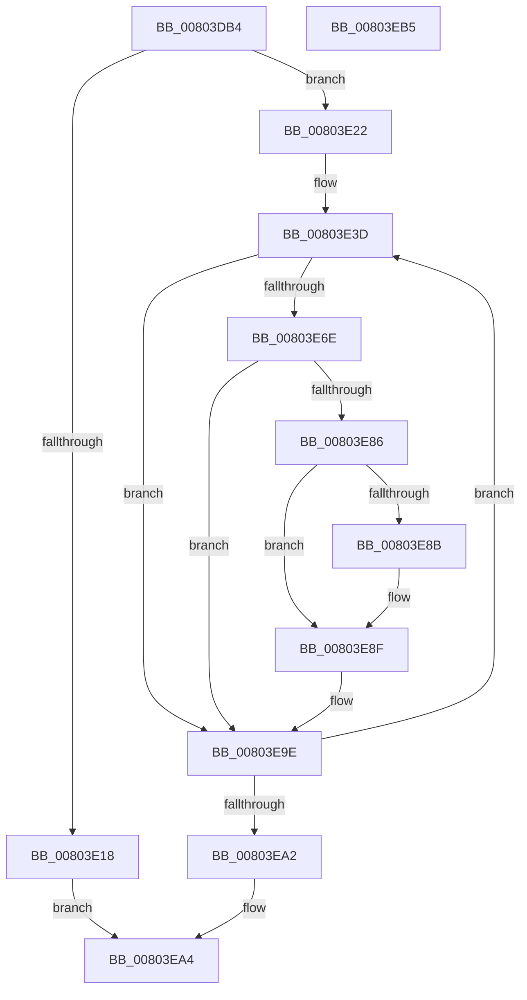

# MiIdentifyImageDiscardablePages

- RVA: `0x00803DB4`–`0x00803EB6` (길이 `258` bytes)
- VA: `0x0000000140803DB4`
- 실행 섹션: `PAGE`
- PDB 이름 있음: `예`; PDB Function 태그: `아니요`
- unwind 정보 RVA: `0x000BF984`
- 디코드: `78`개 명령, `258/258` bytes 표시
- 미해석 바이트: `0` (있으면 어셈블리에 `.byte`로 보존)

> 이 문서는 커널 이미지의 기계어와 PDB 기호를 분석해 생성했습니다. 4번과 5번은 함수 원형과 자료형을 바이너리 사용 방식에서 추정한 C 해석이며 원본 소스 복구 결과는 아닙니다.

## 1. Dependencies

- 직접 호출 지점: **4**; 고유 호출 대상: **4**
- 직접 호출자로 확인된 함수: **1**
- RIP 상대 이미지 참조: **0**

### Outgoing calls
- `0x00803E0E` → [MiAllocatePool](../../text/35/MiAllocatePool_function_0035B540.md) (function, `0x0035B540`)
- `0x00803E33` → [MiGetPteAddress](../../text/43/MiGetPteAddress_function_0043E130.md) (function, `0x0043E130`)
- `0x00803E5D` → [MiSnapDriverRange](../A4/MiSnapDriverRange_function_00A4B328.md) (function, `0x00A4B328`)
- `0x00803E99` → [RtlSetBitsEx](../../text/3B/RtlSetBitsEx_function_003B6570.md) (function, `0x003B6570`)

### Direct callers
- [MiApplyDriverHotPatch](MiApplyDriverHotPatch_function_008018EC.md) at `0x00801B61`

### Static image references
- 디코드된 RIP-relative 메모리 참조가 없습니다.

## 2. Other-region calls and transfers

- 다른 실행 섹션으로 향하는 call: **3**
  - `0x00803E0E` → [MiAllocatePool](../../text/35/MiAllocatePool_function_0035B540.md) (`PAGE` → `.text`)
  - `0x00803E33` → [MiGetPteAddress](../../text/43/MiGetPteAddress_function_0043E130.md) (`PAGE` → `.text`)
  - `0x00803E99` → [RtlSetBitsEx](../../text/3B/RtlSetBitsEx_function_003B6570.md) (`PAGE` → `.text`)
- 별도 외부 분기/꼬리 이동을 확인하지 못했습니다.

## 3. Assembly (complete function range)

```asm
00803DB4  48 89 5C 24 18                  mov qword ptr [rsp + 0x18], rbx
00803DB9  55                              push rbp
00803DBA  56                              push rsi
00803DBB  57                              push rdi
00803DBC  41 56                           push r14
00803DBE  41 57                           push r15
00803DC0  48 83 EC 30                     sub rsp, 0x30
00803DC4  48 8B 01                        mov rax, qword ptr [rcx]
00803DC7  4C 8B F1                        mov r14, rcx
00803DCA  48 83 64 24 60 00               and qword ptr [rsp + 0x60], 0
00803DD0  B9 00 00 00 00                  mov ecx, 0
00803DD5  48 83 64 24 68 00               and qword ptr [rsp + 0x68], 0
00803DDB  BF 00 00 00 00                  mov edi, 0
00803DE0  41 B8 50 44 42 4D               mov r8d, 0x4d424450
00803DE6  8B 50 40                        mov edx, dword ptr [rax + 0x40]
00803DE9  F7 C2 FF 0F 00 00               test edx, 0xfff
00803DEF  40 0F 95 C7                     setne dil
00803DF3  C1 EA 0C                        shr edx, 0xc
00803DF6  03 FA                           add edi, edx
00803DF8  8B D7                           mov edx, edi
00803DFA  40 F6 C7 3F                     test dil, 0x3f
00803DFE  0F 95 C1                        setne cl
00803E01  C1 EA 06                        shr edx, 6
00803E04  03 D1                           add edx, ecx
00803E06  B9 40 00 00 00                  mov ecx, 0x40
00803E0B  C1 E2 03                        shl edx, 3
00803E0E  E8 2D 77 B5 FF                  call 0x14035b540
00803E13  48 85 C0                        test rax, rax
00803E16  75 0A                           jne 0x140803e22
00803E18  B8 9A 00 00 C0                  mov eax, 0xc000009a
00803E1D  E9 82 00 00 00                  jmp 0x140803ea4
00803E22  49 89 46 58                     mov qword ptr [r14 + 0x58], rax
00803E26  8B DF                           mov ebx, edi
00803E28  49 89 5E 50                     mov qword ptr [r14 + 0x50], rbx
00803E2C  49 8B 0E                        mov rcx, qword ptr [r14]
00803E2F  48 8B 49 30                     mov rcx, qword ptr [rcx + 0x30]
00803E33  E8 F8 A2 C3 FF                  call 0x14043e130
00803E38  4C 8B F8                        mov r15, rax
00803E3B  33 ED                           xor ebp, ebp
00803E3D  49 8B 0E                        mov rcx, qword ptr [r14]
00803E40  48 8D 44 24 68                  lea rax, [rsp + 0x68]
00803E45  48 89 44 24 28                  mov qword ptr [rsp + 0x28], rax
00803E4A  45 33 C9                        xor r9d, r9d
00803E4D  48 8D 44 24 60                  lea rax, [rsp + 0x60]
00803E52  8B D5                           mov edx, ebp
00803E54  48 89 44 24 20                  mov qword ptr [rsp + 0x20], rax
00803E59  45 8D 41 02                     lea r8d, [r9 + 2]
00803E5D  E8 C6 74 24 00                  call 0x140a4b328
00803E62  48 8B 54 24 60                  mov rdx, qword ptr [rsp + 0x60]
00803E67  8B E8                           mov ebp, eax
00803E69  48 85 D2                        test rdx, rdx
00803E6C  74 30                           je 0x140803e9e
00803E6E  4C 8B 44 24 68                  mov r8, qword ptr [rsp + 0x68]
00803E73  49 2B D7                        sub rdx, r15
00803E76  4D 2B C7                        sub r8, r15
00803E79  48 C1 FA 03                     sar rdx, 3
00803E7D  49 C1 F8 03                     sar r8, 3
00803E81  48 3B D3                        cmp rdx, rbx
00803E84  73 18                           jae 0x140803e9e
00803E86  4C 3B C3                        cmp r8, rbx
00803E89  72 04                           jb 0x140803e8f
00803E8B  44 8D 47 FF                     lea r8d, [rdi - 1]
00803E8F  4C 2B C2                        sub r8, rdx
00803E92  49 8D 4E 50                     lea rcx, [r14 + 0x50]
00803E96  49 FF C0                        inc r8
00803E99  E8 D2 26 BB FF                  call 0x1403b6570
00803E9E  85 ED                           test ebp, ebp
00803EA0  75 9B                           jne 0x140803e3d
00803EA2  33 C0                           xor eax, eax
00803EA4  48 8B 5C 24 70                  mov rbx, qword ptr [rsp + 0x70]
00803EA9  48 83 C4 30                     add rsp, 0x30
00803EAD  41 5F                           pop r15
00803EAF  41 5E                           pop r14
00803EB1  5F                              pop rdi
00803EB2  5E                              pop rsi
00803EB3  5D                              pop rbp
00803EB4  C3                              ret
00803EB5  CC                              int3
```

## 4. C-style interpretation (structured pseudocode)

```c
__int64 __fastcall MiIdentifyImageDiscardablePages(__int64 a1, __int64 a2, __int64 a3, int a4)
{
    __int64 result;
    __int64 v_rbp;
    __int64 v_rdi;
    __int64 v_rsp;
    unsigned __int64 v_stack_m30;
    unsigned __int64 v_stack_m38;
    unsigned __int64 v_stack_p10;
    unsigned __int64 v_stack_p18;
    unsigned __int64 v_stack_p8;

    v_stack_p18 = v_rbx;
    v_rsp = (v_rsp) - (48);
    v_rdi = ((((unsigned int)((unsigned int)(*(unsigned int *)(*(unsigned __int64 *)(a1) + 64)))) & (0xFFFULL)) != 0) ? 1 : 0;
    a2 = (unsigned int)(((unsigned int)(*(unsigned int *)(*(unsigned __int64 *)(a1) + 64))) >> (12));
    v_rdi = (unsigned int)((v_rdi) + ((unsigned int)(a2)));
    a1 = ((((unsigned __int8)(v_rdi)) & (63)) != 0) ? 1 : 0;
    a2 = (unsigned int)(((unsigned int)((unsigned int)(v_rdi))) >> (6));
    a2 = (unsigned int)((a2) + ((unsigned int)(a1)));
    a2 = (unsigned int)((a2) << (3));
    result = MiAllocatePool(64, a2, (unsigned int)(0x4D424450ULL), a4);
    if (result != 0) goto loc_00803E22;
    goto loc_00803EA4;
loc_00803E22:
    *(unsigned __int64 *)(a1 + 88) = (unsigned int)(0xC000009AULL);
    *(unsigned __int64 *)(a1 + 80) = (unsigned int)((unsigned int)(v_rdi));
    result = MiGetPteAddress(*(unsigned __int64 *)(*(unsigned __int64 *)(a1) + 48), a2, (unsigned int)(0x4D424450ULL), a4);
    v_rbp = 0;
loc_00803E3D:
    v_stack_m30 = v_stack_p10;
    a4 = 0;
    v_stack_m38 = v_stack_p8;
    result = MiSnapDriverRange(*(unsigned __int64 *)(a1), 0, a4 + 2, a4);
    if (v_stack_p8 == 0) goto loc_00803E9E;
    a2 = (v_stack_p8) - (result);
    a3 = (v_stack_p10) - (result);
    a2 = (a2) >> (3);
    a3 = (a3) >> (3);
    if (a2 >= ((unsigned int)((unsigned int)(v_rdi)))) goto loc_00803E9E;
    if (a3 >= ((unsigned int)((unsigned int)(v_rdi)))) {
        a3 = v_rdi - 1;
    }
    a3 = (a3) - (a2);
    a3 = (a3) + 1;
    result = RtlSetBitsEx(a1 + 80, a2, a3, a4);
loc_00803E9E:
    if ((unsigned int)((unsigned int)((unsigned int)(result))) != 0) goto loc_00803E3D;
    result = 0;
loc_00803EA4:
    v_rsp = (v_rsp) + (48);
    return result;
}
```

## 5. (Beta) C Style

```c
int64_t MiIdentifyImageDiscardablePages(void *Arg1, int64_t Arg2, int64_t Arg3, int32_t Arg4)
{
    uint8_t *arg1 = (uint8_t *)Arg1;

    int64_t result;
    int64_t local_rbp;
    int64_t local_rdi;
    int64_t local_rsp;
    uint64_t v_stack_m30;
    uint64_t v_stack_m38;
    uint64_t v_stack_p10;
    uint64_t v_stack_p18;
    uint64_t v_stack_p8;

    v_stack_p18 = local_rbx;
    local_rsp = (local_rsp) - (48);
    local_rdi = ((((uint32_t)((uint32_t)(*(uint32_t *)(*(uint64_t *)(arg1) + 0x40)))) & (0xFFFULL)) != 0) ? 1 : 0;
    Arg2 = (uint32_t)(((uint32_t)(*(uint32_t *)(*(uint64_t *)(arg1) + 0x40))) >> (12));
    local_rdi = (uint32_t)((local_rdi) + ((uint32_t)(Arg2)));
    Arg1 = ((((uint8_t)(local_rdi)) & (63)) != 0) ? 1 : 0;
    Arg2 = (uint32_t)(((uint32_t)((uint32_t)(local_rdi))) >> (6));
    Arg2 = (uint32_t)((Arg2) + ((uint32_t)(Arg1)));
    Arg2 = (uint32_t)((Arg2) << (3));
    result = MiAllocatePool(64, Arg2, (uint32_t)(0x4D424450ULL), Arg4);
    if (result != 0) goto loc_00803E22;
    goto loc_00803EA4;
loc_00803E22:
    *(uint64_t *)(arg1 + 0x58) = (uint32_t)(0xC000009AULL);
    *(uint64_t *)(arg1 + 0x50) = (uint32_t)((uint32_t)(local_rdi));
    result = MiGetPteAddress(*(uint64_t *)(*(uint64_t *)(arg1) + 0x30), Arg2, (uint32_t)(0x4D424450ULL), Arg4);
    local_rbp = 0;
loc_00803E3D:
    v_stack_m30 = v_stack_p10;
    Arg4 = 0;
    v_stack_m38 = v_stack_p8;
    result = MiSnapDriverRange(*(uint64_t *)(arg1), 0, Arg4 + 2, Arg4);
    if (v_stack_p8 == 0) goto loc_00803E9E;
    Arg2 = (v_stack_p8) - (result);
    Arg3 = (v_stack_p10) - (result);
    Arg2 = (Arg2) >> (3);
    Arg3 = (Arg3) >> (3);
    if (Arg2 >= ((uint32_t)((uint32_t)(local_rdi)))) goto loc_00803E9E;
    if (Arg3 >= ((uint32_t)((uint32_t)(local_rdi)))) {
        Arg3 = local_rdi - 1;
    }
    Arg3 = (Arg3) - (Arg2);
    Arg3 = (Arg3) + 1;
    result = RtlSetBitsEx(Arg1 + 80, Arg2, Arg3, Arg4);
loc_00803E9E:
    if ((uint32_t)((uint32_t)((uint32_t)(result))) != 0) goto loc_00803E3D;
    result = 0;
loc_00803EA4:
    local_rsp = (local_rsp) + (48);
    return result;
}
```

### 관측된 메모리 오프셋

구조체 형식이 확인되지 않은 접근은 인자 기준의 오프셋으로만 기록했습니다.

| 기준 인자 | 오프셋 표현 | 폭 (bit) | 접근 |
|---|---:|---:|---|
| `Arg1` | `+ 0x0` | `64` | `R` |
| `Arg1` | `+ 0x50` | `64` | `R` |
| `Arg1` | `+ 0x50` | `64` | `W` |
| `Arg1` | `+ 0x58` | `64` | `W` |

## 6. Execution-region graph

[열기: 2D/3D 그래프와 함수 탐색 컨트롤 패널](../../../control-panel.html?section=page&rva=0x00803DB4&view=graph)

- 2D 그래프는 위에서 아래로 흐르고, 3D 그래프는 빈 공간을 드래그해 회전합니다. Shift+드래그는 이동, 휠은 확대·축소, 함수 노드 선택은 대상 보고서 이동입니다.

### Static fallback


