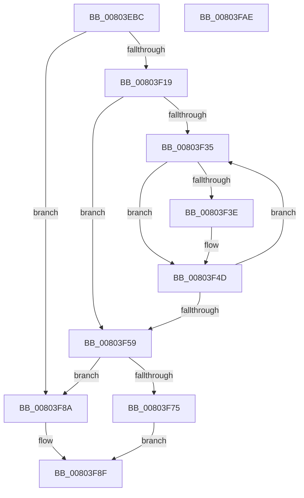

# MiIdentifyPatchImageDataPages

- RVA: `0x00803EBC`–`0x00803FAF` (길이 `243` bytes)
- VA: `0x0000000140803EBC`
- 실행 섹션: `PAGE`
- PDB 이름 있음: `예`; PDB Function 태그: `아니요`
- unwind 정보 RVA: `0x0005FEF8`
- 디코드: `71`개 명령, `243/243` bytes 표시
- 미해석 바이트: `0` (있으면 어셈블리에 `.byte`로 보존)

> 이 문서는 커널 이미지의 기계어와 PDB 기호를 분석해 생성했습니다. 4번과 5번은 함수 원형과 자료형을 바이너리 사용 방식에서 추정한 C 해석이며 원본 소스 복구 결과는 아닙니다.

## 1. Dependencies

- 직접 호출 지점: **4**; 고유 호출 대상: **3**
- 직접 호출자로 확인된 함수: **1**
- RIP 상대 이미지 참조: **0**

### Outgoing calls
- `0x00803F0F` → [MiAllocatePool](../../text/35/MiAllocatePool_function_0035B540.md) (function, `0x0035B540`)
- `0x00803F48` → [RtlSetBitsEx](../../text/3B/RtlSetBitsEx_function_003B6570.md) (function, `0x003B6570`)
- `0x00803F6B` → [MiAllocatePool](../../text/35/MiAllocatePool_function_0035B540.md) (function, `0x0035B540`)
- `0x00803F81` → [RtlClearAllBitsEx](../../text/47/RtlClearAllBitsEx_function_00477DC0.md) (function, `0x00477DC0`)

### Direct callers
- [MiApplyDriverHotPatch](MiApplyDriverHotPatch_function_008018EC.md) at `0x00801B4E`

### Static image references
- 디코드된 RIP-relative 메모리 참조가 없습니다.

## 2. Other-region calls and transfers

- 다른 실행 섹션으로 향하는 call: **4**
  - `0x00803F0F` → [MiAllocatePool](../../text/35/MiAllocatePool_function_0035B540.md) (`PAGE` → `.text`)
  - `0x00803F48` → [RtlSetBitsEx](../../text/3B/RtlSetBitsEx_function_003B6570.md) (`PAGE` → `.text`)
  - `0x00803F6B` → [MiAllocatePool](../../text/35/MiAllocatePool_function_0035B540.md) (`PAGE` → `.text`)
  - `0x00803F81` → [RtlClearAllBitsEx](../../text/47/RtlClearAllBitsEx_function_00477DC0.md) (`PAGE` → `.text`)
- 별도 외부 분기/꼬리 이동을 확인하지 못했습니다.

## 3. Assembly (complete function range)

```asm
00803EBC  48 8B C4                        mov rax, rsp
00803EBF  48 89 58 08                     mov qword ptr [rax + 8], rbx
00803EC3  48 89 68 10                     mov qword ptr [rax + 0x10], rbp
00803EC7  48 89 70 18                     mov qword ptr [rax + 0x18], rsi
00803ECB  48 89 78 20                     mov qword ptr [rax + 0x20], rdi
00803ECF  41 54                           push r12
00803ED1  41 56                           push r14
00803ED3  41 57                           push r15
00803ED5  48 83 EC 20                     sub rsp, 0x20
00803ED9  48 8B 41 10                     mov rax, qword ptr [rcx + 0x10]
00803EDD  4C 8B F9                        mov r15, rcx
00803EE0  4C 8B 71 08                     mov r14, qword ptr [rcx + 8]
00803EE4  41 B8 50 44 42 4D               mov r8d, 0x4d424450
00803EEA  B9 00 00 00 00                  mov ecx, 0
00803EEF  48 8B 10                        mov rdx, qword ptr [rax]
00803EF2  8B 5A 08                        mov ebx, dword ptr [rdx + 8]
00803EF5  8B C3                           mov eax, ebx
00803EF7  F6 C3 3F                        test bl, 0x3f
00803EFA  0F 95 C1                        setne cl
00803EFD  C1 E8 06                        shr eax, 6
00803F00  03 C8                           add ecx, eax
00803F02  C1 E1 03                        shl ecx, 3
00803F05  44 8B E1                        mov r12d, ecx
00803F08  8B D1                           mov edx, ecx
00803F0A  B9 40 00 00 00                  mov ecx, 0x40
00803F0F  E8 2C 76 B5 FF                  call 0x14035b540
00803F14  48 85 C0                        test rax, rax
00803F17  74 71                           je 0x140803f8a
00803F19  8B EB                           mov ebp, ebx
00803F1B  49 89 5E 30                     mov qword ptr [r14 + 0x30], rbx
00803F1F  49 89 46 38                     mov qword ptr [r14 + 0x38], rax
00803F23  BE 00 00 00 00                  mov esi, 0
00803F28  49 8B 5F 10                     mov rbx, qword ptr [r15 + 0x10]
00803F2C  48 81 C3 80 00 00 00            add rbx, 0x80
00803F33  74 24                           je 0x140803f59
00803F35  8B 43 20                        mov eax, dword ptr [rbx + 0x20]
00803F38  24 0C                           and al, 0xc
00803F3A  3C 08                           cmp al, 8
00803F3C  75 0F                           jne 0x140803f4d
00803F3E  44 8B 43 2C                     mov r8d, dword ptr [rbx + 0x2c]
00803F42  49 8D 4E 30                     lea rcx, [r14 + 0x30]
00803F46  8B D6                           mov edx, esi
00803F48  E8 23 26 BB FF                  call 0x1403b6570
00803F4D  03 73 2C                        add esi, dword ptr [rbx + 0x2c]
00803F50  48 8B 5B 10                     mov rbx, qword ptr [rbx + 0x10]
00803F54  48 85 DB                        test rbx, rbx
00803F57  75 DC                           jne 0x140803f35
00803F59  49 8B 5F 08                     mov rbx, qword ptr [r15 + 8]
00803F5D  41 B8 50 44 42 4D               mov r8d, 0x4d424450
00803F63  49 8B D4                        mov rdx, r12
00803F66  B9 00 01 00 00                  mov ecx, 0x100
00803F6B  E8 D0 75 B5 FF                  call 0x14035b540
00803F70  48 85 C0                        test rax, rax
00803F73  74 15                           je 0x140803f8a
00803F75  48 8D 4B 40                     lea rcx, [rbx + 0x40]
00803F79  48 89 6B 40                     mov qword ptr [rbx + 0x40], rbp
00803F7D  48 89 43 48                     mov qword ptr [rbx + 0x48], rax
00803F81  E8 3A 3E C7 FF                  call 0x140477dc0
00803F86  33 C0                           xor eax, eax
00803F88  EB 05                           jmp 0x140803f8f
00803F8A  B8 9A 00 00 C0                  mov eax, 0xc000009a
00803F8F  48 8B 5C 24 40                  mov rbx, qword ptr [rsp + 0x40]
00803F94  48 8B 6C 24 48                  mov rbp, qword ptr [rsp + 0x48]
00803F99  48 8B 74 24 50                  mov rsi, qword ptr [rsp + 0x50]
00803F9E  48 8B 7C 24 58                  mov rdi, qword ptr [rsp + 0x58]
00803FA3  48 83 C4 20                     add rsp, 0x20
00803FA7  41 5F                           pop r15
00803FA9  41 5E                           pop r14
00803FAB  41 5C                           pop r12
00803FAD  C3                              ret
00803FAE  CC                              int3
```

## 4. C-style interpretation (structured pseudocode)

```c
__int64 __fastcall MiIdentifyPatchImageDataPages(__int64 a1)
{
    __int64 result;
    __int64 v_rbx;
    __int64 v_rsi;
    __int64 v_rsp;
    unsigned __int64 v_stack_p10;
    unsigned __int64 v_stack_p18;
    unsigned __int64 v_stack_p20;
    unsigned __int64 v_stack_p8;

    *(unsigned __int64 *)(v_rsp + 8) = v_rbx;
    *(unsigned __int64 *)(v_rsp + 16) = v_rbp;
    *(unsigned __int64 *)(v_rsp + 24) = v_rsi;
    *(unsigned __int64 *)(v_rsp + 32) = v_rdi;
    v_rsp = (v_rsp) - (32);
    a1 = ((((unsigned __int8)((unsigned int)(*(unsigned int *)(*(unsigned __int64 *)(*(unsigned __int64 *)(a1 + 16)) + 8)))) & (63)) != 0) ? 1 : 0;
    result = (unsigned int)(((unsigned int)((unsigned int)((unsigned int)(*(unsigned int *)(*(unsigned __int64 *)(*(unsigned __int64 *)(a1 + 16)) + 8))))) >> (6));
    a1 = (unsigned int)((a1) + ((unsigned int)(result)));
    a1 = (unsigned int)((a1) << (3));
    result = MiAllocatePool(64, (unsigned int)((unsigned int)(a1)), (unsigned int)(0x4D424450ULL), a4);
    if (result == 0) goto loc_00803F8A;
    *(unsigned __int64 *)(*(unsigned __int64 *)(a1 + 8) + 48) = (unsigned int)(*(unsigned int *)(*(unsigned __int64 *)(*(unsigned __int64 *)(a1 + 16)) + 8));
    *(unsigned __int64 *)(*(unsigned __int64 *)(a1 + 8) + 56) = result;
    v_rbx = (*(unsigned __int64 *)(a1 + 16)) + (128);
    if (condition_is_equal) goto loc_00803F59;
loc_00803F35:
    result = (unsigned __int8)(((unsigned int)(*(unsigned int *)(v_rbx + 32))) & (12));
    if (((unsigned __int8)(result)) == 8) {
        a3 = *(unsigned int *)(v_rbx + 44);
        a1 = *(unsigned __int64 *)(a1 + 8) + 48;
        a2 = 0;
        result = RtlSetBitsEx(a1, a2, a3, a4);
    }
    v_rsi = (unsigned int)((0) + (*(unsigned int *)(v_rbx + 44)));
    if (*(unsigned __int64 *)(v_rbx + 16) != 0) goto loc_00803F35;
loc_00803F59:
    result = MiAllocatePool(256, (unsigned int)((unsigned int)(a1)), (unsigned int)(0x4D424450ULL), a4);
    if (result == 0) goto loc_00803F8A;
    *(unsigned __int64 *)(*(unsigned __int64 *)(a1 + 8) + 64) = (unsigned int)((unsigned int)((unsigned int)(*(unsigned int *)(*(unsigned __int64 *)(*(unsigned __int64 *)(a1 + 16)) + 8))));
    *(unsigned __int64 *)(*(unsigned __int64 *)(a1 + 8) + 72) = result;
    result = RtlClearAllBitsEx(*(unsigned __int64 *)(a1 + 8) + 64, (unsigned int)((unsigned int)(a1)), (unsigned int)(0x4D424450ULL), a4);
    result = 0;
    goto loc_00803F8F;
loc_00803F8A:
loc_00803F8F:
    v_rsp = (v_rsp) + (32);
    return (unsigned int)(0xC000009AULL);
}
```

## 5. (Beta) C Style

```c
int64_t MiIdentifyPatchImageDataPages(void *Arg1)
{
    uint8_t *arg1 = (uint8_t *)Arg1;

    int64_t result;
    int64_t local_rbx;
    int64_t local_rsi;
    int64_t local_rsp;
    uint64_t v_stack_p10;
    uint64_t v_stack_p18;
    uint64_t v_stack_p20;
    uint64_t v_stack_p8;

    *(uint64_t *)(local_rsp + 0x8) = local_rbx;
    *(uint64_t *)(local_rsp + 0x10) = local_rbp;
    *(uint64_t *)(local_rsp + 0x18) = local_rsi;
    *(uint64_t *)(local_rsp + 0x20) = local_rdi;
    local_rsp = (local_rsp) - (32);
    Arg1 = ((((uint8_t)((uint32_t)(*(uint32_t *)(*(uint64_t *)(*(uint64_t *)(arg1 + 0x10)) + 0x8)))) & (63)) != 0) ? 1 : 0;
    result = (uint32_t)(((uint32_t)((uint32_t)((uint32_t)(*(uint32_t *)(*(uint64_t *)(*(uint64_t *)(arg1 + 0x10)) + 0x8))))) >> (6));
    Arg1 = (uint32_t)((Arg1) + ((uint32_t)(result)));
    Arg1 = (uint32_t)((Arg1) << (3));
    result = MiAllocatePool(64, (uint32_t)((uint32_t)(Arg1)), (uint32_t)(0x4D424450ULL), a4);
    if (result == 0) goto loc_00803F8A;
    *(uint64_t *)(*(uint64_t *)(arg1 + 0x8) + 0x30) = (uint32_t)(*(uint32_t *)(*(uint64_t *)(*(uint64_t *)(arg1 + 0x10)) + 0x8));
    *(uint64_t *)(*(uint64_t *)(arg1 + 0x8) + 0x38) = result;
    local_rbx = (*(uint64_t *)(arg1 + 0x10)) + (128);
    if (condition_is_equal) goto loc_00803F59;
loc_00803F35:
    result = (uint8_t)(((uint32_t)(*(uint32_t *)(local_rbx + 0x20))) & (12));
    if (((uint8_t)(result)) == 8) {
        a3 = *(uint32_t *)(local_rbx + 0x2C);
        Arg1 = *(uint64_t *)(arg1 + 0x8) + 48;
        a2 = 0;
        result = RtlSetBitsEx(Arg1, a2, a3, a4);
    }
    local_rsi = (uint32_t)((0) + (*(uint32_t *)(local_rbx + 0x2C)));
    if (*(uint64_t *)(local_rbx + 0x10) != 0) goto loc_00803F35;
loc_00803F59:
    result = MiAllocatePool(256, (uint32_t)((uint32_t)(Arg1)), (uint32_t)(0x4D424450ULL), a4);
    if (result == 0) goto loc_00803F8A;
    *(uint64_t *)(*(uint64_t *)(arg1 + 0x8) + 0x40) = (uint32_t)((uint32_t)((uint32_t)(*(uint32_t *)(*(uint64_t *)(*(uint64_t *)(arg1 + 0x10)) + 0x8))));
    *(uint64_t *)(*(uint64_t *)(arg1 + 0x8) + 0x48) = result;
    result = RtlClearAllBitsEx(*(uint64_t *)(arg1 + 0x8) + 64, (uint32_t)((uint32_t)(Arg1)), (uint32_t)(0x4D424450ULL), a4);
    result = 0;
    goto loc_00803F8F;
loc_00803F8A:
loc_00803F8F:
    local_rsp = (local_rsp) + (32);
    return (uint32_t)(0xC000009AULL);
}
```

### 관측된 메모리 오프셋

구조체 형식이 확인되지 않은 접근은 인자 기준의 오프셋으로만 기록했습니다.

| 기준 인자 | 오프셋 표현 | 폭 (bit) | 접근 |
|---|---:|---:|---|
| `Arg1` | `+ 0x8` | `64` | `R` |
| `Arg1` | `+ 0x10` | `64` | `R` |

## 6. Execution-region graph

[열기: 2D/3D 그래프와 함수 탐색 컨트롤 패널](../../../control-panel.html?section=page&rva=0x00803EBC&view=graph)

- 2D 그래프는 위에서 아래로 흐르고, 3D 그래프는 빈 공간을 드래그해 회전합니다. Shift+드래그는 이동, 휠은 확대·축소, 함수 노드 선택은 대상 보고서 이동입니다.

### Static fallback


