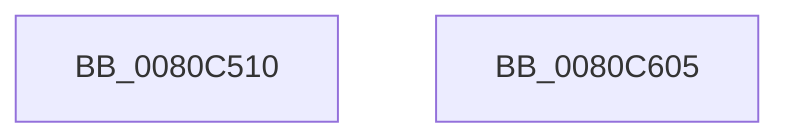

# MiInSwapSharedWorkingSetWorker

- RVA: `0x0080C510`–`0x0080C606` (길이 `246` bytes)
- VA: `0x000000014080C510`
- 실행 섹션: `PAGE`
- PDB 이름 있음: `예`; PDB Function 태그: `아니요`
- unwind 정보 RVA: `0x000D8DC4`
- 디코드: `61`개 명령, `246/246` bytes 표시
- 미해석 바이트: `0` (있으면 어셈블리에 `.byte`로 보존)

> 이 문서는 커널 이미지의 기계어와 PDB 기호를 분석해 생성했습니다. 4번과 5번은 함수 원형과 자료형을 바이너리 사용 방식에서 추정한 C 해석이며 원본 소스 복구 결과는 아닙니다.

## 1. Dependencies

- 직접 호출 지점: **9**; 고유 호출 대상: **8**
- 직접 호출자로 확인된 함수: **0**
- RIP 상대 이미지 참조: **1**

### Outgoing calls
- `0x0080C561` → [KeStackAttachProcess](../../text/21/KeStackAttachProcess_function_00216800.md) (function, `0x00216800`)
- `0x0080C579` → [EtwTraceWorkingSetSwap](../A1/EtwTraceWorkingSetSwap_function_00A17D80.md) (function, `0x00A17D80`)
- `0x0080C592` → [MiProcessWsInSwapSupport](../../text/45/MiProcessWsInSwapSupport_function_0045B954.md) (function, `0x0045B954`)
- `0x0080C5AF` → [EtwTraceWorkingSetSwap](../A1/EtwTraceWorkingSetSwap_function_00A17D80.md) (function, `0x00A17D80`)
- `0x0080C5BA` → [KiUnstackDetachProcess](../../text/21/KiUnstackDetachProcess_function_00217D30.md) (function, `0x00217D30`)
- `0x0080C5C2` → [MiGetProcessPartition](../../text/44/MiGetProcessPartition_function_00443B10.md) (function, `0x00443B10`)
- `0x0080C5D2` → [MiFreeWorkingSetSwapContext](../A4/MiFreeWorkingSetSwapContext_function_00A4AABC.md) (function, `0x00A4AABC`)
- `0x0080C5DF` → [ObfDereferenceObjectWithTag](../../text/2F/ObfDereferenceObjectWithTag_function_002F78E0.md) (function, `0x002F78E0`)
- `0x0080C5EB` → [_security_check_cookie](../../text/6A/_security_check_cookie_function_006AC640.md) (function, `0x006AC640`)

### Direct callers
- 이 함수 시작 RVA로 연결되는 직접 call은 확인되지 않았습니다. 간접 호출은 완전히 역산할 수 없습니다.

### Static image references
- `0x0080C525` → RVA `0x00E0A740` (`.data`; read)

## 2. Other-region calls and transfers

- 다른 실행 섹션으로 향하는 call: **6**
  - `0x0080C561` → [KeStackAttachProcess](../../text/21/KeStackAttachProcess_function_00216800.md) (`PAGE` → `.text`)
  - `0x0080C592` → [MiProcessWsInSwapSupport](../../text/45/MiProcessWsInSwapSupport_function_0045B954.md) (`PAGE` → `.text`)
  - `0x0080C5BA` → [KiUnstackDetachProcess](../../text/21/KiUnstackDetachProcess_function_00217D30.md) (`PAGE` → `.text`)
  - `0x0080C5C2` → [MiGetProcessPartition](../../text/44/MiGetProcessPartition_function_00443B10.md) (`PAGE` → `.text`)
  - `0x0080C5DF` → [ObfDereferenceObjectWithTag](../../text/2F/ObfDereferenceObjectWithTag_function_002F78E0.md) (`PAGE` → `.text`)
  - `0x0080C5EB` → [_security_check_cookie](../../text/6A/_security_check_cookie_function_006AC640.md) (`PAGE` → `.text`)
- 별도 외부 분기/꼬리 이동을 확인하지 못했습니다.

## 3. Assembly (complete function range)

```asm
0080C510  48 89 74 24 10                  mov qword ptr [rsp + 0x10], rsi
0080C515  48 89 7C 24 18                  mov qword ptr [rsp + 0x18], rdi
0080C51A  55                              push rbp
0080C51B  48 8B EC                        mov rbp, rsp
0080C51E  48 81 EC 80 00 00 00            sub rsp, 0x80
0080C525  48 8B 05 14 E2 5F 00            mov rax, qword ptr [rip + 0x5fe214]
0080C52C  48 33 C4                        xor rax, rsp
0080C52F  48 89 45 F8                     mov qword ptr [rbp - 8], rax
0080C533  48 8B 79 30                     mov rdi, qword ptr [rcx + 0x30]
0080C537  48 8D 55 C8                     lea rdx, [rbp - 0x38]
0080C53B  0F 57 C0                        xorps xmm0, xmm0
0080C53E  0F 57 C9                        xorps xmm1, xmm1
0080C541  48 8B F1                        mov rsi, rcx
0080C544  33 C0                           xor eax, eax
0080C546  48 8B CF                        mov rcx, rdi
0080C549  48 89 45 C0                     mov qword ptr [rbp - 0x40], rax
0080C54D  0F 11 45 C8                     movups xmmword ptr [rbp - 0x38], xmm0
0080C551  0F 11 45 D8                     movups xmmword ptr [rbp - 0x28], xmm0
0080C555  0F 11 45 E8                     movups xmmword ptr [rbp - 0x18], xmm0
0080C559  0F 11 4D A0                     movups xmmword ptr [rbp - 0x60], xmm1
0080C55D  0F 11 4D B0                     movups xmmword ptr [rbp - 0x50], xmm1
0080C561  E8 9A A2 A0 FF                  call 0x140216800
0080C566  4C 8D 45 A0                     lea r8, [rbp - 0x60]
0080C56A  C7 45 A0 01 00 00 00            mov dword ptr [rbp - 0x60], 1
0080C571  BA 03 00 00 00                  mov edx, 3
0080C576  48 8B CF                        mov rcx, rdi
0080C579  E8 02 B8 20 00                  call 0x140a17d80
0080C57E  B8 E8 03 00 00                  mov eax, 0x3e8
0080C583  BA 01 00 00 00                  mov edx, 1
0080C588  87 87 60 06 00 00               xchg dword ptr [rdi + 0x660], eax
0080C58E  48 8B 4E 08                     mov rcx, qword ptr [rsi + 8]
0080C592  E8 BD F3 C4 FF                  call 0x14045b954
0080C597  33 C0                           xor eax, eax
0080C599  4C 8D 45 A0                     lea r8, [rbp - 0x60]
0080C59D  87 87 60 06 00 00               xchg dword ptr [rdi + 0x660], eax
0080C5A3  83 4D C0 FF                     or dword ptr [rbp - 0x40], 0xffffffff
0080C5A7  BA 01 00 00 00                  mov edx, 1
0080C5AC  48 8B CF                        mov rcx, rdi
0080C5AF  E8 CC B7 20 00                  call 0x140a17d80
0080C5B4  33 D2                           xor edx, edx
0080C5B6  48 8D 4D C8                     lea rcx, [rbp - 0x38]
0080C5BA  E8 71 B7 A0 FF                  call 0x140217d30
0080C5BF  48 8B CF                        mov rcx, rdi
0080C5C2  E8 49 75 C3 FF                  call 0x140443b10
0080C5C7  48 83 66 30 00                  and qword ptr [rsi + 0x30], 0
0080C5CC  48 8B D6                        mov rdx, rsi
0080C5CF  48 8B C8                        mov rcx, rax
0080C5D2  E8 E5 E4 23 00                  call 0x140a4aabc
0080C5D7  BA 4D 6D 57 73                  mov edx, 0x73576d4d
0080C5DC  48 8B CF                        mov rcx, rdi
0080C5DF  E8 FC B2 AE FF                  call 0x1402f78e0
0080C5E4  48 8B 4D F8                     mov rcx, qword ptr [rbp - 8]
0080C5E8  48 33 CC                        xor rcx, rsp
0080C5EB  E8 50 00 EA FF                  call 0x1406ac640
0080C5F0  4C 8D 9C 24 80 00 00 00         lea r11, [rsp + 0x80]
0080C5F8  49 8B 73 18                     mov rsi, qword ptr [r11 + 0x18]
0080C5FC  49 8B 7B 20                     mov rdi, qword ptr [r11 + 0x20]
0080C600  49 8B E3                        mov rsp, r11
0080C603  5D                              pop rbp
0080C604  C3                              ret
0080C605  CC                              int3
```

## 4. C-style interpretation (structured pseudocode)

```c
__int64 __fastcall MiInSwapSharedWorkingSetWorker(__int64 a1)
{
    __int64 result;
    __int64 v_rsp;
    unsigned __int64 v_stack_m10;
    unsigned __int64 v_stack_m20;
    unsigned __int64 v_stack_m30;
    unsigned __int64 v_stack_m40;
    unsigned __int64 v_stack_m48;
    unsigned __int64 v_stack_m58;
    unsigned __int64 v_stack_m68;
    unsigned __int64 v_stack_m8;
    unsigned __int64 v_stack_p10;
    unsigned __int64 v_stack_p18;

    v_stack_p10 = v_rsi;
    v_stack_p18 = v_rdi;
    v_rsp = (v_rsp) - (128);
    result = (*(unsigned __int64 *)(v_rip + 6283796)) ^ (v_rsp);
    v_stack_m10 = result;
    result = 0;
    v_stack_m48 = 0;
    v_stack_m40 = v_xmm0;
    v_stack_m30 = v_xmm0;
    v_stack_m20 = v_xmm0;
    v_stack_m68 = v_xmm1;
    v_stack_m58 = v_xmm1;
    result = KeStackAttachProcess(*(unsigned __int64 *)(a1 + 48), v_stack_m40, a3, a4);
    v_stack_m68 = 1;
    result = EtwTraceWorkingSetSwap(*(unsigned __int64 *)(a1 + 48), 3, v_stack_m68, a4);
    result = MiProcessWsInSwapSupport(*(unsigned __int64 *)(a1 + 8), 1, v_stack_m68, a4);
    result = 0;
    result = EtwTraceWorkingSetSwap(*(unsigned __int64 *)(a1 + 48), 1, v_stack_m68, a4);
    a2 = 0;
    result = KiUnstackDetachProcess(v_stack_m40, a2, v_stack_m68, a4);
    result = MiGetProcessPartition(*(unsigned __int64 *)(a1 + 48), a2, v_stack_m68, a4);
    result = MiFreeWorkingSetSwapContext(result, a1, v_stack_m68, a4);
    result = ObfDereferenceObjectWithTag(*(unsigned __int64 *)(a1 + 48), (unsigned int)(0x73576D4DULL), v_stack_m68, a4);
    a1 = (v_stack_m10) ^ (v_rsp);
    result = _security_check_cookie(a1, (unsigned int)(0x73576D4DULL), v_stack_m68, a4);
    return result;
}
```

## 5. (Beta) C Style

```c
int64_t MiInSwapSharedWorkingSetWorker(void *Arg1)
{
    uint8_t *arg1 = (uint8_t *)Arg1;

    int64_t result;
    int64_t local_rsp;
    uint64_t v_stack_m10;
    uint64_t v_stack_m20;
    uint64_t v_stack_m30;
    uint64_t v_stack_m40;
    uint64_t v_stack_m48;
    uint64_t v_stack_m58;
    uint64_t v_stack_m68;
    uint64_t v_stack_m8;
    uint64_t v_stack_p10;
    uint64_t v_stack_p18;

    v_stack_p10 = local_rsi;
    v_stack_p18 = local_rdi;
    local_rsp = (local_rsp) - (128);
    result = (*(uint64_t *)(v_rip + 0x5FE214)) ^ (local_rsp);
    v_stack_m10 = result;
    result = 0;
    v_stack_m48 = 0;
    v_stack_m40 = v_xmm0;
    v_stack_m30 = v_xmm0;
    v_stack_m20 = v_xmm0;
    v_stack_m68 = v_xmm1;
    v_stack_m58 = v_xmm1;
    result = KeStackAttachProcess(*(uint64_t *)(arg1 + 0x30), v_stack_m40, a3, a4);
    v_stack_m68 = 1;
    result = EtwTraceWorkingSetSwap(*(uint64_t *)(arg1 + 0x30), 3, v_stack_m68, a4);
    result = MiProcessWsInSwapSupport(*(uint64_t *)(arg1 + 0x8), 1, v_stack_m68, a4);
    result = 0;
    result = EtwTraceWorkingSetSwap(*(uint64_t *)(arg1 + 0x30), 1, v_stack_m68, a4);
    a2 = 0;
    result = KiUnstackDetachProcess(v_stack_m40, a2, v_stack_m68, a4);
    result = MiGetProcessPartition(*(uint64_t *)(arg1 + 0x30), a2, v_stack_m68, a4);
    result = MiFreeWorkingSetSwapContext(result, Arg1, v_stack_m68, a4);
    result = ObfDereferenceObjectWithTag(*(uint64_t *)(arg1 + 0x30), (uint32_t)(0x73576D4DULL), v_stack_m68, a4);
    Arg1 = (v_stack_m10) ^ (local_rsp);
    result = _security_check_cookie(Arg1, (uint32_t)(0x73576D4DULL), v_stack_m68, a4);
    return result;
}
```

### 관측된 메모리 오프셋

구조체 형식이 확인되지 않은 접근은 인자 기준의 오프셋으로만 기록했습니다.

| 기준 인자 | 오프셋 표현 | 폭 (bit) | 접근 |
|---|---:|---:|---|
| `Arg1` | `+ 0x8` | `64` | `R` |
| `Arg1` | `+ 0x30` | `64` | `R` |
| `Arg1` | `+ 0x30` | `64` | `R/W` |

## 6. Execution-region graph

[열기: 2D/3D 그래프와 함수 탐색 컨트롤 패널](../../../control-panel.html?section=page&rva=0x0080C510&view=graph)

- 2D 그래프는 위에서 아래로 흐르고, 3D 그래프는 빈 공간을 드래그해 회전합니다. Shift+드래그는 이동, 휠은 확대·축소, 함수 노드 선택은 대상 보고서 이동입니다.

### Static fallback


