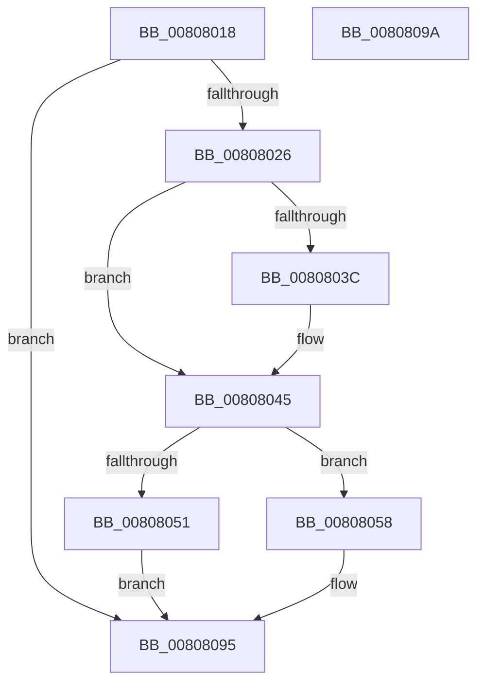

# MiInitializeChannelOrdering

- RVA: `0x00808018`–`0x0080809B` (길이 `131` bytes)
- VA: `0x0000000140808018`
- 실행 섹션: `PAGE`
- PDB 이름 있음: `예`; PDB Function 태그: `아니요`
- unwind 정보 RVA: `0x0005C788`
- 디코드: `24`개 명령, `131/131` bytes 표시
- 미해석 바이트: `0` (있으면 어셈블리에 `.byte`로 보존)

> 이 문서는 커널 이미지의 기계어와 PDB 기호를 분석해 생성했습니다. 4번과 5번은 함수 원형과 자료형을 바이너리 사용 방식에서 추정한 C 해석이며 원본 소스 복구 결과는 아닙니다.

## 1. Dependencies

- 직접 호출 지점: **1**; 고유 호출 대상: **1**
- 직접 호출자로 확인된 함수: **1**
- RIP 상대 이미지 참조: **4**

### Outgoing calls
- `0x00808051` → [MiInitializeSystemChannelOrdering](../../init/C6/MiInitializeSystemChannelOrdering_function_00C687E4.md) (function, `0x00C687E4`)

### Direct callers
- [MiInitializeNuma](../../text/66/MiInitializeNuma_function_0066E0E0.md) at `0x0066E150`

### Static image references
- `0x0080801C` → RVA `0x00E2DC28` (`.data`; read)
- `0x00808033` → RVA `0x00FC5002` (`ALMOSTRO`; read)
- `0x00808045` → RVA `0x00E38D00` (`.data`; read)
- `0x00808058` → RVA `0x00E38D10` (`.data`; read)

## 2. Other-region calls and transfers

- 다른 실행 섹션으로 향하는 call: **1**
  - `0x00808051` → [MiInitializeSystemChannelOrdering](../../init/C6/MiInitializeSystemChannelOrdering_function_00C687E4.md) (`PAGE` → `INIT`)
- 별도 외부 분기/꼬리 이동을 확인하지 못했습니다.

## 3. Assembly (complete function range)

```asm
00808018  48 83 EC 28                     sub rsp, 0x28
0080801C  48 83 3D 04 5C 62 00 00         cmp qword ptr [rip + 0x625c04], 0
00808024  74 6F                           je 0x140808095
00808026  4C 8B 49 10                     mov r9, qword ptr [rcx + 0x10]
0080802A  8B C2                           mov eax, edx
0080802C  4C 69 C0 80 DF 00 00            imul r8, rax, 0xdf80
00808033  80 3D C8 CF 7B 00 01            cmp byte ptr [rip + 0x7bcfc8], 1
0080803A  76 09                           jbe 0x140808045
0080803C  43 83 8C 08 50 3B 00 00 01      or dword ptr [r8 + r9 + 0x3b50], 1
00808045  48 8D 05 B4 0C 63 00            lea rax, [rip + 0x630cb4]
0080804C  48 3B C8                        cmp rcx, rax
0080804F  75 07                           jne 0x140808058
00808051  E8 8E 07 46 00                  call 0x140c687e4
00808056  EB 3D                           jmp 0x140808095
00808058  48 8B 0D B1 0C 63 00            mov rcx, qword ptr [rip + 0x630cb1]
0080805F  41 0F B7 84 08 85 3B 00 00      movzx eax, word ptr [r8 + rcx + 0x3b85]
00808068  66 43 89 84 08 85 3B 00 00      mov word ptr [r8 + r9 + 0x3b85], ax
00808071  41 0F B7 84 08 81 3B 00 00      movzx eax, word ptr [r8 + rcx + 0x3b81]
0080807A  66 43 89 84 08 81 3B 00 00      mov word ptr [r8 + r9 + 0x3b81], ax
00808083  41 0F B7 84 08 83 3B 00 00      movzx eax, word ptr [r8 + rcx + 0x3b83]
0080808C  66 43 89 84 08 83 3B 00 00      mov word ptr [r8 + r9 + 0x3b83], ax
00808095  48 83 C4 28                     add rsp, 0x28
00808099  C3                              ret
0080809A  CC                              int3
```

## 4. C-style interpretation (structured pseudocode)

```c
__int64 __fastcall MiInitializeChannelOrdering(__int64 a1, int a2)
{
    __int64 result;
    __int64 v_rsp;

    v_rsp = (v_rsp) - (40);
    if ((*(unsigned __int64 *)(v_rip + 6446084)) == 0) goto loc_00808095;
    a3 = (a3) * ((unsigned int)(a2));
    if ((*(unsigned __int8 *)(v_rip + 8114120)) >= = 1) {
    }
    if (a1 != (v_rip + 6491316)) goto loc_00808058;
    result = MiInitializeSystemChannelOrdering(a1, a2, a3, *(unsigned __int64 *)(a1 + 16));
    goto loc_00808095;
loc_00808058:
    *(unsigned __int16 *)(a3 + *(unsigned __int64 *)(a1 + 16) * 1 + 15237) = (unsigned __int16)(*(unsigned __int16 *)(a3 + *(unsigned __int64 *)(v_rip + 6491313) * 1 + 15237));
    *(unsigned __int16 *)(a3 + *(unsigned __int64 *)(a1 + 16) * 1 + 15233) = (unsigned __int16)(*(unsigned __int16 *)(a3 + *(unsigned __int64 *)(v_rip + 6491313) * 1 + 15233));
    *(unsigned __int16 *)(a3 + *(unsigned __int64 *)(a1 + 16) * 1 + 15235) = (unsigned __int16)(*(unsigned __int16 *)(a3 + *(unsigned __int64 *)(v_rip + 6491313) * 1 + 15235));
loc_00808095:
    v_rsp = (v_rsp) + (40);
    return *(unsigned __int16 *)(a3 + *(unsigned __int64 *)(v_rip + 6491313) * 1 + 15235);
}
```

## 5. (Beta) C Style

```c
int64_t MiInitializeChannelOrdering(void *Arg1, int32_t Arg2)
{
    uint8_t *arg1 = (uint8_t *)Arg1;

    int64_t result;
    int64_t local_rsp;

    local_rsp = (local_rsp) - (40);
    if ((*(uint64_t *)(v_rip + 0x625C04)) == 0) goto loc_00808095;
    a3 = (a3) * ((uint32_t)(Arg2));
    if ((*(uint8_t *)(v_rip + 0x7BCFC8)) >= = 1) {
    }
    if (Arg1 != (v_rip + 6491316)) goto loc_00808058;
    result = MiInitializeSystemChannelOrdering(Arg1, Arg2, a3, *(uint64_t *)(arg1 + 0x10));
    goto loc_00808095;
loc_00808058:
    *(uint16_t *)(a3 + *(uint64_t *)(arg1 + 0x10) * 1 + 0x3B85) = (uint16_t)(*(uint16_t *)(a3 + *(uint64_t *)(v_rip + 0x630CB1) * 1 + 0x3B85));
    *(uint16_t *)(a3 + *(uint64_t *)(arg1 + 0x10) * 1 + 0x3B81) = (uint16_t)(*(uint16_t *)(a3 + *(uint64_t *)(v_rip + 0x630CB1) * 1 + 0x3B81));
    *(uint16_t *)(a3 + *(uint64_t *)(arg1 + 0x10) * 1 + 0x3B83) = (uint16_t)(*(uint16_t *)(a3 + *(uint64_t *)(v_rip + 0x630CB1) * 1 + 0x3B83));
loc_00808095:
    local_rsp = (local_rsp) + (40);
    return *(uint16_t *)(a3 + *(uint64_t *)(v_rip + 0x630CB1) * 1 + 0x3B83);
}
```

### 관측된 메모리 오프셋

구조체 형식이 확인되지 않은 접근은 인자 기준의 오프셋으로만 기록했습니다.

| 기준 인자 | 오프셋 표현 | 폭 (bit) | 접근 |
|---|---:|---:|---|
| `Arg1` | `+ 0x10` | `64` | `R` |

## 6. Execution-region graph

[열기: 2D/3D 그래프와 함수 탐색 컨트롤 패널](../../../control-panel.html?section=page&rva=0x00808018&view=graph)

- 2D 그래프는 위에서 아래로 흐르고, 3D 그래프는 빈 공간을 드래그해 회전합니다. Shift+드래그는 이동, 휠은 확대·축소, 함수 노드 선택은 대상 보고서 이동입니다.

### Static fallback


