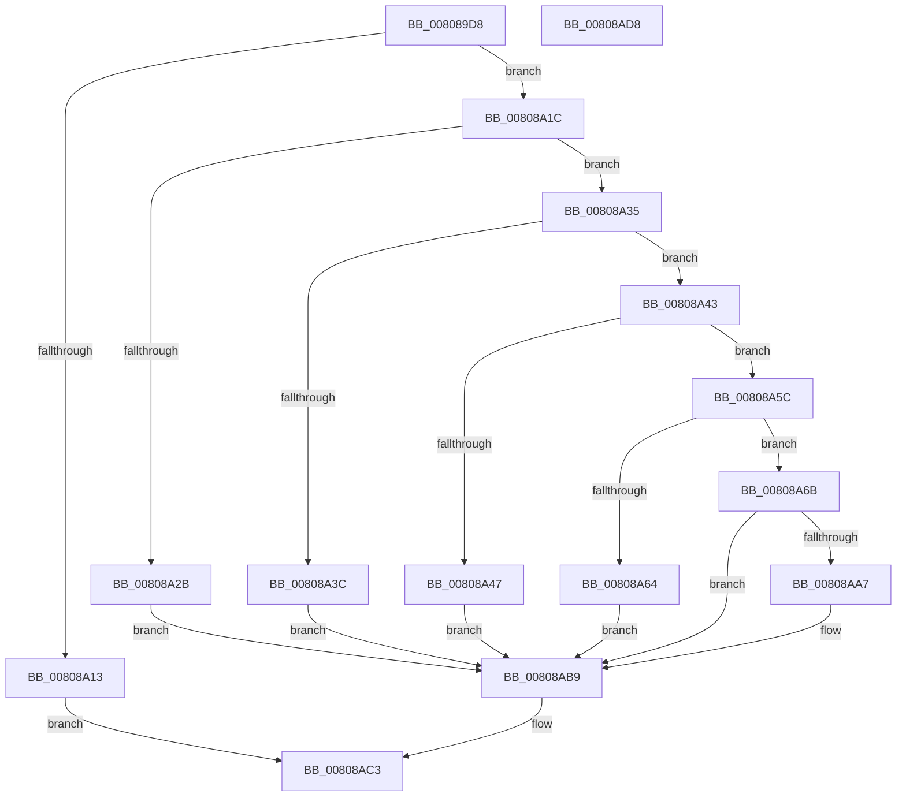

# MiInitializeEnclave

- RVA: `0x008089D8`–`0x00808AD9` (길이 `257` bytes)
- VA: `0x00000001408089D8`
- 실행 섹션: `PAGE`
- PDB 이름 있음: `예`; PDB Function 태그: `아니요`
- unwind 정보 RVA: `0x0007D3C0`
- 디코드: `73`개 명령, `257/257` bytes 표시
- 미해석 바이트: `0` (있으면 어셈블리에 `.byte`로 보존)

> 이 문서는 커널 이미지의 기계어와 PDB 기호를 분석해 생성했습니다. 4번과 5번은 함수 원형과 자료형을 바이너리 사용 방식에서 추정한 C 해석이며 원본 소스 복구 결과는 아닙니다.

## 1. Dependencies

- 직접 호출 지점: **5**; 고유 호출 대상: **5**
- 직접 호출자로 확인된 함수: **1**
- RIP 상대 이미지 참조: **0**

### Outgoing calls
- `0x00808A06` → [MiObtainReferencedVadEx](../../text/31/MiObtainReferencedVadEx_function_00316690.md) (function, `0x00316690`)
- `0x00808A53` → [MiInitializeVsmEnclave](MiInitializeVsmEnclave_function_00808AE0.md) (function, `0x00808AE0`)
- `0x00808A9C` → [KeInitializeEnclave](../74/KeInitializeEnclave_function_00746394.md) (function, `0x00746394`)
- `0x00808AAE` → [MiReturnReservedEnclavePages](../../pagelk/B7/MiReturnReservedEnclavePages_function_00B74FD0.md) (function, `0x00B74FD0`)
- `0x00808ABC` → [MiUnlockAndDereferenceVad](../../text/31/MiUnlockAndDereferenceVad_function_00316E60.md) (function, `0x00316E60`)

### Direct callers
- [NtInitializeEnclave](NtInitializeEnclave_function_008090B0.md) at `0x00809288`

### Static image references
- 디코드된 RIP-relative 메모리 참조가 없습니다.

## 2. Other-region calls and transfers

- 다른 실행 섹션으로 향하는 call: **3**
  - `0x00808A06` → [MiObtainReferencedVadEx](../../text/31/MiObtainReferencedVadEx_function_00316690.md) (`PAGE` → `.text`)
  - `0x00808AAE` → [MiReturnReservedEnclavePages](../../pagelk/B7/MiReturnReservedEnclavePages_function_00B74FD0.md) (`PAGE` → `PAGELK`)
  - `0x00808ABC` → [MiUnlockAndDereferenceVad](../../text/31/MiUnlockAndDereferenceVad_function_00316E60.md) (`PAGE` → `.text`)
- 별도 외부 분기/꼬리 이동을 확인하지 못했습니다.

## 3. Assembly (complete function range)

```asm
008089D8  4C 8B DC                        mov r11, rsp
008089DB  49 89 5B 08                     mov qword ptr [r11 + 8], rbx
008089DF  49 89 6B 10                     mov qword ptr [r11 + 0x10], rbp
008089E3  49 89 73 18                     mov qword ptr [r11 + 0x18], rsi
008089E7  57                              push rdi
008089E8  48 83 EC 40                     sub rsp, 0x40
008089EC  83 64 24 30 00                  and dword ptr [rsp + 0x30], 0
008089F1  48 8B C2                        mov rax, rdx
008089F4  49 8B F0                        mov rsi, r8
008089F7  48 8B E9                        mov rbp, rcx
008089FA  48 8B C8                        mov rcx, rax
008089FD  4D 8D 43 E8                     lea r8, [r11 - 0x18]
00808A01  33 D2                           xor edx, edx
00808A03  41 8B F9                        mov edi, r9d
00808A06  E8 85 DC B0 FF                  call 0x140316690
00808A0B  48 8B D8                        mov rbx, rax
00808A0E  48 85 C0                        test rax, rax
00808A11  75 09                           jne 0x140808a1c
00808A13  8B 44 24 30                     mov eax, dword ptr [rsp + 0x30]
00808A17  E9 A7 00 00 00                  jmp 0x140808ac3
00808A1C  8B 40 30                        mov eax, dword ptr [rax + 0x30]
00808A1F  25 00 00 20 0C                  and eax, 0xc200000
00808A24  3D 00 00 20 08                  cmp eax, 0x8200000
00808A29  74 0A                           je 0x140808a35
00808A2B  BF 18 00 00 C0                  mov edi, 0xc0000018
00808A30  E9 84 00 00 00                  jmp 0x140808ab9
00808A35  8B 43 40                        mov eax, dword ptr [rbx + 0x40]
00808A38  A8 02                           test al, 2
00808A3A  74 07                           je 0x140808a43
00808A3C  BF 10 05 00 C0                  mov edi, 0xc0000510
00808A41  EB 76                           jmp 0x140808ab9
00808A43  A8 01                           test al, 1
00808A45  75 15                           jne 0x140808a5c
00808A47  44 8B CF                        mov r9d, edi
00808A4A  4C 8B C6                        mov r8, rsi
00808A4D  48 8B D3                        mov rdx, rbx
00808A50  48 8B CD                        mov rcx, rbp
00808A53  E8 88 00 00 00                  call 0x140808ae0
00808A58  8B F8                           mov edi, eax
00808A5A  EB 5D                           jmp 0x140808ab9
00808A5C  81 FF 00 10 00 00               cmp edi, 0x1000
00808A62  74 07                           je 0x140808a6b
00808A64  BF 04 00 00 C0                  mov edi, 0xc0000004
00808A69  EB 4E                           jmp 0x140808ab9
00808A6B  48 8B 4B 50                     mov rcx, qword ptr [rbx + 0x50]
00808A6F  4C 8D 8E 00 08 00 00            lea r9, [rsi + 0x800]
00808A76  48 C1 E1 19                     shl rcx, 0x19
00808A7A  48 B8 00 00 00 00 80 F6 FF FF   movabs rax, 0xfffff68000000000
00808A84  48 C1 E0 19                     shl rax, 0x19
00808A88  48 8B D6                        mov rdx, rsi
00808A8B  48 2B C8                        sub rcx, rax
00808A8E  48 8B 44 24 70                  mov rax, qword ptr [rsp + 0x70]
00808A93  48 C1 F9 10                     sar rcx, 0x10
00808A97  48 89 44 24 28                  mov qword ptr [rsp + 0x28], rax
00808A9C  E8 F3 D8 F3 FF                  call 0x140746394
00808AA1  8B F8                           mov edi, eax
00808AA3  85 C0                           test eax, eax
00808AA5  78 12                           js 0x140808ab9
00808AA7  48 83 CA FF                     or rdx, 0xffffffffffffffff
00808AAB  48 8B CB                        mov rcx, rbx
00808AAE  E8 1D C5 36 00                  call 0x140b74fd0
00808AB3  83 4B 40 02                     or dword ptr [rbx + 0x40], 2
00808AB7  33 FF                           xor edi, edi
00808AB9  48 8B CB                        mov rcx, rbx
00808ABC  E8 9F E3 B0 FF                  call 0x140316e60
00808AC1  8B C7                           mov eax, edi
00808AC3  48 8B 5C 24 50                  mov rbx, qword ptr [rsp + 0x50]
00808AC8  48 8B 6C 24 58                  mov rbp, qword ptr [rsp + 0x58]
00808ACD  48 8B 74 24 60                  mov rsi, qword ptr [rsp + 0x60]
00808AD2  48 83 C4 40                     add rsp, 0x40
00808AD6  5F                              pop rdi
00808AD7  C3                              ret
00808AD8  CC                              int3
```

## 4. C-style interpretation (structured pseudocode)

```c
__int64 __fastcall MiInitializeEnclave(__int64 a1, __int64 a2, __int64 a3, int a4, __int64 a5)
{
    __int64 result;
    __int64 v_rdi;
    __int64 v_rsp;
    unsigned int v_stack_m18;
    unsigned __int64 v_stack_m20;
    unsigned __int64 v_stack_p10;
    unsigned __int64 v_stack_p18;
    unsigned __int64 v_stack_p8;

    *(unsigned __int64 *)(v_rsp + 8) = v_rbx;
    *(unsigned __int64 *)(v_rsp + 16) = v_rbp;
    *(unsigned __int64 *)(v_rsp + 24) = v_rsi;
    v_rsp = (v_rsp) - (64);
    a2 = 0;
    result = MiObtainReferencedVadEx(a2, a2, v_rsp - 24, a4);
    if (result != 0) goto loc_00808A1C;
    goto loc_00808AC3;
loc_00808A1C:
    result = (unsigned int)(((unsigned int)(*(unsigned int *)((unsigned int)(v_stack_m18) + 48))) & (0xC200000ULL));
    if (((unsigned int)(result)) == 0x8200000ULL) goto loc_00808A35;
    goto loc_00808AB9;
loc_00808A35:
    if ((((unsigned __int8)((unsigned int)(*(unsigned int *)(result + 64)))) & (2)) == 0) goto loc_00808A43;
    goto loc_00808AB9;
loc_00808A43:
    if ((((unsigned __int8)((unsigned int)(*(unsigned int *)(result + 64)))) & (1)) != 0) goto loc_00808A5C;
    result = MiInitializeVsmEnclave(a1, result, a3, (unsigned int)((unsigned int)((unsigned int)(0xC0000510ULL))));
    goto loc_00808AB9;
loc_00808A5C:
    if (((unsigned int)((unsigned int)((unsigned int)(result)))) == 0x1000ULL) goto loc_00808A6B;
    goto loc_00808AB9;
loc_00808A6B:
    a1 = (*(unsigned __int64 *)(result + 80)) << (25);
    result = (result) << (25);
    a1 = (a1) - (result);
    a1 = (a1) >> (16);
    v_stack_m20 = a5;
    result = KeInitializeEnclave(a1, a3, a3, a3 + 2048);
    v_rdi = (unsigned int)((unsigned int)(result));
    if (!(sign_flag)) {
        a2 = (a3) | (-1);
        a1 = result;
        result = MiReturnReservedEnclavePages(a1, a2, a3, a3 + 2048);
        v_rdi = 0;
    }
    result = MiUnlockAndDereferenceVad(result, a2, a3, a3 + 2048);
loc_00808AC3:
    v_rsp = (v_rsp) + (64);
    return 0;
}
```

## 5. (Beta) C Style

```c
int64_t MiInitializeEnclave(int64_t Arg1, int64_t Arg2, void *Arg3, int32_t Arg4, int64_t Arg5)
{
    uint8_t *arg3 = (uint8_t *)Arg3;

    int64_t result;
    int64_t local_rdi;
    int64_t local_rsp;
    uint32_t v_stack_m18;
    uint64_t v_stack_m20;
    uint64_t v_stack_p10;
    uint64_t v_stack_p18;
    uint64_t v_stack_p8;

    *(uint64_t *)(local_rsp + 0x8) = local_rbx;
    *(uint64_t *)(local_rsp + 0x10) = local_rbp;
    *(uint64_t *)(local_rsp + 0x18) = local_rsi;
    local_rsp = (local_rsp) - (64);
    Arg2 = 0;
    result = MiObtainReferencedVadEx(Arg2, Arg2, local_rsp - 24, Arg4);
    if (result != 0) goto loc_00808A1C;
    goto loc_00808AC3;
loc_00808A1C:
    result = (uint32_t)(((uint32_t)(*(uint32_t *)((uint32_t)(v_stack_m18) + 0x30))) & (0xC200000ULL));
    if (((uint32_t)(result)) == 0x8200000ULL) goto loc_00808A35;
    goto loc_00808AB9;
loc_00808A35:
    if ((((uint8_t)((uint32_t)(*(uint32_t *)(result + 0x40)))) & (2)) == 0) goto loc_00808A43;
    goto loc_00808AB9;
loc_00808A43:
    if ((((uint8_t)((uint32_t)(*(uint32_t *)(result + 0x40)))) & (1)) != 0) goto loc_00808A5C;
    result = MiInitializeVsmEnclave(Arg1, result, Arg3, (uint32_t)((uint32_t)((uint32_t)(0xC0000510ULL))));
    goto loc_00808AB9;
loc_00808A5C:
    if (((uint32_t)((uint32_t)((uint32_t)(result)))) == 0x1000ULL) goto loc_00808A6B;
    goto loc_00808AB9;
loc_00808A6B:
    Arg1 = (*(uint64_t *)(result + 0x50)) << (25);
    result = (result) << (25);
    Arg1 = (Arg1) - (result);
    Arg1 = (Arg1) >> (16);
    v_stack_m20 = Arg5;
    result = KeInitializeEnclave(Arg1, Arg3, Arg3, Arg3 + 2048);
    local_rdi = (uint32_t)((uint32_t)(result));
    if (!(sign_flag)) {
        Arg2 = (Arg3) | (-1);
        Arg1 = result;
        result = MiReturnReservedEnclavePages(Arg1, Arg2, Arg3, Arg3 + 2048);
        local_rdi = 0;
    }
    result = MiUnlockAndDereferenceVad(result, Arg2, Arg3, Arg3 + 2048);
loc_00808AC3:
    local_rsp = (local_rsp) + (64);
    return 0;
}
```

### 관측된 메모리 오프셋

구조체 형식이 확인되지 않은 접근은 인자 기준의 오프셋으로만 기록했습니다.

| 기준 인자 | 오프셋 표현 | 폭 (bit) | 접근 |
|---|---:|---:|---|
| `Arg3` | `+ 0x800` | `64` | `R` |

## 6. Execution-region graph

[열기: 2D/3D 그래프와 함수 탐색 컨트롤 패널](../../../control-panel.html?section=page&rva=0x008089D8&view=graph)

- 2D 그래프는 위에서 아래로 흐르고, 3D 그래프는 빈 공간을 드래그해 회전합니다. Shift+드래그는 이동, 휠은 확대·축소, 함수 노드 선택은 대상 보고서 이동입니다.

### Static fallback


