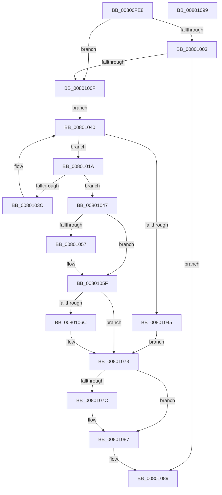

# MiInitializeImageExtents

- RVA: `0x00800FE8`–`0x0080109A` (길이 `178` bytes)
- VA: `0x0000000140800FE8`
- 실행 섹션: `PAGE`
- PDB 이름 있음: `예`; PDB Function 태그: `아니요`
- unwind 정보 RVA: `0x000794E0`
- 디코드: `53`개 명령, `178/178` bytes 표시
- 미해석 바이트: `0` (있으면 어셈블리에 `.byte`로 보존)

> 이 문서는 커널 이미지의 기계어와 PDB 기호를 분석해 생성했습니다. 4번과 5번은 함수 원형과 자료형을 바이너리 사용 방식에서 추정한 C 해석이며 원본 소스 복구 결과는 아닙니다.

## 1. Dependencies

- 직접 호출 지점: **5**; 고유 호출 대상: **5**
- 직접 호출자로 확인된 함수: **1**
- RIP 상대 이미지 참조: **0**

### Outgoing calls
- `0x00801006` → [MiCreatePerSessionProtos](../A6/MiCreatePerSessionProtos_function_00A666D8.md) (function, `0x00A666D8`)
- `0x00801031` → [MiAllocateFileExtents](../AB/MiAllocateFileExtents_function_00ABDF54.md) (function, `0x00ABDF54`)
- `0x0080104A` → [MiGetCommittedPages](../../text/32/MiGetCommittedPages_function_00325CE0.md) (function, `0x00325CE0`)
- `0x00801062` → [MiDeleteSegmentPages](../../text/32/MiDeleteSegmentPages_function_003261D4.md) (function, `0x003261D4`)
- `0x00801082` → [MiDereferencePerSessionProtos](../A2/MiDereferencePerSessionProtos_function_00A2EDE8.md) (function, `0x00A2EDE8`)

### Direct callers
- [MiEnableImageDirectMap](../../text/68/MiEnableImageDirectMap_function_00680A78.md) at `0x00680B36`

### Static image references
- 디코드된 RIP-relative 메모리 참조가 없습니다.

## 2. Other-region calls and transfers

- 다른 실행 섹션으로 향하는 call: **2**
  - `0x0080104A` → [MiGetCommittedPages](../../text/32/MiGetCommittedPages_function_00325CE0.md) (`PAGE` → `.text`)
  - `0x00801062` → [MiDeleteSegmentPages](../../text/32/MiDeleteSegmentPages_function_003261D4.md) (`PAGE` → `.text`)
- 별도 외부 분기/꼬리 이동을 확인하지 못했습니다.

## 3. Assembly (complete function range)

```asm
00800FE8  48 89 5C 24 08                  mov qword ptr [rsp + 8], rbx
00800FED  48 89 74 24 10                  mov qword ptr [rsp + 0x10], rsi
00800FF2  57                              push rdi
00800FF3  48 83 EC 30                     sub rsp, 0x30
00800FF7  F7 41 38 00 00 00 08            test dword ptr [rcx + 0x38], 0x8000000
00800FFE  48 8B D9                        mov rbx, rcx
00801001  74 0C                           je 0x14080100f
00801003  83 CA FF                        or edx, 0xffffffff
00801006  E8 CD 56 26 00                  call 0x140a666d8
0080100B  85 C0                           test eax, eax
0080100D  78 7A                           js 0x140801089
0080100F  33 F6                           xor esi, esi
00801011  48 8D BB 80 00 00 00            lea rdi, [rbx + 0x80]
00801018  EB 26                           jmp 0x140801040
0080101A  83 4C 24 28 FF                  or dword ptr [rsp + 0x28], 0xffffffff
0080101F  33 D2                           xor edx, edx
00801021  44 8B 4F 2C                     mov r9d, dword ptr [rdi + 0x2c]
00801025  48 8B CF                        mov rcx, rdi
00801028  4C 8B 47 08                     mov r8, qword ptr [rdi + 8]
0080102C  83 64 24 20 00                  and dword ptr [rsp + 0x20], 0
00801031  E8 1E CF 2B 00                  call 0x140abdf54
00801036  8B F0                           mov esi, eax
00801038  85 C0                           test eax, eax
0080103A  78 0B                           js 0x140801047
0080103C  48 8B 7F 10                     mov rdi, qword ptr [rdi + 0x10]
00801040  48 85 FF                        test rdi, rdi
00801043  75 D5                           jne 0x14080101a
00801045  EB 2C                           jmp 0x140801073
00801047  48 8B CB                        mov rcx, rbx
0080104A  E8 91 4C B2 FF                  call 0x140325ce0
0080104F  48 8B F8                        mov rdi, rax
00801052  48 85 C0                        test rax, rax
00801055  74 08                           je 0x14080105f
00801057  48 8B 0B                        mov rcx, qword ptr [rbx]
0080105A  48 83 61 10 00                  and qword ptr [rcx + 0x10], 0
0080105F  48 8B CB                        mov rcx, rbx
00801062  E8 6D 51 B2 FF                  call 0x1403261d4
00801067  48 85 FF                        test rdi, rdi
0080106A  74 07                           je 0x140801073
0080106C  48 8B 0B                        mov rcx, qword ptr [rbx]
0080106F  48 89 79 10                     mov qword ptr [rcx + 0x10], rdi
00801073  F7 43 38 00 00 00 08            test dword ptr [rbx + 0x38], 0x8000000
0080107A  74 0B                           je 0x140801087
0080107C  83 CA FF                        or edx, 0xffffffff
0080107F  48 8B CB                        mov rcx, rbx
00801082  E8 61 DD 22 00                  call 0x140a2ede8
00801087  8B C6                           mov eax, esi
00801089  48 8B 5C 24 40                  mov rbx, qword ptr [rsp + 0x40]
0080108E  48 8B 74 24 48                  mov rsi, qword ptr [rsp + 0x48]
00801093  48 83 C4 30                     add rsp, 0x30
00801097  5F                              pop rdi
00801098  C3                              ret
00801099  CC                              int3
```

## 4. C-style interpretation (structured pseudocode)

```c
__int64 __fastcall MiInitializeImageExtents(__int64 a1, int a2)
{
    __int64 result;
    __int64 v_rsi;
    __int64 v_rsp;
    unsigned int v_stack_m10;
    unsigned int v_stack_m18;
    unsigned __int64 v_stack_p10;
    unsigned __int64 v_stack_p8;

    v_stack_p8 = v_rbx;
    v_stack_p10 = v_rsi;
    v_rsp = (v_rsp) - (48);
    if (((*(unsigned int *)(a1 + 56)) & (0x8000000ULL)) == 0) goto loc_0080100F;
    a2 = (unsigned int)((a2) | (0xFFFFFFFFULL));
    result = MiCreatePerSessionProtos(a1, a2, a3, a4);
    if (sign_flag) goto loc_00801089;
loc_0080100F:
    v_rsi = 0;
    goto loc_00801040;
loc_0080101A:
    a2 = 0;
    result = MiAllocateFileExtents(a1 + 128, a2, *(unsigned __int64 *)(a1 + 128 + 8), (unsigned int)(*(unsigned int *)(a1 + 128 + 44)));
    if (sign_flag) goto loc_00801047;
loc_00801040:
    if (*(unsigned __int64 *)(a1 + 128 + 16) != 0) goto loc_0080101A;
    goto loc_00801073;
loc_00801047:
    result = MiGetCommittedPages(a1, a2, *(unsigned __int64 *)(a1 + 128 + 8), (unsigned int)(*(unsigned int *)(a1 + 128 + 44)));
    if (result != 0) {
        a1 = *(unsigned __int64 *)(a1);
    }
    result = MiDeleteSegmentPages(a1, a2, *(unsigned __int64 *)(a1 + 128 + 8), (unsigned int)(*(unsigned int *)(a1 + 128 + 44)));
    if (result != 0) {
        a1 = *(unsigned __int64 *)(a1);
        *(unsigned __int64 *)(a1 + 16) = result;
    }
    if (((*(unsigned int *)(a1 + 56)) & (0x8000000ULL)) != 0) {
        a2 = (unsigned int)((a2) | (0xFFFFFFFFULL));
        a1 = a1;
        result = MiDereferencePerSessionProtos(a1, a2, *(unsigned __int64 *)(a1 + 128 + 8), (unsigned int)(*(unsigned int *)(a1 + 128 + 44)));
    }
loc_00801089:
    v_rsp = (v_rsp) + (48);
    return (unsigned int)((unsigned int)((unsigned int)((unsigned int)(result))));
}
```

## 5. (Beta) C Style

```c
int64_t MiInitializeImageExtents(void *Arg1, int32_t Arg2)
{
    uint8_t *arg1 = (uint8_t *)Arg1;

    int64_t result;
    int64_t local_rsi;
    int64_t local_rsp;
    uint32_t v_stack_m10;
    uint32_t v_stack_m18;
    uint64_t v_stack_p10;
    uint64_t v_stack_p8;

    v_stack_p8 = local_rbx;
    v_stack_p10 = local_rsi;
    local_rsp = (local_rsp) - (48);
    if (((*(uint32_t *)(arg1 + 0x38)) & (0x8000000ULL)) == 0) goto loc_0080100F;
    Arg2 = (uint32_t)((Arg2) | (0xFFFFFFFFULL));
    result = MiCreatePerSessionProtos(Arg1, Arg2, a3, a4);
    if (sign_flag) goto loc_00801089;
loc_0080100F:
    local_rsi = 0;
    goto loc_00801040;
loc_0080101A:
    Arg2 = 0;
    result = MiAllocateFileExtents(Arg1 + 128, Arg2, *(uint64_t *)(arg1 + 0x80 + 0x8), (uint32_t)(*(uint32_t *)(arg1 + 0x80 + 0x2C)));
    if (sign_flag) goto loc_00801047;
loc_00801040:
    if (*(uint64_t *)(arg1 + 0x80 + 0x10) != 0) goto loc_0080101A;
    goto loc_00801073;
loc_00801047:
    result = MiGetCommittedPages(Arg1, Arg2, *(uint64_t *)(arg1 + 0x80 + 0x8), (uint32_t)(*(uint32_t *)(arg1 + 0x80 + 0x2C)));
    if (result != 0) {
        Arg1 = *(uint64_t *)(arg1);
    }
    result = MiDeleteSegmentPages(Arg1, Arg2, *(uint64_t *)(arg1 + 0x80 + 0x8), (uint32_t)(*(uint32_t *)(arg1 + 0x80 + 0x2C)));
    if (result != 0) {
        Arg1 = *(uint64_t *)(arg1);
        *(uint64_t *)(arg1 + 0x10) = result;
    }
    if (((*(uint32_t *)(arg1 + 0x38)) & (0x8000000ULL)) != 0) {
        Arg2 = (uint32_t)((Arg2) | (0xFFFFFFFFULL));
        Arg1 = Arg1;
        result = MiDereferencePerSessionProtos(Arg1, Arg2, *(uint64_t *)(arg1 + 0x80 + 0x8), (uint32_t)(*(uint32_t *)(arg1 + 0x80 + 0x2C)));
    }
loc_00801089:
    local_rsp = (local_rsp) + (48);
    return (uint32_t)((uint32_t)((uint32_t)((uint32_t)(result))));
}
```

### 관측된 메모리 오프셋

구조체 형식이 확인되지 않은 접근은 인자 기준의 오프셋으로만 기록했습니다.

| 기준 인자 | 오프셋 표현 | 폭 (bit) | 접근 |
|---|---:|---:|---|
| `Arg1` | `+ 0x0` | `64` | `R` |
| `Arg1` | `+ 0x38` | `32` | `R` |
| `Arg1` | `+ 0x80` | `64` | `R` |

## 6. Execution-region graph

[열기: 2D/3D 그래프와 함수 탐색 컨트롤 패널](../../../control-panel.html?section=page&rva=0x00800FE8&view=graph)

- 2D 그래프는 위에서 아래로 흐르고, 3D 그래프는 빈 공간을 드래그해 회전합니다. Shift+드래그는 이동, 휠은 확대·축소, 함수 노드 선택은 대상 보고서 이동입니다.

### Static fallback


