# MiInitializePartitionSpecialPurposeMemory

- RVA: `0x0080F704`–`0x0080FA21` (길이 `797` bytes)
- VA: `0x000000014080F704`
- 실행 섹션: `PAGE`
- PDB 이름 있음: `예`; PDB Function 태그: `아니요`
- unwind 정보 RVA: `0x000D93A4`
- 디코드: `207`개 명령, `797/797` bytes 표시
- 미해석 바이트: `0` (있으면 어셈블리에 `.byte`로 보존)

> 이 문서는 커널 이미지의 기계어와 PDB 기호를 분석해 생성했습니다. 4번과 5번은 함수 원형과 자료형을 바이너리 사용 방식에서 추정한 C 해석이며 원본 소스 복구 결과는 아닙니다.

## 1. Dependencies

- 직접 호출 지점: **18**; 고유 호출 대상: **14**
- 직접 호출자로 확인된 함수: **2**
- RIP 상대 이미지 참조: **5**

### Outgoing calls
- `0x0080F73C` → [MiFindSpecialPurposeMemoryType](../../text/69/MiFindSpecialPurposeMemoryType_function_0069503C.md) (function, `0x0069503C`)
- `0x0080F79A` → [KeAbPreAcquire](../../text/21/KeAbPreAcquire_function_00210230.md) (function, `0x00210230`)
- `0x0080F7B3` → [ExfAcquirePushLockExclusiveEx](../../text/20/ExfAcquirePushLockExclusiveEx_function_0020FC90.md) (function, `0x0020FC90`)
- `0x0080F7DC` → [KeExpandKernelStackAndCallout](../../text/46/KeExpandKernelStackAndCallout_function_004675F0.md) (function, `0x004675F0`)
- `0x0080F7FC` → [MiFindSpecialPurposeMemoryType](../../text/69/MiFindSpecialPurposeMemoryType_function_0069503C.md) (function, `0x0069503C`)
- `0x0080F82C` → [ObDuplicateObject](../8C/ObDuplicateObject_function_008C4FA0.md) (function, `0x008C4FA0`)
- `0x0080F849` → [ExfTryToWakePushLock](../../text/26/ExfTryToWakePushLock_function_00265DD0.md) (function, `0x00265DD0`)
- `0x0080F851` → [KeAbPostRelease](../../text/2E/KeAbPostRelease_function_002E1600.md) (function, `0x002E1600`)
- `0x0080F868` → [MiAllocatePool](../../text/35/MiAllocatePool_function_0035B540.md) (function, `0x0035B540`)
- `0x0080F89A` → [ExfTryToWakePushLock](../../text/26/ExfTryToWakePushLock_function_00265DD0.md) (function, `0x00265DD0`)
- `0x0080F8A2` → [KeAbPostRelease](../../text/2E/KeAbPostRelease_function_002E1600.md) (function, `0x002E1600`)
- `0x0080F8EC` → [PsCreatePartition](../78/PsCreatePartition_function_00787EB0.md) (function, `0x00787EB0`)
- `0x0080F913` → [PsReferencePartitionByHandle](../90/PsReferencePartitionByHandle_function_0090337C.md) (function, `0x0090337C`)
- `0x0080F931` → [ObfReferenceObjectWithTag](../../text/21/ObfReferenceObjectWithTag_function_00210710.md) (function, `0x00210710`)
- `0x0080F9D3` → [ZwClose](../../text/6A/ZwClose_function_006AD2B0.md) (function, `0x006AD2B0`)
- `0x0080F9E1` → [ZwClose](../../text/6A/ZwClose_function_006AD2B0.md) (function, `0x006AD2B0`)
- `0x0080F9EF` → [PsDereferencePartition](../../text/34/PsDereferencePartition_function_00342E70.md) (function, `0x00342E70`)
- `0x0080F9FE` → [ExFreePoolWithTag](../../poolcode/B8/ExFreePoolWithTag_function_00B82870.md) (function, `0x00B82870`)

### Direct callers
- [MiInitializePartitionSpecialPurposeMemoryCallout](../../text/69/MiInitializePartitionSpecialPurposeMemoryCallout_function_006950A0.md) at `0x006950B0`
- [MiSpecialPurposeMemoryChangePrepare](MiSpecialPurposeMemoryChangePrepare_function_0080FED0.md) at `0x0080FF4E`

### Static image references
- `0x0080F74F` → RVA `0x00E38D00` (`.data`; read)
- `0x0080F7C6` → RVA `0x006950A0` (`MiInitializePartitionSpecialPurposeMemoryCallout`; read)
- `0x0080F7CD` → RVA `0x00FC5020` (`ALMOSTRO`; read)
- `0x0080F801` → RVA `0x00FC6AB0` (`ALMOSTRO`; read)
- `0x0080F96A` → RVA `0x00E2EE78` (`.data`; read/write)

## 2. Other-region calls and transfers

- 다른 실행 섹션으로 향하는 call: **15**
  - `0x0080F73C` → [MiFindSpecialPurposeMemoryType](../../text/69/MiFindSpecialPurposeMemoryType_function_0069503C.md) (`PAGE` → `.text`)
  - `0x0080F79A` → [KeAbPreAcquire](../../text/21/KeAbPreAcquire_function_00210230.md) (`PAGE` → `.text`)
  - `0x0080F7B3` → [ExfAcquirePushLockExclusiveEx](../../text/20/ExfAcquirePushLockExclusiveEx_function_0020FC90.md) (`PAGE` → `.text`)
  - `0x0080F7DC` → [KeExpandKernelStackAndCallout](../../text/46/KeExpandKernelStackAndCallout_function_004675F0.md) (`PAGE` → `.text`)
  - `0x0080F7FC` → [MiFindSpecialPurposeMemoryType](../../text/69/MiFindSpecialPurposeMemoryType_function_0069503C.md) (`PAGE` → `.text`)
  - `0x0080F849` → [ExfTryToWakePushLock](../../text/26/ExfTryToWakePushLock_function_00265DD0.md) (`PAGE` → `.text`)
  - `0x0080F851` → [KeAbPostRelease](../../text/2E/KeAbPostRelease_function_002E1600.md) (`PAGE` → `.text`)
  - `0x0080F868` → [MiAllocatePool](../../text/35/MiAllocatePool_function_0035B540.md) (`PAGE` → `.text`)
  - `0x0080F89A` → [ExfTryToWakePushLock](../../text/26/ExfTryToWakePushLock_function_00265DD0.md) (`PAGE` → `.text`)
  - `0x0080F8A2` → [KeAbPostRelease](../../text/2E/KeAbPostRelease_function_002E1600.md) (`PAGE` → `.text`)
  - `0x0080F931` → [ObfReferenceObjectWithTag](../../text/21/ObfReferenceObjectWithTag_function_00210710.md) (`PAGE` → `.text`)
  - `0x0080F9D3` → [ZwClose](../../text/6A/ZwClose_function_006AD2B0.md) (`PAGE` → `.text`)
  - `0x0080F9E1` → [ZwClose](../../text/6A/ZwClose_function_006AD2B0.md) (`PAGE` → `.text`)
  - `0x0080F9EF` → [PsDereferencePartition](../../text/34/PsDereferencePartition_function_00342E70.md) (`PAGE` → `.text`)
  - `0x0080F9FE` → [ExFreePoolWithTag](../../poolcode/B8/ExFreePoolWithTag_function_00B82870.md) (`PAGE` → `POOLCODE`)
- 별도 외부 분기/꼬리 이동을 확인하지 못했습니다.

## 3. Assembly (complete function range)

```asm
0080F704  48 89 5C 24 08                  mov qword ptr [rsp + 8], rbx
0080F709  55                              push rbp
0080F70A  56                              push rsi
0080F70B  57                              push rdi
0080F70C  41 54                           push r12
0080F70E  41 55                           push r13
0080F710  41 56                           push r14
0080F712  41 57                           push r15
0080F714  48 8D 6C 24 D9                  lea rbp, [rsp - 0x27]
0080F719  48 81 EC 90 00 00 00            sub rsp, 0x90
0080F720  33 C0                           xor eax, eax
0080F722  0F 57 C0                        xorps xmm0, xmm0
0080F725  21 45 13                        and dword ptr [rbp + 0x13], eax
0080F728  4C 8B E2                        mov r12, rdx
0080F72B  89 45 FB                        mov dword ptr [rbp - 5], eax
0080F72E  4C 8B E9                        mov r13, rcx
0080F731  21 45 FB                        and dword ptr [rbp - 5], eax
0080F734  0F 11 45 DF                     movups xmmword ptr [rbp - 0x21], xmm0
0080F738  48 89 45 EF                     mov qword ptr [rbp - 0x11], rax
0080F73C  E8 FB 58 E8 FF                  call 0x14069503c
0080F741  48 85 C0                        test rax, rax
0080F744  74 07                           je 0x14080f74d
0080F746  33 C0                           xor eax, eax
0080F748  E9 B8 02 00 00                  jmp 0x14080fa05
0080F74D  33 FF                           xor edi, edi
0080F74F  48 8D 05 AA 95 62 00            lea rax, [rip + 0x6295aa]
0080F756  48 21 7D 7F                     and qword ptr [rbp + 0x7f], rdi
0080F75A  4D 8D BD B8 00 00 00            lea r15, [r13 + 0xb8]
0080F761  48 21 7D D7                     and qword ptr [rbp - 0x29], rdi
0080F765  45 33 F6                        xor r14d, r14d
0080F768  4C 89 75 77                     mov qword ptr [rbp + 0x77], r14
0080F76C  4C 3B E8                        cmp r13, rax
0080F76F  0F 84 E5 00 00 00               je 0x14080f85a
0080F775  49 8B 07                        mov rax, qword ptr [r15]
0080F778  45 33 C0                        xor r8d, r8d
0080F77B  33 D2                           xor edx, edx
0080F77D  48 8B 48 48                     mov rcx, qword ptr [rax + 0x48]
0080F781  4C 8B 31                        mov r14, qword ptr [rcx]
0080F784  48 21 7D EF                     and qword ptr [rbp - 0x11], rdi
0080F788  4C 89 75 DF                     mov qword ptr [rbp - 0x21], r14
0080F78C  4C 89 65 E7                     mov qword ptr [rbp - 0x19], r12
0080F790  49 8D 9E 08 45 00 00            lea rbx, [r14 + 0x4508]
0080F797  48 8B CB                        mov rcx, rbx
0080F79A  E8 91 0A A0 FF                  call 0x140210230
0080F79F  F0 48 0F BA 2B 00               lock bts qword ptr [rbx], 0
0080F7A5  48 8B F0                        mov rsi, rax
0080F7A8  73 0E                           jae 0x14080f7b8
0080F7AA  4C 8B C3                        mov r8, rbx
0080F7AD  48 8B D0                        mov rdx, rax
0080F7B0  48 8B CB                        mov rcx, rbx
0080F7B3  E8 D8 04 A0 FF                  call 0x14020fc90
0080F7B8  48 85 F6                        test rsi, rsi
0080F7BB  74 04                           je 0x14080f7c1
0080F7BD  C6 46 0A 01                     mov byte ptr [rsi + 0xa], 1
0080F7C1  B8 AB AA AA AA                  mov eax, 0xaaaaaaab
0080F7C6  48 8D 0D D3 58 E8 FF            lea rcx, [rip - 0x17a72d]
0080F7CD  F7 25 4D 58 7B 00               mul dword ptr [rip + 0x7b584d]
0080F7D3  D1 EA                           shr edx, 1
0080F7D5  44 8B C2                        mov r8d, edx
0080F7D8  48 8D 55 DF                     lea rdx, [rbp - 0x21]
0080F7DC  E8 0F 7E C5 FF                  call 0x1404675f0
0080F7E1  8B F0                           mov esi, eax
0080F7E3  85 C0                           test eax, eax
0080F7E5  0F 88 94 00 00 00               js 0x14080f87f
0080F7EB  8B 75 EF                        mov esi, dword ptr [rbp - 0x11]
0080F7EE  85 F6                           test esi, esi
0080F7F0  0F 88 89 00 00 00               js 0x14080f87f
0080F7F6  49 8B D4                        mov rdx, r12
0080F7F9  49 8B CE                        mov rcx, r14
0080F7FC  E8 3B 58 E8 FF                  call 0x14069503c
0080F801  48 8B 0D A8 72 7B 00            mov rcx, qword ptr [rip + 0x7b72a8]
0080F808  4C 8D 4D 77                     lea r9, [rbp + 0x77]
0080F80C  40 88 7C 24 38                  mov byte ptr [rsp + 0x38], dil
0080F811  45 33 C0                        xor r8d, r8d
0080F814  C7 44 24 30 02 00 00 00         mov dword ptr [rsp + 0x30], 2
0080F81C  48 8B 50 38                     mov rdx, qword ptr [rax + 0x38]
0080F820  C7 44 24 28 00 02 00 00         mov dword ptr [rsp + 0x28], 0x200
0080F828  21 7C 24 20                     and dword ptr [rsp + 0x20], edi
0080F82C  E8 6F 57 0B 00                  call 0x1408c4fa0
0080F831  8B F0                           mov esi, eax
0080F833  85 C0                           test eax, eax
0080F835  78 48                           js 0x14080f87f
0080F837  48 83 C8 FF                     or rax, 0xffffffffffffffff
0080F83B  F0 48 0F C1 03                  lock xadd qword ptr [rbx], rax
0080F840  24 06                           and al, 6
0080F842  3C 02                           cmp al, 2
0080F844  75 08                           jne 0x14080f84e
0080F846  48 8B CB                        mov rcx, rbx
0080F849  E8 82 65 A5 FF                  call 0x140265dd0
0080F84E  48 8B CB                        mov rcx, rbx
0080F851  E8 AA 1D AD FF                  call 0x1402e1600
0080F856  4C 8B 75 77                     mov r14, qword ptr [rbp + 0x77]
0080F85A  BA 60 00 00 00                  mov edx, 0x60
0080F85F  41 B8 4D 69 4D 74               mov r8d, 0x744d694d
0080F865  8D 4A E0                        lea ecx, [rdx - 0x20]
0080F868  E8 D3 BC B4 FF                  call 0x14035b540
0080F86D  48 8B F8                        mov rdi, rax
0080F870  48 85 C0                        test rax, rax
0080F873  75 37                           jne 0x14080f8ac
0080F875  BE 9A 00 00 C0                  mov esi, 0xc000009a
0080F87A  E9 4C 01 00 00                  jmp 0x14080f9cb
0080F87F  48 85 DB                        test rbx, rbx
0080F882  0F 84 3F 01 00 00               je 0x14080f9c7
0080F888  48 83 C8 FF                     or rax, 0xffffffffffffffff
0080F88C  F0 48 0F C1 03                  lock xadd qword ptr [rbx], rax
0080F891  24 06                           and al, 6
0080F893  3C 02                           cmp al, 2
0080F895  75 08                           jne 0x14080f89f
0080F897  48 8B CB                        mov rcx, rbx
0080F89A  E8 31 65 A5 FF                  call 0x140265dd0
0080F89F  48 8B CB                        mov rcx, rbx
0080F8A2  E8 59 1D AD FF                  call 0x1402e1600
0080F8A7  E9 1B 01 00 00                  jmp 0x14080f9c7
0080F8AC  48 83 65 FF 00                  and qword ptr [rbp - 1], 0
0080F8B1  4C 8D 4D F7                     lea r9, [rbp - 9]
0080F8B5  48 83 65 07 00                  and qword ptr [rbp + 7], 0
0080F8BA  48 8D 55 7F                     lea rdx, [rbp + 0x7f]
0080F8BE  0F 57 C0                        xorps xmm0, xmm0
0080F8C1  C7 44 24 28 02 00 00 00         mov dword ptr [rsp + 0x28], 2
0080F8C9  BB 03 00 1F 00                  mov ebx, 0x1f0003
0080F8CE  C7 45 F7 30 00 00 00            mov dword ptr [rbp - 9], 0x30
0080F8D5  44 8B C3                        mov r8d, ebx
0080F8D8  C7 45 0F 00 02 00 00            mov dword ptr [rbp + 0xf], 0x200
0080F8DF  49 8B CE                        mov rcx, r14
0080F8E2  C6 44 24 20 00                  mov byte ptr [rsp + 0x20], 0
0080F8E7  F3 0F 7F 45 17                  movdqu xmmword ptr [rbp + 0x17], xmm0
0080F8EC  E8 BF 85 F7 FF                  call 0x140787eb0
0080F8F1  8B F0                           mov esi, eax
0080F8F3  85 C0                           test eax, eax
0080F8F5  0F 88 D0 00 00 00               js 0x14080f9cb
0080F8FB  48 8B 4D 7F                     mov rcx, qword ptr [rbp + 0x7f]
0080F8FF  48 8D 45 D7                     lea rax, [rbp - 0x29]
0080F903  41 B9 4D 6D 53 4D               mov r9d, 0x4d536d4d
0080F909  48 89 44 24 20                  mov qword ptr [rsp + 0x20], rax
0080F90E  45 33 C0                        xor r8d, r8d
0080F911  8B D3                           mov edx, ebx
0080F913  E8 64 3A 0F 00                  call 0x14090337c
0080F918  8B F0                           mov esi, eax
0080F91A  85 C0                           test eax, eax
0080F91C  0F 88 A9 00 00 00               js 0x14080f9cb
0080F922  48 8B 45 D7                     mov rax, qword ptr [rbp - 0x29]
0080F926  BA 4D 6D 53 72                  mov edx, 0x72536d4d
0080F92B  49 8B 0F                        mov rcx, qword ptr [r15]
0080F92E  48 8B 18                        mov rbx, qword ptr [rax]
0080F931  E8 DA 0D A0 FF                  call 0x140210710
0080F936  49 8B 07                        mov rax, qword ptr [r15]
0080F939  48 83 65 77 00                  and qword ptr [rbp + 0x77], 0
0080F93E  48 89 83 D8 44 00 00            mov qword ptr [rbx + 0x44d8], rax
0080F945  B8 01 00 00 00                  mov eax, 1
0080F94A  4C 89 B3 E0 44 00 00            mov qword ptr [rbx + 0x44e0], r14
0080F951  41 0F 10 04 24                  movups xmm0, xmmword ptr [r12]
0080F956  0F 11 83 E8 44 00 00            movups xmmword ptr [rbx + 0x44e8], xmm0
0080F95D  41 0F 10 4C 24 10               movups xmm1, xmmword ptr [r12 + 0x10]
0080F963  0F 11 8B F8 44 00 00            movups xmmword ptr [rbx + 0x44f8], xmm1
0080F96A  F0 48 0F C1 05 05 F5 61 00      lock xadd qword ptr [rip + 0x61f505], rax
0080F973  48 FF C0                        inc rax
0080F976  48 89 47 10                     mov qword ptr [rdi + 0x10], rax
0080F97A  41 0F 10 04 24                  movups xmm0, xmmword ptr [r12]
0080F97F  48 8B 45 7F                     mov rax, qword ptr [rbp + 0x7f]
0080F983  0F 11 47 18                     movups xmmword ptr [rdi + 0x18], xmm0
0080F987  41 0F 10 4C 24 10               movups xmm1, xmmword ptr [r12 + 0x10]
0080F98D  48 89 47 38                     mov qword ptr [rdi + 0x38], rax
0080F991  49 8D 85 D8 44 00 00            lea rax, [r13 + 0x44d8]
0080F998  48 89 5F 40                     mov qword ptr [rdi + 0x40], rbx
0080F99C  0F 11 4F 28                     movups xmmword ptr [rdi + 0x28], xmm1
0080F9A0  48 8B 48 08                     mov rcx, qword ptr [rax + 8]
0080F9A4  48 39 01                        cmp qword ptr [rcx], rax
0080F9A7  74 07                           je 0x14080f9b0
0080F9A9  B9 03 00 00 00                  mov ecx, 3
0080F9AE  CD 29                           int 0x29
0080F9B0  48 83 65 7F 00                  and qword ptr [rbp + 0x7f], 0
0080F9B5  48 89 07                        mov qword ptr [rdi], rax
0080F9B8  48 89 4F 08                     mov qword ptr [rdi + 8], rcx
0080F9BC  48 89 39                        mov qword ptr [rcx], rdi
0080F9BF  48 89 78 08                     mov qword ptr [rax + 8], rdi
0080F9C3  33 FF                           xor edi, edi
0080F9C5  33 F6                           xor esi, esi
0080F9C7  4C 8B 75 77                     mov r14, qword ptr [rbp + 0x77]
0080F9CB  4D 85 F6                        test r14, r14
0080F9CE  74 08                           je 0x14080f9d8
0080F9D0  49 8B CE                        mov rcx, r14
0080F9D3  E8 D8 D8 E9 FF                  call 0x1406ad2b0
0080F9D8  48 8B 4D 7F                     mov rcx, qword ptr [rbp + 0x7f]
0080F9DC  48 85 C9                        test rcx, rcx
0080F9DF  74 05                           je 0x14080f9e6
0080F9E1  E8 CA D8 E9 FF                  call 0x1406ad2b0
0080F9E6  48 8B 4D D7                     mov rcx, qword ptr [rbp - 0x29]
0080F9EA  48 85 C9                        test rcx, rcx
0080F9ED  74 05                           je 0x14080f9f4
0080F9EF  E8 7C 34 B3 FF                  call 0x140342e70
0080F9F4  48 85 FF                        test rdi, rdi
0080F9F7  74 0A                           je 0x14080fa03
0080F9F9  33 D2                           xor edx, edx
0080F9FB  48 8B CF                        mov rcx, rdi
0080F9FE  E8 6D 2E 37 00                  call 0x140b82870
0080FA03  8B C6                           mov eax, esi
0080FA05  48 8B 9C 24 D0 00 00 00         mov rbx, qword ptr [rsp + 0xd0]
0080FA0D  48 81 C4 90 00 00 00            add rsp, 0x90
0080FA14  41 5F                           pop r15
0080FA16  41 5E                           pop r14
0080FA18  41 5D                           pop r13
0080FA1A  41 5C                           pop r12
0080FA1C  5F                              pop rdi
0080FA1D  5E                              pop rsi
0080FA1E  5D                              pop rbp
0080FA1F  C3                              ret
0080FA20  CC                              int3
```

## 4. C-style interpretation (structured pseudocode)

```c
__int64 __fastcall MiInitializePartitionSpecialPurposeMemory(__int64 a1, __int64 a2, int a3)
{
    __int64 result;
    __int64 v_r14;
    __int64 v_rdi;
    __int64 v_rsi;
    __int64 v_rsp;
    unsigned __int64 v_stack_m48;
    unsigned int v_stack_m4C;
    unsigned int v_stack_m50;
    unsigned __int64 v_stack_m58;
    unsigned __int64 v_stack_m5F;
    unsigned __int64 v_stack_m60;
    unsigned int v_stack_m64;
    unsigned __int64 v_stack_m68;
    unsigned __int64 v_stack_m70;
    unsigned __int64 v_stack_m78;
    unsigned __int64 v_stack_m80;
    unsigned __int64 v_stack_m88;
    unsigned __int8 v_stack_m90;
    unsigned int v_stack_m98;
    unsigned int v_stack_mA0;
    unsigned int v_stack_mA8;
    unsigned __int64 v_stack_p18;
    unsigned __int64 v_stack_p20;
    unsigned __int64 v_stack_p8;

    v_stack_p8 = v_rbx;
    v_rsp = (v_rsp) - (144);
    result = 0;
    v_stack_m64 = 0;
    v_stack_m80 = v_xmm0;
    v_stack_m70 = 0;
    result = MiFindSpecialPurposeMemoryType(a1, a2, a3, a4);
    if (result == 0) goto loc_0080F74D;
    result = 0;
    goto loc_0080FA05;
loc_0080F74D:
    v_rdi = 0;
    v_r14 = 0;
    v_stack_p18 = 0;
    if (a1 == (v_rip + 6460842)) goto loc_0080F85A;
    a3 = 0;
    a2 = 0;
    v_stack_m80 = *(unsigned __int64 *)(*(unsigned __int64 *)(*(unsigned __int64 *)(a1 + 184) + 72));
    v_stack_m78 = 0;
    result = KeAbPreAcquire(*(unsigned __int64 *)(*(unsigned __int64 *)(*(unsigned __int64 *)(a1 + 184) + 72)) + 17672, a2, a3, a4);
    if (!(condition_is_above_or_equal)) {
        a3 = *(unsigned __int64 *)(*(unsigned __int64 *)(*(unsigned __int64 *)(a1 + 184) + 72)) + 17672;
        a2 = result;
        a1 = *(unsigned __int64 *)(*(unsigned __int64 *)(*(unsigned __int64 *)(a1 + 184) + 72)) + 17672;
        result = ExfAcquirePushLockExclusiveEx(a1, a2, a3, a4);
    }
    if (result != 0) {
        *(unsigned __int8 *)(result + 10) = 1;
    }
    a2 = (unsigned int)((a2) >> (1));
    result = KeExpandKernelStackAndCallout(v_rip - 1550125, v_stack_m80, (unsigned int)((unsigned int)(a2)), a4);
    if (sign_flag) goto loc_0080F87F;
    if (sign_flag) goto loc_0080F87F;
    result = MiFindSpecialPurposeMemoryType(*(unsigned __int64 *)(*(unsigned __int64 *)(*(unsigned __int64 *)(a1 + 184) + 72)), a2, (unsigned int)((unsigned int)(a2)), a4);
    v_stack_m90 = 0;
    a3 = 0;
    v_stack_m98 = 2;
    v_stack_mA0 = 512;
    result = ObDuplicateObject(*(unsigned __int64 *)(v_rip + 8090280), *(unsigned __int64 *)(result + 56), a3, v_stack_p18);
    if (sign_flag) goto loc_0080F87F;
    result = (result) | (-1);
    result = (unsigned __int8)((result) & (6));
    if (((unsigned __int8)(result)) == 2) {
        a1 = *(unsigned __int64 *)(*(unsigned __int64 *)(*(unsigned __int64 *)(a1 + 184) + 72)) + 17672;
        result = ExfTryToWakePushLock(a1, *(unsigned __int64 *)(result + 56), a3, v_stack_p18);
    }
    result = KeAbPostRelease(*(unsigned __int64 *)(*(unsigned __int64 *)(*(unsigned __int64 *)(a1 + 184) + 72)) + 17672, *(unsigned __int64 *)(result + 56), a3, v_stack_p18);
loc_0080F85A:
    result = MiAllocatePool(96 - 32, 96, (unsigned int)(0x744D694DULL), v_stack_p18);
    if (result != 0) goto loc_0080F8AC;
    goto loc_0080F9CB;
loc_0080F87F:
    if (*(unsigned __int64 *)(*(unsigned __int64 *)(*(unsigned __int64 *)(a1 + 184) + 72)) + 17672 == 0) goto loc_0080F9C7;
    result = (result) | (-1);
    result = (unsigned __int8)((result) & (6));
    if (((unsigned __int8)(result)) == 2) {
        a1 = *(unsigned __int64 *)(*(unsigned __int64 *)(*(unsigned __int64 *)(a1 + 184) + 72)) + 17672;
        result = ExfTryToWakePushLock(a1, 96, (unsigned int)(0x744D694DULL), v_stack_p18);
    }
    result = KeAbPostRelease(*(unsigned __int64 *)(*(unsigned __int64 *)(*(unsigned __int64 *)(a1 + 184) + 72)) + 17672, 96, (unsigned int)(0x744D694DULL), v_stack_p18);
    goto loc_0080F9C7;
loc_0080F8AC:
    v_stack_mA0 = 2;
    v_stack_m68 = 48;
    v_stack_m50 = 512;
    v_stack_mA8 = 0;
    v_stack_m48 = v_xmm0;
    result = PsCreatePartition(v_stack_p18, v_stack_p20, (unsigned int)((unsigned int)((unsigned int)(0x1F0003ULL))), v_stack_m68);
    if (sign_flag) goto loc_0080F9CB;
    v_stack_mA8 = v_stack_m88;
    a3 = 0;
    result = PsReferencePartitionByHandle(v_stack_p20, (unsigned int)((unsigned int)((unsigned int)(0x1F0003ULL))), a3, (unsigned int)(0x4D536D4DULL));
    if (sign_flag) goto loc_0080F9CB;
    result = ObfReferenceObjectWithTag(*(unsigned __int64 *)(a1 + 184), (unsigned int)(0x72536D4DULL), a3, (unsigned int)(0x4D536D4DULL));
    *(unsigned __int64 *)(*(unsigned __int64 *)(v_stack_m88) + 17624) = *(unsigned __int64 *)(a1 + 184);
    *(unsigned __int64 *)(*(unsigned __int64 *)(v_stack_m88) + 17632) = v_stack_p18;
    *(unsigned __int64 *)(*(unsigned __int64 *)(v_stack_m88) + 17640) = v_xmm0;
    *(unsigned __int64 *)(*(unsigned __int64 *)(v_stack_m88) + 17656) = v_xmm1;
    result = (1) + 1;
    *(unsigned __int64 *)(result + 16) = result;
    *(unsigned __int64 *)(result + 24) = v_xmm0;
    *(unsigned __int64 *)(result + 56) = v_stack_p20;
    *(unsigned __int64 *)(result + 64) = *(unsigned __int64 *)(v_stack_m88);
    *(unsigned __int64 *)(result + 40) = v_xmm1;
    if ((*(unsigned __int64 *)(*(unsigned __int64 *)(a1 + 17624 + 8))) != (a1 + 17624)) {
        a1 = 3;
    }
    *(unsigned __int64 *)(result) = a1 + 17624;
    *(unsigned __int64 *)(result + 8) = a1;
    *(unsigned __int64 *)(a1) = result;
    *(unsigned __int64 *)(a1 + 17624 + 8) = result;
    v_rdi = 0;
    v_rsi = 0;
loc_0080F9C7:
loc_0080F9CB:
    result = a1 + 17624;
    if (v_stack_p18 != 0) {
        a1 = v_stack_p18;
        result = ZwClose(a1, (unsigned int)(0x72536D4DULL), a3, (unsigned int)(0x4D536D4DULL));
    }
    if (v_stack_p20 != 0) {
        result = ZwClose(v_stack_p20, (unsigned int)(0x72536D4DULL), a3, (unsigned int)(0x4D536D4DULL));
    }
    if (v_stack_m88 != 0) {
        result = PsDereferencePartition(v_stack_m88, (unsigned int)(0x72536D4DULL), a3, (unsigned int)(0x4D536D4DULL));
    }
    if (0 != 0) {
        a2 = 0;
        a1 = 0;
        result = ExFreePoolWithTag(a1, a2, a3, (unsigned int)(0x4D536D4DULL));
    }
loc_0080FA05:
    v_rsp = (v_rsp) + (144);
    return 0;
}
```

## 5. (Beta) C Style

```c
int64_t MiInitializePartitionSpecialPurposeMemory(void *Arg1, void *Arg2, int32_t Arg3)
{
    uint8_t *arg1 = (uint8_t *)Arg1;
    uint8_t *arg2 = (uint8_t *)Arg2;

    int64_t result;
    int64_t local_r14;
    int64_t local_rdi;
    int64_t local_rsi;
    int64_t local_rsp;
    uint64_t v_stack_m48;
    uint32_t v_stack_m4C;
    uint32_t v_stack_m50;
    uint64_t v_stack_m58;
    uint64_t v_stack_m5F;
    uint64_t v_stack_m60;
    uint32_t v_stack_m64;
    uint64_t v_stack_m68;
    uint64_t v_stack_m70;
    uint64_t v_stack_m78;
    uint64_t v_stack_m80;
    uint64_t v_stack_m88;
    uint8_t v_stack_m90;
    uint32_t v_stack_m98;
    uint32_t v_stack_mA0;
    uint32_t v_stack_mA8;
    uint64_t v_stack_p18;
    uint64_t v_stack_p20;
    uint64_t v_stack_p8;

    v_stack_p8 = local_rbx;
    local_rsp = (local_rsp) - (144);
    result = 0;
    v_stack_m64 = 0;
    v_stack_m80 = v_xmm0;
    v_stack_m70 = 0;
    result = MiFindSpecialPurposeMemoryType(Arg1, Arg2, Arg3, a4);
    if (result == 0) goto loc_0080F74D;
    result = 0;
    goto loc_0080FA05;
loc_0080F74D:
    local_rdi = 0;
    local_r14 = 0;
    v_stack_p18 = 0;
    if (Arg1 == (v_rip + 6460842)) goto loc_0080F85A;
    Arg3 = 0;
    Arg2 = 0;
    v_stack_m80 = *(uint64_t *)(*(uint64_t *)(*(uint64_t *)(arg1 + 0xB8) + 0x48));
    v_stack_m78 = 0;
    result = KeAbPreAcquire(*(uint64_t *)(*(uint64_t *)(*(uint64_t *)(arg1 + 0xB8) + 0x48)) + 17672, Arg2, Arg3, a4);
    if (!(condition_is_above_or_equal)) {
        Arg3 = *(uint64_t *)(*(uint64_t *)(*(uint64_t *)(arg1 + 0xB8) + 0x48)) + 17672;
        Arg2 = result;
        Arg1 = *(uint64_t *)(*(uint64_t *)(*(uint64_t *)(arg1 + 0xB8) + 0x48)) + 17672;
        result = ExfAcquirePushLockExclusiveEx(Arg1, Arg2, Arg3, a4);
    }
    if (result != 0) {
        *(uint8_t *)(result + 0xA) = 1;
    }
    Arg2 = (uint32_t)((Arg2) >> (1));
    result = KeExpandKernelStackAndCallout(v_rip - 1550125, v_stack_m80, (uint32_t)((uint32_t)(Arg2)), a4);
    if (sign_flag) goto loc_0080F87F;
    if (sign_flag) goto loc_0080F87F;
    result = MiFindSpecialPurposeMemoryType(*(uint64_t *)(*(uint64_t *)(*(uint64_t *)(arg1 + 0xB8) + 0x48)), Arg2, (uint32_t)((uint32_t)(Arg2)), a4);
    v_stack_m90 = 0;
    Arg3 = 0;
    v_stack_m98 = 2;
    v_stack_mA0 = 512;
    result = ObDuplicateObject(*(uint64_t *)(v_rip + 0x7B72A8), *(uint64_t *)(result + 0x38), Arg3, v_stack_p18);
    if (sign_flag) goto loc_0080F87F;
    result = (result) | (-1);
    result = (uint8_t)((result) & (6));
    if (((uint8_t)(result)) == 2) {
        Arg1 = *(uint64_t *)(*(uint64_t *)(*(uint64_t *)(arg1 + 0xB8) + 0x48)) + 17672;
        result = ExfTryToWakePushLock(Arg1, *(uint64_t *)(result + 0x38), Arg3, v_stack_p18);
    }
    result = KeAbPostRelease(*(uint64_t *)(*(uint64_t *)(*(uint64_t *)(arg1 + 0xB8) + 0x48)) + 17672, *(uint64_t *)(result + 0x38), Arg3, v_stack_p18);
loc_0080F85A:
    result = MiAllocatePool(96 - 32, 96, (uint32_t)(0x744D694DULL), v_stack_p18);
    if (result != 0) goto loc_0080F8AC;
    goto loc_0080F9CB;
loc_0080F87F:
    if (*(uint64_t *)(*(uint64_t *)(*(uint64_t *)(arg1 + 0xB8) + 0x48)) + 17672 == 0) goto loc_0080F9C7;
    result = (result) | (-1);
    result = (uint8_t)((result) & (6));
    if (((uint8_t)(result)) == 2) {
        Arg1 = *(uint64_t *)(*(uint64_t *)(*(uint64_t *)(arg1 + 0xB8) + 0x48)) + 17672;
        result = ExfTryToWakePushLock(Arg1, 96, (uint32_t)(0x744D694DULL), v_stack_p18);
    }
    result = KeAbPostRelease(*(uint64_t *)(*(uint64_t *)(*(uint64_t *)(arg1 + 0xB8) + 0x48)) + 17672, 96, (uint32_t)(0x744D694DULL), v_stack_p18);
    goto loc_0080F9C7;
loc_0080F8AC:
    v_stack_mA0 = 2;
    v_stack_m68 = 48;
    v_stack_m50 = 512;
    v_stack_mA8 = 0;
    v_stack_m48 = v_xmm0;
    result = PsCreatePartition(v_stack_p18, v_stack_p20, (uint32_t)((uint32_t)((uint32_t)(0x1F0003ULL))), v_stack_m68);
    if (sign_flag) goto loc_0080F9CB;
    v_stack_mA8 = v_stack_m88;
    Arg3 = 0;
    result = PsReferencePartitionByHandle(v_stack_p20, (uint32_t)((uint32_t)((uint32_t)(0x1F0003ULL))), Arg3, (uint32_t)(0x4D536D4DULL));
    if (sign_flag) goto loc_0080F9CB;
    result = ObfReferenceObjectWithTag(*(uint64_t *)(arg1 + 0xB8), (uint32_t)(0x72536D4DULL), Arg3, (uint32_t)(0x4D536D4DULL));
    *(uint64_t *)(*(uint64_t *)(v_stack_m88) + 0x44D8) = *(uint64_t *)(arg1 + 0xB8);
    *(uint64_t *)(*(uint64_t *)(v_stack_m88) + 0x44E0) = v_stack_p18;
    *(uint64_t *)(*(uint64_t *)(v_stack_m88) + 0x44E8) = v_xmm0;
    *(uint64_t *)(*(uint64_t *)(v_stack_m88) + 0x44F8) = v_xmm1;
    result = (1) + 1;
    *(uint64_t *)(result + 0x10) = result;
    *(uint64_t *)(result + 0x18) = v_xmm0;
    *(uint64_t *)(result + 0x38) = v_stack_p20;
    *(uint64_t *)(result + 0x40) = *(uint64_t *)(v_stack_m88);
    *(uint64_t *)(result + 0x28) = v_xmm1;
    if ((*(uint64_t *)(*(uint64_t *)(arg1 + 0x44D8 + 0x8))) != (Arg1 + 17624)) {
        Arg1 = 3;
    }
    *(void **)(result) = Arg1 + 17624;
    *(void **)(result + 0x8) = Arg1;
    *(uint64_t *)(arg1) = result;
    *(uint64_t *)(arg1 + 0x44D8 + 0x8) = result;
    local_rdi = 0;
    local_rsi = 0;
loc_0080F9C7:
loc_0080F9CB:
    result = Arg1 + 17624;
    if (v_stack_p18 != 0) {
        Arg1 = v_stack_p18;
        result = ZwClose(Arg1, (uint32_t)(0x72536D4DULL), Arg3, (uint32_t)(0x4D536D4DULL));
    }
    if (v_stack_p20 != 0) {
        result = ZwClose(v_stack_p20, (uint32_t)(0x72536D4DULL), Arg3, (uint32_t)(0x4D536D4DULL));
    }
    if (v_stack_m88 != 0) {
        result = PsDereferencePartition(v_stack_m88, (uint32_t)(0x72536D4DULL), Arg3, (uint32_t)(0x4D536D4DULL));
    }
    if (0 != 0) {
        Arg2 = 0;
        Arg1 = 0;
        result = ExFreePoolWithTag(Arg1, Arg2, Arg3, (uint32_t)(0x4D536D4DULL));
    }
loc_0080FA05:
    local_rsp = (local_rsp) + (144);
    return 0;
}
```

### 관측된 메모리 오프셋

구조체 형식이 확인되지 않은 접근은 인자 기준의 오프셋으로만 기록했습니다.

| 기준 인자 | 오프셋 표현 | 폭 (bit) | 접근 |
|---|---:|---:|---|
| `Arg1` | `+ 0x0` | `64` | `R` |
| `Arg1` | `+ 0xB8` | `64` | `R` |
| `Arg2` | `+ 0x0` | `128` | `R` |
| `Arg2` | `+ 0x10` | `128` | `R` |

## 6. Execution-region graph

[열기: 2D/3D 그래프와 함수 탐색 컨트롤 패널](../../../control-panel.html?section=page&rva=0x0080F704&view=graph)

- 2D 그래프는 위에서 아래로 흐르고, 3D 그래프는 빈 공간을 드래그해 회전합니다. Shift+드래그는 이동, 휠은 확대·축소, 함수 노드 선택은 대상 보고서 이동입니다.

### Static fallback

```mermaid
flowchart TD
  bb_0080F704[BB_0080F704]
  bb_0080F746[BB_0080F746]
  bb_0080F74D[BB_0080F74D]
  bb_0080F775[BB_0080F775]
  bb_0080F7AA[BB_0080F7AA]
  bb_0080F7B8[BB_0080F7B8]
  bb_0080F7BD[BB_0080F7BD]
  bb_0080F7C1[BB_0080F7C1]
  bb_0080F7EB[BB_0080F7EB]
  bb_0080F7F6[BB_0080F7F6]
  bb_0080F837[BB_0080F837]
  bb_0080F846[BB_0080F846]
  bb_0080F84E[BB_0080F84E]
  bb_0080F85A[BB_0080F85A]
  bb_0080F875[BB_0080F875]
  bb_0080F87F[BB_0080F87F]
  bb_0080F888[BB_0080F888]
  bb_0080F897[BB_0080F897]
  bb_0080F89F[BB_0080F89F]
  bb_0080F8AC[BB_0080F8AC]
  bb_0080F8FB[BB_0080F8FB]
  bb_0080F922[BB_0080F922]
  bb_0080F9A9[BB_0080F9A9]
  bb_0080F9B0[BB_0080F9B0]
  bb_0080F9C7[BB_0080F9C7]
  bb_0080F9CB[BB_0080F9CB]
  bb_0080F9D0[BB_0080F9D0]
  bb_0080F9D8[BB_0080F9D8]
  bb_0080F9E1[BB_0080F9E1]
  bb_0080F9E6[BB_0080F9E6]
  bb_0080F9EF[BB_0080F9EF]
  bb_0080F9F4[BB_0080F9F4]
  bb_0080F9F9[BB_0080F9F9]
  bb_0080FA03[BB_0080FA03]
  bb_0080FA05[BB_0080FA05]
  bb_0080FA20[BB_0080FA20]
  bb_0080F704 -->|branch| bb_0080F74D
  bb_0080F704 -->|fallthrough| bb_0080F746
  bb_0080F746 -->|branch| bb_0080FA05
  bb_0080F74D -->|branch| bb_0080F85A
  bb_0080F74D -->|fallthrough| bb_0080F775
  bb_0080F775 -->|branch| bb_0080F7B8
  bb_0080F775 -->|fallthrough| bb_0080F7AA
  bb_0080F7AA -->|flow| bb_0080F7B8
  bb_0080F7B8 -->|branch| bb_0080F7C1
  bb_0080F7B8 -->|fallthrough| bb_0080F7BD
  bb_0080F7BD -->|flow| bb_0080F7C1
  bb_0080F7C1 -->|branch| bb_0080F87F
  bb_0080F7C1 -->|fallthrough| bb_0080F7EB
  bb_0080F7EB -->|branch| bb_0080F87F
  bb_0080F7EB -->|fallthrough| bb_0080F7F6
  bb_0080F7F6 -->|branch| bb_0080F87F
  bb_0080F7F6 -->|fallthrough| bb_0080F837
  bb_0080F837 -->|branch| bb_0080F84E
  bb_0080F837 -->|fallthrough| bb_0080F846
  bb_0080F846 -->|flow| bb_0080F84E
  bb_0080F84E -->|flow| bb_0080F85A
  bb_0080F85A -->|branch| bb_0080F8AC
  bb_0080F85A -->|fallthrough| bb_0080F875
  bb_0080F875 -->|branch| bb_0080F9CB
  bb_0080F87F -->|branch| bb_0080F9C7
  bb_0080F87F -->|fallthrough| bb_0080F888
  bb_0080F888 -->|branch| bb_0080F89F
  bb_0080F888 -->|fallthrough| bb_0080F897
  bb_0080F897 -->|flow| bb_0080F89F
  bb_0080F89F -->|branch| bb_0080F9C7
  bb_0080F8AC -->|branch| bb_0080F9CB
  bb_0080F8AC -->|fallthrough| bb_0080F8FB
  bb_0080F8FB -->|branch| bb_0080F9CB
  bb_0080F8FB -->|fallthrough| bb_0080F922
  bb_0080F922 -->|branch| bb_0080F9B0
  bb_0080F922 -->|fallthrough| bb_0080F9A9
  bb_0080F9A9 -->|flow| bb_0080F9B0
  bb_0080F9B0 -->|flow| bb_0080F9C7
  bb_0080F9C7 -->|flow| bb_0080F9CB
  bb_0080F9CB -->|branch| bb_0080F9D8
  bb_0080F9CB -->|fallthrough| bb_0080F9D0
  bb_0080F9D0 -->|flow| bb_0080F9D8
  bb_0080F9D8 -->|branch| bb_0080F9E6
  bb_0080F9D8 -->|fallthrough| bb_0080F9E1
  bb_0080F9E1 -->|flow| bb_0080F9E6
  bb_0080F9E6 -->|branch| bb_0080F9F4
  bb_0080F9E6 -->|fallthrough| bb_0080F9EF
  bb_0080F9EF -->|flow| bb_0080F9F4
  bb_0080F9F4 -->|branch| bb_0080FA03
  bb_0080F9F4 -->|fallthrough| bb_0080F9F9
  bb_0080F9F9 -->|flow| bb_0080FA03
  bb_0080FA03 -->|flow| bb_0080FA05
```


