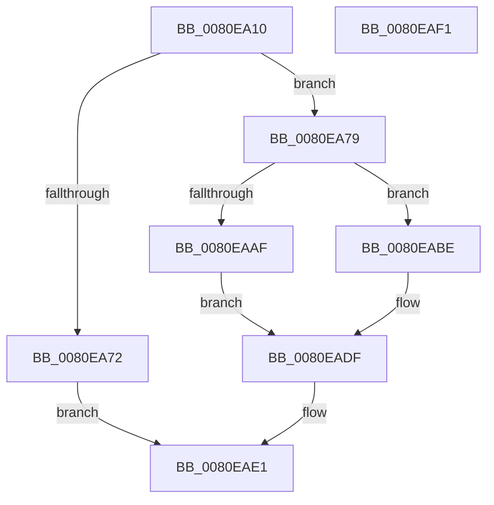

# MiInitializeScrubPacket

- RVA: `0x0080EA10`–`0x0080EAF2` (길이 `226` bytes)
- VA: `0x000000014080EA10`
- 실행 섹션: `PAGE`
- PDB 이름 있음: `예`; PDB Function 태그: `아니요`
- unwind 정보 RVA: `0x000794E0`
- 디코드: `53`개 명령, `226/226` bytes 표시
- 미해석 바이트: `0` (있으면 어셈블리에 `.byte`로 보존)

> 이 문서는 커널 이미지의 기계어와 PDB 기호를 분석해 생성했습니다. 4번과 5번은 함수 원형과 자료형을 바이너리 사용 방식에서 추정한 C 해석이며 원본 소스 복구 결과는 아닙니다.

## 1. Dependencies

- 직접 호출 지점: **4**; 고유 호출 대상: **4**
- 직접 호출자로 확인된 함수: **1**
- RIP 상대 이미지 참조: **0**

### Outgoing calls
- `0x0080EA52` → [MiInitializePageColorBase](../../text/32/MiInitializePageColorBase_function_00320410.md) (function, `0x00320410`)
- `0x0080EA67` → [MiCreateUltraThreadContext](../../text/28/MiCreateUltraThreadContext_function_00288200.md) (function, `0x00288200`)
- `0x0080EA9E` → [ExAllocatePoolMm](../../text/35/ExAllocatePoolMm_function_0035B690.md) (function, `0x0035B690`)
- `0x0080EAB7` → [MiReleaseScrubPacket](MiReleaseScrubPacket_function_0080ED24.md) (function, `0x0080ED24`)

### Direct callers
- [MiScrubMemoryWorker](MiScrubMemoryWorker_function_0080EE00.md) at `0x0080EE15`

### Static image references
- 디코드된 RIP-relative 메모리 참조가 없습니다.

## 2. Other-region calls and transfers

- 다른 실행 섹션으로 향하는 call: **3**
  - `0x0080EA52` → [MiInitializePageColorBase](../../text/32/MiInitializePageColorBase_function_00320410.md) (`PAGE` → `.text`)
  - `0x0080EA67` → [MiCreateUltraThreadContext](../../text/28/MiCreateUltraThreadContext_function_00288200.md) (`PAGE` → `.text`)
  - `0x0080EA9E` → [ExAllocatePoolMm](../../text/35/ExAllocatePoolMm_function_0035B690.md) (`PAGE` → `.text`)
- 별도 외부 분기/꼬리 이동을 확인하지 못했습니다.

## 3. Assembly (complete function range)

```asm
0080EA10  48 89 5C 24 08                  mov qword ptr [rsp + 8], rbx
0080EA15  48 89 74 24 10                  mov qword ptr [rsp + 0x10], rsi
0080EA1A  57                              push rdi
0080EA1B  48 83 EC 30                     sub rsp, 0x30
0080EA1F  44 8B 41 08                     mov r8d, dword ptr [rcx + 8]
0080EA23  4C 8D 4C 24 20                  lea r9, [rsp + 0x20]
0080EA28  65 48 8B 04 25 88 01 00 00      mov rax, qword ptr gs:[0x188]
0080EA31  48 8B D9                        mov rbx, rcx
0080EA34  0F 57 C0                        xorps xmm0, xmm0
0080EA37  41 FF C0                        inc r8d
0080EA3A  BA 03 00 00 00                  mov edx, 3
0080EA3F  0F 11 44 24 20                  movups xmmword ptr [rsp + 0x20], xmm0
0080EA44  48 8B 88 B8 00 00 00            mov rcx, qword ptr [rax + 0xb8]
0080EA4B  48 81 C1 00 04 00 00            add rcx, 0x400
0080EA52  E8 B9 19 B1 FF                  call 0x140320410
0080EA57  45 33 C9                        xor r9d, r9d
0080EA5A  48 8D 4B 30                     lea rcx, [rbx + 0x30]
0080EA5E  48 8D 54 24 20                  lea rdx, [rsp + 0x20]
0080EA63  45 8D 41 0F                     lea r8d, [r9 + 0xf]
0080EA67  E8 94 97 A7 FF                  call 0x140288200
0080EA6C  33 FF                           xor edi, edi
0080EA6E  85 C0                           test eax, eax
0080EA70  75 07                           jne 0x14080ea79
0080EA72  B8 9A 00 00 C0                  mov eax, 0xc000009a
0080EA77  EB 68                           jmp 0x14080eae1
0080EA79  44 8B 4B 08                     mov r9d, dword ptr [rbx + 8]
0080EA7D  BA 00 10 00 00                  mov edx, 0x1000
0080EA82  48 8B 33                        mov rsi, qword ptr [rbx]
0080EA85  B9 40 00 00 00                  mov ecx, 0x40
0080EA8A  41 B8 4D 45 63 63               mov r8d, 0x6363454d
0080EA90  48 89 BB B0 00 00 00            mov qword ptr [rbx + 0xb0], rdi
0080EA97  48 89 BB B8 00 00 00            mov qword ptr [rbx + 0xb8], rdi
0080EA9E  E8 ED CB B4 FF                  call 0x14035b690
0080EAA3  48 89 83 B0 00 00 00            mov qword ptr [rbx + 0xb0], rax
0080EAAA  48 85 C0                        test rax, rax
0080EAAD  75 0F                           jne 0x14080eabe
0080EAAF  48 8B CB                        mov rcx, rbx
0080EAB2  BF 9A 00 00 C0                  mov edi, 0xc000009a
0080EAB7  E8 68 02 00 00                  call 0x14080ed24
0080EABC  EB 21                           jmp 0x14080eadf
0080EABE  8B 4B 08                        mov ecx, dword ptr [rbx + 8]
0080EAC1  4C 69 C1 80 DF 00 00            imul r8, rcx, 0xdf80
0080EAC8  48 8B 4E 30                     mov rcx, qword ptr [rsi + 0x30]
0080EACC  48 8B 51 10                     mov rdx, qword ptr [rcx + 0x10]
0080EAD0  49 8B 8C 10 90 3B 00 00         mov rcx, qword ptr [r8 + rdx + 0x3b90]
0080EAD8  48 89 8B C0 00 00 00            mov qword ptr [rbx + 0xc0], rcx
0080EADF  8B C7                           mov eax, edi
0080EAE1  48 8B 5C 24 40                  mov rbx, qword ptr [rsp + 0x40]
0080EAE6  48 8B 74 24 48                  mov rsi, qword ptr [rsp + 0x48]
0080EAEB  48 83 C4 30                     add rsp, 0x30
0080EAEF  5F                              pop rdi
0080EAF0  C3                              ret
0080EAF1  CC                              int3
```

## 4. C-style interpretation (structured pseudocode)

```c
__int64 __fastcall MiInitializeScrubPacket(__int64 a1)
{
    __int64 result;
    __int64 v_rdi;
    __int64 v_rsp;
    unsigned __int64 v_stack_m18;
    unsigned __int64 v_stack_p10;
    unsigned __int64 v_stack_p8;

    v_stack_p8 = v_rbx;
    v_stack_p10 = v_rsi;
    v_rsp = (v_rsp) - (48);
    a3 = (unsigned int)(((unsigned int)(*(unsigned int *)(a1 + 8))) + 1);
    v_stack_m18 = v_xmm0;
    a1 = (*(unsigned __int64 *)(*(unsigned __int64 *)(gs_base + (0 + 392)) + 184)) + (0x400ULL);
    result = MiInitializePageColorBase(a1, 3, a3, v_stack_m18);
    a4 = 0;
    result = MiCreateUltraThreadContext(a1 + 48, v_stack_m18, a4 + 15, a4);
    v_rdi = 0;
    if ((unsigned int)(result) != 0) goto loc_0080EA79;
    goto loc_0080EAE1;
loc_0080EA79:
    *(unsigned __int64 *)(a1 + 176) = 0;
    *(unsigned __int64 *)(a1 + 184) = 0;
    result = ExAllocatePoolMm(64, (unsigned int)(0x1000ULL), (unsigned int)(0x6363454DULL), (unsigned int)(*(unsigned int *)(a1 + 8)));
    *(unsigned __int64 *)(a1 + 176) = result;
    if (result != 0) goto loc_0080EABE;
    result = MiReleaseScrubPacket(a1, (unsigned int)(0x1000ULL), (unsigned int)(0x6363454DULL), (unsigned int)(*(unsigned int *)(a1 + 8)));
    goto loc_0080EADF;
loc_0080EABE:
    a3 = ((unsigned int)(0x6363454DULL)) * ((unsigned int)(*(unsigned int *)(a1 + 8)));
    *(unsigned __int64 *)(a1 + 192) = *(unsigned __int64 *)(a3 + *(unsigned __int64 *)(*(unsigned __int64 *)(*(unsigned __int64 *)(a1) + 48) + 16) * 1 + 15248);
loc_0080EADF:
loc_0080EAE1:
    v_rsp = (v_rsp) + (48);
    return (unsigned int)((unsigned int)((unsigned int)(0xC000009AULL)));
}
```

## 5. (Beta) C Style

```c
int64_t MiInitializeScrubPacket(void *Arg1)
{
    uint8_t *arg1 = (uint8_t *)Arg1;

    int64_t result;
    int64_t local_rdi;
    int64_t local_rsp;
    uint64_t v_stack_m18;
    uint64_t v_stack_p10;
    uint64_t v_stack_p8;

    v_stack_p8 = local_rbx;
    v_stack_p10 = local_rsi;
    local_rsp = (local_rsp) - (48);
    a3 = (uint32_t)(((uint32_t)(*(uint32_t *)(arg1 + 0x8))) + 1);
    v_stack_m18 = v_xmm0;
    Arg1 = (*(uint64_t *)(*(uint64_t *)(gs_base + (0 + 0x188)) + 0xB8)) + (0x400ULL);
    result = MiInitializePageColorBase(Arg1, 3, a3, v_stack_m18);
    a4 = 0;
    result = MiCreateUltraThreadContext(Arg1 + 48, v_stack_m18, a4 + 15, a4);
    local_rdi = 0;
    if ((uint32_t)(result) != 0) goto loc_0080EA79;
    goto loc_0080EAE1;
loc_0080EA79:
    *(uint64_t *)(arg1 + 0xB0) = 0;
    *(uint64_t *)(arg1 + 0xB8) = 0;
    result = ExAllocatePoolMm(64, (uint32_t)(0x1000ULL), (uint32_t)(0x6363454DULL), (uint32_t)(*(uint32_t *)(arg1 + 0x8)));
    *(uint64_t *)(arg1 + 0xB0) = result;
    if (result != 0) goto loc_0080EABE;
    result = MiReleaseScrubPacket(Arg1, (uint32_t)(0x1000ULL), (uint32_t)(0x6363454DULL), (uint32_t)(*(uint32_t *)(arg1 + 0x8)));
    goto loc_0080EADF;
loc_0080EABE:
    a3 = ((uint32_t)(0x6363454DULL)) * ((uint32_t)(*(uint32_t *)(arg1 + 0x8)));
    *(uint64_t *)(arg1 + 0xC0) = *(uint64_t *)(a3 + *(uint64_t *)(*(uint64_t *)(*(uint64_t *)(arg1) + 0x30) + 0x10) * 1 + 0x3B90);
loc_0080EADF:
loc_0080EAE1:
    local_rsp = (local_rsp) + (48);
    return (uint32_t)((uint32_t)((uint32_t)(0xC000009AULL)));
}
```

### 관측된 메모리 오프셋

구조체 형식이 확인되지 않은 접근은 인자 기준의 오프셋으로만 기록했습니다.

| 기준 인자 | 오프셋 표현 | 폭 (bit) | 접근 |
|---|---:|---:|---|
| `Arg1` | `+ 0x0` | `64` | `R` |
| `Arg1` | `+ 0x8` | `32` | `R` |
| `Arg1` | `+ 0x30` | `64` | `R` |
| `Arg1` | `+ 0xB0` | `64` | `W` |
| `Arg1` | `+ 0xB8` | `64` | `W` |
| `Arg1` | `+ 0xC0` | `64` | `W` |

## 6. Execution-region graph

[열기: 2D/3D 그래프와 함수 탐색 컨트롤 패널](../../../control-panel.html?section=page&rva=0x0080EA10&view=graph)

- 2D 그래프는 위에서 아래로 흐르고, 3D 그래프는 빈 공간을 드래그해 회전합니다. Shift+드래그는 이동, 휠은 확대·축소, 함수 노드 선택은 대상 보고서 이동입니다.

### Static fallback


