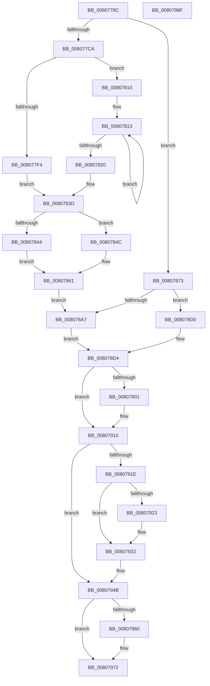

# MiInitializeShadowPageTable

- RVA: `0x0080778C`–`0x00807990` (길이 `516` bytes)
- VA: `0x000000014080778C`
- 실행 섹션: `PAGE`
- PDB 이름 있음: `예`; PDB Function 태그: `아니요`
- unwind 정보 RVA: `0x00075C18`
- 디코드: `137`개 명령, `516/516` bytes 표시
- 미해석 바이트: `0` (있으면 어셈블리에 `.byte`로 보존)

> 이 문서는 커널 이미지의 기계어와 PDB 기호를 분석해 생성했습니다. 4번과 5번은 함수 원형과 자료형을 바이너리 사용 방식에서 추정한 C 해석이며 원본 소스 복구 결과는 아닙니다.

## 1. Dependencies

- 직접 호출 지점: **14**; 고유 호출 대상: **11**
- 직접 호출자로 확인된 함수: **1**
- RIP 상대 이미지 참조: **2**

### Outgoing calls
- `0x008077E9` → [MI_IS_PHYSICAL_ADDRESS](../../text/23/MI_IS_PHYSICAL_ADDRESS_function_0023B3A0.md) (function, `0x0023B3A0`)
- `0x008077F7` → [MI_READ_PTE_LOCK_FREE](../../text/28/MI_READ_PTE_LOCK_FREE_function_002828A0.md) (function, `0x002828A0`)
- `0x00807816` → [MiGetPteAddress](../../text/43/MiGetPteAddress_function_0043E130.md) (function, `0x0043E130`)
- `0x00807823` → [MI_READ_PTE_LOCK_FREE](../../text/28/MI_READ_PTE_LOCK_FREE_function_002828A0.md) (function, `0x002828A0`)
- `0x00807830` → [MiVaToPfnEx](../../text/23/MiVaToPfnEx_function_0023A1A0.md) (function, `0x0023A1A0`)
- `0x00807852` → [MI_IS_PTE_SHADOW_STACK](../../text/44/MI_IS_PTE_SHADOW_STACK_function_0044B110.md) (function, `0x0044B110`)
- `0x008078AD` → [MiGetPteAddress](../../text/43/MiGetPteAddress_function_0043E130.md) (function, `0x0043E130`)
- `0x008078BF` → [MiReadWriteAnyLevelShadowPte](../../text/43/MiReadWriteAnyLevelShadowPte_function_00432654.md) (function, `0x00432654`)
- `0x008078F2` → [MiMakeValidPte](../../text/2C/MiMakeValidPte_function_002C5590.md) (function, `0x002C5590`)
- `0x00807906` → [MI_SET_PTE_SHADOW_STACK](../../text/49/MI_SET_PTE_SHADOW_STACK_function_00494AEC.md) (function, `0x00494AEC`)
- `0x00807941` → [MiInitializePfnForOtherProcess](../../text/38/MiInitializePfnForOtherProcess_function_00382A20.md) (function, `0x00382A20`)
- `0x00807956` → [MiReadWriteAnyLevelShadowPte](../../text/43/MiReadWriteAnyLevelShadowPte_function_00432654.md) (function, `0x00432654`)
- `0x00807963` → [MiMarkPxeAsShadowed](../../text/68/MiMarkPxeAsShadowed_function_00686360.md) (function, `0x00686360`)
- `0x0080796D` → [MiReplicatePteChange](../../text/4F/MiReplicatePteChange_function_004F8A24.md) (function, `0x004F8A24`)

### Direct callers
- [MiMakeShadowPageTableRange](MiMakeShadowPageTableRange_function_00807998.md) at `0x00807A37`

### Static image references
- `0x008078B2` → RVA `0x00010880` (`.rdata`; read)
- `0x00807923` → RVA `0x00FC6AB0` (`ALMOSTRO`; read)

## 2. Other-region calls and transfers

- 다른 실행 섹션으로 향하는 call: **14**
  - `0x008077E9` → [MI_IS_PHYSICAL_ADDRESS](../../text/23/MI_IS_PHYSICAL_ADDRESS_function_0023B3A0.md) (`PAGE` → `.text`)
  - `0x008077F7` → [MI_READ_PTE_LOCK_FREE](../../text/28/MI_READ_PTE_LOCK_FREE_function_002828A0.md) (`PAGE` → `.text`)
  - `0x00807816` → [MiGetPteAddress](../../text/43/MiGetPteAddress_function_0043E130.md) (`PAGE` → `.text`)
  - `0x00807823` → [MI_READ_PTE_LOCK_FREE](../../text/28/MI_READ_PTE_LOCK_FREE_function_002828A0.md) (`PAGE` → `.text`)
  - `0x00807830` → [MiVaToPfnEx](../../text/23/MiVaToPfnEx_function_0023A1A0.md) (`PAGE` → `.text`)
  - `0x00807852` → [MI_IS_PTE_SHADOW_STACK](../../text/44/MI_IS_PTE_SHADOW_STACK_function_0044B110.md) (`PAGE` → `.text`)
  - `0x008078AD` → [MiGetPteAddress](../../text/43/MiGetPteAddress_function_0043E130.md) (`PAGE` → `.text`)
  - `0x008078BF` → [MiReadWriteAnyLevelShadowPte](../../text/43/MiReadWriteAnyLevelShadowPte_function_00432654.md) (`PAGE` → `.text`)
  - `0x008078F2` → [MiMakeValidPte](../../text/2C/MiMakeValidPte_function_002C5590.md) (`PAGE` → `.text`)
  - `0x00807906` → [MI_SET_PTE_SHADOW_STACK](../../text/49/MI_SET_PTE_SHADOW_STACK_function_00494AEC.md) (`PAGE` → `.text`)
  - `0x00807941` → [MiInitializePfnForOtherProcess](../../text/38/MiInitializePfnForOtherProcess_function_00382A20.md) (`PAGE` → `.text`)
  - `0x00807956` → [MiReadWriteAnyLevelShadowPte](../../text/43/MiReadWriteAnyLevelShadowPte_function_00432654.md) (`PAGE` → `.text`)
  - `0x00807963` → [MiMarkPxeAsShadowed](../../text/68/MiMarkPxeAsShadowed_function_00686360.md) (`PAGE` → `.text`)
  - `0x0080796D` → [MiReplicatePteChange](../../text/4F/MiReplicatePteChange_function_004F8A24.md) (`PAGE` → `.text`)
- 별도 외부 분기/꼬리 이동을 확인하지 못했습니다.

## 3. Assembly (complete function range)

```asm
0080778C  48 89 5C 24 08                  mov qword ptr [rsp + 8], rbx
00807791  48 89 6C 24 10                  mov qword ptr [rsp + 0x10], rbp
00807796  48 89 74 24 18                  mov qword ptr [rsp + 0x18], rsi
0080779B  57                              push rdi
0080779C  41 54                           push r12
0080779E  41 55                           push r13
008077A0  41 56                           push r14
008077A2  41 57                           push r15
008077A4  48 83 EC 20                     sub rsp, 0x20
008077A8  45 32 FF                        xor r15b, r15b
008077AB  41 8B F0                        mov esi, r8d
008077AE  48 8B F9                        mov rdi, rcx
008077B1  41 BC 01 00 00 00               mov r12d, 1
008077B7  49 BD FF FF FF FF FF 00 00 00   movabs r13, 0xffffffffff
008077C1  45 85 C0                        test r8d, r8d
008077C4  0F 85 A9 00 00 00               jne 0x140807873
008077CA  48 8B D9                        mov rbx, rcx
008077CD  48 C1 E3 19                     shl rbx, 0x19
008077D1  48 B8 00 00 00 00 80 F6 FF FF   movabs rax, 0xfffff68000000000
008077DB  48 C1 E0 19                     shl rax, 0x19
008077DF  48 2B D8                        sub rbx, rax
008077E2  48 C1 FB 10                     sar rbx, 0x10
008077E6  48 8B CB                        mov rcx, rbx
008077E9  E8 B2 3B A3 FF                  call 0x14023b3a0
008077EE  8B D0                           mov edx, eax
008077F0  85 C0                           test eax, eax
008077F2  75 1C                           jne 0x140807810
008077F4  48 8B CF                        mov rcx, rdi
008077F7  E8 A4 B0 A7 FF                  call 0x1402828a0
008077FC  48 8B D8                        mov rbx, rax
008077FF  48 89 44 24 68                  mov qword ptr [rsp + 0x68], rax
00807804  48 C1 EB 0C                     shr rbx, 0xc
00807808  48 8B D0                        mov rdx, rax
0080780B  49 23 DD                        and rbx, r13
0080780E  EB 2D                           jmp 0x14080783d
00807810  48 8B C7                        mov rax, rdi
00807813  48 8B C8                        mov rcx, rax
00807816  E8 15 69 C3 FF                  call 0x14043e130
0080781B  83 C2 FF                        add edx, -1
0080781E  75 F3                           jne 0x140807813
00807820  48 8B C8                        mov rcx, rax
00807823  E8 78 B0 A7 FF                  call 0x1402828a0
00807828  48 8B CB                        mov rcx, rbx
0080782B  48 89 44 24 68                  mov qword ptr [rsp + 0x68], rax
00807830  E8 6B 29 A3 FF                  call 0x14023a1a0
00807835  48 8B 54 24 68                  mov rdx, qword ptr [rsp + 0x68]
0080783A  48 8B D8                        mov rbx, rax
0080783D  48 0F BA E2 0B                  bt rdx, 0xb
00807842  73 08                           jae 0x14080784c
00807844  41 B8 04 00 00 00               mov r8d, 4
0080784A  EB 15                           jmp 0x140807861
0080784C  48 8B CA                        mov rcx, rdx
0080784F  45 8B C4                        mov r8d, r12d
00807852  E8 B9 38 C4 FF                  call 0x14044b110
00807857  85 C0                           test eax, eax
00807859  45 0F B6 FF                     movzx r15d, r15b
0080785D  45 0F 45 FC                     cmovne r15d, r12d
00807861  45 8B F0                        mov r14d, r8d
00807864  41 83 CE 02                     or r14d, 2
00807868  48 0F BA E2 3F                  bt rdx, 0x3f
0080786D  45 0F 42 F0                     cmovb r14d, r8d
00807871  EB 34                           jmp 0x1408078a7
00807873  48 B8 00 00 00 00 00 DE FF FF   movabs rax, 0xffffde0000000000
0080787D  48 8B DA                        mov rbx, rdx
00807880  48 C7 02 00 00 00 00            mov qword ptr [rdx], 0
00807887  48 2B D8                        sub rbx, rax
0080788A  41 BE 06 00 00 00               mov r14d, 6
00807890  48 C1 FB 04                     sar rbx, 4
00807894  48 B8 AB AA AA AA AA AA AA AA   movabs rax, 0xaaaaaaaaaaaaaaab
0080789E  48 0F AF D8                     imul rbx, rax
008078A2  83 FE 03                        cmp esi, 3
008078A5  74 29                           je 0x1408078d0
008078A7  48 8B CF                        mov rcx, rdi
008078AA  8D 56 01                        lea edx, [rsi + 1]
008078AD  E8 7E 68 C3 FF                  call 0x14043e130
008078B2  4C 8B 0D C7 8F 80 FF            mov r9, qword ptr [rip - 0x7f7039]
008078B9  48 8B C8                        mov rcx, rax
008078BC  45 33 C0                        xor r8d, r8d
008078BF  E8 90 AD C2 FF                  call 0x140432654
008078C4  48 8B E8                        mov rbp, rax
008078C7  48 C1 ED 0C                     shr rbp, 0xc
008078CB  49 23 ED                        and rbp, r13
008078CE  EB 04                           jmp 0x1408078d4
008078D0  48 83 CD FF                     or rbp, 0xffffffffffffffff
008078D4  8B C6                           mov eax, esi
008078D6  48 8B D3                        mov rdx, rbx
008078D9  F7 D8                           neg eax
008078DB  48 8B CF                        mov rcx, rdi
008078DE  45 1B C0                        sbb r8d, r8d
008078E1  41 81 E0 00 00 00 08            and r8d, 0x8000000
008078E8  41 81 C0 00 00 00 90            add r8d, 0x90000000
008078EF  45 0B C6                        or r8d, r14d
008078F2  E8 99 DC AB FF                  call 0x1402c5590
008078F7  48 89 44 24 68                  mov qword ptr [rsp + 0x68], rax
008078FC  45 84 FF                        test r15b, r15b
008078FF  74 0F                           je 0x140807910
00807901  48 8D 4C 24 68                  lea rcx, [rsp + 0x68]
00807906  E8 E1 D1 C8 FF                  call 0x140494aec
0080790B  48 8B 44 24 68                  mov rax, qword ptr [rsp + 0x68]
00807910  48 0F BA F0 08                  btr rax, 8
00807915  48 89 44 24 68                  mov qword ptr [rsp + 0x68], rax
0080791A  85 F6                           test esi, esi
0080791C  74 2D                           je 0x14080794b
0080791E  83 FE 03                        cmp esi, 3
00807921  75 0F                           jne 0x140807932
00807923  48 8B 05 86 F1 7B 00            mov rax, qword ptr [rip + 0x7bf186]
0080792A  48 8B 68 28                     mov rbp, qword ptr [rax + 0x28]
0080792E  48 C1 ED 0C                     shr rbp, 0xc
00807932  41 B9 00 0A 00 00               mov r9d, 0xa00
00807938  4C 8B C5                        mov r8, rbp
0080793B  48 8B D7                        mov rdx, rdi
0080793E  48 8B CB                        mov rcx, rbx
00807941  E8 DA B0 B7 FF                  call 0x140382a20
00807946  48 8B 44 24 68                  mov rax, qword ptr [rsp + 0x68]
0080794B  4C 8B C8                        mov r9, rax
0080794E  45 8B C4                        mov r8d, r12d
00807951  8B D6                           mov edx, esi
00807953  48 8B CF                        mov rcx, rdi
00807956  E8 F9 AC C2 FF                  call 0x140432654
0080795B  83 FE 03                        cmp esi, 3
0080795E  75 12                           jne 0x140807972
00807960  48 8B CF                        mov rcx, rdi
00807963  E8 F8 E9 E7 FF                  call 0x140686360
00807968  33 D2                           xor edx, edx
0080796A  48 8B CF                        mov rcx, rdi
0080796D  E8 B2 10 CF FF                  call 0x1404f8a24
00807972  48 8B 5C 24 50                  mov rbx, qword ptr [rsp + 0x50]
00807977  48 8B 6C 24 58                  mov rbp, qword ptr [rsp + 0x58]
0080797C  48 8B 74 24 60                  mov rsi, qword ptr [rsp + 0x60]
00807981  48 83 C4 20                     add rsp, 0x20
00807985  41 5F                           pop r15
00807987  41 5E                           pop r14
00807989  41 5D                           pop r13
0080798B  41 5C                           pop r12
0080798D  5F                              pop rdi
0080798E  C3                              ret
0080798F  CC                              int3
```

## 4. C-style interpretation (structured pseudocode)

```c
__int64 __fastcall MiInitializeShadowPageTable(__int64 a1, __int64 a2, int a3)
{
    __int64 result;
    __int64 v_r14;
    __int64 v_r15;
    __int64 v_rbp;
    __int64 v_rbx;
    __int64 v_rsp;
    unsigned __int64 v_stack_p10;
    unsigned __int64 v_stack_p18;
    unsigned __int64 v_stack_p20;
    unsigned __int64 v_stack_p8;

    v_stack_p8 = v_rbx;
    v_stack_p10 = v_rbp;
    v_stack_p18 = v_rsi;
    v_rsp = (v_rsp) - (32);
    v_r15 = 0;
    if (a3 != 0) goto loc_00807873;
    v_rbx = (a1) << (25);
    result = (result) << (25);
    v_rbx = (v_rbx) - (result);
    v_rbx = (v_rbx) >> (16);
    result = MI_IS_PHYSICAL_ADDRESS(v_rbx, a2, a3, a4);
    if ((unsigned int)(result) != 0) goto loc_00807810;
    result = MI_READ_PTE_LOCK_FREE(a1, (unsigned int)((unsigned int)(result)), a3, a4);
    v_stack_p20 = result;
    v_rbx = (result) >> (12);
    v_rbx = (v_rbx) & (v_r13);
    goto loc_0080783D;
loc_00807810:
loc_00807813:
    result = MiGetPteAddress(a1, result, a3, a4);
    a2 = (unsigned int)((result) + (-1));
    if (condition_is_not_equal) goto loc_00807813;
    result = MI_READ_PTE_LOCK_FREE(result, a2, a3, a4);
    v_stack_p20 = result;
    result = MiVaToPfnEx(v_rbx, a2, a3, a4);
loc_0080783D:
    if (condition_is_above_or_equal) goto loc_0080784C;
    goto loc_00807861;
loc_0080784C:
    result = MI_IS_PTE_SHADOW_STACK(v_stack_p20, v_stack_p20, 1, a4);
    v_r15 = 0;
    if ((unsigned int)(result) != 0) { v_r15 = 1; }
loc_00807861:
    v_r14 = (unsigned int)((1) | (2));
    if (condition_is_below) { v_r14 = 1; }
    goto loc_008078A7;
loc_00807873:
    *(unsigned __int64 *)(v_stack_p20) = 0;
    v_rbx = (v_stack_p20) - (result);
    v_rbx = (v_rbx) >> (4);
    v_rbx = (v_rbx) * (result);
    if (((unsigned int)((unsigned int)(a3))) == 3) goto loc_008078D0;
loc_008078A7:
    result = MiGetPteAddress(a1, (unsigned int)(a3) + 1, 1, a4);
    a3 = 0;
    result = MiReadWriteAnyLevelShadowPte(result, (unsigned int)(a3) + 1, a3, *(unsigned __int64 *)(v_rip - 8351801));
    v_rbp = (result) >> (12);
    v_rbp = (v_rbp) & (v_r13);
    goto loc_008078D4;
loc_008078D0:
    v_rbp = (v_rbp) | (-1);
loc_008078D4:
    result = (unsigned int)(-((unsigned int)((unsigned int)((unsigned int)(a3)))));
    a3 = (unsigned int)((a3) & (0x8000000ULL));
    a3 = (unsigned int)((a3) + (0x90000000ULL));
    a3 = (unsigned int)((a3) | (6));
    result = MiMakeValidPte(a1, v_rbx, a3, *(unsigned __int64 *)(v_rip - 8351801));
    v_stack_p20 = result;
    if ((unsigned __int8)(v_r15) != 0) {
        a1 = v_stack_p20;
        result = MI_SET_PTE_SHADOW_STACK(a1, v_rbx, a3, *(unsigned __int64 *)(v_rip - 8351801));
        result = v_stack_p20;
    }
    v_stack_p20 = result;
    if ((unsigned int)((unsigned int)(a3)) == 0) goto loc_0080794B;
    if (((unsigned int)((unsigned int)(a3))) == 3) {
        result = *(unsigned __int64 *)(v_rip + 8122758);
        v_rbp = *(unsigned __int64 *)(result + 40);
        v_rbp = (v_rbp) >> (12);
    }
    result = MiInitializePfnForOtherProcess(v_rbx, a1, v_rbp, (unsigned int)(0xA00ULL));
loc_0080794B:
    result = MiReadWriteAnyLevelShadowPte(a1, (unsigned int)((unsigned int)((unsigned int)(a3))), 1, v_stack_p20);
    if (((unsigned int)((unsigned int)(a3))) == 3) {
        a1 = a1;
        result = MiMarkPxeAsShadowed(a1, (unsigned int)((unsigned int)((unsigned int)(a3))), 1, v_stack_p20);
        a2 = 0;
        a1 = a1;
        result = MiReplicatePteChange(a1, a2, 1, v_stack_p20);
    }
    v_rsp = (v_rsp) + (32);
    return result;
}
```

## 5. (Beta) C Style

```c
int64_t MiInitializeShadowPageTable(int64_t Arg1, void *Arg2, int32_t Arg3)
{
    uint8_t *arg2 = (uint8_t *)Arg2;

    int64_t result;
    int64_t local_r14;
    int64_t local_r15;
    int64_t local_rbp;
    int64_t local_rbx;
    int64_t local_rsp;
    uint64_t v_stack_p10;
    uint64_t v_stack_p18;
    uint64_t v_stack_p20;
    uint64_t v_stack_p8;

    v_stack_p8 = local_rbx;
    v_stack_p10 = local_rbp;
    v_stack_p18 = local_rsi;
    local_rsp = (local_rsp) - (32);
    local_r15 = 0;
    if (Arg3 != 0) goto loc_00807873;
    local_rbx = (Arg1) << (25);
    result = (result) << (25);
    local_rbx = (local_rbx) - (result);
    local_rbx = (local_rbx) >> (16);
    result = MI_IS_PHYSICAL_ADDRESS(local_rbx, Arg2, Arg3, a4);
    if ((uint32_t)(result) != 0) goto loc_00807810;
    result = MI_READ_PTE_LOCK_FREE(Arg1, (uint32_t)((uint32_t)(result)), Arg3, a4);
    v_stack_p20 = result;
    local_rbx = (result) >> (12);
    local_rbx = (local_rbx) & (local_r13);
    goto loc_0080783D;
loc_00807810:
loc_00807813:
    result = MiGetPteAddress(Arg1, result, Arg3, a4);
    Arg2 = (uint32_t)((result) + (-1));
    if (condition_is_not_equal) goto loc_00807813;
    result = MI_READ_PTE_LOCK_FREE(result, Arg2, Arg3, a4);
    v_stack_p20 = result;
    result = MiVaToPfnEx(local_rbx, Arg2, Arg3, a4);
loc_0080783D:
    if (condition_is_above_or_equal) goto loc_0080784C;
    goto loc_00807861;
loc_0080784C:
    result = MI_IS_PTE_SHADOW_STACK(v_stack_p20, v_stack_p20, 1, a4);
    local_r15 = 0;
    if ((uint32_t)(result) != 0) { local_r15 = 1; }
loc_00807861:
    local_r14 = (uint32_t)((1) | (2));
    if (condition_is_below) { local_r14 = 1; }
    goto loc_008078A7;
loc_00807873:
    *(uint64_t *)(v_stack_p20) = 0;
    local_rbx = (v_stack_p20) - (result);
    local_rbx = (local_rbx) >> (4);
    local_rbx = (local_rbx) * (result);
    if (((uint32_t)((uint32_t)(Arg3))) == 3) goto loc_008078D0;
loc_008078A7:
    result = MiGetPteAddress(Arg1, (uint32_t)(Arg3) + 1, 1, a4);
    Arg3 = 0;
    result = MiReadWriteAnyLevelShadowPte(result, (uint32_t)(Arg3) + 1, Arg3, *(uint64_t *)(v_rip - 0x7F7039));
    local_rbp = (result) >> (12);
    local_rbp = (local_rbp) & (local_r13);
    goto loc_008078D4;
loc_008078D0:
    local_rbp = (local_rbp) | (-1);
loc_008078D4:
    result = (uint32_t)(-((uint32_t)((uint32_t)((uint32_t)(Arg3)))));
    Arg3 = (uint32_t)((Arg3) & (0x8000000ULL));
    Arg3 = (uint32_t)((Arg3) + (0x90000000ULL));
    Arg3 = (uint32_t)((Arg3) | (6));
    result = MiMakeValidPte(Arg1, local_rbx, Arg3, *(uint64_t *)(v_rip - 0x7F7039));
    v_stack_p20 = result;
    if ((uint8_t)(local_r15) != 0) {
        Arg1 = v_stack_p20;
        result = MI_SET_PTE_SHADOW_STACK(Arg1, local_rbx, Arg3, *(uint64_t *)(v_rip - 0x7F7039));
        result = v_stack_p20;
    }
    v_stack_p20 = result;
    if ((uint32_t)((uint32_t)(Arg3)) == 0) goto loc_0080794B;
    if (((uint32_t)((uint32_t)(Arg3))) == 3) {
        result = *(uint64_t *)(v_rip + 0x7BF186);
        local_rbp = *(uint64_t *)(result + 0x28);
        local_rbp = (local_rbp) >> (12);
    }
    result = MiInitializePfnForOtherProcess(local_rbx, Arg1, local_rbp, (uint32_t)(0xA00ULL));
loc_0080794B:
    result = MiReadWriteAnyLevelShadowPte(Arg1, (uint32_t)((uint32_t)((uint32_t)(Arg3))), 1, v_stack_p20);
    if (((uint32_t)((uint32_t)(Arg3))) == 3) {
        Arg1 = Arg1;
        result = MiMarkPxeAsShadowed(Arg1, (uint32_t)((uint32_t)((uint32_t)(Arg3))), 1, v_stack_p20);
        Arg2 = 0;
        Arg1 = Arg1;
        result = MiReplicatePteChange(Arg1, Arg2, 1, v_stack_p20);
    }
    local_rsp = (local_rsp) + (32);
    return result;
}
```

### 관측된 메모리 오프셋

구조체 형식이 확인되지 않은 접근은 인자 기준의 오프셋으로만 기록했습니다.

| 기준 인자 | 오프셋 표현 | 폭 (bit) | 접근 |
|---|---:|---:|---|
| `Arg2` | `+ 0x0` | `64` | `W` |

## 6. Execution-region graph

[열기: 2D/3D 그래프와 함수 탐색 컨트롤 패널](../../../control-panel.html?section=page&rva=0x0080778C&view=graph)

- 2D 그래프는 위에서 아래로 흐르고, 3D 그래프는 빈 공간을 드래그해 회전합니다. Shift+드래그는 이동, 휠은 확대·축소, 함수 노드 선택은 대상 보고서 이동입니다.

### Static fallback


