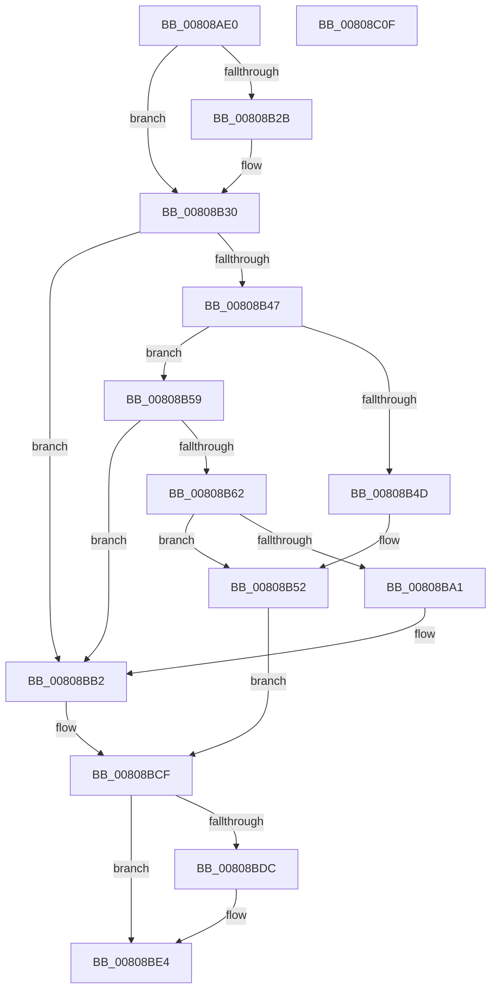

# MiInitializeVsmEnclave

- RVA: `0x00808AE0`–`0x00808C10` (길이 `304` bytes)
- VA: `0x0000000140808AE0`
- 실행 섹션: `PAGE`
- PDB 이름 있음: `예`; PDB Function 태그: `아니요`
- unwind 정보 RVA: `0x000BC81C`
- 디코드: `89`개 명령, `304/304` bytes 표시
- 미해석 바이트: `0` (있으면 어셈블리에 `.byte`로 보존)

> 이 문서는 커널 이미지의 기계어와 PDB 기호를 분석해 생성했습니다. 4번과 5번은 함수 원형과 자료형을 바이너리 사용 방식에서 추정한 C 해석이며 원본 소스 복구 결과는 아닙니다.

## 1. Dependencies

- 직접 호출 지점: **8**; 고유 호출 대상: **8**
- 직접 호출자로 확인된 함수: **1**
- RIP 상대 이미지 참조: **0**

### Outgoing calls
- `0x00808B3C` → [MiUnlockVad](../../text/2A/MiUnlockVad_function_002A59C8.md) (function, `0x002A59C8`)
- `0x00808B6A` → [PsReferencePrimaryTokenWithTag](../../text/20/PsReferencePrimaryTokenWithTag_function_0020FF80.md) (function, `0x0020FF80`)
- `0x00808B8E` → [MiMapImageForEnclaveUse](../AB/MiMapImageForEnclaveUse_function_00AB213C.md) (function, `0x00AB213C`)
- `0x00808B98` → [ObfDereferenceObject](../../text/2F/ObfDereferenceObject_function_002F9350.md) (function, `0x002F9350`)
- `0x00808BC8` → [PsInitializeVsmEnclave](../78/PsInitializeVsmEnclave_function_0078875C.md) (function, `0x0078875C`)
- `0x00808BD2` → [PsDereferenceVsmEnclave](../A0/PsDereferenceVsmEnclave_function_00A0D7D4.md) (function, `0x00A0D7D4`)
- `0x00808BDF` → [MiUnmapImageForEnclaveUse](../AB/MiUnmapImageForEnclaveUse_function_00AB90C4.md) (function, `0x00AB90C4`)
- `0x00808BEA` → [MiLockVad](../../text/29/MiLockVad_function_00295810.md) (function, `0x00295810`)

### Direct callers
- [MiInitializeEnclave](MiInitializeEnclave_function_008089D8.md) at `0x00808A53`

### Static image references
- 디코드된 RIP-relative 메모리 참조가 없습니다.

## 2. Other-region calls and transfers

- 다른 실행 섹션으로 향하는 call: **4**
  - `0x00808B3C` → [MiUnlockVad](../../text/2A/MiUnlockVad_function_002A59C8.md) (`PAGE` → `.text`)
  - `0x00808B6A` → [PsReferencePrimaryTokenWithTag](../../text/20/PsReferencePrimaryTokenWithTag_function_0020FF80.md) (`PAGE` → `.text`)
  - `0x00808B98` → [ObfDereferenceObject](../../text/2F/ObfDereferenceObject_function_002F9350.md) (`PAGE` → `.text`)
  - `0x00808BEA` → [MiLockVad](../../text/29/MiLockVad_function_00295810.md) (`PAGE` → `.text`)
- 별도 외부 분기/꼬리 이동을 확인하지 못했습니다.

## 3. Assembly (complete function range)

```asm
00808AE0  48 8B C4                        mov rax, rsp
00808AE3  48 89 58 08                     mov qword ptr [rax + 8], rbx
00808AE7  48 89 68 18                     mov qword ptr [rax + 0x18], rbp
00808AEB  48 89 70 20                     mov qword ptr [rax + 0x20], rsi
00808AEF  57                              push rdi
00808AF0  41 54                           push r12
00808AF2  41 55                           push r13
00808AF4  41 56                           push r14
00808AF6  41 57                           push r15
00808AF8  48 83 EC 40                     sub rsp, 0x40
00808AFC  48 8B 7A 48                     mov rdi, qword ptr [rdx + 0x48]
00808B00  33 F6                           xor esi, esi
00808B02  48 89 70 C8                     mov qword ptr [rax - 0x38], rsi
00808B06  45 8B E1                        mov r12d, r9d
00808B09  48 89 70 10                     mov qword ptr [rax + 0x10], rsi
00808B0D  4D 8B E8                        mov r13, r8
00808B10  4C 8B F2                        mov r14, rdx
00808B13  48 8B D9                        mov rbx, rcx
00808B16  8D 46 01                        lea eax, [rsi + 1]
00808B19  44 8B FE                        mov r15d, esi
00808B1C  F0 48 0F C1 47 10               lock xadd qword ptr [rdi + 0x10], rax
00808B22  48 FF C0                        inc rax
00808B25  48 83 F8 01                     cmp rax, 1
00808B29  7F 05                           jg 0x140808b30
00808B2B  8D 4E 0E                        lea ecx, [rsi + 0xe]
00808B2E  CD 29                           int 0x29
00808B30  65 48 8B 2C 25 88 01 00 00      mov rbp, qword ptr gs:[0x188]
00808B39  48 8B CD                        mov rcx, rbp
00808B3C  E8 87 CE A9 FF                  call 0x1402a59c8
00808B41  40 38 77 4C                     cmp byte ptr [rdi + 0x4c], sil
00808B45  74 6B                           je 0x140808bb2
00808B47  41 83 FC 38                     cmp r12d, 0x38
00808B4B  73 0C                           jae 0x140808b59
00808B4D  BE 04 00 00 C0                  mov esi, 0xc0000004
00808B52  48 8B 5C 24 78                  mov rbx, qword ptr [rsp + 0x78]
00808B57  EB 76                           jmp 0x140808bcf
00808B59  49 8B 75 30                     mov rsi, qword ptr [r13 + 0x30]
00808B5D  48 85 F6                        test rsi, rsi
00808B60  74 50                           je 0x140808bb2
00808B62  BA 44 66 6C 74                  mov edx, 0x746c6644
00808B67  48 8B CB                        mov rcx, rbx
00808B6A  E8 11 74 A0 FF                  call 0x14020ff80
00808B6F  44 8A 85 32 02 00 00            mov r8b, byte ptr [rbp + 0x232]
00808B76  4C 8D 4C 24 78                  lea r9, [rsp + 0x78]
00808B7B  48 8B D8                        mov rbx, rax
00808B7E  48 8B CE                        mov rcx, rsi
00808B81  48 8D 44 24 30                  lea rax, [rsp + 0x30]
00808B86  48 8B D3                        mov rdx, rbx
00808B89  48 89 44 24 20                  mov qword ptr [rsp + 0x20], rax
00808B8E  E8 A9 95 2A 00                  call 0x140ab213c
00808B93  48 8B CB                        mov rcx, rbx
00808B96  8B F0                           mov esi, eax
00808B98  E8 B3 07 AF FF                  call 0x1402f9350
00808B9D  85 F6                           test esi, esi
00808B9F  78 B1                           js 0x140808b52
00808BA1  48 8B 44 24 30                  mov rax, qword ptr [rsp + 0x30]
00808BA6  48 8B 48 60                     mov rcx, qword ptr [rax + 0x60]
00808BAA  48 83 E1 F8                     and rcx, 0xfffffffffffffff8
00808BAE  4C 8B 79 40                     mov r15, qword ptr [rcx + 0x40]
00808BB2  48 8B 5C 24 78                  mov rbx, qword ptr [rsp + 0x78]
00808BB7  4D 8B CF                        mov r9, r15
00808BBA  45 8B C4                        mov r8d, r12d
00808BBD  48 89 5C 24 20                  mov qword ptr [rsp + 0x20], rbx
00808BC2  49 8B D5                        mov rdx, r13
00808BC5  48 8B CF                        mov rcx, rdi
00808BC8  E8 8F FB F7 FF                  call 0x14078875c
00808BCD  8B F0                           mov esi, eax
00808BCF  48 8B CF                        mov rcx, rdi
00808BD2  E8 FD 4B 20 00                  call 0x140a0d7d4
00808BD7  48 85 DB                        test rbx, rbx
00808BDA  74 08                           je 0x140808be4
00808BDC  48 8B CB                        mov rcx, rbx
00808BDF  E8 E0 04 2B 00                  call 0x140ab90c4
00808BE4  49 8B D6                        mov rdx, r14
00808BE7  48 8B CD                        mov rcx, rbp
00808BEA  E8 21 CC A8 FF                  call 0x140295810
00808BEF  4C 8D 5C 24 40                  lea r11, [rsp + 0x40]
00808BF4  8B C6                           mov eax, esi
00808BF6  49 8B 5B 30                     mov rbx, qword ptr [r11 + 0x30]
00808BFA  49 8B 6B 40                     mov rbp, qword ptr [r11 + 0x40]
00808BFE  49 8B 73 48                     mov rsi, qword ptr [r11 + 0x48]
00808C02  49 8B E3                        mov rsp, r11
00808C05  41 5F                           pop r15
00808C07  41 5E                           pop r14
00808C09  41 5D                           pop r13
00808C0B  41 5C                           pop r12
00808C0D  5F                              pop rdi
00808C0E  C3                              ret
00808C0F  CC                              int3
```

## 4. C-style interpretation (structured pseudocode)

```c
__int64 __fastcall MiInitializeVsmEnclave(__int64 a1, __int64 a2, __int64 a3, int a4)
{
    __int64 result;
    __int64 v_rsi;
    __int64 v_rsp;
    unsigned __int64 v_stack_m28;
    unsigned __int64 v_stack_m38;
    unsigned __int64 v_stack_m48;
    unsigned __int64 v_stack_p10;

    *(unsigned __int64 *)(v_rsp + 8) = v_rbx;
    *(unsigned __int64 *)(v_rsp + 24) = v_rbp;
    *(unsigned __int64 *)(v_rsp + 32) = v_rsi;
    v_rsp = (v_rsp) - (64);
    v_rsi = 0;
    *(unsigned __int64 *)(v_rsp - 56) = 0;
    *(unsigned __int64 *)(v_rsp + 16) = 0;
    result = (v_rsi + 1) + 1;
    if (result <= 1) {
        a1 = v_rsi + 14;
    }
    result = MiUnlockVad(*(unsigned __int64 *)(gs_base + (0 + 392)), a2, a3, a4);
    if ((*(unsigned __int8 *)(*(unsigned __int64 *)(a2 + 72) + 76)) == 0) goto loc_00808BB2;
    if (((unsigned int)((unsigned int)(a4))) >= 56) goto loc_00808B59;
loc_00808B52:
    goto loc_00808BCF;
loc_00808B59:
    if (*(unsigned __int64 *)(a3 + 48) == 0) goto loc_00808BB2;
    result = PsReferencePrimaryTokenWithTag(v_stack_p10, (unsigned int)(0x746C6644ULL), a3, a4);
    v_stack_m48 = v_stack_m38;
    result = MiMapImageForEnclaveUse(*(unsigned __int64 *)(a3 + 48), result, *(unsigned __int8 *)(*(unsigned __int64 *)(gs_base + (0 + 392)) + 562), v_stack_p10);
    result = ObfDereferenceObject(result, result, *(unsigned __int8 *)(*(unsigned __int64 *)(gs_base + (0 + 392)) + 562), v_stack_p10);
    if (sign_flag) goto loc_00808B52;
    a1 = (*(unsigned __int64 *)(v_stack_m38 + 96)) & (-8);
loc_00808BB2:
    v_stack_m48 = v_stack_p10;
    result = PsInitializeVsmEnclave(*(unsigned __int64 *)(a2 + 72), a3, (unsigned int)((unsigned int)((unsigned int)(a4))), *(unsigned __int64 *)(a1 + 64));
loc_00808BCF:
    result = PsDereferenceVsmEnclave(*(unsigned __int64 *)(a2 + 72), a3, (unsigned int)((unsigned int)((unsigned int)(a4))), *(unsigned __int64 *)(a1 + 64));
    if (v_stack_p10 != 0) {
        a1 = v_stack_p10;
        result = MiUnmapImageForEnclaveUse(a1, a3, (unsigned int)((unsigned int)((unsigned int)(a4))), *(unsigned __int64 *)(a1 + 64));
    }
    result = MiLockVad(*(unsigned __int64 *)(gs_base + (0 + 392)), a2, (unsigned int)((unsigned int)((unsigned int)(a4))), *(unsigned __int64 *)(a1 + 64));
    return (unsigned int)((unsigned int)((unsigned int)((unsigned int)(result))));
}
```

## 5. (Beta) C Style

```c
int64_t MiInitializeVsmEnclave(int64_t Arg1, void *Arg2, void *Arg3, int32_t Arg4)
{
    uint8_t *arg2 = (uint8_t *)Arg2;
    uint8_t *arg3 = (uint8_t *)Arg3;

    int64_t result;
    int64_t local_rsi;
    int64_t local_rsp;
    uint64_t v_stack_m28;
    uint64_t v_stack_m38;
    uint64_t v_stack_m48;
    uint64_t v_stack_p10;

    *(uint64_t *)(local_rsp + 0x8) = local_rbx;
    *(uint64_t *)(local_rsp + 0x18) = local_rbp;
    *(uint64_t *)(local_rsp + 0x20) = local_rsi;
    local_rsp = (local_rsp) - (64);
    local_rsi = 0;
    *(uint64_t *)(local_rsp - 0x38) = 0;
    *(uint64_t *)(local_rsp + 0x10) = 0;
    result = (local_rsi + 1) + 1;
    if (result <= 1) {
        Arg1 = local_rsi + 14;
    }
    result = MiUnlockVad(*(uint64_t *)(gs_base + (0 + 0x188)), Arg2, Arg3, Arg4);
    if ((*(uint8_t *)(*(uint64_t *)(arg2 + 0x48) + 0x4C)) == 0) goto loc_00808BB2;
    if (((uint32_t)((uint32_t)(Arg4))) >= 56) goto loc_00808B59;
loc_00808B52:
    goto loc_00808BCF;
loc_00808B59:
    if (*(uint64_t *)(arg3 + 0x30) == 0) goto loc_00808BB2;
    result = PsReferencePrimaryTokenWithTag(v_stack_p10, (uint32_t)(0x746C6644ULL), Arg3, Arg4);
    v_stack_m48 = v_stack_m38;
    result = MiMapImageForEnclaveUse(*(uint64_t *)(arg3 + 0x30), result, *(uint8_t *)(*(uint64_t *)(gs_base + (0 + 0x188)) + 0x232), v_stack_p10);
    result = ObfDereferenceObject(result, result, *(uint8_t *)(*(uint64_t *)(gs_base + (0 + 0x188)) + 0x232), v_stack_p10);
    if (sign_flag) goto loc_00808B52;
    Arg1 = (*(uint64_t *)(v_stack_m38 + 0x60)) & (-8);
loc_00808BB2:
    v_stack_m48 = v_stack_p10;
    result = PsInitializeVsmEnclave(*(uint64_t *)(arg2 + 0x48), Arg3, (uint32_t)((uint32_t)((uint32_t)(Arg4))), *(uint64_t *)(Arg1 + 0x40));
loc_00808BCF:
    result = PsDereferenceVsmEnclave(*(uint64_t *)(arg2 + 0x48), Arg3, (uint32_t)((uint32_t)((uint32_t)(Arg4))), *(uint64_t *)(Arg1 + 0x40));
    if (v_stack_p10 != 0) {
        Arg1 = v_stack_p10;
        result = MiUnmapImageForEnclaveUse(Arg1, Arg3, (uint32_t)((uint32_t)((uint32_t)(Arg4))), *(uint64_t *)(Arg1 + 0x40));
    }
    result = MiLockVad(*(uint64_t *)(gs_base + (0 + 0x188)), Arg2, (uint32_t)((uint32_t)((uint32_t)(Arg4))), *(uint64_t *)(Arg1 + 0x40));
    return (uint32_t)((uint32_t)((uint32_t)((uint32_t)(result))));
}
```

### 관측된 메모리 오프셋

구조체 형식이 확인되지 않은 접근은 인자 기준의 오프셋으로만 기록했습니다.

| 기준 인자 | 오프셋 표현 | 폭 (bit) | 접근 |
|---|---:|---:|---|
| `Arg2` | `+ 0x48` | `64` | `R` |
| `Arg3` | `+ 0x30` | `64` | `R` |

## 6. Execution-region graph

[열기: 2D/3D 그래프와 함수 탐색 컨트롤 패널](../../../control-panel.html?section=page&rva=0x00808AE0&view=graph)

- 2D 그래프는 위에서 아래로 흐르고, 3D 그래프는 빈 공간을 드래그해 회전합니다. Shift+드래그는 이동, 휠은 확대·축소, 함수 노드 선택은 대상 보고서 이동입니다.

### Static fallback


