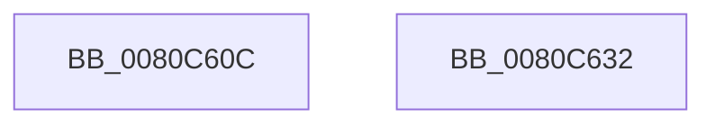

# MiInitializeWsSwapping

- RVA: `0x0080C60C`–`0x0080C633` (길이 `39` bytes)
- VA: `0x000000014080C60C`
- 실행 섹션: `PAGE`
- PDB 이름 있음: `예`; PDB Function 태그: `아니요`
- unwind 정보 RVA: `0x000DB714`
- 디코드: `7`개 명령, `39/39` bytes 표시
- 미해석 바이트: `0` (있으면 어셈블리에 `.byte`로 보존)

> 이 문서는 커널 이미지의 기계어와 PDB 기호를 분석해 생성했습니다. 4번과 5번은 함수 원형과 자료형을 바이너리 사용 방식에서 추정한 C 해석이며 원본 소스 복구 결과는 아닙니다.

## 1. Dependencies

- 직접 호출 지점: **0**; 고유 호출 대상: **0**
- 직접 호출자로 확인된 함수: **1**
- RIP 상대 이미지 참조: **1**

### Outgoing calls
- 직접 디코드된 call 명령이 없습니다.

### Direct callers
- [MiInitNucleus](../../init/C5/MiInitNucleus_function_00C5FD38.md) at `0x00C6049E`

### Static image references
- `0x0080C614` → RVA `0x0068B860` (`MiContractWsSwapPageFileWorker`; read)

## 2. Other-region calls and transfers

- 다른 실행 섹션으로 향하는 call: **0**
- 별도 외부 분기/꼬리 이동을 확인하지 못했습니다.

## 3. Assembly (complete function range)

```asm
0080C60C  48 83 A1 98 04 00 00 00         and qword ptr [rcx + 0x498], 0
0080C614  48 8D 05 45 F2 E7 FF            lea rax, [rip - 0x180dbb]
0080C61B  48 83 A1 70 04 00 00 00         and qword ptr [rcx + 0x470], 0
0080C623  48 89 81 80 04 00 00            mov qword ptr [rcx + 0x480], rax
0080C62A  48 89 89 88 04 00 00            mov qword ptr [rcx + 0x488], rcx
0080C631  C3                              ret
0080C632  CC                              int3
```

## 4. C-style interpretation (structured pseudocode)

```c
__int64 __fastcall MiInitializeWsSwapping(__int64 a1)
{
    *(unsigned __int64 *)(a1 + 1152) = v_rip - 1576379;
    *(unsigned __int64 *)(a1 + 1160) = a1;
    return v_rip - 1576379;
}
```

## 5. (Beta) C Style

```c
int64_t MiInitializeWsSwapping(void *Arg1)
{
    uint8_t *arg1 = (uint8_t *)Arg1;

    *(uint64_t *)(arg1 + 0x480) = v_rip - 1576379;
    *(void **)(arg1 + 0x488) = Arg1;
    return v_rip - 1576379;
}
```

### 관측된 메모리 오프셋

구조체 형식이 확인되지 않은 접근은 인자 기준의 오프셋으로만 기록했습니다.

| 기준 인자 | 오프셋 표현 | 폭 (bit) | 접근 |
|---|---:|---:|---|
| `Arg1` | `+ 0x470` | `64` | `R/W` |
| `Arg1` | `+ 0x480` | `64` | `W` |
| `Arg1` | `+ 0x488` | `64` | `W` |
| `Arg1` | `+ 0x498` | `64` | `R/W` |

## 6. Execution-region graph

[열기: 2D/3D 그래프와 함수 탐색 컨트롤 패널](../../../control-panel.html?section=page&rva=0x0080C60C&view=graph)

- 2D 그래프는 위에서 아래로 흐르고, 3D 그래프는 빈 공간을 드래그해 회전합니다. Shift+드래그는 이동, 휠은 확대·축소, 함수 노드 선택은 대상 보고서 이동입니다.

### Static fallback


