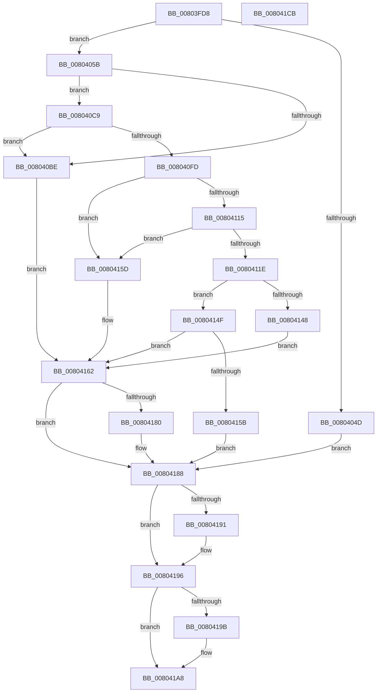

# MiInjectThreadForHotPatch

- RVA: `0x00803FD8`–`0x008041CC` (길이 `500` bytes)
- VA: `0x0000000140803FD8`
- 실행 섹션: `PAGE`
- PDB 이름 있음: `예`; PDB Function 태그: `아니요`
- unwind 정보 RVA: `0x000CBCB4`
- 디코드: `130`개 명령, `500/500` bytes 표시
- 미해석 바이트: `0` (있으면 어셈블리에 `.byte`로 보존)

> 이 문서는 커널 이미지의 기계어와 PDB 기호를 분석해 생성했습니다. 4번과 5번은 함수 원형과 자료형을 바이너리 사용 방식에서 추정한 C 해석이며 원본 소스 복구 결과는 아닙니다.

## 1. Dependencies

- 직접 호출 지점: **10**; 고유 호출 대상: **9**
- 직접 호출자로 확인된 함수: **1**
- RIP 상대 이미지 참조: **2**

### Outgoing calls
- `0x00804040` → [ExAcquireRundownProtection](../../text/21/ExAcquireRundownProtection_function_00216620.md) (function, `0x00216620`)
- `0x008040B5` → [ZwCreateThreadEx](../../text/6A/ZwCreateThreadEx_function_006AE9F0.md) (function, `0x006AE9F0`)
- `0x008040F4` → [ObpReferenceObjectByHandleWithTag](../86/ObpReferenceObjectByHandleWithTag_function_00869650.md) (function, `0x00869650`)
- `0x00804100` → [ExReleaseRundownProtection](../../text/34/ExReleaseRundownProtection_function_00349E80.md) (function, `0x00349E80`)
- `0x0080413C` → [KeWaitForSingleObject](../../text/20/KeWaitForSingleObject_function_0020E6B0.md) (function, `0x0020E6B0`)
- `0x00804152` → [PsGetThreadExitStatus](../A6/PsGetThreadExitStatus_function_00A65500.md) (function, `0x00A65500`)
- `0x00804176` → [MiLogHotPatchOperationStatus](MiLogHotPatchOperationStatus_function_00804E84.md) (function, `0x00804E84`)
- `0x00804183` → [ExReleaseRundownProtection](../../text/34/ExReleaseRundownProtection_function_00349E80.md) (function, `0x00349E80`)
- `0x00804191` → [ZwClose](../../text/6A/ZwClose_function_006AD2B0.md) (function, `0x006AD2B0`)
- `0x008041A3` → [ObfDereferenceObjectWithTag](../../text/2F/ObfDereferenceObjectWithTag_function_002F78E0.md) (function, `0x002F78E0`)

### Direct callers
- [MiHotPatchProcess](MiHotPatchProcess_function_00803B78.md) at `0x00803D11`

### Static image references
- `0x0080405B` → RVA `0x00FC7510` (`ALMOSTRO`; read)
- `0x008040C9` → RVA `0x00FC6AC8` (`ALMOSTRO`; read)

## 2. Other-region calls and transfers

- 다른 실행 섹션으로 향하는 call: **7**
  - `0x00804040` → [ExAcquireRundownProtection](../../text/21/ExAcquireRundownProtection_function_00216620.md) (`PAGE` → `.text`)
  - `0x008040B5` → [ZwCreateThreadEx](../../text/6A/ZwCreateThreadEx_function_006AE9F0.md) (`PAGE` → `.text`)
  - `0x00804100` → [ExReleaseRundownProtection](../../text/34/ExReleaseRundownProtection_function_00349E80.md) (`PAGE` → `.text`)
  - `0x0080413C` → [KeWaitForSingleObject](../../text/20/KeWaitForSingleObject_function_0020E6B0.md) (`PAGE` → `.text`)
  - `0x00804183` → [ExReleaseRundownProtection](../../text/34/ExReleaseRundownProtection_function_00349E80.md) (`PAGE` → `.text`)
  - `0x00804191` → [ZwClose](../../text/6A/ZwClose_function_006AD2B0.md) (`PAGE` → `.text`)
  - `0x008041A3` → [ObfDereferenceObjectWithTag](../../text/2F/ObfDereferenceObjectWithTag_function_002F78E0.md) (`PAGE` → `.text`)
- 별도 외부 분기/꼬리 이동을 확인하지 못했습니다.

## 3. Assembly (complete function range)

```asm
00803FD8  48 8B C4                        mov rax, rsp
00803FDB  48 89 58 08                     mov qword ptr [rax + 8], rbx
00803FDF  48 89 70 10                     mov qword ptr [rax + 0x10], rsi
00803FE3  48 89 78 18                     mov qword ptr [rax + 0x18], rdi
00803FE7  55                              push rbp
00803FE8  41 54                           push r12
00803FEA  41 55                           push r13
00803FEC  41 56                           push r14
00803FEE  41 57                           push r15
00803FF0  48 8D 68 A1                     lea rbp, [rax - 0x5f]
00803FF4  48 81 EC A0 00 00 00            sub rsp, 0xa0
00803FFB  33 C0                           xor eax, eax
00803FFD  0F 57 C0                        xorps xmm0, xmm0
00804000  33 FF                           xor edi, edi
00804002  48 89 45 27                     mov qword ptr [rbp + 0x27], rax
00804006  0F 11 45 07                     movups xmmword ptr [rbp + 7], xmm0
0080400A  89 45 2F                        mov dword ptr [rbp + 0x2f], eax
0080400D  4C 8B F9                        mov r15, rcx
00804010  0F 11 45 17                     movups xmmword ptr [rbp + 0x17], xmm0
00804014  48 89 7D FF                     mov qword ptr [rbp - 1], rdi
00804018  45 8B E0                        mov r12d, r8d
0080401B  48 89 7D F7                     mov qword ptr [rbp - 9], rdi
0080401F  44 8B EA                        mov r13d, edx
00804022  65 48 8B 04 25 88 01 00 00      mov rax, qword ptr gs:[0x188]
0080402B  48 89 7D 7F                     mov qword ptr [rbp + 0x7f], rdi
0080402F  48 8B B0 B8 00 00 00            mov rsi, qword ptr [rax + 0xb8]
00804036  48 81 C6 E8 01 00 00            add rsi, 0x1e8
0080403D  48 8B CE                        mov rcx, rsi
00804040  E8 DB 25 A1 FF                  call 0x140216620
00804045  44 0F B6 F0                     movzx r14d, al
00804049  84 C0                           test al, al
0080404B  75 0E                           jne 0x14080405b
0080404D  48 8B 5D 7F                     mov rbx, qword ptr [rbp + 0x7f]
00804051  BF 0A 01 00 C0                  mov edi, 0xc000010a
00804056  E9 2D 01 00 00                  jmp 0x140804188
0080405B  48 8B 05 AE 34 7C 00            mov rax, qword ptr [rip + 0x7c34ae]
00804062  4C 8D 45 07                     lea r8, [rbp + 7]
00804066  48 89 7C 24 50                  mov qword ptr [rsp + 0x50], rdi
0080406B  48 8D 4D F7                     lea rcx, [rbp - 9]
0080406F  48 89 7C 24 48                  mov qword ptr [rsp + 0x48], rdi
00804074  0F 57 C0                        xorps xmm0, xmm0
00804077  48 89 7C 24 40                  mov qword ptr [rsp + 0x40], rdi
0080407C  BB FF FF 1F 00                  mov ebx, 0x1fffff
00804081  48 89 7C 24 38                  mov qword ptr [rsp + 0x38], rdi
00804086  49 83 C9 FF                     or r9, 0xffffffffffffffff
0080408A  89 7C 24 30                     mov dword ptr [rsp + 0x30], edi
0080408E  8B D3                           mov edx, ebx
00804090  4C 89 7C 24 28                  mov qword ptr [rsp + 0x28], r15
00804095  48 89 44 24 20                  mov qword ptr [rsp + 0x20], rax
0080409A  C7 45 07 30 00 00 00            mov dword ptr [rbp + 7], 0x30
008040A1  48 89 7D 0F                     mov qword ptr [rbp + 0xf], rdi
008040A5  C7 45 1F 00 02 00 00            mov dword ptr [rbp + 0x1f], 0x200
008040AC  48 89 7D 17                     mov qword ptr [rbp + 0x17], rdi
008040B0  F3 0F 7F 45 27                  movdqu xmmword ptr [rbp + 0x27], xmm0
008040B5  E8 36 A9 EA FF                  call 0x1406ae9f0
008040BA  85 C0                           test eax, eax
008040BC  79 0B                           jns 0x1408040c9
008040BE  48 8B 5D 7F                     mov rbx, qword ptr [rbp + 0x7f]
008040C2  8B F8                           mov edi, eax
008040C4  E9 99 00 00 00                  jmp 0x140804162
008040C9  4C 8B 05 F8 29 7C 00            mov r8, qword ptr [rip + 0x7c29f8]
008040D0  48 8D 45 7F                     lea rax, [rbp + 0x7f]
008040D4  48 8B 4D F7                     mov rcx, qword ptr [rbp - 9]
008040D8  45 33 C9                        xor r9d, r9d
008040DB  48 89 7C 24 38                  mov qword ptr [rsp + 0x38], rdi
008040E0  8B D3                           mov edx, ebx
008040E2  48 89 7C 24 30                  mov qword ptr [rsp + 0x30], rdi
008040E7  48 89 44 24 28                  mov qword ptr [rsp + 0x28], rax
008040EC  C7 44 24 20 4D 6D 48 70         mov dword ptr [rsp + 0x20], 0x70486d4d
008040F4  E8 57 55 06 00                  call 0x140869650
008040F9  85 C0                           test eax, eax
008040FB  78 C1                           js 0x1408040be
008040FD  48 8B CE                        mov rcx, rsi
00804100  E8 7B 5D B4 FF                  call 0x140349e80
00804105  48 8B 5D 7F                     mov rbx, qword ptr [rbp + 0x7f]
00804109  44 8B F7                        mov r14d, edi
0080410C  40 38 BB 84 02 00 00            cmp byte ptr [rbx + 0x284], dil
00804113  75 48                           jne 0x14080415d
00804115  F7 43 78 00 40 00 00            test dword ptr [rbx + 0x78], 0x4000
0080411C  75 3F                           jne 0x14080415d
0080411E  45 33 C9                        xor r9d, r9d
00804121  48 C7 45 FF 00 1F 0A FA         mov qword ptr [rbp - 1], 0xfffffffffa0a1f00
00804129  48 8D 45 FF                     lea rax, [rbp - 1]
0080412D  45 33 C0                        xor r8d, r8d
00804130  48 8B CB                        mov rcx, rbx
00804133  48 89 44 24 20                  mov qword ptr [rsp + 0x20], rax
00804138  41 8D 51 1A                     lea edx, [r9 + 0x1a]
0080413C  E8 6F A5 A0 FF                  call 0x14020e6b0
00804141  3D 02 01 00 00                  cmp eax, 0x102
00804146  75 07                           jne 0x14080414f
00804148  B8 7D 04 00 C0                  mov eax, 0xc000047d
0080414D  EB 13                           jmp 0x140804162
0080414F  48 8B CB                        mov rcx, rbx
00804152  E8 A9 13 26 00                  call 0x140a65500
00804157  85 C0                           test eax, eax
00804159  78 07                           js 0x140804162
0080415B  EB 2B                           jmp 0x140804188
0080415D  B8 01 00 00 40                  mov eax, 0x40000001
00804162  44 8B C8                        mov r9d, eax
00804165  C7 44 24 20 03 00 00 00         mov dword ptr [rsp + 0x20], 3
0080416D  4D 8B C7                        mov r8, r15
00804170  41 8B D4                        mov edx, r12d
00804173  41 8B CD                        mov ecx, r13d
00804176  E8 09 0D 00 00                  call 0x140804e84
0080417B  45 85 F6                        test r14d, r14d
0080417E  74 08                           je 0x140804188
00804180  48 8B CE                        mov rcx, rsi
00804183  E8 F8 5C B4 FF                  call 0x140349e80
00804188  48 8B 4D F7                     mov rcx, qword ptr [rbp - 9]
0080418C  48 85 C9                        test rcx, rcx
0080418F  74 05                           je 0x140804196
00804191  E8 1A 91 EA FF                  call 0x1406ad2b0
00804196  48 85 DB                        test rbx, rbx
00804199  74 0D                           je 0x1408041a8
0080419B  BA 4D 6D 48 70                  mov edx, 0x70486d4d
008041A0  48 8B CB                        mov rcx, rbx
008041A3  E8 38 37 AF FF                  call 0x1402f78e0
008041A8  4C 8D 9C 24 A0 00 00 00         lea r11, [rsp + 0xa0]
008041B0  8B C7                           mov eax, edi
008041B2  49 8B 5B 30                     mov rbx, qword ptr [r11 + 0x30]
008041B6  49 8B 73 38                     mov rsi, qword ptr [r11 + 0x38]
008041BA  49 8B 7B 40                     mov rdi, qword ptr [r11 + 0x40]
008041BE  49 8B E3                        mov rsp, r11
008041C1  41 5F                           pop r15
008041C3  41 5E                           pop r14
008041C5  41 5D                           pop r13
008041C7  41 5C                           pop r12
008041C9  5D                              pop rbp
008041CA  C3                              ret
008041CB  CC                              int3
```

## 4. C-style interpretation (structured pseudocode)

```c
__int64 __fastcall MiInjectThreadForHotPatch(__int64 a1, int a2, int a3, __int64 a4)
{
    __int64 result;
    __int64 v_rdi;
    __int64 v_rsi;
    __int64 v_rsp;
    unsigned __int64 v_stack_m28;
    unsigned __int64 v_stack_m78;
    unsigned __int64 v_stack_m80;
    unsigned __int64 v_stack_m88;
    unsigned __int64 v_stack_m90;
    unsigned int v_stack_m98;
    unsigned __int64 v_stack_mA0;
    unsigned __int64 v_stack_mA8;

    *(unsigned __int64 *)(v_rsp + 8) = v_rbx;
    *(unsigned __int64 *)(v_rsp + 16) = v_rsi;
    *(unsigned __int64 *)(v_rsp + 24) = v_rdi;
    v_rsp = (v_rsp) - (160);
    result = 0;
    v_rdi = 0;
    *(unsigned __int64 *)(v_rsp - 95 + 39) = 0;
    *(unsigned __int64 *)(v_rsp - 95 + 7) = v_xmm0;
    *(unsigned int *)(v_rsp - 95 + 47) = 0;
    *(unsigned __int64 *)(v_rsp - 95 + 23) = v_xmm0;
    *(unsigned __int64 *)(v_rsp - 95 - 1) = 0;
    *(unsigned __int64 *)(v_rsp - 95 - 9) = 0;
    *(unsigned __int64 *)(v_rsp - 95 + 127) = 0;
    v_rsi = (*(unsigned __int64 *)(*(unsigned __int64 *)(gs_base + (0 + 392)) + 184)) + (488);
    result = ExAcquireRundownProtection(v_rsi, a2, a3, a4);
    if ((unsigned __int8)(result) != 0) goto loc_0080405B;
    goto loc_00804188;
loc_0080405B:
    v_stack_m78 = (unsigned int)(0xC000010AULL);
    v_stack_m80 = (unsigned int)(0xC000010AULL);
    v_stack_m88 = (unsigned int)(0xC000010AULL);
    v_stack_m90 = (unsigned int)(0xC000010AULL);
    a4 = (a4) | (-1);
    v_stack_m98 = (unsigned int)((unsigned int)(0xC000010AULL));
    v_stack_mA0 = a1;
    v_stack_mA8 = *(unsigned __int64 *)(v_rip + 8139950);
    *(unsigned int *)(v_rsp - 95 + 7) = 48;
    *(unsigned __int64 *)(v_rsp - 95 + 15) = (unsigned int)(0xC000010AULL);
    *(unsigned int *)(v_rsp - 95 + 31) = 512;
    *(unsigned __int64 *)(v_rsp - 95 + 23) = (unsigned int)(0xC000010AULL);
    *(unsigned __int64 *)(v_rsp - 95 + 39) = v_xmm0;
    result = ZwCreateThreadEx(v_rsp - 95 - 9, (unsigned int)((unsigned int)((unsigned int)(0x1FFFFFULL))), v_rsp - 95 + 7, a4);
    if (!sign_flag) goto loc_008040C9;
loc_008040BE:
    goto loc_00804162;
loc_008040C9:
    a4 = 0;
    v_stack_m90 = (unsigned int)((unsigned int)(result));
    v_stack_m98 = (unsigned int)((unsigned int)(result));
    v_stack_mA0 = v_rsp - 95 + 127;
    v_stack_mA8 = 0x70486D4DULL;
    result = ObpReferenceObjectByHandleWithTag(*(unsigned __int64 *)(v_rsp - 95 - 9), (unsigned int)((unsigned int)(*(unsigned __int64 *)(v_rsp - 95 + 127))), *(unsigned __int64 *)(v_rip + 8137208), a4);
    if (sign_flag) goto loc_008040BE;
    result = ExReleaseRundownProtection(v_rsi, (unsigned int)((unsigned int)(*(unsigned __int64 *)(v_rsp - 95 + 127))), *(unsigned __int64 *)(v_rip + 8137208), a4);
    if ((*(unsigned __int8 *)(*(unsigned __int64 *)(v_rsp - 95 + 127) + 644)) != ((unsigned __int8)((unsigned int)((unsigned int)(result))))) goto loc_0080415D;
    if (((*(unsigned int *)(*(unsigned __int64 *)(v_rsp - 95 + 127) + 120)) & (0x4000ULL)) != 0) goto loc_0080415D;
    a4 = 0;
    *(unsigned __int64 *)(v_rsp - 95 - 1) = 0xFFFFFFFFFA0A1F00ULL;
    a3 = 0;
    v_stack_mA8 = v_rsp - 95 - 1;
    result = KeWaitForSingleObject(*(unsigned __int64 *)(v_rsp - 95 + 127), a4 + 26, a3, a4);
    if (((unsigned int)(result)) != 258) goto loc_0080414F;
    goto loc_00804162;
loc_0080414F:
    result = PsGetThreadExitStatus(*(unsigned __int64 *)(v_rsp - 95 + 127), a4 + 26, a3, a4);
    if (sign_flag) goto loc_00804162;
    goto loc_00804188;
loc_0080415D:
loc_00804162:
    v_stack_mA8 = 3;
    result = MiLogHotPatchOperationStatus((unsigned int)((unsigned int)((unsigned int)(a2))), (unsigned int)((unsigned int)((unsigned int)(a3))), a1, (unsigned int)((unsigned int)((unsigned int)(0x40000001ULL))));
    if ((unsigned int)((unsigned int)((unsigned int)((unsigned int)((unsigned int)(result))))) != 0) {
        a1 = v_rsi;
        result = ExReleaseRundownProtection(a1, (unsigned int)((unsigned int)((unsigned int)(a3))), a1, (unsigned int)((unsigned int)((unsigned int)(0x40000001ULL))));
    }
    if (*(unsigned __int64 *)(v_rsp - 95 - 9) != 0) {
        result = ZwClose(*(unsigned __int64 *)(v_rsp - 95 - 9), (unsigned int)((unsigned int)((unsigned int)(a3))), a1, (unsigned int)((unsigned int)((unsigned int)(0x40000001ULL))));
    }
    if (*(unsigned __int64 *)(v_rsp - 95 + 127) != 0) {
        a2 = 0x70486D4DULL;
        a1 = *(unsigned __int64 *)(v_rsp - 95 + 127);
        result = ObfDereferenceObjectWithTag(a1, a2, a1, (unsigned int)((unsigned int)((unsigned int)(0x40000001ULL))));
    }
    return (unsigned int)((unsigned int)((unsigned int)((unsigned int)(result))));
}
```

## 5. (Beta) C Style

```c
int64_t MiInjectThreadForHotPatch(int64_t Arg1, int32_t Arg2, int32_t Arg3, int64_t Arg4)
{
    int64_t result;
    int64_t local_rdi;
    int64_t local_rsi;
    int64_t local_rsp;
    uint64_t v_stack_m28;
    uint64_t v_stack_m78;
    uint64_t v_stack_m80;
    uint64_t v_stack_m88;
    uint64_t v_stack_m90;
    uint32_t v_stack_m98;
    uint64_t v_stack_mA0;
    uint64_t v_stack_mA8;

    *(uint64_t *)(local_rsp + 0x8) = local_rbx;
    *(uint64_t *)(local_rsp + 0x10) = local_rsi;
    *(uint64_t *)(local_rsp + 0x18) = local_rdi;
    local_rsp = (local_rsp) - (160);
    result = 0;
    local_rdi = 0;
    *(uint64_t *)(local_rsp - 0x5F + 0x27) = 0;
    *(uint64_t *)(local_rsp - 0x5F + 0x7) = v_xmm0;
    *(uint32_t *)(local_rsp - 0x5F + 0x2F) = 0;
    *(uint64_t *)(local_rsp - 0x5F + 0x17) = v_xmm0;
    *(uint64_t *)(local_rsp - 0x5F - 0x1) = 0;
    *(uint64_t *)(local_rsp - 0x5F - 0x9) = 0;
    *(uint64_t *)(local_rsp - 0x5F + 0x7F) = 0;
    local_rsi = (*(uint64_t *)(*(uint64_t *)(gs_base + (0 + 0x188)) + 0xB8)) + (488);
    result = ExAcquireRundownProtection(local_rsi, Arg2, Arg3, Arg4);
    if ((uint8_t)(result) != 0) goto loc_0080405B;
    goto loc_00804188;
loc_0080405B:
    v_stack_m78 = (uint32_t)(0xC000010AULL);
    v_stack_m80 = (uint32_t)(0xC000010AULL);
    v_stack_m88 = (uint32_t)(0xC000010AULL);
    v_stack_m90 = (uint32_t)(0xC000010AULL);
    Arg4 = (Arg4) | (-1);
    v_stack_m98 = (uint32_t)((uint32_t)(0xC000010AULL));
    v_stack_mA0 = Arg1;
    v_stack_mA8 = *(uint64_t *)(v_rip + 0x7C34AE);
    *(uint32_t *)(local_rsp - 0x5F + 0x7) = 48;
    *(uint64_t *)(local_rsp - 0x5F + 0xF) = (uint32_t)(0xC000010AULL);
    *(uint32_t *)(local_rsp - 0x5F + 0x1F) = 512;
    *(uint64_t *)(local_rsp - 0x5F + 0x17) = (uint32_t)(0xC000010AULL);
    *(uint64_t *)(local_rsp - 0x5F + 0x27) = v_xmm0;
    result = ZwCreateThreadEx(local_rsp - 95 - 9, (uint32_t)((uint32_t)((uint32_t)(0x1FFFFFULL))), local_rsp - 95 + 7, Arg4);
    if (!sign_flag) goto loc_008040C9;
loc_008040BE:
    goto loc_00804162;
loc_008040C9:
    Arg4 = 0;
    v_stack_m90 = (uint32_t)((uint32_t)(result));
    v_stack_m98 = (uint32_t)((uint32_t)(result));
    v_stack_mA0 = local_rsp - 95 + 127;
    v_stack_mA8 = 0x70486D4DULL;
    result = ObpReferenceObjectByHandleWithTag(*(uint64_t *)(local_rsp - 0x5F - 0x9), (uint32_t)((uint32_t)(*(uint64_t *)(local_rsp - 0x5F + 0x7F))), *(uint64_t *)(v_rip + 0x7C29F8), Arg4);
    if (sign_flag) goto loc_008040BE;
    result = ExReleaseRundownProtection(local_rsi, (uint32_t)((uint32_t)(*(uint64_t *)(local_rsp - 0x5F + 0x7F))), *(uint64_t *)(v_rip + 0x7C29F8), Arg4);
    if ((*(uint8_t *)(*(uint64_t *)(local_rsp - 0x5F + 0x7F) + 0x284)) != ((uint8_t)((uint32_t)((uint32_t)(result))))) goto loc_0080415D;
    if (((*(uint32_t *)(*(uint64_t *)(local_rsp - 0x5F + 0x7F) + 0x78)) & (0x4000ULL)) != 0) goto loc_0080415D;
    Arg4 = 0;
    *(uint64_t *)(local_rsp - 0x5F - 0x1) = 0xFFFFFFFFFA0A1F00ULL;
    Arg3 = 0;
    v_stack_mA8 = local_rsp - 95 - 1;
    result = KeWaitForSingleObject(*(uint64_t *)(local_rsp - 0x5F + 0x7F), Arg4 + 26, Arg3, Arg4);
    if (((uint32_t)(result)) != 258) goto loc_0080414F;
    goto loc_00804162;
loc_0080414F:
    result = PsGetThreadExitStatus(*(uint64_t *)(local_rsp - 0x5F + 0x7F), Arg4 + 26, Arg3, Arg4);
    if (sign_flag) goto loc_00804162;
    goto loc_00804188;
loc_0080415D:
loc_00804162:
    v_stack_mA8 = 3;
    result = MiLogHotPatchOperationStatus((uint32_t)((uint32_t)((uint32_t)(Arg2))), (uint32_t)((uint32_t)((uint32_t)(Arg3))), Arg1, (uint32_t)((uint32_t)((uint32_t)(0x40000001ULL))));
    if ((uint32_t)((uint32_t)((uint32_t)((uint32_t)((uint32_t)(result))))) != 0) {
        Arg1 = local_rsi;
        result = ExReleaseRundownProtection(Arg1, (uint32_t)((uint32_t)((uint32_t)(Arg3))), Arg1, (uint32_t)((uint32_t)((uint32_t)(0x40000001ULL))));
    }
    if (*(uint64_t *)(local_rsp - 0x5F - 0x9) != 0) {
        result = ZwClose(*(uint64_t *)(local_rsp - 0x5F - 0x9), (uint32_t)((uint32_t)((uint32_t)(Arg3))), Arg1, (uint32_t)((uint32_t)((uint32_t)(0x40000001ULL))));
    }
    if (*(uint64_t *)(local_rsp - 0x5F + 0x7F) != 0) {
        Arg2 = 0x70486D4DULL;
        Arg1 = *(uint64_t *)(local_rsp - 0x5F + 0x7F);
        result = ObfDereferenceObjectWithTag(Arg1, Arg2, Arg1, (uint32_t)((uint32_t)((uint32_t)(0x40000001ULL))));
    }
    return (uint32_t)((uint32_t)((uint32_t)((uint32_t)(result))));
}
```

## 6. Execution-region graph

[열기: 2D/3D 그래프와 함수 탐색 컨트롤 패널](../../../control-panel.html?section=page&rva=0x00803FD8&view=graph)

- 2D 그래프는 위에서 아래로 흐르고, 3D 그래프는 빈 공간을 드래그해 회전합니다. Shift+드래그는 이동, 휠은 확대·축소, 함수 노드 선택은 대상 보고서 이동입니다.

### Static fallback


