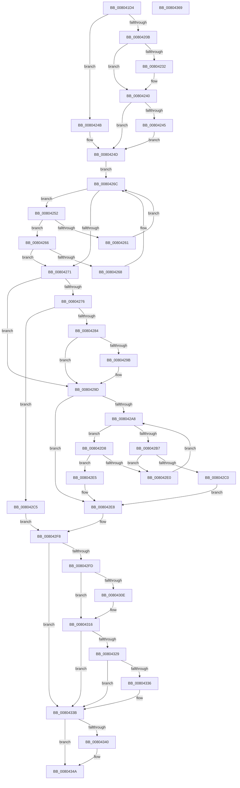

# MiInsertHotPatchRecord

- RVA: `0x008041D4`–`0x0080436A` (길이 `406` bytes)
- VA: `0x00000001408041D4`
- 실행 섹션: `PAGE`
- PDB 이름 있음: `예`; PDB Function 태그: `아니요`
- unwind 정보 RVA: `0x00075C18`
- 디코드: `129`개 명령, `406/406` bytes 표시
- 미해석 바이트: `0` (있으면 어셈블리에 `.byte`로 보존)

> 이 문서는 커널 이미지의 기계어와 PDB 기호를 분석해 생성했습니다. 4번과 5번은 함수 원형과 자료형을 바이너리 사용 방식에서 추정한 C 해석이며 원본 소스 복구 결과는 아닙니다.

## 1. Dependencies

- 직접 호출 지점: **11**; 고유 호출 대상: **10**
- 직접 호출자로 확인된 함수: **3**
- RIP 상대 이미지 참조: **2**

### Outgoing calls
- `0x00804221` → [KeAbPreAcquire](../../text/21/KeAbPreAcquire_function_00210230.md) (function, `0x00210230`)
- `0x0080423B` → [ExfAcquirePushLockExclusiveEx](../../text/20/ExfAcquirePushLockExclusiveEx_function_0020FC90.md) (function, `0x0020FC90`)
- `0x00804258` → [MiCompareHotPatchNodes](MiCompareHotPatchNodes_function_00803114.md) (function, `0x00803114`)
- `0x0080428A` → [RtlAvlRemoveNode](../../text/29/RtlAvlRemoveNode_function_00296650.md) (function, `0x00296650`)
- `0x00804292` → [MiInsertPreviouslyRegisteredHotPatchRecord](MiInsertPreviouslyRegisteredHotPatchRecord_function_00804370.md) (function, `0x00804370`)
- `0x008042AE` → [MiCompareHotPatchNodes](MiCompareHotPatchNodes_function_00803114.md) (function, `0x00803114`)
- `0x008042F1` → [RtlAvlInsertNodeEx](../../text/26/RtlAvlInsertNodeEx_function_00265790.md) (function, `0x00265790`)
- `0x00804311` → [ExfTryToWakePushLock](../../text/26/ExfTryToWakePushLock_function_00265DD0.md) (function, `0x00265DD0`)
- `0x00804319` → [KeAbPostRelease](../../text/2E/KeAbPostRelease_function_002E1600.md) (function, `0x002E1600`)
- `0x00804336` → [KiCheckForKernelApcDelivery](../../text/2E/KiCheckForKernelApcDelivery_function_002E2C80.md) (function, `0x002E2C80`)
- `0x00804345` → [ExFreePoolWithTag](../../poolcode/B8/ExFreePoolWithTag_function_00B82870.md) (function, `0x00B82870`)

### Direct callers
- [MiLoadHotPatchForUserSid](../AB/MiLoadHotPatchForUserSid_function_00AB4F08.md) at `0x00AB513C`
- [MiLoadHotPatch](../AB/MiLoadHotPatch_function_00AB521C.md) at `0x00AB536D`
- [MmRegisterHotPatches](../../init/C6/MmRegisterHotPatches_function_00C678DC.md) at `0x00C6798F`

### Static image references
- `0x008041F2` → RVA `0x00E37590` (`.data`; read)
- `0x008042FD` → RVA `0x00E37590` (`.data`; read/write)

## 2. Other-region calls and transfers

- 다른 실행 섹션으로 향하는 call: **8**
  - `0x00804221` → [KeAbPreAcquire](../../text/21/KeAbPreAcquire_function_00210230.md) (`PAGE` → `.text`)
  - `0x0080423B` → [ExfAcquirePushLockExclusiveEx](../../text/20/ExfAcquirePushLockExclusiveEx_function_0020FC90.md) (`PAGE` → `.text`)
  - `0x0080428A` → [RtlAvlRemoveNode](../../text/29/RtlAvlRemoveNode_function_00296650.md) (`PAGE` → `.text`)
  - `0x008042F1` → [RtlAvlInsertNodeEx](../../text/26/RtlAvlInsertNodeEx_function_00265790.md) (`PAGE` → `.text`)
  - `0x00804311` → [ExfTryToWakePushLock](../../text/26/ExfTryToWakePushLock_function_00265DD0.md) (`PAGE` → `.text`)
  - `0x00804319` → [KeAbPostRelease](../../text/2E/KeAbPostRelease_function_002E1600.md) (`PAGE` → `.text`)
  - `0x00804336` → [KiCheckForKernelApcDelivery](../../text/2E/KiCheckForKernelApcDelivery_function_002E2C80.md) (`PAGE` → `.text`)
  - `0x00804345` → [ExFreePoolWithTag](../../poolcode/B8/ExFreePoolWithTag_function_00B82870.md) (`PAGE` → `POOLCODE`)
- 별도 외부 분기/꼬리 이동을 확인하지 못했습니다.

## 3. Assembly (complete function range)

```asm
008041D4  48 89 5C 24 08                  mov qword ptr [rsp + 8], rbx
008041D9  48 89 6C 24 10                  mov qword ptr [rsp + 0x10], rbp
008041DE  48 89 74 24 18                  mov qword ptr [rsp + 0x18], rsi
008041E3  57                              push rdi
008041E4  41 54                           push r12
008041E6  41 55                           push r13
008041E8  41 56                           push r14
008041EA  41 57                           push r15
008041EC  48 83 EC 20                     sub rsp, 0x20
008041F0  33 F6                           xor esi, esi
008041F2  4C 8D 2D 97 33 63 00            lea r13, [rip + 0x633397]
008041F9  48 83 CB FF                     or rbx, 0xffffffffffffffff
008041FD  45 8B E0                        mov r12d, r8d
00804200  4C 8B FA                        mov r15, rdx
00804203  4C 8B F1                        mov r14, rcx
00804206  45 85 C0                        test r8d, r8d
00804209  75 40                           jne 0x14080424b
0080420B  65 48 8B 2C 25 88 01 00 00      mov rbp, qword ptr gs:[0x188]
00804214  33 D2                           xor edx, edx
00804216  49 8B CD                        mov rcx, r13
00804219  66 01 9D E6 01 00 00            add word ptr [rbp + 0x1e6], bx
00804220  90                              nop
00804221  E8 0A C0 A0 FF                  call 0x140210230
00804226  F0 49 0F BA 6D 00 00            lock bts qword ptr [r13], 0
0080422D  48 8B F8                        mov rdi, rax
00804230  73 0E                           jae 0x140804240
00804232  4D 8B C5                        mov r8, r13
00804235  48 8B D0                        mov rdx, rax
00804238  49 8B CD                        mov rcx, r13
0080423B  E8 50 BA A0 FF                  call 0x14020fc90
00804240  48 85 FF                        test rdi, rdi
00804243  74 08                           je 0x14080424d
00804245  C6 47 0A 01                     mov byte ptr [rdi + 0xa], 1
00804249  EB 02                           jmp 0x14080424d
0080424B  33 ED                           xor ebp, ebp
0080424D  49 8B 3E                        mov rdi, qword ptr [r14]
00804250  EB 1A                           jmp 0x14080426c
00804252  48 8B D7                        mov rdx, rdi
00804255  49 8B CF                        mov rcx, r15
00804258  E8 B7 EE FF FF                  call 0x140803114
0080425D  85 C0                           test eax, eax
0080425F  79 05                           jns 0x140804266
00804261  48 8B 3F                        mov rdi, qword ptr [rdi]
00804264  EB 06                           jmp 0x14080426c
00804266  7E 09                           jle 0x140804271
00804268  48 8B 7F 08                     mov rdi, qword ptr [rdi + 8]
0080426C  48 85 FF                        test rdi, rdi
0080426F  75 E1                           jne 0x140804252
00804271  48 85 FF                        test rdi, rdi
00804274  74 27                           je 0x14080429d
00804276  41 8B 47 20                     mov eax, dword ptr [r15 + 0x20]
0080427A  48 8B F7                        mov rsi, rdi
0080427D  8B 4F 20                        mov ecx, dword ptr [rdi + 0x20]
00804280  3B C1                           cmp eax, ecx
00804282  76 41                           jbe 0x1408042c5
00804284  48 8B D7                        mov rdx, rdi
00804287  49 8B CE                        mov rcx, r14
0080428A  E8 C1 23 A9 FF                  call 0x140296650
0080428F  48 8B CF                        mov rcx, rdi
00804292  E8 D9 00 00 00                  call 0x140804370
00804297  85 C0                           test eax, eax
00804299  74 02                           je 0x14080429d
0080429B  33 F6                           xor esi, esi
0080429D  49 8B 3E                        mov rdi, qword ptr [r14]
008042A0  45 32 C0                        xor r8b, r8b
008042A3  48 85 FF                        test rdi, rdi
008042A6  74 40                           je 0x1408042e8
008042A8  48 8B D7                        mov rdx, rdi
008042AB  49 8B CF                        mov rcx, r15
008042AE  E8 61 EE FF FF                  call 0x140803114
008042B3  85 C0                           test eax, eax
008042B5  78 21                           js 0x1408042d8
008042B7  48 8B 47 08                     mov rax, qword ptr [rdi + 8]
008042BB  48 85 C0                        test rax, rax
008042BE  75 20                           jne 0x1408042e0
008042C0  41 B0 01                        mov r8b, 1
008042C3  EB 23                           jmp 0x1408042e8
008042C5  33 F6                           xor esi, esi
008042C7  BF FF 00 00 00                  mov edi, 0xff
008042CC  3B C1                           cmp eax, ecx
008042CE  BA 2A 04 00 C0                  mov edx, 0xc000042a
008042D3  0F 45 FA                        cmovne edi, edx
008042D6  EB 20                           jmp 0x1408042f8
008042D8  48 8B 07                        mov rax, qword ptr [rdi]
008042DB  48 85 C0                        test rax, rax
008042DE  74 05                           je 0x1408042e5
008042E0  48 8B F8                        mov rdi, rax
008042E3  EB C3                           jmp 0x1408042a8
008042E5  45 32 C0                        xor r8b, r8b
008042E8  4D 8B CF                        mov r9, r15
008042EB  48 8B D7                        mov rdx, rdi
008042EE  49 8B CE                        mov rcx, r14
008042F1  E8 9A 14 A6 FF                  call 0x140265790
008042F6  33 FF                           xor edi, edi
008042F8  45 85 E4                        test r12d, r12d
008042FB  75 3E                           jne 0x14080433b
008042FD  F0 48 0F C1 1D 8A 32 63 00      lock xadd qword ptr [rip + 0x63328a], rbx
00804306  80 E3 06                        and bl, 6
00804309  80 FB 02                        cmp bl, 2
0080430C  75 08                           jne 0x140804316
0080430E  49 8B CD                        mov rcx, r13
00804311  E8 BA 1A A6 FF                  call 0x140265dd0
00804316  49 8B CD                        mov rcx, r13
00804319  E8 E2 D2 AD FF                  call 0x1402e1600
0080431E  90                              nop
0080431F  66 83 85 E6 01 00 00 01         add word ptr [rbp + 0x1e6], 1
00804327  75 12                           jne 0x14080433b
00804329  48 8D 95 98 00 00 00            lea rdx, [rbp + 0x98]
00804330  90                              nop
00804331  48 39 12                        cmp qword ptr [rdx], rdx
00804334  74 05                           je 0x14080433b
00804336  E8 45 E9 AD FF                  call 0x1402e2c80
0080433B  48 85 F6                        test rsi, rsi
0080433E  74 0A                           je 0x14080434a
00804340  33 D2                           xor edx, edx
00804342  48 8B CE                        mov rcx, rsi
00804345  E8 26 E5 37 00                  call 0x140b82870
0080434A  48 8B 5C 24 50                  mov rbx, qword ptr [rsp + 0x50]
0080434F  8B C7                           mov eax, edi
00804351  48 8B 6C 24 58                  mov rbp, qword ptr [rsp + 0x58]
00804356  48 8B 74 24 60                  mov rsi, qword ptr [rsp + 0x60]
0080435B  48 83 C4 20                     add rsp, 0x20
0080435F  41 5F                           pop r15
00804361  41 5E                           pop r14
00804363  41 5D                           pop r13
00804365  41 5C                           pop r12
00804367  5F                              pop rdi
00804368  C3                              ret
00804369  CC                              int3
```

## 4. C-style interpretation (structured pseudocode)

```c
__int64 __fastcall MiInsertHotPatchRecord(__int64 a1, __int64 a2, int a3)
{
    __int64 result;
    __int64 v_rbp;
    __int64 v_rbx;
    __int64 v_rdi;
    __int64 v_rsi;
    __int64 v_rsp;
    unsigned __int64 v_stack_p10;
    unsigned __int64 v_stack_p18;
    unsigned __int64 v_stack_p8;

    v_stack_p8 = v_rbx;
    v_stack_p10 = v_rbp;
    v_stack_p18 = v_rsi;
    v_rsp = (v_rsp) - (32);
    v_rsi = 0;
    v_rbx = (v_rbx) | (-1);
    if (a3 != 0) goto loc_0080424B;
    a2 = 0;
    result = KeAbPreAcquire(v_rip + 6501271, a2, a3, a4);
    if (!(condition_is_above_or_equal)) {
        a3 = v_rip + 6501271;
        a2 = result;
        a1 = v_rip + 6501271;
        result = ExfAcquirePushLockExclusiveEx(a1, a2, a3, a4);
    }
    if (result == 0) goto loc_0080424D;
    *(unsigned __int8 *)(result + 10) = 1;
    goto loc_0080424D;
loc_0080424B:
    v_rbp = 0;
loc_0080424D:
    goto loc_0080426C;
loc_00804252:
    result = MiCompareHotPatchNodes(a2, *(unsigned __int64 *)(a1), a3, a4);
    if (!sign_flag) goto loc_00804266;
    goto loc_0080426C;
loc_00804266:
    if (condition_is_less_or_equal) goto loc_00804271;
loc_0080426C:
    if (*(unsigned __int64 *)(*(unsigned __int64 *)(*(unsigned __int64 *)(a1)) + 8) != 0) goto loc_00804252;
loc_00804271:
    if (*(unsigned __int64 *)(*(unsigned __int64 *)(*(unsigned __int64 *)(a1)) + 8) == 0) goto loc_0080429D;
    if (((unsigned int)((unsigned int)(*(unsigned int *)(a2 + 32)))) <= ((unsigned int)((unsigned int)(*(unsigned int *)(*(unsigned __int64 *)(*(unsigned __int64 *)(*(unsigned __int64 *)(a1)) + 8) + 32))))) goto loc_008042C5;
    result = RtlAvlRemoveNode(a1, *(unsigned __int64 *)(*(unsigned __int64 *)(*(unsigned __int64 *)(a1)) + 8), a3, a4);
    result = MiInsertPreviouslyRegisteredHotPatchRecord(*(unsigned __int64 *)(*(unsigned __int64 *)(*(unsigned __int64 *)(a1)) + 8), *(unsigned __int64 *)(*(unsigned __int64 *)(*(unsigned __int64 *)(a1)) + 8), a3, a4);
    v_rsi = *(unsigned __int64 *)(*(unsigned __int64 *)(*(unsigned __int64 *)(a1)) + 8);
    if ((unsigned int)(result) != 0) {
        v_rsi = 0;
    }
    a3 = 0;
    if (*(unsigned __int64 *)(a1) == 0) goto loc_008042E8;
loc_008042A8:
    result = MiCompareHotPatchNodes(a2, *(unsigned __int64 *)(a1), a3, a4);
    if (sign_flag) goto loc_008042D8;
    if (*(unsigned __int64 *)(*(unsigned __int64 *)(a1) + 8) != 0) goto loc_008042E0;
    goto loc_008042E8;
loc_008042C5:
    v_rsi = 0;
    v_rdi = 255;
    if (((unsigned int)(*(unsigned __int64 *)(*(unsigned __int64 *)(a1) + 8))) != ((unsigned int)(a2))) { v_rdi = (unsigned int)((unsigned int)(0xC000042AULL)); }
    goto loc_008042F8;
loc_008042D8:
    if (*(unsigned __int64 *)(v_rdi) == 0) goto loc_008042E5;
loc_008042E0:
    goto loc_008042A8;
loc_008042E5:
    a3 = 0;
loc_008042E8:
    result = RtlAvlInsertNodeEx(a1, *(unsigned __int64 *)(v_rdi), a3, a2);
    v_rdi = 0;
loc_008042F8:
    if ((unsigned int)((unsigned int)(a3)) != 0) goto loc_0080433B;
    v_rbx = (unsigned __int8)((v_rbx) & (6));
    if (((unsigned __int8)(v_rbx)) == 2) {
        a1 = v_rip + 6501271;
        result = ExfTryToWakePushLock(a1, *(unsigned __int64 *)(v_rdi), a3, a2);
    }
    result = KeAbPostRelease(v_rip + 6501271, *(unsigned __int64 *)(v_rdi), a3, a2);
    if (((unsigned __int8)(v_rbx)) != 2) goto loc_0080433B;
    if ((*(unsigned __int64 *)(v_rbp + 152)) != (v_rbp + 152)) {
        result = KiCheckForKernelApcDelivery(v_rip + 6501271, v_rbp + 152, a3, a2);
    }
    if (0 != 0) {
        a2 = 0;
        a1 = 0;
        result = ExFreePoolWithTag(a1, a2, a3, a2);
    }
    v_rsp = (v_rsp) + (32);
    return 0;
}
```

## 5. (Beta) C Style

```c
int64_t MiInsertHotPatchRecord(void *Arg1, void *Arg2, int32_t Arg3)
{
    uint8_t *arg1 = (uint8_t *)Arg1;
    uint8_t *arg2 = (uint8_t *)Arg2;

    int64_t result;
    int64_t local_rbp;
    int64_t local_rbx;
    int64_t local_rdi;
    int64_t local_rsi;
    int64_t local_rsp;
    uint64_t v_stack_p10;
    uint64_t v_stack_p18;
    uint64_t v_stack_p8;

    v_stack_p8 = local_rbx;
    v_stack_p10 = local_rbp;
    v_stack_p18 = local_rsi;
    local_rsp = (local_rsp) - (32);
    local_rsi = 0;
    local_rbx = (local_rbx) | (-1);
    if (Arg3 != 0) goto loc_0080424B;
    Arg2 = 0;
    result = KeAbPreAcquire(v_rip + 6501271, Arg2, Arg3, a4);
    if (!(condition_is_above_or_equal)) {
        Arg3 = v_rip + 6501271;
        Arg2 = result;
        Arg1 = v_rip + 6501271;
        result = ExfAcquirePushLockExclusiveEx(Arg1, Arg2, Arg3, a4);
    }
    if (result == 0) goto loc_0080424D;
    *(uint8_t *)(result + 0xA) = 1;
    goto loc_0080424D;
loc_0080424B:
    local_rbp = 0;
loc_0080424D:
    goto loc_0080426C;
loc_00804252:
    result = MiCompareHotPatchNodes(Arg2, *(uint64_t *)(arg1), Arg3, a4);
    if (!sign_flag) goto loc_00804266;
    goto loc_0080426C;
loc_00804266:
    if (condition_is_less_or_equal) goto loc_00804271;
loc_0080426C:
    if (*(uint64_t *)(*(uint64_t *)(*(uint64_t *)(arg1)) + 0x8) != 0) goto loc_00804252;
loc_00804271:
    if (*(uint64_t *)(*(uint64_t *)(*(uint64_t *)(arg1)) + 0x8) == 0) goto loc_0080429D;
    if (((uint32_t)((uint32_t)(*(uint32_t *)(arg2 + 0x20)))) <= ((uint32_t)((uint32_t)(*(uint32_t *)(*(uint64_t *)(*(uint64_t *)(*(uint64_t *)(arg1)) + 0x8) + 0x20))))) goto loc_008042C5;
    result = RtlAvlRemoveNode(Arg1, *(uint64_t *)(*(uint64_t *)(*(uint64_t *)(arg1)) + 0x8), Arg3, a4);
    result = MiInsertPreviouslyRegisteredHotPatchRecord(*(uint64_t *)(*(uint64_t *)(*(uint64_t *)(arg1)) + 0x8), *(uint64_t *)(*(uint64_t *)(*(uint64_t *)(arg1)) + 0x8), Arg3, a4);
    local_rsi = *(uint64_t *)(*(uint64_t *)(*(uint64_t *)(arg1)) + 0x8);
    if ((uint32_t)(result) != 0) {
        local_rsi = 0;
    }
    Arg3 = 0;
    if (*(uint64_t *)(arg1) == 0) goto loc_008042E8;
loc_008042A8:
    result = MiCompareHotPatchNodes(Arg2, *(uint64_t *)(arg1), Arg3, a4);
    if (sign_flag) goto loc_008042D8;
    if (*(uint64_t *)(*(uint64_t *)(arg1) + 0x8) != 0) goto loc_008042E0;
    goto loc_008042E8;
loc_008042C5:
    local_rsi = 0;
    local_rdi = 255;
    if (((uint32_t)(*(uint64_t *)(*(uint64_t *)(arg1) + 0x8))) != ((uint32_t)(Arg2))) { local_rdi = (uint32_t)((uint32_t)(0xC000042AULL)); }
    goto loc_008042F8;
loc_008042D8:
    if (*(uint64_t *)(local_rdi) == 0) goto loc_008042E5;
loc_008042E0:
    goto loc_008042A8;
loc_008042E5:
    Arg3 = 0;
loc_008042E8:
    result = RtlAvlInsertNodeEx(Arg1, *(uint64_t *)(local_rdi), Arg3, Arg2);
    local_rdi = 0;
loc_008042F8:
    if ((uint32_t)((uint32_t)(Arg3)) != 0) goto loc_0080433B;
    local_rbx = (uint8_t)((local_rbx) & (6));
    if (((uint8_t)(local_rbx)) == 2) {
        Arg1 = v_rip + 6501271;
        result = ExfTryToWakePushLock(Arg1, *(uint64_t *)(local_rdi), Arg3, Arg2);
    }
    result = KeAbPostRelease(v_rip + 6501271, *(uint64_t *)(local_rdi), Arg3, Arg2);
    if (((uint8_t)(local_rbx)) != 2) goto loc_0080433B;
    if ((*(uint64_t *)(local_rbp + 0x98)) != (local_rbp + 152)) {
        result = KiCheckForKernelApcDelivery(v_rip + 6501271, local_rbp + 152, Arg3, Arg2);
    }
    if (0 != 0) {
        Arg2 = 0;
        Arg1 = 0;
        result = ExFreePoolWithTag(Arg1, Arg2, Arg3, Arg2);
    }
    local_rsp = (local_rsp) + (32);
    return 0;
}
```

### 관측된 메모리 오프셋

구조체 형식이 확인되지 않은 접근은 인자 기준의 오프셋으로만 기록했습니다.

| 기준 인자 | 오프셋 표현 | 폭 (bit) | 접근 |
|---|---:|---:|---|
| `Arg1` | `+ 0x0` | `64` | `R` |
| `Arg2` | `+ 0x20` | `32` | `R` |

## 6. Execution-region graph

[열기: 2D/3D 그래프와 함수 탐색 컨트롤 패널](../../../control-panel.html?section=page&rva=0x008041D4&view=graph)

- 2D 그래프는 위에서 아래로 흐르고, 3D 그래프는 빈 공간을 드래그해 회전합니다. Shift+드래그는 이동, 휠은 확대·축소, 함수 노드 선택은 대상 보고서 이동입니다.

### Static fallback


