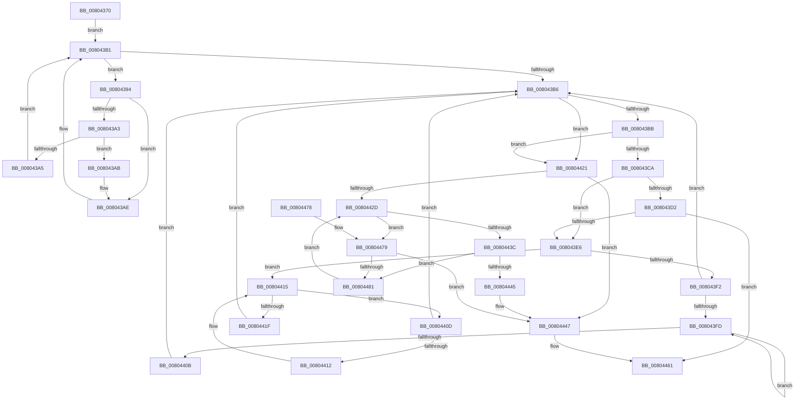

# MiInsertPreviouslyRegisteredHotPatchRecord

- RVA: `0x00804370`–`0x00804486` (길이 `278` bytes)
- VA: `0x0000000140804370`
- 실행 섹션: `PAGE`
- PDB 이름 있음: `예`; PDB Function 태그: `아니요`
- unwind 정보 RVA: `0x00069BF8`
- 디코드: `90`개 명령, `278/278` bytes 표시
- 미해석 바이트: `0` (있으면 어셈블리에 `.byte`로 보존)

> 이 문서는 커널 이미지의 기계어와 PDB 기호를 분석해 생성했습니다. 4번과 5번은 함수 원형과 자료형을 바이너리 사용 방식에서 추정한 C 해석이며 원본 소스 복구 결과는 아닙니다.

## 1. Dependencies

- 직접 호출 지점: **5**; 고유 호출 대상: **3**
- 직접 호출자로 확인된 함수: **1**
- RIP 상대 이미지 참조: **1**

### Outgoing calls
- `0x0080439A` → [MiCompareHotPatchNodes](MiCompareHotPatchNodes_function_00803114.md) (function, `0x00803114`)
- `0x008043C1` → [MiCompareHotPatchNodes](MiCompareHotPatchNodes_function_00803114.md) (function, `0x00803114`)
- `0x008043DD` → [RtlEqualUnicodeString](../93/RtlEqualUnicodeString_function_00932A20.md) (function, `0x00932A20`)
- `0x00804433` → [MiCompareHotPatchNodes](MiCompareHotPatchNodes_function_00803114.md) (function, `0x00803114`)
- `0x00804457` → [RtlAvlInsertNodeEx](../../text/26/RtlAvlInsertNodeEx_function_00265790.md) (function, `0x00265790`)

### Direct callers
- [MiInsertHotPatchRecord](MiInsertHotPatchRecord_function_008041D4.md) at `0x00804292`

### Static image references
- `0x00804384` → RVA `0x00E37580` (`.data`; read)

## 2. Other-region calls and transfers

- 다른 실행 섹션으로 향하는 call: **1**
  - `0x00804457` → [RtlAvlInsertNodeEx](../../text/26/RtlAvlInsertNodeEx_function_00265790.md) (`PAGE` → `.text`)
- 별도 외부 분기/꼬리 이동을 확인하지 못했습니다.

## 3. Assembly (complete function range)

```asm
00804370  48 89 5C 24 08                  mov qword ptr [rsp + 8], rbx
00804375  48 89 6C 24 10                  mov qword ptr [rsp + 0x10], rbp
0080437A  48 89 74 24 18                  mov qword ptr [rsp + 0x18], rsi
0080437F  57                              push rdi
00804380  48 83 EC 20                     sub rsp, 0x20
00804384  48 8B 35 F5 31 63 00            mov rsi, qword ptr [rip + 0x6331f5]
0080438B  33 DB                           xor ebx, ebx
0080438D  8B FB                           mov edi, ebx
0080438F  48 8B E9                        mov rbp, rcx
00804392  EB 1D                           jmp 0x1408043b1
00804394  48 8B D6                        mov rdx, rsi
00804397  48 8B CD                        mov rcx, rbp
0080439A  E8 75 ED FF FF                  call 0x140803114
0080439F  85 C0                           test eax, eax
008043A1  78 0B                           js 0x1408043ae
008043A3  7E 06                           jle 0x1408043ab
008043A5  48 8B 76 08                     mov rsi, qword ptr [rsi + 8]
008043A9  EB 06                           jmp 0x1408043b1
008043AB  48 8B FE                        mov rdi, rsi
008043AE  48 8B 36                        mov rsi, qword ptr [rsi]
008043B1  48 85 F6                        test rsi, rsi
008043B4  75 DE                           jne 0x140804394
008043B6  48 85 FF                        test rdi, rdi
008043B9  74 66                           je 0x140804421
008043BB  48 8B D7                        mov rdx, rdi
008043BE  48 8B CD                        mov rcx, rbp
008043C1  E8 4E ED FF FF                  call 0x140803114
008043C6  85 C0                           test eax, eax
008043C8  75 57                           jne 0x140804421
008043CA  8B 47 20                        mov eax, dword ptr [rdi + 0x20]
008043CD  39 45 20                        cmp dword ptr [rbp + 0x20], eax
008043D0  75 14                           jne 0x1408043e6
008043D2  48 8D 57 28                     lea rdx, [rdi + 0x28]
008043D6  45 33 C0                        xor r8d, r8d
008043D9  48 8D 4D 28                     lea rcx, [rbp + 0x28]
008043DD  E8 3E E6 12 00                  call 0x140932a20
008043E2  84 C0                           test al, al
008043E4  75 7B                           jne 0x140804461
008043E6  48 8B 47 08                     mov rax, qword ptr [rdi + 8]
008043EA  48 8B CF                        mov rcx, rdi
008043ED  48 85 C0                        test rax, rax
008043F0  74 23                           je 0x140804415
008043F2  48 8B 08                        mov rcx, qword ptr [rax]
008043F5  48 8B F8                        mov rdi, rax
008043F8  48 85 C9                        test rcx, rcx
008043FB  74 B9                           je 0x1408043b6
008043FD  48 8B 01                        mov rax, qword ptr [rcx]
00804400  48 8B F9                        mov rdi, rcx
00804403  48 8B C8                        mov rcx, rax
00804406  48 85 C0                        test rax, rax
00804409  75 F2                           jne 0x1408043fd
0080440B  EB A9                           jmp 0x1408043b6
0080440D  48 39 0F                        cmp qword ptr [rdi], rcx
00804410  74 A4                           je 0x1408043b6
00804412  48 8B CF                        mov rcx, rdi
00804415  48 8B 7F 10                     mov rdi, qword ptr [rdi + 0x10]
00804419  48 83 E7 FC                     and rdi, 0xfffffffffffffffc
0080441D  75 EE                           jne 0x14080440d
0080441F  EB 95                           jmp 0x1408043b6
00804421  48 8B 3D 58 31 63 00            mov rdi, qword ptr [rip + 0x633158]
00804428  48 85 FF                        test rdi, rdi
0080442B  74 1A                           je 0x140804447
0080442D  48 8B D7                        mov rdx, rdi
00804430  48 8B CD                        mov rcx, rbp
00804433  E8 DC EC FF FF                  call 0x140803114
00804438  85 C0                           test eax, eax
0080443A  78 3D                           js 0x140804479
0080443C  48 8B 47 08                     mov rax, qword ptr [rdi + 8]
00804440  48 85 C0                        test rax, rax
00804443  75 3C                           jne 0x140804481
00804445  B3 01                           mov bl, 1
00804447  4C 8B CD                        mov r9, rbp
0080444A  48 8D 0D 2F 31 63 00            lea rcx, [rip + 0x63312f]
00804451  44 8A C3                        mov r8b, bl
00804454  48 8B D7                        mov rdx, rdi
00804457  E8 34 13 A6 FF                  call 0x140265790
0080445C  BB 01 00 00 00                  mov ebx, 1
00804461  48 8B 6C 24 38                  mov rbp, qword ptr [rsp + 0x38]
00804466  8B C3                           mov eax, ebx
00804468  48 8B 5C 24 30                  mov rbx, qword ptr [rsp + 0x30]
0080446D  48 8B 74 24 40                  mov rsi, qword ptr [rsp + 0x40]
00804472  48 83 C4 20                     add rsp, 0x20
00804476  5F                              pop rdi
00804477  C3                              ret
00804478  CC                              int3
00804479  48 8B 07                        mov rax, qword ptr [rdi]
0080447C  48 85 C0                        test rax, rax
0080447F  74 C6                           je 0x140804447
00804481  48 8B F8                        mov rdi, rax
00804484  EB A7                           jmp 0x14080442d
```

## 4. C-style interpretation (structured pseudocode)

```c
__int64 __fastcall MiInsertPreviouslyRegisteredHotPatchRecord(__int64 a1, __int64 a2, int a3)
{
    __int64 result;
    __int64 v_rbx;
    __int64 v_rdi;
    __int64 v_rsp;
    unsigned __int64 v_stack_p10;
    unsigned __int64 v_stack_p18;
    unsigned __int64 v_stack_p8;

    v_stack_p8 = v_rbx;
    v_stack_p10 = v_rbp;
    v_stack_p18 = v_rsi;
    v_rsp = (v_rsp) - (32);
    v_rbx = 0;
    goto loc_008043B1;
loc_00804394:
    result = MiCompareHotPatchNodes(a1, *(unsigned __int64 *)(v_rip + 6500853), a3, a4);
    if (sign_flag) goto loc_008043AE;
    if (condition_is_less_or_equal) goto loc_008043AB;
    goto loc_008043B1;
loc_008043AB:
loc_008043AE:
loc_008043B1:
    if (*(unsigned __int64 *)(*(unsigned __int64 *)(*(unsigned __int64 *)(v_rip + 6500853) + 8)) != 0) goto loc_00804394;
loc_008043B6:
    if (*(unsigned __int64 *)(*(unsigned __int64 *)(v_rip + 6500853) + 8) == 0) goto loc_00804421;
    result = MiCompareHotPatchNodes(a1, *(unsigned __int64 *)(*(unsigned __int64 *)(v_rip + 6500853) + 8), a3, a4);
    if ((unsigned int)(result) != 0) goto loc_00804421;
    if ((*(unsigned int *)(a1 + 32)) != ((unsigned int)((unsigned int)(*(unsigned int *)(*(unsigned __int64 *)(*(unsigned __int64 *)(v_rip + 6500853) + 8) + 32))))) goto loc_008043E6;
    a3 = 0;
    result = RtlEqualUnicodeString(a1 + 40, *(unsigned __int64 *)(*(unsigned __int64 *)(v_rip + 6500853) + 8) + 40, a3, a4);
    if ((unsigned __int8)(result) != 0) goto loc_00804461;
loc_008043E6:
    if (*(unsigned __int64 *)(*(unsigned __int64 *)(*(unsigned __int64 *)(v_rip + 6500853) + 8) + 8) == 0) goto loc_00804415;
    if (*(unsigned __int64 *)(*(unsigned __int64 *)(*(unsigned __int64 *)(*(unsigned __int64 *)(v_rip + 6500853) + 8) + 8)) == 0) goto loc_008043B6;
loc_008043FD:
    if (*(unsigned __int64 *)(*(unsigned __int64 *)(*(unsigned __int64 *)(*(unsigned __int64 *)(*(unsigned __int64 *)(v_rip + 6500853) + 8) + 8))) != 0) goto loc_008043FD;
    goto loc_008043B6;
loc_0080440D:
    if ((*(unsigned __int64 *)(*(unsigned __int64 *)(*(unsigned __int64 *)(*(unsigned __int64 *)(*(unsigned __int64 *)(v_rip + 6500853) + 8) + 8)))) == (*(unsigned __int64 *)(*(unsigned __int64 *)(*(unsigned __int64 *)(*(unsigned __int64 *)(*(unsigned __int64 *)(v_rip + 6500853) + 8) + 8))))) goto loc_008043B6;
loc_00804415:
    v_rdi = (*(unsigned __int64 *)(*(unsigned __int64 *)(*(unsigned __int64 *)(*(unsigned __int64 *)(*(unsigned __int64 *)(v_rip + 6500853) + 8) + 8)) + 16)) & (-4);
    if (condition_is_not_equal) goto loc_0080440D;
    goto loc_008043B6;
loc_00804421:
    if (*(unsigned __int64 *)(v_rip + 6500696) == 0) goto loc_00804447;
loc_0080442D:
    result = MiCompareHotPatchNodes(a1, *(unsigned __int64 *)(v_rip + 6500696), a3, a4);
    if (sign_flag) goto loc_00804479;
    if (*(unsigned __int64 *)(*(unsigned __int64 *)(v_rip + 6500696) + 8) != 0) goto loc_00804481;
loc_00804447:
    result = RtlAvlInsertNodeEx(v_rip + 6500655, *(unsigned __int64 *)(v_rip + 6500696), 1, a1);
loc_00804461:
    v_rsp = (v_rsp) + (32);
    return 1;
loc_00804479:
    if (*(unsigned __int64 *)(*(unsigned __int64 *)(v_rip + 6500696)) == 0) goto loc_00804447;
loc_00804481:
    goto loc_0080442D;
}
```

## 5. (Beta) C Style

```c
int64_t MiInsertPreviouslyRegisteredHotPatchRecord(void *Arg1, int64_t Arg2, int32_t Arg3)
{
    uint8_t *arg1 = (uint8_t *)Arg1;

    int64_t result;
    int64_t local_rbx;
    int64_t local_rdi;
    int64_t local_rsp;
    uint64_t v_stack_p10;
    uint64_t v_stack_p18;
    uint64_t v_stack_p8;

    v_stack_p8 = local_rbx;
    v_stack_p10 = local_rbp;
    v_stack_p18 = local_rsi;
    local_rsp = (local_rsp) - (32);
    local_rbx = 0;
    goto loc_008043B1;
loc_00804394:
    result = MiCompareHotPatchNodes(Arg1, *(uint64_t *)(v_rip + 0x6331F5), Arg3, a4);
    if (sign_flag) goto loc_008043AE;
    if (condition_is_less_or_equal) goto loc_008043AB;
    goto loc_008043B1;
loc_008043AB:
loc_008043AE:
loc_008043B1:
    if (*(uint64_t *)(*(uint64_t *)(*(uint64_t *)(v_rip + 0x6331F5) + 0x8)) != 0) goto loc_00804394;
loc_008043B6:
    if (*(uint64_t *)(*(uint64_t *)(v_rip + 0x6331F5) + 0x8) == 0) goto loc_00804421;
    result = MiCompareHotPatchNodes(Arg1, *(uint64_t *)(*(uint64_t *)(v_rip + 0x6331F5) + 0x8), Arg3, a4);
    if ((uint32_t)(result) != 0) goto loc_00804421;
    if ((*(uint32_t *)(arg1 + 0x20)) != ((uint32_t)((uint32_t)(*(uint32_t *)(*(uint64_t *)(*(uint64_t *)(v_rip + 0x6331F5) + 0x8) + 0x20))))) goto loc_008043E6;
    Arg3 = 0;
    result = RtlEqualUnicodeString(Arg1 + 40, *(uint64_t *)(*(uint64_t *)(v_rip + 0x6331F5) + 0x8) + 40, Arg3, a4);
    if ((uint8_t)(result) != 0) goto loc_00804461;
loc_008043E6:
    if (*(uint64_t *)(*(uint64_t *)(*(uint64_t *)(v_rip + 0x6331F5) + 0x8) + 0x8) == 0) goto loc_00804415;
    if (*(uint64_t *)(*(uint64_t *)(*(uint64_t *)(*(uint64_t *)(v_rip + 0x6331F5) + 0x8) + 0x8)) == 0) goto loc_008043B6;
loc_008043FD:
    if (*(uint64_t *)(*(uint64_t *)(*(uint64_t *)(*(uint64_t *)(*(uint64_t *)(v_rip + 0x6331F5) + 0x8) + 0x8))) != 0) goto loc_008043FD;
    goto loc_008043B6;
loc_0080440D:
    if ((*(uint64_t *)(*(uint64_t *)(*(uint64_t *)(*(uint64_t *)(*(uint64_t *)(v_rip + 0x6331F5) + 0x8) + 0x8)))) == (*(uint64_t *)(*(uint64_t *)(*(uint64_t *)(*(uint64_t *)(*(uint64_t *)(v_rip + 0x6331F5) + 0x8) + 0x8))))) goto loc_008043B6;
loc_00804415:
    local_rdi = (*(uint64_t *)(*(uint64_t *)(*(uint64_t *)(*(uint64_t *)(*(uint64_t *)(v_rip + 0x6331F5) + 0x8) + 0x8)) + 0x10)) & (-4);
    if (condition_is_not_equal) goto loc_0080440D;
    goto loc_008043B6;
loc_00804421:
    if (*(uint64_t *)(v_rip + 0x633158) == 0) goto loc_00804447;
loc_0080442D:
    result = MiCompareHotPatchNodes(Arg1, *(uint64_t *)(v_rip + 0x633158), Arg3, a4);
    if (sign_flag) goto loc_00804479;
    if (*(uint64_t *)(*(uint64_t *)(v_rip + 0x633158) + 0x8) != 0) goto loc_00804481;
loc_00804447:
    result = RtlAvlInsertNodeEx(v_rip + 6500655, *(uint64_t *)(v_rip + 0x633158), 1, Arg1);
loc_00804461:
    local_rsp = (local_rsp) + (32);
    return 1;
loc_00804479:
    if (*(uint64_t *)(*(uint64_t *)(v_rip + 0x633158)) == 0) goto loc_00804447;
loc_00804481:
    goto loc_0080442D;
}
```

### 관측된 메모리 오프셋

구조체 형식이 확인되지 않은 접근은 인자 기준의 오프셋으로만 기록했습니다.

| 기준 인자 | 오프셋 표현 | 폭 (bit) | 접근 |
|---|---:|---:|---|
| `Arg1` | `+ 0x20` | `32` | `R` |
| `Arg1` | `+ 0x28` | `64` | `R` |

## 6. Execution-region graph

[열기: 2D/3D 그래프와 함수 탐색 컨트롤 패널](../../../control-panel.html?section=page&rva=0x00804370&view=graph)

- 2D 그래프는 위에서 아래로 흐르고, 3D 그래프는 빈 공간을 드래그해 회전합니다. Shift+드래그는 이동, 휠은 확대·축소, 함수 노드 선택은 대상 보고서 이동입니다.

### Static fallback


