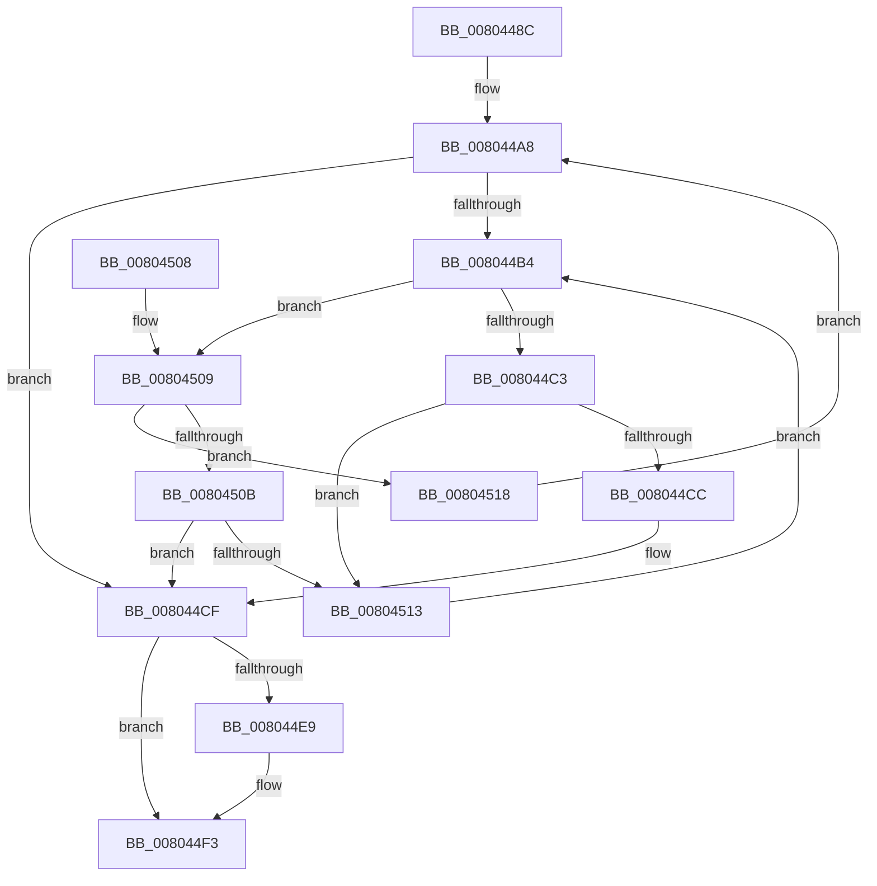

# MiInsertSecureImageActivePatch

- RVA: `0x0080448C`–`0x0080452F` (길이 `163` bytes)
- VA: `0x000000014080448C`
- 실행 섹션: `PAGE`
- PDB 이름 있음: `예`; PDB Function 태그: `아니요`
- unwind 정보 RVA: `0x000B3AA8`
- 디코드: `48`개 명령, `163/163` bytes 표시
- 미해석 바이트: `0` (있으면 어셈블리에 `.byte`로 보존)

> 이 문서는 커널 이미지의 기계어와 PDB 기호를 분석해 생성했습니다. 4번과 5번은 함수 원형과 자료형을 바이너리 사용 방식에서 추정한 C 해석이며 원본 소스 복구 결과는 아닙니다.

## 1. Dependencies

- 직접 호출 지점: **4**; 고유 호출 대상: **4**
- 직접 호출자로 확인된 함수: **3**
- RIP 상대 이미지 참조: **1**

### Outgoing calls
- `0x008044BA` → [MiCompareHotPatchNodes](MiCompareHotPatchNodes_function_00803114.md) (function, `0x00803114`)
- `0x008044DF` → [RtlAvlInsertNodeEx](../../text/26/RtlAvlInsertNodeEx_function_00265790.md) (function, `0x00265790`)
- `0x008044EE` → [ExFreePoolWithTag](../../poolcode/B8/ExFreePoolWithTag_function_00B82870.md) (function, `0x00B82870`)
- `0x00804525` → [RtlAvlRemoveNode](../../text/29/RtlAvlRemoveNode_function_00296650.md) (function, `0x00296650`)

### Direct callers
- [MmInsertSecureImageActivePatch](MmInsertSecureImageActivePatch_function_008073E4.md) at `0x0080748A`
- [MiLoadHotPatch](../AB/MiLoadHotPatch_function_00AB521C.md) at `0x00AB5517`
- [MmRegisterHotPatches](../../init/C6/MmRegisterHotPatches_function_00C678DC.md) at `0x00C679F3`

### Static image references
- `0x008044A8` → RVA `0x00E37588` (`.data`; read)

## 2. Other-region calls and transfers

- 다른 실행 섹션으로 향하는 call: **3**
  - `0x008044DF` → [RtlAvlInsertNodeEx](../../text/26/RtlAvlInsertNodeEx_function_00265790.md) (`PAGE` → `.text`)
  - `0x008044EE` → [ExFreePoolWithTag](../../poolcode/B8/ExFreePoolWithTag_function_00B82870.md) (`PAGE` → `POOLCODE`)
  - `0x00804525` → [RtlAvlRemoveNode](../../text/29/RtlAvlRemoveNode_function_00296650.md) (`PAGE` → `.text`)
- 별도 외부 분기/꼬리 이동을 확인하지 못했습니다.

## 3. Assembly (complete function range)

```asm
0080448C  48 89 5C 24 08                  mov qword ptr [rsp + 8], rbx
00804491  48 89 6C 24 10                  mov qword ptr [rsp + 0x10], rbp
00804496  48 89 74 24 18                  mov qword ptr [rsp + 0x18], rsi
0080449B  57                              push rdi
0080449C  48 83 EC 20                     sub rsp, 0x20
008044A0  33 FF                           xor edi, edi
008044A2  48 8B E9                        mov rbp, rcx
008044A5  40 32 F6                        xor sil, sil
008044A8  48 8B 1D D9 30 63 00            mov rbx, qword ptr [rip + 0x6330d9]
008044AF  48 85 DB                        test rbx, rbx
008044B2  74 1B                           je 0x1408044cf
008044B4  48 8B D3                        mov rdx, rbx
008044B7  48 8B CD                        mov rcx, rbp
008044BA  E8 55 EC FF FF                  call 0x140803114
008044BF  85 C0                           test eax, eax
008044C1  7E 46                           jle 0x140804509
008044C3  48 8B 43 08                     mov rax, qword ptr [rbx + 8]
008044C7  48 85 C0                        test rax, rax
008044CA  75 47                           jne 0x140804513
008044CC  40 B6 01                        mov sil, 1
008044CF  4C 8B CD                        mov r9, rbp
008044D2  48 8D 0D AF 30 63 00            lea rcx, [rip + 0x6330af]
008044D9  44 8A C6                        mov r8b, sil
008044DC  48 8B D3                        mov rdx, rbx
008044DF  E8 AC 12 A6 FF                  call 0x140265790
008044E4  48 85 FF                        test rdi, rdi
008044E7  74 0A                           je 0x1408044f3
008044E9  33 D2                           xor edx, edx
008044EB  48 8B CF                        mov rcx, rdi
008044EE  E8 7D E3 37 00                  call 0x140b82870
008044F3  48 8B 5C 24 30                  mov rbx, qword ptr [rsp + 0x30]
008044F8  48 8B 6C 24 38                  mov rbp, qword ptr [rsp + 0x38]
008044FD  48 8B 74 24 40                  mov rsi, qword ptr [rsp + 0x40]
00804502  48 83 C4 20                     add rsp, 0x20
00804506  5F                              pop rdi
00804507  C3                              ret
00804508  CC                              int3
00804509  79 0D                           jns 0x140804518
0080450B  48 8B 03                        mov rax, qword ptr [rbx]
0080450E  48 85 C0                        test rax, rax
00804511  74 BC                           je 0x1408044cf
00804513  48 8B D8                        mov rbx, rax
00804516  EB 9C                           jmp 0x1408044b4
00804518  48 8B D3                        mov rdx, rbx
0080451B  48 8D 0D 66 30 63 00            lea rcx, [rip + 0x633066]
00804522  48 8B FB                        mov rdi, rbx
00804525  E8 26 21 A9 FF                  call 0x140296650
0080452A  E9 79 FF FF FF                  jmp 0x1408044a8
```

## 4. C-style interpretation (structured pseudocode)

```c
__int64 __fastcall MiInsertSecureImageActivePatch(__int64 a1)
{
    __int64 result;
    __int64 v_rdi;
    __int64 v_rsi;
    __int64 v_rsp;
    unsigned __int64 v_stack_p10;
    unsigned __int64 v_stack_p18;
    unsigned __int64 v_stack_p8;

    v_stack_p8 = v_rbx;
    v_stack_p10 = v_rbp;
    v_stack_p18 = v_rsi;
    v_rsp = (v_rsp) - (32);
    v_rdi = 0;
    v_rsi = 0;
loc_008044A8:
    if (*(unsigned __int64 *)(v_rip + 6500569) == 0) goto loc_008044CF;
loc_008044B4:
    result = MiCompareHotPatchNodes(a1, *(unsigned __int64 *)(v_rip + 6500569), a3, a4);
    if (condition_is_less_or_equal) goto loc_00804509;
    if (*(unsigned __int64 *)(*(unsigned __int64 *)(v_rip + 6500569) + 8) != 0) goto loc_00804513;
loc_008044CF:
    result = RtlAvlInsertNodeEx(v_rip + 6500527, *(unsigned __int64 *)(v_rip + 6500569), 1, a1);
    if (0 != 0) {
        a2 = 0;
        a1 = 0;
        result = ExFreePoolWithTag(a1, a2, 1, a1);
    }
    v_rsp = (v_rsp) + (32);
    return result;
loc_00804509:
    if (!sign_flag) goto loc_00804518;
    if (*(unsigned __int64 *)(v_stack_p8) == 0) goto loc_008044CF;
loc_00804513:
    goto loc_008044B4;
loc_00804518:
    result = RtlAvlRemoveNode(v_rip + 6500454, *(unsigned __int64 *)(v_stack_p8), 1, a1);
    goto loc_008044A8;
}
```

## 5. (Beta) C Style

```c
int64_t MiInsertSecureImageActivePatch(int64_t Arg1)
{
    int64_t result;
    int64_t local_rdi;
    int64_t local_rsi;
    int64_t local_rsp;
    uint64_t v_stack_p10;
    uint64_t v_stack_p18;
    uint64_t v_stack_p8;

    v_stack_p8 = local_rbx;
    v_stack_p10 = local_rbp;
    v_stack_p18 = local_rsi;
    local_rsp = (local_rsp) - (32);
    local_rdi = 0;
    local_rsi = 0;
loc_008044A8:
    if (*(uint64_t *)(v_rip + 0x6330D9) == 0) goto loc_008044CF;
loc_008044B4:
    result = MiCompareHotPatchNodes(Arg1, *(uint64_t *)(v_rip + 0x6330D9), a3, a4);
    if (condition_is_less_or_equal) goto loc_00804509;
    if (*(uint64_t *)(*(uint64_t *)(v_rip + 0x6330D9) + 0x8) != 0) goto loc_00804513;
loc_008044CF:
    result = RtlAvlInsertNodeEx(v_rip + 6500527, *(uint64_t *)(v_rip + 0x6330D9), 1, Arg1);
    if (0 != 0) {
        a2 = 0;
        Arg1 = 0;
        result = ExFreePoolWithTag(Arg1, a2, 1, Arg1);
    }
    local_rsp = (local_rsp) + (32);
    return result;
loc_00804509:
    if (!sign_flag) goto loc_00804518;
    if (*(uint64_t *)(v_stack_p8) == 0) goto loc_008044CF;
loc_00804513:
    goto loc_008044B4;
loc_00804518:
    result = RtlAvlRemoveNode(v_rip + 6500454, *(uint64_t *)(v_stack_p8), 1, Arg1);
    goto loc_008044A8;
}
```

## 6. Execution-region graph

[열기: 2D/3D 그래프와 함수 탐색 컨트롤 패널](../../../control-panel.html?section=page&rva=0x0080448C&view=graph)

- 2D 그래프는 위에서 아래로 흐르고, 3D 그래프는 빈 공간을 드래그해 회전합니다. Shift+드래그는 이동, 휠은 확대·축소, 함수 노드 선택은 대상 보고서 이동입니다.

### Static fallback


