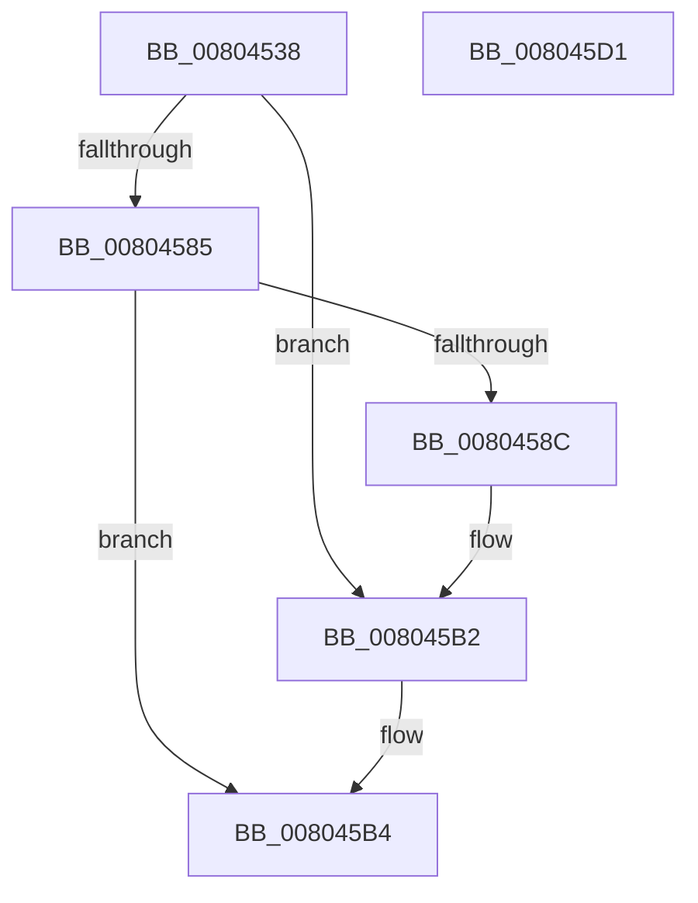

# MiInvokePatchCallback

- RVA: `0x00804538`–`0x008045D2` (길이 `154` bytes)
- VA: `0x0000000140804538`
- 실행 섹션: `PAGE`
- PDB 이름 있음: `예`; PDB Function 태그: `아니요`
- unwind 정보 RVA: `0x000D85D8`
- 디코드: `43`개 명령, `154/154` bytes 표시
- 미해석 바이트: `0` (있으면 어셈블리에 `.byte`로 보존)

> 이 문서는 커널 이미지의 기계어와 PDB 기호를 분석해 생성했습니다. 4번과 5번은 함수 원형과 자료형을 바이너리 사용 방식에서 추정한 C 해석이며 원본 소스 복구 결과는 아닙니다.

## 1. Dependencies

- 직접 호출 지점: **3**; 고유 호출 대상: **3**
- 직접 호출자로 확인된 함수: **1**
- RIP 상대 이미지 참조: **1**

### Outgoing calls
- `0x0080457C` → [guard_dispatch_icall](../../text/6B/guard_dispatch_icall_function_006BAAD0.md) (function, `0x006BAAD0`)
- `0x008045AC` → [KeBugCheckEx](../../text/4F/KeBugCheckEx_function_004FD660.md) (function, `0x004FD660`)
- `0x008045BC` → [_security_check_cookie](../../text/6A/_security_check_cookie_function_006AC640.md) (function, `0x006AC640`)

### Direct callers
- [MiApplyDriverHotPatch](MiApplyDriverHotPatch_function_008018EC.md) at `0x00801CC1`
- [MiApplyDriverHotPatch](MiApplyDriverHotPatch_function_008018EC.md) at `0x00801D78`
- [MiApplyDriverHotPatch](MiApplyDriverHotPatch_function_008018EC.md) at `0x00801E24`

### Static image references
- `0x00804547` → RVA `0x00E0A740` (`.data`; read)

## 2. Other-region calls and transfers

- 다른 실행 섹션으로 향하는 call: **3**
  - `0x0080457C` → [guard_dispatch_icall](../../text/6B/guard_dispatch_icall_function_006BAAD0.md) (`PAGE` → `.text`)
  - `0x008045AC` → [KeBugCheckEx](../../text/4F/KeBugCheckEx_function_004FD660.md) (`PAGE` → `.text`)
  - `0x008045BC` → [_security_check_cookie](../../text/6A/_security_check_cookie_function_006AC640.md) (`PAGE` → `.text`)
- 별도 외부 분기/꼬리 이동을 확인하지 못했습니다.

## 3. Assembly (complete function range)

```asm
00804538  48 89 5C 24 18                  mov qword ptr [rsp + 0x18], rbx
0080453D  48 89 74 24 20                  mov qword ptr [rsp + 0x20], rsi
00804542  57                              push rdi
00804543  48 83 EC 50                     sub rsp, 0x50
00804547  48 8B 05 F2 61 60 00            mov rax, qword ptr [rip + 0x6061f2]
0080454E  48 33 C4                        xor rax, rsp
00804551  48 89 44 24 40                  mov qword ptr [rsp + 0x40], rax
00804556  8B 42 08                        mov eax, dword ptr [rdx + 8]
00804559  33 DB                           xor ebx, ebx
0080455B  89 44 24 34                     mov dword ptr [rsp + 0x34], eax
0080455F  48 8B FA                        mov rdi, rdx
00804562  48 8B 02                        mov rax, qword ptr [rdx]
00804565  48 8B F1                        mov rsi, rcx
00804568  48 8D 4C 24 30                  lea rcx, [rsp + 0x30]
0080456D  89 5C 24 38                     mov dword ptr [rsp + 0x38], ebx
00804571  8D 53 0C                        lea edx, [rbx + 0xc]
00804574  C7 44 24 30 01 00 00 00         mov dword ptr [rsp + 0x30], 1
0080457C  E8 4F 65 EB FF                  call 0x1406baad0
00804581  85 C0                           test eax, eax
00804583  79 2D                           jns 0x1408045b2
00804585  8B 4F 08                        mov ecx, dword ptr [rdi + 8]
00804588  85 C9                           test ecx, ecx
0080458A  74 28                           je 0x1408045b4
0080458C  4C 8B 0F                        mov r9, qword ptr [rdi]
0080458F  83 F9 01                        cmp ecx, 1
00804592  4C 8B 46 30                     mov r8, qword ptr [rsi + 0x30]
00804596  B9 1A 00 00 00                  mov ecx, 0x1a
0080459B  0F 95 C3                        setne bl
0080459E  48 98                           cdqe
008045A0  48 89 44 24 20                  mov qword ptr [rsp + 0x20], rax
008045A5  48 8D 93 C3 15 05 00            lea rdx, [rbx + 0x515c3]
008045AC  E8 AF 90 CF FF                  call 0x1404fd660
008045B1  CC                              int3
008045B2  8B C3                           mov eax, ebx
008045B4  48 8B 4C 24 40                  mov rcx, qword ptr [rsp + 0x40]
008045B9  48 33 CC                        xor rcx, rsp
008045BC  E8 7F 80 EA FF                  call 0x1406ac640
008045C1  48 8B 5C 24 70                  mov rbx, qword ptr [rsp + 0x70]
008045C6  48 8B 74 24 78                  mov rsi, qword ptr [rsp + 0x78]
008045CB  48 83 C4 50                     add rsp, 0x50
008045CF  5F                              pop rdi
008045D0  C3                              ret
008045D1  CC                              int3
```

## 4. C-style interpretation (structured pseudocode)

```c
__int64 __fastcall MiInvokePatchCallback(__int64 a1, __int64 a2)
{
    __int64 result;
    __int64 v_rbx;
    __int64 v_rsp;
    unsigned __int64 v_stack_m18;
    unsigned int v_stack_m20;
    unsigned int v_stack_m24;
    unsigned __int64 v_stack_m28;
    unsigned __int64 v_stack_m38;
    unsigned __int64 v_stack_p18;
    unsigned __int64 v_stack_p20;

    v_stack_p18 = v_rbx;
    v_stack_p20 = v_rsi;
    v_rsp = (v_rsp) - (80);
    result = (*(unsigned __int64 *)(v_rip + 6316530)) ^ (v_rsp);
    v_stack_m18 = result;
    v_rbx = 0;
    v_stack_m24 = (unsigned int)((unsigned int)(*(unsigned int *)(a2 + 8)));
    v_stack_m20 = 0;
    v_stack_m28 = 1;
    result = guard_dispatch_icall(v_stack_m28, v_rbx + 12, a3, a4);
    if (!sign_flag) goto loc_008045B2;
    if ((unsigned int)((unsigned int)(*(unsigned int *)(a2 + 8))) == 0) goto loc_008045B4;
    v_rbx = (((unsigned int)((unsigned int)(*(unsigned int *)(a2 + 8)))) != 1) ? 1 : 0;
    v_stack_m38 = result;
    result = KeBugCheckEx(26, v_rbx + 333251, *(unsigned __int64 *)(a1 + 48), *(unsigned __int64 *)(a2));
loc_008045B2:
loc_008045B4:
    a1 = (v_stack_m18) ^ (v_rsp);
    result = _security_check_cookie(a1, v_rbx + 333251, *(unsigned __int64 *)(a1 + 48), *(unsigned __int64 *)(a2));
    v_rsp = (v_rsp) + (80);
    return result;
}
```

## 5. (Beta) C Style

```c
int64_t MiInvokePatchCallback(void *Arg1, void *Arg2)
{
    uint8_t *arg1 = (uint8_t *)Arg1;
    uint8_t *arg2 = (uint8_t *)Arg2;

    int64_t result;
    int64_t local_rbx;
    int64_t local_rsp;
    uint64_t v_stack_m18;
    uint32_t v_stack_m20;
    uint32_t v_stack_m24;
    uint64_t v_stack_m28;
    uint64_t v_stack_m38;
    uint64_t v_stack_p18;
    uint64_t v_stack_p20;

    v_stack_p18 = local_rbx;
    v_stack_p20 = local_rsi;
    local_rsp = (local_rsp) - (80);
    result = (*(uint64_t *)(v_rip + 0x6061F2)) ^ (local_rsp);
    v_stack_m18 = result;
    local_rbx = 0;
    v_stack_m24 = (uint32_t)((uint32_t)(*(uint32_t *)(arg2 + 0x8)));
    v_stack_m20 = 0;
    v_stack_m28 = 1;
    result = guard_dispatch_icall(v_stack_m28, local_rbx + 12, a3, a4);
    if (!sign_flag) goto loc_008045B2;
    if ((uint32_t)((uint32_t)(*(uint32_t *)(arg2 + 0x8))) == 0) goto loc_008045B4;
    local_rbx = (((uint32_t)((uint32_t)(*(uint32_t *)(arg2 + 0x8)))) != 1) ? 1 : 0;
    v_stack_m38 = result;
    result = KeBugCheckEx(26, local_rbx + 333251, *(uint64_t *)(arg1 + 0x30), *(uint64_t *)(arg2));
loc_008045B2:
loc_008045B4:
    Arg1 = (v_stack_m18) ^ (local_rsp);
    result = _security_check_cookie(Arg1, local_rbx + 333251, *(uint64_t *)(arg1 + 0x30), *(uint64_t *)(arg2));
    local_rsp = (local_rsp) + (80);
    return result;
}
```

### 관측된 메모리 오프셋

구조체 형식이 확인되지 않은 접근은 인자 기준의 오프셋으로만 기록했습니다.

| 기준 인자 | 오프셋 표현 | 폭 (bit) | 접근 |
|---|---:|---:|---|
| `Arg1` | `+ 0x30` | `64` | `R` |
| `Arg2` | `+ 0x0` | `64` | `R` |
| `Arg2` | `+ 0x8` | `32` | `R` |

## 6. Execution-region graph

[열기: 2D/3D 그래프와 함수 탐색 컨트롤 패널](../../../control-panel.html?section=page&rva=0x00804538&view=graph)

- 2D 그래프는 위에서 아래로 흐르고, 3D 그래프는 빈 공간을 드래그해 회전합니다. Shift+드래그는 이동, 휠은 확대·축소, 함수 노드 선택은 대상 보고서 이동입니다.

### Static fallback


