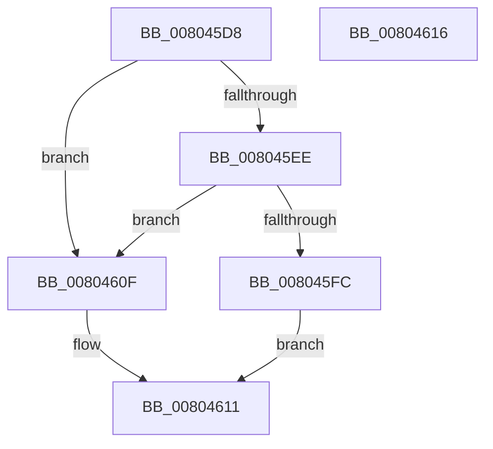

# MiIsActiveSystemHotPatch

- RVA: `0x008045D8`–`0x00804617` (길이 `63` bytes)
- VA: `0x00000001408045D8`
- 실행 섹션: `PAGE`
- PDB 이름 있음: `예`; PDB Function 태그: `아니요`
- unwind 정보 RVA: `0x0005C788`
- 디코드: `19`개 명령, `63/63` bytes 표시
- 미해석 바이트: `0` (있으면 어셈블리에 `.byte`로 보존)

> 이 문서는 커널 이미지의 기계어와 PDB 기호를 분석해 생성했습니다. 4번과 5번은 함수 원형과 자료형을 바이너리 사용 방식에서 추정한 C 해석이며 원본 소스 복구 결과는 아닙니다.

## 1. Dependencies

- 직접 호출 지점: **2**; 고유 호출 대상: **1**
- 직접 호출자로 확인된 함수: **2**
- RIP 상대 이미지 참조: **0**

### Outgoing calls
- `0x008045DF` → [MiGetBaseLoaderPortion](../../text/4D/MiGetBaseLoaderPortion_function_004D9D34.md) (function, `0x004D9D34`)
- `0x008045FC` → [MiGetBaseLoaderPortion](../../text/4D/MiGetBaseLoaderPortion_function_004D9D34.md) (function, `0x004D9D34`)

### Direct callers
- [MiLogHotPatchRundown](MiLogHotPatchRundown_function_008057A4.md) at `0x00805CC4`
- [MiQueryProcessActivePatches](../AC/MiQueryProcessActivePatches_function_00AC6164.md) at `0x00AC62B3`
- [MiQueryProcessActivePatches](../AC/MiQueryProcessActivePatches_function_00AC6164.md) at `0x00AC66C7`

### Static image references
- 디코드된 RIP-relative 메모리 참조가 없습니다.

## 2. Other-region calls and transfers

- 다른 실행 섹션으로 향하는 call: **2**
  - `0x008045DF` → [MiGetBaseLoaderPortion](../../text/4D/MiGetBaseLoaderPortion_function_004D9D34.md) (`PAGE` → `.text`)
  - `0x008045FC` → [MiGetBaseLoaderPortion](../../text/4D/MiGetBaseLoaderPortion_function_004D9D34.md) (`PAGE` → `.text`)
- 별도 외부 분기/꼬리 이동을 확인하지 못했습니다.

## 3. Assembly (complete function range)

```asm
008045D8  48 83 EC 28                     sub rsp, 0x28
008045DC  4C 8B C1                        mov r8, rcx
008045DF  E8 50 57 CD FF                  call 0x1404d9d34
008045E4  8B 90 B8 00 00 00               mov edx, dword ptr [rax + 0xb8]
008045EA  84 D2                           test dl, dl
008045EC  79 21                           jns 0x14080460f
008045EE  48 8B 88 F8 00 00 00            mov rcx, qword ptr [rax + 0xf8]
008045F5  33 D2                           xor edx, edx
008045F7  48 85 C9                        test rcx, rcx
008045FA  74 13                           je 0x14080460f
008045FC  E8 33 57 CD FF                  call 0x1404d9d34
00804601  4C 39 80 F8 00 00 00            cmp qword ptr [rax + 0xf8], r8
00804608  0F 94 C2                        sete dl
0080460B  8B C2                           mov eax, edx
0080460D  EB 02                           jmp 0x140804611
0080460F  33 C0                           xor eax, eax
00804611  48 83 C4 28                     add rsp, 0x28
00804615  C3                              ret
00804616  CC                              int3
```

## 4. C-style interpretation (structured pseudocode)

```c
__int64 __fastcall MiIsActiveSystemHotPatch(__int64 a1)
{
    __int64 result;
    __int64 v_rsp;

    v_rsp = (v_rsp) - (40);
    result = MiGetBaseLoaderPortion(a1, a2, a1, a4);
    if (!sign_flag) goto loc_0080460F;
    a2 = 0;
    if (*(unsigned __int64 *)(result + 248) == 0) goto loc_0080460F;
    result = MiGetBaseLoaderPortion(*(unsigned __int64 *)(result + 248), a2, a1, a4);
    a2 = ((*(unsigned __int64 *)(result + 248)) == a1) ? 1 : 0;
    goto loc_00804611;
loc_0080460F:
    result = 0;
loc_00804611:
    v_rsp = (v_rsp) + (40);
    return result;
}
```

## 5. (Beta) C Style

```c
int64_t MiIsActiveSystemHotPatch(int64_t Arg1)
{
    int64_t result;
    int64_t local_rsp;

    local_rsp = (local_rsp) - (40);
    result = MiGetBaseLoaderPortion(Arg1, a2, Arg1, a4);
    if (!sign_flag) goto loc_0080460F;
    a2 = 0;
    if (*(uint64_t *)(result + 0xF8) == 0) goto loc_0080460F;
    result = MiGetBaseLoaderPortion(*(uint64_t *)(result + 0xF8), a2, Arg1, a4);
    a2 = ((*(uint64_t *)(result + 0xF8)) == Arg1) ? 1 : 0;
    goto loc_00804611;
loc_0080460F:
    result = 0;
loc_00804611:
    local_rsp = (local_rsp) + (40);
    return result;
}
```

## 6. Execution-region graph

[열기: 2D/3D 그래프와 함수 탐색 컨트롤 패널](../../../control-panel.html?section=page&rva=0x008045D8&view=graph)

- 2D 그래프는 위에서 아래로 흐르고, 3D 그래프는 빈 공간을 드래그해 회전합니다. Shift+드래그는 이동, 휠은 확대·축소, 함수 노드 선택은 대상 보고서 이동입니다.

### Static fallback


