# MiIsExtentDangling

- RVA: `0x008010A0`–`0x0080128F` (길이 `495` bytes)
- VA: `0x00000001408010A0`
- 실행 섹션: `PAGE`
- PDB 이름 있음: `예`; PDB Function 태그: `아니요`
- unwind 정보 RVA: `0x0008C2BC`
- 디코드: `143`개 명령, `495/495` bytes 표시
- 미해석 바이트: `0` (있으면 어셈블리에 `.byte`로 보존)

> 이 문서는 커널 이미지의 기계어와 PDB 기호를 분석해 생성했습니다. 4번과 5번은 함수 원형과 자료형을 바이너리 사용 방식에서 추정한 C 해석이며 원본 소스 복구 결과는 아닙니다.

## 1. Dependencies

- 직접 호출 지점: **6**; 고유 호출 대상: **6**
- 직접 호출자로 확인된 함수: **2**
- RIP 상대 이미지 참조: **2**

### Outgoing calls
- `0x008010F5` → [MiIsPfn](../../text/46/MiIsPfn_function_00462450.md) (function, `0x00462450`)
- `0x00801145` → [KeAbPreAcquire](../../text/21/KeAbPreAcquire_function_00210230.md) (function, `0x00210230`)
- `0x00801169` → [ExfAcquirePushLockSharedEx](../../text/21/ExfAcquirePushLockSharedEx_function_0021044C.md) (function, `0x0021044C`)
- `0x00801244` → [ExfReleasePushLockShared](../../text/26/ExfReleasePushLockShared_function_00263440.md) (function, `0x00263440`)
- `0x0080124C` → [KeAbPostRelease](../../text/2E/KeAbPostRelease_function_002E1600.md) (function, `0x002E1600`)
- `0x00801269` → [KiCheckForKernelApcDelivery](../../text/2E/KiCheckForKernelApcDelivery_function_002E2C80.md) (function, `0x002E2C80`)

### Direct callers
- [FsRtlIsExtentDangling](../71/FsRtlIsExtentDangling_function_007161C0.md) at `0x007161C7`
- [MiAddPhysicalMemory](../7F/MiAddPhysicalMemory_function_007F95FC.md) at `0x007F96AF`
- [MiAddPhysicalMemory](../7F/MiAddPhysicalMemory_function_007F95FC.md) at `0x007F974E`

### Static image references
- `0x0080112E` → RVA `0x00E2D898` (`.data`; read)
- `0x0080117B` → RVA `0x00E2D888` (`.data`; read)

## 2. Other-region calls and transfers

- 다른 실행 섹션으로 향하는 call: **6**
  - `0x008010F5` → [MiIsPfn](../../text/46/MiIsPfn_function_00462450.md) (`PAGE` → `.text`)
  - `0x00801145` → [KeAbPreAcquire](../../text/21/KeAbPreAcquire_function_00210230.md) (`PAGE` → `.text`)
  - `0x00801169` → [ExfAcquirePushLockSharedEx](../../text/21/ExfAcquirePushLockSharedEx_function_0021044C.md) (`PAGE` → `.text`)
  - `0x00801244` → [ExfReleasePushLockShared](../../text/26/ExfReleasePushLockShared_function_00263440.md) (`PAGE` → `.text`)
  - `0x0080124C` → [KeAbPostRelease](../../text/2E/KeAbPostRelease_function_002E1600.md) (`PAGE` → `.text`)
  - `0x00801269` → [KiCheckForKernelApcDelivery](../../text/2E/KiCheckForKernelApcDelivery_function_002E2C80.md) (`PAGE` → `.text`)
- 별도 외부 분기/꼬리 이동을 확인하지 못했습니다.

## 3. Assembly (complete function range)

```asm
008010A0  48 89 5C 24 10                  mov qword ptr [rsp + 0x10], rbx
008010A5  48 89 6C 24 18                  mov qword ptr [rsp + 0x18], rbp
008010AA  48 89 74 24 20                  mov qword ptr [rsp + 0x20], rsi
008010AF  57                              push rdi
008010B0  41 54                           push r12
008010B2  41 55                           push r13
008010B4  41 56                           push r14
008010B6  41 57                           push r15
008010B8  48 83 EC 30                     sub rsp, 0x30
008010BC  48 8D 34 49                     lea rsi, [rcx + rcx*2]
008010C0  45 8B F0                        mov r14d, r8d
008010C3  48 C1 E6 04                     shl rsi, 4
008010C7  48 8D 2C 11                     lea rbp, [rcx + rdx]
008010CB  4C 8B FA                        mov r15, rdx
008010CE  48 8B D9                        mov rbx, rcx
008010D1  48 B9 00 00 00 00 00 DE FF FF   movabs rcx, 0xffffde0000000000
008010DB  48 83 C1 28                     add rcx, 0x28
008010DF  48 8B FB                        mov rdi, rbx
008010E2  48 03 F1                        add rsi, rcx
008010E5  45 33 E4                        xor r12d, r12d
008010E8  45 8D 6C 24 01                  lea r13d, [r12 + 1]
008010ED  48 3B FD                        cmp rdi, rbp
008010F0  73 25                           jae 0x140801117
008010F2  48 8B CF                        mov rcx, rdi
008010F5  E8 56 13 C6 FF                  call 0x140462450
008010FA  85 C0                           test eax, eax
008010FC  74 07                           je 0x140801105
008010FE  48 0F BA 26 35                  bt qword ptr [rsi], 0x35
00801103  72 09                           jb 0x14080110e
00801105  49 03 FD                        add rdi, r13
00801108  48 83 C6 30                     add rsi, 0x30
0080110C  EB DF                           jmp 0x1408010ed
0080110E  4C 8B FF                        mov r15, rdi
00801111  48 8B EF                        mov rbp, rdi
00801114  4C 2B FB                        sub r15, rbx
00801117  BE 02 00 00 00                  mov esi, 2
0080111C  44 84 F6                        test sil, r14b
0080111F  0F 85 49 01 00 00               jne 0x14080126e
00801125  65 48 8B 04 25 88 01 00 00      mov rax, qword ptr gs:[0x188]
0080112E  4C 8D 35 63 C7 62 00            lea r14, [rip + 0x62c763]
00801135  45 33 C0                        xor r8d, r8d
00801138  33 D2                           xor edx, edx
0080113A  49 8B CE                        mov rcx, r14
0080113D  66 FF 88 E6 01 00 00            dec word ptr [rax + 0x1e6]
00801144  90                              nop
00801145  E8 E6 F0 A0 FF                  call 0x140210230
0080114A  48 8B F8                        mov rdi, rax
0080114D  44 8D 5E 0F                     lea r11d, [rsi + 0xf]
00801151  33 C0                           xor eax, eax
00801153  F0 4C 0F B1 1D 3C C7 62 00      lock cmpxchg qword ptr [rip + 0x62c73c], r11
0080115C  74 14                           je 0x140801172
0080115E  4D 8B CE                        mov r9, r14
00801161  4C 8B C7                        mov r8, rdi
00801164  33 D2                           xor edx, edx
00801166  49 8B CE                        mov rcx, r14
00801169  E8 DE F2 A0 FF                  call 0x14021044c
0080116E  44 8D 5E 0F                     lea r11d, [rsi + 0xf]
00801172  48 85 FF                        test rdi, rdi
00801175  74 04                           je 0x14080117b
00801177  44 88 6F 0A                     mov byte ptr [rdi + 0xa], r13b
0080117B  4C 8D 0D 06 C7 62 00            lea r9, [rip + 0x62c706]
00801182  49 8B 11                        mov rdx, qword ptr [r9]
00801185  4C 8B D3                        mov r10, rbx
00801188  48 85 D2                        test rdx, rdx
0080118B  0F 84 8C 00 00 00               je 0x14080121d
00801191  4E 8D 04 3B                     lea r8, [rbx + r15]
00801195  48 8B 4A 20                     mov rcx, qword ptr [rdx + 0x20]
00801199  4C 3B C1                        cmp r8, rcx
0080119C  77 05                           ja 0x1408011a3
0080119E  48 8B 12                        mov rdx, qword ptr [rdx]
008011A1  EB 0D                           jmp 0x1408011b0
008011A3  48 03 4A 28                     add rcx, qword ptr [rdx + 0x28]
008011A7  48 3B D9                        cmp rbx, rcx
008011AA  72 09                           jb 0x1408011b5
008011AC  48 8B 52 08                     mov rdx, qword ptr [rdx + 8]
008011B0  48 85 D2                        test rdx, rdx
008011B3  75 E0                           jne 0x140801195
008011B5  48 85 D2                        test rdx, rdx
008011B8  74 63                           je 0x14080121d
008011BA  48 8B 0A                        mov rcx, qword ptr [rdx]
008011BD  4C 8B C2                        mov r8, rdx
008011C0  48 85 C9                        test rcx, rcx
008011C3  74 15                           je 0x1408011da
008011C5  4C 39 61 08                     cmp qword ptr [rcx + 8], r12
008011C9  74 28                           je 0x1408011f3
008011CB  48 8B 41 08                     mov rax, qword ptr [rcx + 8]
008011CF  48 8B C8                        mov rcx, rax
008011D2  4C 39 60 08                     cmp qword ptr [rax + 8], r12
008011D6  75 F3                           jne 0x1408011cb
008011D8  EB 19                           jmp 0x1408011f3
008011DA  48 8B 4A 10                     mov rcx, qword ptr [rdx + 0x10]
008011DE  EB 0D                           jmp 0x1408011ed
008011E0  4C 39 41 08                     cmp qword ptr [rcx + 8], r8
008011E4  74 0D                           je 0x1408011f3
008011E6  4C 8B C1                        mov r8, rcx
008011E9  48 8B 49 10                     mov rcx, qword ptr [rcx + 0x10]
008011ED  48 83 E1 FC                     and rcx, 0xfffffffffffffffc
008011F1  75 ED                           jne 0x1408011e0
008011F3  48 85 C9                        test rcx, rcx
008011F6  74 12                           je 0x14080120a
008011F8  48 8B 41 28                     mov rax, qword ptr [rcx + 0x28]
008011FC  48 03 41 20                     add rax, qword ptr [rcx + 0x20]
00801200  48 3B C3                        cmp rax, rbx
00801203  76 05                           jbe 0x14080120a
00801205  48 8B D1                        mov rdx, rcx
00801208  EB B0                           jmp 0x1408011ba
0080120A  48 8B 5A 20                     mov rbx, qword ptr [rdx + 0x20]
0080120E  4C 3B D3                        cmp r10, rbx
00801211  49 0F 43 DA                     cmovae rbx, r10
00801215  48 3B EB                        cmp rbp, rbx
00801218  76 03                           jbe 0x14080121d
0080121A  48 8B EB                        mov rbp, rbx
0080121D  49 83 C1 08                     add r9, 8
00801221  49 2B F5                        sub rsi, r13
00801224  0F 85 58 FF FF FF               jne 0x140801182
0080122A  65 48 8B 1C 25 88 01 00 00      mov rbx, qword ptr gs:[0x188]
00801233  49 8B C3                        mov rax, r11
00801236  F0 4C 0F B1 25 59 C6 62 00      lock cmpxchg qword ptr [rip + 0x62c659], r12
0080123F  74 08                           je 0x140801249
00801241  49 8B CE                        mov rcx, r14
00801244  E8 F7 21 A6 FF                  call 0x140263440
00801249  49 8B CE                        mov rcx, r14
0080124C  E8 AF 03 AE FF                  call 0x1402e1600
00801251  90                              nop
00801252  66 44 01 AB E6 01 00 00         add word ptr [rbx + 0x1e6], r13w
0080125A  75 12                           jne 0x14080126e
0080125C  48 8D 83 98 00 00 00            lea rax, [rbx + 0x98]
00801263  90                              nop
00801264  48 39 00                        cmp qword ptr [rax], rax
00801267  74 05                           je 0x14080126e
00801269  E8 12 1A AE FF                  call 0x1402e2c80
0080126E  48 8B 5C 24 68                  mov rbx, qword ptr [rsp + 0x68]
00801273  48 8B C5                        mov rax, rbp
00801276  48 8B 6C 24 70                  mov rbp, qword ptr [rsp + 0x70]
0080127B  48 8B 74 24 78                  mov rsi, qword ptr [rsp + 0x78]
00801280  48 83 C4 30                     add rsp, 0x30
00801284  41 5F                           pop r15
00801286  41 5E                           pop r14
00801288  41 5D                           pop r13
0080128A  41 5C                           pop r12
0080128C  5F                              pop rdi
0080128D  C3                              ret
0080128E  CC                              int3
```

## 4. C-style interpretation (structured pseudocode)

```c
__int64 __fastcall MiIsExtentDangling(__int64 a1, __int64 a2, int a3)
{
    __int64 result;
    __int64 v_r11;
    __int64 v_r12;
    __int64 v_r15;
    __int64 v_rbp;
    __int64 v_rbx;
    __int64 v_rdi;
    __int64 v_rsi;
    __int64 v_rsp;
    unsigned __int64 v_stack_p10;
    unsigned __int64 v_stack_p18;
    unsigned __int64 v_stack_p20;

    v_stack_p10 = v_rbx;
    v_stack_p18 = v_rbp;
    v_stack_p20 = v_rsi;
    v_rsp = (v_rsp) - (48);
    v_rsi = (a1 + a1 * 2) << (4);
    a1 = (a1) + (40);
    v_rsi = (v_rsi) + (a1);
    v_r12 = 0;
loc_008010ED:
    if (a1 >= (a1 + a2 * 1)) goto loc_00801117;
    result = MiIsPfn(a1, a2, a3, a4);
    if ((unsigned int)(result) == 0) goto loc_00801105;
    if (condition_is_below) goto loc_0080110E;
loc_00801105:
    v_rdi = (a1) + (v_r12 + 1);
    v_rsi = (v_rsi) + (48);
    goto loc_008010ED;
loc_0080110E:
    v_r15 = (v_rdi) - (a1);
loc_00801117:
    if (((2) & ((unsigned __int8)((unsigned int)(a3)))) != 0) goto loc_0080126E;
    a3 = 0;
    a2 = 0;
    result = KeAbPreAcquire(v_rip + 6473571, a2, a3, a4);
    result = 0;
    v_r11 = 2 + 15;
    if (!(condition_is_equal)) {
        a4 = v_rip + 6473571;
        a3 = 0;
        a2 = 0;
        a1 = v_rip + 6473571;
        result = ExfAcquirePushLockSharedEx(a1, a2, a3, a4);
        v_r11 = 2 + 15;
    }
    if (result != 0) {
        *(unsigned __int8 *)(result + 10) = (unsigned __int8)(v_r12 + 1);
    }
loc_00801182:
    if (*(unsigned __int64 *)(v_rip + 6473478) == 0) goto loc_0080121D;
loc_00801195:
    if ((a1 + v_r15 * 1) > (*(unsigned __int64 *)(*(unsigned __int64 *)(v_rip + 6473478) + 32))) goto loc_008011A3;
    goto loc_008011B0;
loc_008011A3:
    a1 = (*(unsigned __int64 *)(*(unsigned __int64 *)(v_rip + 6473478) + 32)) + (*(unsigned __int64 *)(*(unsigned __int64 *)(*(unsigned __int64 *)(v_rip + 6473478)) + 40));
    if (a1 < a1) goto loc_008011B5;
loc_008011B0:
    if (*(unsigned __int64 *)(*(unsigned __int64 *)(*(unsigned __int64 *)(v_rip + 6473478)) + 8) != 0) goto loc_00801195;
loc_008011B5:
    if (*(unsigned __int64 *)(*(unsigned __int64 *)(*(unsigned __int64 *)(v_rip + 6473478)) + 8) == 0) goto loc_0080121D;
loc_008011BA:
    if (*(unsigned __int64 *)(*(unsigned __int64 *)(*(unsigned __int64 *)(*(unsigned __int64 *)(v_rip + 6473478)) + 8)) == 0) goto loc_008011DA;
    if ((*(unsigned __int64 *)(*(unsigned __int64 *)(*(unsigned __int64 *)(*(unsigned __int64 *)(*(unsigned __int64 *)(v_rip + 6473478)) + 8)) + 8)) == 0) goto loc_008011F3;
loc_008011CB:
    if ((*(unsigned __int64 *)(*(unsigned __int64 *)(*(unsigned __int64 *)(*(unsigned __int64 *)(*(unsigned __int64 *)(*(unsigned __int64 *)(v_rip + 6473478)) + 8)) + 8) + 8)) != 0) goto loc_008011CB;
    goto loc_008011F3;
loc_008011DA:
    goto loc_008011ED;
loc_008011E0:
    if ((*(unsigned __int64 *)(*(unsigned __int64 *)(*(unsigned __int64 *)(*(unsigned __int64 *)(*(unsigned __int64 *)(v_rip + 6473478)) + 8) + 16) + 8)) == (*(unsigned __int64 *)(*(unsigned __int64 *)(*(unsigned __int64 *)(v_rip + 6473478)) + 8))) goto loc_008011F3;
loc_008011ED:
    a1 = (*(unsigned __int64 *)(*(unsigned __int64 *)(*(unsigned __int64 *)(*(unsigned __int64 *)(*(unsigned __int64 *)(v_rip + 6473478)) + 8) + 16) + 16)) & (-4);
    if (condition_is_not_equal) goto loc_008011E0;
loc_008011F3:
    if (a1 == 0) goto loc_0080120A;
    result = (*(unsigned __int64 *)(a1 + 40)) + (*(unsigned __int64 *)(a1 + 32));
    if (result <= a1) goto loc_0080120A;
    goto loc_008011BA;
loc_0080120A:
    v_rbx = *(unsigned __int64 *)(a1 + 32);
    if (a1 >= (*(unsigned __int64 *)(a1 + 32))) { v_rbx = a1; }
    v_rbp = v_rdi;
    if (v_rdi >= = v_rbx) {
        v_rbp = v_rbx;
    }
    a4 = (v_rip + 6473478) + (8);
    v_rsi = (2) - (v_r12 + 1);
    if (condition_is_not_equal) goto loc_00801182;
    result = v_r11;
    if (!(condition_is_equal)) {
        a1 = v_rip + 6473571;
        result = ExfReleasePushLockShared(a1, a1, *(unsigned __int64 *)(*(unsigned __int64 *)(*(unsigned __int64 *)(*(unsigned __int64 *)(v_rip + 6473478)) + 8) + 16), a4);
    }
    result = KeAbPostRelease(v_rip + 6473571, a1, *(unsigned __int64 *)(*(unsigned __int64 *)(*(unsigned __int64 *)(*(unsigned __int64 *)(v_rip + 6473478)) + 8) + 16), a4);
    if (condition_is_not_equal) goto loc_0080126E;
    result = *(unsigned __int64 *)(gs_base + (0 + 392)) + 152;
    if ((*(unsigned __int64 *)(*(unsigned __int64 *)(gs_base + (0 + 392)) + 152)) != (*(unsigned __int64 *)(gs_base + (0 + 392)) + 152)) {
        result = KiCheckForKernelApcDelivery(v_rip + 6473571, a1, *(unsigned __int64 *)(*(unsigned __int64 *)(*(unsigned __int64 *)(*(unsigned __int64 *)(v_rip + 6473478)) + 8) + 16), a4);
    }
    v_rsp = (v_rsp) + (48);
    return v_rbp;
}
```

## 5. (Beta) C Style

```c
int64_t MiIsExtentDangling(void *Arg1, int64_t Arg2, int32_t Arg3)
{
    uint8_t *arg1 = (uint8_t *)Arg1;

    int64_t result;
    int64_t local_r11;
    int64_t local_r12;
    int64_t local_r15;
    int64_t local_rbp;
    int64_t local_rbx;
    int64_t local_rdi;
    int64_t local_rsi;
    int64_t local_rsp;
    uint64_t v_stack_p10;
    uint64_t v_stack_p18;
    uint64_t v_stack_p20;

    v_stack_p10 = local_rbx;
    v_stack_p18 = local_rbp;
    v_stack_p20 = local_rsi;
    local_rsp = (local_rsp) - (48);
    local_rsi = (Arg1 + Arg1 * 2) << (4);
    Arg1 = (Arg1) + (40);
    local_rsi = (local_rsi) + (Arg1);
    local_r12 = 0;
loc_008010ED:
    if (Arg1 >= (Arg1 + Arg2 * 1)) goto loc_00801117;
    result = MiIsPfn(Arg1, Arg2, Arg3, a4);
    if ((uint32_t)(result) == 0) goto loc_00801105;
    if (condition_is_below) goto loc_0080110E;
loc_00801105:
    local_rdi = (Arg1) + (local_r12 + 1);
    local_rsi = (local_rsi) + (48);
    goto loc_008010ED;
loc_0080110E:
    local_r15 = (local_rdi) - (Arg1);
loc_00801117:
    if (((2) & ((uint8_t)((uint32_t)(Arg3)))) != 0) goto loc_0080126E;
    Arg3 = 0;
    Arg2 = 0;
    result = KeAbPreAcquire(v_rip + 6473571, Arg2, Arg3, a4);
    result = 0;
    local_r11 = 2 + 15;
    if (!(condition_is_equal)) {
        a4 = v_rip + 6473571;
        Arg3 = 0;
        Arg2 = 0;
        Arg1 = v_rip + 6473571;
        result = ExfAcquirePushLockSharedEx(Arg1, Arg2, Arg3, a4);
        local_r11 = 2 + 15;
    }
    if (result != 0) {
        *(uint8_t *)(result + 0xA) = (uint8_t)(local_r12 + 1);
    }
loc_00801182:
    if (*(uint64_t *)(v_rip + 0x62C706) == 0) goto loc_0080121D;
loc_00801195:
    if ((Arg1 + local_r15 * 1) > (*(uint64_t *)(*(uint64_t *)(v_rip + 0x62C706) + 0x20))) goto loc_008011A3;
    goto loc_008011B0;
loc_008011A3:
    Arg1 = (*(uint64_t *)(*(uint64_t *)(v_rip + 0x62C706) + 0x20)) + (*(uint64_t *)(*(uint64_t *)(*(uint64_t *)(v_rip + 0x62C706)) + 0x28));
    if (Arg1 < Arg1) goto loc_008011B5;
loc_008011B0:
    if (*(uint64_t *)(*(uint64_t *)(*(uint64_t *)(v_rip + 0x62C706)) + 0x8) != 0) goto loc_00801195;
loc_008011B5:
    if (*(uint64_t *)(*(uint64_t *)(*(uint64_t *)(v_rip + 0x62C706)) + 0x8) == 0) goto loc_0080121D;
loc_008011BA:
    if (*(uint64_t *)(*(uint64_t *)(*(uint64_t *)(*(uint64_t *)(v_rip + 0x62C706)) + 0x8)) == 0) goto loc_008011DA;
    if ((*(uint64_t *)(*(uint64_t *)(*(uint64_t *)(*(uint64_t *)(*(uint64_t *)(v_rip + 0x62C706)) + 0x8)) + 0x8)) == 0) goto loc_008011F3;
loc_008011CB:
    if ((*(uint64_t *)(*(uint64_t *)(*(uint64_t *)(*(uint64_t *)(*(uint64_t *)(*(uint64_t *)(v_rip + 0x62C706)) + 0x8)) + 0x8) + 0x8)) != 0) goto loc_008011CB;
    goto loc_008011F3;
loc_008011DA:
    goto loc_008011ED;
loc_008011E0:
    if ((*(uint64_t *)(*(uint64_t *)(*(uint64_t *)(*(uint64_t *)(*(uint64_t *)(v_rip + 0x62C706)) + 0x8) + 0x10) + 0x8)) == (*(uint64_t *)(*(uint64_t *)(*(uint64_t *)(v_rip + 0x62C706)) + 0x8))) goto loc_008011F3;
loc_008011ED:
    Arg1 = (*(uint64_t *)(*(uint64_t *)(*(uint64_t *)(*(uint64_t *)(*(uint64_t *)(v_rip + 0x62C706)) + 0x8) + 0x10) + 0x10)) & (-4);
    if (condition_is_not_equal) goto loc_008011E0;
loc_008011F3:
    if (Arg1 == NULL) goto loc_0080120A;
    result = (*(uint64_t *)(arg1 + 0x28)) + (*(uint64_t *)(arg1 + 0x20));
    if (result <= Arg1) goto loc_0080120A;
    goto loc_008011BA;
loc_0080120A:
    local_rbx = *(uint64_t *)(arg1 + 0x20);
    if (Arg1 >= (*(uint64_t *)(arg1 + 0x20))) { local_rbx = Arg1; }
    local_rbp = local_rdi;
    if (local_rdi >= = local_rbx) {
        local_rbp = local_rbx;
    }
    a4 = (v_rip + 6473478) + (8);
    local_rsi = (2) - (local_r12 + 1);
    if (condition_is_not_equal) goto loc_00801182;
    result = local_r11;
    if (!(condition_is_equal)) {
        Arg1 = v_rip + 6473571;
        result = ExfReleasePushLockShared(Arg1, Arg1, *(uint64_t *)(*(uint64_t *)(*(uint64_t *)(*(uint64_t *)(v_rip + 0x62C706)) + 0x8) + 0x10), a4);
    }
    result = KeAbPostRelease(v_rip + 6473571, Arg1, *(uint64_t *)(*(uint64_t *)(*(uint64_t *)(*(uint64_t *)(v_rip + 0x62C706)) + 0x8) + 0x10), a4);
    if (condition_is_not_equal) goto loc_0080126E;
    result = *(uint64_t *)(gs_base + (0 + 0x188)) + 152;
    if ((*(uint64_t *)(*(uint64_t *)(gs_base + (0 + 0x188)) + 0x98)) != (*(uint64_t *)(gs_base + (0 + 0x188)) + 152)) {
        result = KiCheckForKernelApcDelivery(v_rip + 6473571, Arg1, *(uint64_t *)(*(uint64_t *)(*(uint64_t *)(*(uint64_t *)(v_rip + 0x62C706)) + 0x8) + 0x10), a4);
    }
    local_rsp = (local_rsp) + (48);
    return local_rbp;
}
```

### 관측된 메모리 오프셋

구조체 형식이 확인되지 않은 접근은 인자 기준의 오프셋으로만 기록했습니다.

| 기준 인자 | 오프셋 표현 | 폭 (bit) | 접근 |
|---|---:|---:|---|
| `Arg1` | `+ 0x0 + rcx*2` | `64` | `R` |
| `Arg1` | `+ 0x0 + rdx*1` | `64` | `R` |

## 6. Execution-region graph

[열기: 2D/3D 그래프와 함수 탐색 컨트롤 패널](../../../control-panel.html?section=page&rva=0x008010A0&view=graph)

- 2D 그래프는 위에서 아래로 흐르고, 3D 그래프는 빈 공간을 드래그해 회전합니다. Shift+드래그는 이동, 휠은 확대·축소, 함수 노드 선택은 대상 보고서 이동입니다.

### Static fallback

```mermaid
flowchart TD
  bb_008010A0[BB_008010A0]
  bb_008010ED[BB_008010ED]
  bb_008010F2[BB_008010F2]
  bb_008010FE[BB_008010FE]
  bb_00801105[BB_00801105]
  bb_0080110E[BB_0080110E]
  bb_00801117[BB_00801117]
  bb_00801125[BB_00801125]
  bb_0080115E[BB_0080115E]
  bb_00801172[BB_00801172]
  bb_00801177[BB_00801177]
  bb_0080117B[BB_0080117B]
  bb_00801182[BB_00801182]
  bb_00801191[BB_00801191]
  bb_00801195[BB_00801195]
  bb_0080119E[BB_0080119E]
  bb_008011A3[BB_008011A3]
  bb_008011AC[BB_008011AC]
  bb_008011B0[BB_008011B0]
  bb_008011B5[BB_008011B5]
  bb_008011BA[BB_008011BA]
  bb_008011C5[BB_008011C5]
  bb_008011CB[BB_008011CB]
  bb_008011D8[BB_008011D8]
  bb_008011DA[BB_008011DA]
  bb_008011E0[BB_008011E0]
  bb_008011E6[BB_008011E6]
  bb_008011ED[BB_008011ED]
  bb_008011F3[BB_008011F3]
  bb_008011F8[BB_008011F8]
  bb_00801205[BB_00801205]
  bb_0080120A[BB_0080120A]
  bb_0080121A[BB_0080121A]
  bb_0080121D[BB_0080121D]
  bb_0080122A[BB_0080122A]
  bb_00801241[BB_00801241]
  bb_00801249[BB_00801249]
  bb_0080125C[BB_0080125C]
  bb_00801269[BB_00801269]
  bb_0080126E[BB_0080126E]
  bb_0080128E[BB_0080128E]
  bb_008010A0 -->|flow| bb_008010ED
  bb_008010ED -->|branch| bb_00801117
  bb_008010ED -->|fallthrough| bb_008010F2
  bb_008010F2 -->|branch| bb_00801105
  bb_008010F2 -->|fallthrough| bb_008010FE
  bb_008010FE -->|branch| bb_0080110E
  bb_008010FE -->|fallthrough| bb_00801105
  bb_00801105 -->|branch| bb_008010ED
  bb_0080110E -->|flow| bb_00801117
  bb_00801117 -->|branch| bb_0080126E
  bb_00801117 -->|fallthrough| bb_00801125
  bb_00801125 -->|branch| bb_00801172
  bb_00801125 -->|fallthrough| bb_0080115E
  bb_0080115E -->|flow| bb_00801172
  bb_00801172 -->|branch| bb_0080117B
  bb_00801172 -->|fallthrough| bb_00801177
  bb_00801177 -->|flow| bb_0080117B
  bb_0080117B -->|flow| bb_00801182
  bb_00801182 -->|branch| bb_0080121D
  bb_00801182 -->|fallthrough| bb_00801191
  bb_00801191 -->|flow| bb_00801195
  bb_00801195 -->|branch| bb_008011A3
  bb_00801195 -->|fallthrough| bb_0080119E
  bb_0080119E -->|branch| bb_008011B0
  bb_008011A3 -->|branch| bb_008011B5
  bb_008011A3 -->|fallthrough| bb_008011AC
  bb_008011AC -->|flow| bb_008011B0
  bb_008011B0 -->|branch| bb_00801195
  bb_008011B0 -->|fallthrough| bb_008011B5
  bb_008011B5 -->|branch| bb_0080121D
  bb_008011B5 -->|fallthrough| bb_008011BA
  bb_008011BA -->|branch| bb_008011DA
  bb_008011BA -->|fallthrough| bb_008011C5
  bb_008011C5 -->|branch| bb_008011F3
  bb_008011C5 -->|fallthrough| bb_008011CB
  bb_008011CB -->|branch| bb_008011CB
  bb_008011CB -->|fallthrough| bb_008011D8
  bb_008011D8 -->|branch| bb_008011F3
  bb_008011DA -->|branch| bb_008011ED
  bb_008011E0 -->|branch| bb_008011F3
  bb_008011E0 -->|fallthrough| bb_008011E6
  bb_008011E6 -->|flow| bb_008011ED
  bb_008011ED -->|branch| bb_008011E0
  bb_008011ED -->|fallthrough| bb_008011F3
  bb_008011F3 -->|branch| bb_0080120A
  bb_008011F3 -->|fallthrough| bb_008011F8
  bb_008011F8 -->|branch| bb_0080120A
  bb_008011F8 -->|fallthrough| bb_00801205
  bb_00801205 -->|branch| bb_008011BA
  bb_0080120A -->|branch| bb_0080121D
  bb_0080120A -->|fallthrough| bb_0080121A
  bb_0080121A -->|flow| bb_0080121D
  bb_0080121D -->|branch| bb_00801182
  bb_0080121D -->|fallthrough| bb_0080122A
  bb_0080122A -->|branch| bb_00801249
  bb_0080122A -->|fallthrough| bb_00801241
  bb_00801241 -->|flow| bb_00801249
  bb_00801249 -->|branch| bb_0080126E
  bb_00801249 -->|fallthrough| bb_0080125C
  bb_0080125C -->|branch| bb_0080126E
  bb_0080125C -->|fallthrough| bb_00801269
  bb_00801269 -->|flow| bb_0080126E
```


