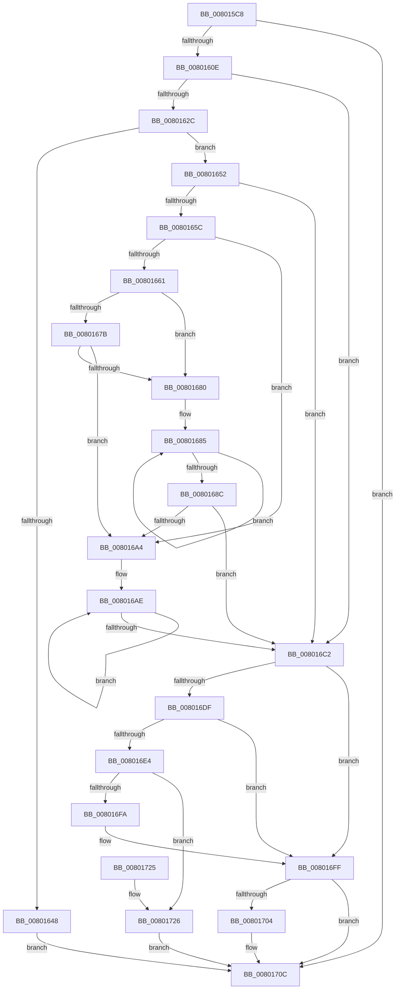

# MiLockAndMapEntireDriver

- RVA: `0x008015C8`–`0x00801778` (길이 `432` bytes)
- VA: `0x00000001408015C8`
- 실행 섹션: `PAGE`
- PDB 이름 있음: `예`; PDB Function 태그: `아니요`
- unwind 정보 RVA: `0x000D82D4`
- 디코드: `129`개 명령, `432/432` bytes 표시
- 미해석 바이트: `0` (있으면 어셈블리에 `.byte`로 보존)

> 이 문서는 커널 이미지의 기계어와 PDB 기호를 분석해 생성했습니다. 4번과 5번은 함수 원형과 자료형을 바이너리 사용 방식에서 추정한 C 해석이며 원본 소스 복구 결과는 아닙니다.

## 1. Dependencies

- 직접 호출 지점: **7**; 고유 호출 대상: **7**
- 직접 호출자로 확인된 함수: **1**
- RIP 상대 이미지 참조: **2**

### Outgoing calls
- `0x008015F4` → [MiGetAnyMultiplexedVm](../../text/44/MiGetAnyMultiplexedVm_function_00448BD0.md) (function, `0x00448BD0`)
- `0x008015FF` → [MiPrepareDriverPatchState](../7F/MiPrepareDriverPatchState_function_007F8C8C.md) (function, `0x007F8C8C`)
- `0x0080163B` → [IoAllocateMdl](../../text/29/IoAllocateMdl_function_0029EBF0.md) (function, `0x0029EBF0`)
- `0x008016D4` → [MiLockDriverPageRange](../../text/67/MiLockDriverPageRange_function_00670160.md) (function, `0x00670160`)
- `0x008016ED` → [MiReservePtes](../../text/31/MiReservePtes_function_00318D20.md) (function, `0x00318D20`)
- `0x00801707` → [IoFreeMdl](../../text/29/IoFreeMdl_function_0029EA80.md) (function, `0x0029EA80`)
- `0x00801746` → [MiFillSystemPtes](../../text/31/MiFillSystemPtes_function_00319850.md) (function, `0x00319850`)

### Direct callers
- [MiReapplyImportOptimizationForDriverVerifier](../../text/68/MiReapplyImportOptimizationForDriverVerifier_function_00682268.md) at `0x0068238D`

### Static image references
- `0x00801661` → RVA `0x00E37438` (`.data`; read)
- `0x008016E6` → RVA `0x00E37668` (`.data`; read)

## 2. Other-region calls and transfers

- 다른 실행 섹션으로 향하는 call: **6**
  - `0x008015F4` → [MiGetAnyMultiplexedVm](../../text/44/MiGetAnyMultiplexedVm_function_00448BD0.md) (`PAGE` → `.text`)
  - `0x0080163B` → [IoAllocateMdl](../../text/29/IoAllocateMdl_function_0029EBF0.md) (`PAGE` → `.text`)
  - `0x008016D4` → [MiLockDriverPageRange](../../text/67/MiLockDriverPageRange_function_00670160.md) (`PAGE` → `.text`)
  - `0x008016ED` → [MiReservePtes](../../text/31/MiReservePtes_function_00318D20.md) (`PAGE` → `.text`)
  - `0x00801707` → [IoFreeMdl](../../text/29/IoFreeMdl_function_0029EA80.md) (`PAGE` → `.text`)
  - `0x00801746` → [MiFillSystemPtes](../../text/31/MiFillSystemPtes_function_00319850.md) (`PAGE` → `.text`)
- 별도 외부 분기/꼬리 이동을 확인하지 못했습니다.

## 3. Assembly (complete function range)

```asm
008015C8  48 89 5C 24 08                  mov qword ptr [rsp + 8], rbx
008015CD  48 89 6C 24 10                  mov qword ptr [rsp + 0x10], rbp
008015D2  56                              push rsi
008015D3  57                              push rdi
008015D4  41 54                           push r12
008015D6  41 56                           push r14
008015D8  41 57                           push r15
008015DA  48 83 EC 30                     sub rsp, 0x30
008015DE  83 64 24 78 00                  and dword ptr [rsp + 0x78], 0
008015E3  48 8B E9                        mov rbp, rcx
008015E6  33 DB                           xor ebx, ebx
008015E8  4D 8B F8                        mov r15, r8
008015EB  4C 8B E2                        mov r12, rdx
008015EE  45 33 F6                        xor r14d, r14d
008015F1  8D 4B 01                        lea ecx, [rbx + 1]
008015F4  E8 D7 75 C4 FF                  call 0x140448bd0
008015F9  48 8B D0                        mov rdx, rax
008015FC  49 8B CC                        mov rcx, r12
008015FF  E8 88 76 FF FF                  call 0x1407f8c8c
00801604  8B F8                           mov edi, eax
00801606  85 C0                           test eax, eax
00801608  0F 88 FE 00 00 00               js 0x14080170c
0080160E  8B 55 40                        mov edx, dword ptr [rbp + 0x40]
00801611  8B CB                           mov ecx, ebx
00801613  F7 C2 FF 0F 00 00               test edx, 0xfff
00801619  8B F2                           mov esi, edx
0080161B  0F 95 C1                        setne cl
0080161E  C1 EE 0C                        shr esi, 0xc
00801621  03 F1                           add esi, ecx
00801623  4D 85 FF                        test r15, r15
00801626  0F 84 96 00 00 00               je 0x1408016c2
0080162C  48 8B 4D 30                     mov rcx, qword ptr [rbp + 0x30]
00801630  45 33 C9                        xor r9d, r9d
00801633  48 21 5C 24 20                  and qword ptr [rsp + 0x20], rbx
00801638  45 33 C0                        xor r8d, r8d
0080163B  E8 B0 D5 A9 FF                  call 0x14029ebf0
00801640  48 8B D8                        mov rbx, rax
00801643  48 85 C0                        test rax, rax
00801646  75 0A                           jne 0x140801652
00801648  BF 9A 00 00 C0                  mov edi, 0xc000009a
0080164D  E9 BA 00 00 00                  jmp 0x14080170c
00801652  33 D2                           xor edx, edx
00801654  4C 8D 70 30                     lea r14, [rax + 0x30]
00801658  85 F6                           test esi, esi
0080165A  74 66                           je 0x1408016c2
0080165C  83 FE 02                        cmp esi, 2
0080165F  72 43                           jb 0x1408016a4
00801661  4C 8B 0D D0 5D 63 00            mov r9, qword ptr [rip + 0x635dd0]
00801668  48 8D 0D C9 5D 63 00            lea rcx, [rip + 0x635dc9]
0080166F  8D 46 FF                        lea eax, [rsi - 1]
00801672  49 8D 04 C6                     lea rax, [r14 + rax*8]
00801676  4C 3B F1                        cmp r14, rcx
00801679  77 05                           ja 0x140801680
0080167B  48 3B C1                        cmp rax, rcx
0080167E  73 24                           jae 0x1408016a4
00801680  8B CE                           mov ecx, esi
00801682  83 E1 FE                        and ecx, 0xfffffffe
00801685  83 C2 02                        add edx, 2
00801688  3B D1                           cmp edx, ecx
0080168A  72 F9                           jb 0x140801685
0080168C  48 D1 E9                        shr rcx, 1
0080168F  49 8B FE                        mov rdi, r14
00801692  48 C1 E1 04                     shl rcx, 4
00801696  49 8B C1                        mov rax, r9
00801699  48 C1 E9 03                     shr rcx, 3
0080169D  F3 48 AB                        rep stosq qword ptr [rdi], rax
008016A0  3B D6                           cmp edx, esi
008016A2  73 1E                           jae 0x1408016c2
008016A4  8B C6                           mov eax, esi
008016A6  49 8D 0C D6                     lea rcx, [r14 + rdx*8]
008016AA  2B C2                           sub eax, edx
008016AC  8B D0                           mov edx, eax
008016AE  48 8B 05 83 5D 63 00            mov rax, qword ptr [rip + 0x635d83]
008016B5  48 89 01                        mov qword ptr [rcx], rax
008016B8  48 8D 49 08                     lea rcx, [rcx + 8]
008016BC  48 83 EA 01                     sub rdx, 1
008016C0  75 EC                           jne 0x1408016ae
008016C2  33 D2                           xor edx, edx
008016C4  48 89 5C 24 20                  mov qword ptr [rsp + 0x20], rbx
008016C9  44 8D 46 FF                     lea r8d, [rsi - 1]
008016CD  49 8B CC                        mov rcx, r12
008016D0  44 8D 4A 02                     lea r9d, [rdx + 2]
008016D4  E8 87 EA E6 FF                  call 0x140670160
008016D9  8B F8                           mov edi, eax
008016DB  85 C0                           test eax, eax
008016DD  78 20                           js 0x1408016ff
008016DF  4D 85 FF                        test r15, r15
008016E2  74 1B                           je 0x1408016ff
008016E4  8B D6                           mov edx, esi
008016E6  48 8D 0D 7B 5F 63 00            lea rcx, [rip + 0x635f7b]
008016ED  E8 2E 76 B1 FF                  call 0x140318d20
008016F2  48 8B E8                        mov rbp, rax
008016F5  48 85 C0                        test rax, rax
008016F8  75 2C                           jne 0x140801726
008016FA  BF 9A 00 00 C0                  mov edi, 0xc000009a
008016FF  48 85 DB                        test rbx, rbx
00801702  74 08                           je 0x14080170c
00801704  48 8B CB                        mov rcx, rbx
00801707  E8 74 D3 A9 FF                  call 0x14029ea80
0080170C  48 8B 5C 24 60                  mov rbx, qword ptr [rsp + 0x60]
00801711  8B C7                           mov eax, edi
00801713  48 8B 6C 24 68                  mov rbp, qword ptr [rsp + 0x68]
00801718  48 83 C4 30                     add rsp, 0x30
0080171C  41 5F                           pop r15
0080171E  41 5E                           pop r14
00801720  41 5C                           pop r12
00801722  5F                              pop rdi
00801723  5E                              pop rsi
00801724  C3                              ret
00801725  CC                              int3
00801726  48 8D 44 24 78                  lea rax, [rsp + 0x78]
0080172B  8B D6                           mov edx, esi
0080172D  48 89 44 24 28                  mov qword ptr [rsp + 0x28], rax
00801732  41 B9 04 00 00 00               mov r9d, 4
00801738  4D 8B C6                        mov r8, r14
0080173B  C7 44 24 20 02 00 00 00         mov dword ptr [rsp + 0x20], 2
00801743  48 8B CD                        mov rcx, rbp
00801746  E8 05 81 B1 FF                  call 0x140319850
0080174B  8B F8                           mov edi, eax
0080174D  48 C1 E5 19                     shl rbp, 0x19
00801751  48 B8 00 00 00 00 80 F6 FF FF   movabs rax, 0xfffff68000000000
0080175B  48 C1 E0 19                     shl rax, 0x19
0080175F  48 2B E8                        sub rbp, rax
00801762  B8 01 00 00 00                  mov eax, 1
00801767  48 C1 FD 10                     sar rbp, 0x10
0080176B  66 09 43 0A                     or word ptr [rbx + 0xa], ax
0080176F  48 89 6B 18                     mov qword ptr [rbx + 0x18], rbp
00801773  49 89 1F                        mov qword ptr [r15], rbx
00801776  EB 94                           jmp 0x14080170c
```

## 4. C-style interpretation (structured pseudocode)

```c
__int64 __fastcall MiLockAndMapEntireDriver(__int64 a1, __int64 a2, __int64 a3, int a4)
{
    __int64 result;
    __int64 v_r14;
    __int64 v_rbp;
    __int64 v_rbx;
    __int64 v_rsi;
    __int64 v_rsp;
    unsigned __int64 v_stack_m38;
    unsigned __int64 v_stack_p10;
    unsigned int v_stack_p20;
    unsigned __int64 v_stack_p28;
    unsigned __int64 v_stack_p78;
    unsigned __int64 v_stack_p8;

    v_stack_p8 = v_rbx;
    v_stack_p10 = v_rbp;
    v_rsp = (v_rsp) - (48);
    v_rbx = 0;
    v_r14 = 0;
    result = MiGetAnyMultiplexedVm(v_rbx + 1, a2, a3, a4);
    result = MiPrepareDriverPatchState(a2, result, a3, a4);
    if (sign_flag) goto loc_0080170C;
    a1 = ((((unsigned int)((unsigned int)(*(unsigned int *)(a1 + 64)))) & (0xFFFULL)) != 0) ? 1 : 0;
    v_rsi = (unsigned int)(((unsigned int)((unsigned int)((unsigned int)(*(unsigned int *)(a1 + 64))))) >> (12));
    v_rsi = (unsigned int)((v_rsi) + ((unsigned int)(a1)));
    if (a3 == 0) goto loc_008016C2;
    a4 = 0;
    a3 = 0;
    result = IoAllocateMdl(*(unsigned __int64 *)(a1 + 48), (unsigned int)(*(unsigned int *)(a1 + 64)), a3, a4);
    if (result != 0) goto loc_00801652;
    goto loc_0080170C;
loc_00801652:
    a2 = 0;
    if ((unsigned int)(v_rsi) == 0) goto loc_008016C2;
    if (((unsigned int)(v_rsi)) < 2) goto loc_008016A4;
    if ((result + 48) > (v_rip + 6512073)) goto loc_00801680;
    if ((result + 48 + v_rsi - 1 * 8) >= (v_rip + 6512073)) goto loc_008016A4;
loc_00801680:
    a1 = (unsigned int)(((unsigned int)((unsigned int)(v_rsi))) & (0xFFFFFFFEULL));
loc_00801685:
    a2 = (unsigned int)((a2) + (2));
    if (((unsigned int)(a2)) < ((unsigned int)(a1))) goto loc_00801685;
    a1 = (a1) >> (1);
    a1 = (a1) << (4);
    a1 = (a1) >> (3);
    if (((unsigned int)(a2)) >= ((unsigned int)(v_rsi))) goto loc_008016C2;
loc_008016A4:
    result = (unsigned int)(((unsigned int)((unsigned int)(v_rsi))) - ((unsigned int)(a2)));
loc_008016AE:
    *(unsigned __int64 *)(result + 48 + a2 * 8) = *(unsigned __int64 *)(v_rip + 6512003);
    a2 = ((unsigned int)((unsigned int)(result))) - (1);
    if (condition_is_not_equal) goto loc_008016AE;
loc_008016C2:
    a2 = 0;
    v_stack_m38 = result;
    result = MiLockDriverPageRange(0, a2, v_rsi - 1, a2 + 2);
    if (sign_flag) goto loc_008016FF;
    if (0 == 0) goto loc_008016FF;
    result = MiReservePtes(v_rip + 6512507, (unsigned int)((unsigned int)(v_rsi)), v_rsi - 1, a2 + 2);
    if (result != 0) goto loc_00801726;
loc_008016FF:
    if (result != 0) {
        a1 = result;
        result = IoFreeMdl(a1, (unsigned int)((unsigned int)(v_rsi)), v_rsi - 1, a2 + 2);
    }
    v_rsp = (v_rsp) + (48);
    return (unsigned int)((unsigned int)((unsigned int)(0xC000009AULL)));
loc_00801726:
    v_stack_p28 = v_stack_p78;
    v_stack_p20 = 2;
    result = MiFillSystemPtes(v_stack_p10, (unsigned int)((unsigned int)(v_rsi)), result + 48, 4);
    v_rbp = (v_stack_p10) << (25);
    result = (result) << (25);
    v_rbp = (v_rbp) - (result);
    v_rbp = (v_rbp) >> (16);
    *(unsigned __int64 *)(v_stack_p8 + 24) = v_rbp;
    *(unsigned __int64 *)(a3) = v_stack_p8;
    goto loc_0080170C;
}
```

## 5. (Beta) C Style

```c
int64_t MiLockAndMapEntireDriver(void *Arg1, int64_t Arg2, int64_t Arg3, int32_t Arg4)
{
    uint8_t *arg1 = (uint8_t *)Arg1;

    int64_t result;
    int64_t local_r14;
    int64_t local_rbp;
    int64_t local_rbx;
    int64_t local_rsi;
    int64_t local_rsp;
    uint64_t v_stack_m38;
    uint64_t v_stack_p10;
    uint32_t v_stack_p20;
    uint64_t v_stack_p28;
    uint64_t v_stack_p78;
    uint64_t v_stack_p8;

    v_stack_p8 = local_rbx;
    v_stack_p10 = local_rbp;
    local_rsp = (local_rsp) - (48);
    local_rbx = 0;
    local_r14 = 0;
    result = MiGetAnyMultiplexedVm(local_rbx + 1, Arg2, Arg3, Arg4);
    result = MiPrepareDriverPatchState(Arg2, result, Arg3, Arg4);
    if (sign_flag) goto loc_0080170C;
    Arg1 = ((((uint32_t)((uint32_t)(*(uint32_t *)(arg1 + 0x40)))) & (0xFFFULL)) != 0) ? 1 : 0;
    local_rsi = (uint32_t)(((uint32_t)((uint32_t)((uint32_t)(*(uint32_t *)(arg1 + 0x40))))) >> (12));
    local_rsi = (uint32_t)((local_rsi) + ((uint32_t)(Arg1)));
    if (Arg3 == 0) goto loc_008016C2;
    Arg4 = 0;
    Arg3 = 0;
    result = IoAllocateMdl(*(uint64_t *)(arg1 + 0x30), (uint32_t)(*(uint32_t *)(arg1 + 0x40)), Arg3, Arg4);
    if (result != 0) goto loc_00801652;
    goto loc_0080170C;
loc_00801652:
    Arg2 = 0;
    if ((uint32_t)(local_rsi) == 0) goto loc_008016C2;
    if (((uint32_t)(local_rsi)) < 2) goto loc_008016A4;
    if ((result + 48) > (v_rip + 6512073)) goto loc_00801680;
    if ((result + 48 + local_rsi - 1 * 8) >= (v_rip + 6512073)) goto loc_008016A4;
loc_00801680:
    Arg1 = (uint32_t)(((uint32_t)((uint32_t)(local_rsi))) & (0xFFFFFFFEULL));
loc_00801685:
    Arg2 = (uint32_t)((Arg2) + (2));
    if (((uint32_t)(Arg2)) < ((uint32_t)(Arg1))) goto loc_00801685;
    Arg1 = (Arg1) >> (1);
    Arg1 = (Arg1) << (4);
    Arg1 = (Arg1) >> (3);
    if (((uint32_t)(Arg2)) >= ((uint32_t)(local_rsi))) goto loc_008016C2;
loc_008016A4:
    result = (uint32_t)(((uint32_t)((uint32_t)(local_rsi))) - ((uint32_t)(Arg2)));
loc_008016AE:
    *(uint64_t *)(result + 0x30 + Arg2 * 8) = *(uint64_t *)(v_rip + 0x635D83);
    Arg2 = ((uint32_t)((uint32_t)(result))) - (1);
    if (condition_is_not_equal) goto loc_008016AE;
loc_008016C2:
    Arg2 = 0;
    v_stack_m38 = result;
    result = MiLockDriverPageRange(0, Arg2, local_rsi - 1, Arg2 + 2);
    if (sign_flag) goto loc_008016FF;
    if (0 == 0) goto loc_008016FF;
    result = MiReservePtes(v_rip + 6512507, (uint32_t)((uint32_t)(local_rsi)), local_rsi - 1, Arg2 + 2);
    if (result != 0) goto loc_00801726;
loc_008016FF:
    if (result != 0) {
        Arg1 = result;
        result = IoFreeMdl(Arg1, (uint32_t)((uint32_t)(local_rsi)), local_rsi - 1, Arg2 + 2);
    }
    local_rsp = (local_rsp) + (48);
    return (uint32_t)((uint32_t)((uint32_t)(0xC000009AULL)));
loc_00801726:
    v_stack_p28 = v_stack_p78;
    v_stack_p20 = 2;
    result = MiFillSystemPtes(v_stack_p10, (uint32_t)((uint32_t)(local_rsi)), result + 48, 4);
    local_rbp = (v_stack_p10) << (25);
    result = (result) << (25);
    local_rbp = (local_rbp) - (result);
    local_rbp = (local_rbp) >> (16);
    *(uint64_t *)(v_stack_p8 + 0x18) = local_rbp;
    *(uint64_t *)(Arg3) = v_stack_p8;
    goto loc_0080170C;
}
```

### 관측된 메모리 오프셋

구조체 형식이 확인되지 않은 접근은 인자 기준의 오프셋으로만 기록했습니다.

| 기준 인자 | 오프셋 표현 | 폭 (bit) | 접근 |
|---|---:|---:|---|
| `Arg1` | `+ 0x30` | `64` | `R` |
| `Arg1` | `+ 0x40` | `32` | `R` |

## 6. Execution-region graph

[열기: 2D/3D 그래프와 함수 탐색 컨트롤 패널](../../../control-panel.html?section=page&rva=0x008015C8&view=graph)

- 2D 그래프는 위에서 아래로 흐르고, 3D 그래프는 빈 공간을 드래그해 회전합니다. Shift+드래그는 이동, 휠은 확대·축소, 함수 노드 선택은 대상 보고서 이동입니다.

### Static fallback


