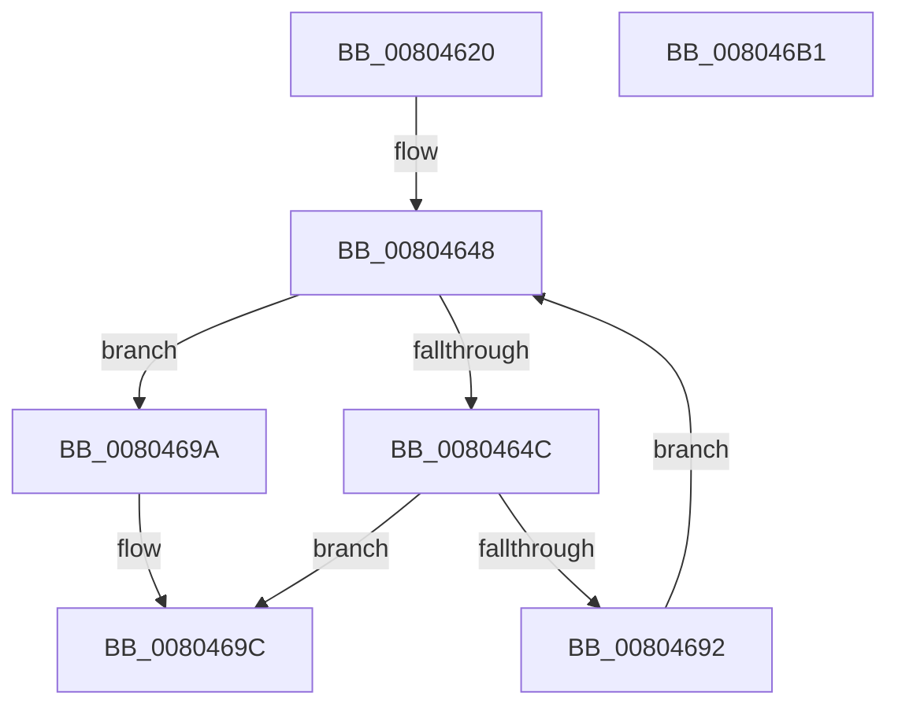

# MiLockHotPatchPages

- RVA: `0x00804620`–`0x008046B2` (길이 `146` bytes)
- VA: `0x0000000140804620`
- 실행 섹션: `PAGE`
- PDB 이름 있음: `예`; PDB Function 태그: `아니요`
- unwind 정보 RVA: `0x000BF96C`
- 디코드: `41`개 명령, `146/146` bytes 표시
- 미해석 바이트: `0` (있으면 어셈블리에 `.byte`로 보존)

> 이 문서는 커널 이미지의 기계어와 PDB 기호를 분석해 생성했습니다. 4번과 5번은 함수 원형과 자료형을 바이너리 사용 방식에서 추정한 C 해석이며 원본 소스 복구 결과는 아닙니다.

## 1. Dependencies

- 직접 호출 지점: **2**; 고유 호출 대상: **2**
- 직접 호출자로 확인된 함수: **1**
- RIP 상대 이미지 참조: **0**

### Outgoing calls
- `0x0080466C` → [RtlDetermineHotPatchExtent](../84/RtlDetermineHotPatchExtent_function_00840D24.md) (function, `0x00840D24`)
- `0x00804689` → [MiLockDriverPageRange](../../text/67/MiLockDriverPageRange_function_00670160.md) (function, `0x00670160`)

### Direct callers
- [MiPrepareDriverForHotPatch](MiPrepareDriverForHotPatch_function_008066F4.md) at `0x0080675B`
- [MiPrepareDriverForHotPatch](MiPrepareDriverForHotPatch_function_008066F4.md) at `0x0080678E`

### Static image references
- 디코드된 RIP-relative 메모리 참조가 없습니다.

## 2. Other-region calls and transfers

- 다른 실행 섹션으로 향하는 call: **1**
  - `0x00804689` → [MiLockDriverPageRange](../../text/67/MiLockDriverPageRange_function_00670160.md) (`PAGE` → `.text`)
- 별도 외부 분기/꼬리 이동을 확인하지 못했습니다.

## 3. Assembly (complete function range)

```asm
00804620  48 8B C4                        mov rax, rsp
00804623  48 89 58 08                     mov qword ptr [rax + 8], rbx
00804627  48 89 68 10                     mov qword ptr [rax + 0x10], rbp
0080462B  48 89 70 20                     mov qword ptr [rax + 0x20], rsi
0080462F  57                              push rdi
00804630  48 83 EC 40                     sub rsp, 0x40
00804634  83 60 E8 00                     and dword ptr [rax - 0x18], 0
00804638  41 8B D8                        mov ebx, r8d
0080463B  83 60 18 00                     and dword ptr [rax + 0x18], 0
0080463F  48 8B FA                        mov rdi, rdx
00804642  41 8B F1                        mov esi, r9d
00804645  48 8B E9                        mov rbp, rcx
00804648  85 DB                           test ebx, ebx
0080464A  74 4E                           je 0x14080469a
0080464C  8B 54 24 78                     mov edx, dword ptr [rsp + 0x78]
00804650  48 8D 44 24 60                  lea rax, [rsp + 0x60]
00804655  8B 4C 24 70                     mov ecx, dword ptr [rsp + 0x70]
00804659  4C 8D 4C 24 30                  lea r9, [rsp + 0x30]
0080465E  41 B8 64 86 00 00               mov r8d, 0x8664
00804664  48 89 44 24 20                  mov qword ptr [rsp + 0x20], rax
00804669  8B 14 97                        mov edx, dword ptr [rdi + rdx*4]
0080466C  E8 B3 C6 03 00                  call 0x140840d24
00804671  44 8B 44 24 60                  mov r8d, dword ptr [rsp + 0x60]
00804676  41 B9 01 00 00 00               mov r9d, 1
0080467C  8B 54 24 30                     mov edx, dword ptr [rsp + 0x30]
00804680  48 8B CD                        mov rcx, rbp
00804683  48 83 64 24 20 00               and qword ptr [rsp + 0x20], 0
00804689  E8 D2 BA E6 FF                  call 0x140670160
0080468E  85 C0                           test eax, eax
00804690  78 0A                           js 0x14080469c
00804692  48 8D 3C B7                     lea rdi, [rdi + rsi*4]
00804696  FF CB                           dec ebx
00804698  EB AE                           jmp 0x140804648
0080469A  33 C0                           xor eax, eax
0080469C  48 8B 5C 24 50                  mov rbx, qword ptr [rsp + 0x50]
008046A1  48 8B 6C 24 58                  mov rbp, qword ptr [rsp + 0x58]
008046A6  48 8B 74 24 68                  mov rsi, qword ptr [rsp + 0x68]
008046AB  48 83 C4 40                     add rsp, 0x40
008046AF  5F                              pop rdi
008046B0  C3                              ret
008046B1  CC                              int3
```

## 4. C-style interpretation (structured pseudocode)

```c
__int64 __fastcall MiLockHotPatchPages(__int64 a1, __int64 a2, int a3, int a4, unsigned int a5, unsigned int a6)
{
    __int64 result;
    __int64 v_rbx;
    __int64 v_rsp;
    unsigned __int64 v_stack_m18;
    unsigned __int64 v_stack_m28;
    unsigned __int64 v_stack_p10;
    unsigned __int64 v_stack_p18;
    unsigned __int64 v_stack_p20;
    unsigned __int64 v_stack_p8;

    *(unsigned __int64 *)(v_rsp + 8) = v_rbx;
    *(unsigned __int64 *)(v_rsp + 16) = v_rbp;
    *(unsigned __int64 *)(v_rsp + 32) = v_rsi;
    v_rsp = (v_rsp) - (64);
loc_00804648:
    if ((unsigned int)((unsigned int)(a3)) == 0) goto loc_0080469A;
    v_stack_m28 = v_stack_p18;
    result = RtlDetermineHotPatchExtent((unsigned int)(a5), (unsigned int)(*(unsigned int *)(a2 + (unsigned int)(a6) * 4)), (unsigned int)(0x8664ULL), v_stack_m18);
    result = MiLockDriverPageRange(a1, (unsigned int)(v_stack_m18), (unsigned int)(v_stack_p18), 1);
    if (sign_flag) goto loc_0080469C;
    v_rbx = (unsigned int)(((unsigned int)(a3)) - 1);
    goto loc_00804648;
loc_0080469A:
    result = 0;
loc_0080469C:
    v_rsp = (v_rsp) + (64);
    return result;
}
```

## 5. (Beta) C Style

```c
int64_t MiLockHotPatchPages(int64_t Arg1, void *Arg2, int32_t Arg3, int32_t Arg4, uint32_t Arg5, uint32_t Arg6)
{
    uint8_t *arg2 = (uint8_t *)Arg2;

    int64_t result;
    int64_t local_rbx;
    int64_t local_rsp;
    uint64_t v_stack_m18;
    uint64_t v_stack_m28;
    uint64_t v_stack_p10;
    uint64_t v_stack_p18;
    uint64_t v_stack_p20;
    uint64_t v_stack_p8;

    *(uint64_t *)(local_rsp + 0x8) = local_rbx;
    *(uint64_t *)(local_rsp + 0x10) = local_rbp;
    *(uint64_t *)(local_rsp + 0x20) = local_rsi;
    local_rsp = (local_rsp) - (64);
loc_00804648:
    if ((uint32_t)((uint32_t)(Arg3)) == 0) goto loc_0080469A;
    v_stack_m28 = v_stack_p18;
    result = RtlDetermineHotPatchExtent((uint32_t)(Arg5), (uint32_t)(*(uint32_t *)(arg2 + (uint32_t)(Arg6) * 4)), (uint32_t)(0x8664ULL), v_stack_m18);
    result = MiLockDriverPageRange(Arg1, (uint32_t)(v_stack_m18), (uint32_t)(v_stack_p18), 1);
    if (sign_flag) goto loc_0080469C;
    local_rbx = (uint32_t)(((uint32_t)(Arg3)) - 1);
    goto loc_00804648;
loc_0080469A:
    result = 0;
loc_0080469C:
    local_rsp = (local_rsp) + (64);
    return result;
}
```

### 관측된 메모리 오프셋

구조체 형식이 확인되지 않은 접근은 인자 기준의 오프셋으로만 기록했습니다.

| 기준 인자 | 오프셋 표현 | 폭 (bit) | 접근 |
|---|---:|---:|---|
| `Arg2` | `+ 0x0 + rdx*4` | `32` | `R` |
| `Arg2` | `+ 0x0 + rsi*4` | `64` | `R` |

## 6. Execution-region graph

[열기: 2D/3D 그래프와 함수 탐색 컨트롤 패널](../../../control-panel.html?section=page&rva=0x00804620&view=graph)

- 2D 그래프는 위에서 아래로 흐르고, 3D 그래프는 빈 공간을 드래그해 회전합니다. Shift+드래그는 이동, 휠은 확대·축소, 함수 노드 선택은 대상 보고서 이동입니다.

### Static fallback


