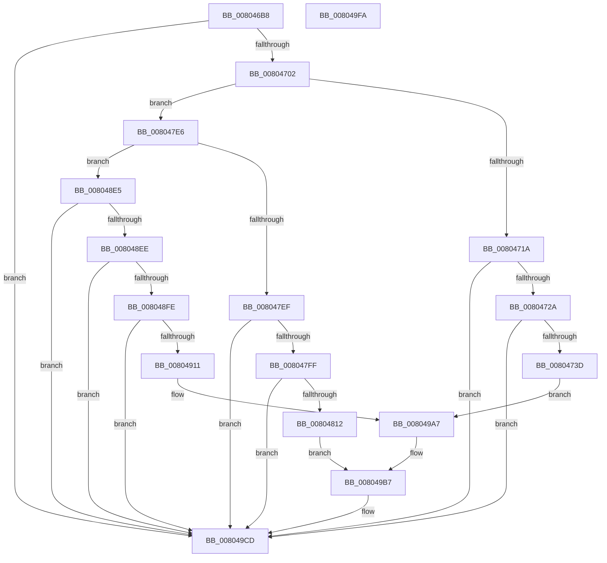

# MiLogHotPatchManagement

- RVA: `0x008046B8`–`0x008049FB` (길이 `835` bytes)
- VA: `0x00000001408046B8`
- 실행 섹션: `PAGE`
- PDB 이름 있음: `예`; PDB Function 태그: `아니요`
- unwind 정보 RVA: `0x000D84B0`
- 디코드: `181`개 명령, `835/835` bytes 표시
- 미해석 바이트: `0` (있으면 어셈블리에 `.byte`로 보존)

> 이 문서는 커널 이미지의 기계어와 PDB 기호를 분석해 생성했습니다. 4번과 5번은 함수 원형과 자료형을 바이너리 사용 방식에서 추정한 C 해석이며 원본 소스 복구 결과는 아닙니다.

## 1. Dependencies

- 직접 호출 지점: **8**; 고유 호출 대상: **4**
- 직접 호출자로 확인된 함수: **1**
- RIP 상대 이미지 참조: **5**

### Outgoing calls
- `0x00804730` → [tlgKeywordOn](../../text/42/tlgKeywordOn_function_0042EAA0.md) (function, `0x0042EAA0`)
- `0x00804740` → [PsGetProcessId](../../text/43/PsGetProcessId_function_0043D910.md) (function, `0x0043D910`)
- `0x00804805` → [tlgKeywordOn](../../text/42/tlgKeywordOn_function_0042EAA0.md) (function, `0x0042EAA0`)
- `0x00804815` → [PsGetProcessId](../../text/43/PsGetProcessId_function_0043D910.md) (function, `0x0043D910`)
- `0x00804904` → [tlgKeywordOn](../../text/42/tlgKeywordOn_function_0042EAA0.md) (function, `0x0042EAA0`)
- `0x00804914` → [PsGetProcessId](../../text/43/PsGetProcessId_function_0043D910.md) (function, `0x0043D910`)
- `0x008049C8` → [tlgWriteEx_EtwWriteEx](../../text/4A/tlgWriteEx_EtwWriteEx_function_004AA348.md) (function, `0x004AA348`)
- `0x008049D4` → [_security_check_cookie](../../text/6A/_security_check_cookie_function_006AC640.md) (function, `0x006AC640`)

### Direct callers
- [NtManageHotPatch](../AF/NtManageHotPatch_function_00AF8660.md) at `0x00AF8B3D`
- [NtManageHotPatch](../AF/NtManageHotPatch_function_00AF8660.md) at `0x00AF8B77`

### Static image references
- `0x008046DB` → RVA `0x00E0A740` (`.data`; read)
- `0x008046EF` → RVA `0x00E37618` (`.data`; read)
- `0x00804749` → RVA `0x00058DF8` (`.rdata`; read)
- `0x0080481E` → RVA `0x00058E68` (`.rdata`; read)
- `0x0080491D` → RVA `0x00058CC2` (`.rdata`; read)

## 2. Other-region calls and transfers

- 다른 실행 섹션으로 향하는 call: **8**
  - `0x00804730` → [tlgKeywordOn](../../text/42/tlgKeywordOn_function_0042EAA0.md) (`PAGE` → `.text`)
  - `0x00804740` → [PsGetProcessId](../../text/43/PsGetProcessId_function_0043D910.md) (`PAGE` → `.text`)
  - `0x00804805` → [tlgKeywordOn](../../text/42/tlgKeywordOn_function_0042EAA0.md) (`PAGE` → `.text`)
  - `0x00804815` → [PsGetProcessId](../../text/43/PsGetProcessId_function_0043D910.md) (`PAGE` → `.text`)
  - `0x00804904` → [tlgKeywordOn](../../text/42/tlgKeywordOn_function_0042EAA0.md) (`PAGE` → `.text`)
  - `0x00804914` → [PsGetProcessId](../../text/43/PsGetProcessId_function_0043D910.md) (`PAGE` → `.text`)
  - `0x008049C8` → [tlgWriteEx_EtwWriteEx](../../text/4A/tlgWriteEx_EtwWriteEx_function_004AA348.md) (`PAGE` → `.text`)
  - `0x008049D4` → [_security_check_cookie](../../text/6A/_security_check_cookie_function_006AC640.md) (`PAGE` → `.text`)
- 별도 외부 분기/꼬리 이동을 확인하지 못했습니다.

## 3. Assembly (complete function range)

```asm
008046B8  48 8B C4                        mov rax, rsp
008046BB  48 89 58 08                     mov qword ptr [rax + 8], rbx
008046BF  48 89 70 10                     mov qword ptr [rax + 0x10], rsi
008046C3  48 89 78 18                     mov qword ptr [rax + 0x18], rdi
008046C7  4C 89 60 20                     mov qword ptr [rax + 0x20], r12
008046CB  55                              push rbp
008046CC  41 56                           push r14
008046CE  41 57                           push r15
008046D0  48 8D 68 D8                     lea rbp, [rax - 0x28]
008046D4  48 81 EC 10 01 00 00            sub rsp, 0x110
008046DB  48 8B 05 5E 60 60 00            mov rax, qword ptr [rip + 0x60605e]
008046E2  48 33 C4                        xor rax, rsp
008046E5  48 89 45 00                     mov qword ptr [rbp], rax
008046E9  45 33 E4                        xor r12d, r12d
008046EC  45 8B F9                        mov r15d, r9d
008046EF  4C 39 25 22 2F 63 00            cmp qword ptr [rip + 0x632f22], r12
008046F6  4D 8B F0                        mov r14, r8
008046F9  48 8B FA                        mov rdi, rdx
008046FC  0F 84 CB 02 00 00               je 0x1408049cd
00804702  65 48 8B 04 25 88 01 00 00      mov rax, qword ptr gs:[0x188]
0080470B  48 8B B0 B8 00 00 00            mov rsi, qword ptr [rax + 0xb8]
00804712  85 C9                           test ecx, ecx
00804714  0F 85 CC 00 00 00               jne 0x1408047e6
0080471A  48 8B 1D F7 2E 63 00            mov rbx, qword ptr [rip + 0x632ef7]
00804721  83 3B 05                        cmp dword ptr [rbx], 5
00804724  0F 86 A3 02 00 00               jbe 0x1408049cd
0080472A  8D 51 20                        lea edx, [rcx + 0x20]
0080472D  48 8B CB                        mov rcx, rbx
00804730  E8 6B A3 C2 FF                  call 0x14042eaa0
00804735  84 C0                           test al, al
00804737  0F 84 90 02 00 00               je 0x1408049cd
0080473D  48 8B CE                        mov rcx, rsi
00804740  E8 CB 91 C3 FF                  call 0x14043d910
00804745  89 44 24 50                     mov dword ptr [rsp + 0x50], eax
00804749  48 8D 15 A8 46 85 FF            lea rdx, [rip - 0x7ab958]
00804750  48 8D 44 24 50                  lea rax, [rsp + 0x50]
00804755  44 89 7C 24 44                  mov dword ptr [rsp + 0x44], r15d
0080475A  48 89 45 80                     mov qword ptr [rbp - 0x80], rax
0080475E  48 8D 44 24 44                  lea rax, [rsp + 0x44]
00804763  48 89 45 90                     mov qword ptr [rbp - 0x70], rax
00804767  8B 47 5C                        mov eax, dword ptr [rdi + 0x5c]
0080476A  89 44 24 48                     mov dword ptr [rsp + 0x48], eax
0080476E  48 8D 44 24 48                  lea rax, [rsp + 0x48]
00804773  48 89 45 A0                     mov qword ptr [rbp - 0x60], rax
00804777  8B 47 60                        mov eax, dword ptr [rdi + 0x60]
0080477A  89 44 24 4C                     mov dword ptr [rsp + 0x4c], eax
0080477E  48 8D 44 24 4C                  lea rax, [rsp + 0x4c]
00804783  48 89 45 B0                     mov qword ptr [rbp - 0x50], rax
00804787  48 8D 45 D8                     lea rax, [rbp - 0x28]
0080478B  48 89 45 C0                     mov qword ptr [rbp - 0x40], rax
0080478F  49 8B 46 08                     mov rax, qword ptr [r14 + 8]
00804793  48 89 45 D0                     mov qword ptr [rbp - 0x30], rax
00804797  41 0F B7 06                     movzx eax, word ptr [r14]
0080479B  89 45 D8                        mov dword ptr [rbp - 0x28], eax
0080479E  0F B7 86 EC 06 00 00            movzx eax, word ptr [rsi + 0x6ec]
008047A5  66 89 44 24 40                  mov word ptr [rsp + 0x40], ax
008047AA  48 8D 44 24 40                  lea rax, [rsp + 0x40]
008047AF  48 89 45 E0                     mov qword ptr [rbp - 0x20], rax
008047B3  48 8D 44 24 60                  lea rax, [rsp + 0x60]
008047B8  48 89 44 24 38                  mov qword ptr [rsp + 0x38], rax
008047BD  C7 44 24 30 09 00 00 00         mov dword ptr [rsp + 0x30], 9
008047C5  48 C7 45 B8 04 00 00 00         mov qword ptr [rbp - 0x48], 4
008047CD  48 C7 45 C8 02 00 00 00         mov qword ptr [rbp - 0x38], 2
008047D5  44 89 65 DC                     mov dword ptr [rbp - 0x24], r12d
008047D9  48 C7 45 E8 02 00 00 00         mov qword ptr [rbp - 0x18], 2
008047E1  E9 C1 01 00 00                  jmp 0x1408049a7
008047E6  83 F9 03                        cmp ecx, 3
008047E9  0F 85 F6 00 00 00               jne 0x1408048e5
008047EF  48 8B 1D 22 2E 63 00            mov rbx, qword ptr [rip + 0x632e22]
008047F6  83 3B 05                        cmp dword ptr [rbx], 5
008047F9  0F 86 CE 01 00 00               jbe 0x1408049cd
008047FF  8D 51 1D                        lea edx, [rcx + 0x1d]
00804802  48 8B CB                        mov rcx, rbx
00804805  E8 96 A2 C2 FF                  call 0x14042eaa0
0080480A  84 C0                           test al, al
0080480C  0F 84 BB 01 00 00               je 0x1408049cd
00804812  48 8B CE                        mov rcx, rsi
00804815  E8 F6 90 C3 FF                  call 0x14043d910
0080481A  89 44 24 4C                     mov dword ptr [rsp + 0x4c], eax
0080481E  48 8D 15 43 46 85 FF            lea rdx, [rip - 0x7ab9bd]
00804825  48 8D 44 24 4C                  lea rax, [rsp + 0x4c]
0080482A  48 C7 45 88 04 00 00 00         mov qword ptr [rbp - 0x78], 4
00804832  48 89 45 80                     mov qword ptr [rbp - 0x80], rax
00804836  48 8D 44 24 48                  lea rax, [rsp + 0x48]
0080483B  48 89 45 90                     mov qword ptr [rbp - 0x70], rax
0080483F  8B 47 5C                        mov eax, dword ptr [rdi + 0x5c]
00804842  89 44 24 44                     mov dword ptr [rsp + 0x44], eax
00804846  48 8D 44 24 44                  lea rax, [rsp + 0x44]
0080484B  48 89 45 A0                     mov qword ptr [rbp - 0x60], rax
0080484F  8B 47 60                        mov eax, dword ptr [rdi + 0x60]
00804852  89 44 24 50                     mov dword ptr [rsp + 0x50], eax
00804856  48 8D 44 24 50                  lea rax, [rsp + 0x50]
0080485B  48 89 45 B0                     mov qword ptr [rbp - 0x50], rax
0080485F  48 8D 45 D8                     lea rax, [rbp - 0x28]
00804863  48 89 45 C0                     mov qword ptr [rbp - 0x40], rax
00804867  49 8B 46 08                     mov rax, qword ptr [r14 + 8]
0080486B  48 89 45 D0                     mov qword ptr [rbp - 0x30], rax
0080486F  41 0F B7 06                     movzx eax, word ptr [r14]
00804873  89 45 D8                        mov dword ptr [rbp - 0x28], eax
00804876  48 8D 47 18                     lea rax, [rdi + 0x18]
0080487A  48 89 45 E0                     mov qword ptr [rbp - 0x20], rax
0080487E  0F B6 40 01                     movzx eax, byte ptr [rax + 1]
00804882  44 89 7C 24 48                  mov dword ptr [rsp + 0x48], r15d
00804887  48 C7 45 98 04 00 00 00         mov qword ptr [rbp - 0x68], 4
0080488F  48 C7 45 B8 04 00 00 00         mov qword ptr [rbp - 0x48], 4
00804897  8D 04 85 08 00 00 00            lea eax, [rax*4 + 8]
0080489E  48 C7 45 C8 02 00 00 00         mov qword ptr [rbp - 0x38], 2
008048A6  89 45 E8                        mov dword ptr [rbp - 0x18], eax
008048A9  0F B7 86 EC 06 00 00            movzx eax, word ptr [rsi + 0x6ec]
008048B0  66 89 44 24 40                  mov word ptr [rsp + 0x40], ax
008048B5  48 8D 44 24 40                  lea rax, [rsp + 0x40]
008048BA  48 89 45 F0                     mov qword ptr [rbp - 0x10], rax
008048BE  48 8D 44 24 60                  lea rax, [rsp + 0x60]
008048C3  48 89 44 24 38                  mov qword ptr [rsp + 0x38], rax
008048C8  C7 44 24 30 0A 00 00 00         mov dword ptr [rsp + 0x30], 0xa
008048D0  44 89 65 DC                     mov dword ptr [rbp - 0x24], r12d
008048D4  44 89 65 EC                     mov dword ptr [rbp - 0x14], r12d
008048D8  48 C7 45 F8 02 00 00 00         mov qword ptr [rbp - 8], 2
008048E0  E9 D2 00 00 00                  jmp 0x1408049b7
008048E5  83 F9 07                        cmp ecx, 7
008048E8  0F 85 DF 00 00 00               jne 0x1408049cd
008048EE  48 8B 1D 23 2D 63 00            mov rbx, qword ptr [rip + 0x632d23]
008048F5  83 3B 05                        cmp dword ptr [rbx], 5
008048F8  0F 86 CF 00 00 00               jbe 0x1408049cd
008048FE  8D 51 19                        lea edx, [rcx + 0x19]
00804901  48 8B CB                        mov rcx, rbx
00804904  E8 97 A1 C2 FF                  call 0x14042eaa0
00804909  84 C0                           test al, al
0080490B  0F 84 BC 00 00 00               je 0x1408049cd
00804911  48 8B CE                        mov rcx, rsi
00804914  E8 F7 8F C3 FF                  call 0x14043d910
00804919  89 44 24 4C                     mov dword ptr [rsp + 0x4c], eax
0080491D  48 8D 15 9E 43 85 FF            lea rdx, [rip - 0x7abc62]
00804924  B9 08 00 00 00                  mov ecx, 8
00804929  44 89 7C 24 48                  mov dword ptr [rsp + 0x48], r15d
0080492E  48 8D 44 24 4C                  lea rax, [rsp + 0x4c]
00804933  48 89 4D B8                     mov qword ptr [rbp - 0x48], rcx
00804937  48 89 45 80                     mov qword ptr [rbp - 0x80], rax
0080493B  48 8D 44 24 48                  lea rax, [rsp + 0x48]
00804940  48 89 45 90                     mov qword ptr [rbp - 0x70], rax
00804944  8B 47 04                        mov eax, dword ptr [rdi + 4]
00804947  89 44 24 44                     mov dword ptr [rsp + 0x44], eax
0080494B  48 8D 44 24 44                  lea rax, [rsp + 0x44]
00804950  48 89 45 A0                     mov qword ptr [rbp - 0x60], rax
00804954  48 8B 47 10                     mov rax, qword ptr [rdi + 0x10]
00804958  48 89 44 24 50                  mov qword ptr [rsp + 0x50], rax
0080495D  48 8D 44 24 50                  lea rax, [rsp + 0x50]
00804962  48 89 45 B0                     mov qword ptr [rbp - 0x50], rax
00804966  48 8B 47 18                     mov rax, qword ptr [rdi + 0x18]
0080496A  48 89 44 24 58                  mov qword ptr [rsp + 0x58], rax
0080496F  48 8D 44 24 58                  lea rax, [rsp + 0x58]
00804974  48 89 45 C0                     mov qword ptr [rbp - 0x40], rax
00804978  0F B7 86 EC 06 00 00            movzx eax, word ptr [rsi + 0x6ec]
0080497F  66 89 44 24 40                  mov word ptr [rsp + 0x40], ax
00804984  48 8D 44 24 40                  lea rax, [rsp + 0x40]
00804989  48 89 45 D0                     mov qword ptr [rbp - 0x30], rax
0080498D  48 8D 44 24 60                  lea rax, [rsp + 0x60]
00804992  48 89 44 24 38                  mov qword ptr [rsp + 0x38], rax
00804997  89 4C 24 30                     mov dword ptr [rsp + 0x30], ecx
0080499B  48 89 4D C8                     mov qword ptr [rbp - 0x38], rcx
0080499F  48 C7 45 D8 02 00 00 00         mov qword ptr [rbp - 0x28], 2
008049A7  48 C7 45 88 04 00 00 00         mov qword ptr [rbp - 0x78], 4
008049AF  48 C7 45 98 04 00 00 00         mov qword ptr [rbp - 0x68], 4
008049B7  41 B9 01 00 00 00               mov r9d, 1
008049BD  48 C7 45 A8 04 00 00 00         mov qword ptr [rbp - 0x58], 4
008049C5  48 8B CB                        mov rcx, rbx
008049C8  E8 7B 59 CA FF                  call 0x1404aa348
008049CD  48 8B 4D 00                     mov rcx, qword ptr [rbp]
008049D1  48 33 CC                        xor rcx, rsp
008049D4  E8 67 7C EA FF                  call 0x1406ac640
008049D9  4C 8D 9C 24 10 01 00 00         lea r11, [rsp + 0x110]
008049E1  49 8B 5B 20                     mov rbx, qword ptr [r11 + 0x20]
008049E5  49 8B 73 28                     mov rsi, qword ptr [r11 + 0x28]
008049E9  49 8B 7B 30                     mov rdi, qword ptr [r11 + 0x30]
008049ED  4D 8B 63 38                     mov r12, qword ptr [r11 + 0x38]
008049F1  49 8B E3                        mov rsp, r11
008049F4  41 5F                           pop r15
008049F6  41 5E                           pop r14
008049F8  5D                              pop rbp
008049F9  C3                              ret
008049FA  CC                              int3
```

## 4. C-style interpretation (structured pseudocode)

```c
__int64 __fastcall MiLogHotPatchManagement(__int64 a1, __int64 a2, __int64 a3, int a4)
{
    __int64 result;
    __int64 v_r12;
    __int64 v_rsp;
    unsigned __int64 v_stack_m18;
    unsigned __int64 v_stack_mC8;
    unsigned __int64 v_stack_mD0;
    unsigned int v_stack_mD8;
    unsigned int v_stack_mDC;
    unsigned int v_stack_mE0;
    unsigned int v_stack_mE4;
    unsigned __int16 v_stack_mE8;
    unsigned __int64 v_stack_mF0;
    unsigned int v_stack_mF8;

    *(unsigned __int64 *)(v_rsp + 8) = v_rbx;
    *(unsigned __int64 *)(v_rsp + 16) = v_rsi;
    *(unsigned __int64 *)(v_rsp + 24) = v_rdi;
    *(unsigned __int64 *)(v_rsp + 32) = v_r12;
    v_rsp = (v_rsp) - (272);
    result = (*(unsigned __int64 *)(v_rip + 6316126)) ^ (v_rsp);
    *(unsigned __int64 *)(v_rsp - 40) = result;
    v_r12 = 0;
    if ((*(unsigned __int64 *)(v_rip + 6500130)) == 0) goto loc_008049CD;
    if ((unsigned int)(a1) != 0) goto loc_008047E6;
    if ((*(unsigned int *)(*(unsigned __int64 *)(v_rip + 6500087))) <= 5) goto loc_008049CD;
    result = tlgKeywordOn(*(unsigned __int64 *)(v_rip + 6500087), a1 + 32, a3, a4);
    if ((unsigned __int8)(result) == 0) goto loc_008049CD;
    result = PsGetProcessId(*(unsigned __int64 *)(*(unsigned __int64 *)(gs_base + (0 + 392)) + 184), a1 + 32, a3, a4);
    v_stack_mD8 = (unsigned int)(result);
    v_stack_mE4 = (unsigned int)((unsigned int)(a4));
    *(unsigned __int64 *)(v_rsp - 40 - 128) = v_stack_mD8;
    *(unsigned __int64 *)(v_rsp - 40 - 112) = v_stack_mE4;
    v_stack_mE0 = (unsigned int)((unsigned int)(*(unsigned int *)(a2 + 92)));
    *(unsigned __int64 *)(v_rsp - 40 - 96) = v_stack_mE0;
    v_stack_mDC = (unsigned int)((unsigned int)(*(unsigned int *)(a2 + 96)));
    *(unsigned __int64 *)(v_rsp - 40 - 80) = v_stack_mDC;
    *(unsigned __int64 *)(v_rsp - 40 - 64) = v_rsp - 40 - 40;
    *(unsigned __int64 *)(v_rsp - 40 - 48) = *(unsigned __int64 *)(a3 + 8);
    *(unsigned int *)(v_rsp - 40 - 40) = (unsigned int)(*(unsigned __int16 *)(a3));
    v_stack_mE8 = (unsigned __int16)(*(unsigned __int16 *)(*(unsigned __int64 *)(*(unsigned __int64 *)(gs_base + (0 + 392)) + 184) + 1772));
    *(unsigned __int64 *)(v_rsp - 40 - 32) = v_stack_mE8;
    v_stack_mF0 = v_stack_mC8;
    v_stack_mF8 = 9;
    *(unsigned __int64 *)(v_rsp - 40 - 72) = 4;
    *(unsigned __int64 *)(v_rsp - 40 - 56) = 2;
    *(unsigned int *)(v_rsp - 40 - 36) = 0;
    *(unsigned __int64 *)(v_rsp - 40 - 24) = 2;
    goto loc_008049A7;
loc_008047E6:
    if (((unsigned int)(*(unsigned __int64 *)(*(unsigned __int64 *)(gs_base + (0 + 392)) + 184))) != 3) goto loc_008048E5;
    if ((*(unsigned int *)(*(unsigned __int64 *)(v_rip + 6499874))) <= 5) goto loc_008049CD;
    result = tlgKeywordOn(*(unsigned __int64 *)(v_rip + 6499874), *(unsigned __int64 *)(*(unsigned __int64 *)(gs_base + (0 + 392)) + 184) + 29, a3, a4);
    if ((unsigned __int8)(result) == 0) goto loc_008049CD;
    result = PsGetProcessId(*(unsigned __int64 *)(*(unsigned __int64 *)(gs_base + (0 + 392)) + 184), *(unsigned __int64 *)(*(unsigned __int64 *)(gs_base + (0 + 392)) + 184) + 29, a3, a4);
    v_stack_mDC = (unsigned int)(result);
    *(unsigned __int64 *)(v_rsp - 40 - 120) = 4;
    *(unsigned __int64 *)(v_rsp - 40 - 128) = v_stack_mDC;
    *(unsigned __int64 *)(v_rsp - 40 - 112) = v_stack_mE0;
    v_stack_mE4 = (unsigned int)((unsigned int)(*(unsigned int *)(a2 + 92)));
    *(unsigned __int64 *)(v_rsp - 40 - 96) = v_stack_mE4;
    v_stack_mD8 = (unsigned int)((unsigned int)(*(unsigned int *)(a2 + 96)));
    *(unsigned __int64 *)(v_rsp - 40 - 80) = v_stack_mD8;
    *(unsigned __int64 *)(v_rsp - 40 - 64) = v_rsp - 40 - 40;
    *(unsigned __int64 *)(v_rsp - 40 - 48) = *(unsigned __int64 *)(a3 + 8);
    *(unsigned int *)(v_rsp - 40 - 40) = (unsigned int)(*(unsigned __int16 *)(a3));
    *(unsigned __int64 *)(v_rsp - 40 - 32) = a2 + 24;
    v_stack_mE0 = (unsigned int)((unsigned int)(a4));
    *(unsigned __int64 *)(v_rsp - 40 - 104) = 4;
    *(unsigned __int64 *)(v_rsp - 40 - 72) = 4;
    *(unsigned __int64 *)(v_rsp - 40 - 56) = 2;
    *(unsigned int *)(v_rsp - 40 - 24) = (unsigned int)(*(unsigned __int8 *)(a2 + 24 + 1) * 4 + 8);
    v_stack_mE8 = (unsigned __int16)(*(unsigned __int16 *)(*(unsigned __int64 *)(*(unsigned __int64 *)(gs_base + (0 + 392)) + 184) + 1772));
    *(unsigned __int64 *)(v_rsp - 40 - 16) = v_stack_mE8;
    v_stack_mF0 = v_stack_mC8;
    v_stack_mF8 = 10;
    *(unsigned int *)(v_rsp - 40 - 36) = 0;
    *(unsigned int *)(v_rsp - 40 - 20) = 0;
    *(unsigned __int64 *)(v_rsp - 40 - 8) = 2;
    goto loc_008049B7;
loc_008048E5:
    if (((unsigned int)(*(unsigned __int64 *)(*(unsigned __int64 *)(gs_base + (0 + 392)) + 184))) != 7) goto loc_008049CD;
    if ((*(unsigned int *)(*(unsigned __int64 *)(v_rip + 6499619))) <= 5) goto loc_008049CD;
    result = tlgKeywordOn(*(unsigned __int64 *)(v_rip + 6499619), *(unsigned __int64 *)(*(unsigned __int64 *)(gs_base + (0 + 392)) + 184) + 25, a3, a4);
    if ((unsigned __int8)(result) == 0) goto loc_008049CD;
    result = PsGetProcessId(*(unsigned __int64 *)(*(unsigned __int64 *)(gs_base + (0 + 392)) + 184), *(unsigned __int64 *)(*(unsigned __int64 *)(gs_base + (0 + 392)) + 184) + 25, a3, a4);
    v_stack_mDC = (unsigned int)(result);
    v_stack_mE0 = (unsigned int)((unsigned int)(a4));
    *(unsigned __int64 *)(v_rsp - 40 - 72) = 8;
    *(unsigned __int64 *)(v_rsp - 40 - 128) = v_stack_mDC;
    *(unsigned __int64 *)(v_rsp - 40 - 112) = v_stack_mE0;
    v_stack_mE4 = (unsigned int)((unsigned int)(*(unsigned int *)(a2 + 4)));
    *(unsigned __int64 *)(v_rsp - 40 - 96) = v_stack_mE4;
    v_stack_mD8 = *(unsigned __int64 *)(a2 + 16);
    *(unsigned __int64 *)(v_rsp - 40 - 80) = v_stack_mD8;
    v_stack_mD0 = *(unsigned __int64 *)(a2 + 24);
    *(unsigned __int64 *)(v_rsp - 40 - 64) = v_stack_mD0;
    v_stack_mE8 = (unsigned __int16)(*(unsigned __int16 *)(*(unsigned __int64 *)(*(unsigned __int64 *)(gs_base + (0 + 392)) + 184) + 1772));
    *(unsigned __int64 *)(v_rsp - 40 - 48) = v_stack_mE8;
    v_stack_mF0 = v_stack_mC8;
    v_stack_mF8 = 8;
    *(unsigned __int64 *)(v_rsp - 40 - 56) = 8;
    *(unsigned __int64 *)(v_rsp - 40 - 40) = 2;
loc_008049A7:
    *(unsigned __int64 *)(v_rsp - 40 - 120) = 4;
    *(unsigned __int64 *)(v_rsp - 40 - 104) = 4;
loc_008049B7:
    *(unsigned __int64 *)(v_rsp - 40 - 88) = 4;
    result = tlgWriteEx_EtwWriteEx(*(unsigned __int64 *)(v_rip + 6499619), v_rip - 8043618, a3, 1);
loc_008049CD:
    a1 = (*(unsigned __int64 *)(v_rsp - 40)) ^ (v_rsp);
    result = _security_check_cookie(a1, v_rip - 8043618, a3, 1);
    return result;
}
```

## 5. (Beta) C Style

```c
int64_t MiLogHotPatchManagement(int64_t Arg1, void *Arg2, void *Arg3, int32_t Arg4)
{
    uint8_t *arg2 = (uint8_t *)Arg2;
    uint8_t *arg3 = (uint8_t *)Arg3;

    int64_t result;
    int64_t local_r12;
    int64_t local_rsp;
    uint64_t v_stack_m18;
    uint64_t v_stack_mC8;
    uint64_t v_stack_mD0;
    uint32_t v_stack_mD8;
    uint32_t v_stack_mDC;
    uint32_t v_stack_mE0;
    uint32_t v_stack_mE4;
    uint16_t v_stack_mE8;
    uint64_t v_stack_mF0;
    uint32_t v_stack_mF8;

    *(uint64_t *)(local_rsp + 0x8) = local_rbx;
    *(uint64_t *)(local_rsp + 0x10) = local_rsi;
    *(uint64_t *)(local_rsp + 0x18) = local_rdi;
    *(uint64_t *)(local_rsp + 0x20) = local_r12;
    local_rsp = (local_rsp) - (272);
    result = (*(uint64_t *)(v_rip + 0x60605E)) ^ (local_rsp);
    *(uint64_t *)(local_rsp - 0x28) = result;
    local_r12 = 0;
    if ((*(uint64_t *)(v_rip + 0x632F22)) == 0) goto loc_008049CD;
    if ((uint32_t)(Arg1) != 0) goto loc_008047E6;
    if ((*(uint32_t *)(*(uint64_t *)(v_rip + 0x632EF7))) <= 5) goto loc_008049CD;
    result = tlgKeywordOn(*(uint64_t *)(v_rip + 0x632EF7), Arg1 + 32, Arg3, Arg4);
    if ((uint8_t)(result) == 0) goto loc_008049CD;
    result = PsGetProcessId(*(uint64_t *)(*(uint64_t *)(gs_base + (0 + 0x188)) + 0xB8), Arg1 + 32, Arg3, Arg4);
    v_stack_mD8 = (uint32_t)(result);
    v_stack_mE4 = (uint32_t)((uint32_t)(Arg4));
    *(uint64_t *)(local_rsp - 0x28 - 0x80) = v_stack_mD8;
    *(uint64_t *)(local_rsp - 0x28 - 0x70) = v_stack_mE4;
    v_stack_mE0 = (uint32_t)((uint32_t)(*(uint32_t *)(arg2 + 0x5C)));
    *(uint64_t *)(local_rsp - 0x28 - 0x60) = v_stack_mE0;
    v_stack_mDC = (uint32_t)((uint32_t)(*(uint32_t *)(arg2 + 0x60)));
    *(uint64_t *)(local_rsp - 0x28 - 0x50) = v_stack_mDC;
    *(uint64_t *)(local_rsp - 0x28 - 0x40) = local_rsp - 40 - 40;
    *(uint64_t *)(local_rsp - 0x28 - 0x30) = *(uint64_t *)(arg3 + 0x8);
    *(uint32_t *)(local_rsp - 0x28 - 0x28) = (uint32_t)(*(uint16_t *)(arg3));
    v_stack_mE8 = (uint16_t)(*(uint16_t *)(*(uint64_t *)(*(uint64_t *)(gs_base + (0 + 0x188)) + 0xB8) + 0x6EC));
    *(uint64_t *)(local_rsp - 0x28 - 0x20) = v_stack_mE8;
    v_stack_mF0 = v_stack_mC8;
    v_stack_mF8 = 9;
    *(uint64_t *)(local_rsp - 0x28 - 0x48) = 4;
    *(uint64_t *)(local_rsp - 0x28 - 0x38) = 2;
    *(uint32_t *)(local_rsp - 0x28 - 0x24) = 0;
    *(uint64_t *)(local_rsp - 0x28 - 0x18) = 2;
    goto loc_008049A7;
loc_008047E6:
    if (((uint32_t)(*(uint64_t *)(*(uint64_t *)(gs_base + (0 + 0x188)) + 0xB8))) != 3) goto loc_008048E5;
    if ((*(uint32_t *)(*(uint64_t *)(v_rip + 0x632E22))) <= 5) goto loc_008049CD;
    result = tlgKeywordOn(*(uint64_t *)(v_rip + 0x632E22), *(uint64_t *)(*(uint64_t *)(gs_base + (0 + 0x188)) + 0xB8) + 29, Arg3, Arg4);
    if ((uint8_t)(result) == 0) goto loc_008049CD;
    result = PsGetProcessId(*(uint64_t *)(*(uint64_t *)(gs_base + (0 + 0x188)) + 0xB8), *(uint64_t *)(*(uint64_t *)(gs_base + (0 + 0x188)) + 0xB8) + 29, Arg3, Arg4);
    v_stack_mDC = (uint32_t)(result);
    *(uint64_t *)(local_rsp - 0x28 - 0x78) = 4;
    *(uint64_t *)(local_rsp - 0x28 - 0x80) = v_stack_mDC;
    *(uint64_t *)(local_rsp - 0x28 - 0x70) = v_stack_mE0;
    v_stack_mE4 = (uint32_t)((uint32_t)(*(uint32_t *)(arg2 + 0x5C)));
    *(uint64_t *)(local_rsp - 0x28 - 0x60) = v_stack_mE4;
    v_stack_mD8 = (uint32_t)((uint32_t)(*(uint32_t *)(arg2 + 0x60)));
    *(uint64_t *)(local_rsp - 0x28 - 0x50) = v_stack_mD8;
    *(uint64_t *)(local_rsp - 0x28 - 0x40) = local_rsp - 40 - 40;
    *(uint64_t *)(local_rsp - 0x28 - 0x30) = *(uint64_t *)(arg3 + 0x8);
    *(uint32_t *)(local_rsp - 0x28 - 0x28) = (uint32_t)(*(uint16_t *)(arg3));
    *(void **)(local_rsp - 0x28 - 0x20) = Arg2 + 24;
    v_stack_mE0 = (uint32_t)((uint32_t)(Arg4));
    *(uint64_t *)(local_rsp - 0x28 - 0x68) = 4;
    *(uint64_t *)(local_rsp - 0x28 - 0x48) = 4;
    *(uint64_t *)(local_rsp - 0x28 - 0x38) = 2;
    *(uint32_t *)(local_rsp - 0x28 - 0x18) = (uint32_t)(*(uint8_t *)(arg2 + 0x18 + 0x1) * 4 + 8);
    v_stack_mE8 = (uint16_t)(*(uint16_t *)(*(uint64_t *)(*(uint64_t *)(gs_base + (0 + 0x188)) + 0xB8) + 0x6EC));
    *(uint64_t *)(local_rsp - 0x28 - 0x10) = v_stack_mE8;
    v_stack_mF0 = v_stack_mC8;
    v_stack_mF8 = 10;
    *(uint32_t *)(local_rsp - 0x28 - 0x24) = 0;
    *(uint32_t *)(local_rsp - 0x28 - 0x14) = 0;
    *(uint64_t *)(local_rsp - 0x28 - 0x8) = 2;
    goto loc_008049B7;
loc_008048E5:
    if (((uint32_t)(*(uint64_t *)(*(uint64_t *)(gs_base + (0 + 0x188)) + 0xB8))) != 7) goto loc_008049CD;
    if ((*(uint32_t *)(*(uint64_t *)(v_rip + 0x632D23))) <= 5) goto loc_008049CD;
    result = tlgKeywordOn(*(uint64_t *)(v_rip + 0x632D23), *(uint64_t *)(*(uint64_t *)(gs_base + (0 + 0x188)) + 0xB8) + 25, Arg3, Arg4);
    if ((uint8_t)(result) == 0) goto loc_008049CD;
    result = PsGetProcessId(*(uint64_t *)(*(uint64_t *)(gs_base + (0 + 0x188)) + 0xB8), *(uint64_t *)(*(uint64_t *)(gs_base + (0 + 0x188)) + 0xB8) + 25, Arg3, Arg4);
    v_stack_mDC = (uint32_t)(result);
    v_stack_mE0 = (uint32_t)((uint32_t)(Arg4));
    *(uint64_t *)(local_rsp - 0x28 - 0x48) = 8;
    *(uint64_t *)(local_rsp - 0x28 - 0x80) = v_stack_mDC;
    *(uint64_t *)(local_rsp - 0x28 - 0x70) = v_stack_mE0;
    v_stack_mE4 = (uint32_t)((uint32_t)(*(uint32_t *)(arg2 + 0x4)));
    *(uint64_t *)(local_rsp - 0x28 - 0x60) = v_stack_mE4;
    v_stack_mD8 = *(uint64_t *)(arg2 + 0x10);
    *(uint64_t *)(local_rsp - 0x28 - 0x50) = v_stack_mD8;
    v_stack_mD0 = *(uint64_t *)(arg2 + 0x18);
    *(uint64_t *)(local_rsp - 0x28 - 0x40) = v_stack_mD0;
    v_stack_mE8 = (uint16_t)(*(uint16_t *)(*(uint64_t *)(*(uint64_t *)(gs_base + (0 + 0x188)) + 0xB8) + 0x6EC));
    *(uint64_t *)(local_rsp - 0x28 - 0x30) = v_stack_mE8;
    v_stack_mF0 = v_stack_mC8;
    v_stack_mF8 = 8;
    *(uint64_t *)(local_rsp - 0x28 - 0x38) = 8;
    *(uint64_t *)(local_rsp - 0x28 - 0x28) = 2;
loc_008049A7:
    *(uint64_t *)(local_rsp - 0x28 - 0x78) = 4;
    *(uint64_t *)(local_rsp - 0x28 - 0x68) = 4;
loc_008049B7:
    *(uint64_t *)(local_rsp - 0x28 - 0x58) = 4;
    result = tlgWriteEx_EtwWriteEx(*(uint64_t *)(v_rip + 0x632D23), v_rip - 8043618, Arg3, 1);
loc_008049CD:
    Arg1 = (*(uint64_t *)(local_rsp - 0x28)) ^ (local_rsp);
    result = _security_check_cookie(Arg1, v_rip - 8043618, Arg3, 1);
    return result;
}
```

### 관측된 메모리 오프셋

구조체 형식이 확인되지 않은 접근은 인자 기준의 오프셋으로만 기록했습니다.

| 기준 인자 | 오프셋 표현 | 폭 (bit) | 접근 |
|---|---:|---:|---|
| `Arg2` | `+ 0x1` | `8` | `R` |
| `Arg2` | `+ 0x4` | `32` | `R` |
| `Arg2` | `+ 0x10` | `64` | `R` |
| `Arg2` | `+ 0x18` | `64` | `R` |
| `Arg2` | `+ 0x5C` | `32` | `R` |
| `Arg2` | `+ 0x60` | `32` | `R` |
| `Arg3` | `+ 0x0` | `16` | `R` |
| `Arg3` | `+ 0x8` | `64` | `R` |

## 6. Execution-region graph

[열기: 2D/3D 그래프와 함수 탐색 컨트롤 패널](../../../control-panel.html?section=page&rva=0x008046B8&view=graph)

- 2D 그래프는 위에서 아래로 흐르고, 3D 그래프는 빈 공간을 드래그해 회전합니다. Shift+드래그는 이동, 휠은 확대·축소, 함수 노드 선택은 대상 보고서 이동입니다.

### Static fallback


