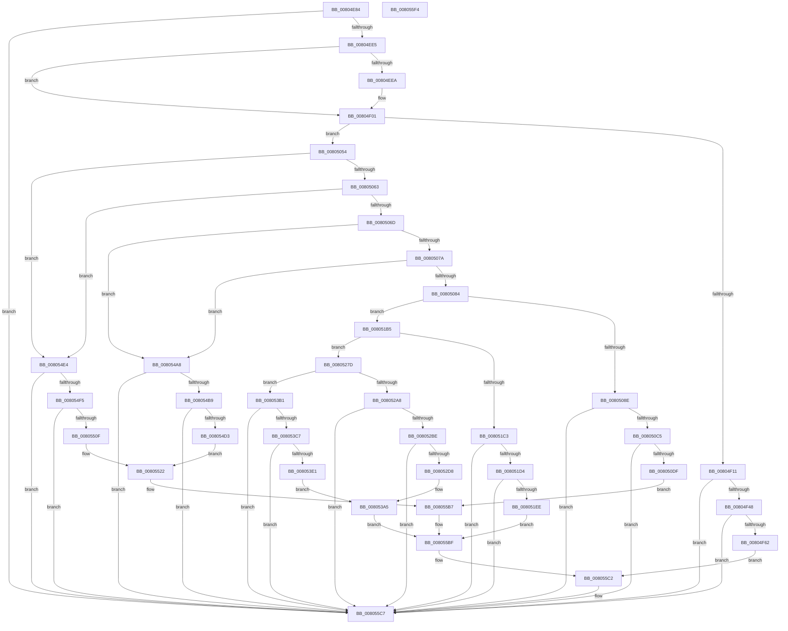

# MiLogHotPatchOperationStatus

- RVA: `0x00804E84`–`0x008055F5` (길이 `1,905` bytes)
- VA: `0x0000000140804E84`
- 실행 섹션: `PAGE`
- PDB 이름 있음: `예`; PDB Function 태그: `아니요`
- unwind 정보 RVA: `0x000B7838`
- 디코드: `395`개 명령, `1,905/1,905` bytes 표시
- 미해석 바이트: `0` (있으면 어셈블리에 `.byte`로 보존)

> 이 문서는 커널 이미지의 기계어와 PDB 기호를 분석해 생성했습니다. 4번과 5번은 함수 원형과 자료형을 바이너리 사용 방식에서 추정한 C 해석이며 원본 소스 복구 결과는 아닙니다.

## 1. Dependencies

- 직접 호출 지점: **22**; 고유 호출 대상: **7**
- 직접 호출자로 확인된 함수: **7**
- RIP 상대 이미지 참조: **9**

### Outgoing calls
- `0x00804EF0` → [RtlInitUnicodeString](../../text/42/RtlInitUnicodeString_function_0042A780.md) (function, `0x0042A780`)
- `0x00804F32` → [MiFillLogProcessInfo](../../text/44/MiFillLogProcessInfo_function_00448110.md) (function, `0x00448110`)
- `0x00804F55` → [tlgKeywordOn](../../text/42/tlgKeywordOn_function_0042EAA0.md) (function, `0x0042EAA0`)
- `0x00804F65` → [PsGetProcessId](../../text/43/PsGetProcessId_function_0043D910.md) (function, `0x0043D910`)
- `0x00804F8B` → [tlgCreate1Sz_char](../../text/42/tlgCreate1Sz_char_function_00427304.md) (function, `0x00427304`)
- `0x008050AF` → [MiFillLogProcessInfo](../../text/44/MiFillLogProcessInfo_function_00448110.md) (function, `0x00448110`)
- `0x008050D2` → [tlgKeywordOn](../../text/42/tlgKeywordOn_function_0042EAA0.md) (function, `0x0042EAA0`)
- `0x008050E2` → [PsGetProcessId](../../text/43/PsGetProcessId_function_0043D910.md) (function, `0x0043D910`)
- `0x00805105` → [tlgCreate1Sz_char](../../text/42/tlgCreate1Sz_char_function_00427304.md) (function, `0x00427304`)
- `0x008051E1` → [tlgKeywordOn](../../text/42/tlgKeywordOn_function_0042EAA0.md) (function, `0x0042EAA0`)
- `0x008052A8` → [MiFillLogProcessInfo](../../text/44/MiFillLogProcessInfo_function_00448110.md) (function, `0x00448110`)
- `0x008052CB` → [tlgKeywordOn](../../text/42/tlgKeywordOn_function_0042EAA0.md) (function, `0x0042EAA0`)
- `0x008052DB` → [PsGetProcessId](../../text/43/PsGetProcessId_function_0043D910.md) (function, `0x0043D910`)
- `0x008052FD` → [tlgCreate1Sz_char](../../text/42/tlgCreate1Sz_char_function_00427304.md) (function, `0x00427304`)
- `0x008053B1` → [MiFillLogProcessInfo](../../text/44/MiFillLogProcessInfo_function_00448110.md) (function, `0x00448110`)
- `0x008053D4` → [tlgKeywordOn](../../text/42/tlgKeywordOn_function_0042EAA0.md) (function, `0x0042EAA0`)
- `0x008053E4` → [PsGetProcessId](../../text/43/PsGetProcessId_function_0043D910.md) (function, `0x0043D910`)
- `0x00805403` → [tlgCreate1Sz_char](../../text/42/tlgCreate1Sz_char_function_00427304.md) (function, `0x00427304`)
- `0x008054C6` → [tlgKeywordOn](../../text/42/tlgKeywordOn_function_0042EAA0.md) (function, `0x0042EAA0`)
- `0x00805502` → [tlgKeywordOn](../../text/42/tlgKeywordOn_function_0042EAA0.md) (function, `0x0042EAA0`)
- `0x008055C2` → [tlgWriteEx_EtwWriteEx](../../text/4A/tlgWriteEx_EtwWriteEx_function_004AA348.md) (function, `0x004AA348`)
- `0x008055CE` → [_security_check_cookie](../../text/6A/_security_check_cookie_function_006AC640.md) (function, `0x006AC640`)

### Direct callers
- [MiApplyHotPatchToDriver](MiApplyHotPatchToDriver_function_00801E64.md) at `0x00801EF3`
- [MiApplyImageHotPatchRequest](MiApplyImageHotPatchRequest_function_008025AC.md) at `0x00802A02`
- [MiCreatePatchSectionRequest](MiCreatePatchSectionRequest_function_008031E0.md) at `0x00803243`
- [MiHotPatchProcess](MiHotPatchProcess_function_00803B78.md) at `0x00803CDF`
- [MiInjectThreadForHotPatch](MiInjectThreadForHotPatch_function_00803FD8.md) at `0x00804176`
- [MiLoadHotPatch](../AB/MiLoadHotPatch_function_00AB521C.md) at `0x00AB54DB`
- [MiLoadHotPatch](../AB/MiLoadHotPatch_function_00AB521C.md) at `0x00AB55D8`
- [MmRegisterHotPatches](../../init/C6/MmRegisterHotPatches_function_00C678DC.md) at `0x00C679B9`
- [MmRegisterHotPatches](../../init/C6/MmRegisterHotPatches_function_00C678DC.md) at `0x00C67A16`
- [MmRegisterHotPatches](../../init/C6/MmRegisterHotPatches_function_00C678DC.md) at `0x00C67C19`

### Static image references
- `0x00804EA7` → RVA `0x00E0A740` (`.data`; read)
- `0x00804EBC` → RVA `0x00E37618` (`.data`; read)
- `0x00804FA6` → RVA `0x0005891E` (`.rdata`; read)
- `0x00805118` → RVA `0x000589BE` (`.rdata`; read)
- `0x008051FC` → RVA `0x00058C4D` (`.rdata`; read)
- `0x00805310` → RVA `0x00058AF5` (`.rdata`; read)
- `0x0080540C` → RVA `0x00058BA2` (`.rdata`; read)
- `0x008054D7` → RVA `0x00058A66` (`.rdata`; read)
- `0x00805517` → RVA `0x00058895` (`.rdata`; read)

## 2. Other-region calls and transfers

- 다른 실행 섹션으로 향하는 call: **22**
  - `0x00804EF0` → [RtlInitUnicodeString](../../text/42/RtlInitUnicodeString_function_0042A780.md) (`PAGE` → `.text`)
  - `0x00804F32` → [MiFillLogProcessInfo](../../text/44/MiFillLogProcessInfo_function_00448110.md) (`PAGE` → `.text`)
  - `0x00804F55` → [tlgKeywordOn](../../text/42/tlgKeywordOn_function_0042EAA0.md) (`PAGE` → `.text`)
  - `0x00804F65` → [PsGetProcessId](../../text/43/PsGetProcessId_function_0043D910.md) (`PAGE` → `.text`)
  - `0x00804F8B` → [tlgCreate1Sz_char](../../text/42/tlgCreate1Sz_char_function_00427304.md) (`PAGE` → `.text`)
  - `0x008050AF` → [MiFillLogProcessInfo](../../text/44/MiFillLogProcessInfo_function_00448110.md) (`PAGE` → `.text`)
  - `0x008050D2` → [tlgKeywordOn](../../text/42/tlgKeywordOn_function_0042EAA0.md) (`PAGE` → `.text`)
  - `0x008050E2` → [PsGetProcessId](../../text/43/PsGetProcessId_function_0043D910.md) (`PAGE` → `.text`)
  - `0x00805105` → [tlgCreate1Sz_char](../../text/42/tlgCreate1Sz_char_function_00427304.md) (`PAGE` → `.text`)
  - `0x008051E1` → [tlgKeywordOn](../../text/42/tlgKeywordOn_function_0042EAA0.md) (`PAGE` → `.text`)
  - `0x008052A8` → [MiFillLogProcessInfo](../../text/44/MiFillLogProcessInfo_function_00448110.md) (`PAGE` → `.text`)
  - `0x008052CB` → [tlgKeywordOn](../../text/42/tlgKeywordOn_function_0042EAA0.md) (`PAGE` → `.text`)
  - `0x008052DB` → [PsGetProcessId](../../text/43/PsGetProcessId_function_0043D910.md) (`PAGE` → `.text`)
  - `0x008052FD` → [tlgCreate1Sz_char](../../text/42/tlgCreate1Sz_char_function_00427304.md) (`PAGE` → `.text`)
  - `0x008053B1` → [MiFillLogProcessInfo](../../text/44/MiFillLogProcessInfo_function_00448110.md) (`PAGE` → `.text`)
  - `0x008053D4` → [tlgKeywordOn](../../text/42/tlgKeywordOn_function_0042EAA0.md) (`PAGE` → `.text`)
  - `0x008053E4` → [PsGetProcessId](../../text/43/PsGetProcessId_function_0043D910.md) (`PAGE` → `.text`)
  - `0x00805403` → [tlgCreate1Sz_char](../../text/42/tlgCreate1Sz_char_function_00427304.md) (`PAGE` → `.text`)
  - `0x008054C6` → [tlgKeywordOn](../../text/42/tlgKeywordOn_function_0042EAA0.md) (`PAGE` → `.text`)
  - `0x00805502` → [tlgKeywordOn](../../text/42/tlgKeywordOn_function_0042EAA0.md) (`PAGE` → `.text`)
  - `0x008055C2` → [tlgWriteEx_EtwWriteEx](../../text/4A/tlgWriteEx_EtwWriteEx_function_004AA348.md) (`PAGE` → `.text`)
  - `0x008055CE` → [_security_check_cookie](../../text/6A/_security_check_cookie_function_006AC640.md) (`PAGE` → `.text`)
- 별도 외부 분기/꼬리 이동을 확인하지 못했습니다.

## 3. Assembly (complete function range)

```asm
00804E84  48 8B C4                        mov rax, rsp
00804E87  48 89 58 08                     mov qword ptr [rax + 8], rbx
00804E8B  48 89 70 10                     mov qword ptr [rax + 0x10], rsi
00804E8F  48 89 78 18                     mov qword ptr [rax + 0x18], rdi
00804E93  55                              push rbp
00804E94  41 54                           push r12
00804E96  41 55                           push r13
00804E98  41 56                           push r14
00804E9A  41 57                           push r15
00804E9C  48 8D 68 88                     lea rbp, [rax - 0x78]
00804EA0  48 81 EC 50 01 00 00            sub rsp, 0x150
00804EA7  48 8B 05 92 58 60 00            mov rax, qword ptr [rip + 0x605892]
00804EAE  48 33 C4                        xor rax, rsp
00804EB1  48 89 45 40                     mov qword ptr [rbp + 0x40], rax
00804EB5  45 33 DB                        xor r11d, r11d
00804EB8  89 54 24 5C                     mov dword ptr [rsp + 0x5c], edx
00804EBC  4C 39 1D 55 27 63 00            cmp qword ptr [rip + 0x632755], r11
00804EC3  0F 57 C0                        xorps xmm0, xmm0
00804EC6  45 8B E1                        mov r12d, r9d
00804EC9  89 4C 24 58                     mov dword ptr [rsp + 0x58], ecx
00804ECD  49 8B F8                        mov rdi, r8
00804ED0  4C 89 5C 24 68                  mov qword ptr [rsp + 0x68], r11
00804ED5  44 8B EA                        mov r13d, edx
00804ED8  44 8B C9                        mov r9d, ecx
00804EDB  0F 11 45 80                     movups xmmword ptr [rbp - 0x80], xmm0
00804EDF  0F 84 E2 06 00 00               je 0x1408055c7
00804EE5  4D 85 C0                        test r8, r8
00804EE8  75 17                           jne 0x140804f01
00804EEA  33 D2                           xor edx, edx
00804EEC  48 8D 4D 80                     lea rcx, [rbp - 0x80]
00804EF0  E8 8B 58 C2 FF                  call 0x14042a780
00804EF5  44 8B 4C 24 58                  mov r9d, dword ptr [rsp + 0x58]
00804EFA  48 8D 7D 80                     lea rdi, [rbp - 0x80]
00804EFE  45 33 DB                        xor r11d, r11d
00804F01  44 8B 85 A0 00 00 00            mov r8d, dword ptr [rbp + 0xa0]
00804F08  45 85 C0                        test r8d, r8d
00804F0B  0F 85 43 01 00 00               jne 0x140805054
00804F11  65 48 8B 04 25 88 01 00 00      mov rax, qword ptr gs:[0x188]
00804F1A  4C 8D 44 24 68                  lea r8, [rsp + 0x68]
00804F1F  48 8D 54 24 70                  lea rdx, [rsp + 0x70]
00804F24  4C 8B B0 B8 00 00 00            mov r14, qword ptr [rax + 0xb8]
00804F2B  49 8D 8E 00 04 00 00            lea rcx, [r14 + 0x400]
00804F32  E8 D9 31 C4 FF                  call 0x140448110
00804F37  4C 8B 3D DA 26 63 00            mov r15, qword ptr [rip + 0x6326da]
00804F3E  41 83 3F 05                     cmp dword ptr [r15], 5
00804F42  0F 86 7F 06 00 00               jbe 0x1408055c7
00804F48  48 BA 20 00 00 00 00 40 00 00   movabs rdx, 0x400000000020
00804F52  49 8B CF                        mov rcx, r15
00804F55  E8 46 9B C2 FF                  call 0x14042eaa0
00804F5A  84 C0                           test al, al
00804F5C  0F 84 65 06 00 00               je 0x1408055c7
00804F62  49 8B CE                        mov rcx, r14
00804F65  E8 A6 89 C3 FF                  call 0x14043d910
00804F6A  48 8B 54 24 68                  mov rdx, qword ptr [rsp + 0x68]
00804F6F  48 8D 4D C0                     lea rcx, [rbp - 0x40]
00804F73  89 44 24 5C                     mov dword ptr [rsp + 0x5c], eax
00804F77  45 33 C0                        xor r8d, r8d
00804F7A  48 8D 44 24 5C                  lea rax, [rsp + 0x5c]
00804F7F  48 C7 45 B8 04 00 00 00         mov qword ptr [rbp - 0x48], 4
00804F87  48 89 45 B0                     mov qword ptr [rbp - 0x50], rax
00804F8B  E8 74 23 C2 FF                  call 0x140427304
00804F90  48 8D 44 24 4C                  lea rax, [rsp + 0x4c]
00804F95  44 89 64 24 4C                  mov dword ptr [rsp + 0x4c], r12d
00804F9A  48 89 45 D0                     mov qword ptr [rbp - 0x30], rax
00804F9E  45 8D 48 01                     lea r9d, [r8 + 1]
00804FA2  8B 44 24 58                     mov eax, dword ptr [rsp + 0x58]
00804FA6  48 8D 15 71 39 85 FF            lea rdx, [rip - 0x7ac68f]
00804FAD  89 44 24 44                     mov dword ptr [rsp + 0x44], eax
00804FB1  49 8B CF                        mov rcx, r15
00804FB4  48 8D 44 24 44                  lea rax, [rsp + 0x44]
00804FB9  48 C7 45 D8 04 00 00 00         mov qword ptr [rbp - 0x28], 4
00804FC1  48 89 45 E0                     mov qword ptr [rbp - 0x20], rax
00804FC5  48 8D 44 24 48                  lea rax, [rsp + 0x48]
00804FCA  48 89 45 F0                     mov qword ptr [rbp - 0x10], rax
00804FCE  48 8D 45 18                     lea rax, [rbp + 0x18]
00804FD2  48 89 45 00                     mov qword ptr [rbp], rax
00804FD6  48 8B 47 08                     mov rax, qword ptr [rdi + 8]
00804FDA  48 89 45 10                     mov qword ptr [rbp + 0x10], rax
00804FDE  0F B7 07                        movzx eax, word ptr [rdi]
00804FE1  89 45 18                        mov dword ptr [rbp + 0x18], eax
00804FE4  41 0F B7 86 EC 06 00 00         movzx eax, word ptr [r14 + 0x6ec]
00804FEC  66 89 44 24 40                  mov word ptr [rsp + 0x40], ax
00804FF1  48 8D 44 24 40                  lea rax, [rsp + 0x40]
00804FF6  48 89 45 20                     mov qword ptr [rbp + 0x20], rax
00804FFA  B8 00 00 00 81                  mov eax, 0x81000000
00804FFF  48 89 44 24 50                  mov qword ptr [rsp + 0x50], rax
00805004  48 8D 44 24 50                  lea rax, [rsp + 0x50]
00805009  48 89 45 30                     mov qword ptr [rbp + 0x30], rax
0080500D  48 8D 45 90                     lea rax, [rbp - 0x70]
00805011  48 89 44 24 38                  mov qword ptr [rsp + 0x38], rax
00805016  C7 44 24 30 0B 00 00 00         mov dword ptr [rsp + 0x30], 0xb
0080501E  48 C7 45 E8 04 00 00 00         mov qword ptr [rbp - 0x18], 4
00805026  44 89 6C 24 48                  mov dword ptr [rsp + 0x48], r13d
0080502B  48 C7 45 F8 04 00 00 00         mov qword ptr [rbp - 8], 4
00805033  48 C7 45 08 02 00 00 00         mov qword ptr [rbp + 8], 2
0080503B  44 89 45 1C                     mov dword ptr [rbp + 0x1c], r8d
0080503F  48 C7 45 28 02 00 00 00         mov qword ptr [rbp + 0x28], 2
00805047  48 C7 45 38 08 00 00 00         mov qword ptr [rbp + 0x38], 8
0080504F  E9 6E 05 00 00                  jmp 0x1408055c2
00805054  41 BE 01 00 00 00               mov r14d, 1
0080505A  45 3B C6                        cmp r8d, r14d
0080505D  0F 84 81 04 00 00               je 0x1408054e4
00805063  41 83 F8 06                     cmp r8d, 6
00805067  0F 84 77 04 00 00               je 0x1408054e4
0080506D  41 8D 76 01                     lea esi, [r14 + 1]
00805071  44 3B C6                        cmp r8d, esi
00805074  0F 84 2E 04 00 00               je 0x1408054a8
0080507A  41 83 F8 05                     cmp r8d, 5
0080507E  0F 84 24 04 00 00               je 0x1408054a8
00805084  41 83 F8 03                     cmp r8d, 3
00805088  0F 85 27 01 00 00               jne 0x1408051b5
0080508E  65 48 8B 04 25 88 01 00 00      mov rax, qword ptr gs:[0x188]
00805097  4C 8D 44 24 68                  lea r8, [rsp + 0x68]
0080509C  48 8D 54 24 70                  lea rdx, [rsp + 0x70]
008050A1  4C 8B A8 B8 00 00 00            mov r13, qword ptr [rax + 0xb8]
008050A8  49 8D 8D 00 04 00 00            lea rcx, [r13 + 0x400]
008050AF  E8 5C 30 C4 FF                  call 0x140448110
008050B4  4C 8B 3D 5D 25 63 00            mov r15, qword ptr [rip + 0x63255d]
008050BB  41 83 3F 05                     cmp dword ptr [r15], 5
008050BF  0F 86 02 05 00 00               jbe 0x1408055c7
008050C5  48 BA 20 00 00 00 00 40 00 00   movabs rdx, 0x400000000020
008050CF  49 8B CF                        mov rcx, r15
008050D2  E8 C9 99 C2 FF                  call 0x14042eaa0
008050D7  84 C0                           test al, al
008050D9  0F 84 E8 04 00 00               je 0x1408055c7
008050DF  49 8B CD                        mov rcx, r13
008050E2  E8 29 88 C3 FF                  call 0x14043d910
008050E7  48 8B 54 24 68                  mov rdx, qword ptr [rsp + 0x68]
008050EC  48 8D 4D C0                     lea rcx, [rbp - 0x40]
008050F0  89 44 24 48                     mov dword ptr [rsp + 0x48], eax
008050F4  48 8D 44 24 48                  lea rax, [rsp + 0x48]
008050F9  48 89 45 B0                     mov qword ptr [rbp - 0x50], rax
008050FD  48 C7 45 B8 04 00 00 00         mov qword ptr [rbp - 0x48], 4
00805105  E8 FA 21 C2 FF                  call 0x140427304
0080510A  48 8D 44 24 44                  lea rax, [rsp + 0x44]
0080510F  44 89 64 24 44                  mov dword ptr [rsp + 0x44], r12d
00805114  48 89 45 D0                     mov qword ptr [rbp - 0x30], rax
00805118  48 8D 15 9F 38 85 FF            lea rdx, [rip - 0x7ac761]
0080511F  8B 44 24 58                     mov eax, dword ptr [rsp + 0x58]
00805123  49 8B CF                        mov rcx, r15
00805126  89 44 24 4C                     mov dword ptr [rsp + 0x4c], eax
0080512A  48 8D 44 24 4C                  lea rax, [rsp + 0x4c]
0080512F  48 89 45 E0                     mov qword ptr [rbp - 0x20], rax
00805133  8B 44 24 5C                     mov eax, dword ptr [rsp + 0x5c]
00805137  89 44 24 50                     mov dword ptr [rsp + 0x50], eax
0080513B  48 8D 44 24 50                  lea rax, [rsp + 0x50]
00805140  48 89 45 F0                     mov qword ptr [rbp - 0x10], rax
00805144  48 8D 44 24 78                  lea rax, [rsp + 0x78]
00805149  48 89 45 00                     mov qword ptr [rbp], rax
0080514D  41 0F B7 85 EC 06 00 00         movzx eax, word ptr [r13 + 0x6ec]
00805155  66 89 44 24 40                  mov word ptr [rsp + 0x40], ax
0080515A  48 8D 44 24 40                  lea rax, [rsp + 0x40]
0080515F  48 89 45 10                     mov qword ptr [rbp + 0x10], rax
00805163  B8 00 00 00 81                  mov eax, 0x81000000
00805168  48 89 44 24 60                  mov qword ptr [rsp + 0x60], rax
0080516D  48 8D 44 24 60                  lea rax, [rsp + 0x60]
00805172  48 89 45 20                     mov qword ptr [rbp + 0x20], rax
00805176  48 8D 45 90                     lea rax, [rbp - 0x70]
0080517A  48 89 44 24 38                  mov qword ptr [rsp + 0x38], rax
0080517F  C7 44 24 30 0A 00 00 00         mov dword ptr [rsp + 0x30], 0xa
00805187  48 C7 45 E8 04 00 00 00         mov qword ptr [rbp - 0x18], 4
0080518F  48 C7 45 F8 04 00 00 00         mov qword ptr [rbp - 8], 4
00805197  48 89 7C 24 78                  mov qword ptr [rsp + 0x78], rdi
0080519C  48 C7 45 08 08 00 00 00         mov qword ptr [rbp + 8], 8
008051A4  48 89 75 18                     mov qword ptr [rbp + 0x18], rsi
008051A8  48 C7 45 28 08 00 00 00         mov qword ptr [rbp + 0x28], 8
008051B0  E9 02 04 00 00                  jmp 0x1408055b7
008051B5  BB 04 00 00 00                  mov ebx, 4
008051BA  44 3B C3                        cmp r8d, ebx
008051BD  0F 85 BA 00 00 00               jne 0x14080527d
008051C3  4C 8B 05 4E 24 63 00            mov r8, qword ptr [rip + 0x63244e]
008051CA  41 83 38 05                     cmp dword ptr [r8], 5
008051CE  0F 86 F3 03 00 00               jbe 0x1408055c7
008051D4  48 BA 20 00 00 00 00 40 00 00   movabs rdx, 0x400000000020
008051DE  49 8B C8                        mov rcx, r8
008051E1  E8 BA 98 C2 FF                  call 0x14042eaa0
008051E6  84 C0                           test al, al
008051E8  0F 84 D9 03 00 00               je 0x1408055c7
008051EE  48 8D 44 24 50                  lea rax, [rsp + 0x50]
008051F3  44 89 64 24 50                  mov dword ptr [rsp + 0x50], r12d
008051F8  48 89 45 B0                     mov qword ptr [rbp - 0x50], rax
008051FC  48 8D 15 4A 3A 85 FF            lea rdx, [rip - 0x7ac5b6]
00805203  48 8D 44 24 48                  lea rax, [rsp + 0x48]
00805208  48 89 5D B8                     mov qword ptr [rbp - 0x48], rbx
0080520C  48 89 45 C0                     mov qword ptr [rbp - 0x40], rax
00805210  49 8B C8                        mov rcx, r8
00805213  48 8D 44 24 44                  lea rax, [rsp + 0x44]
00805218  44 89 4C 24 48                  mov dword ptr [rsp + 0x48], r9d
0080521D  48 89 45 D0                     mov qword ptr [rbp - 0x30], rax
00805221  48 8D 45 F8                     lea rax, [rbp - 8]
00805225  48 89 45 E0                     mov qword ptr [rbp - 0x20], rax
00805229  48 8B 47 08                     mov rax, qword ptr [rdi + 8]
0080522D  48 89 45 F0                     mov qword ptr [rbp - 0x10], rax
00805231  0F B7 07                        movzx eax, word ptr [rdi]
00805234  89 45 F8                        mov dword ptr [rbp - 8], eax
00805237  B8 00 00 00 81                  mov eax, 0x81000000
0080523C  48 89 44 24 60                  mov qword ptr [rsp + 0x60], rax
00805241  48 8D 44 24 60                  lea rax, [rsp + 0x60]
00805246  48 89 45 00                     mov qword ptr [rbp], rax
0080524A  48 8D 45 90                     lea rax, [rbp - 0x70]
0080524E  48 89 44 24 38                  mov qword ptr [rsp + 0x38], rax
00805253  C7 44 24 30 08 00 00 00         mov dword ptr [rsp + 0x30], 8
0080525B  48 89 5D C8                     mov qword ptr [rbp - 0x38], rbx
0080525F  44 89 6C 24 44                  mov dword ptr [rsp + 0x44], r13d
00805264  48 89 5D D8                     mov qword ptr [rbp - 0x28], rbx
00805268  48 89 75 E8                     mov qword ptr [rbp - 0x18], rsi
0080526C  44 89 5D FC                     mov dword ptr [rbp - 4], r11d
00805270  48 C7 45 08 08 00 00 00         mov qword ptr [rbp + 8], 8
00805278  E9 42 03 00 00                  jmp 0x1408055bf
0080527D  65 48 8B 04 25 88 01 00 00      mov rax, qword ptr gs:[0x188]
00805286  48 8D 54 24 70                  lea rdx, [rsp + 0x70]
0080528B  41 83 F8 07                     cmp r8d, 7
0080528F  4C 8D 44 24 68                  lea r8, [rsp + 0x68]
00805294  4C 8B A8 B8 00 00 00            mov r13, qword ptr [rax + 0xb8]
0080529B  49 8D 8D 00 04 00 00            lea rcx, [r13 + 0x400]
008052A2  0F 85 09 01 00 00               jne 0x1408053b1
008052A8  E8 63 2E C4 FF                  call 0x140448110
008052AD  4C 8B 3D 64 23 63 00            mov r15, qword ptr [rip + 0x632364]
008052B4  41 83 3F 05                     cmp dword ptr [r15], 5
008052B8  0F 86 09 03 00 00               jbe 0x1408055c7
008052BE  48 BA 20 00 00 00 00 40 00 00   movabs rdx, 0x400000000020
008052C8  49 8B CF                        mov rcx, r15
008052CB  E8 D0 97 C2 FF                  call 0x14042eaa0
008052D0  84 C0                           test al, al
008052D2  0F 84 EF 02 00 00               je 0x1408055c7
008052D8  49 8B CD                        mov rcx, r13
008052DB  E8 30 86 C3 FF                  call 0x14043d910
008052E0  48 8B 54 24 68                  mov rdx, qword ptr [rsp + 0x68]
008052E5  48 8D 4D C0                     lea rcx, [rbp - 0x40]
008052E9  89 44 24 50                     mov dword ptr [rsp + 0x50], eax
008052ED  45 33 C0                        xor r8d, r8d
008052F0  48 8D 44 24 50                  lea rax, [rsp + 0x50]
008052F5  48 89 5D B8                     mov qword ptr [rbp - 0x48], rbx
008052F9  48 89 45 B0                     mov qword ptr [rbp - 0x50], rax
008052FD  E8 02 20 C2 FF                  call 0x140427304
00805302  48 8D 44 24 48                  lea rax, [rsp + 0x48]
00805307  44 89 64 24 48                  mov dword ptr [rsp + 0x48], r12d
0080530C  48 89 45 D0                     mov qword ptr [rbp - 0x30], rax
00805310  48 8D 15 DE 37 85 FF            lea rdx, [rip - 0x7ac822]
00805317  8B 44 24 58                     mov eax, dword ptr [rsp + 0x58]
0080531B  89 44 24 44                     mov dword ptr [rsp + 0x44], eax
0080531F  48 8D 44 24 44                  lea rax, [rsp + 0x44]
00805324  48 89 45 E0                     mov qword ptr [rbp - 0x20], rax
00805328  8B 44 24 5C                     mov eax, dword ptr [rsp + 0x5c]
0080532C  89 44 24 4C                     mov dword ptr [rsp + 0x4c], eax
00805330  48 8D 44 24 4C                  lea rax, [rsp + 0x4c]
00805335  48 89 45 F0                     mov qword ptr [rbp - 0x10], rax
00805339  48 8D 45 18                     lea rax, [rbp + 0x18]
0080533D  48 89 45 00                     mov qword ptr [rbp], rax
00805341  48 8B 47 08                     mov rax, qword ptr [rdi + 8]
00805345  48 89 45 10                     mov qword ptr [rbp + 0x10], rax
00805349  0F B7 07                        movzx eax, word ptr [rdi]
0080534C  89 45 18                        mov dword ptr [rbp + 0x18], eax
0080534F  41 0F B7 85 EC 06 00 00         movzx eax, word ptr [r13 + 0x6ec]
00805357  66 89 44 24 40                  mov word ptr [rsp + 0x40], ax
0080535C  48 8D 44 24 40                  lea rax, [rsp + 0x40]
00805361  48 89 45 20                     mov qword ptr [rbp + 0x20], rax
00805365  B8 00 00 00 81                  mov eax, 0x81000000
0080536A  48 89 44 24 60                  mov qword ptr [rsp + 0x60], rax
0080536F  48 8D 44 24 60                  lea rax, [rsp + 0x60]
00805374  48 89 45 30                     mov qword ptr [rbp + 0x30], rax
00805378  48 8D 45 90                     lea rax, [rbp - 0x70]
0080537C  48 89 44 24 38                  mov qword ptr [rsp + 0x38], rax
00805381  C7 44 24 30 0B 00 00 00         mov dword ptr [rsp + 0x30], 0xb
00805389  48 89 5D D8                     mov qword ptr [rbp - 0x28], rbx
0080538D  48 89 5D F8                     mov qword ptr [rbp - 8], rbx
00805391  48 89 75 08                     mov qword ptr [rbp + 8], rsi
00805395  44 89 45 1C                     mov dword ptr [rbp + 0x1c], r8d
00805399  48 89 75 28                     mov qword ptr [rbp + 0x28], rsi
0080539D  48 C7 45 38 08 00 00 00         mov qword ptr [rbp + 0x38], 8
008053A5  48 89 5D E8                     mov qword ptr [rbp - 0x18], rbx
008053A9  49 8B CF                        mov rcx, r15
008053AC  E9 0E 02 00 00                  jmp 0x1408055bf
008053B1  E8 5A 2D C4 FF                  call 0x140448110
008053B6  4C 8B 3D 5B 22 63 00            mov r15, qword ptr [rip + 0x63225b]
008053BD  41 83 3F 05                     cmp dword ptr [r15], 5
008053C1  0F 86 00 02 00 00               jbe 0x1408055c7
008053C7  48 BA 20 00 00 00 00 40 00 00   movabs rdx, 0x400000000020
008053D1  49 8B CF                        mov rcx, r15
008053D4  E8 C7 96 C2 FF                  call 0x14042eaa0
008053D9  84 C0                           test al, al
008053DB  0F 84 E6 01 00 00               je 0x1408055c7
008053E1  49 8B CD                        mov rcx, r13
008053E4  E8 27 85 C3 FF                  call 0x14043d910
008053E9  48 8B 54 24 68                  mov rdx, qword ptr [rsp + 0x68]
008053EE  48 8D 4D C0                     lea rcx, [rbp - 0x40]
008053F2  89 44 24 50                     mov dword ptr [rsp + 0x50], eax
008053F6  48 8D 44 24 50                  lea rax, [rsp + 0x50]
008053FB  48 89 45 B0                     mov qword ptr [rbp - 0x50], rax
008053FF  48 89 5D B8                     mov qword ptr [rbp - 0x48], rbx
00805403  E8 FC 1E C2 FF                  call 0x140427304
00805408  8B 44 24 58                     mov eax, dword ptr [rsp + 0x58]
0080540C  48 8D 15 8F 37 85 FF            lea rdx, [rip - 0x7ac871]
00805413  89 44 24 48                     mov dword ptr [rsp + 0x48], eax
00805417  48 8D 44 24 48                  lea rax, [rsp + 0x48]
0080541C  48 89 45 D0                     mov qword ptr [rbp - 0x30], rax
00805420  8B 44 24 5C                     mov eax, dword ptr [rsp + 0x5c]
00805424  89 44 24 44                     mov dword ptr [rsp + 0x44], eax
00805428  48 8D 44 24 44                  lea rax, [rsp + 0x44]
0080542D  48 89 45 E0                     mov qword ptr [rbp - 0x20], rax
00805431  48 8D 44 24 60                  lea rax, [rsp + 0x60]
00805436  48 89 45 F0                     mov qword ptr [rbp - 0x10], rax
0080543A  48 8D 44 24 4C                  lea rax, [rsp + 0x4c]
0080543F  48 89 45 00                     mov qword ptr [rbp], rax
00805443  41 0F B7 85 EC 06 00 00         movzx eax, word ptr [r13 + 0x6ec]
0080544B  66 89 44 24 40                  mov word ptr [rsp + 0x40], ax
00805450  48 8D 44 24 40                  lea rax, [rsp + 0x40]
00805455  48 89 45 10                     mov qword ptr [rbp + 0x10], rax
00805459  B8 00 00 00 81                  mov eax, 0x81000000
0080545E  48 89 44 24 78                  mov qword ptr [rsp + 0x78], rax
00805463  48 8D 44 24 78                  lea rax, [rsp + 0x78]
00805468  48 89 45 20                     mov qword ptr [rbp + 0x20], rax
0080546C  48 8D 45 90                     lea rax, [rbp - 0x70]
00805470  48 89 44 24 38                  mov qword ptr [rsp + 0x38], rax
00805475  C7 44 24 30 0A 00 00 00         mov dword ptr [rsp + 0x30], 0xa
0080547D  48 89 5D D8                     mov qword ptr [rbp - 0x28], rbx
00805481  48 89 7C 24 60                  mov qword ptr [rsp + 0x60], rdi
00805486  48 C7 45 F8 08 00 00 00         mov qword ptr [rbp - 8], 8
0080548E  44 89 64 24 4C                  mov dword ptr [rsp + 0x4c], r12d
00805493  48 89 5D 08                     mov qword ptr [rbp + 8], rbx
00805497  48 89 75 18                     mov qword ptr [rbp + 0x18], rsi
0080549B  48 C7 45 28 08 00 00 00         mov qword ptr [rbp + 0x28], 8
008054A3  E9 FD FE FF FF                  jmp 0x1408053a5
008054A8  4C 8B 15 69 21 63 00            mov r10, qword ptr [rip + 0x632169]
008054AF  41 83 3A 05                     cmp dword ptr [r10], 5
008054B3  0F 86 0E 01 00 00               jbe 0x1408055c7
008054B9  48 BA 20 00 00 00 00 40 00 00   movabs rdx, 0x400000000020
008054C3  49 8B CA                        mov rcx, r10
008054C6  E8 D5 95 C2 FF                  call 0x14042eaa0
008054CB  84 C0                           test al, al
008054CD  0F 84 F4 00 00 00               je 0x1408055c7
008054D3  48 89 75 E8                     mov qword ptr [rbp - 0x18], rsi
008054D7  48 8D 15 88 35 85 FF            lea rdx, [rip - 0x7aca78]
008054DE  41 83 F8 05                     cmp r8d, 5
008054E2  EB 3E                           jmp 0x140805522
008054E4  4C 8B 15 2D 21 63 00            mov r10, qword ptr [rip + 0x63212d]
008054EB  41 83 3A 05                     cmp dword ptr [r10], 5
008054EF  0F 86 D2 00 00 00               jbe 0x1408055c7
008054F5  48 BA 20 00 00 00 00 40 00 00   movabs rdx, 0x400000000020
008054FF  49 8B CA                        mov rcx, r10
00805502  E8 99 95 C2 FF                  call 0x14042eaa0
00805507  84 C0                           test al, al
00805509  0F 84 B8 00 00 00               je 0x1408055c7
0080550F  48 C7 45 E8 02 00 00 00         mov qword ptr [rbp - 0x18], 2
00805517  48 8D 15 77 33 85 FF            lea rdx, [rip - 0x7acc89]
0080551E  41 83 F8 06                     cmp r8d, 6
00805522  48 8D 44 24 50                  lea rax, [rsp + 0x50]
00805527  44 89 6C 24 44                  mov dword ptr [rsp + 0x44], r13d
0080552C  48 89 45 B0                     mov qword ptr [rbp - 0x50], rax
00805530  48 8D 44 24 48                  lea rax, [rsp + 0x48]
00805535  48 89 45 C0                     mov qword ptr [rbp - 0x40], rax
00805539  48 8D 44 24 44                  lea rax, [rsp + 0x44]
0080553E  48 C7 45 C8 04 00 00 00         mov qword ptr [rbp - 0x38], 4
00805546  44 89 4C 24 48                  mov dword ptr [rsp + 0x48], r9d
0080554B  48 C7 45 B8 04 00 00 00         mov qword ptr [rbp - 0x48], 4
00805553  48 89 45 D0                     mov qword ptr [rbp - 0x30], rax
00805557  49 8B CA                        mov rcx, r10
0080555A  48 8D 45 F8                     lea rax, [rbp - 8]
0080555E  44 89 64 24 50                  mov dword ptr [rsp + 0x50], r12d
00805563  48 89 45 E0                     mov qword ptr [rbp - 0x20], rax
00805567  0F 94 44 24 40                  sete byte ptr [rsp + 0x40]
0080556C  48 8B 47 08                     mov rax, qword ptr [rdi + 8]
00805570  48 89 45 F0                     mov qword ptr [rbp - 0x10], rax
00805574  0F B7 07                        movzx eax, word ptr [rdi]
00805577  89 45 F8                        mov dword ptr [rbp - 8], eax
0080557A  48 8D 44 24 40                  lea rax, [rsp + 0x40]
0080557F  48 89 45 00                     mov qword ptr [rbp], rax
00805583  B8 00 00 00 81                  mov eax, 0x81000000
00805588  48 89 44 24 60                  mov qword ptr [rsp + 0x60], rax
0080558D  48 8D 44 24 60                  lea rax, [rsp + 0x60]
00805592  48 89 45 10                     mov qword ptr [rbp + 0x10], rax
00805596  48 8D 45 90                     lea rax, [rbp - 0x70]
0080559A  48 89 44 24 38                  mov qword ptr [rsp + 0x38], rax
0080559F  C7 44 24 30 09 00 00 00         mov dword ptr [rsp + 0x30], 9
008055A7  48 C7 45 18 08 00 00 00         mov qword ptr [rbp + 0x18], 8
008055AF  4C 89 75 08                     mov qword ptr [rbp + 8], r14
008055B3  44 89 5D FC                     mov dword ptr [rbp - 4], r11d
008055B7  48 C7 45 D8 04 00 00 00         mov qword ptr [rbp - 0x28], 4
008055BF  45 8B CE                        mov r9d, r14d
008055C2  E8 81 4D CA FF                  call 0x1404aa348
008055C7  48 8B 4D 40                     mov rcx, qword ptr [rbp + 0x40]
008055CB  48 33 CC                        xor rcx, rsp
008055CE  E8 6D 70 EA FF                  call 0x1406ac640
008055D3  4C 8D 9C 24 50 01 00 00         lea r11, [rsp + 0x150]
008055DB  49 8B 5B 30                     mov rbx, qword ptr [r11 + 0x30]
008055DF  49 8B 73 38                     mov rsi, qword ptr [r11 + 0x38]
008055E3  49 8B 7B 40                     mov rdi, qword ptr [r11 + 0x40]
008055E7  49 8B E3                        mov rsp, r11
008055EA  41 5F                           pop r15
008055EC  41 5E                           pop r14
008055EE  41 5D                           pop r13
008055F0  41 5C                           pop r12
008055F2  5D                              pop rbp
008055F3  C3                              ret
008055F4  CC                              int3
```

## 4. C-style interpretation (structured pseudocode)

```c
__int64 __fastcall MiLogHotPatchOperationStatus(int a1, int a2, __int64 a3, int a4)
{
    __int64 result;
    __int64 v_r11;
    __int64 v_rdi;
    __int64 v_rsp;
    unsigned __int64 v_stack_m100;
    unsigned __int64 v_stack_m108;
    unsigned __int64 v_stack_m110;
    unsigned __int64 v_stack_m118;
    unsigned int v_stack_m11C;
    unsigned int v_stack_m120;
    unsigned __int64 v_stack_m128;
    unsigned __int64 v_stack_m12C;
    unsigned __int64 v_stack_m130;
    unsigned int v_stack_m134;
    unsigned __int16 v_stack_m138;
    unsigned __int64 v_stack_m140;
    unsigned int v_stack_m148;
    unsigned __int64 v_stack_m28;

    *(unsigned __int64 *)(v_rsp + 8) = v_rbx;
    *(unsigned __int64 *)(v_rsp + 16) = v_rsi;
    *(unsigned __int64 *)(v_rsp + 24) = v_rdi;
    v_rsp = (v_rsp) - (336);
    result = (*(unsigned __int64 *)(v_rip + 6314130)) ^ (v_rsp);
    *(unsigned __int64 *)(v_rsp - 120 + 64) = result;
    v_r11 = 0;
    v_stack_m11C = a2;
    v_stack_m120 = a1;
    v_stack_m110 = 0;
    *(unsigned __int64 *)(v_rsp - 120 - 128) = v_xmm0;
    if ((*(unsigned __int64 *)(v_rip + 6498133)) == 0) goto loc_008055C7;
    v_rdi = a3;
    if (a3 == 0) {
        a2 = 0;
        a1 = v_rsp - 120 - 128;
        result = RtlInitUnicodeString(a1, a2, a3, (unsigned int)(a1));
        a4 = v_stack_m120;
        v_rdi = v_rsp - 120 - 128;
        v_r11 = 0;
    }
    if ((unsigned int)((unsigned int)(*(unsigned int *)(v_rsp - 120 + 160))) != 0) goto loc_00805054;
    result = MiFillLogProcessInfo(*(unsigned __int64 *)(*(unsigned __int64 *)(gs_base + (0 + 392)) + 184) + 1024, v_stack_m108, v_stack_m110, a4);
    if ((*(unsigned int *)(*(unsigned __int64 *)(v_rip + 6498010))) <= 5) goto loc_008055C7;
    result = tlgKeywordOn(*(unsigned __int64 *)(v_rip + 6498010), v_stack_m108, v_stack_m110, a4);
    if ((unsigned __int8)(result) == 0) goto loc_008055C7;
    result = PsGetProcessId(*(unsigned __int64 *)(*(unsigned __int64 *)(gs_base + (0 + 392)) + 184), v_stack_m108, v_stack_m110, a4);
    v_stack_m11C = (unsigned int)(result);
    a3 = 0;
    *(unsigned __int64 *)(v_rsp - 120 - 72) = 4;
    *(unsigned __int64 *)(v_rsp - 120 - 80) = v_stack_m11C;
    result = tlgCreate1Sz_char(v_rsp - 120 - 64, v_stack_m110, a3, a4);
    v_stack_m12C = (unsigned int)((unsigned int)(a4));
    *(unsigned __int64 *)(v_rsp - 120 - 48) = v_stack_m12C;
    v_stack_m134 = (unsigned int)((unsigned int)(v_stack_m120));
    *(unsigned __int64 *)(v_rsp - 120 - 40) = 4;
    *(unsigned __int64 *)(v_rsp - 120 - 32) = v_stack_m134;
    *(unsigned __int64 *)(v_rsp - 120 - 16) = v_stack_m130;
    *(unsigned __int64 *)(v_rsp - 120) = v_rsp - 120 + 24;
    *(unsigned __int64 *)(v_rsp - 120 + 16) = *(unsigned __int64 *)(v_rdi + 8);
    *(unsigned int *)(v_rsp - 120 + 24) = (unsigned int)(*(unsigned __int16 *)(v_rdi));
    v_stack_m138 = (unsigned __int16)(*(unsigned __int16 *)(*(unsigned __int64 *)(*(unsigned __int64 *)(gs_base + (0 + 392)) + 184) + 1772));
    *(unsigned __int64 *)(v_rsp - 120 + 32) = v_stack_m138;
    v_stack_m128 = (unsigned int)(0x81000000ULL);
    *(unsigned __int64 *)(v_rsp - 120 + 48) = v_stack_m128;
    v_stack_m140 = v_rsp - 120 - 112;
    v_stack_m148 = 11;
    *(unsigned __int64 *)(v_rsp - 120 - 24) = 4;
    v_stack_m130 = (unsigned int)((unsigned int)(a2));
    *(unsigned __int64 *)(v_rsp - 120 - 8) = 4;
    *(unsigned __int64 *)(v_rsp - 120 + 8) = 2;
    *(unsigned int *)(v_rsp - 120 + 28) = 0;
    *(unsigned __int64 *)(v_rsp - 120 + 40) = 2;
    *(unsigned __int64 *)(v_rsp - 120 + 56) = 8;
    goto loc_008055C2;
loc_00805054:
    if (0 == 1) goto loc_008054E4;
    if (0 == 6) goto loc_008054E4;
    if (0 == ((unsigned int)(1 + 1))) goto loc_008054A8;
    if (0 == 5) goto loc_008054A8;
    if (0 != 3) goto loc_008051B5;
    result = MiFillLogProcessInfo(*(unsigned __int64 *)(*(unsigned __int64 *)(gs_base + (0 + 392)) + 184) + 1024, v_stack_m108, v_stack_m110, a3 + 1);
    if ((*(unsigned int *)(*(unsigned __int64 *)(v_rip + 6497629))) <= 5) goto loc_008055C7;
    result = tlgKeywordOn(*(unsigned __int64 *)(v_rip + 6497629), v_stack_m108, v_stack_m110, a3 + 1);
    if ((unsigned __int8)(result) == 0) goto loc_008055C7;
    result = PsGetProcessId(*(unsigned __int64 *)(*(unsigned __int64 *)(gs_base + (0 + 392)) + 184), v_stack_m108, v_stack_m110, a3 + 1);
    v_stack_m130 = (unsigned int)(result);
    *(unsigned __int64 *)(v_rsp - 120 - 80) = v_stack_m130;
    *(unsigned __int64 *)(v_rsp - 120 - 72) = 4;
    result = tlgCreate1Sz_char(v_rsp - 120 - 64, v_stack_m110, v_stack_m110, a3 + 1);
    v_stack_m134 = (unsigned int)((unsigned int)(a4));
    *(unsigned __int64 *)(v_rsp - 120 - 48) = v_stack_m134;
    v_stack_m12C = (unsigned int)((unsigned int)(v_stack_m120));
    *(unsigned __int64 *)(v_rsp - 120 - 32) = v_stack_m12C;
    v_stack_m128 = (unsigned int)((unsigned int)(v_stack_m11C));
    *(unsigned __int64 *)(v_rsp - 120 - 16) = v_stack_m128;
    *(unsigned __int64 *)(v_rsp - 120) = v_stack_m100;
    v_stack_m138 = (unsigned __int16)(*(unsigned __int16 *)(*(unsigned __int64 *)(*(unsigned __int64 *)(gs_base + (0 + 392)) + 184) + 1772));
    *(unsigned __int64 *)(v_rsp - 120 + 16) = v_stack_m138;
    v_stack_m118 = (unsigned int)(0x81000000ULL);
    *(unsigned __int64 *)(v_rsp - 120 + 32) = v_stack_m118;
    v_stack_m140 = v_rsp - 120 - 112;
    v_stack_m148 = 10;
    *(unsigned __int64 *)(v_rsp - 120 - 24) = 4;
    *(unsigned __int64 *)(v_rsp - 120 - 8) = 4;
    v_stack_m100 = v_rdi;
    *(unsigned __int64 *)(v_rsp - 120 + 8) = 8;
    *(unsigned __int64 *)(v_rsp - 120 + 24) = 1 + 1;
    *(unsigned __int64 *)(v_rsp - 120 + 40) = 8;
    goto loc_008055B7;
loc_008051B5:
    if (((unsigned int)(v_stack_m110)) != 4) goto loc_0080527D;
    if ((*(unsigned int *)(*(unsigned __int64 *)(v_rip + 6497358))) <= 5) goto loc_008055C7;
    result = tlgKeywordOn(*(unsigned __int64 *)(v_rip + 6497358), v_rip - 8046433, *(unsigned __int64 *)(v_rip + 6497358), a3 + 1);
    if ((unsigned __int8)(result) == 0) goto loc_008055C7;
    v_stack_m128 = (unsigned int)((unsigned int)(a4));
    *(unsigned __int64 *)(v_rsp - 120 - 80) = v_stack_m128;
    *(unsigned __int64 *)(v_rsp - 120 - 72) = 4;
    *(unsigned __int64 *)(v_rsp - 120 - 64) = v_stack_m130;
    v_stack_m130 = (unsigned int)(a3 + 1);
    *(unsigned __int64 *)(v_rsp - 120 - 48) = v_stack_m134;
    *(unsigned __int64 *)(v_rsp - 120 - 32) = v_rsp - 120 - 8;
    *(unsigned __int64 *)(v_rsp - 120 - 16) = *(unsigned __int64 *)(v_rdi + 8);
    *(unsigned int *)(v_rsp - 120 - 8) = (unsigned int)(*(unsigned __int16 *)(v_rdi));
    v_stack_m118 = (unsigned int)(0x81000000ULL);
    *(unsigned __int64 *)(v_rsp - 120) = v_stack_m118;
    v_stack_m140 = v_rsp - 120 - 112;
    v_stack_m148 = 8;
    *(unsigned __int64 *)(v_rsp - 120 - 56) = 4;
    v_stack_m134 = (unsigned int)(*(unsigned __int64 *)(*(unsigned __int64 *)(gs_base + (0 + 392)) + 184));
    *(unsigned __int64 *)(v_rsp - 120 - 40) = 4;
    *(unsigned __int64 *)(v_rsp - 120 - 24) = 1 + 1;
    *(unsigned int *)(v_rsp - 120 - 4) = 0;
    *(unsigned __int64 *)(v_rsp - 120 + 8) = 8;
    goto loc_008055BF;
loc_0080527D:
    if (((unsigned int)(*(unsigned __int64 *)(v_rip + 6497358))) != 7) goto loc_008053B1;
    result = MiFillLogProcessInfo(*(unsigned __int64 *)(*(unsigned __int64 *)(gs_base + (0 + 392)) + 184) + 1024, v_stack_m108, v_stack_m110, a3 + 1);
    if ((*(unsigned int *)(*(unsigned __int64 *)(v_rip + 6497124))) <= 5) goto loc_008055C7;
    result = tlgKeywordOn(*(unsigned __int64 *)(v_rip + 6497124), v_stack_m108, v_stack_m110, a3 + 1);
    if ((unsigned __int8)(result) == 0) goto loc_008055C7;
    result = PsGetProcessId(*(unsigned __int64 *)(*(unsigned __int64 *)(gs_base + (0 + 392)) + 184), v_stack_m108, v_stack_m110, a3 + 1);
    v_stack_m128 = (unsigned int)(result);
    a3 = 0;
    *(unsigned __int64 *)(v_rsp - 120 - 72) = 4;
    *(unsigned __int64 *)(v_rsp - 120 - 80) = v_stack_m128;
    result = tlgCreate1Sz_char(v_rsp - 120 - 64, v_stack_m110, a3, a3 + 1);
    v_stack_m130 = (unsigned int)((unsigned int)(a4));
    *(unsigned __int64 *)(v_rsp - 120 - 48) = v_stack_m130;
    v_stack_m134 = (unsigned int)((unsigned int)(v_stack_m120));
    *(unsigned __int64 *)(v_rsp - 120 - 32) = v_stack_m134;
    v_stack_m12C = (unsigned int)((unsigned int)(v_stack_m11C));
    *(unsigned __int64 *)(v_rsp - 120 - 16) = v_stack_m12C;
    *(unsigned __int64 *)(v_rsp - 120) = v_rsp - 120 + 24;
    *(unsigned __int64 *)(v_rsp - 120 + 16) = *(unsigned __int64 *)(v_rdi + 8);
    *(unsigned int *)(v_rsp - 120 + 24) = (unsigned int)(*(unsigned __int16 *)(v_rdi));
    v_stack_m138 = (unsigned __int16)(*(unsigned __int16 *)(*(unsigned __int64 *)(*(unsigned __int64 *)(gs_base + (0 + 392)) + 184) + 1772));
    *(unsigned __int64 *)(v_rsp - 120 + 32) = v_stack_m138;
    v_stack_m118 = (unsigned int)(0x81000000ULL);
    *(unsigned __int64 *)(v_rsp - 120 + 48) = v_stack_m118;
    v_stack_m140 = v_rsp - 120 - 112;
    v_stack_m148 = 11;
    *(unsigned __int64 *)(v_rsp - 120 - 40) = 4;
    *(unsigned __int64 *)(v_rsp - 120 - 8) = 4;
    *(unsigned __int64 *)(v_rsp - 120 + 8) = 1 + 1;
    *(unsigned int *)(v_rsp - 120 + 28) = 0;
    *(unsigned __int64 *)(v_rsp - 120 + 40) = 1 + 1;
    *(unsigned __int64 *)(v_rsp - 120 + 56) = 8;
loc_008053A5:
    *(unsigned __int64 *)(v_rsp - 120 - 24) = 4;
    goto loc_008055BF;
loc_008053B1:
    result = MiFillLogProcessInfo(*(unsigned __int64 *)(v_rip + 6497124), v_rip - 8046626, a3, a3 + 1);
    if ((*(unsigned int *)(*(unsigned __int64 *)(v_rip + 6496859))) <= 5) goto loc_008055C7;
    result = tlgKeywordOn(*(unsigned __int64 *)(v_rip + 6496859), v_rip - 8046626, a3, a3 + 1);
    if ((unsigned __int8)(result) == 0) goto loc_008055C7;
    result = PsGetProcessId(*(unsigned __int64 *)(*(unsigned __int64 *)(gs_base + (0 + 392)) + 184), v_rip - 8046626, a3, a3 + 1);
    v_stack_m128 = (unsigned int)(result);
    *(unsigned __int64 *)(v_rsp - 120 - 80) = v_stack_m128;
    *(unsigned __int64 *)(v_rsp - 120 - 72) = 4;
    result = tlgCreate1Sz_char(v_rsp - 120 - 64, v_stack_m110, a3, a3 + 1);
    v_stack_m130 = (unsigned int)((unsigned int)(v_stack_m120));
    *(unsigned __int64 *)(v_rsp - 120 - 48) = v_stack_m130;
    v_stack_m134 = (unsigned int)((unsigned int)(v_stack_m11C));
    *(unsigned __int64 *)(v_rsp - 120 - 32) = v_stack_m134;
    *(unsigned __int64 *)(v_rsp - 120 - 16) = v_stack_m118;
    *(unsigned __int64 *)(v_rsp - 120) = v_stack_m12C;
    v_stack_m138 = (unsigned __int16)(*(unsigned __int16 *)(*(unsigned __int64 *)(*(unsigned __int64 *)(gs_base + (0 + 392)) + 184) + 1772));
    *(unsigned __int64 *)(v_rsp - 120 + 16) = v_stack_m138;
    v_stack_m100 = (unsigned int)(0x81000000ULL);
    *(unsigned __int64 *)(v_rsp - 120 + 32) = v_stack_m100;
    v_stack_m140 = v_rsp - 120 - 112;
    v_stack_m148 = 10;
    *(unsigned __int64 *)(v_rsp - 120 - 40) = 4;
    v_stack_m118 = v_rdi;
    *(unsigned __int64 *)(v_rsp - 120 - 8) = 8;
    v_stack_m12C = (unsigned int)((unsigned int)(a4));
    *(unsigned __int64 *)(v_rsp - 120 + 8) = 4;
    *(unsigned __int64 *)(v_rsp - 120 + 24) = 1 + 1;
    *(unsigned __int64 *)(v_rsp - 120 + 40) = 8;
    goto loc_008053A5;
loc_008054A8:
    if ((*(unsigned int *)(*(unsigned __int64 *)(v_rip + 6496617))) <= 5) goto loc_008055C7;
    result = tlgKeywordOn(*(unsigned __int64 *)(v_rip + 6496617), v_rip - 8046705, a3, a3 + 1);
    if ((unsigned __int8)(result) == 0) goto loc_008055C7;
    *(unsigned __int64 *)(v_rsp - 120 - 24) = 1 + 1;
    goto loc_00805522;
loc_008054E4:
    if ((*(unsigned int *)(*(unsigned __int64 *)(v_rip + 6496557))) <= 5) goto loc_008055C7;
    result = tlgKeywordOn(*(unsigned __int64 *)(v_rip + 6496557), v_rip - 8047224, a3, a3 + 1);
    if ((unsigned __int8)(result) == 0) goto loc_008055C7;
    *(unsigned __int64 *)(v_rsp - 120 - 24) = 2;
loc_00805522:
    v_stack_m134 = (unsigned int)(*(unsigned __int64 *)(*(unsigned __int64 *)(gs_base + (0 + 392)) + 184));
    *(unsigned __int64 *)(v_rsp - 120 - 80) = v_stack_m128;
    *(unsigned __int64 *)(v_rsp - 120 - 64) = v_stack_m130;
    *(unsigned __int64 *)(v_rsp - 120 - 56) = 4;
    v_stack_m130 = (unsigned int)(a3 + 1);
    *(unsigned __int64 *)(v_rsp - 120 - 72) = 4;
    *(unsigned __int64 *)(v_rsp - 120 - 48) = v_stack_m134;
    v_stack_m128 = (unsigned int)((unsigned int)(a4));
    *(unsigned __int64 *)(v_rsp - 120 - 32) = v_rsp - 120 - 8;
    *(unsigned __int64 *)(v_rsp - 120 - 16) = *(unsigned __int64 *)(v_rdi + 8);
    *(unsigned int *)(v_rsp - 120 - 8) = (unsigned int)(*(unsigned __int16 *)(v_rdi));
    *(unsigned __int64 *)(v_rsp - 120) = v_stack_m138;
    v_stack_m118 = (unsigned int)(0x81000000ULL);
    *(unsigned __int64 *)(v_rsp - 120 + 16) = v_stack_m118;
    v_stack_m140 = v_rsp - 120 - 112;
    v_stack_m148 = 9;
    *(unsigned __int64 *)(v_rsp - 120 + 24) = 8;
    *(unsigned __int64 *)(v_rsp - 120 + 8) = 1;
    *(unsigned int *)(v_rsp - 120 - 4) = 0;
loc_008055B7:
    *(unsigned __int64 *)(v_rsp - 120 - 40) = 4;
loc_008055BF:
loc_008055C2:
    result = tlgWriteEx_EtwWriteEx(*(unsigned __int64 *)(v_rip + 6496557), v_rip - 8047753, a3, 1);
loc_008055C7:
    a1 = (*(unsigned __int64 *)(v_rsp - 120 + 64)) ^ (v_rsp);
    result = _security_check_cookie(a1, v_rip - 8047753, a3, 1);
    return result;
}
```

## 5. (Beta) C Style

```c
int64_t MiLogHotPatchOperationStatus(int32_t Arg1, int32_t Arg2, int64_t Arg3, int32_t Arg4)
{
    int64_t result;
    int64_t local_r11;
    int64_t local_rdi;
    int64_t local_rsp;
    uint64_t v_stack_m100;
    uint64_t v_stack_m108;
    uint64_t v_stack_m110;
    uint64_t v_stack_m118;
    uint32_t v_stack_m11C;
    uint32_t v_stack_m120;
    uint64_t v_stack_m128;
    uint64_t v_stack_m12C;
    uint64_t v_stack_m130;
    uint32_t v_stack_m134;
    uint16_t v_stack_m138;
    uint64_t v_stack_m140;
    uint32_t v_stack_m148;
    uint64_t v_stack_m28;

    *(uint64_t *)(local_rsp + 0x8) = local_rbx;
    *(uint64_t *)(local_rsp + 0x10) = local_rsi;
    *(uint64_t *)(local_rsp + 0x18) = local_rdi;
    local_rsp = (local_rsp) - (336);
    result = (*(uint64_t *)(v_rip + 0x605892)) ^ (local_rsp);
    *(uint64_t *)(local_rsp - 0x78 + 0x40) = result;
    local_r11 = 0;
    v_stack_m11C = Arg2;
    v_stack_m120 = Arg1;
    v_stack_m110 = 0;
    *(uint64_t *)(local_rsp - 0x78 - 0x80) = v_xmm0;
    if ((*(uint64_t *)(v_rip + 0x632755)) == 0) goto loc_008055C7;
    local_rdi = Arg3;
    if (Arg3 == 0) {
        Arg2 = 0;
        Arg1 = local_rsp - 120 - 128;
        result = RtlInitUnicodeString(Arg1, Arg2, Arg3, (uint32_t)(Arg1));
        Arg4 = v_stack_m120;
        local_rdi = local_rsp - 120 - 128;
        local_r11 = 0;
    }
    if ((uint32_t)((uint32_t)(*(uint32_t *)(local_rsp - 0x78 + 0xA0))) != 0) goto loc_00805054;
    result = MiFillLogProcessInfo(*(uint64_t *)(*(uint64_t *)(gs_base + (0 + 0x188)) + 0xB8) + 1024, v_stack_m108, v_stack_m110, Arg4);
    if ((*(uint32_t *)(*(uint64_t *)(v_rip + 0x6326DA))) <= 5) goto loc_008055C7;
    result = tlgKeywordOn(*(uint64_t *)(v_rip + 0x6326DA), v_stack_m108, v_stack_m110, Arg4);
    if ((uint8_t)(result) == 0) goto loc_008055C7;
    result = PsGetProcessId(*(uint64_t *)(*(uint64_t *)(gs_base + (0 + 0x188)) + 0xB8), v_stack_m108, v_stack_m110, Arg4);
    v_stack_m11C = (uint32_t)(result);
    Arg3 = 0;
    *(uint64_t *)(local_rsp - 0x78 - 0x48) = 4;
    *(uint64_t *)(local_rsp - 0x78 - 0x50) = v_stack_m11C;
    result = tlgCreate1Sz_char(local_rsp - 120 - 64, v_stack_m110, Arg3, Arg4);
    v_stack_m12C = (uint32_t)((uint32_t)(Arg4));
    *(uint64_t *)(local_rsp - 0x78 - 0x30) = v_stack_m12C;
    v_stack_m134 = (uint32_t)((uint32_t)(v_stack_m120));
    *(uint64_t *)(local_rsp - 0x78 - 0x28) = 4;
    *(uint64_t *)(local_rsp - 0x78 - 0x20) = v_stack_m134;
    *(uint64_t *)(local_rsp - 0x78 - 0x10) = v_stack_m130;
    *(uint64_t *)(local_rsp - 0x78) = local_rsp - 120 + 24;
    *(uint64_t *)(local_rsp - 0x78 + 0x10) = *(uint64_t *)(local_rdi + 0x8);
    *(uint32_t *)(local_rsp - 0x78 + 0x18) = (uint32_t)(*(uint16_t *)(local_rdi));
    v_stack_m138 = (uint16_t)(*(uint16_t *)(*(uint64_t *)(*(uint64_t *)(gs_base + (0 + 0x188)) + 0xB8) + 0x6EC));
    *(uint64_t *)(local_rsp - 0x78 + 0x20) = v_stack_m138;
    v_stack_m128 = (uint32_t)(0x81000000ULL);
    *(uint64_t *)(local_rsp - 0x78 + 0x30) = v_stack_m128;
    v_stack_m140 = local_rsp - 120 - 112;
    v_stack_m148 = 11;
    *(uint64_t *)(local_rsp - 0x78 - 0x18) = 4;
    v_stack_m130 = (uint32_t)((uint32_t)(Arg2));
    *(uint64_t *)(local_rsp - 0x78 - 0x8) = 4;
    *(uint64_t *)(local_rsp - 0x78 + 0x8) = 2;
    *(uint32_t *)(local_rsp - 0x78 + 0x1C) = 0;
    *(uint64_t *)(local_rsp - 0x78 + 0x28) = 2;
    *(uint64_t *)(local_rsp - 0x78 + 0x38) = 8;
    goto loc_008055C2;
loc_00805054:
    if (0 == 1) goto loc_008054E4;
    if (0 == 6) goto loc_008054E4;
    if (0 == ((uint32_t)(1 + 1))) goto loc_008054A8;
    if (0 == 5) goto loc_008054A8;
    if (0 != 3) goto loc_008051B5;
    result = MiFillLogProcessInfo(*(uint64_t *)(*(uint64_t *)(gs_base + (0 + 0x188)) + 0xB8) + 1024, v_stack_m108, v_stack_m110, Arg3 + 1);
    if ((*(uint32_t *)(*(uint64_t *)(v_rip + 0x63255D))) <= 5) goto loc_008055C7;
    result = tlgKeywordOn(*(uint64_t *)(v_rip + 0x63255D), v_stack_m108, v_stack_m110, Arg3 + 1);
    if ((uint8_t)(result) == 0) goto loc_008055C7;
    result = PsGetProcessId(*(uint64_t *)(*(uint64_t *)(gs_base + (0 + 0x188)) + 0xB8), v_stack_m108, v_stack_m110, Arg3 + 1);
    v_stack_m130 = (uint32_t)(result);
    *(uint64_t *)(local_rsp - 0x78 - 0x50) = v_stack_m130;
    *(uint64_t *)(local_rsp - 0x78 - 0x48) = 4;
    result = tlgCreate1Sz_char(local_rsp - 120 - 64, v_stack_m110, v_stack_m110, Arg3 + 1);
    v_stack_m134 = (uint32_t)((uint32_t)(Arg4));
    *(uint64_t *)(local_rsp - 0x78 - 0x30) = v_stack_m134;
    v_stack_m12C = (uint32_t)((uint32_t)(v_stack_m120));
    *(uint64_t *)(local_rsp - 0x78 - 0x20) = v_stack_m12C;
    v_stack_m128 = (uint32_t)((uint32_t)(v_stack_m11C));
    *(uint64_t *)(local_rsp - 0x78 - 0x10) = v_stack_m128;
    *(uint64_t *)(local_rsp - 0x78) = v_stack_m100;
    v_stack_m138 = (uint16_t)(*(uint16_t *)(*(uint64_t *)(*(uint64_t *)(gs_base + (0 + 0x188)) + 0xB8) + 0x6EC));
    *(uint64_t *)(local_rsp - 0x78 + 0x10) = v_stack_m138;
    v_stack_m118 = (uint32_t)(0x81000000ULL);
    *(uint64_t *)(local_rsp - 0x78 + 0x20) = v_stack_m118;
    v_stack_m140 = local_rsp - 120 - 112;
    v_stack_m148 = 10;
    *(uint64_t *)(local_rsp - 0x78 - 0x18) = 4;
    *(uint64_t *)(local_rsp - 0x78 - 0x8) = 4;
    v_stack_m100 = local_rdi;
    *(uint64_t *)(local_rsp - 0x78 + 0x8) = 8;
    *(uint64_t *)(local_rsp - 0x78 + 0x18) = 1 + 1;
    *(uint64_t *)(local_rsp - 0x78 + 0x28) = 8;
    goto loc_008055B7;
loc_008051B5:
    if (((uint32_t)(v_stack_m110)) != 4) goto loc_0080527D;
    if ((*(uint32_t *)(*(uint64_t *)(v_rip + 0x63244E))) <= 5) goto loc_008055C7;
    result = tlgKeywordOn(*(uint64_t *)(v_rip + 0x63244E), v_rip - 8046433, *(uint64_t *)(v_rip + 0x63244E), Arg3 + 1);
    if ((uint8_t)(result) == 0) goto loc_008055C7;
    v_stack_m128 = (uint32_t)((uint32_t)(Arg4));
    *(uint64_t *)(local_rsp - 0x78 - 0x50) = v_stack_m128;
    *(uint64_t *)(local_rsp - 0x78 - 0x48) = 4;
    *(uint64_t *)(local_rsp - 0x78 - 0x40) = v_stack_m130;
    v_stack_m130 = (uint32_t)(Arg3 + 1);
    *(uint64_t *)(local_rsp - 0x78 - 0x30) = v_stack_m134;
    *(uint64_t *)(local_rsp - 0x78 - 0x20) = local_rsp - 120 - 8;
    *(uint64_t *)(local_rsp - 0x78 - 0x10) = *(uint64_t *)(local_rdi + 0x8);
    *(uint32_t *)(local_rsp - 0x78 - 0x8) = (uint32_t)(*(uint16_t *)(local_rdi));
    v_stack_m118 = (uint32_t)(0x81000000ULL);
    *(uint64_t *)(local_rsp - 0x78) = v_stack_m118;
    v_stack_m140 = local_rsp - 120 - 112;
    v_stack_m148 = 8;
    *(uint64_t *)(local_rsp - 0x78 - 0x38) = 4;
    v_stack_m134 = (uint32_t)(*(uint64_t *)(*(uint64_t *)(gs_base + (0 + 0x188)) + 0xB8));
    *(uint64_t *)(local_rsp - 0x78 - 0x28) = 4;
    *(uint64_t *)(local_rsp - 0x78 - 0x18) = 1 + 1;
    *(uint32_t *)(local_rsp - 0x78 - 0x4) = 0;
    *(uint64_t *)(local_rsp - 0x78 + 0x8) = 8;
    goto loc_008055BF;
loc_0080527D:
    if (((uint32_t)(*(uint64_t *)(v_rip + 0x63244E))) != 7) goto loc_008053B1;
    result = MiFillLogProcessInfo(*(uint64_t *)(*(uint64_t *)(gs_base + (0 + 0x188)) + 0xB8) + 1024, v_stack_m108, v_stack_m110, Arg3 + 1);
    if ((*(uint32_t *)(*(uint64_t *)(v_rip + 0x632364))) <= 5) goto loc_008055C7;
    result = tlgKeywordOn(*(uint64_t *)(v_rip + 0x632364), v_stack_m108, v_stack_m110, Arg3 + 1);
    if ((uint8_t)(result) == 0) goto loc_008055C7;
    result = PsGetProcessId(*(uint64_t *)(*(uint64_t *)(gs_base + (0 + 0x188)) + 0xB8), v_stack_m108, v_stack_m110, Arg3 + 1);
    v_stack_m128 = (uint32_t)(result);
    Arg3 = 0;
    *(uint64_t *)(local_rsp - 0x78 - 0x48) = 4;
    *(uint64_t *)(local_rsp - 0x78 - 0x50) = v_stack_m128;
    result = tlgCreate1Sz_char(local_rsp - 120 - 64, v_stack_m110, Arg3, Arg3 + 1);
    v_stack_m130 = (uint32_t)((uint32_t)(Arg4));
    *(uint64_t *)(local_rsp - 0x78 - 0x30) = v_stack_m130;
    v_stack_m134 = (uint32_t)((uint32_t)(v_stack_m120));
    *(uint64_t *)(local_rsp - 0x78 - 0x20) = v_stack_m134;
    v_stack_m12C = (uint32_t)((uint32_t)(v_stack_m11C));
    *(uint64_t *)(local_rsp - 0x78 - 0x10) = v_stack_m12C;
    *(uint64_t *)(local_rsp - 0x78) = local_rsp - 120 + 24;
    *(uint64_t *)(local_rsp - 0x78 + 0x10) = *(uint64_t *)(local_rdi + 0x8);
    *(uint32_t *)(local_rsp - 0x78 + 0x18) = (uint32_t)(*(uint16_t *)(local_rdi));
    v_stack_m138 = (uint16_t)(*(uint16_t *)(*(uint64_t *)(*(uint64_t *)(gs_base + (0 + 0x188)) + 0xB8) + 0x6EC));
    *(uint64_t *)(local_rsp - 0x78 + 0x20) = v_stack_m138;
    v_stack_m118 = (uint32_t)(0x81000000ULL);
    *(uint64_t *)(local_rsp - 0x78 + 0x30) = v_stack_m118;
    v_stack_m140 = local_rsp - 120 - 112;
    v_stack_m148 = 11;
    *(uint64_t *)(local_rsp - 0x78 - 0x28) = 4;
    *(uint64_t *)(local_rsp - 0x78 - 0x8) = 4;
    *(uint64_t *)(local_rsp - 0x78 + 0x8) = 1 + 1;
    *(uint32_t *)(local_rsp - 0x78 + 0x1C) = 0;
    *(uint64_t *)(local_rsp - 0x78 + 0x28) = 1 + 1;
    *(uint64_t *)(local_rsp - 0x78 + 0x38) = 8;
loc_008053A5:
    *(uint64_t *)(local_rsp - 0x78 - 0x18) = 4;
    goto loc_008055BF;
loc_008053B1:
    result = MiFillLogProcessInfo(*(uint64_t *)(v_rip + 0x632364), v_rip - 8046626, Arg3, Arg3 + 1);
    if ((*(uint32_t *)(*(uint64_t *)(v_rip + 0x63225B))) <= 5) goto loc_008055C7;
    result = tlgKeywordOn(*(uint64_t *)(v_rip + 0x63225B), v_rip - 8046626, Arg3, Arg3 + 1);
    if ((uint8_t)(result) == 0) goto loc_008055C7;
    result = PsGetProcessId(*(uint64_t *)(*(uint64_t *)(gs_base + (0 + 0x188)) + 0xB8), v_rip - 8046626, Arg3, Arg3 + 1);
    v_stack_m128 = (uint32_t)(result);
    *(uint64_t *)(local_rsp - 0x78 - 0x50) = v_stack_m128;
    *(uint64_t *)(local_rsp - 0x78 - 0x48) = 4;
    result = tlgCreate1Sz_char(local_rsp - 120 - 64, v_stack_m110, Arg3, Arg3 + 1);
    v_stack_m130 = (uint32_t)((uint32_t)(v_stack_m120));
    *(uint64_t *)(local_rsp - 0x78 - 0x30) = v_stack_m130;
    v_stack_m134 = (uint32_t)((uint32_t)(v_stack_m11C));
    *(uint64_t *)(local_rsp - 0x78 - 0x20) = v_stack_m134;
    *(uint64_t *)(local_rsp - 0x78 - 0x10) = v_stack_m118;
    *(uint64_t *)(local_rsp - 0x78) = v_stack_m12C;
    v_stack_m138 = (uint16_t)(*(uint16_t *)(*(uint64_t *)(*(uint64_t *)(gs_base + (0 + 0x188)) + 0xB8) + 0x6EC));
    *(uint64_t *)(local_rsp - 0x78 + 0x10) = v_stack_m138;
    v_stack_m100 = (uint32_t)(0x81000000ULL);
    *(uint64_t *)(local_rsp - 0x78 + 0x20) = v_stack_m100;
    v_stack_m140 = local_rsp - 120 - 112;
    v_stack_m148 = 10;
    *(uint64_t *)(local_rsp - 0x78 - 0x28) = 4;
    v_stack_m118 = local_rdi;
    *(uint64_t *)(local_rsp - 0x78 - 0x8) = 8;
    v_stack_m12C = (uint32_t)((uint32_t)(Arg4));
    *(uint64_t *)(local_rsp - 0x78 + 0x8) = 4;
    *(uint64_t *)(local_rsp - 0x78 + 0x18) = 1 + 1;
    *(uint64_t *)(local_rsp - 0x78 + 0x28) = 8;
    goto loc_008053A5;
loc_008054A8:
    if ((*(uint32_t *)(*(uint64_t *)(v_rip + 0x632169))) <= 5) goto loc_008055C7;
    result = tlgKeywordOn(*(uint64_t *)(v_rip + 0x632169), v_rip - 8046705, Arg3, Arg3 + 1);
    if ((uint8_t)(result) == 0) goto loc_008055C7;
    *(uint64_t *)(local_rsp - 0x78 - 0x18) = 1 + 1;
    goto loc_00805522;
loc_008054E4:
    if ((*(uint32_t *)(*(uint64_t *)(v_rip + 0x63212D))) <= 5) goto loc_008055C7;
    result = tlgKeywordOn(*(uint64_t *)(v_rip + 0x63212D), v_rip - 8047224, Arg3, Arg3 + 1);
    if ((uint8_t)(result) == 0) goto loc_008055C7;
    *(uint64_t *)(local_rsp - 0x78 - 0x18) = 2;
loc_00805522:
    v_stack_m134 = (uint32_t)(*(uint64_t *)(*(uint64_t *)(gs_base + (0 + 0x188)) + 0xB8));
    *(uint64_t *)(local_rsp - 0x78 - 0x50) = v_stack_m128;
    *(uint64_t *)(local_rsp - 0x78 - 0x40) = v_stack_m130;
    *(uint64_t *)(local_rsp - 0x78 - 0x38) = 4;
    v_stack_m130 = (uint32_t)(Arg3 + 1);
    *(uint64_t *)(local_rsp - 0x78 - 0x48) = 4;
    *(uint64_t *)(local_rsp - 0x78 - 0x30) = v_stack_m134;
    v_stack_m128 = (uint32_t)((uint32_t)(Arg4));
    *(uint64_t *)(local_rsp - 0x78 - 0x20) = local_rsp - 120 - 8;
    *(uint64_t *)(local_rsp - 0x78 - 0x10) = *(uint64_t *)(local_rdi + 0x8);
    *(uint32_t *)(local_rsp - 0x78 - 0x8) = (uint32_t)(*(uint16_t *)(local_rdi));
    *(uint64_t *)(local_rsp - 0x78) = v_stack_m138;
    v_stack_m118 = (uint32_t)(0x81000000ULL);
    *(uint64_t *)(local_rsp - 0x78 + 0x10) = v_stack_m118;
    v_stack_m140 = local_rsp - 120 - 112;
    v_stack_m148 = 9;
    *(uint64_t *)(local_rsp - 0x78 + 0x18) = 8;
    *(uint64_t *)(local_rsp - 0x78 + 0x8) = 1;
    *(uint32_t *)(local_rsp - 0x78 - 0x4) = 0;
loc_008055B7:
    *(uint64_t *)(local_rsp - 0x78 - 0x28) = 4;
loc_008055BF:
loc_008055C2:
    result = tlgWriteEx_EtwWriteEx(*(uint64_t *)(v_rip + 0x63212D), v_rip - 8047753, Arg3, 1);
loc_008055C7:
    Arg1 = (*(uint64_t *)(local_rsp - 0x78 + 0x40)) ^ (local_rsp);
    result = _security_check_cookie(Arg1, v_rip - 8047753, Arg3, 1);
    return result;
}
```

## 6. Execution-region graph

[열기: 2D/3D 그래프와 함수 탐색 컨트롤 패널](../../../control-panel.html?section=page&rva=0x00804E84&view=graph)

- 2D 그래프는 위에서 아래로 흐르고, 3D 그래프는 빈 공간을 드래그해 회전합니다. Shift+드래그는 이동, 휠은 확대·축소, 함수 노드 선택은 대상 보고서 이동입니다.

### Static fallback


