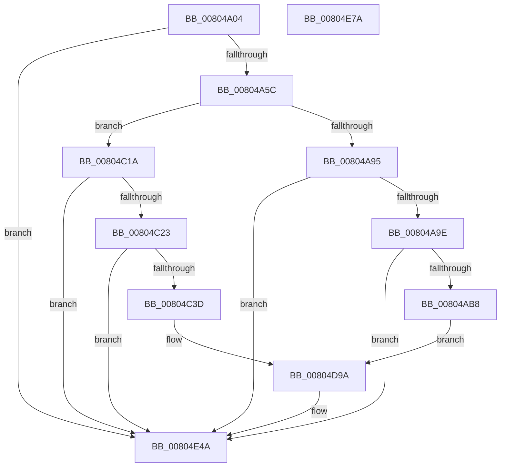

# MiLogHotPatchOperation

- RVA: `0x00804A04`–`0x00804E7B` (길이 `1,143` bytes)
- VA: `0x0000000140804A04`
- 실행 섹션: `PAGE`
- PDB 이름 있음: `예`; PDB Function 태그: `아니요`
- unwind 정보 RVA: `0x000CD2FC`
- 디코드: `232`개 명령, `1,143/1,143` bytes 표시
- 미해석 바이트: `0` (있으면 어셈블리에 `.byte`로 보존)

> 이 문서는 커널 이미지의 기계어와 PDB 기호를 분석해 생성했습니다. 4번과 5번은 함수 원형과 자료형을 바이너리 사용 방식에서 추정한 C 해석이며 원본 소스 복구 결과는 아닙니다.

## 1. Dependencies

- 직접 호출 지점: **9**; 고유 호출 대상: **6**
- 직접 호출자로 확인된 함수: **1**
- RIP 상대 이미지 참조: **4**

### Outgoing calls
- `0x00804A7C` → [MiFillLogProcessInfo](../../text/44/MiFillLogProcessInfo_function_00448110.md) (function, `0x00448110`)
- `0x00804AAB` → [tlgKeywordOn](../../text/42/tlgKeywordOn_function_0042EAA0.md) (function, `0x0042EAA0`)
- `0x00804ABB` → [PsGetProcessId](../../text/43/PsGetProcessId_function_0043D910.md) (function, `0x0043D910`)
- `0x00804ADE` → [tlgCreate1Sz_char](../../text/42/tlgCreate1Sz_char_function_00427304.md) (function, `0x00427304`)
- `0x00804C30` → [tlgKeywordOn](../../text/42/tlgKeywordOn_function_0042EAA0.md) (function, `0x0042EAA0`)
- `0x00804C40` → [PsGetProcessId](../../text/43/PsGetProcessId_function_0043D910.md) (function, `0x0043D910`)
- `0x00804C63` → [tlgCreate1Sz_char](../../text/42/tlgCreate1Sz_char_function_00427304.md) (function, `0x00427304`)
- `0x00804E45` → [tlgWriteEx_EtwWriteEx](../../text/4A/tlgWriteEx_EtwWriteEx_function_004AA348.md) (function, `0x004AA348`)
- `0x00804E54` → [_security_check_cookie](../../text/6A/_security_check_cookie_function_006AC640.md) (function, `0x006AC640`)

### Direct callers
- [MiApplyImageHotPatchRequest](MiApplyImageHotPatchRequest_function_008025AC.md) at `0x00802EEB`

### Static image references
- `0x00804A2A` → RVA `0x00E0A740` (`.data`; read)
- `0x00804A41` → RVA `0x00E37618` (`.data`; read)
- `0x00804AF2` → RVA `0x0005874A` (`.rdata`; read)
- `0x00804C77` → RVA `0x000585F4` (`.rdata`; read)

## 2. Other-region calls and transfers

- 다른 실행 섹션으로 향하는 call: **9**
  - `0x00804A7C` → [MiFillLogProcessInfo](../../text/44/MiFillLogProcessInfo_function_00448110.md) (`PAGE` → `.text`)
  - `0x00804AAB` → [tlgKeywordOn](../../text/42/tlgKeywordOn_function_0042EAA0.md) (`PAGE` → `.text`)
  - `0x00804ABB` → [PsGetProcessId](../../text/43/PsGetProcessId_function_0043D910.md) (`PAGE` → `.text`)
  - `0x00804ADE` → [tlgCreate1Sz_char](../../text/42/tlgCreate1Sz_char_function_00427304.md) (`PAGE` → `.text`)
  - `0x00804C30` → [tlgKeywordOn](../../text/42/tlgKeywordOn_function_0042EAA0.md) (`PAGE` → `.text`)
  - `0x00804C40` → [PsGetProcessId](../../text/43/PsGetProcessId_function_0043D910.md) (`PAGE` → `.text`)
  - `0x00804C63` → [tlgCreate1Sz_char](../../text/42/tlgCreate1Sz_char_function_00427304.md) (`PAGE` → `.text`)
  - `0x00804E45` → [tlgWriteEx_EtwWriteEx](../../text/4A/tlgWriteEx_EtwWriteEx_function_004AA348.md) (`PAGE` → `.text`)
  - `0x00804E54` → [_security_check_cookie](../../text/6A/_security_check_cookie_function_006AC640.md) (`PAGE` → `.text`)
- 별도 외부 분기/꼬리 이동을 확인하지 못했습니다.

## 3. Assembly (complete function range)

```asm
00804A04  48 8B C4                        mov rax, rsp
00804A07  48 89 58 08                     mov qword ptr [rax + 8], rbx
00804A0B  48 89 70 10                     mov qword ptr [rax + 0x10], rsi
00804A0F  48 89 78 18                     mov qword ptr [rax + 0x18], rdi
00804A13  55                              push rbp
00804A14  41 54                           push r12
00804A16  41 55                           push r13
00804A18  41 56                           push r14
00804A1A  41 57                           push r15
00804A1C  48 8D A8 E8 FE FF FF            lea rbp, [rax - 0x118]
00804A23  48 81 EC F0 01 00 00            sub rsp, 0x1f0
00804A2A  48 8B 05 0F 5D 60 00            mov rax, qword ptr [rip + 0x605d0f]
00804A31  48 33 C4                        xor rax, rsp
00804A34  48 89 85 E0 00 00 00            mov qword ptr [rbp + 0xe0], rax
00804A3B  45 33 ED                        xor r13d, r13d
00804A3E  45 8B F1                        mov r14d, r9d
00804A41  4C 39 2D D0 2B 63 00            cmp qword ptr [rip + 0x632bd0], r13
00804A48  45 8B F8                        mov r15d, r8d
00804A4B  44 8B E2                        mov r12d, edx
00804A4E  4C 89 6C 24 78                  mov qword ptr [rsp + 0x78], r13
00804A53  48 8B F1                        mov rsi, rcx
00804A56  0F 84 EE 03 00 00               je 0x140804e4a
00804A5C  65 48 8B 04 25 88 01 00 00      mov rax, qword ptr gs:[0x188]
00804A65  4C 8D 44 24 78                  lea r8, [rsp + 0x78]
00804A6A  48 8D 55 88                     lea rdx, [rbp - 0x78]
00804A6E  48 8B B8 B8 00 00 00            mov rdi, qword ptr [rax + 0xb8]
00804A75  48 8D 8F 00 04 00 00            lea rcx, [rdi + 0x400]
00804A7C  E8 8F 36 C4 FF                  call 0x140448110
00804A81  48 8B 1D 90 2B 63 00            mov rbx, qword ptr [rip + 0x632b90]
00804A88  44 39 AD 58 01 00 00            cmp dword ptr [rbp + 0x158], r13d
00804A8F  0F 85 85 01 00 00               jne 0x140804c1a
00804A95  83 3B 05                        cmp dword ptr [rbx], 5
00804A98  0F 86 AC 03 00 00               jbe 0x140804e4a
00804A9E  48 BA 20 00 00 00 00 40 00 00   movabs rdx, 0x400000000020
00804AA8  48 8B CB                        mov rcx, rbx
00804AAB  E8 F0 9F C2 FF                  call 0x14042eaa0
00804AB0  84 C0                           test al, al
00804AB2  0F 84 92 03 00 00               je 0x140804e4a
00804AB8  48 8B CF                        mov rcx, rdi
00804ABB  E8 50 8E C3 FF                  call 0x14043d910
00804AC0  48 8B 54 24 78                  mov rdx, qword ptr [rsp + 0x78]
00804AC5  48 8D 4D C0                     lea rcx, [rbp - 0x40]
00804AC9  89 44 24 44                     mov dword ptr [rsp + 0x44], eax
00804ACD  48 8D 44 24 44                  lea rax, [rsp + 0x44]
00804AD2  48 89 45 B0                     mov qword ptr [rbp - 0x50], rax
00804AD6  48 C7 45 B8 04 00 00 00         mov qword ptr [rbp - 0x48], 4
00804ADE  E8 21 28 C2 FF                  call 0x140427304
00804AE3  8B 8D 50 01 00 00               mov ecx, dword ptr [rbp + 0x150]
00804AE9  48 8D 44 24 48                  lea rax, [rsp + 0x48]
00804AEE  48 89 45 D0                     mov qword ptr [rbp - 0x30], rax
00804AF2  48 8D 15 51 3C 85 FF            lea rdx, [rip - 0x7ac3af]
00804AF9  48 8D 44 24 4C                  lea rax, [rsp + 0x4c]
00804AFE  89 4C 24 48                     mov dword ptr [rsp + 0x48], ecx
00804B02  48 8B 8D 40 01 00 00            mov rcx, qword ptr [rbp + 0x140]
00804B09  48 89 45 E0                     mov qword ptr [rbp - 0x20], rax
00804B0D  48 8D 44 24 50                  lea rax, [rsp + 0x50]
00804B12  48 89 45 F0                     mov qword ptr [rbp - 0x10], rax
00804B16  8B 46 38                        mov eax, dword ptr [rsi + 0x38]
00804B19  89 44 24 54                     mov dword ptr [rsp + 0x54], eax
00804B1D  48 8D 44 24 54                  lea rax, [rsp + 0x54]
00804B22  48 89 45 00                     mov qword ptr [rbp], rax
00804B26  8B 46 3C                        mov eax, dword ptr [rsi + 0x3c]
00804B29  89 44 24 58                     mov dword ptr [rsp + 0x58], eax
00804B2D  48 8D 44 24 58                  lea rax, [rsp + 0x58]
00804B32  48 89 45 10                     mov qword ptr [rbp + 0x10], rax
00804B36  48 8D 45 38                     lea rax, [rbp + 0x38]
00804B3A  48 89 45 20                     mov qword ptr [rbp + 0x20], rax
00804B3E  48 8B 46 30                     mov rax, qword ptr [rsi + 0x30]
00804B42  48 89 45 30                     mov qword ptr [rbp + 0x30], rax
00804B46  0F B7 46 28                     movzx eax, word ptr [rsi + 0x28]
00804B4A  89 45 38                        mov dword ptr [rbp + 0x38], eax
00804B4D  8B 46 40                        mov eax, dword ptr [rsi + 0x40]
00804B50  89 44 24 5C                     mov dword ptr [rsp + 0x5c], eax
00804B54  48 8D 44 24 5C                  lea rax, [rsp + 0x5c]
00804B59  48 89 45 40                     mov qword ptr [rbp + 0x40], rax
00804B5D  48 8D 44 24 60                  lea rax, [rsp + 0x60]
00804B62  48 89 45 50                     mov qword ptr [rbp + 0x50], rax
00804B66  8B 01                           mov eax, dword ptr [rcx]
00804B68  89 44 24 64                     mov dword ptr [rsp + 0x64], eax
00804B6C  48 8D 44 24 64                  lea rax, [rsp + 0x64]
00804B71  48 89 45 60                     mov qword ptr [rbp + 0x60], rax
00804B75  8B 41 04                        mov eax, dword ptr [rcx + 4]
00804B78  48 8B 8D 48 01 00 00            mov rcx, qword ptr [rbp + 0x148]
00804B7F  89 44 24 68                     mov dword ptr [rsp + 0x68], eax
00804B83  48 8D 44 24 68                  lea rax, [rsp + 0x68]
00804B88  48 89 45 70                     mov qword ptr [rbp + 0x70], rax
00804B8C  48 8D 85 98 00 00 00            lea rax, [rbp + 0x98]
00804B93  48 89 85 80 00 00 00            mov qword ptr [rbp + 0x80], rax
00804B9A  48 8B 41 08                     mov rax, qword ptr [rcx + 8]
00804B9E  48 89 85 90 00 00 00            mov qword ptr [rbp + 0x90], rax
00804BA5  0F B7 01                        movzx eax, word ptr [rcx]
00804BA8  89 85 98 00 00 00               mov dword ptr [rbp + 0x98], eax
00804BAE  8B 46 10                        mov eax, dword ptr [rsi + 0x10]
00804BB1  89 44 24 6C                     mov dword ptr [rsp + 0x6c], eax
00804BB5  48 8D 44 24 6C                  lea rax, [rsp + 0x6c]
00804BBA  48 89 85 A0 00 00 00            mov qword ptr [rbp + 0xa0], rax
00804BC1  8B 46 44                        mov eax, dword ptr [rsi + 0x44]
00804BC4  D1 E8                           shr eax, 1
00804BC6  83 E0 01                        and eax, 1
00804BC9  48 C7 45 D8 04 00 00 00         mov qword ptr [rbp - 0x28], 4
00804BD1  89 44 24 70                     mov dword ptr [rsp + 0x70], eax
00804BD5  48 8D 44 24 70                  lea rax, [rsp + 0x70]
00804BDA  44 89 64 24 4C                  mov dword ptr [rsp + 0x4c], r12d
00804BDF  48 C7 45 E8 04 00 00 00         mov qword ptr [rbp - 0x18], 4
00804BE7  44 89 7C 24 50                  mov dword ptr [rsp + 0x50], r15d
00804BEC  48 C7 45 F8 04 00 00 00         mov qword ptr [rbp - 8], 4
00804BF4  48 C7 45 08 04 00 00 00         mov qword ptr [rbp + 8], 4
00804BFC  48 C7 45 18 04 00 00 00         mov qword ptr [rbp + 0x18], 4
00804C04  48 C7 45 28 02 00 00 00         mov qword ptr [rbp + 0x28], 2
00804C0C  44 89 6D 3C                     mov dword ptr [rbp + 0x3c], r13d
00804C10  44 89 74 24 60                  mov dword ptr [rsp + 0x60], r14d
00804C15  E9 80 01 00 00                  jmp 0x140804d9a
00804C1A  83 3B 05                        cmp dword ptr [rbx], 5
00804C1D  0F 86 27 02 00 00               jbe 0x140804e4a
00804C23  48 BA 20 00 00 00 00 40 00 00   movabs rdx, 0x400000000020
00804C2D  48 8B CB                        mov rcx, rbx
00804C30  E8 6B 9E C2 FF                  call 0x14042eaa0
00804C35  84 C0                           test al, al
00804C37  0F 84 0D 02 00 00               je 0x140804e4a
00804C3D  48 8B CF                        mov rcx, rdi
00804C40  E8 CB 8C C3 FF                  call 0x14043d910
00804C45  48 8B 54 24 78                  mov rdx, qword ptr [rsp + 0x78]
00804C4A  48 8D 4D C0                     lea rcx, [rbp - 0x40]
00804C4E  89 44 24 70                     mov dword ptr [rsp + 0x70], eax
00804C52  48 8D 44 24 70                  lea rax, [rsp + 0x70]
00804C57  48 89 45 B0                     mov qword ptr [rbp - 0x50], rax
00804C5B  48 C7 45 B8 04 00 00 00         mov qword ptr [rbp - 0x48], 4
00804C63  E8 9C 26 C2 FF                  call 0x140427304
00804C68  8B 8D 50 01 00 00               mov ecx, dword ptr [rbp + 0x150]
00804C6E  48 8D 44 24 6C                  lea rax, [rsp + 0x6c]
00804C73  48 89 45 D0                     mov qword ptr [rbp - 0x30], rax
00804C77  48 8D 15 76 39 85 FF            lea rdx, [rip - 0x7ac68a]
00804C7E  48 8D 44 24 68                  lea rax, [rsp + 0x68]
00804C83  89 4C 24 6C                     mov dword ptr [rsp + 0x6c], ecx
00804C87  48 8B 8D 40 01 00 00            mov rcx, qword ptr [rbp + 0x140]
00804C8E  48 89 45 E0                     mov qword ptr [rbp - 0x20], rax
00804C92  48 8D 44 24 64                  lea rax, [rsp + 0x64]
00804C97  48 89 45 F0                     mov qword ptr [rbp - 0x10], rax
00804C9B  8B 46 38                        mov eax, dword ptr [rsi + 0x38]
00804C9E  89 44 24 60                     mov dword ptr [rsp + 0x60], eax
00804CA2  48 8D 44 24 60                  lea rax, [rsp + 0x60]
00804CA7  48 89 45 00                     mov qword ptr [rbp], rax
00804CAB  8B 46 3C                        mov eax, dword ptr [rsi + 0x3c]
00804CAE  89 44 24 5C                     mov dword ptr [rsp + 0x5c], eax
00804CB2  48 8D 44 24 5C                  lea rax, [rsp + 0x5c]
00804CB7  48 89 45 10                     mov qword ptr [rbp + 0x10], rax
00804CBB  48 8D 45 38                     lea rax, [rbp + 0x38]
00804CBF  48 89 45 20                     mov qword ptr [rbp + 0x20], rax
00804CC3  48 8B 46 30                     mov rax, qword ptr [rsi + 0x30]
00804CC7  48 89 45 30                     mov qword ptr [rbp + 0x30], rax
00804CCB  0F B7 46 28                     movzx eax, word ptr [rsi + 0x28]
00804CCF  89 45 38                        mov dword ptr [rbp + 0x38], eax
00804CD2  8B 46 40                        mov eax, dword ptr [rsi + 0x40]
00804CD5  89 44 24 58                     mov dword ptr [rsp + 0x58], eax
00804CD9  48 8D 44 24 58                  lea rax, [rsp + 0x58]
00804CDE  48 89 45 40                     mov qword ptr [rbp + 0x40], rax
00804CE2  48 8D 44 24 54                  lea rax, [rsp + 0x54]
00804CE7  48 89 45 50                     mov qword ptr [rbp + 0x50], rax
00804CEB  8B 01                           mov eax, dword ptr [rcx]
00804CED  89 44 24 50                     mov dword ptr [rsp + 0x50], eax
00804CF1  48 8D 44 24 50                  lea rax, [rsp + 0x50]
00804CF6  48 89 45 60                     mov qword ptr [rbp + 0x60], rax
00804CFA  8B 41 04                        mov eax, dword ptr [rcx + 4]
00804CFD  48 8B 8D 48 01 00 00            mov rcx, qword ptr [rbp + 0x148]
00804D04  89 44 24 4C                     mov dword ptr [rsp + 0x4c], eax
00804D08  48 8D 44 24 4C                  lea rax, [rsp + 0x4c]
00804D0D  48 89 45 70                     mov qword ptr [rbp + 0x70], rax
00804D11  48 8D 85 98 00 00 00            lea rax, [rbp + 0x98]
00804D18  48 89 85 80 00 00 00            mov qword ptr [rbp + 0x80], rax
00804D1F  48 8B 41 08                     mov rax, qword ptr [rcx + 8]
00804D23  48 89 85 90 00 00 00            mov qword ptr [rbp + 0x90], rax
00804D2A  0F B7 01                        movzx eax, word ptr [rcx]
00804D2D  89 85 98 00 00 00               mov dword ptr [rbp + 0x98], eax
00804D33  8B 46 10                        mov eax, dword ptr [rsi + 0x10]
00804D36  89 44 24 48                     mov dword ptr [rsp + 0x48], eax
00804D3A  48 8D 44 24 48                  lea rax, [rsp + 0x48]
00804D3F  48 89 85 A0 00 00 00            mov qword ptr [rbp + 0xa0], rax
00804D46  8B 46 44                        mov eax, dword ptr [rsi + 0x44]
00804D49  D1 E8                           shr eax, 1
00804D4B  83 E0 01                        and eax, 1
00804D4E  48 C7 45 D8 04 00 00 00         mov qword ptr [rbp - 0x28], 4
00804D56  89 44 24 44                     mov dword ptr [rsp + 0x44], eax
00804D5A  48 8D 44 24 44                  lea rax, [rsp + 0x44]
00804D5F  44 89 64 24 68                  mov dword ptr [rsp + 0x68], r12d
00804D64  48 C7 45 E8 04 00 00 00         mov qword ptr [rbp - 0x18], 4
00804D6C  44 89 7C 24 64                  mov dword ptr [rsp + 0x64], r15d
00804D71  48 C7 45 F8 04 00 00 00         mov qword ptr [rbp - 8], 4
00804D79  48 C7 45 08 04 00 00 00         mov qword ptr [rbp + 8], 4
00804D81  48 C7 45 18 04 00 00 00         mov qword ptr [rbp + 0x18], 4
00804D89  48 C7 45 28 02 00 00 00         mov qword ptr [rbp + 0x28], 2
00804D91  44 89 6D 3C                     mov dword ptr [rbp + 0x3c], r13d
00804D95  44 89 74 24 54                  mov dword ptr [rsp + 0x54], r14d
00804D9A  48 89 85 B0 00 00 00            mov qword ptr [rbp + 0xb0], rax
00804DA1  41 B9 01 00 00 00               mov r9d, 1
00804DA7  0F B7 87 EC 06 00 00            movzx eax, word ptr [rdi + 0x6ec]
00804DAE  48 8B CB                        mov rcx, rbx
00804DB1  66 89 44 24 40                  mov word ptr [rsp + 0x40], ax
00804DB6  48 8D 44 24 40                  lea rax, [rsp + 0x40]
00804DBB  48 89 85 C0 00 00 00            mov qword ptr [rbp + 0xc0], rax
00804DC2  B8 00 00 00 81                  mov eax, 0x81000000
00804DC7  48 89 45 80                     mov qword ptr [rbp - 0x80], rax
00804DCB  48 8D 45 80                     lea rax, [rbp - 0x80]
00804DCF  48 89 85 D0 00 00 00            mov qword ptr [rbp + 0xd0], rax
00804DD6  48 8D 45 90                     lea rax, [rbp - 0x70]
00804DDA  48 89 44 24 38                  mov qword ptr [rsp + 0x38], rax
00804DDF  C7 44 24 30 15 00 00 00         mov dword ptr [rsp + 0x30], 0x15
00804DE7  48 C7 45 48 04 00 00 00         mov qword ptr [rbp + 0x48], 4
00804DEF  48 C7 85 88 00 00 00 02 00 00 00  mov qword ptr [rbp + 0x88], 2
00804DFA  48 C7 45 78 04 00 00 00         mov qword ptr [rbp + 0x78], 4
00804E02  48 C7 45 68 04 00 00 00         mov qword ptr [rbp + 0x68], 4
00804E0A  48 C7 45 58 04 00 00 00         mov qword ptr [rbp + 0x58], 4
00804E12  44 89 AD 9C 00 00 00            mov dword ptr [rbp + 0x9c], r13d
00804E19  48 C7 85 A8 00 00 00 04 00 00 00  mov qword ptr [rbp + 0xa8], 4
00804E24  48 C7 85 B8 00 00 00 04 00 00 00  mov qword ptr [rbp + 0xb8], 4
00804E2F  48 C7 85 C8 00 00 00 02 00 00 00  mov qword ptr [rbp + 0xc8], 2
00804E3A  48 C7 85 D8 00 00 00 08 00 00 00  mov qword ptr [rbp + 0xd8], 8
00804E45  E8 FE 54 CA FF                  call 0x1404aa348
00804E4A  48 8B 8D E0 00 00 00            mov rcx, qword ptr [rbp + 0xe0]
00804E51  48 33 CC                        xor rcx, rsp
00804E54  E8 E7 77 EA FF                  call 0x1406ac640
00804E59  4C 8D 9C 24 F0 01 00 00         lea r11, [rsp + 0x1f0]
00804E61  49 8B 5B 30                     mov rbx, qword ptr [r11 + 0x30]
00804E65  49 8B 73 38                     mov rsi, qword ptr [r11 + 0x38]
00804E69  49 8B 7B 40                     mov rdi, qword ptr [r11 + 0x40]
00804E6D  49 8B E3                        mov rsp, r11
00804E70  41 5F                           pop r15
00804E72  41 5E                           pop r14
00804E74  41 5D                           pop r13
00804E76  41 5C                           pop r12
00804E78  5D                              pop rbp
00804E79  C3                              ret
00804E7A  CC                              int3
```

## 4. C-style interpretation (structured pseudocode)

```c
__int64 __fastcall MiLogHotPatchOperation(__int64 a1, int a2, int a3, int a4)
{
    __int64 result;
    __int64 v_r13;
    __int64 v_rsp;
    unsigned __int64 v_stack_m1A0;
    unsigned int v_stack_m1A8;
    unsigned int v_stack_m1AC;
    unsigned int v_stack_m1B0;
    unsigned int v_stack_m1B4;
    unsigned __int64 v_stack_m1B8;
    unsigned int v_stack_m1BC;
    unsigned int v_stack_m1C0;
    unsigned int v_stack_m1C4;
    unsigned __int64 v_stack_m1C8;
    unsigned __int64 v_stack_m1CC;
    unsigned __int64 v_stack_m1D0;
    unsigned int v_stack_m1D4;
    unsigned __int16 v_stack_m1D8;
    unsigned __int64 v_stack_m1E0;
    unsigned int v_stack_m1E8;
    unsigned __int64 v_stack_m28;

    *(unsigned __int64 *)(v_rsp + 8) = v_rbx;
    *(unsigned __int64 *)(v_rsp + 16) = v_rsi;
    *(unsigned __int64 *)(v_rsp + 24) = v_rdi;
    v_rsp = (v_rsp) - (496);
    result = (*(unsigned __int64 *)(v_rip + 6315279)) ^ (v_rsp);
    *(unsigned __int64 *)(v_rsp - 280 + 224) = result;
    v_r13 = 0;
    v_stack_m1A0 = 0;
    if ((*(unsigned __int64 *)(v_rip + 6499280)) == 0) goto loc_00804E4A;
    result = MiFillLogProcessInfo(*(unsigned __int64 *)(*(unsigned __int64 *)(gs_base + (0 + 392)) + 184) + 1024, v_rsp - 280 - 120, v_stack_m1A0, a4);
    if ((*(unsigned int *)(v_rsp - 280 + 344)) != 0) goto loc_00804C1A;
    if ((*(unsigned int *)(*(unsigned __int64 *)(v_rip + 6499216))) <= 5) goto loc_00804E4A;
    result = tlgKeywordOn(*(unsigned __int64 *)(v_rip + 6499216), v_rsp - 280 - 120, v_stack_m1A0, a4);
    if ((unsigned __int8)(result) == 0) goto loc_00804E4A;
    result = PsGetProcessId(*(unsigned __int64 *)(*(unsigned __int64 *)(gs_base + (0 + 392)) + 184), v_rsp - 280 - 120, v_stack_m1A0, a4);
    v_stack_m1D4 = (unsigned int)(result);
    *(unsigned __int64 *)(v_rsp - 280 - 80) = v_stack_m1D4;
    *(unsigned __int64 *)(v_rsp - 280 - 72) = 4;
    result = tlgCreate1Sz_char(v_rsp - 280 - 64, v_stack_m1A0, v_stack_m1A0, a4);
    *(unsigned __int64 *)(v_rsp - 280 - 48) = v_stack_m1D0;
    v_stack_m1D0 = (unsigned int)((unsigned int)(*(unsigned int *)(v_rsp - 280 + 336)));
    *(unsigned __int64 *)(v_rsp - 280 - 32) = v_stack_m1CC;
    *(unsigned __int64 *)(v_rsp - 280 - 16) = v_stack_m1C8;
    v_stack_m1C4 = (unsigned int)((unsigned int)(*(unsigned int *)(a1 + 56)));
    *(unsigned __int64 *)(v_rsp - 280) = v_stack_m1C4;
    v_stack_m1C0 = (unsigned int)((unsigned int)(*(unsigned int *)(a1 + 60)));
    *(unsigned __int64 *)(v_rsp - 280 + 16) = v_stack_m1C0;
    *(unsigned __int64 *)(v_rsp - 280 + 32) = v_rsp - 280 + 56;
    *(unsigned __int64 *)(v_rsp - 280 + 48) = *(unsigned __int64 *)(a1 + 48);
    *(unsigned int *)(v_rsp - 280 + 56) = (unsigned int)(*(unsigned __int16 *)(a1 + 40));
    v_stack_m1BC = (unsigned int)((unsigned int)(*(unsigned int *)(a1 + 64)));
    *(unsigned __int64 *)(v_rsp - 280 + 64) = v_stack_m1BC;
    *(unsigned __int64 *)(v_rsp - 280 + 80) = v_stack_m1B8;
    v_stack_m1B4 = (unsigned int)((unsigned int)(*(unsigned int *)(*(unsigned __int64 *)(v_rsp - 280 + 320))));
    *(unsigned __int64 *)(v_rsp - 280 + 96) = v_stack_m1B4;
    v_stack_m1B0 = (unsigned int)((unsigned int)(*(unsigned int *)(*(unsigned __int64 *)(v_rsp - 280 + 320) + 4)));
    *(unsigned __int64 *)(v_rsp - 280 + 112) = v_stack_m1B0;
    *(unsigned __int64 *)(v_rsp - 280 + 128) = v_rsp - 280 + 152;
    *(unsigned __int64 *)(v_rsp - 280 + 144) = *(unsigned __int64 *)(*(unsigned __int64 *)(v_rsp - 280 + 328) + 8);
    *(unsigned int *)(v_rsp - 280 + 152) = (unsigned int)(*(unsigned __int16 *)(*(unsigned __int64 *)(v_rsp - 280 + 328)));
    v_stack_m1AC = (unsigned int)((unsigned int)(*(unsigned int *)(a1 + 16)));
    *(unsigned __int64 *)(v_rsp - 280 + 160) = v_stack_m1AC;
    result = (unsigned int)(((unsigned int)(*(unsigned int *)(a1 + 68))) >> (1));
    result = (unsigned int)((result) & (1));
    *(unsigned __int64 *)(v_rsp - 280 - 40) = 4;
    v_stack_m1A8 = (unsigned int)(result);
    v_stack_m1CC = (unsigned int)((unsigned int)(a2));
    *(unsigned __int64 *)(v_rsp - 280 - 24) = 4;
    v_stack_m1C8 = (unsigned int)((unsigned int)(a3));
    *(unsigned __int64 *)(v_rsp - 280 - 8) = 4;
    *(unsigned __int64 *)(v_rsp - 280 + 8) = 4;
    *(unsigned __int64 *)(v_rsp - 280 + 24) = 4;
    *(unsigned __int64 *)(v_rsp - 280 + 40) = 2;
    *(unsigned int *)(v_rsp - 280 + 60) = 0;
    v_stack_m1B8 = (unsigned int)((unsigned int)(a4));
    goto loc_00804D9A;
loc_00804C1A:
    if ((*(unsigned int *)(*(unsigned __int64 *)(v_rip + 6499216))) <= 5) goto loc_00804E4A;
    result = tlgKeywordOn(*(unsigned __int64 *)(v_rip + 6499216), v_rip - 8045487, v_stack_m1A0, a4);
    if ((unsigned __int8)(result) == 0) goto loc_00804E4A;
    result = PsGetProcessId(*(unsigned __int64 *)(*(unsigned __int64 *)(gs_base + (0 + 392)) + 184), v_rip - 8045487, v_stack_m1A0, a4);
    v_stack_m1A8 = (unsigned int)(result);
    *(unsigned __int64 *)(v_rsp - 280 - 80) = v_stack_m1A8;
    *(unsigned __int64 *)(v_rsp - 280 - 72) = 4;
    result = tlgCreate1Sz_char(v_rsp - 280 - 64, v_stack_m1A0, v_stack_m1A0, a4);
    *(unsigned __int64 *)(v_rsp - 280 - 48) = v_stack_m1AC;
    v_stack_m1AC = (unsigned int)((unsigned int)(*(unsigned int *)(v_rsp - 280 + 336)));
    *(unsigned __int64 *)(v_rsp - 280 - 32) = v_stack_m1B0;
    *(unsigned __int64 *)(v_rsp - 280 - 16) = v_stack_m1B4;
    v_stack_m1B8 = (unsigned int)((unsigned int)(*(unsigned int *)(a1 + 56)));
    *(unsigned __int64 *)(v_rsp - 280) = v_stack_m1B8;
    v_stack_m1BC = (unsigned int)((unsigned int)(*(unsigned int *)(a1 + 60)));
    *(unsigned __int64 *)(v_rsp - 280 + 16) = v_stack_m1BC;
    *(unsigned __int64 *)(v_rsp - 280 + 32) = v_rsp - 280 + 56;
    *(unsigned __int64 *)(v_rsp - 280 + 48) = *(unsigned __int64 *)(a1 + 48);
    *(unsigned int *)(v_rsp - 280 + 56) = (unsigned int)(*(unsigned __int16 *)(a1 + 40));
    v_stack_m1C0 = (unsigned int)((unsigned int)(*(unsigned int *)(a1 + 64)));
    *(unsigned __int64 *)(v_rsp - 280 + 64) = v_stack_m1C0;
    *(unsigned __int64 *)(v_rsp - 280 + 80) = v_stack_m1C4;
    v_stack_m1C8 = (unsigned int)((unsigned int)(*(unsigned int *)(*(unsigned __int64 *)(v_rsp - 280 + 320))));
    *(unsigned __int64 *)(v_rsp - 280 + 96) = v_stack_m1C8;
    v_stack_m1CC = (unsigned int)((unsigned int)(*(unsigned int *)(*(unsigned __int64 *)(v_rsp - 280 + 320) + 4)));
    *(unsigned __int64 *)(v_rsp - 280 + 112) = v_stack_m1CC;
    *(unsigned __int64 *)(v_rsp - 280 + 128) = v_rsp - 280 + 152;
    *(unsigned __int64 *)(v_rsp - 280 + 144) = *(unsigned __int64 *)(*(unsigned __int64 *)(v_rsp - 280 + 328) + 8);
    *(unsigned int *)(v_rsp - 280 + 152) = (unsigned int)(*(unsigned __int16 *)(*(unsigned __int64 *)(v_rsp - 280 + 328)));
    v_stack_m1D0 = (unsigned int)((unsigned int)(*(unsigned int *)(a1 + 16)));
    *(unsigned __int64 *)(v_rsp - 280 + 160) = v_stack_m1D0;
    result = (unsigned int)(((unsigned int)(*(unsigned int *)(a1 + 68))) >> (1));
    result = (unsigned int)((result) & (1));
    *(unsigned __int64 *)(v_rsp - 280 - 40) = 4;
    v_stack_m1D4 = (unsigned int)(result);
    v_stack_m1B0 = (unsigned int)((unsigned int)(a2));
    *(unsigned __int64 *)(v_rsp - 280 - 24) = 4;
    v_stack_m1B4 = (unsigned int)((unsigned int)(a3));
    *(unsigned __int64 *)(v_rsp - 280 - 8) = 4;
    *(unsigned __int64 *)(v_rsp - 280 + 8) = 4;
    *(unsigned __int64 *)(v_rsp - 280 + 24) = 4;
    *(unsigned __int64 *)(v_rsp - 280 + 40) = 2;
    *(unsigned int *)(v_rsp - 280 + 60) = 0;
    v_stack_m1C4 = (unsigned int)((unsigned int)(a4));
loc_00804D9A:
    *(unsigned __int64 *)(v_rsp - 280 + 176) = v_stack_m1D4;
    v_stack_m1D8 = (unsigned __int16)(*(unsigned __int16 *)(*(unsigned __int64 *)(*(unsigned __int64 *)(gs_base + (0 + 392)) + 184) + 1772));
    *(unsigned __int64 *)(v_rsp - 280 + 192) = v_stack_m1D8;
    *(unsigned __int64 *)(v_rsp - 280 - 128) = (unsigned int)(0x81000000ULL);
    *(unsigned __int64 *)(v_rsp - 280 + 208) = v_rsp - 280 - 128;
    v_stack_m1E0 = v_rsp - 280 - 112;
    v_stack_m1E8 = 21;
    *(unsigned __int64 *)(v_rsp - 280 + 72) = 4;
    *(unsigned __int64 *)(v_rsp - 280 + 136) = 2;
    *(unsigned __int64 *)(v_rsp - 280 + 120) = 4;
    *(unsigned __int64 *)(v_rsp - 280 + 104) = 4;
    *(unsigned __int64 *)(v_rsp - 280 + 88) = 4;
    *(unsigned int *)(v_rsp - 280 + 156) = 0;
    *(unsigned __int64 *)(v_rsp - 280 + 168) = 4;
    *(unsigned __int64 *)(v_rsp - 280 + 184) = 4;
    *(unsigned __int64 *)(v_rsp - 280 + 200) = 2;
    *(unsigned __int64 *)(v_rsp - 280 + 216) = 8;
    result = tlgWriteEx_EtwWriteEx(*(unsigned __int64 *)(v_rip + 6499216), v_rip - 8046218, v_stack_m1A0, 1);
loc_00804E4A:
    a1 = (*(unsigned __int64 *)(v_rsp - 280 + 224)) ^ (v_rsp);
    result = _security_check_cookie(a1, v_rip - 8046218, v_stack_m1A0, 1);
    return result;
}
```

## 5. (Beta) C Style

```c
int64_t MiLogHotPatchOperation(void *Arg1, int32_t Arg2, int32_t Arg3, int32_t Arg4)
{
    uint8_t *arg1 = (uint8_t *)Arg1;

    int64_t result;
    int64_t local_r13;
    int64_t local_rsp;
    uint64_t v_stack_m1A0;
    uint32_t v_stack_m1A8;
    uint32_t v_stack_m1AC;
    uint32_t v_stack_m1B0;
    uint32_t v_stack_m1B4;
    uint64_t v_stack_m1B8;
    uint32_t v_stack_m1BC;
    uint32_t v_stack_m1C0;
    uint32_t v_stack_m1C4;
    uint64_t v_stack_m1C8;
    uint64_t v_stack_m1CC;
    uint64_t v_stack_m1D0;
    uint32_t v_stack_m1D4;
    uint16_t v_stack_m1D8;
    uint64_t v_stack_m1E0;
    uint32_t v_stack_m1E8;
    uint64_t v_stack_m28;

    *(uint64_t *)(local_rsp + 0x8) = local_rbx;
    *(uint64_t *)(local_rsp + 0x10) = local_rsi;
    *(uint64_t *)(local_rsp + 0x18) = local_rdi;
    local_rsp = (local_rsp) - (496);
    result = (*(uint64_t *)(v_rip + 0x605D0F)) ^ (local_rsp);
    *(uint64_t *)(local_rsp - 0x118 + 0xE0) = result;
    local_r13 = 0;
    v_stack_m1A0 = 0;
    if ((*(uint64_t *)(v_rip + 0x632BD0)) == 0) goto loc_00804E4A;
    result = MiFillLogProcessInfo(*(uint64_t *)(*(uint64_t *)(gs_base + (0 + 0x188)) + 0xB8) + 1024, local_rsp - 280 - 120, v_stack_m1A0, Arg4);
    if ((*(uint32_t *)(local_rsp - 0x118 + 0x158)) != 0) goto loc_00804C1A;
    if ((*(uint32_t *)(*(uint64_t *)(v_rip + 0x632B90))) <= 5) goto loc_00804E4A;
    result = tlgKeywordOn(*(uint64_t *)(v_rip + 0x632B90), local_rsp - 280 - 120, v_stack_m1A0, Arg4);
    if ((uint8_t)(result) == 0) goto loc_00804E4A;
    result = PsGetProcessId(*(uint64_t *)(*(uint64_t *)(gs_base + (0 + 0x188)) + 0xB8), local_rsp - 280 - 120, v_stack_m1A0, Arg4);
    v_stack_m1D4 = (uint32_t)(result);
    *(uint64_t *)(local_rsp - 0x118 - 0x50) = v_stack_m1D4;
    *(uint64_t *)(local_rsp - 0x118 - 0x48) = 4;
    result = tlgCreate1Sz_char(local_rsp - 280 - 64, v_stack_m1A0, v_stack_m1A0, Arg4);
    *(uint64_t *)(local_rsp - 0x118 - 0x30) = v_stack_m1D0;
    v_stack_m1D0 = (uint32_t)((uint32_t)(*(uint32_t *)(local_rsp - 0x118 + 0x150)));
    *(uint64_t *)(local_rsp - 0x118 - 0x20) = v_stack_m1CC;
    *(uint64_t *)(local_rsp - 0x118 - 0x10) = v_stack_m1C8;
    v_stack_m1C4 = (uint32_t)((uint32_t)(*(uint32_t *)(arg1 + 0x38)));
    *(uint64_t *)(local_rsp - 0x118) = v_stack_m1C4;
    v_stack_m1C0 = (uint32_t)((uint32_t)(*(uint32_t *)(arg1 + 0x3C)));
    *(uint64_t *)(local_rsp - 0x118 + 0x10) = v_stack_m1C0;
    *(uint64_t *)(local_rsp - 0x118 + 0x20) = local_rsp - 280 + 56;
    *(uint64_t *)(local_rsp - 0x118 + 0x30) = *(uint64_t *)(arg1 + 0x30);
    *(uint32_t *)(local_rsp - 0x118 + 0x38) = (uint32_t)(*(uint16_t *)(arg1 + 0x28));
    v_stack_m1BC = (uint32_t)((uint32_t)(*(uint32_t *)(arg1 + 0x40)));
    *(uint64_t *)(local_rsp - 0x118 + 0x40) = v_stack_m1BC;
    *(uint64_t *)(local_rsp - 0x118 + 0x50) = v_stack_m1B8;
    v_stack_m1B4 = (uint32_t)((uint32_t)(*(uint32_t *)(*(uint64_t *)(local_rsp - 0x118 + 0x140))));
    *(uint64_t *)(local_rsp - 0x118 + 0x60) = v_stack_m1B4;
    v_stack_m1B0 = (uint32_t)((uint32_t)(*(uint32_t *)(*(uint64_t *)(local_rsp - 0x118 + 0x140) + 0x4)));
    *(uint64_t *)(local_rsp - 0x118 + 0x70) = v_stack_m1B0;
    *(uint64_t *)(local_rsp - 0x118 + 0x80) = local_rsp - 280 + 152;
    *(uint64_t *)(local_rsp - 0x118 + 0x90) = *(uint64_t *)(*(uint64_t *)(local_rsp - 0x118 + 0x148) + 0x8);
    *(uint32_t *)(local_rsp - 0x118 + 0x98) = (uint32_t)(*(uint16_t *)(*(uint64_t *)(local_rsp - 0x118 + 0x148)));
    v_stack_m1AC = (uint32_t)((uint32_t)(*(uint32_t *)(arg1 + 0x10)));
    *(uint64_t *)(local_rsp - 0x118 + 0xA0) = v_stack_m1AC;
    result = (uint32_t)(((uint32_t)(*(uint32_t *)(arg1 + 0x44))) >> (1));
    result = (uint32_t)((result) & (1));
    *(uint64_t *)(local_rsp - 0x118 - 0x28) = 4;
    v_stack_m1A8 = (uint32_t)(result);
    v_stack_m1CC = (uint32_t)((uint32_t)(Arg2));
    *(uint64_t *)(local_rsp - 0x118 - 0x18) = 4;
    v_stack_m1C8 = (uint32_t)((uint32_t)(Arg3));
    *(uint64_t *)(local_rsp - 0x118 - 0x8) = 4;
    *(uint64_t *)(local_rsp - 0x118 + 0x8) = 4;
    *(uint64_t *)(local_rsp - 0x118 + 0x18) = 4;
    *(uint64_t *)(local_rsp - 0x118 + 0x28) = 2;
    *(uint32_t *)(local_rsp - 0x118 + 0x3C) = 0;
    v_stack_m1B8 = (uint32_t)((uint32_t)(Arg4));
    goto loc_00804D9A;
loc_00804C1A:
    if ((*(uint32_t *)(*(uint64_t *)(v_rip + 0x632B90))) <= 5) goto loc_00804E4A;
    result = tlgKeywordOn(*(uint64_t *)(v_rip + 0x632B90), v_rip - 8045487, v_stack_m1A0, Arg4);
    if ((uint8_t)(result) == 0) goto loc_00804E4A;
    result = PsGetProcessId(*(uint64_t *)(*(uint64_t *)(gs_base + (0 + 0x188)) + 0xB8), v_rip - 8045487, v_stack_m1A0, Arg4);
    v_stack_m1A8 = (uint32_t)(result);
    *(uint64_t *)(local_rsp - 0x118 - 0x50) = v_stack_m1A8;
    *(uint64_t *)(local_rsp - 0x118 - 0x48) = 4;
    result = tlgCreate1Sz_char(local_rsp - 280 - 64, v_stack_m1A0, v_stack_m1A0, Arg4);
    *(uint64_t *)(local_rsp - 0x118 - 0x30) = v_stack_m1AC;
    v_stack_m1AC = (uint32_t)((uint32_t)(*(uint32_t *)(local_rsp - 0x118 + 0x150)));
    *(uint64_t *)(local_rsp - 0x118 - 0x20) = v_stack_m1B0;
    *(uint64_t *)(local_rsp - 0x118 - 0x10) = v_stack_m1B4;
    v_stack_m1B8 = (uint32_t)((uint32_t)(*(uint32_t *)(arg1 + 0x38)));
    *(uint64_t *)(local_rsp - 0x118) = v_stack_m1B8;
    v_stack_m1BC = (uint32_t)((uint32_t)(*(uint32_t *)(arg1 + 0x3C)));
    *(uint64_t *)(local_rsp - 0x118 + 0x10) = v_stack_m1BC;
    *(uint64_t *)(local_rsp - 0x118 + 0x20) = local_rsp - 280 + 56;
    *(uint64_t *)(local_rsp - 0x118 + 0x30) = *(uint64_t *)(arg1 + 0x30);
    *(uint32_t *)(local_rsp - 0x118 + 0x38) = (uint32_t)(*(uint16_t *)(arg1 + 0x28));
    v_stack_m1C0 = (uint32_t)((uint32_t)(*(uint32_t *)(arg1 + 0x40)));
    *(uint64_t *)(local_rsp - 0x118 + 0x40) = v_stack_m1C0;
    *(uint64_t *)(local_rsp - 0x118 + 0x50) = v_stack_m1C4;
    v_stack_m1C8 = (uint32_t)((uint32_t)(*(uint32_t *)(*(uint64_t *)(local_rsp - 0x118 + 0x140))));
    *(uint64_t *)(local_rsp - 0x118 + 0x60) = v_stack_m1C8;
    v_stack_m1CC = (uint32_t)((uint32_t)(*(uint32_t *)(*(uint64_t *)(local_rsp - 0x118 + 0x140) + 0x4)));
    *(uint64_t *)(local_rsp - 0x118 + 0x70) = v_stack_m1CC;
    *(uint64_t *)(local_rsp - 0x118 + 0x80) = local_rsp - 280 + 152;
    *(uint64_t *)(local_rsp - 0x118 + 0x90) = *(uint64_t *)(*(uint64_t *)(local_rsp - 0x118 + 0x148) + 0x8);
    *(uint32_t *)(local_rsp - 0x118 + 0x98) = (uint32_t)(*(uint16_t *)(*(uint64_t *)(local_rsp - 0x118 + 0x148)));
    v_stack_m1D0 = (uint32_t)((uint32_t)(*(uint32_t *)(arg1 + 0x10)));
    *(uint64_t *)(local_rsp - 0x118 + 0xA0) = v_stack_m1D0;
    result = (uint32_t)(((uint32_t)(*(uint32_t *)(arg1 + 0x44))) >> (1));
    result = (uint32_t)((result) & (1));
    *(uint64_t *)(local_rsp - 0x118 - 0x28) = 4;
    v_stack_m1D4 = (uint32_t)(result);
    v_stack_m1B0 = (uint32_t)((uint32_t)(Arg2));
    *(uint64_t *)(local_rsp - 0x118 - 0x18) = 4;
    v_stack_m1B4 = (uint32_t)((uint32_t)(Arg3));
    *(uint64_t *)(local_rsp - 0x118 - 0x8) = 4;
    *(uint64_t *)(local_rsp - 0x118 + 0x8) = 4;
    *(uint64_t *)(local_rsp - 0x118 + 0x18) = 4;
    *(uint64_t *)(local_rsp - 0x118 + 0x28) = 2;
    *(uint32_t *)(local_rsp - 0x118 + 0x3C) = 0;
    v_stack_m1C4 = (uint32_t)((uint32_t)(Arg4));
loc_00804D9A:
    *(uint64_t *)(local_rsp - 0x118 + 0xB0) = v_stack_m1D4;
    v_stack_m1D8 = (uint16_t)(*(uint16_t *)(*(uint64_t *)(*(uint64_t *)(gs_base + (0 + 0x188)) + 0xB8) + 0x6EC));
    *(uint64_t *)(local_rsp - 0x118 + 0xC0) = v_stack_m1D8;
    *(uint64_t *)(local_rsp - 0x118 - 0x80) = (uint32_t)(0x81000000ULL);
    *(uint64_t *)(local_rsp - 0x118 + 0xD0) = local_rsp - 280 - 128;
    v_stack_m1E0 = local_rsp - 280 - 112;
    v_stack_m1E8 = 21;
    *(uint64_t *)(local_rsp - 0x118 + 0x48) = 4;
    *(uint64_t *)(local_rsp - 0x118 + 0x88) = 2;
    *(uint64_t *)(local_rsp - 0x118 + 0x78) = 4;
    *(uint64_t *)(local_rsp - 0x118 + 0x68) = 4;
    *(uint64_t *)(local_rsp - 0x118 + 0x58) = 4;
    *(uint32_t *)(local_rsp - 0x118 + 0x9C) = 0;
    *(uint64_t *)(local_rsp - 0x118 + 0xA8) = 4;
    *(uint64_t *)(local_rsp - 0x118 + 0xB8) = 4;
    *(uint64_t *)(local_rsp - 0x118 + 0xC8) = 2;
    *(uint64_t *)(local_rsp - 0x118 + 0xD8) = 8;
    result = tlgWriteEx_EtwWriteEx(*(uint64_t *)(v_rip + 0x632B90), v_rip - 8046218, v_stack_m1A0, 1);
loc_00804E4A:
    Arg1 = (*(uint64_t *)(local_rsp - 0x118 + 0xE0)) ^ (local_rsp);
    result = _security_check_cookie(Arg1, v_rip - 8046218, v_stack_m1A0, 1);
    return result;
}
```

### 관측된 메모리 오프셋

구조체 형식이 확인되지 않은 접근은 인자 기준의 오프셋으로만 기록했습니다.

| 기준 인자 | 오프셋 표현 | 폭 (bit) | 접근 |
|---|---:|---:|---|
| `Arg1` | `+ 0x10` | `32` | `R` |
| `Arg1` | `+ 0x28` | `16` | `R` |
| `Arg1` | `+ 0x30` | `64` | `R` |
| `Arg1` | `+ 0x38` | `32` | `R` |
| `Arg1` | `+ 0x3C` | `32` | `R` |
| `Arg1` | `+ 0x40` | `32` | `R` |
| `Arg1` | `+ 0x44` | `32` | `R` |

## 6. Execution-region graph

[열기: 2D/3D 그래프와 함수 탐색 컨트롤 패널](../../../control-panel.html?section=page&rva=0x00804A04&view=graph)

- 2D 그래프는 위에서 아래로 흐르고, 3D 그래프는 빈 공간을 드래그해 회전합니다. Shift+드래그는 이동, 휠은 확대·축소, 함수 노드 선택은 대상 보고서 이동입니다.

### Static fallback


