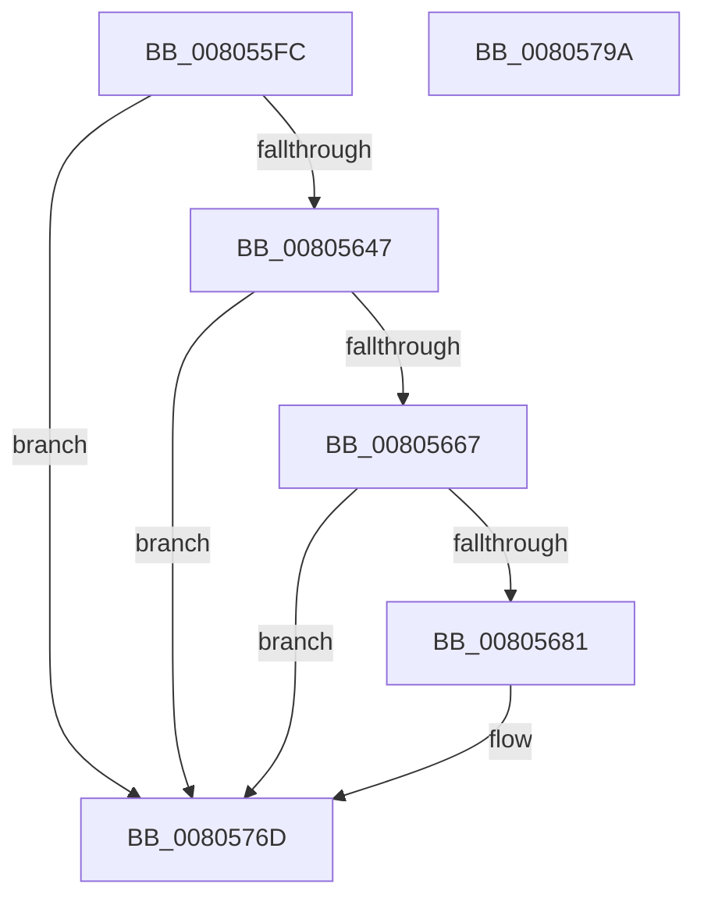

# MiLogHotPatchPagesLocked

- RVA: `0x008055FC`–`0x0080579B` (길이 `415` bytes)
- VA: `0x00000001408055FC`
- 실행 섹션: `PAGE`
- PDB 이름 있음: `예`; PDB Function 태그: `아니요`
- unwind 정보 RVA: `0x000D8484`
- 디코드: `96`개 명령, `415/415` bytes 표시
- 미해석 바이트: `0` (있으면 어셈블리에 `.byte`로 보존)

> 이 문서는 커널 이미지의 기계어와 PDB 기호를 분석해 생성했습니다. 4번과 5번은 함수 원형과 자료형을 바이너리 사용 방식에서 추정한 C 해석이며 원본 소스 복구 결과는 아닙니다.

## 1. Dependencies

- 직접 호출 지점: **4**; 고유 호출 대상: **4**
- 직접 호출자로 확인된 함수: **1**
- RIP 상대 이미지 참조: **3**

### Outgoing calls
- `0x00805674` → [tlgKeywordOn](../../text/42/tlgKeywordOn_function_0042EAA0.md) (function, `0x0042EAA0`)
- `0x00805684` → [PsGetProcessId](../../text/43/PsGetProcessId_function_0043D910.md) (function, `0x0043D910`)
- `0x00805768` → [tlgWriteEx_EtwWriteEx](../../text/4A/tlgWriteEx_EtwWriteEx_function_004AA348.md) (function, `0x004AA348`)
- `0x00805774` → [_security_check_cookie](../../text/6A/_security_check_cookie_function_006AC640.md) (function, `0x006AC640`)

### Direct callers
- [MiPrepareImagePagesForHotPatch](../../text/68/MiPrepareImagePagesForHotPatch_function_00683800.md) at `0x00683CE0`

### Static image references
- `0x0080561F` → RVA `0x00E0A740` (`.data`; read)
- `0x0080562D` → RVA `0x00E37618` (`.data`; read)
- `0x00805731` → RVA `0x00058D38` (`.rdata`; read)

## 2. Other-region calls and transfers

- 다른 실행 섹션으로 향하는 call: **4**
  - `0x00805674` → [tlgKeywordOn](../../text/42/tlgKeywordOn_function_0042EAA0.md) (`PAGE` → `.text`)
  - `0x00805684` → [PsGetProcessId](../../text/43/PsGetProcessId_function_0043D910.md) (`PAGE` → `.text`)
  - `0x00805768` → [tlgWriteEx_EtwWriteEx](../../text/4A/tlgWriteEx_EtwWriteEx_function_004AA348.md) (`PAGE` → `.text`)
  - `0x00805774` → [_security_check_cookie](../../text/6A/_security_check_cookie_function_006AC640.md) (`PAGE` → `.text`)
- 별도 외부 분기/꼬리 이동을 확인하지 못했습니다.

## 3. Assembly (complete function range)

```asm
008055FC  48 8B C4                        mov rax, rsp
008055FF  48 89 58 08                     mov qword ptr [rax + 8], rbx
00805603  48 89 70 10                     mov qword ptr [rax + 0x10], rsi
00805607  48 89 78 18                     mov qword ptr [rax + 0x18], rdi
0080560B  4C 89 60 20                     mov qword ptr [rax + 0x20], r12
0080560F  55                              push rbp
00805610  41 56                           push r14
00805612  41 57                           push r15
00805614  48 8D 68 C8                     lea rbp, [rax - 0x38]
00805618  48 81 EC 20 01 00 00            sub rsp, 0x120
0080561F  48 8B 05 1A 51 60 00            mov rax, qword ptr [rip + 0x60511a]
00805626  48 33 C4                        xor rax, rsp
00805629  48 89 45 10                     mov qword ptr [rbp + 0x10], rax
0080562D  48 83 3D E3 1F 63 00 00         cmp qword ptr [rip + 0x631fe3], 0
00805635  41 8B F1                        mov esi, r9d
00805638  45 8B F0                        mov r14d, r8d
0080563B  4C 8B FA                        mov r15, rdx
0080563E  4C 8B E1                        mov r12, rcx
00805641  0F 84 26 01 00 00               je 0x14080576d
00805647  65 48 8B 04 25 88 01 00 00      mov rax, qword ptr gs:[0x188]
00805650  48 8B 1D C1 1F 63 00            mov rbx, qword ptr [rip + 0x631fc1]
00805657  48 8B B8 B8 00 00 00            mov rdi, qword ptr [rax + 0xb8]
0080565E  83 3B 05                        cmp dword ptr [rbx], 5
00805661  0F 86 06 01 00 00               jbe 0x14080576d
00805667  48 BA 20 00 00 00 00 40 00 00   movabs rdx, 0x400000000020
00805671  48 8B CB                        mov rcx, rbx
00805674  E8 27 94 C2 FF                  call 0x14042eaa0
00805679  84 C0                           test al, al
0080567B  0F 84 EC 00 00 00               je 0x14080576d
00805681  48 8B CF                        mov rcx, rdi
00805684  E8 87 82 C3 FF                  call 0x14043d910
00805689  83 65 9C 00                     and dword ptr [rbp - 0x64], 0
0080568D  B9 04 00 00 00                  mov ecx, 4
00805692  83 65 AC 00                     and dword ptr [rbp - 0x54], 0
00805696  83 65 BC 00                     and dword ptr [rbp - 0x44], 0
0080569A  83 65 CC 00                     and dword ptr [rbp - 0x34], 0
0080569E  83 65 DC 00                     and dword ptr [rbp - 0x24], 0
008056A2  8D 51 04                        lea edx, [rcx + 4]
008056A5  83 65 EC 00                     and dword ptr [rbp - 0x14], 0
008056A9  44 8D 49 FD                     lea r9d, [rcx - 3]
008056AD  83 65 FC 00                     and dword ptr [rbp - 4], 0
008056B1  83 65 0C 00                     and dword ptr [rbp + 0xc], 0
008056B5  89 44 24 44                     mov dword ptr [rsp + 0x44], eax
008056B9  48 8D 44 24 44                  lea rax, [rsp + 0x44]
008056BE  48 89 45 90                     mov qword ptr [rbp - 0x70], rax
008056C2  48 8D 44 24 58                  lea rax, [rsp + 0x58]
008056C7  48 89 45 A0                     mov qword ptr [rbp - 0x60], rax
008056CB  48 8D 44 24 60                  lea rax, [rsp + 0x60]
008056D0  48 89 45 B0                     mov qword ptr [rbp - 0x50], rax
008056D4  48 8D 44 24 48                  lea rax, [rsp + 0x48]
008056D9  48 89 45 C0                     mov qword ptr [rbp - 0x40], rax
008056DD  48 8D 44 24 4C                  lea rax, [rsp + 0x4c]
008056E2  48 89 45 D0                     mov qword ptr [rbp - 0x30], rax
008056E6  8B 45 60                        mov eax, dword ptr [rbp + 0x60]
008056E9  89 44 24 50                     mov dword ptr [rsp + 0x50], eax
008056ED  48 8D 44 24 50                  lea rax, [rsp + 0x50]
008056F2  48 89 45 E0                     mov qword ptr [rbp - 0x20], rax
008056F6  0F B7 87 EC 06 00 00            movzx eax, word ptr [rdi + 0x6ec]
008056FD  66 89 44 24 40                  mov word ptr [rsp + 0x40], ax
00805702  48 8D 44 24 40                  lea rax, [rsp + 0x40]
00805707  48 89 45 F0                     mov qword ptr [rbp - 0x10], rax
0080570B  48 8D 44 24 68                  lea rax, [rsp + 0x68]
00805710  48 89 45 00                     mov qword ptr [rbp], rax
00805714  48 8D 44 24 70                  lea rax, [rsp + 0x70]
00805719  89 4D 98                        mov dword ptr [rbp - 0x68], ecx
0080571C  89 55 A8                        mov dword ptr [rbp - 0x58], edx
0080571F  89 55 B8                        mov dword ptr [rbp - 0x48], edx
00805722  89 4D C8                        mov dword ptr [rbp - 0x38], ecx
00805725  89 4D D8                        mov dword ptr [rbp - 0x28], ecx
00805728  89 4D E8                        mov dword ptr [rbp - 0x18], ecx
0080572B  48 8B CB                        mov rcx, rbx
0080572E  89 55 08                        mov dword ptr [rbp + 8], edx
00805731  48 8D 15 00 36 85 FF            lea rdx, [rip - 0x7aca00]
00805738  48 89 44 24 38                  mov qword ptr [rsp + 0x38], rax
0080573D  C7 44 24 30 0A 00 00 00         mov dword ptr [rsp + 0x30], 0xa
00805745  4C 89 64 24 58                  mov qword ptr [rsp + 0x58], r12
0080574A  4C 89 7C 24 60                  mov qword ptr [rsp + 0x60], r15
0080574F  44 89 74 24 48                  mov dword ptr [rsp + 0x48], r14d
00805754  89 74 24 4C                     mov dword ptr [rsp + 0x4c], esi
00805758  C7 45 F8 02 00 00 00            mov dword ptr [rbp - 8], 2
0080575F  48 C7 44 24 68 00 00 00 01      mov qword ptr [rsp + 0x68], 0x1000000
00805768  E8 DB 4B CA FF                  call 0x1404aa348
0080576D  48 8B 4D 10                     mov rcx, qword ptr [rbp + 0x10]
00805771  48 33 CC                        xor rcx, rsp
00805774  E8 C7 6E EA FF                  call 0x1406ac640
00805779  4C 8D 9C 24 20 01 00 00         lea r11, [rsp + 0x120]
00805781  49 8B 5B 20                     mov rbx, qword ptr [r11 + 0x20]
00805785  49 8B 73 28                     mov rsi, qword ptr [r11 + 0x28]
00805789  49 8B 7B 30                     mov rdi, qword ptr [r11 + 0x30]
0080578D  4D 8B 63 38                     mov r12, qword ptr [r11 + 0x38]
00805791  49 8B E3                        mov rsp, r11
00805794  41 5F                           pop r15
00805796  41 5E                           pop r14
00805798  5D                              pop rbp
00805799  C3                              ret
0080579A  CC                              int3
```

## 4. C-style interpretation (structured pseudocode)

```c
__int64 __fastcall MiLogHotPatchPagesLocked(__int64 a1, __int64 a2, int a3, int a4)
{
    __int64 result;
    __int64 v_rsp;
    unsigned __int64 v_stack_m100;
    unsigned int v_stack_m108;
    unsigned __int64 v_stack_m18;
    unsigned __int64 v_stack_mC8;
    unsigned __int64 v_stack_mD0;
    unsigned __int64 v_stack_mD8;
    unsigned __int64 v_stack_mE0;
    unsigned int v_stack_mE8;
    unsigned __int64 v_stack_mEC;
    unsigned __int64 v_stack_mF0;
    unsigned int v_stack_mF4;
    unsigned __int16 v_stack_mF8;

    *(unsigned __int64 *)(v_rsp + 8) = v_rbx;
    *(unsigned __int64 *)(v_rsp + 16) = v_rsi;
    *(unsigned __int64 *)(v_rsp + 24) = v_rdi;
    *(unsigned __int64 *)(v_rsp + 32) = v_r12;
    v_rsp = (v_rsp) - (288);
    result = (*(unsigned __int64 *)(v_rip + 6312218)) ^ (v_rsp);
    *(unsigned __int64 *)(v_rsp - 56 + 16) = result;
    if ((*(unsigned __int64 *)(v_rip + 6496227)) == 0) goto loc_0080576D;
    if ((*(unsigned int *)(*(unsigned __int64 *)(v_rip + 6496193))) <= 5) goto loc_0080576D;
    result = tlgKeywordOn(*(unsigned __int64 *)(v_rip + 6496193), a2, a3, a4);
    if ((unsigned __int8)(result) != 0) {
        a1 = *(unsigned __int64 *)(*(unsigned __int64 *)(gs_base + (0 + 392)) + 184);
        result = PsGetProcessId(a1, a2, a3, a4);
        a1 = 4;
        a2 = a1 + 4;
        a4 = a1 - 3;
        v_stack_mF4 = (unsigned int)(result);
        result = v_stack_mF4;
        *(unsigned __int64 *)(v_rsp - 56 - 112) = result;
        result = v_stack_mE0;
        *(unsigned __int64 *)(v_rsp - 56 - 96) = result;
        result = v_stack_mD8;
        *(unsigned __int64 *)(v_rsp - 56 - 80) = result;
        result = v_stack_mF0;
        *(unsigned __int64 *)(v_rsp - 56 - 64) = result;
        result = v_stack_mEC;
        *(unsigned __int64 *)(v_rsp - 56 - 48) = result;
        result = *(unsigned int *)(v_rsp - 56 + 96);
        v_stack_mE8 = (unsigned int)(result);
        result = v_stack_mE8;
        *(unsigned __int64 *)(v_rsp - 56 - 32) = result;
        result = *(unsigned __int16 *)(*(unsigned __int64 *)(*(unsigned __int64 *)(gs_base + (0 + 392)) + 184) + 1772);
        v_stack_mF8 = (unsigned __int16)(result);
        result = v_stack_mF8;
        *(unsigned __int64 *)(v_rsp - 56 - 16) = result;
        result = v_stack_mD0;
        *(unsigned __int64 *)(v_rsp - 56) = result;
        result = v_stack_mC8;
        *(unsigned int *)(v_rsp - 56 - 104) = (unsigned int)(a1);
        *(unsigned int *)(v_rsp - 56 - 88) = (unsigned int)(a2);
        *(unsigned int *)(v_rsp - 56 - 72) = (unsigned int)(a2);
        *(unsigned int *)(v_rsp - 56 - 56) = (unsigned int)(a1);
        *(unsigned int *)(v_rsp - 56 - 40) = (unsigned int)(a1);
        *(unsigned int *)(v_rsp - 56 - 24) = (unsigned int)(a1);
        a1 = *(unsigned __int64 *)(v_rip + 6496193);
        *(unsigned int *)(v_rsp - 56 + 8) = (unsigned int)(a2);
        a2 = v_rip - 8047104;
        v_stack_m100 = result;
        v_stack_m108 = 10;
        v_stack_mE0 = a1;
        v_stack_mD8 = a2;
        v_stack_mF0 = (unsigned int)((unsigned int)(a3));
        v_stack_mEC = (unsigned int)((unsigned int)(a4));
        *(unsigned int *)(v_rsp - 56 - 8) = 2;
        v_stack_mD0 = 0x1000000ULL;
        result = tlgWriteEx_EtwWriteEx(a1, a2, a3, a4);
    }
    a1 = (*(unsigned __int64 *)(v_rsp - 56 + 16)) ^ (v_rsp);
    result = _security_check_cookie(a1, a2, a3, a4);
    return result;
}
```

## 5. (Beta) C Style

```c
int64_t MiLogHotPatchPagesLocked(int64_t Arg1, int64_t Arg2, int32_t Arg3, int32_t Arg4)
{
    int64_t result;
    int64_t local_rsp;
    uint64_t v_stack_m100;
    uint32_t v_stack_m108;
    uint64_t v_stack_m18;
    uint64_t v_stack_mC8;
    uint64_t v_stack_mD0;
    uint64_t v_stack_mD8;
    uint64_t v_stack_mE0;
    uint32_t v_stack_mE8;
    uint64_t v_stack_mEC;
    uint64_t v_stack_mF0;
    uint32_t v_stack_mF4;
    uint16_t v_stack_mF8;

    *(uint64_t *)(local_rsp + 0x8) = local_rbx;
    *(uint64_t *)(local_rsp + 0x10) = local_rsi;
    *(uint64_t *)(local_rsp + 0x18) = local_rdi;
    *(uint64_t *)(local_rsp + 0x20) = local_r12;
    local_rsp = (local_rsp) - (288);
    result = (*(uint64_t *)(v_rip + 0x60511A)) ^ (local_rsp);
    *(uint64_t *)(local_rsp - 0x38 + 0x10) = result;
    if ((*(uint64_t *)(v_rip + 0x631FE3)) == 0) goto loc_0080576D;
    if ((*(uint32_t *)(*(uint64_t *)(v_rip + 0x631FC1))) <= 5) goto loc_0080576D;
    result = tlgKeywordOn(*(uint64_t *)(v_rip + 0x631FC1), Arg2, Arg3, Arg4);
    if ((uint8_t)(result) != 0) {
        Arg1 = *(uint64_t *)(*(uint64_t *)(gs_base + (0 + 0x188)) + 0xB8);
        result = PsGetProcessId(Arg1, Arg2, Arg3, Arg4);
        Arg1 = 4;
        Arg2 = Arg1 + 4;
        Arg4 = Arg1 - 3;
        v_stack_mF4 = (uint32_t)(result);
        result = v_stack_mF4;
        *(uint64_t *)(local_rsp - 0x38 - 0x70) = result;
        result = v_stack_mE0;
        *(uint64_t *)(local_rsp - 0x38 - 0x60) = result;
        result = v_stack_mD8;
        *(uint64_t *)(local_rsp - 0x38 - 0x50) = result;
        result = v_stack_mF0;
        *(uint64_t *)(local_rsp - 0x38 - 0x40) = result;
        result = v_stack_mEC;
        *(uint64_t *)(local_rsp - 0x38 - 0x30) = result;
        result = *(uint32_t *)(local_rsp - 0x38 + 0x60);
        v_stack_mE8 = (uint32_t)(result);
        result = v_stack_mE8;
        *(uint64_t *)(local_rsp - 0x38 - 0x20) = result;
        result = *(uint16_t *)(*(uint64_t *)(*(uint64_t *)(gs_base + (0 + 0x188)) + 0xB8) + 0x6EC);
        v_stack_mF8 = (uint16_t)(result);
        result = v_stack_mF8;
        *(uint64_t *)(local_rsp - 0x38 - 0x10) = result;
        result = v_stack_mD0;
        *(uint64_t *)(local_rsp - 0x38) = result;
        result = v_stack_mC8;
        *(uint32_t *)(local_rsp - 0x38 - 0x68) = (uint32_t)(Arg1);
        *(uint32_t *)(local_rsp - 0x38 - 0x58) = (uint32_t)(Arg2);
        *(uint32_t *)(local_rsp - 0x38 - 0x48) = (uint32_t)(Arg2);
        *(uint32_t *)(local_rsp - 0x38 - 0x38) = (uint32_t)(Arg1);
        *(uint32_t *)(local_rsp - 0x38 - 0x28) = (uint32_t)(Arg1);
        *(uint32_t *)(local_rsp - 0x38 - 0x18) = (uint32_t)(Arg1);
        Arg1 = *(uint64_t *)(v_rip + 0x631FC1);
        *(uint32_t *)(local_rsp - 0x38 + 0x8) = (uint32_t)(Arg2);
        Arg2 = v_rip - 8047104;
        v_stack_m100 = result;
        v_stack_m108 = 10;
        v_stack_mE0 = Arg1;
        v_stack_mD8 = Arg2;
        v_stack_mF0 = (uint32_t)((uint32_t)(Arg3));
        v_stack_mEC = (uint32_t)((uint32_t)(Arg4));
        *(uint32_t *)(local_rsp - 0x38 - 0x8) = 2;
        v_stack_mD0 = 0x1000000ULL;
        result = tlgWriteEx_EtwWriteEx(Arg1, Arg2, Arg3, Arg4);
    }
    Arg1 = (*(uint64_t *)(local_rsp - 0x38 + 0x10)) ^ (local_rsp);
    result = _security_check_cookie(Arg1, Arg2, Arg3, Arg4);
    return result;
}
```

## 6. Execution-region graph

[열기: 2D/3D 그래프와 함수 탐색 컨트롤 패널](../../../control-panel.html?section=page&rva=0x008055FC&view=graph)

- 2D 그래프는 위에서 아래로 흐르고, 3D 그래프는 빈 공간을 드래그해 회전합니다. Shift+드래그는 이동, 휠은 확대·축소, 함수 노드 선택은 대상 보고서 이동입니다.

### Static fallback


