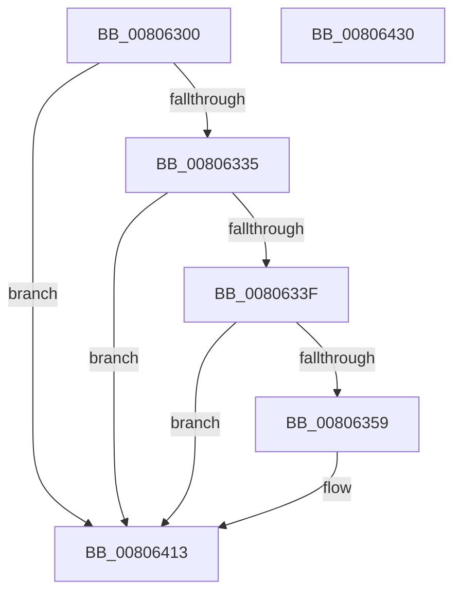

# MiLogInsertSecureImageActivePatch

- RVA: `0x00806300`–`0x00806431` (길이 `305` bytes)
- VA: `0x0000000140806300`
- 실행 섹션: `PAGE`
- PDB 이름 있음: `예`; PDB Function 태그: `아니요`
- unwind 정보 RVA: `0x000C9068`
- 디코드: `73`개 명령, `305/305` bytes 표시
- 미해석 바이트: `0` (있으면 어셈블리에 `.byte`로 보존)

> 이 문서는 커널 이미지의 기계어와 PDB 기호를 분석해 생성했습니다. 4번과 5번은 함수 원형과 자료형을 바이너리 사용 방식에서 추정한 C 해석이며 원본 소스 복구 결과는 아닙니다.

## 1. Dependencies

- 직접 호출 지점: **3**; 고유 호출 대상: **3**
- 직접 호출자로 확인된 함수: **1**
- RIP 상대 이미지 참조: **3**

### Outgoing calls
- `0x0080634C` → [tlgKeywordOn](../../text/42/tlgKeywordOn_function_0042EAA0.md) (function, `0x0042EAA0`)
- `0x0080640E` → [tlgWriteEx_EtwWriteEx](../../text/4A/tlgWriteEx_EtwWriteEx_function_004AA348.md) (function, `0x004AA348`)
- `0x0080641A` → [_security_check_cookie](../../text/6A/_security_check_cookie_function_006AC640.md) (function, `0x006AC640`)

### Direct callers
- [MmInsertSecureImageActivePatch](MmInsertSecureImageActivePatch_function_008073E4.md) at `0x008074B2`

### Static image references
- `0x00806312` → RVA `0x00E0A740` (`.data`; read)
- `0x00806320` → RVA `0x00E37618` (`.data`; read)
- `0x0080635C` → RVA `0x000590C1` (`.rdata`; read)

## 2. Other-region calls and transfers

- 다른 실행 섹션으로 향하는 call: **3**
  - `0x0080634C` → [tlgKeywordOn](../../text/42/tlgKeywordOn_function_0042EAA0.md) (`PAGE` → `.text`)
  - `0x0080640E` → [tlgWriteEx_EtwWriteEx](../../text/4A/tlgWriteEx_EtwWriteEx_function_004AA348.md) (`PAGE` → `.text`)
  - `0x0080641A` → [_security_check_cookie](../../text/6A/_security_check_cookie_function_006AC640.md) (`PAGE` → `.text`)
- 별도 외부 분기/꼬리 이동을 확인하지 못했습니다.

## 3. Assembly (complete function range)

```asm
00806300  48 89 5C 24 08                  mov qword ptr [rsp + 8], rbx
00806305  55                              push rbp
00806306  48 8D 6C 24 B9                  lea rbp, [rsp - 0x47]
0080630B  48 81 EC 00 01 00 00            sub rsp, 0x100
00806312  48 8B 05 27 44 60 00            mov rax, qword ptr [rip + 0x604427]
00806319  48 33 C4                        xor rax, rsp
0080631C  48 89 45 37                     mov qword ptr [rbp + 0x37], rax
00806320  4C 8B 15 F1 12 63 00            mov r10, qword ptr [rip + 0x6312f1]
00806327  44 8B DA                        mov r11d, edx
0080632A  8B D9                           mov ebx, ecx
0080632C  4D 85 D2                        test r10, r10
0080632F  0F 84 DE 00 00 00               je 0x140806413
00806335  41 83 3A 05                     cmp dword ptr [r10], 5
00806339  0F 86 D4 00 00 00               jbe 0x140806413
0080633F  48 BA 20 00 00 00 00 40 00 00   movabs rdx, 0x400000000020
00806349  49 8B CA                        mov rcx, r10
0080634C  E8 4F 87 C2 FF                  call 0x14042eaa0
00806351  84 C0                           test al, al
00806353  0F 84 BA 00 00 00               je 0x140806413
00806359  8B 45 7F                        mov eax, dword ptr [rbp + 0x7f]
0080635C  48 8D 15 5E 2D 85 FF            lea rdx, [rip - 0x7ad2a2]
00806363  83 65 D3 00                     and dword ptr [rbp - 0x2d], 0
00806367  B9 04 00 00 00                  mov ecx, 4
0080636C  83 65 E3 00                     and dword ptr [rbp - 0x1d], 0
00806370  83 65 F3 00                     and dword ptr [rbp - 0xd], 0
00806374  83 65 03 00                     and dword ptr [rbp + 3], 0
00806378  83 65 13 00                     and dword ptr [rbp + 0x13], 0
0080637C  83 65 23 00                     and dword ptr [rbp + 0x23], 0
00806380  83 65 33 00                     and dword ptr [rbp + 0x33], 0
00806384  89 45 87                        mov dword ptr [rbp - 0x79], eax
00806387  48 8D 45 87                     lea rax, [rbp - 0x79]
0080638B  48 89 45 C7                     mov qword ptr [rbp - 0x39], rax
0080638F  48 8D 45 8B                     lea rax, [rbp - 0x75]
00806393  48 89 45 D7                     mov qword ptr [rbp - 0x29], rax
00806397  48 8D 45 8F                     lea rax, [rbp - 0x71]
0080639B  48 89 45 E7                     mov qword ptr [rbp - 0x19], rax
0080639F  48 8D 45 93                     lea rax, [rbp - 0x6d]
008063A3  48 89 45 F7                     mov qword ptr [rbp - 9], rax
008063A7  48 8D 45 97                     lea rax, [rbp - 0x69]
008063AB  48 89 45 07                     mov qword ptr [rbp + 7], rax
008063AF  8B 45 77                        mov eax, dword ptr [rbp + 0x77]
008063B2  89 45 9B                        mov dword ptr [rbp - 0x65], eax
008063B5  48 8D 45 9B                     lea rax, [rbp - 0x65]
008063B9  48 89 45 17                     mov qword ptr [rbp + 0x17], rax
008063BD  B8 00 00 00 81                  mov eax, 0x81000000
008063C2  48 89 45 9F                     mov qword ptr [rbp - 0x61], rax
008063C6  48 8D 45 9F                     lea rax, [rbp - 0x61]
008063CA  48 89 45 27                     mov qword ptr [rbp + 0x27], rax
008063CE  48 8D 45 A7                     lea rax, [rbp - 0x59]
008063D2  44 89 4D 97                     mov dword ptr [rbp - 0x69], r9d
008063D6  44 8D 49 FD                     lea r9d, [rcx - 3]
008063DA  89 4D CF                        mov dword ptr [rbp - 0x31], ecx
008063DD  89 4D DF                        mov dword ptr [rbp - 0x21], ecx
008063E0  89 4D EF                        mov dword ptr [rbp - 0x11], ecx
008063E3  89 4D FF                        mov dword ptr [rbp - 1], ecx
008063E6  89 4D 0F                        mov dword ptr [rbp + 0xf], ecx
008063E9  89 4D 1F                        mov dword ptr [rbp + 0x1f], ecx
008063EC  49 8B CA                        mov rcx, r10
008063EF  48 89 44 24 38                  mov qword ptr [rsp + 0x38], rax
008063F4  C7 44 24 30 09 00 00 00         mov dword ptr [rsp + 0x30], 9
008063FC  89 5D 8B                        mov dword ptr [rbp - 0x75], ebx
008063FF  44 89 5D 8F                     mov dword ptr [rbp - 0x71], r11d
00806403  44 89 45 93                     mov dword ptr [rbp - 0x6d], r8d
00806407  C7 45 2F 08 00 00 00            mov dword ptr [rbp + 0x2f], 8
0080640E  E8 35 3F CA FF                  call 0x1404aa348
00806413  48 8B 4D 37                     mov rcx, qword ptr [rbp + 0x37]
00806417  48 33 CC                        xor rcx, rsp
0080641A  E8 21 62 EA FF                  call 0x1406ac640
0080641F  48 8B 9C 24 10 01 00 00         mov rbx, qword ptr [rsp + 0x110]
00806427  48 81 C4 00 01 00 00            add rsp, 0x100
0080642E  5D                              pop rbp
0080642F  C3                              ret
00806430  CC                              int3
```

## 4. C-style interpretation (structured pseudocode)

```c
__int64 __fastcall MiLogInsertSecureImageActivePatch(int a1, int a2, int a3, int a4, unsigned int a5, unsigned int a6)
{
    __int64 result;
    __int64 v_rsp;
    unsigned __int64 v_stack_m18;
    unsigned int v_stack_m1C;
    unsigned int v_stack_m20;
    unsigned __int64 v_stack_m28;
    unsigned int v_stack_m2C;
    unsigned int v_stack_m30;
    unsigned __int64 v_stack_m38;
    unsigned int v_stack_m3C;
    unsigned int v_stack_m40;
    unsigned __int64 v_stack_m48;
    unsigned int v_stack_m4C;
    unsigned __int64 v_stack_m4F;
    unsigned int v_stack_m50;
    unsigned __int64 v_stack_m58;
    unsigned int v_stack_m5C;
    unsigned int v_stack_m60;
    unsigned __int64 v_stack_m68;
    unsigned int v_stack_m6C;
    unsigned int v_stack_m70;
    unsigned __int64 v_stack_m78;
    unsigned int v_stack_m7C;
    unsigned int v_stack_m80;
    unsigned __int64 v_stack_m88;
    unsigned __int64 v_stack_mA8;
    unsigned __int64 v_stack_mB0;
    unsigned int v_stack_mB4;
    unsigned __int64 v_stack_mB8;
    unsigned __int64 v_stack_mBC;
    unsigned __int64 v_stack_mC0;
    unsigned __int64 v_stack_mC4;
    unsigned int v_stack_mC8;
    unsigned __int64 v_stack_mD0;
    unsigned int v_stack_mD8;
    unsigned __int64 v_stack_p8;

    v_stack_p8 = v_rbx;
    v_rsp = (v_rsp) - (256);
    result = (*(unsigned __int64 *)(v_rip + 6308903)) ^ (v_rsp);
    v_stack_m18 = result;
    if (*(unsigned __int64 *)(v_rip + 6492913) == 0) goto loc_00806413;
    if ((*(unsigned int *)(*(unsigned __int64 *)(v_rip + 6492913))) <= 5) goto loc_00806413;
    result = tlgKeywordOn(*(unsigned __int64 *)(v_rip + 6492913), a2, a3, a4);
    if ((unsigned __int8)(result) != 0) {
        result = a6;
        a2 = v_rip - 8049314;
        a1 = 4;
        v_stack_mC8 = (unsigned int)(result);
        result = v_stack_mC8;
        v_stack_m88 = result;
        result = v_stack_mC4;
        v_stack_m78 = result;
        result = v_stack_mC0;
        v_stack_m68 = result;
        result = v_stack_mBC;
        v_stack_m58 = result;
        result = v_stack_mB8;
        v_stack_m48 = result;
        result = a5;
        v_stack_mB4 = (unsigned int)(result);
        result = v_stack_mB4;
        v_stack_m38 = result;
        result = 0x81000000ULL;
        v_stack_mB0 = result;
        result = v_stack_mB0;
        v_stack_m28 = result;
        result = v_stack_mA8;
        v_stack_mB8 = a4;
        a4 = a1 - 3;
        v_stack_m80 = a1;
        v_stack_m70 = a1;
        v_stack_m60 = a1;
        v_stack_m50 = a1;
        v_stack_m40 = a1;
        v_stack_m30 = a1;
        a1 = *(unsigned __int64 *)(v_rip + 6492913);
        v_stack_mD0 = result;
        v_stack_mD8 = 9;
        v_stack_mC4 = (unsigned int)((unsigned int)(a1));
        v_stack_mC0 = (unsigned int)((unsigned int)(a2));
        v_stack_mBC = a3;
        v_stack_m20 = 8;
        result = tlgWriteEx_EtwWriteEx(a1, a2, a3, a4);
    }
    a1 = (v_stack_m18) ^ (v_rsp);
    result = _security_check_cookie(a1, a2, a3, a4);
    v_rsp = (v_rsp) + (256);
    return result;
}
```

## 5. (Beta) C Style

```c
int64_t MiLogInsertSecureImageActivePatch(int32_t Arg1, int32_t Arg2, int32_t Arg3, int32_t Arg4, uint32_t Arg5, uint32_t Arg6)
{
    int64_t result;
    int64_t local_rsp;
    uint64_t v_stack_m18;
    uint32_t v_stack_m1C;
    uint32_t v_stack_m20;
    uint64_t v_stack_m28;
    uint32_t v_stack_m2C;
    uint32_t v_stack_m30;
    uint64_t v_stack_m38;
    uint32_t v_stack_m3C;
    uint32_t v_stack_m40;
    uint64_t v_stack_m48;
    uint32_t v_stack_m4C;
    uint64_t v_stack_m4F;
    uint32_t v_stack_m50;
    uint64_t v_stack_m58;
    uint32_t v_stack_m5C;
    uint32_t v_stack_m60;
    uint64_t v_stack_m68;
    uint32_t v_stack_m6C;
    uint32_t v_stack_m70;
    uint64_t v_stack_m78;
    uint32_t v_stack_m7C;
    uint32_t v_stack_m80;
    uint64_t v_stack_m88;
    uint64_t v_stack_mA8;
    uint64_t v_stack_mB0;
    uint32_t v_stack_mB4;
    uint64_t v_stack_mB8;
    uint64_t v_stack_mBC;
    uint64_t v_stack_mC0;
    uint64_t v_stack_mC4;
    uint32_t v_stack_mC8;
    uint64_t v_stack_mD0;
    uint32_t v_stack_mD8;
    uint64_t v_stack_p8;

    v_stack_p8 = local_rbx;
    local_rsp = (local_rsp) - (256);
    result = (*(uint64_t *)(v_rip + 0x604427)) ^ (local_rsp);
    v_stack_m18 = result;
    if (*(uint64_t *)(v_rip + 0x6312F1) == 0) goto loc_00806413;
    if ((*(uint32_t *)(*(uint64_t *)(v_rip + 0x6312F1))) <= 5) goto loc_00806413;
    result = tlgKeywordOn(*(uint64_t *)(v_rip + 0x6312F1), Arg2, Arg3, Arg4);
    if ((uint8_t)(result) != 0) {
        result = Arg6;
        Arg2 = v_rip - 8049314;
        Arg1 = 4;
        v_stack_mC8 = (uint32_t)(result);
        result = v_stack_mC8;
        v_stack_m88 = result;
        result = v_stack_mC4;
        v_stack_m78 = result;
        result = v_stack_mC0;
        v_stack_m68 = result;
        result = v_stack_mBC;
        v_stack_m58 = result;
        result = v_stack_mB8;
        v_stack_m48 = result;
        result = Arg5;
        v_stack_mB4 = (uint32_t)(result);
        result = v_stack_mB4;
        v_stack_m38 = result;
        result = 0x81000000ULL;
        v_stack_mB0 = result;
        result = v_stack_mB0;
        v_stack_m28 = result;
        result = v_stack_mA8;
        v_stack_mB8 = Arg4;
        Arg4 = Arg1 - 3;
        v_stack_m80 = Arg1;
        v_stack_m70 = Arg1;
        v_stack_m60 = Arg1;
        v_stack_m50 = Arg1;
        v_stack_m40 = Arg1;
        v_stack_m30 = Arg1;
        Arg1 = *(uint64_t *)(v_rip + 0x6312F1);
        v_stack_mD0 = result;
        v_stack_mD8 = 9;
        v_stack_mC4 = (uint32_t)((uint32_t)(Arg1));
        v_stack_mC0 = (uint32_t)((uint32_t)(Arg2));
        v_stack_mBC = Arg3;
        v_stack_m20 = 8;
        result = tlgWriteEx_EtwWriteEx(Arg1, Arg2, Arg3, Arg4);
    }
    Arg1 = (v_stack_m18) ^ (local_rsp);
    result = _security_check_cookie(Arg1, Arg2, Arg3, Arg4);
    local_rsp = (local_rsp) + (256);
    return result;
}
```

## 6. Execution-region graph

[열기: 2D/3D 그래프와 함수 탐색 컨트롤 패널](../../../control-panel.html?section=page&rva=0x00806300&view=graph)

- 2D 그래프는 위에서 아래로 흐르고, 3D 그래프는 빈 공간을 드래그해 회전합니다. Shift+드래그는 이동, 휠은 확대·축소, 함수 노드 선택은 대상 보고서 이동입니다.

### Static fallback


