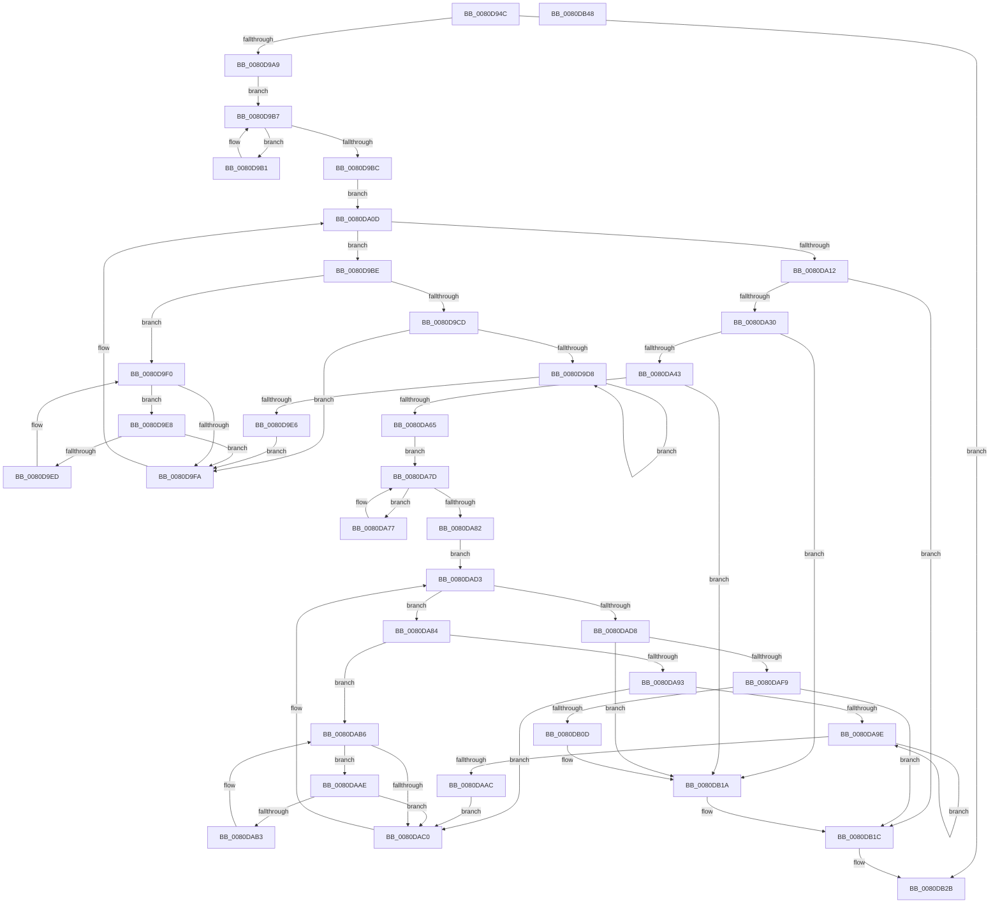

# MiMakePartitionMemoryBlock

- RVA: `0x0080D94C`–`0x0080DB49` (길이 `509` bytes)
- VA: `0x000000014080D94C`
- 실행 섹션: `PAGE`
- PDB 이름 있음: `예`; PDB Function 태그: `아니요`
- unwind 정보 RVA: `0x000D20A0`
- 디코드: `151`개 명령, `509/509` bytes 표시
- 미해석 바이트: `0` (있으면 어셈블리에 `.byte`로 보존)

> 이 문서는 커널 이미지의 기계어와 PDB 기호를 분석해 생성했습니다. 4번과 5번은 함수 원형과 자료형을 바이너리 사용 방식에서 추정한 C 해석이며 원본 소스 복구 결과는 아닙니다.

## 1. Dependencies

- 직접 호출 지점: **10**; 고유 호출 대상: **8**
- 직접 호출자로 확인된 함수: **6**
- RIP 상대 이미지 참조: **1**

### Outgoing calls
- `0x0080D986` → [memset](../../text/6C/memset_function_006C6C40.md) (function, `0x006C6C40`)
- `0x0080D994` → [memset](../../text/6C/memset_function_006C6C40.md) (function, `0x006C6C40`)
- `0x0080DA08` → [MiActOnPartitionNodePages](../../text/68/MiActOnPartitionNodePages_function_0068F7F4.md) (function, `0x0068F7F4`)
- `0x0080DA54` → [MiAllocatePool](../../text/35/MiAllocatePool_function_0035B540.md) (function, `0x0035B540`)
- `0x0080DACE` → [MiActOnPartitionNodePages](../../text/68/MiActOnPartitionNodePages_function_0068F7F4.md) (function, `0x0068F7F4`)
- `0x0080DADE` → [MiConvertInitialMemoryBlock](../7F/MiConvertInitialMemoryBlock_function_007FA10C.md) (function, `0x007FA10C`)
- `0x0080DAEF` → [ExFreePoolWithTag](../../poolcode/B8/ExFreePoolWithTag_function_00B82870.md) (function, `0x00B82870`)
- `0x0080DAFF` → [MiCreateNodeLists](../7F/MiCreateNodeLists_function_007FA220.md) (function, `0x007FA220`)
- `0x0080DB10` → [MiDereferencePageRuns](../../text/3B/MiDereferencePageRuns_function_003BD388.md) (function, `0x003BD388`)
- `0x0080DB26` → [MiUpdatePartitionMemory](../../text/69/MiUpdatePartitionMemory_function_00692294.md) (function, `0x00692294`)

### Direct callers
- [MiClearPartitionPageBitMap](../../text/69/MiClearPartitionPageBitMap_function_00690614.md) at `0x006906F6`
- [MiFinishChildPartitionHotAdd](../../text/69/MiFinishChildPartitionHotAdd_function_00690C00.md) at `0x00690CE1`
- [MiInsertPartitionPageNodes](../../text/69/MiInsertPartitionPageNodes_function_00690F94.md) at `0x00691113`
- [MiPartitionDeleteMemoryNode](../../text/69/MiPartitionDeleteMemoryNode_function_00691A20.md) at `0x00691AB8`
- [MiRebuildPartitionMemoryBlock](../../text/69/MiRebuildPartitionMemoryBlock_function_00691AE8.md) at `0x00691B1F`
- [MiReturnPartitionPagesToParent](../../text/69/MiReturnPartitionPagesToParent_function_00691B5C.md) at `0x00691CE4`
- [MiReturnPartitionPagesToParent](../../text/69/MiReturnPartitionPagesToParent_function_00691B5C.md) at `0x00691CEC`

### Static image references
- `0x0080D999` → RVA `0x00E38D00` (`.data`; read)

## 2. Other-region calls and transfers

- 다른 실행 섹션으로 향하는 call: **8**
  - `0x0080D986` → [memset](../../text/6C/memset_function_006C6C40.md) (`PAGE` → `.text`)
  - `0x0080D994` → [memset](../../text/6C/memset_function_006C6C40.md) (`PAGE` → `.text`)
  - `0x0080DA08` → [MiActOnPartitionNodePages](../../text/68/MiActOnPartitionNodePages_function_0068F7F4.md) (`PAGE` → `.text`)
  - `0x0080DA54` → [MiAllocatePool](../../text/35/MiAllocatePool_function_0035B540.md) (`PAGE` → `.text`)
  - `0x0080DACE` → [MiActOnPartitionNodePages](../../text/68/MiActOnPartitionNodePages_function_0068F7F4.md) (`PAGE` → `.text`)
  - `0x0080DAEF` → [ExFreePoolWithTag](../../poolcode/B8/ExFreePoolWithTag_function_00B82870.md) (`PAGE` → `POOLCODE`)
  - `0x0080DB10` → [MiDereferencePageRuns](../../text/3B/MiDereferencePageRuns_function_003BD388.md) (`PAGE` → `.text`)
  - `0x0080DB26` → [MiUpdatePartitionMemory](../../text/69/MiUpdatePartitionMemory_function_00692294.md) (`PAGE` → `.text`)
- 별도 외부 분기/꼬리 이동을 확인하지 못했습니다.

## 3. Assembly (complete function range)

```asm
0080D94C  48 8B C4                        mov rax, rsp
0080D94F  48 89 58 08                     mov qword ptr [rax + 8], rbx
0080D953  48 89 70 10                     mov qword ptr [rax + 0x10], rsi
0080D957  48 89 78 18                     mov qword ptr [rax + 0x18], rdi
0080D95B  55                              push rbp
0080D95C  41 56                           push r14
0080D95E  41 57                           push r15
0080D960  48 8D 68 A1                     lea rbp, [rax - 0x5f]
0080D964  48 81 EC E0 00 00 00            sub rsp, 0xe0
0080D96B  48 83 65 87 00                  and qword ptr [rbp - 0x79], 0
0080D970  4C 8B F1                        mov r14, rcx
0080D973  48 83 65 9F 00                  and qword ptr [rbp - 0x61], 0
0080D978  48 8D 4D F7                     lea rcx, [rbp - 9]
0080D97C  BB 48 00 00 00                  mov ebx, 0x48
0080D981  33 D2                           xor edx, edx
0080D983  44 8B C3                        mov r8d, ebx
0080D986  E8 B5 92 EB FF                  call 0x1406c6c40
0080D98B  44 8B C3                        mov r8d, ebx
0080D98E  48 8D 4D A7                     lea rcx, [rbp - 0x59]
0080D992  33 D2                           xor edx, edx
0080D994  E8 A7 92 EB FF                  call 0x1406c6c40
0080D999  48 8D 05 60 B3 62 00            lea rax, [rip + 0x62b360]
0080D9A0  4C 3B F0                        cmp r14, rax
0080D9A3  0F 84 82 01 00 00               je 0x14080db2b
0080D9A9  49 8B 46 18                     mov rax, qword ptr [r14 + 0x18]
0080D9AD  33 DB                           xor ebx, ebx
0080D9AF  EB 06                           jmp 0x14080d9b7
0080D9B1  48 8B D8                        mov rbx, rax
0080D9B4  48 8B 00                        mov rax, qword ptr [rax]
0080D9B7  48 85 C0                        test rax, rax
0080D9BA  75 F5                           jne 0x14080d9b1
0080D9BC  EB 4F                           jmp 0x14080da0d
0080D9BE  48 8B 43 08                     mov rax, qword ptr [rbx + 8]
0080D9C2  4C 8B D3                        mov r10, rbx
0080D9C5  48 8B CB                        mov rcx, rbx
0080D9C8  48 85 C0                        test rax, rax
0080D9CB  74 23                           je 0x14080d9f0
0080D9CD  48 8B 08                        mov rcx, qword ptr [rax]
0080D9D0  48 8B D8                        mov rbx, rax
0080D9D3  48 85 C9                        test rcx, rcx
0080D9D6  74 22                           je 0x14080d9fa
0080D9D8  48 8B 01                        mov rax, qword ptr [rcx]
0080D9DB  48 8B D9                        mov rbx, rcx
0080D9DE  48 8B C8                        mov rcx, rax
0080D9E1  48 85 C0                        test rax, rax
0080D9E4  75 F2                           jne 0x14080d9d8
0080D9E6  EB 12                           jmp 0x14080d9fa
0080D9E8  48 39 0B                        cmp qword ptr [rbx], rcx
0080D9EB  74 0D                           je 0x14080d9fa
0080D9ED  48 8B CB                        mov rcx, rbx
0080D9F0  48 8B 5B 10                     mov rbx, qword ptr [rbx + 0x10]
0080D9F4  48 83 E3 FC                     and rbx, 0xfffffffffffffffc
0080D9F8  75 EE                           jne 0x14080d9e8
0080D9FA  45 33 C0                        xor r8d, r8d
0080D9FD  4C 8D 4D A7                     lea r9, [rbp - 0x59]
0080DA01  49 8B CA                        mov rcx, r10
0080DA04  41 8D 50 07                     lea edx, [r8 + 7]
0080DA08  E8 E7 1D E8 FF                  call 0x14068f7f4
0080DA0D  48 85 DB                        test rbx, rbx
0080DA10  75 AC                           jne 0x14080d9be
0080DA12  4C 8B 7D D7                     mov r15, qword ptr [rbp - 0x29]
0080DA16  0F 57 C0                        xorps xmm0, xmm0
0080DA19  48 8B 5D CF                     mov rbx, qword ptr [rbp - 0x31]
0080DA1D  BF 01 00 00 00                  mov edi, 1
0080DA22  F3 0F 7F 45 8F                  movdqu xmmword ptr [rbp - 0x71], xmm0
0080DA27  4D 85 FF                        test r15, r15
0080DA2A  0F 84 EC 00 00 00               je 0x14080db1c
0080DA30  48 B8 FF FF FF FF FF FF FF 07   movabs rax, 0x7ffffffffffffff
0080DA3A  48 3B D8                        cmp rbx, rax
0080DA3D  0F 87 D7 00 00 00               ja 0x14080db1a
0080DA43  48 8D 53 01                     lea rdx, [rbx + 1]
0080DA47  41 B8 4D 6D 4D 6C               mov r8d, 0x6c4d6d4d
0080DA4D  48 C1 E2 04                     shl rdx, 4
0080DA51  8D 4F 3F                        lea ecx, [rdi + 0x3f]
0080DA54  E8 E7 DA B4 FF                  call 0x14035b540
0080DA59  48 8B F0                        mov rsi, rax
0080DA5C  48 85 C0                        test rax, rax
0080DA5F  0F 84 B5 00 00 00               je 0x14080db1a
0080DA65  48 89 45 37                     mov qword ptr [rbp + 0x37], rax
0080DA69  89 18                           mov dword ptr [rax], ebx
0080DA6B  33 DB                           xor ebx, ebx
0080DA6D  4C 89 78 08                     mov qword ptr [rax + 8], r15
0080DA71  49 8B 46 18                     mov rax, qword ptr [r14 + 0x18]
0080DA75  EB 06                           jmp 0x14080da7d
0080DA77  48 8B D8                        mov rbx, rax
0080DA7A  48 8B 00                        mov rax, qword ptr [rax]
0080DA7D  48 85 C0                        test rax, rax
0080DA80  75 F5                           jne 0x14080da77
0080DA82  EB 4F                           jmp 0x14080dad3
0080DA84  48 8B 43 08                     mov rax, qword ptr [rbx + 8]
0080DA88  4C 8B D3                        mov r10, rbx
0080DA8B  48 8B CB                        mov rcx, rbx
0080DA8E  48 85 C0                        test rax, rax
0080DA91  74 23                           je 0x14080dab6
0080DA93  48 8B 08                        mov rcx, qword ptr [rax]
0080DA96  48 8B D8                        mov rbx, rax
0080DA99  48 85 C9                        test rcx, rcx
0080DA9C  74 22                           je 0x14080dac0
0080DA9E  48 8B 01                        mov rax, qword ptr [rcx]
0080DAA1  48 8B D9                        mov rbx, rcx
0080DAA4  48 8B C8                        mov rcx, rax
0080DAA7  48 85 C0                        test rax, rax
0080DAAA  75 F2                           jne 0x14080da9e
0080DAAC  EB 12                           jmp 0x14080dac0
0080DAAE  48 39 0B                        cmp qword ptr [rbx], rcx
0080DAB1  74 0D                           je 0x14080dac0
0080DAB3  48 8B CB                        mov rcx, rbx
0080DAB6  48 8B 5B 10                     mov rbx, qword ptr [rbx + 0x10]
0080DABA  48 83 E3 FC                     and rbx, 0xfffffffffffffffc
0080DABE  75 EE                           jne 0x14080daae
0080DAC0  45 33 C0                        xor r8d, r8d
0080DAC3  4C 8D 4D F7                     lea r9, [rbp - 9]
0080DAC7  49 8B CA                        mov rcx, r10
0080DACA  41 8D 50 08                     lea edx, [r8 + 8]
0080DACE  E8 21 1D E8 FF                  call 0x14068f7f4
0080DAD3  48 85 DB                        test rbx, rbx
0080DAD6  75 AC                           jne 0x14080da84
0080DAD8  48 8B D6                        mov rdx, rsi
0080DADB  49 8B CE                        mov rcx, r14
0080DADE  E8 29 C6 FE FF                  call 0x1407fa10c
0080DAE3  33 D2                           xor edx, edx
0080DAE5  48 89 45 8F                     mov qword ptr [rbp - 0x71], rax
0080DAE9  48 8B CE                        mov rcx, rsi
0080DAEC  48 8B D8                        mov rbx, rax
0080DAEF  E8 7C 4D 37 00                  call 0x140b82870
0080DAF4  48 85 DB                        test rbx, rbx
0080DAF7  74 21                           je 0x14080db1a
0080DAF9  48 8B D3                        mov rdx, rbx
0080DAFC  49 8B CE                        mov rcx, r14
0080DAFF  E8 1C C7 FE FF                  call 0x1407fa220
0080DB04  48 89 45 97                     mov qword ptr [rbp - 0x69], rax
0080DB08  48 85 C0                        test rax, rax
0080DB0B  75 0F                           jne 0x14080db1c
0080DB0D  48 8B CB                        mov rcx, rbx
0080DB10  E8 73 F8 BA FF                  call 0x1403bd388
0080DB15  48 83 65 8F 00                  and qword ptr [rbp - 0x71], 0
0080DB1A  33 FF                           xor edi, edi
0080DB1C  44 8B C7                        mov r8d, edi
0080DB1F  48 8D 55 87                     lea rdx, [rbp - 0x79]
0080DB23  49 8B CE                        mov rcx, r14
0080DB26  E8 69 47 E8 FF                  call 0x140692294
0080DB2B  4C 8D 9C 24 E0 00 00 00         lea r11, [rsp + 0xe0]
0080DB33  49 8B 5B 20                     mov rbx, qword ptr [r11 + 0x20]
0080DB37  49 8B 73 28                     mov rsi, qword ptr [r11 + 0x28]
0080DB3B  49 8B 7B 30                     mov rdi, qword ptr [r11 + 0x30]
0080DB3F  49 8B E3                        mov rsp, r11
0080DB42  41 5F                           pop r15
0080DB44  41 5E                           pop r14
0080DB46  5D                              pop rbp
0080DB47  C3                              ret
0080DB48  CC                              int3
```

## 4. C-style interpretation (structured pseudocode)

```c
__int64 __fastcall MiMakePartitionMemoryBlock(__int64 a1, int a2)
{
    __int64 result;
    __int64 v_rbx;
    __int64 v_rdi;
    __int64 v_rsp;
    unsigned __int64 v_stack_m18;

    *(unsigned __int64 *)(v_rsp + 8) = v_rbx;
    *(unsigned __int64 *)(v_rsp + 16) = v_rsi;
    *(unsigned __int64 *)(v_rsp + 24) = v_rdi;
    v_rsp = (v_rsp) - (224);
    a2 = 0;
    result = memset(v_rsp - 95 - 9, a2, 72, a4);
    a2 = 0;
    result = memset(v_rsp - 95 - 89, a2, 72, a4);
    if (a1 == (v_rip + 6468448)) goto loc_0080DB2B;
    v_rbx = 0;
    goto loc_0080D9B7;
loc_0080D9B1:
loc_0080D9B7:
    if (*(unsigned __int64 *)(*(unsigned __int64 *)(a1 + 24)) != 0) goto loc_0080D9B1;
    goto loc_0080DA0D;
loc_0080D9BE:
    if (*(unsigned __int64 *)(*(unsigned __int64 *)(a1 + 24) + 8) == 0) goto loc_0080D9F0;
    if (*(unsigned __int64 *)(*(unsigned __int64 *)(*(unsigned __int64 *)(a1 + 24) + 8)) == 0) goto loc_0080D9FA;
loc_0080D9D8:
    if (*(unsigned __int64 *)(*(unsigned __int64 *)(*(unsigned __int64 *)(*(unsigned __int64 *)(a1 + 24) + 8))) != 0) goto loc_0080D9D8;
    goto loc_0080D9FA;
loc_0080D9E8:
    if ((*(unsigned __int64 *)(*(unsigned __int64 *)(*(unsigned __int64 *)(*(unsigned __int64 *)(a1 + 24) + 8)))) == (*(unsigned __int64 *)(*(unsigned __int64 *)(*(unsigned __int64 *)(*(unsigned __int64 *)(a1 + 24) + 8))))) goto loc_0080D9FA;
loc_0080D9F0:
    v_rbx = (*(unsigned __int64 *)(*(unsigned __int64 *)(*(unsigned __int64 *)(*(unsigned __int64 *)(a1 + 24) + 8)) + 16)) & (-4);
    if (condition_is_not_equal) goto loc_0080D9E8;
loc_0080D9FA:
    a3 = 0;
    result = MiActOnPartitionNodePages(*(unsigned __int64 *)(a1 + 24), a3 + 7, a3, v_rsp - 95 - 89);
loc_0080DA0D:
    if (v_rbx != 0) goto loc_0080D9BE;
    *(unsigned __int64 *)(v_rsp - 95 - 113) = v_xmm0;
    if (*(unsigned __int64 *)(v_rsp - 95 - 41) == 0) goto loc_0080DB1C;
    if ((*(unsigned __int64 *)(v_rsp - 95 - 49)) > result) goto loc_0080DB1A;
    a2 = (*(unsigned __int64 *)(v_rsp - 95 - 49) + 1) << (4);
    result = MiAllocatePool(1 + 63, a2, (unsigned int)(0x6C4D6D4DULL), v_rsp - 95 - 89);
    if (result == 0) goto loc_0080DB1A;
    *(unsigned __int64 *)(v_rsp - 95 + 55) = result;
    *(unsigned int *)(result) = (unsigned int)(*(unsigned __int64 *)(v_rsp - 95 - 49));
    v_rbx = 0;
    *(unsigned __int64 *)(result + 8) = *(unsigned __int64 *)(v_rsp - 95 - 41);
    goto loc_0080DA7D;
loc_0080DA77:
loc_0080DA7D:
    if (*(unsigned __int64 *)(*(unsigned __int64 *)(a1 + 24)) != 0) goto loc_0080DA77;
    goto loc_0080DAD3;
loc_0080DA84:
    if (*(unsigned __int64 *)(*(unsigned __int64 *)(a1 + 24) + 8) == 0) goto loc_0080DAB6;
    if (*(unsigned __int64 *)(*(unsigned __int64 *)(*(unsigned __int64 *)(a1 + 24) + 8)) == 0) goto loc_0080DAC0;
loc_0080DA9E:
    if (*(unsigned __int64 *)(*(unsigned __int64 *)(*(unsigned __int64 *)(*(unsigned __int64 *)(a1 + 24) + 8))) != 0) goto loc_0080DA9E;
    goto loc_0080DAC0;
loc_0080DAAE:
    if ((*(unsigned __int64 *)(*(unsigned __int64 *)(*(unsigned __int64 *)(*(unsigned __int64 *)(a1 + 24) + 8)))) == (*(unsigned __int64 *)(*(unsigned __int64 *)(*(unsigned __int64 *)(*(unsigned __int64 *)(a1 + 24) + 8))))) goto loc_0080DAC0;
loc_0080DAB6:
    v_rbx = (*(unsigned __int64 *)(*(unsigned __int64 *)(*(unsigned __int64 *)(*(unsigned __int64 *)(a1 + 24) + 8)) + 16)) & (-4);
    if (condition_is_not_equal) goto loc_0080DAAE;
loc_0080DAC0:
    a3 = 0;
    result = MiActOnPartitionNodePages(*(unsigned __int64 *)(a1 + 24), a3 + 8, a3, v_rsp - 95 - 9);
loc_0080DAD3:
    if (v_rbx != 0) goto loc_0080DA84;
    result = MiConvertInitialMemoryBlock(a1, result, a3, v_rsp - 95 - 9);
    a2 = 0;
    *(unsigned __int64 *)(v_rsp - 95 - 113) = result;
    result = ExFreePoolWithTag(result, a2, a3, v_rsp - 95 - 9);
    if (result == 0) goto loc_0080DB1A;
    result = MiCreateNodeLists(a1, result, a3, v_rsp - 95 - 9);
    *(unsigned __int64 *)(v_rsp - 95 - 105) = result;
    if (result != 0) goto loc_0080DB1C;
    result = MiDereferencePageRuns(result, result, a3, v_rsp - 95 - 9);
loc_0080DB1A:
    v_rdi = 0;
loc_0080DB1C:
    result = MiUpdatePartitionMemory(a1, v_rsp - 95 - 121, 0, v_rsp - 95 - 9);
loc_0080DB2B:
    return result;
}
```

## 5. (Beta) C Style

```c
int64_t MiMakePartitionMemoryBlock(int64_t Arg1, int32_t Arg2)
{
    int64_t result;
    int64_t local_rbx;
    int64_t local_rdi;
    int64_t local_rsp;
    uint64_t v_stack_m18;

    *(uint64_t *)(local_rsp + 0x8) = local_rbx;
    *(uint64_t *)(local_rsp + 0x10) = local_rsi;
    *(uint64_t *)(local_rsp + 0x18) = local_rdi;
    local_rsp = (local_rsp) - (224);
    Arg2 = 0;
    result = memset(local_rsp - 95 - 9, Arg2, 72, a4);
    Arg2 = 0;
    result = memset(local_rsp - 95 - 89, Arg2, 72, a4);
    if (Arg1 == (v_rip + 6468448)) goto loc_0080DB2B;
    local_rbx = 0;
    goto loc_0080D9B7;
loc_0080D9B1:
loc_0080D9B7:
    if (*(uint64_t *)(*(uint64_t *)(Arg1 + 0x18)) != 0) goto loc_0080D9B1;
    goto loc_0080DA0D;
loc_0080D9BE:
    if (*(uint64_t *)(*(uint64_t *)(Arg1 + 0x18) + 0x8) == 0) goto loc_0080D9F0;
    if (*(uint64_t *)(*(uint64_t *)(*(uint64_t *)(Arg1 + 0x18) + 0x8)) == 0) goto loc_0080D9FA;
loc_0080D9D8:
    if (*(uint64_t *)(*(uint64_t *)(*(uint64_t *)(*(uint64_t *)(Arg1 + 0x18) + 0x8))) != 0) goto loc_0080D9D8;
    goto loc_0080D9FA;
loc_0080D9E8:
    if ((*(uint64_t *)(*(uint64_t *)(*(uint64_t *)(*(uint64_t *)(Arg1 + 0x18) + 0x8)))) == (*(uint64_t *)(*(uint64_t *)(*(uint64_t *)(*(uint64_t *)(Arg1 + 0x18) + 0x8))))) goto loc_0080D9FA;
loc_0080D9F0:
    local_rbx = (*(uint64_t *)(*(uint64_t *)(*(uint64_t *)(*(uint64_t *)(Arg1 + 0x18) + 0x8)) + 0x10)) & (-4);
    if (condition_is_not_equal) goto loc_0080D9E8;
loc_0080D9FA:
    a3 = 0;
    result = MiActOnPartitionNodePages(*(uint64_t *)(Arg1 + 0x18), a3 + 7, a3, local_rsp - 95 - 89);
loc_0080DA0D:
    if (local_rbx != 0) goto loc_0080D9BE;
    *(uint64_t *)(local_rsp - 0x5F - 0x71) = v_xmm0;
    if (*(uint64_t *)(local_rsp - 0x5F - 0x29) == 0) goto loc_0080DB1C;
    if ((*(uint64_t *)(local_rsp - 0x5F - 0x31)) > result) goto loc_0080DB1A;
    Arg2 = (*(uint64_t *)(local_rsp - 0x5F - 0x31) + 1) << (4);
    result = MiAllocatePool(1 + 63, Arg2, (uint32_t)(0x6C4D6D4DULL), local_rsp - 95 - 89);
    if (result == 0) goto loc_0080DB1A;
    *(uint64_t *)(local_rsp - 0x5F + 0x37) = result;
    *(uint32_t *)(result) = (uint32_t)(*(uint64_t *)(local_rsp - 0x5F - 0x31));
    local_rbx = 0;
    *(uint64_t *)(result + 0x8) = *(uint64_t *)(local_rsp - 0x5F - 0x29);
    goto loc_0080DA7D;
loc_0080DA77:
loc_0080DA7D:
    if (*(uint64_t *)(*(uint64_t *)(Arg1 + 0x18)) != 0) goto loc_0080DA77;
    goto loc_0080DAD3;
loc_0080DA84:
    if (*(uint64_t *)(*(uint64_t *)(Arg1 + 0x18) + 0x8) == 0) goto loc_0080DAB6;
    if (*(uint64_t *)(*(uint64_t *)(*(uint64_t *)(Arg1 + 0x18) + 0x8)) == 0) goto loc_0080DAC0;
loc_0080DA9E:
    if (*(uint64_t *)(*(uint64_t *)(*(uint64_t *)(*(uint64_t *)(Arg1 + 0x18) + 0x8))) != 0) goto loc_0080DA9E;
    goto loc_0080DAC0;
loc_0080DAAE:
    if ((*(uint64_t *)(*(uint64_t *)(*(uint64_t *)(*(uint64_t *)(Arg1 + 0x18) + 0x8)))) == (*(uint64_t *)(*(uint64_t *)(*(uint64_t *)(*(uint64_t *)(Arg1 + 0x18) + 0x8))))) goto loc_0080DAC0;
loc_0080DAB6:
    local_rbx = (*(uint64_t *)(*(uint64_t *)(*(uint64_t *)(*(uint64_t *)(Arg1 + 0x18) + 0x8)) + 0x10)) & (-4);
    if (condition_is_not_equal) goto loc_0080DAAE;
loc_0080DAC0:
    a3 = 0;
    result = MiActOnPartitionNodePages(*(uint64_t *)(Arg1 + 0x18), a3 + 8, a3, local_rsp - 95 - 9);
loc_0080DAD3:
    if (local_rbx != 0) goto loc_0080DA84;
    result = MiConvertInitialMemoryBlock(Arg1, result, a3, local_rsp - 95 - 9);
    Arg2 = 0;
    *(uint64_t *)(local_rsp - 0x5F - 0x71) = result;
    result = ExFreePoolWithTag(result, Arg2, a3, local_rsp - 95 - 9);
    if (result == 0) goto loc_0080DB1A;
    result = MiCreateNodeLists(Arg1, result, a3, local_rsp - 95 - 9);
    *(uint64_t *)(local_rsp - 0x5F - 0x69) = result;
    if (result != 0) goto loc_0080DB1C;
    result = MiDereferencePageRuns(result, result, a3, local_rsp - 95 - 9);
loc_0080DB1A:
    local_rdi = 0;
loc_0080DB1C:
    result = MiUpdatePartitionMemory(Arg1, local_rsp - 95 - 121, 0, local_rsp - 95 - 9);
loc_0080DB2B:
    return result;
}
```

## 6. Execution-region graph

[열기: 2D/3D 그래프와 함수 탐색 컨트롤 패널](../../../control-panel.html?section=page&rva=0x0080D94C&view=graph)

- 2D 그래프는 위에서 아래로 흐르고, 3D 그래프는 빈 공간을 드래그해 회전합니다. Shift+드래그는 이동, 휠은 확대·축소, 함수 노드 선택은 대상 보고서 이동입니다.

### Static fallback


