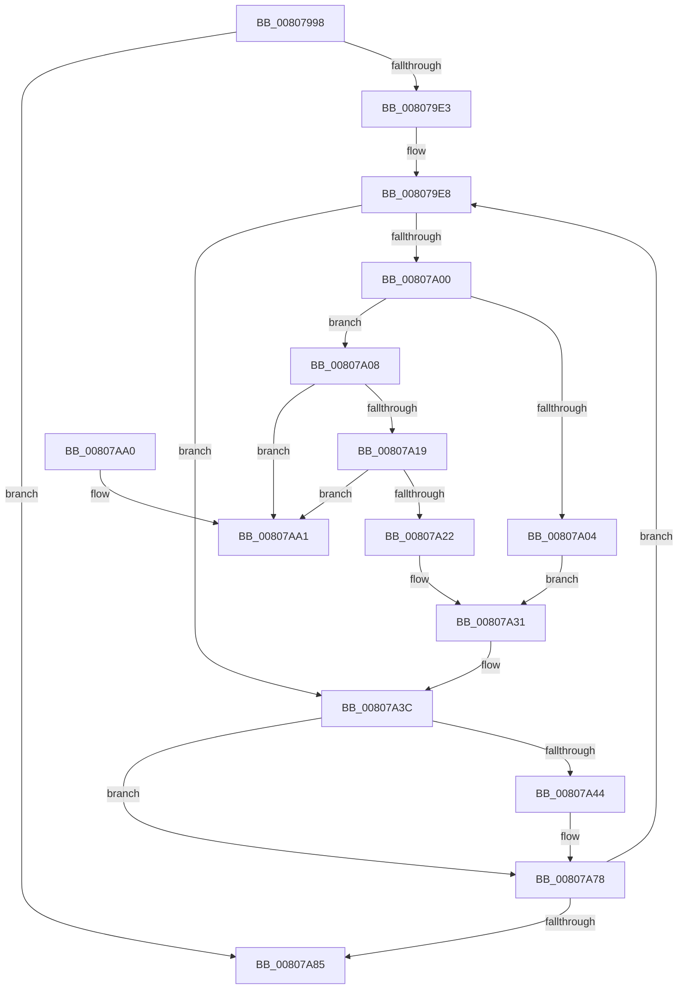

# MiMakeShadowPageTableRange

- RVA: `0x00807998`–`0x00807AA8` (길이 `272` bytes)
- VA: `0x0000000140807998`
- 실행 섹션: `PAGE`
- PDB 이름 있음: `예`; PDB Function 태그: `아니요`
- unwind 정보 RVA: `0x0008C994`
- 디코드: `73`개 명령, `272/272` bytes 표시
- 미해석 바이트: `0` (있으면 어셈블리에 `.byte`로 보존)

> 이 문서는 커널 이미지의 기계어와 PDB 기호를 분석해 생성했습니다. 4번과 5번은 함수 원형과 자료형을 바이너리 사용 방식에서 추정한 C 해석이며 원본 소스 복구 결과는 아닙니다.

## 1. Dependencies

- 직접 호출 지점: **3**; 고유 호출 대상: **3**
- 직접 호출자로 확인된 함수: **2**
- RIP 상대 이미지 참조: **1**

### Outgoing calls
- `0x008079F7` → [MiReadWriteAnyLevelShadowPte](../../text/43/MiReadWriteAnyLevelShadowPte_function_00432654.md) (function, `0x00432654`)
- `0x00807A37` → [MiInitializeShadowPageTable](MiInitializeShadowPageTable_function_0080778C.md) (function, `0x0080778C`)
- `0x00807A73` → [MiMakeShadowPageTableRange](MiMakeShadowPageTableRange_function_00807998.md) (function, `0x00807998`)

### Direct callers
- [MiMakeShadowPageTableRange](MiMakeShadowPageTableRange_function_00807998.md) at `0x00807A73`
- [MmCreateShadowMapping](MmCreateShadowMapping_function_00807AB0.md) at `0x00807C61`

### Static image references
- `0x008079E8` → RVA `0x00010880` (`.rdata`; read)

## 2. Other-region calls and transfers

- 다른 실행 섹션으로 향하는 call: **1**
  - `0x008079F7` → [MiReadWriteAnyLevelShadowPte](../../text/43/MiReadWriteAnyLevelShadowPte_function_00432654.md) (`PAGE` → `.text`)
- 별도 외부 분기/꼬리 이동을 확인하지 못했습니다.

## 3. Assembly (complete function range)

```asm
00807998  48 8B C4                        mov rax, rsp
0080799B  48 89 58 08                     mov qword ptr [rax + 8], rbx
0080799F  48 89 68 10                     mov qword ptr [rax + 0x10], rbp
008079A3  48 89 70 18                     mov qword ptr [rax + 0x18], rsi
008079A7  48 89 78 20                     mov qword ptr [rax + 0x20], rdi
008079AB  41 56                           push r14
008079AD  48 83 EC 30                     sub rsp, 0x30
008079B1  49 63 F1                        movsxd rsi, r9d
008079B4  48 8B D9                        mov rbx, rcx
008079B7  4C 8B D6                        mov r10, rsi
008079BA  48 8B EA                        mov rbp, rdx
008079BD  4D 03 D2                        add r10, r10
008079C0  4D 8B F0                        mov r14, r8
008079C3  4B 8B 04 D0                     mov rax, qword ptr [r8 + r10*8]
008079C7  48 3B C8                        cmp rcx, rax
008079CA  48 0F 42 D8                     cmovb rbx, rax
008079CE  4B 8B 44 D0 08                  mov rax, qword ptr [r8 + r10*8 + 8]
008079D3  48 3B D0                        cmp rdx, rax
008079D6  48 0F 47 E8                     cmova rbp, rax
008079DA  48 3B DD                        cmp rbx, rbp
008079DD  0F 87 A2 00 00 00               ja 0x140807a85
008079E3  48 8B 7C 24 60                  mov rdi, qword ptr [rsp + 0x60]
008079E8  4C 8B 0D 91 8E 80 FF            mov r9, qword ptr [rip - 0x7f716f]
008079EF  45 33 C0                        xor r8d, r8d
008079F2  8B D6                           mov edx, esi
008079F4  48 8B CB                        mov rcx, rbx
008079F7  E8 58 AC C2 FF                  call 0x140432654
008079FC  A8 01                           test al, 1
008079FE  75 3C                           jne 0x140807a3c
00807A00  85 F6                           test esi, esi
00807A02  75 04                           jne 0x140807a08
00807A04  33 D2                           xor edx, edx
00807A06  EB 29                           jmp 0x140807a31
00807A08  48 8D 47 48                     lea rax, [rdi + 0x48]
00807A0C  48 8B 10                        mov rdx, qword ptr [rax]
00807A0F  48 39 42 08                     cmp qword ptr [rdx + 8], rax
00807A13  0F 85 88 00 00 00               jne 0x140807aa1
00807A19  48 8B 0A                        mov rcx, qword ptr [rdx]
00807A1C  48 39 51 08                     cmp qword ptr [rcx + 8], rdx
00807A20  75 7F                           jne 0x140807aa1
00807A22  48 89 08                        mov qword ptr [rax], rcx
00807A25  48 89 41 08                     mov qword ptr [rcx + 8], rax
00807A29  48 FF 4F 58                     dec qword ptr [rdi + 0x58]
00807A2D  48 FF 47 70                     inc qword ptr [rdi + 0x70]
00807A31  44 8B C6                        mov r8d, esi
00807A34  48 8B CB                        mov rcx, rbx
00807A37  E8 50 FD FF FF                  call 0x14080778c
00807A3C  3B B7 84 00 00 00               cmp esi, dword ptr [rdi + 0x84]
00807A42  7E 34                           jle 0x140807a78
00807A44  48 8B CB                        mov rcx, rbx
00807A47  48 C1 E1 19                     shl rcx, 0x19
00807A4B  48 B8 00 00 00 00 80 F6 FF FF   movabs rax, 0xfffff68000000000
00807A55  48 C1 E0 19                     shl rax, 0x19
00807A59  44 8D 4E FF                     lea r9d, [rsi - 1]
00807A5D  48 2B C8                        sub rcx, rax
00807A60  48 89 7C 24 20                  mov qword ptr [rsp + 0x20], rdi
00807A65  48 C1 F9 10                     sar rcx, 0x10
00807A69  4D 8B C6                        mov r8, r14
00807A6C  48 8D 91 F8 0F 00 00            lea rdx, [rcx + 0xff8]
00807A73  E8 20 FF FF FF                  call 0x140807998
00807A78  48 83 C3 08                     add rbx, 8
00807A7C  48 3B DD                        cmp rbx, rbp
00807A7F  0F 86 63 FF FF FF               jbe 0x1408079e8
00807A85  48 8B 5C 24 40                  mov rbx, qword ptr [rsp + 0x40]
00807A8A  48 8B 6C 24 48                  mov rbp, qword ptr [rsp + 0x48]
00807A8F  48 8B 74 24 50                  mov rsi, qword ptr [rsp + 0x50]
00807A94  48 8B 7C 24 58                  mov rdi, qword ptr [rsp + 0x58]
00807A99  48 83 C4 30                     add rsp, 0x30
00807A9D  41 5E                           pop r14
00807A9F  C3                              ret
00807AA0  CC                              int3
00807AA1  B9 03 00 00 00                  mov ecx, 3
00807AA6  CD 29                           int 0x29
```

## 4. C-style interpretation (structured pseudocode)

```c
__int64 __fastcall MiMakeShadowPageTableRange(__int64 a1, __int64 a2, __int64 a3, int a4, __int64 a5)
{
    __int64 result;
    __int64 v_r10;
    __int64 v_rbx;
    __int64 v_rsp;
    unsigned __int64 v_stack_m18;
    unsigned __int64 v_stack_p10;
    unsigned __int64 v_stack_p18;
    unsigned __int64 v_stack_p20;
    unsigned __int64 v_stack_p8;

    *(unsigned __int64 *)(v_rsp + 8) = v_rbx;
    *(unsigned __int64 *)(v_rsp + 16) = v_rbp;
    *(unsigned __int64 *)(v_rsp + 24) = v_rsi;
    *(unsigned __int64 *)(v_rsp + 32) = v_rdi;
    v_rsp = (v_rsp) - (48);
    v_r10 = ((int)(a4)) + ((int)(a4));
    if (a1 < (*(unsigned __int64 *)(a3 + v_r10 * 8))) { a1 = *(unsigned __int64 *)(a3 + v_r10 * 8); }
    if (a2 > (*(unsigned __int64 *)(a3 + v_r10 * 8 + 8))) { a2 = *(unsigned __int64 *)(a3 + v_r10 * 8 + 8); }
    if (a1 > a2) goto loc_00807A85;
loc_008079E8:
    a3 = 0;
    result = MiReadWriteAnyLevelShadowPte(a1, (unsigned int)((unsigned int)((int)(a4))), a3, *(unsigned __int64 *)(v_rip - 8352111));
    if ((((unsigned __int8)(result)) & (1)) != 0) goto loc_00807A3C;
    if ((unsigned int)((int)(a4)) != 0) goto loc_00807A08;
    a2 = 0;
    goto loc_00807A31;
loc_00807A08:
    if ((*(unsigned __int64 *)(*(unsigned __int64 *)(a5 + 72) + 8)) != (a5 + 72)) goto loc_00807AA1;
    if ((*(unsigned __int64 *)(*(unsigned __int64 *)(*(unsigned __int64 *)(a5 + 72)) + 8)) != (*(unsigned __int64 *)(a5 + 72))) goto loc_00807AA1;
    *(unsigned __int64 *)(a5 + 72) = *(unsigned __int64 *)(*(unsigned __int64 *)(a5 + 72));
    *(unsigned __int64 *)(*(unsigned __int64 *)(*(unsigned __int64 *)(a5 + 72)) + 8) = a5 + 72;
loc_00807A31:
    result = MiInitializeShadowPageTable(a1, *(unsigned __int64 *)(a5 + 72), (unsigned int)((unsigned int)((int)(a4))), *(unsigned __int64 *)(v_rip - 8352111));
loc_00807A3C:
    if (((unsigned int)((int)(a4))) >= = (*(unsigned int *)(a5 + 132))) {
        a1 = a1;
        a1 = (a1) << (25);
        result = (result) << (25);
        a4 = (int)(a4) - 1;
        a1 = (a1) - (result);
        v_stack_m18 = a5;
        a1 = (a1) >> (16);
        a3 = 0;
        a2 = a1 + 4088;
        result = MiMakeShadowPageTableRange(a1, a2, a3, a4);
    }
    v_rbx = (a1) + (8);
    if (v_rbx <= a2) goto loc_008079E8;
loc_00807A85:
    v_rsp = (v_rsp) + (48);
    return result;
loc_00807AA1:
    return result;
}
```

## 5. (Beta) C Style

```c
int64_t MiMakeShadowPageTableRange(int64_t Arg1, int64_t Arg2, void *Arg3, int32_t Arg4, void *Arg5)
{
    uint8_t *arg3 = (uint8_t *)Arg3;
    uint8_t *arg5 = (uint8_t *)Arg5;

    int64_t result;
    int64_t local_r10;
    int64_t local_rbx;
    int64_t local_rsp;
    uint64_t v_stack_m18;
    uint64_t v_stack_p10;
    uint64_t v_stack_p18;
    uint64_t v_stack_p20;
    uint64_t v_stack_p8;

    *(uint64_t *)(local_rsp + 0x8) = local_rbx;
    *(uint64_t *)(local_rsp + 0x10) = local_rbp;
    *(uint64_t *)(local_rsp + 0x18) = local_rsi;
    *(uint64_t *)(local_rsp + 0x20) = local_rdi;
    local_rsp = (local_rsp) - (48);
    local_r10 = ((int32_t)(Arg4)) + ((int32_t)(Arg4));
    if (Arg1 < (*(uint64_t *)(arg3 + local_r10 * 8))) { Arg1 = *(uint64_t *)(arg3 + local_r10 * 8); }
    if (Arg2 > (*(uint64_t *)(arg3 + local_r10 * 8 + 0x8))) { Arg2 = *(uint64_t *)(arg3 + local_r10 * 8 + 0x8); }
    if (Arg1 > Arg2) goto loc_00807A85;
loc_008079E8:
    Arg3 = 0;
    result = MiReadWriteAnyLevelShadowPte(Arg1, (uint32_t)((uint32_t)((int32_t)(Arg4))), Arg3, *(uint64_t *)(v_rip - 0x7F716F));
    if ((((uint8_t)(result)) & (1)) != 0) goto loc_00807A3C;
    if ((uint32_t)((int32_t)(Arg4)) != 0) goto loc_00807A08;
    Arg2 = 0;
    goto loc_00807A31;
loc_00807A08:
    if ((*(uint64_t *)(*(uint64_t *)(arg5 + 0x48) + 0x8)) != (Arg5 + 72)) goto loc_00807AA1;
    if ((*(uint64_t *)(*(uint64_t *)(*(uint64_t *)(arg5 + 0x48)) + 0x8)) != (*(uint64_t *)(arg5 + 0x48))) goto loc_00807AA1;
    *(uint64_t *)(arg5 + 0x48) = *(uint64_t *)(*(uint64_t *)(arg5 + 0x48));
    *(void **)(*(uint64_t *)(*(uint64_t *)(arg5 + 0x48)) + 0x8) = Arg5 + 72;
loc_00807A31:
    result = MiInitializeShadowPageTable(Arg1, *(uint64_t *)(arg5 + 0x48), (uint32_t)((uint32_t)((int32_t)(Arg4))), *(uint64_t *)(v_rip - 0x7F716F));
loc_00807A3C:
    if (((uint32_t)((int32_t)(Arg4))) >= = (*(uint32_t *)(arg5 + 0x84))) {
        Arg1 = Arg1;
        Arg1 = (Arg1) << (25);
        result = (result) << (25);
        Arg4 = (int32_t)(Arg4) - 1;
        Arg1 = (Arg1) - (result);
        v_stack_m18 = Arg5;
        Arg1 = (Arg1) >> (16);
        Arg3 = 0;
        Arg2 = Arg1 + 4088;
        result = MiMakeShadowPageTableRange(Arg1, Arg2, Arg3, Arg4);
    }
    local_rbx = (Arg1) + (8);
    if (local_rbx <= Arg2) goto loc_008079E8;
loc_00807A85:
    local_rsp = (local_rsp) + (48);
    return result;
loc_00807AA1:
    return result;
}
```

### 관측된 메모리 오프셋

구조체 형식이 확인되지 않은 접근은 인자 기준의 오프셋으로만 기록했습니다.

| 기준 인자 | 오프셋 표현 | 폭 (bit) | 접근 |
|---|---:|---:|---|
| `Arg3` | `+ 0x0 + r10*8` | `64` | `R` |
| `Arg3` | `+ 0x8 + r10*8` | `64` | `R` |
| `Arg5` | `+ 0x0` | `64` | `R` |
| `Arg5` | `+ 0x0` | `64` | `W` |
| `Arg5` | `+ 0x48` | `64` | `R` |
| `Arg5` | `+ 0x58` | `64` | `R/W` |
| `Arg5` | `+ 0x70` | `64` | `R/W` |
| `Arg5` | `+ 0x84` | `32` | `R` |

## 6. Execution-region graph

[열기: 2D/3D 그래프와 함수 탐색 컨트롤 패널](../../../control-panel.html?section=page&rva=0x00807998&view=graph)

- 2D 그래프는 위에서 아래로 흐르고, 3D 그래프는 빈 공간을 드래그해 회전합니다. Shift+드래그는 이동, 휠은 확대·축소, 함수 노드 선택은 대상 보고서 이동입니다.

### Static fallback


