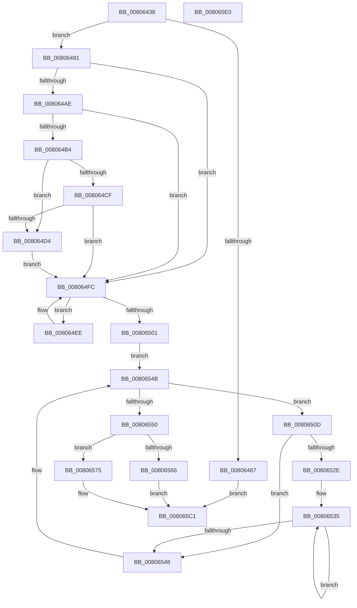

# MiMapHotPatchImageInSystemSpace

- RVA: `0x00806438`–`0x008065E1` (길이 `425` bytes)
- VA: `0x0000000140806438`
- 실행 섹션: `PAGE`
- PDB 이름 있음: `예`; PDB Function 태그: `아니요`
- unwind 정보 RVA: `0x0008C2BC`
- 디코드: `122`개 명령, `425/425` bytes 표시
- 미해석 바이트: `0` (있으면 어셈블리에 `.byte`로 보존)

> 이 문서는 커널 이미지의 기계어와 PDB 기호를 분석해 생성했습니다. 4번과 5번은 함수 원형과 자료형을 바이너리 사용 방식에서 추정한 C 해석이며 원본 소스 복구 결과는 아닙니다.

## 1. Dependencies

- 직접 호출 지점: **4**; 고유 호출 대상: **4**
- 직접 호출자로 확인된 함수: **1**
- RIP 상대 이미지 참조: **2**

### Outgoing calls
- `0x0080647A` → [IoAllocateMdl](../../text/29/IoAllocateMdl_function_0029EBF0.md) (function, `0x0029EBF0`)
- `0x00806559` → [MiReservePtes](../../text/31/MiReservePtes_function_00318D20.md) (function, `0x00318D20`)
- `0x0080656E` → [IoFreeMdl](../../text/29/IoFreeMdl_function_0029EA80.md) (function, `0x0029EA80`)
- `0x00806596` → [MiFillSystemPtes](../../text/31/MiFillSystemPtes_function_00319850.md) (function, `0x00319850`)

### Direct callers
- [MiPrepareToHotPatchImage](MiPrepareToHotPatchImage_function_00806820.md) at `0x00806D7A`

### Static image references
- `0x008064B4` → RVA `0x00E37438` (`.data`; read)
- `0x00806552` → RVA `0x00E37668` (`.data`; read)

## 2. Other-region calls and transfers

- 다른 실행 섹션으로 향하는 call: **4**
  - `0x0080647A` → [IoAllocateMdl](../../text/29/IoAllocateMdl_function_0029EBF0.md) (`PAGE` → `.text`)
  - `0x00806559` → [MiReservePtes](../../text/31/MiReservePtes_function_00318D20.md) (`PAGE` → `.text`)
  - `0x0080656E` → [IoFreeMdl](../../text/29/IoFreeMdl_function_0029EA80.md) (`PAGE` → `.text`)
  - `0x00806596` → [MiFillSystemPtes](../../text/31/MiFillSystemPtes_function_00319850.md) (`PAGE` → `.text`)
- 별도 외부 분기/꼬리 이동을 확인하지 못했습니다.

## 3. Assembly (complete function range)

```asm
00806438  48 8B C4                        mov rax, rsp
0080643B  48 89 58 10                     mov qword ptr [rax + 0x10], rbx
0080643F  48 89 68 18                     mov qword ptr [rax + 0x18], rbp
00806443  48 89 70 20                     mov qword ptr [rax + 0x20], rsi
00806447  57                              push rdi
00806448  41 54                           push r12
0080644A  41 55                           push r13
0080644C  41 56                           push r14
0080644E  41 57                           push r15
00806450  48 83 EC 30                     sub rsp, 0x30
00806454  4C 8B F9                        mov r15, rcx
00806457  33 DB                           xor ebx, ebx
00806459  48 8B 49 08                     mov rcx, qword ptr [rcx + 8]
0080645D  45 33 C9                        xor r9d, r9d
00806460  45 33 C0                        xor r8d, r8d
00806463  89 58 08                        mov dword ptr [rax + 8], ebx
00806466  48 89 58 C8                     mov qword ptr [rax - 0x38], rbx
0080646A  49 8B 6F 10                     mov rbp, qword ptr [r15 + 0x10]
0080646E  48 2B E9                        sub rbp, rcx
00806471  48 C1 ED 0C                     shr rbp, 0xc
00806475  8B D5                           mov edx, ebp
00806477  C1 E2 0C                        shl edx, 0xc
0080647A  E8 71 87 A9 FF                  call 0x14029ebf0
0080647F  48 8B F0                        mov rsi, rax
00806482  48 85 C0                        test rax, rax
00806485  75 0A                           jne 0x140806491
00806487  BB 9A 00 00 C0                  mov ebx, 0xc000009a
0080648C  E9 30 01 00 00                  jmp 0x1408065c1
00806491  4C 8D 70 30                     lea r14, [rax + 0x30]
00806495  44 8B E5                        mov r12d, ebp
00806498  44 8B C5                        mov r8d, ebp
0080649B  49 8B D6                        mov rdx, r14
0080649E  4F 8D 0C E6                     lea r9, [r14 + r12*8]
008064A2  4D 3B F1                        cmp r14, r9
008064A5  4C 0F 47 C3                     cmova r8, rbx
008064A9  4D 85 C0                        test r8, r8
008064AC  74 4E                           je 0x1408064fc
008064AE  49 83 F8 02                     cmp r8, 2
008064B2  72 48                           jb 0x1408064fc
008064B4  48 8B 05 7D 0F 63 00            mov rax, qword ptr [rip + 0x630f7d]
008064BB  48 8D 3D 76 0F 63 00            lea rdi, [rip + 0x630f76]
008064C2  49 8D 48 FF                     lea rcx, [r8 - 1]
008064C6  49 8D 0C CE                     lea rcx, [r14 + rcx*8]
008064CA  4C 3B F7                        cmp r14, rdi
008064CD  77 05                           ja 0x1408064d4
008064CF  48 3B CF                        cmp rcx, rdi
008064D2  73 28                           jae 0x1408064fc
008064D4  49 83 E0 FE                     and r8, 0xfffffffffffffffe
008064D8  48 8B FA                        mov rdi, rdx
008064DB  49 C1 E0 03                     shl r8, 3
008064DF  49 8B C8                        mov rcx, r8
008064E2  48 C1 E9 03                     shr rcx, 3
008064E6  F3 48 AB                        rep stosq qword ptr [rdi], rax
008064E9  49 03 D0                        add rdx, r8
008064EC  EB 0E                           jmp 0x1408064fc
008064EE  48 8B 05 43 0F 63 00            mov rax, qword ptr [rip + 0x630f43]
008064F5  48 89 02                        mov qword ptr [rdx], rax
008064F8  48 83 C2 08                     add rdx, 8
008064FC  49 3B D1                        cmp rdx, r9
008064FF  72 ED                           jb 0x1408064ee
00806501  49 8B 4F 38                     mov rcx, qword ptr [r15 + 0x38]
00806505  41 BD 01 00 00 00               mov r13d, 1
0080650B  EB 3E                           jmp 0x14080654b
0080650D  8B 79 2C                        mov edi, dword ptr [rcx + 0x2c]
00806510  48 03 79 20                     add rdi, qword ptr [rcx + 0x20]
00806514  49 2B 7F 08                     sub rdi, qword ptr [r15 + 8]
00806518  8B 41 28                        mov eax, dword ptr [rcx + 0x28]
0080651B  48 C1 EF 0C                     shr rdi, 0xc
0080651F  48 83 C7 06                     add rdi, 6
00806523  C1 E8 0C                        shr eax, 0xc
00806526  48 8D 3C FE                     lea rdi, [rsi + rdi*8]
0080652A  85 C0                           test eax, eax
0080652C  74 1A                           je 0x140806548
0080652E  48 8D 51 30                     lea rdx, [rcx + 0x30]
00806532  44 8B C0                        mov r8d, eax
00806535  48 8B 02                        mov rax, qword ptr [rdx]
00806538  48 8D 52 08                     lea rdx, [rdx + 8]
0080653C  48 89 07                        mov qword ptr [rdi], rax
0080653F  48 8D 7F 08                     lea rdi, [rdi + 8]
00806543  4D 2B C5                        sub r8, r13
00806546  75 ED                           jne 0x140806535
00806548  48 8B 09                        mov rcx, qword ptr [rcx]
0080654B  48 85 C9                        test rcx, rcx
0080654E  75 BD                           jne 0x14080650d
00806550  8B D5                           mov edx, ebp
00806552  48 8D 0D 0F 11 63 00            lea rcx, [rip + 0x63110f]
00806559  E8 C2 27 B1 FF                  call 0x140318d20
0080655E  48 8B F8                        mov rdi, rax
00806561  48 85 C0                        test rax, rax
00806564  75 0F                           jne 0x140806575
00806566  48 8B CE                        mov rcx, rsi
00806569  BB 9A 00 00 C0                  mov ebx, 0xc000009a
0080656E  E8 0D 85 A9 FF                  call 0x14029ea80
00806573  EB 4C                           jmp 0x1408065c1
00806575  48 8D 44 24 60                  lea rax, [rsp + 0x60]
0080657A  41 B9 04 00 00 00               mov r9d, 4
00806580  48 89 44 24 28                  mov qword ptr [rsp + 0x28], rax
00806585  4D 8B C6                        mov r8, r14
00806588  49 8B D4                        mov rdx, r12
0080658B  C7 44 24 20 02 00 00 00         mov dword ptr [rsp + 0x20], 2
00806593  48 8B CF                        mov rcx, rdi
00806596  E8 B5 32 B1 FF                  call 0x140319850
0080659B  48 C1 E7 19                     shl rdi, 0x19
0080659F  48 B9 00 00 00 00 80 F6 FF FF   movabs rcx, 0xfffff68000000000
008065A9  48 C1 E1 19                     shl rcx, 0x19
008065AD  48 2B F9                        sub rdi, rcx
008065B0  48 C1 FF 10                     sar rdi, 0x10
008065B4  66 44 09 6E 0A                  or word ptr [rsi + 0xa], r13w
008065B9  48 89 7E 18                     mov qword ptr [rsi + 0x18], rdi
008065BD  49 89 77 40                     mov qword ptr [r15 + 0x40], rsi
008065C1  48 8B 6C 24 70                  mov rbp, qword ptr [rsp + 0x70]
008065C6  8B C3                           mov eax, ebx
008065C8  48 8B 5C 24 68                  mov rbx, qword ptr [rsp + 0x68]
008065CD  48 8B 74 24 78                  mov rsi, qword ptr [rsp + 0x78]
008065D2  48 83 C4 30                     add rsp, 0x30
008065D6  41 5F                           pop r15
008065D8  41 5E                           pop r14
008065DA  41 5D                           pop r13
008065DC  41 5C                           pop r12
008065DE  5F                              pop rdi
008065DF  C3                              ret
008065E0  CC                              int3
```

## 4. C-style interpretation (structured pseudocode)

```c
__int64 __fastcall MiMapHotPatchImageInSystemSpace(__int64 a1, __int64 a2, int a3, int a4)
{
    __int64 result;
    __int64 v_rbp;
    __int64 v_rbx;
    __int64 v_rdi;
    __int64 v_rsp;
    unsigned __int64 v_stack_m30;
    unsigned int v_stack_m38;
    unsigned __int64 v_stack_p10;
    unsigned __int64 v_stack_p18;
    unsigned __int64 v_stack_p20;
    unsigned __int64 v_stack_p8;

    *(unsigned __int64 *)(v_rsp + 16) = v_rbx;
    *(unsigned __int64 *)(v_rsp + 24) = v_rbp;
    *(unsigned __int64 *)(v_rsp + 32) = v_rsi;
    v_rsp = (v_rsp) - (48);
    v_rbx = 0;
    a4 = 0;
    a3 = 0;
    *(unsigned int *)(v_rsp + 8) = 0;
    *(unsigned __int64 *)(v_rsp - 56) = 0;
    v_rbp = (*(unsigned __int64 *)(a1 + 16)) - (*(unsigned __int64 *)(a1 + 8));
    v_rbp = (v_rbp) >> (12);
    a2 = (unsigned int)(((unsigned int)((unsigned int)(v_rbp))) << (12));
    result = IoAllocateMdl(*(unsigned __int64 *)(a1 + 8), a2, a3, a4);
    if (result != 0) goto loc_00806491;
    goto loc_008065C1;
loc_00806491:
    a3 = (unsigned int)((unsigned int)(v_rbp));
    if ((result + 48) > (result + 48 + (unsigned int)((unsigned int)(v_rbp)) * 8)) { a3 = (unsigned int)(0xC000009AULL); }
    if (a3 == 0) goto loc_008064FC;
    if (a3 < 2) goto loc_008064FC;
    if ((result + 48) > (v_rip + 6492022)) goto loc_008064D4;
    if ((result + 48 + a3 - 1 * 8) >= (v_rip + 6492022)) goto loc_008064FC;
loc_008064D4:
    a3 = (a3) & (-2);
    a3 = (a3) << (3);
    a1 = (a3) >> (3);
    a2 = (result + 48) + (a3);
    goto loc_008064FC;
loc_008064EE:
    *(unsigned __int64 *)(a2) = *(unsigned __int64 *)(v_rip + 6491971);
    a2 = (a2) + (8);
loc_008064FC:
    if (a2 < (result + 48 + (unsigned int)((unsigned int)(v_rbp)) * 8)) goto loc_008064EE;
    goto loc_0080654B;
loc_0080650D:
    v_rdi = ((unsigned int)(*(unsigned int *)(*(unsigned __int64 *)(a1 + 56) + 44))) + (*(unsigned __int64 *)(*(unsigned __int64 *)(a1 + 56) + 32));
    v_rdi = (v_rdi) - (*(unsigned __int64 *)(a1 + 8));
    v_rdi = (v_rdi) >> (12);
    v_rdi = (v_rdi) + (6);
    result = (unsigned int)(((unsigned int)(*(unsigned int *)(*(unsigned __int64 *)(a1 + 56) + 40))) >> (12));
    if ((unsigned int)(result) == 0) goto loc_00806548;
loc_00806535:
    *(unsigned __int64 *)(result + v_rdi * 8) = *(unsigned __int64 *)(*(unsigned __int64 *)(a1 + 56) + 48);
    a3 = ((unsigned int)((unsigned int)(result))) - (1);
    if (condition_is_not_equal) goto loc_00806535;
loc_00806548:
loc_0080654B:
    if (*(unsigned __int64 *)(*(unsigned __int64 *)(a1 + 56)) != 0) goto loc_0080650D;
    result = MiReservePtes(v_rip + 6492431, (unsigned int)((unsigned int)(v_rbp)), a3, result + 48 + (unsigned int)((unsigned int)(v_rbp)) * 8);
    if (result != 0) goto loc_00806575;
    result = IoFreeMdl(result, (unsigned int)((unsigned int)(v_rbp)), a3, result + 48 + (unsigned int)((unsigned int)(v_rbp)) * 8);
    goto loc_008065C1;
loc_00806575:
    v_stack_m30 = v_stack_p8;
    v_stack_m38 = 2;
    result = MiFillSystemPtes(result, (unsigned int)((unsigned int)(v_rbp)), result + 48, 4);
    v_rdi = (result) << (25);
    a1 = (result) << (25);
    v_rdi = (v_rdi) - (a1);
    v_rdi = (v_rdi) >> (16);
    *(unsigned __int64 *)(result + 24) = v_rdi;
    *(unsigned __int64 *)(a1 + 64) = result;
loc_008065C1:
    v_rsp = (v_rsp) + (48);
    return (unsigned int)((unsigned int)((unsigned int)(0xC000009AULL)));
}
```

## 5. (Beta) C Style

```c
int64_t MiMapHotPatchImageInSystemSpace(void *Arg1, int64_t Arg2, int32_t Arg3, int32_t Arg4)
{
    uint8_t *arg1 = (uint8_t *)Arg1;

    int64_t result;
    int64_t local_rbp;
    int64_t local_rbx;
    int64_t local_rdi;
    int64_t local_rsp;
    uint64_t v_stack_m30;
    uint32_t v_stack_m38;
    uint64_t v_stack_p10;
    uint64_t v_stack_p18;
    uint64_t v_stack_p20;
    uint64_t v_stack_p8;

    *(uint64_t *)(local_rsp + 0x10) = local_rbx;
    *(uint64_t *)(local_rsp + 0x18) = local_rbp;
    *(uint64_t *)(local_rsp + 0x20) = local_rsi;
    local_rsp = (local_rsp) - (48);
    local_rbx = 0;
    Arg4 = 0;
    Arg3 = 0;
    *(uint32_t *)(local_rsp + 0x8) = 0;
    *(uint64_t *)(local_rsp - 0x38) = 0;
    local_rbp = (*(uint64_t *)(arg1 + 0x10)) - (*(uint64_t *)(arg1 + 0x8));
    local_rbp = (local_rbp) >> (12);
    Arg2 = (uint32_t)(((uint32_t)((uint32_t)(local_rbp))) << (12));
    result = IoAllocateMdl(*(uint64_t *)(arg1 + 0x8), Arg2, Arg3, Arg4);
    if (result != 0) goto loc_00806491;
    goto loc_008065C1;
loc_00806491:
    Arg3 = (uint32_t)((uint32_t)(local_rbp));
    if ((result + 48) > (result + 48 + (uint32_t)((uint32_t)(local_rbp)) * 8)) { Arg3 = (uint32_t)(0xC000009AULL); }
    if (Arg3 == 0) goto loc_008064FC;
    if (Arg3 < 2) goto loc_008064FC;
    if ((result + 48) > (v_rip + 6492022)) goto loc_008064D4;
    if ((result + 48 + Arg3 - 1 * 8) >= (v_rip + 6492022)) goto loc_008064FC;
loc_008064D4:
    Arg3 = (Arg3) & (-2);
    Arg3 = (Arg3) << (3);
    Arg1 = (Arg3) >> (3);
    Arg2 = (result + 48) + (Arg3);
    goto loc_008064FC;
loc_008064EE:
    *(uint64_t *)(Arg2) = *(uint64_t *)(v_rip + 0x630F43);
    Arg2 = (Arg2) + (8);
loc_008064FC:
    if (Arg2 < (result + 48 + (uint32_t)((uint32_t)(local_rbp)) * 8)) goto loc_008064EE;
    goto loc_0080654B;
loc_0080650D:
    local_rdi = ((uint32_t)(*(uint32_t *)(*(uint64_t *)(arg1 + 0x38) + 0x2C))) + (*(uint64_t *)(*(uint64_t *)(arg1 + 0x38) + 0x20));
    local_rdi = (local_rdi) - (*(uint64_t *)(arg1 + 0x8));
    local_rdi = (local_rdi) >> (12);
    local_rdi = (local_rdi) + (6);
    result = (uint32_t)(((uint32_t)(*(uint32_t *)(*(uint64_t *)(arg1 + 0x38) + 0x28))) >> (12));
    if ((uint32_t)(result) == 0) goto loc_00806548;
loc_00806535:
    *(uint64_t *)(result + local_rdi * 8) = *(uint64_t *)(*(uint64_t *)(arg1 + 0x38) + 0x30);
    Arg3 = ((uint32_t)((uint32_t)(result))) - (1);
    if (condition_is_not_equal) goto loc_00806535;
loc_00806548:
loc_0080654B:
    if (*(uint64_t *)(*(uint64_t *)(arg1 + 0x38)) != 0) goto loc_0080650D;
    result = MiReservePtes(v_rip + 6492431, (uint32_t)((uint32_t)(local_rbp)), Arg3, result + 48 + (uint32_t)((uint32_t)(local_rbp)) * 8);
    if (result != 0) goto loc_00806575;
    result = IoFreeMdl(result, (uint32_t)((uint32_t)(local_rbp)), Arg3, result + 48 + (uint32_t)((uint32_t)(local_rbp)) * 8);
    goto loc_008065C1;
loc_00806575:
    v_stack_m30 = v_stack_p8;
    v_stack_m38 = 2;
    result = MiFillSystemPtes(result, (uint32_t)((uint32_t)(local_rbp)), result + 48, 4);
    local_rdi = (result) << (25);
    Arg1 = (result) << (25);
    local_rdi = (local_rdi) - (Arg1);
    local_rdi = (local_rdi) >> (16);
    *(uint64_t *)(result + 0x18) = local_rdi;
    *(uint64_t *)(arg1 + 0x40) = result;
loc_008065C1:
    local_rsp = (local_rsp) + (48);
    return (uint32_t)((uint32_t)((uint32_t)(0xC000009AULL)));
}
```

### 관측된 메모리 오프셋

구조체 형식이 확인되지 않은 접근은 인자 기준의 오프셋으로만 기록했습니다.

| 기준 인자 | 오프셋 표현 | 폭 (bit) | 접근 |
|---|---:|---:|---|
| `Arg1` | `+ 0x8` | `64` | `R` |
| `Arg1` | `+ 0x10` | `64` | `R` |
| `Arg1` | `+ 0x38` | `64` | `R` |
| `Arg1` | `+ 0x40` | `64` | `W` |

## 6. Execution-region graph

[열기: 2D/3D 그래프와 함수 탐색 컨트롤 패널](../../../control-panel.html?section=page&rva=0x00806438&view=graph)

- 2D 그래프는 위에서 아래로 흐르고, 3D 그래프는 빈 공간을 드래그해 회전합니다. Shift+드래그는 이동, 휠은 확대·축소, 함수 노드 선택은 대상 보고서 이동입니다.

### Static fallback


