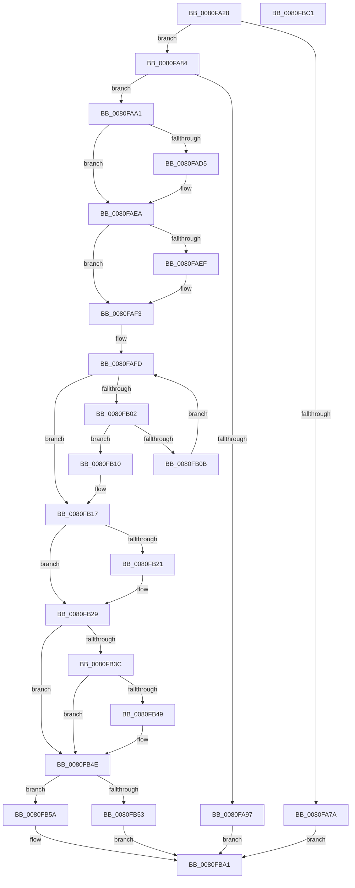

# MiOpenSpecialPurposeMemory

- RVA: `0x0080FA28`–`0x0080FBC2` (길이 `410` bytes)
- VA: `0x000000014080FA28`
- 실행 섹션: `PAGE`
- PDB 이름 있음: `예`; PDB Function 태그: `아니요`
- unwind 정보 RVA: `0x000BC81C`
- 디코드: `114`개 명령, `410/410` bytes 표시
- 미해석 바이트: `0` (있으면 어셈블리에 `.byte`로 보존)

> 이 문서는 커널 이미지의 기계어와 PDB 기호를 분석해 생성했습니다. 4번과 5번은 함수 원형과 자료형을 바이너리 사용 방식에서 추정한 C 해석이며 원본 소스 복구 결과는 아닙니다.

## 1. Dependencies

- 직접 호출 지점: **8**; 고유 호출 대상: **8**
- 직접 호출자로 확인된 함수: **1**
- RIP 상대 이미지 참조: **2**

### Outgoing calls
- `0x0080FA8E` → [SeSinglePrivilegeCheck](../87/SeSinglePrivilegeCheck_function_00871E20.md) (function, `0x00871E20`)
- `0x0080FABF` → [KeAbPreAcquire](../../text/21/KeAbPreAcquire_function_00210230.md) (function, `0x00210230`)
- `0x0080FAE0` → [ExfAcquirePushLockSharedEx](../../text/21/ExfAcquirePushLockSharedEx_function_0021044C.md) (function, `0x0021044C`)
- `0x0080FB24` → [ExfReleasePushLockShared](../../text/26/ExfReleasePushLockShared_function_00263440.md) (function, `0x00263440`)
- `0x0080FB2C` → [KeAbPostRelease](../../text/2E/KeAbPostRelease_function_002E1600.md) (function, `0x002E1600`)
- `0x0080FB49` → [KiCheckForKernelApcDelivery](../../text/2E/KiCheckForKernelApcDelivery_function_002E2C80.md) (function, `0x002E2C80`)
- `0x0080FB8A` → [ObOpenObjectByPointer](../8B/ObOpenObjectByPointer_function_008B7420.md) (function, `0x008B7420`)
- `0x0080FB97` → [MiSpecialPurposeMemoryTypeDereference](../81/MiSpecialPurposeMemoryTypeDereference_function_00810154.md) (function, `0x00810154`)

### Direct callers
- [sub_00B2095C](../B2/Unknown_function_00B2095C.md) at `0x00B20A07`

### Static image references
- `0x0080FA84` → RVA `0x00FD9AD0` (`PAGEDATA`; read)
- `0x0080FB72` → RVA `0x00FC6EB8` (`ALMOSTRO`; read)

## 2. Other-region calls and transfers

- 다른 실행 섹션으로 향하는 call: **5**
  - `0x0080FABF` → [KeAbPreAcquire](../../text/21/KeAbPreAcquire_function_00210230.md) (`PAGE` → `.text`)
  - `0x0080FAE0` → [ExfAcquirePushLockSharedEx](../../text/21/ExfAcquirePushLockSharedEx_function_0021044C.md) (`PAGE` → `.text`)
  - `0x0080FB24` → [ExfReleasePushLockShared](../../text/26/ExfReleasePushLockShared_function_00263440.md) (`PAGE` → `.text`)
  - `0x0080FB2C` → [KeAbPostRelease](../../text/2E/KeAbPostRelease_function_002E1600.md) (`PAGE` → `.text`)
  - `0x0080FB49` → [KiCheckForKernelApcDelivery](../../text/2E/KiCheckForKernelApcDelivery_function_002E2C80.md) (`PAGE` → `.text`)
- 별도 외부 분기/꼬리 이동을 확인하지 못했습니다.

## 3. Assembly (complete function range)

```asm
0080FA28  48 89 5C 24 08                  mov qword ptr [rsp + 8], rbx
0080FA2D  48 89 6C 24 18                  mov qword ptr [rsp + 0x18], rbp
0080FA32  48 89 74 24 20                  mov qword ptr [rsp + 0x20], rsi
0080FA37  57                              push rdi
0080FA38  41 54                           push r12
0080FA3A  41 55                           push r13
0080FA3C  41 56                           push r14
0080FA3E  41 57                           push r15
0080FA40  48 83 EC 40                     sub rsp, 0x40
0080FA44  65 48 8B 34 25 88 01 00 00      mov rsi, qword ptr gs:[0x188]
0080FA4D  33 FF                           xor edi, edi
0080FA4F  44 8B 52 08                     mov r10d, dword ptr [rdx + 8]
0080FA53  41 8A C0                        mov al, r8b
0080FA56  F6 D8                           neg al
0080FA58  4C 8B FA                        mov r15, rdx
0080FA5B  4C 8B E9                        mov r13, rcx
0080FA5E  44 8B F7                        mov r14d, edi
0080FA61  45 1B C9                        sbb r9d, r9d
0080FA64  41 81 E1 00 FE FE FF            and r9d, 0xfffefe00
0080FA6B  41 81 C1 F2 1F 01 00            add r9d, 0x11ff2
0080FA72  45 23 CA                        and r9d, r10d
0080FA75  45 3B CA                        cmp r9d, r10d
0080FA78  74 0A                           je 0x14080fa84
0080FA7A  BF 0D 00 00 C0                  mov edi, 0xc000000d
0080FA7F  E9 1D 01 00 00                  jmp 0x14080fba1
0080FA84  48 8B 0D 45 A0 7C 00            mov rcx, qword ptr [rip + 0x7ca045]
0080FA8B  41 8A D0                        mov dl, r8b
0080FA8E  E8 8D 23 06 00                  call 0x140871e20
0080FA93  84 C0                           test al, al
0080FA95  75 0A                           jne 0x14080faa1
0080FA97  BF 61 00 00 C0                  mov edi, 0xc0000061
0080FA9C  E9 00 01 00 00                  jmp 0x14080fba1
0080FAA1  41 BC 01 00 00 00               mov r12d, 1
0080FAA7  49 8D 9D 08 45 00 00            lea rbx, [r13 + 0x4508]
0080FAAE  66 44 29 A6 E6 01 00 00         sub word ptr [rsi + 0x1e6], r12w
0080FAB6  48 8B CB                        mov rcx, rbx
0080FAB9  45 33 C0                        xor r8d, r8d
0080FABC  33 D2                           xor edx, edx
0080FABE  90                              nop
0080FABF  E8 6C 07 A0 FF                  call 0x140210230
0080FAC4  48 8B E8                        mov rbp, rax
0080FAC7  45 8D 44 24 10                  lea r8d, [r12 + 0x10]
0080FACC  33 C0                           xor eax, eax
0080FACE  F0 4C 0F B1 03                  lock cmpxchg qword ptr [rbx], r8
0080FAD3  74 15                           je 0x14080faea
0080FAD5  4C 8B CB                        mov r9, rbx
0080FAD8  4C 8B C5                        mov r8, rbp
0080FADB  33 D2                           xor edx, edx
0080FADD  48 8B CB                        mov rcx, rbx
0080FAE0  E8 67 09 A0 FF                  call 0x14021044c
0080FAE5  45 8D 44 24 10                  lea r8d, [r12 + 0x10]
0080FAEA  48 85 ED                        test rbp, rbp
0080FAED  74 04                           je 0x14080faf3
0080FAEF  44 88 65 0A                     mov byte ptr [rbp + 0xa], r12b
0080FAF3  49 8D 95 D8 44 00 00            lea rdx, [r13 + 0x44d8]
0080FAFA  48 8B 0A                        mov rcx, qword ptr [rdx]
0080FAFD  48 3B CA                        cmp rcx, rdx
0080FB00  74 15                           je 0x14080fb17
0080FB02  49 8B 07                        mov rax, qword ptr [r15]
0080FB05  48 39 41 10                     cmp qword ptr [rcx + 0x10], rax
0080FB09  74 05                           je 0x14080fb10
0080FB0B  48 8B 09                        mov rcx, qword ptr [rcx]
0080FB0E  EB ED                           jmp 0x14080fafd
0080FB10  4C 01 61 58                     add qword ptr [rcx + 0x58], r12
0080FB14  4C 8B F1                        mov r14, rcx
0080FB17  49 8B C0                        mov rax, r8
0080FB1A  F0 48 0F B1 3B                  lock cmpxchg qword ptr [rbx], rdi
0080FB1F  74 08                           je 0x14080fb29
0080FB21  48 8B CB                        mov rcx, rbx
0080FB24  E8 17 39 A5 FF                  call 0x140263440
0080FB29  48 8B CB                        mov rcx, rbx
0080FB2C  E8 CF 1A AD FF                  call 0x1402e1600
0080FB31  90                              nop
0080FB32  66 44 01 A6 E6 01 00 00         add word ptr [rsi + 0x1e6], r12w
0080FB3A  75 12                           jne 0x14080fb4e
0080FB3C  48 8D 86 98 00 00 00            lea rax, [rsi + 0x98]
0080FB43  90                              nop
0080FB44  48 39 00                        cmp qword ptr [rax], rax
0080FB47  74 05                           je 0x14080fb4e
0080FB49  E8 32 31 AD FF                  call 0x1402e2c80
0080FB4E  4D 85 F6                        test r14, r14
0080FB51  75 07                           jne 0x14080fb5a
0080FB53  BF 25 02 00 C0                  mov edi, 0xc0000225
0080FB58  EB 47                           jmp 0x14080fba1
0080FB5A  49 8B 4E 40                     mov rcx, qword ptr [r14 + 0x40]
0080FB5E  49 8D 47 10                     lea rax, [r15 + 0x10]
0080FB62  45 8B 4F 0C                     mov r9d, dword ptr [r15 + 0xc]
0080FB66  45 33 C0                        xor r8d, r8d
0080FB69  41 8B 57 08                     mov edx, dword ptr [r15 + 8]
0080FB6D  48 89 44 24 30                  mov qword ptr [rsp + 0x30], rax
0080FB72  48 8B 05 3F 73 7B 00            mov rax, qword ptr [rip + 0x7b733f]
0080FB79  48 8B 89 B8 00 00 00            mov rcx, qword ptr [rcx + 0xb8]
0080FB80  40 88 7C 24 28                  mov byte ptr [rsp + 0x28], dil
0080FB85  48 89 44 24 20                  mov qword ptr [rsp + 0x20], rax
0080FB8A  E8 91 78 0A 00                  call 0x1408b7420
0080FB8F  8B D8                           mov ebx, eax
0080FB91  49 8B D6                        mov rdx, r14
0080FB94  49 8B CD                        mov rcx, r13
0080FB97  E8 B8 05 00 00                  call 0x140810154
0080FB9C  85 DB                           test ebx, ebx
0080FB9E  0F 48 FB                        cmovs edi, ebx
0080FBA1  4C 8D 5C 24 40                  lea r11, [rsp + 0x40]
0080FBA6  8B C7                           mov eax, edi
0080FBA8  49 8B 5B 30                     mov rbx, qword ptr [r11 + 0x30]
0080FBAC  49 8B 6B 40                     mov rbp, qword ptr [r11 + 0x40]
0080FBB0  49 8B 73 48                     mov rsi, qword ptr [r11 + 0x48]
0080FBB4  49 8B E3                        mov rsp, r11
0080FBB7  41 5F                           pop r15
0080FBB9  41 5E                           pop r14
0080FBBB  41 5D                           pop r13
0080FBBD  41 5C                           pop r12
0080FBBF  5F                              pop rdi
0080FBC0  C3                              ret
0080FBC1  CC                              int3
```

## 4. C-style interpretation (structured pseudocode)

```c
__int64 __fastcall MiOpenSpecialPurposeMemory(__int64 a1, __int64 a2, int a3, int a4)
{
    __int64 result;
    __int64 v_rdi;
    __int64 v_rsp;
    unsigned __int64 v_stack_m28;
    unsigned __int64 v_stack_m38;
    unsigned __int8 v_stack_m40;
    unsigned __int64 v_stack_m48;
    unsigned __int64 v_stack_p18;
    unsigned __int64 v_stack_p20;
    unsigned __int64 v_stack_p8;

    v_stack_p8 = v_rbx;
    v_stack_p18 = v_rbp;
    v_stack_p20 = v_rsi;
    v_rsp = (v_rsp) - (64);
    v_rdi = 0;
    result = (unsigned __int8)(-((unsigned __int8)(a3)));
    a4 = (unsigned int)((a4) & (0xFFFEFE00ULL));
    a4 = (unsigned int)((a4) + (0x11FF2ULL));
    a4 = (unsigned int)((a4) & ((unsigned int)((unsigned int)(*(unsigned int *)(a2 + 8)))));
    if (a4 == ((unsigned int)((unsigned int)(*(unsigned int *)(a2 + 8))))) goto loc_0080FA84;
    goto loc_0080FBA1;
loc_0080FA84:
    result = SeSinglePrivilegeCheck(*(unsigned __int64 *)(v_rip + 8167493), (unsigned __int8)(a3), a3, a4);
    if ((unsigned __int8)(result) != 0) goto loc_0080FAA1;
    goto loc_0080FBA1;
loc_0080FAA1:
    a3 = 0;
    a2 = 0;
    result = KeAbPreAcquire(a1 + 17672, a2, a3, a4);
    result = 0;
    if (!(condition_is_equal)) {
        a4 = a1 + 17672;
        a3 = 0;
        a2 = 0;
        a1 = a1 + 17672;
        result = ExfAcquirePushLockSharedEx(a1, a2, a3, a4);
        a3 = 1 + 16;
    }
    if (result != 0) {
        *(unsigned __int8 *)(result + 10) = 1;
    }
loc_0080FAFD:
    if ((*(unsigned __int64 *)(a1 + 17624)) == (a1 + 17624)) goto loc_0080FB17;
    if ((*(unsigned __int64 *)(*(unsigned __int64 *)(a1 + 17624) + 16)) == (*(unsigned __int64 *)(a2))) goto loc_0080FB10;
    goto loc_0080FAFD;
loc_0080FB10:
loc_0080FB17:
    result = a3;
    if ((*(unsigned __int64 *)(*(unsigned __int64 *)(a1 + 17624) + 16)) != (*(unsigned __int64 *)(a2))) {
        a1 = a1 + 17672;
        result = ExfReleasePushLockShared(a1, a1 + 17624, a3, a4);
    }
    result = KeAbPostRelease(a1 + 17672, a1 + 17624, a3, a4);
    if ((*(unsigned __int64 *)(*(unsigned __int64 *)(a1 + 17624) + 16)) != (*(unsigned __int64 *)(a2))) goto loc_0080FB4E;
    result = *(unsigned __int64 *)(gs_base + (0 + 392)) + 152;
    if ((*(unsigned __int64 *)(*(unsigned __int64 *)(gs_base + (0 + 392)) + 152)) != (*(unsigned __int64 *)(gs_base + (0 + 392)) + 152)) {
        result = KiCheckForKernelApcDelivery(a1 + 17672, a1 + 17624, a3, a4);
    }
    if (*(unsigned __int64 *)(*(unsigned __int64 *)(a1 + 17624)) != 0) goto loc_0080FB5A;
    goto loc_0080FBA1;
loc_0080FB5A:
    a3 = 0;
    v_stack_m38 = a2 + 16;
    v_stack_m40 = (unsigned __int8)((unsigned int)(0xC0000225ULL));
    v_stack_m48 = *(unsigned __int64 *)(v_rip + 8090431);
    result = ObOpenObjectByPointer(*(unsigned __int64 *)(*(unsigned __int64 *)(*(unsigned __int64 *)(*(unsigned __int64 *)(a1 + 17624)) + 64) + 184), (unsigned int)(*(unsigned int *)(a2 + 8)), a3, (unsigned int)(*(unsigned int *)(a2 + 12)));
    result = MiSpecialPurposeMemoryTypeDereference(a1, *(unsigned __int64 *)(*(unsigned __int64 *)(a1 + 17624)), a3, (unsigned int)(*(unsigned int *)(a2 + 12)));
    v_rdi = (unsigned int)(0xC0000225ULL);
    if (sign_flag) { v_rdi = (unsigned int)((unsigned int)((unsigned int)(result))); }
loc_0080FBA1:
    return (unsigned int)((unsigned int)(v_rdi));
}
```

## 5. (Beta) C Style

```c
int64_t MiOpenSpecialPurposeMemory(void *Arg1, void *Arg2, int32_t Arg3, int32_t Arg4)
{
    uint8_t *arg1 = (uint8_t *)Arg1;
    uint8_t *arg2 = (uint8_t *)Arg2;

    int64_t result;
    int64_t local_rdi;
    int64_t local_rsp;
    uint64_t v_stack_m28;
    uint64_t v_stack_m38;
    uint8_t v_stack_m40;
    uint64_t v_stack_m48;
    uint64_t v_stack_p18;
    uint64_t v_stack_p20;
    uint64_t v_stack_p8;

    v_stack_p8 = local_rbx;
    v_stack_p18 = local_rbp;
    v_stack_p20 = local_rsi;
    local_rsp = (local_rsp) - (64);
    local_rdi = 0;
    result = (uint8_t)(-((uint8_t)(Arg3)));
    Arg4 = (uint32_t)((Arg4) & (0xFFFEFE00ULL));
    Arg4 = (uint32_t)((Arg4) + (0x11FF2ULL));
    Arg4 = (uint32_t)((Arg4) & ((uint32_t)((uint32_t)(*(uint32_t *)(arg2 + 0x8)))));
    if (Arg4 == ((uint32_t)((uint32_t)(*(uint32_t *)(arg2 + 0x8))))) goto loc_0080FA84;
    goto loc_0080FBA1;
loc_0080FA84:
    result = SeSinglePrivilegeCheck(*(uint64_t *)(v_rip + 0x7CA045), (uint8_t)(Arg3), Arg3, Arg4);
    if ((uint8_t)(result) != 0) goto loc_0080FAA1;
    goto loc_0080FBA1;
loc_0080FAA1:
    Arg3 = 0;
    Arg2 = 0;
    result = KeAbPreAcquire(Arg1 + 17672, Arg2, Arg3, Arg4);
    result = 0;
    if (!(condition_is_equal)) {
        Arg4 = Arg1 + 17672;
        Arg3 = 0;
        Arg2 = 0;
        Arg1 = Arg1 + 17672;
        result = ExfAcquirePushLockSharedEx(Arg1, Arg2, Arg3, Arg4);
        Arg3 = 1 + 16;
    }
    if (result != 0) {
        *(uint8_t *)(result + 0xA) = 1;
    }
loc_0080FAFD:
    if ((*(uint64_t *)(arg1 + 0x44D8)) == (Arg1 + 17624)) goto loc_0080FB17;
    if ((*(uint64_t *)(*(uint64_t *)(arg1 + 0x44D8) + 0x10)) == (*(uint64_t *)(arg2))) goto loc_0080FB10;
    goto loc_0080FAFD;
loc_0080FB10:
loc_0080FB17:
    result = Arg3;
    if ((*(uint64_t *)(*(uint64_t *)(arg1 + 0x44D8) + 0x10)) != (*(uint64_t *)(arg2))) {
        Arg1 = Arg1 + 17672;
        result = ExfReleasePushLockShared(Arg1, Arg1 + 17624, Arg3, Arg4);
    }
    result = KeAbPostRelease(Arg1 + 17672, Arg1 + 17624, Arg3, Arg4);
    if ((*(uint64_t *)(*(uint64_t *)(arg1 + 0x44D8) + 0x10)) != (*(uint64_t *)(arg2))) goto loc_0080FB4E;
    result = *(uint64_t *)(gs_base + (0 + 0x188)) + 152;
    if ((*(uint64_t *)(*(uint64_t *)(gs_base + (0 + 0x188)) + 0x98)) != (*(uint64_t *)(gs_base + (0 + 0x188)) + 152)) {
        result = KiCheckForKernelApcDelivery(Arg1 + 17672, Arg1 + 17624, Arg3, Arg4);
    }
    if (*(uint64_t *)(*(uint64_t *)(arg1 + 0x44D8)) != 0) goto loc_0080FB5A;
    goto loc_0080FBA1;
loc_0080FB5A:
    Arg3 = 0;
    v_stack_m38 = Arg2 + 16;
    v_stack_m40 = (uint8_t)((uint32_t)(0xC0000225ULL));
    v_stack_m48 = *(uint64_t *)(v_rip + 0x7B733F);
    result = ObOpenObjectByPointer(*(uint64_t *)(*(uint64_t *)(*(uint64_t *)(*(uint64_t *)(arg1 + 0x44D8)) + 0x40) + 0xB8), (uint32_t)(*(uint32_t *)(arg2 + 0x8)), Arg3, (uint32_t)(*(uint32_t *)(arg2 + 0xC)));
    result = MiSpecialPurposeMemoryTypeDereference(Arg1, *(uint64_t *)(*(uint64_t *)(arg1 + 0x44D8)), Arg3, (uint32_t)(*(uint32_t *)(arg2 + 0xC)));
    local_rdi = (uint32_t)(0xC0000225ULL);
    if (sign_flag) { local_rdi = (uint32_t)((uint32_t)((uint32_t)(result))); }
loc_0080FBA1:
    return (uint32_t)((uint32_t)(local_rdi));
}
```

### 관측된 메모리 오프셋

구조체 형식이 확인되지 않은 접근은 인자 기준의 오프셋으로만 기록했습니다.

| 기준 인자 | 오프셋 표현 | 폭 (bit) | 접근 |
|---|---:|---:|---|
| `Arg1` | `+ 0x0` | `64` | `R` |
| `Arg1` | `+ 0x44D8` | `64` | `R` |
| `Arg1` | `+ 0x4508` | `64` | `R` |
| `Arg2` | `+ 0x0` | `64` | `R` |
| `Arg2` | `+ 0x8` | `32` | `R` |
| `Arg2` | `+ 0xC` | `32` | `R` |
| `Arg2` | `+ 0x10` | `64` | `R` |

## 6. Execution-region graph

[열기: 2D/3D 그래프와 함수 탐색 컨트롤 패널](../../../control-panel.html?section=page&rva=0x0080FA28&view=graph)

- 2D 그래프는 위에서 아래로 흐르고, 3D 그래프는 빈 공간을 드래그해 회전합니다. Shift+드래그는 이동, 휠은 확대·축소, 함수 노드 선택은 대상 보고서 이동입니다.

### Static fallback


