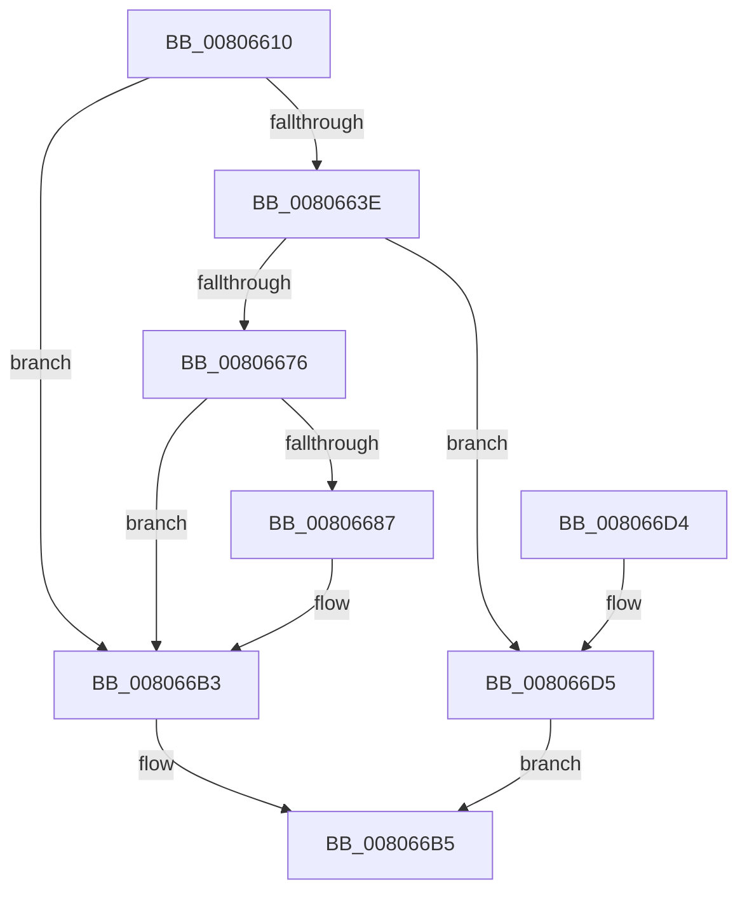

# MiPatchDataPagesCallback

- RVA: `0x00806610`–`0x008066EB` (길이 `219` bytes)
- VA: `0x0000000140806610`
- 실행 섹션: `PAGE`
- PDB 이름 있음: `예`; PDB Function 태그: `아니요`
- unwind 정보 RVA: `0x000D8614`
- 디코드: `66`개 명령, `219/219` bytes 표시
- 미해석 바이트: `0` (있으면 어셈블리에 `.byte`로 보존)

> 이 문서는 커널 이미지의 기계어와 PDB 기호를 분석해 생성했습니다. 4번과 5번은 함수 원형과 자료형을 바이너리 사용 방식에서 추정한 C 해석이며 원본 소스 복구 결과는 아닙니다.

## 1. Dependencies

- 직접 호출 지점: **5**; 고유 호출 대상: **4**
- 직접 호출자로 확인된 함수: **0**
- RIP 상대 이미지 참조: **0**

### Outgoing calls
- `0x00806668` → [RtlAreBitsSetEx](../../text/42/RtlAreBitsSetEx_function_0042A9C0.md) (function, `0x0042A9C0`)
- `0x0080667E` → [RtlAreBitsSetEx](../../text/42/RtlAreBitsSetEx_function_0042A9C0.md) (function, `0x0042A9C0`)
- `0x008066A0` → [MiSetImageProtection](../../text/38/MiSetImageProtection_function_003843D0.md) (function, `0x003843D0`)
- `0x008066AE` → [RtlSetBitsEx](../../text/3B/RtlSetBitsEx_function_003B6570.md) (function, `0x003B6570`)
- `0x008066D9` → [RtlAreBitsClearEx](../../text/41/RtlAreBitsClearEx_function_0041DBF0.md) (function, `0x0041DBF0`)

### Direct callers
- 이 함수 시작 RVA로 연결되는 직접 call은 확인되지 않았습니다. 간접 호출은 완전히 역산할 수 없습니다.

### Static image references
- 디코드된 RIP-relative 메모리 참조가 없습니다.

## 2. Other-region calls and transfers

- 다른 실행 섹션으로 향하는 call: **5**
  - `0x00806668` → [RtlAreBitsSetEx](../../text/42/RtlAreBitsSetEx_function_0042A9C0.md) (`PAGE` → `.text`)
  - `0x0080667E` → [RtlAreBitsSetEx](../../text/42/RtlAreBitsSetEx_function_0042A9C0.md) (`PAGE` → `.text`)
  - `0x008066A0` → [MiSetImageProtection](../../text/38/MiSetImageProtection_function_003843D0.md) (`PAGE` → `.text`)
  - `0x008066AE` → [RtlSetBitsEx](../../text/3B/RtlSetBitsEx_function_003B6570.md) (`PAGE` → `.text`)
  - `0x008066D9` → [RtlAreBitsClearEx](../../text/41/RtlAreBitsClearEx_function_0041DBF0.md) (`PAGE` → `.text`)
- 별도 외부 분기/꼬리 이동을 확인하지 못했습니다.

## 3. Assembly (complete function range)

```asm
00806610  48 8B C4                        mov rax, rsp
00806613  48 89 58 08                     mov qword ptr [rax + 8], rbx
00806617  48 89 68 10                     mov qword ptr [rax + 0x10], rbp
0080661B  48 89 70 18                     mov qword ptr [rax + 0x18], rsi
0080661F  48 89 78 20                     mov qword ptr [rax + 0x20], rdi
00806623  41 54                           push r12
00806625  41 56                           push r14
00806627  41 57                           push r15
00806629  48 83 EC 20                     sub rsp, 0x20
0080662D  4C 8B 74 24 68                  mov r14, qword ptr [rsp + 0x68]
00806632  48 8B D9                        mov rbx, rcx
00806635  41 C6 06 00                     mov byte ptr [r14], 0
00806639  48 85 C9                        test rcx, rcx
0080663C  74 75                           je 0x1408066b3
0080663E  8B EA                           mov ebp, edx
00806640  45 8B F9                        mov r15d, r9d
00806643  81 E2 FF 0F 00 00               and edx, 0xfff
00806649  C1 ED 0C                        shr ebp, 0xc
0080664C  48 81 C2 FF 0F 00 00            add rdx, 0xfff
00806653  8B F5                           mov esi, ebp
00806655  4C 03 FA                        add r15, rdx
00806658  48 83 C1 30                     add rcx, 0x30
0080665C  49 C1 EF 0C                     shr r15, 0xc
00806660  45 8B C7                        mov r8d, r15d
00806663  8B D5                           mov edx, ebp
00806665  41 8B FF                        mov edi, r15d
00806668  E8 53 43 C2 FF                  call 0x14042a9c0
0080666D  44 8B C7                        mov r8d, edi
00806670  8B D6                           mov edx, esi
00806672  84 C0                           test al, al
00806674  74 5F                           je 0x1408066d5
00806676  48 8D 4B 40                     lea rcx, [rbx + 0x40]
0080667A  41 C6 06 01                     mov byte ptr [r14], 1
0080667E  E8 3D 43 C2 FF                  call 0x14042a9c0
00806683  84 C0                           test al, al
00806685  75 2C                           jne 0x1408066b3
00806687  48 8B 0B                        mov rcx, qword ptr [rbx]
0080668A  41 B9 04 00 00 00               mov r9d, 4
00806690  C1 E5 0C                        shl ebp, 0xc
00806693  41 C1 E7 0C                     shl r15d, 0xc
00806697  8B D5                           mov edx, ebp
00806699  45 8B C7                        mov r8d, r15d
0080669C  48 03 51 30                     add rdx, qword ptr [rcx + 0x30]
008066A0  E8 2B DD B7 FF                  call 0x1403843d0
008066A5  44 8B C7                        mov r8d, edi
008066A8  48 8D 4B 40                     lea rcx, [rbx + 0x40]
008066AC  8B D6                           mov edx, esi
008066AE  E8 BD FE BA FF                  call 0x1403b6570
008066B3  33 C0                           xor eax, eax
008066B5  48 8B 5C 24 40                  mov rbx, qword ptr [rsp + 0x40]
008066BA  48 8B 6C 24 48                  mov rbp, qword ptr [rsp + 0x48]
008066BF  48 8B 74 24 50                  mov rsi, qword ptr [rsp + 0x50]
008066C4  48 8B 7C 24 58                  mov rdi, qword ptr [rsp + 0x58]
008066C9  48 83 C4 20                     add rsp, 0x20
008066CD  41 5F                           pop r15
008066CF  41 5E                           pop r14
008066D1  41 5C                           pop r12
008066D3  C3                              ret
008066D4  CC                              int3
008066D5  48 8D 4B 30                     lea rcx, [rbx + 0x30]
008066D9  E8 12 75 C1 FF                  call 0x14041dbf0
008066DE  F6 D8                           neg al
008066E0  1B C0                           sbb eax, eax
008066E2  F7 D0                           not eax
008066E4  25 7B 00 00 C0                  and eax, 0xc000007b
008066E9  EB CA                           jmp 0x1408066b5
```

## 4. C-style interpretation (structured pseudocode)

```c
__int64 __fastcall MiPatchDataPagesCallback(__int64 a1, int a2, __int64 a3, int a4, __int64 a5, __int64 a6)
{
    __int64 result;
    __int64 v_r15;
    __int64 v_rbp;
    __int64 v_rsp;
    unsigned __int64 v_stack_p10;
    unsigned __int64 v_stack_p18;
    unsigned __int64 v_stack_p20;
    unsigned __int64 v_stack_p8;

    *(unsigned __int64 *)(v_rsp + 8) = v_rbx;
    *(unsigned __int64 *)(v_rsp + 16) = v_rbp;
    *(unsigned __int64 *)(v_rsp + 24) = v_rsi;
    *(unsigned __int64 *)(v_rsp + 32) = v_rdi;
    v_rsp = (v_rsp) - (32);
    *(unsigned __int8 *)(a6) = 0;
    if (a1 == 0) goto loc_008066B3;
    a2 = (unsigned int)((a2) & (0xFFFULL));
    v_rbp = (unsigned int)(((unsigned int)(a2)) >> (12));
    a2 = (a2) + (0xFFFULL);
    v_r15 = ((unsigned int)(a4)) + (a2);
    a1 = (a1) + (48);
    v_r15 = (v_r15) >> (12);
    result = RtlAreBitsSetEx(a1, (unsigned int)((unsigned int)(v_rbp)), (unsigned int)((unsigned int)(v_r15)), a4);
    if ((unsigned __int8)(result) == 0) goto loc_008066D5;
    *(unsigned __int8 *)(a6) = 1;
    result = RtlAreBitsSetEx(a1 + 64, (unsigned int)((unsigned int)((unsigned int)((unsigned int)(v_rbp)))), (unsigned int)((unsigned int)((unsigned int)((unsigned int)(v_r15)))), a4);
    if ((unsigned __int8)(result) == 0) {
        a1 = *(unsigned __int64 *)(a1);
        a4 = 4;
        v_rbp = (unsigned int)((v_rbp) << (12));
        v_r15 = (unsigned int)((v_r15) << (12));
        a2 = (unsigned int)(v_rbp);
        a3 = (unsigned int)(v_r15);
        a2 = (a2) + (*(unsigned __int64 *)(a1 + 48));
        result = MiSetImageProtection(a1, a2, a3, a4);
        a3 = (unsigned int)((unsigned int)((unsigned int)(v_r15)));
        a1 = a1 + 64;
        a2 = (unsigned int)((unsigned int)((unsigned int)(v_rbp)));
        result = RtlSetBitsEx(a1, a2, a3, a4);
    }
    result = 0;
loc_008066B5:
    v_rsp = (v_rsp) + (32);
    return result;
loc_008066D5:
    result = RtlAreBitsClearEx(v_stack_p8 + 48, a2, a3, a4);
    result = (unsigned __int8)(-(result));
    result = (unsigned int)(~(result));
    result = (unsigned int)((result) & (0xC000007BULL));
    goto loc_008066B5;
}
```

## 5. (Beta) C Style

```c
int64_t MiPatchDataPagesCallback(void *Arg1, int32_t Arg2, int64_t Arg3, int32_t Arg4, uint64_t Arg5, void *Arg6)
{
    uint8_t *arg1 = (uint8_t *)Arg1;
    uint8_t *arg6 = (uint8_t *)Arg6;

    int64_t result;
    int64_t local_r15;
    int64_t local_rbp;
    int64_t local_rsp;
    uint64_t v_stack_p10;
    uint64_t v_stack_p18;
    uint64_t v_stack_p20;
    uint64_t v_stack_p8;

    *(uint64_t *)(local_rsp + 0x8) = local_rbx;
    *(uint64_t *)(local_rsp + 0x10) = local_rbp;
    *(uint64_t *)(local_rsp + 0x18) = local_rsi;
    *(uint64_t *)(local_rsp + 0x20) = local_rdi;
    local_rsp = (local_rsp) - (32);
    *(uint8_t *)(arg6) = 0;
    if (Arg1 == NULL) goto loc_008066B3;
    Arg2 = (uint32_t)((Arg2) & (0xFFFULL));
    local_rbp = (uint32_t)(((uint32_t)(Arg2)) >> (12));
    Arg2 = (Arg2) + (0xFFFULL);
    local_r15 = ((uint32_t)(Arg4)) + (Arg2);
    Arg1 = (Arg1) + (48);
    local_r15 = (local_r15) >> (12);
    result = RtlAreBitsSetEx(Arg1, (uint32_t)((uint32_t)(local_rbp)), (uint32_t)((uint32_t)(local_r15)), Arg4);
    if ((uint8_t)(result) == 0) goto loc_008066D5;
    *(uint8_t *)(arg6) = 1;
    result = RtlAreBitsSetEx(Arg1 + 64, (uint32_t)((uint32_t)((uint32_t)((uint32_t)(local_rbp)))), (uint32_t)((uint32_t)((uint32_t)((uint32_t)(local_r15)))), Arg4);
    if ((uint8_t)(result) == 0) {
        Arg1 = *(uint64_t *)(arg1);
        Arg4 = 4;
        local_rbp = (uint32_t)((local_rbp) << (12));
        local_r15 = (uint32_t)((local_r15) << (12));
        Arg2 = (uint32_t)(local_rbp);
        Arg3 = (uint32_t)(local_r15);
        Arg2 = (Arg2) + (*(uint64_t *)(arg1 + 0x30));
        result = MiSetImageProtection(Arg1, Arg2, Arg3, Arg4);
        Arg3 = (uint32_t)((uint32_t)((uint32_t)(local_r15)));
        Arg1 = Arg1 + 64;
        Arg2 = (uint32_t)((uint32_t)((uint32_t)(local_rbp)));
        result = RtlSetBitsEx(Arg1, Arg2, Arg3, Arg4);
    }
    result = 0;
loc_008066B5:
    local_rsp = (local_rsp) + (32);
    return result;
loc_008066D5:
    result = RtlAreBitsClearEx(v_stack_p8 + 48, Arg2, Arg3, Arg4);
    result = (uint8_t)(-(result));
    result = (uint32_t)(~(result));
    result = (uint32_t)((result) & (0xC000007BULL));
    goto loc_008066B5;
}
```

### 관측된 메모리 오프셋

구조체 형식이 확인되지 않은 접근은 인자 기준의 오프셋으로만 기록했습니다.

| 기준 인자 | 오프셋 표현 | 폭 (bit) | 접근 |
|---|---:|---:|---|
| `Arg1` | `+ 0x0` | `64` | `R` |
| `Arg1` | `+ 0x30` | `64` | `R` |
| `Arg1` | `+ 0x40` | `64` | `R` |
| `Arg6` | `+ 0x0` | `8` | `W` |

## 6. Execution-region graph

[열기: 2D/3D 그래프와 함수 탐색 컨트롤 패널](../../../control-panel.html?section=page&rva=0x00806610&view=graph)

- 2D 그래프는 위에서 아래로 흐르고, 3D 그래프는 빈 공간을 드래그해 회전합니다. Shift+드래그는 이동, 휠은 확대·축소, 함수 노드 선택은 대상 보고서 이동입니다.

### Static fallback


