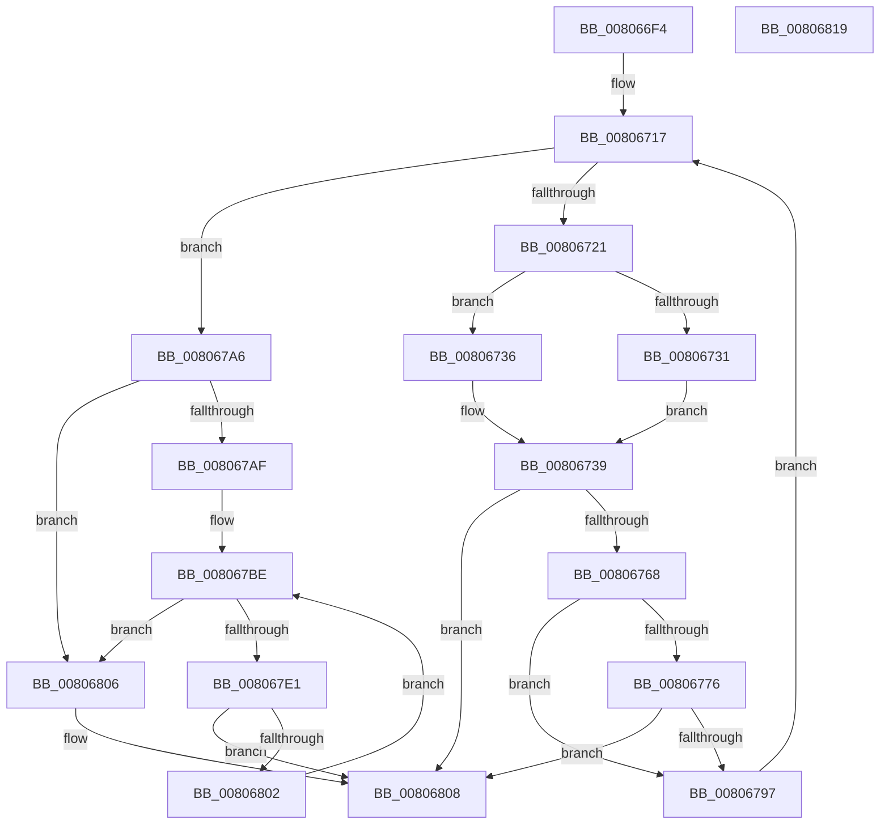

# MiPrepareDriverForHotPatch

- RVA: `0x008066F4`–`0x0080681A` (길이 `294` bytes)
- VA: `0x00000001408066F4`
- 실행 섹션: `PAGE`
- PDB 이름 있음: `예`; PDB Function 태그: `아니요`
- unwind 정보 RVA: `0x000BF984`
- 디코드: `89`개 명령, `294/294` bytes 표시
- 미해석 바이트: `0` (있으면 어셈블리에 `.byte`로 보존)

> 이 문서는 커널 이미지의 기계어와 PDB 기호를 분석해 생성했습니다. 4번과 5번은 함수 원형과 자료형을 바이너리 사용 방식에서 추정한 C 해석이며 원본 소스 복구 결과는 아닙니다.

## 1. Dependencies

- 직접 호출 지점: **5**; 고유 호출 대상: **4**
- 직접 호출자로 확인된 함수: **1**
- RIP 상대 이미지 참조: **0**

### Outgoing calls
- `0x0080670F` → [RtlGetHotPatchSize](../../text/6A/RtlGetHotPatchSize_function_006AA1D0.md) (function, `0x006AA1D0`)
- `0x0080675B` → [MiLockHotPatchPages](MiLockHotPatchPages_function_00804620.md) (function, `0x00804620`)
- `0x0080678E` → [MiLockHotPatchPages](MiLockHotPatchPages_function_00804620.md) (function, `0x00804620`)
- `0x008067D8` → [RtlDetermineHotPatchUndoExtent](../84/RtlDetermineHotPatchUndoExtent_function_00840D9C.md) (function, `0x00840D9C`)
- `0x008067F9` → [MiLockDriverPageRange](../../text/67/MiLockDriverPageRange_function_00670160.md) (function, `0x00670160`)

### Direct callers
- [MiApplyDriverHotPatch](MiApplyDriverHotPatch_function_008018EC.md) at `0x00801B75`

### Static image references
- 디코드된 RIP-relative 메모리 참조가 없습니다.

## 2. Other-region calls and transfers

- 다른 실행 섹션으로 향하는 call: **2**
  - `0x0080670F` → [RtlGetHotPatchSize](../../text/6A/RtlGetHotPatchSize_function_006AA1D0.md) (`PAGE` → `.text`)
  - `0x008067F9` → [MiLockDriverPageRange](../../text/67/MiLockDriverPageRange_function_00670160.md) (`PAGE` → `.text`)
- 별도 외부 분기/꼬리 이동을 확인하지 못했습니다.

## 3. Assembly (complete function range)

```asm
008066F4  48 89 5C 24 18                  mov qword ptr [rsp + 0x18], rbx
008066F9  55                              push rbp
008066FA  56                              push rsi
008066FB  57                              push rdi
008066FC  41 56                           push r14
008066FE  41 57                           push r15
00806700  48 83 EC 30                     sub rsp, 0x30
00806704  48 8B 71 20                     mov rsi, qword ptr [rcx + 0x20]
00806708  48 8B D9                        mov rbx, rcx
0080670B  48 8B 49 18                     mov rcx, qword ptr [rcx + 0x18]
0080670F  E8 BC 3A EA FF                  call 0x1406aa1d0
00806714  44 8B F0                        mov r14d, eax
00806717  8B 3E                           mov edi, dword ptr [rsi]
00806719  85 FF                           test edi, edi
0080671B  0F 84 85 00 00 00               je 0x1408067a6
00806721  8B EF                           mov ebp, edi
00806723  48 8D 4B 08                     lea rcx, [rbx + 8]
00806727  81 E5 FF 0F 00 00               and ebp, 0xfff
0080672D  85 FF                           test edi, edi
0080672F  78 05                           js 0x140806736
00806731  48 8B 03                        mov rax, qword ptr [rbx]
00806734  EB 03                           jmp 0x140806739
00806736  48 8B 01                        mov rax, qword ptr [rcx]
00806739  85 FF                           test edi, edi
0080673B  45 8B CE                        mov r9d, r14d
0080673E  44 8B C5                        mov r8d, ebp
00806741  48 0F 48 CB                     cmovs rcx, rbx
00806745  83 64 24 28 00                  and dword ptr [rsp + 0x28], 0
0080674A  48 83 C6 04                     add rsi, 4
0080674E  89 7C 24 20                     mov dword ptr [rsp + 0x20], edi
00806752  48 8B D6                        mov rdx, rsi
00806755  4C 8B 39                        mov r15, qword ptr [rcx]
00806758  48 8B C8                        mov rcx, rax
0080675B  E8 C0 DE FF FF                  call 0x140804620
00806760  85 C0                           test eax, eax
00806762  0F 88 A0 00 00 00               js 0x140806808
00806768  8B C7                           mov eax, edi
0080676A  25 00 C0 0F 00                  and eax, 0xfc000
0080676F  3D 00 C0 05 00                  cmp eax, 0x5c000
00806774  75 21                           jne 0x140806797
00806776  C7 44 24 28 01 00 00 00         mov dword ptr [rsp + 0x28], 1
0080677E  45 8B CE                        mov r9d, r14d
00806781  44 8B C5                        mov r8d, ebp
00806784  89 7C 24 20                     mov dword ptr [rsp + 0x20], edi
00806788  48 8B D6                        mov rdx, rsi
0080678B  49 8B CF                        mov rcx, r15
0080678E  E8 8D DE FF FF                  call 0x140804620
00806793  85 C0                           test eax, eax
00806795  78 71                           js 0x140806808
00806797  41 8B C6                        mov eax, r14d
0080679A  0F AF C5                        imul eax, ebp
0080679D  48 8D 34 86                     lea rsi, [rsi + rax*4]
008067A1  E9 71 FF FF FF                  jmp 0x140806717
008067A6  48 8B 7B 28                     mov rdi, qword ptr [rbx + 0x28]
008067AA  48 85 FF                        test rdi, rdi
008067AD  74 57                           je 0x140806806
008067AF  83 64 24 68 00                  and dword ptr [rsp + 0x68], 0
008067B4  83 64 24 60 00                  and dword ptr [rsp + 0x60], 0
008067B9  48 8B 33                        mov rsi, qword ptr [rbx]
008067BC  33 DB                           xor ebx, ebx
008067BE  48 8D 44 24 60                  lea rax, [rsp + 0x60]
008067C3  44 8B C3                        mov r8d, ebx
008067C6  4C 8D 4C 24 68                  lea r9, [rsp + 0x68]
008067CB  48 89 44 24 20                  mov qword ptr [rsp + 0x20], rax
008067D0  BA 01 00 00 00                  mov edx, 1
008067D5  48 8B CF                        mov rcx, rdi
008067D8  E8 BF A5 03 00                  call 0x140840d9c
008067DD  84 C0                           test al, al
008067DF  74 25                           je 0x140806806
008067E1  44 8B 44 24 60                  mov r8d, dword ptr [rsp + 0x60]
008067E6  41 B9 01 00 00 00               mov r9d, 1
008067EC  8B 54 24 68                     mov edx, dword ptr [rsp + 0x68]
008067F0  48 8B CE                        mov rcx, rsi
008067F3  48 83 64 24 20 00               and qword ptr [rsp + 0x20], 0
008067F9  E8 62 99 E6 FF                  call 0x140670160
008067FE  85 C0                           test eax, eax
00806800  78 06                           js 0x140806808
00806802  FF C3                           inc ebx
00806804  EB B8                           jmp 0x1408067be
00806806  33 C0                           xor eax, eax
00806808  48 8B 5C 24 70                  mov rbx, qword ptr [rsp + 0x70]
0080680D  48 83 C4 30                     add rsp, 0x30
00806811  41 5F                           pop r15
00806813  41 5E                           pop r14
00806815  5F                              pop rdi
00806816  5E                              pop rsi
00806817  5D                              pop rbp
00806818  C3                              ret
00806819  CC                              int3
```

## 4. C-style interpretation (structured pseudocode)

```c
__int64 __fastcall MiPrepareDriverForHotPatch(__int64 a1)
{
    __int64 result;
    __int64 v_rbp;
    __int64 v_rbx;
    __int64 v_rsi;
    __int64 v_rsp;
    unsigned int v_stack_m30;
    unsigned int v_stack_m38;
    unsigned int v_stack_p10;
    unsigned __int64 v_stack_p18;
    unsigned int v_stack_p8;

    v_stack_p18 = v_rbx;
    v_rsp = (v_rsp) - (48);
    result = RtlGetHotPatchSize(*(unsigned __int64 *)(a1 + 24), a2, a3, a4);
loc_00806717:
    if ((unsigned int)((unsigned int)(*(unsigned int *)(*(unsigned __int64 *)(a1 + 32)))) == 0) goto loc_008067A6;
    v_rbp = (unsigned int)(((unsigned int)((unsigned int)((unsigned int)(*(unsigned int *)(*(unsigned __int64 *)(a1 + 32)))))) & (0xFFFULL));
    if (sign_flag) goto loc_00806736;
    goto loc_00806739;
loc_00806736:
loc_00806739:
    a1 = a1 + 8;
    if (sign_flag) { a1 = a1; }
    v_rsi = (*(unsigned __int64 *)(a1 + 32)) + (4);
    v_stack_m38 = (unsigned int)((unsigned int)(*(unsigned int *)(*(unsigned __int64 *)(a1 + 32))));
    result = MiLockHotPatchPages(*(unsigned __int64 *)(a1 + 8), v_rsi, (unsigned int)((unsigned int)(v_rbp)), (unsigned int)((unsigned int)((unsigned int)((unsigned int)(result)))));
    if (sign_flag) goto loc_00806808;
    result = (unsigned int)(((unsigned int)((unsigned int)((unsigned int)(*(unsigned int *)(*(unsigned __int64 *)(a1 + 32)))))) & (0xFC000ULL));
    if (((unsigned int)(result)) != 0x5C000ULL) goto loc_00806797;
    v_stack_m30 = 1;
    v_stack_m38 = (unsigned int)((unsigned int)(*(unsigned int *)(*(unsigned __int64 *)(a1 + 32))));
    result = MiLockHotPatchPages(*(unsigned __int64 *)(a1), v_rsi, (unsigned int)((unsigned int)(v_rbp)), (unsigned int)((unsigned int)((unsigned int)((unsigned int)(result)))));
    if (sign_flag) goto loc_00806808;
loc_00806797:
    result = (unsigned int)(((unsigned int)((unsigned int)((unsigned int)((unsigned int)(result))))) * ((unsigned int)(v_rbp)));
    goto loc_00806717;
loc_008067A6:
    if (*(unsigned __int64 *)(a1 + 40) == 0) goto loc_00806806;
    v_rbx = 0;
loc_008067BE:
    v_stack_m38 = v_stack_p8;
    result = RtlDetermineHotPatchUndoExtent(*(unsigned __int64 *)(a1 + 40), 1, 0, v_stack_p10);
    if ((unsigned __int8)(result) == 0) goto loc_00806806;
    result = MiLockDriverPageRange(*(unsigned __int64 *)(a1), (unsigned int)(v_stack_p10), (unsigned int)(v_stack_p8), 1);
    if (sign_flag) goto loc_00806808;
    v_rbx = (unsigned int)((v_rbx) + 1);
    goto loc_008067BE;
loc_00806806:
    result = 0;
loc_00806808:
    v_rsp = (v_rsp) + (48);
    return result;
}
```

## 5. (Beta) C Style

```c
int64_t MiPrepareDriverForHotPatch(void *Arg1)
{
    uint8_t *arg1 = (uint8_t *)Arg1;

    int64_t result;
    int64_t local_rbp;
    int64_t local_rbx;
    int64_t local_rsi;
    int64_t local_rsp;
    uint32_t v_stack_m30;
    uint32_t v_stack_m38;
    uint32_t v_stack_p10;
    uint64_t v_stack_p18;
    uint32_t v_stack_p8;

    v_stack_p18 = local_rbx;
    local_rsp = (local_rsp) - (48);
    result = RtlGetHotPatchSize(*(uint64_t *)(arg1 + 0x18), a2, a3, a4);
loc_00806717:
    if ((uint32_t)((uint32_t)(*(uint32_t *)(*(uint64_t *)(arg1 + 0x20)))) == 0) goto loc_008067A6;
    local_rbp = (uint32_t)(((uint32_t)((uint32_t)((uint32_t)(*(uint32_t *)(*(uint64_t *)(arg1 + 0x20)))))) & (0xFFFULL));
    if (sign_flag) goto loc_00806736;
    goto loc_00806739;
loc_00806736:
loc_00806739:
    Arg1 = Arg1 + 8;
    if (sign_flag) { Arg1 = Arg1; }
    local_rsi = (*(uint64_t *)(arg1 + 0x20)) + (4);
    v_stack_m38 = (uint32_t)((uint32_t)(*(uint32_t *)(*(uint64_t *)(arg1 + 0x20))));
    result = MiLockHotPatchPages(*(uint64_t *)(arg1 + 0x8), local_rsi, (uint32_t)((uint32_t)(local_rbp)), (uint32_t)((uint32_t)((uint32_t)((uint32_t)(result)))));
    if (sign_flag) goto loc_00806808;
    result = (uint32_t)(((uint32_t)((uint32_t)((uint32_t)(*(uint32_t *)(*(uint64_t *)(arg1 + 0x20)))))) & (0xFC000ULL));
    if (((uint32_t)(result)) != 0x5C000ULL) goto loc_00806797;
    v_stack_m30 = 1;
    v_stack_m38 = (uint32_t)((uint32_t)(*(uint32_t *)(*(uint64_t *)(arg1 + 0x20))));
    result = MiLockHotPatchPages(*(uint64_t *)(arg1), local_rsi, (uint32_t)((uint32_t)(local_rbp)), (uint32_t)((uint32_t)((uint32_t)((uint32_t)(result)))));
    if (sign_flag) goto loc_00806808;
loc_00806797:
    result = (uint32_t)(((uint32_t)((uint32_t)((uint32_t)((uint32_t)(result))))) * ((uint32_t)(local_rbp)));
    goto loc_00806717;
loc_008067A6:
    if (*(uint64_t *)(arg1 + 0x28) == 0) goto loc_00806806;
    local_rbx = 0;
loc_008067BE:
    v_stack_m38 = v_stack_p8;
    result = RtlDetermineHotPatchUndoExtent(*(uint64_t *)(arg1 + 0x28), 1, 0, v_stack_p10);
    if ((uint8_t)(result) == 0) goto loc_00806806;
    result = MiLockDriverPageRange(*(uint64_t *)(arg1), (uint32_t)(v_stack_p10), (uint32_t)(v_stack_p8), 1);
    if (sign_flag) goto loc_00806808;
    local_rbx = (uint32_t)((local_rbx) + 1);
    goto loc_008067BE;
loc_00806806:
    result = 0;
loc_00806808:
    local_rsp = (local_rsp) + (48);
    return result;
}
```

### 관측된 메모리 오프셋

구조체 형식이 확인되지 않은 접근은 인자 기준의 오프셋으로만 기록했습니다.

| 기준 인자 | 오프셋 표현 | 폭 (bit) | 접근 |
|---|---:|---:|---|
| `Arg1` | `+ 0x0` | `64` | `R` |
| `Arg1` | `+ 0x8` | `64` | `R` |
| `Arg1` | `+ 0x18` | `64` | `R` |
| `Arg1` | `+ 0x20` | `64` | `R` |
| `Arg1` | `+ 0x28` | `64` | `R` |

## 6. Execution-region graph

[열기: 2D/3D 그래프와 함수 탐색 컨트롤 패널](../../../control-panel.html?section=page&rva=0x008066F4&view=graph)

- 2D 그래프는 위에서 아래로 흐르고, 3D 그래프는 빈 공간을 드래그해 회전합니다. Shift+드래그는 이동, 휠은 확대·축소, 함수 노드 선택은 대상 보고서 이동입니다.

### Static fallback


