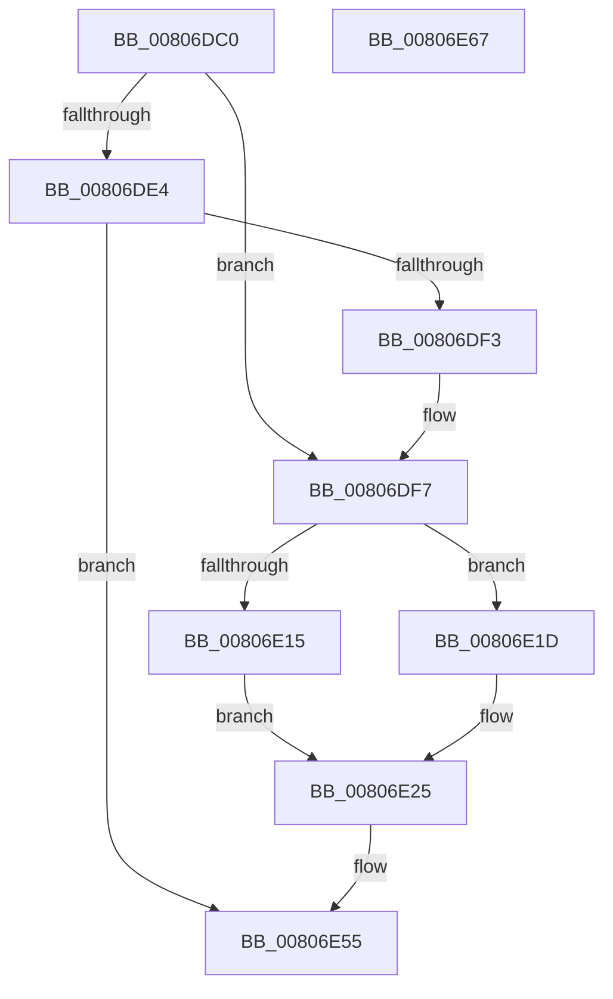

# MiPrepareToHotPatchImagePatchCallback

- RVA: `0x00806DC0`–`0x00806E68` (길이 `168` bytes)
- VA: `0x0000000140806DC0`
- 실행 섹션: `PAGE`
- PDB 이름 있음: `예`; PDB Function 태그: `아니요`
- unwind 정보 RVA: `0x0009E61C`
- 디코드: `46`개 명령, `168/168` bytes 표시
- 미해석 바이트: `0` (있으면 어셈블리에 `.byte`로 보존)

> 이 문서는 커널 이미지의 기계어와 PDB 기호를 분석해 생성했습니다. 4번과 5번은 함수 원형과 자료형을 바이너리 사용 방식에서 추정한 C 해석이며 원본 소스 복구 결과는 아닙니다.

## 1. Dependencies

- 직접 호출 지점: **3**; 고유 호출 대상: **3**
- 직접 호출자로 확인된 함수: **0**
- RIP 상대 이미지 참조: **0**

### Outgoing calls
- `0x00806E0C` → [RtlIsCodeInEcRanges](../../pagelk/B7/RtlIsCodeInEcRanges_function_00B757F0.md) (function, `0x00B757F0`)
- `0x00806E38` → [RtlDetermineHotPatchExtent](../84/RtlDetermineHotPatchExtent_function_00840D24.md) (function, `0x00840D24`)
- `0x00806E50` → [RtlClearBits](../../text/3E/RtlClearBits_function_003E1A90.md) (function, `0x003E1A90`)

### Direct callers
- 이 함수 시작 RVA로 연결되는 직접 call은 확인되지 않았습니다. 간접 호출은 완전히 역산할 수 없습니다.

### Static image references
- 디코드된 RIP-relative 메모리 참조가 없습니다.

## 2. Other-region calls and transfers

- 다른 실행 섹션으로 향하는 call: **2**
  - `0x00806E0C` → [RtlIsCodeInEcRanges](../../pagelk/B7/RtlIsCodeInEcRanges_function_00B757F0.md) (`PAGE` → `PAGELK`)
  - `0x00806E50` → [RtlClearBits](../../text/3E/RtlClearBits_function_003E1A90.md) (`PAGE` → `.text`)
- 별도 외부 분기/꼬리 이동을 확인하지 못했습니다.

## 3. Assembly (complete function range)

```asm
00806DC0  48 8B C4                        mov rax, rsp
00806DC3  48 89 58 10                     mov qword ptr [rax + 0x10], rbx
00806DC7  48 89 70 18                     mov qword ptr [rax + 0x18], rsi
00806DCB  57                              push rdi
00806DCC  48 83 EC 30                     sub rsp, 0x30
00806DD0  83 60 08 00                     and dword ptr [rax + 8], 0
00806DD4  41 8B F8                        mov edi, r8d
00806DD7  83 60 20 00                     and dword ptr [rax + 0x20], 0
00806DDB  41 0F B6 C1                     movzx eax, r9b
00806DDF  39 41 08                        cmp dword ptr [rcx + 8], eax
00806DE2  74 13                           je 0x140806df7
00806DE4  41 8B C0                        mov eax, r8d
00806DE7  25 00 C0 0F 00                  and eax, 0xfc000
00806DEC  3D 00 C0 05 00                  cmp eax, 0x5c000
00806DF1  75 62                           jne 0x140806e55
00806DF3  48 83 C2 04                     add rdx, 4
00806DF7  48 8B 19                        mov rbx, qword ptr [rcx]
00806DFA  8B 32                           mov esi, dword ptr [rdx]
00806DFC  8B CE                           mov ecx, esi
00806DFE  48 8B 93 90 00 00 00            mov rdx, qword ptr [rbx + 0x90]
00806E05  44 8B 83 98 00 00 00            mov r8d, dword ptr [rbx + 0x98]
00806E0C  E8 DF E9 36 00                  call 0x140b757f0
00806E11  84 C0                           test al, al
00806E13  74 08                           je 0x140806e1d
00806E15  41 B8 64 AA 00 00               mov r8d, 0xaa64
00806E1B  EB 08                           jmp 0x140806e25
00806E1D  44 0F B7 83 88 00 00 00         movzx r8d, word ptr [rbx + 0x88]
00806E25  48 8D 44 24 58                  lea rax, [rsp + 0x58]
00806E2A  8B D6                           mov edx, esi
00806E2C  4C 8D 4C 24 40                  lea r9, [rsp + 0x40]
00806E31  48 89 44 24 20                  mov qword ptr [rsp + 0x20], rax
00806E36  8B CF                           mov ecx, edi
00806E38  E8 E7 9E 03 00                  call 0x140840d24
00806E3D  44 8B 44 24 58                  mov r8d, dword ptr [rsp + 0x58]
00806E42  8B 54 24 40                     mov edx, dword ptr [rsp + 0x40]
00806E46  44 2B C2                        sub r8d, edx
00806E49  48 8B 4B 30                     mov rcx, qword ptr [rbx + 0x30]
00806E4D  41 FF C0                        inc r8d
00806E50  E8 3B AC BD FF                  call 0x1403e1a90
00806E55  48 8B 5C 24 48                  mov rbx, qword ptr [rsp + 0x48]
00806E5A  32 C0                           xor al, al
00806E5C  48 8B 74 24 50                  mov rsi, qword ptr [rsp + 0x50]
00806E61  48 83 C4 30                     add rsp, 0x30
00806E65  5F                              pop rdi
00806E66  C3                              ret
00806E67  CC                              int3
```

## 4. C-style interpretation (structured pseudocode)

```c
__int64 __fastcall MiPrepareToHotPatchImagePatchCallback(__int64 a1, __int64 a2, int a3, unsigned __int8 a4)
{
    __int64 result;
    __int64 v_rsp;
    unsigned __int64 v_stack_m18;
    unsigned __int64 v_stack_p10;
    unsigned __int64 v_stack_p18;
    unsigned __int64 v_stack_p20;
    unsigned __int64 v_stack_p8;

    *(unsigned __int64 *)(v_rsp + 16) = v_rbx;
    *(unsigned __int64 *)(v_rsp + 24) = v_rsi;
    v_rsp = (v_rsp) - (48);
    if ((*(unsigned int *)(a1 + 8)) == a4) goto loc_00806DF7;
    result = (unsigned int)(((unsigned int)(a3)) & (0xFC000ULL));
    if (((unsigned int)(result)) != 0x5C000ULL) goto loc_00806E55;
    a2 = (a2) + (4);
loc_00806DF7:
    result = RtlIsCodeInEcRanges((unsigned int)((unsigned int)((unsigned int)(*(unsigned int *)(a2)))), *(unsigned __int64 *)(*(unsigned __int64 *)(a1) + 144), (unsigned int)(*(unsigned int *)(*(unsigned __int64 *)(a1) + 152)), a4);
    if ((unsigned __int8)(result) == 0) goto loc_00806E1D;
    goto loc_00806E25;
loc_00806E1D:
loc_00806E25:
    v_stack_m18 = v_stack_p20;
    result = RtlDetermineHotPatchExtent((unsigned int)((unsigned int)((unsigned int)(a3))), (unsigned int)((unsigned int)((unsigned int)(*(unsigned int *)(a2)))), *(unsigned __int16 *)(*(unsigned __int64 *)(a1) + 136), v_stack_p8);
    a3 = (unsigned int)(((unsigned int)(v_stack_p20)) - ((unsigned int)((unsigned int)(v_stack_p8))));
    a3 = (unsigned int)((a3) + 1);
    result = RtlClearBits(*(unsigned __int64 *)(*(unsigned __int64 *)(a1) + 48), (unsigned int)(v_stack_p8), a3, v_stack_p8);
loc_00806E55:
    result = 0;
    v_rsp = (v_rsp) + (48);
    return result;
}
```

## 5. (Beta) C Style

```c
int64_t MiPrepareToHotPatchImagePatchCallback(void *Arg1, void *Arg2, int32_t Arg3, uint8_t Arg4)
{
    uint8_t *arg1 = (uint8_t *)Arg1;
    uint8_t *arg2 = (uint8_t *)Arg2;

    int64_t result;
    int64_t local_rsp;
    uint64_t v_stack_m18;
    uint64_t v_stack_p10;
    uint64_t v_stack_p18;
    uint64_t v_stack_p20;
    uint64_t v_stack_p8;

    *(uint64_t *)(local_rsp + 0x10) = local_rbx;
    *(uint64_t *)(local_rsp + 0x18) = local_rsi;
    local_rsp = (local_rsp) - (48);
    if ((*(uint32_t *)(arg1 + 0x8)) == Arg4) goto loc_00806DF7;
    result = (uint32_t)(((uint32_t)(Arg3)) & (0xFC000ULL));
    if (((uint32_t)(result)) != 0x5C000ULL) goto loc_00806E55;
    Arg2 = (Arg2) + (4);
loc_00806DF7:
    result = RtlIsCodeInEcRanges((uint32_t)((uint32_t)((uint32_t)(*(uint32_t *)(arg2)))), *(uint64_t *)(*(uint64_t *)(arg1) + 0x90), (uint32_t)(*(uint32_t *)(*(uint64_t *)(arg1) + 0x98)), Arg4);
    if ((uint8_t)(result) == 0) goto loc_00806E1D;
    goto loc_00806E25;
loc_00806E1D:
loc_00806E25:
    v_stack_m18 = v_stack_p20;
    result = RtlDetermineHotPatchExtent((uint32_t)((uint32_t)((uint32_t)(Arg3))), (uint32_t)((uint32_t)((uint32_t)(*(uint32_t *)(arg2)))), *(uint16_t *)(*(uint64_t *)(arg1) + 0x88), v_stack_p8);
    Arg3 = (uint32_t)(((uint32_t)(v_stack_p20)) - ((uint32_t)((uint32_t)(v_stack_p8))));
    Arg3 = (uint32_t)((Arg3) + 1);
    result = RtlClearBits(*(uint64_t *)(*(uint64_t *)(arg1) + 0x30), (uint32_t)(v_stack_p8), Arg3, v_stack_p8);
loc_00806E55:
    result = 0;
    local_rsp = (local_rsp) + (48);
    return result;
}
```

### 관측된 메모리 오프셋

구조체 형식이 확인되지 않은 접근은 인자 기준의 오프셋으로만 기록했습니다.

| 기준 인자 | 오프셋 표현 | 폭 (bit) | 접근 |
|---|---:|---:|---|
| `Arg1` | `+ 0x0` | `64` | `R` |
| `Arg1` | `+ 0x8` | `32` | `R` |
| `Arg2` | `+ 0x0` | `32` | `R` |

## 6. Execution-region graph

[열기: 2D/3D 그래프와 함수 탐색 컨트롤 패널](../../../control-panel.html?section=page&rva=0x00806DC0&view=graph)

- 2D 그래프는 위에서 아래로 흐르고, 3D 그래프는 빈 공간을 드래그해 회전합니다. Shift+드래그는 이동, 휠은 확대·축소, 함수 노드 선택은 대상 보고서 이동입니다.

### Static fallback


