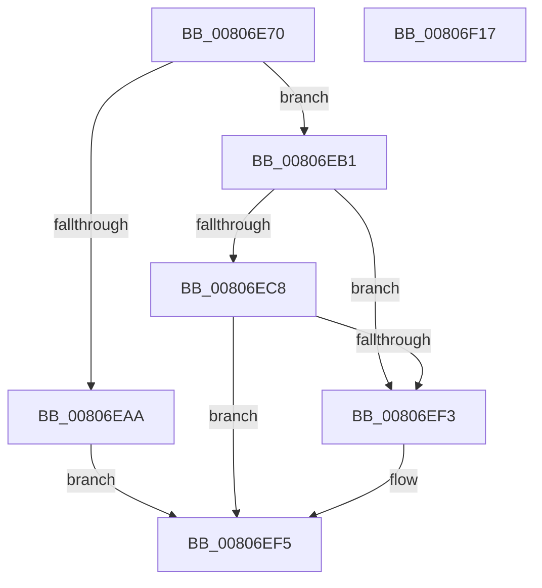

# MiPrepareToHotPatchVad

- RVA: `0x00806E70`–`0x00806F18` (길이 `168` bytes)
- VA: `0x0000000140806E70`
- 실행 섹션: `PAGE`
- PDB 이름 있음: `예`; PDB Function 태그: `아니요`
- unwind 정보 RVA: `0x0005C954`
- 디코드: `46`개 명령, `168/168` bytes 표시
- 미해석 바이트: `0` (있으면 어셈블리에 `.byte`로 보존)

> 이 문서는 커널 이미지의 기계어와 PDB 기호를 분석해 생성했습니다. 4번과 5번은 함수 원형과 자료형을 바이너리 사용 방식에서 추정한 C 해석이며 원본 소스 복구 결과는 아닙니다.

## 1. Dependencies

- 직접 호출 지점: **6**; 고유 호출 대상: **6**
- 직접 호출자로 확인된 함수: **1**
- RIP 상대 이미지 참조: **0**

### Outgoing calls
- `0x00806E99` → [MiLockVad](../../text/29/MiLockVad_function_00295810.md) (function, `0x00295810`)
- `0x00806EA1` → [MiVadDeleted](../../text/43/MiVadDeleted_function_00431350.md) (function, `0x00431350`)
- `0x00806EBC` → [MiInitializeImageHotPatchContext](../AD/MiInitializeImageHotPatchContext_function_00ADA2DC.md) (function, `0x00ADA2DC`)
- `0x00806ECF` → [MiBeginHoldingDirtyFaults](../../text/68/MiBeginHoldingDirtyFaults_function_00682F90.md) (function, `0x00682F90`)
- `0x00806EE8` → [MiPrepareToHotPatchImage](MiPrepareToHotPatchImage_function_00806820.md) (function, `0x00806820`)
- `0x00806EFB` → [MiUnlockVad](../../text/2A/MiUnlockVad_function_002A59C8.md) (function, `0x002A59C8`)

### Direct callers
- [MiApplyImageHotPatchRequest](MiApplyImageHotPatchRequest_function_008025AC.md) at `0x00802CD7`
- [MiApplyImageHotPatchRequest](MiApplyImageHotPatchRequest_function_008025AC.md) at `0x00802D16`

### Static image references
- 디코드된 RIP-relative 메모리 참조가 없습니다.

## 2. Other-region calls and transfers

- 다른 실행 섹션으로 향하는 call: **4**
  - `0x00806E99` → [MiLockVad](../../text/29/MiLockVad_function_00295810.md) (`PAGE` → `.text`)
  - `0x00806EA1` → [MiVadDeleted](../../text/43/MiVadDeleted_function_00431350.md) (`PAGE` → `.text`)
  - `0x00806ECF` → [MiBeginHoldingDirtyFaults](../../text/68/MiBeginHoldingDirtyFaults_function_00682F90.md) (`PAGE` → `.text`)
  - `0x00806EFB` → [MiUnlockVad](../../text/2A/MiUnlockVad_function_002A59C8.md) (`PAGE` → `.text`)
- 별도 외부 분기/꼬리 이동을 확인하지 못했습니다.

## 3. Assembly (complete function range)

```asm
00806E70  48 89 5C 24 08                  mov qword ptr [rsp + 8], rbx
00806E75  48 89 6C 24 10                  mov qword ptr [rsp + 0x10], rbp
00806E7A  48 89 74 24 18                  mov qword ptr [rsp + 0x18], rsi
00806E7F  57                              push rdi
00806E80  48 83 EC 20                     sub rsp, 0x20
00806E84  65 48 8B 34 25 88 01 00 00      mov rsi, qword ptr gs:[0x188]
00806E8D  48 8B E9                        mov rbp, rcx
00806E90  48 8B CE                        mov rcx, rsi
00806E93  49 8B D8                        mov rbx, r8
00806E96  48 8B FA                        mov rdi, rdx
00806E99  E8 72 E9 A8 FF                  call 0x140295810
00806E9E  48 8B CF                        mov rcx, rdi
00806EA1  E8 AA A4 C2 FF                  call 0x140431350
00806EA6  85 C0                           test eax, eax
00806EA8  74 07                           je 0x140806eb1
00806EAA  BB 18 00 00 C0                  mov ebx, 0xc0000018
00806EAF  EB 44                           jmp 0x140806ef5
00806EB1  0F B7 54 24 58                  movzx edx, word ptr [rsp + 0x58]
00806EB6  4C 8B C7                        mov r8, rdi
00806EB9  48 8B CB                        mov rcx, rbx
00806EBC  E8 1B 34 2D 00                  call 0x140ada2dc
00806EC1  83 7C 24 70 00                  cmp dword ptr [rsp + 0x70], 0
00806EC6  74 2B                           je 0x140806ef3
00806EC8  48 8D 53 58                     lea rdx, [rbx + 0x58]
00806ECC  48 8B CD                        mov rcx, rbp
00806ECF  E8 BC C0 E7 FF                  call 0x140682f90
00806ED4  4C 8B 44 24 68                  mov r8, qword ptr [rsp + 0x68]
00806ED9  48 8B CB                        mov rcx, rbx
00806EDC  48 8B 54 24 60                  mov rdx, qword ptr [rsp + 0x60]
00806EE1  83 8B 9C 00 00 00 02            or dword ptr [rbx + 0x9c], 2
00806EE8  E8 33 F9 FF FF                  call 0x140806820
00806EED  8B D8                           mov ebx, eax
00806EEF  85 C0                           test eax, eax
00806EF1  78 02                           js 0x140806ef5
00806EF3  33 DB                           xor ebx, ebx
00806EF5  48 8B D7                        mov rdx, rdi
00806EF8  48 8B CE                        mov rcx, rsi
00806EFB  E8 C8 EA A9 FF                  call 0x1402a59c8
00806F00  48 8B 6C 24 38                  mov rbp, qword ptr [rsp + 0x38]
00806F05  8B C3                           mov eax, ebx
00806F07  48 8B 5C 24 30                  mov rbx, qword ptr [rsp + 0x30]
00806F0C  48 8B 74 24 40                  mov rsi, qword ptr [rsp + 0x40]
00806F11  48 83 C4 20                     add rsp, 0x20
00806F15  5F                              pop rdi
00806F16  C3                              ret
00806F17  CC                              int3
```

## 4. C-style interpretation (structured pseudocode)

```c
__int64 __fastcall MiPrepareToHotPatchVad(__int64 a1, __int64 a2, __int64 a3, __int64 a4, __int64 a5, unsigned __int16 a6, __int64 a7, __int64 a8, unsigned int a9)
{
    __int64 result;
    __int64 v_rbx;
    __int64 v_rsp;
    unsigned __int64 v_stack_p10;
    unsigned __int64 v_stack_p18;
    unsigned __int64 v_stack_p8;

    v_stack_p8 = v_rbx;
    v_stack_p10 = v_rbp;
    v_stack_p18 = v_rsi;
    v_rsp = (v_rsp) - (32);
    result = MiLockVad(*(unsigned __int64 *)(gs_base + (0 + 392)), a2, a3, a4);
    result = MiVadDeleted(a2, a2, a3, a4);
    if ((unsigned int)(result) == 0) goto loc_00806EB1;
    goto loc_00806EF5;
loc_00806EB1:
    result = MiInitializeImageHotPatchContext((unsigned int)(0xC0000018ULL), a6, a2, a4);
    if (a9 == 0) goto loc_00806EF3;
    result = MiBeginHoldingDirtyFaults(a1, (unsigned int)(0xC0000018ULL) + 88, a2, a4);
    result = MiPrepareToHotPatchImage((unsigned int)(0xC0000018ULL), a7, a8, a4);
    v_rbx = (unsigned int)((unsigned int)(result));
    if (!(sign_flag)) {
        v_rbx = 0;
    }
    result = MiUnlockVad(*(unsigned __int64 *)(gs_base + (0 + 392)), a2, a8, a4);
    v_rsp = (v_rsp) + (32);
    return 0;
}
```

## 5. (Beta) C Style

```c
int64_t MiPrepareToHotPatchVad(int64_t Arg1, int64_t Arg2, void *Arg3, int64_t Arg4, uint64_t Arg5, uint16_t Arg6, int64_t Arg7, int64_t Arg8, uint32_t Arg9)
{
    uint8_t *arg3 = (uint8_t *)Arg3;

    int64_t result;
    int64_t local_rbx;
    int64_t local_rsp;
    uint64_t v_stack_p10;
    uint64_t v_stack_p18;
    uint64_t v_stack_p8;

    v_stack_p8 = local_rbx;
    v_stack_p10 = local_rbp;
    v_stack_p18 = local_rsi;
    local_rsp = (local_rsp) - (32);
    result = MiLockVad(*(uint64_t *)(gs_base + (0 + 0x188)), Arg2, Arg3, Arg4);
    result = MiVadDeleted(Arg2, Arg2, Arg3, Arg4);
    if ((uint32_t)(result) == 0) goto loc_00806EB1;
    goto loc_00806EF5;
loc_00806EB1:
    result = MiInitializeImageHotPatchContext((uint32_t)(0xC0000018ULL), Arg6, Arg2, Arg4);
    if (Arg9 == 0) goto loc_00806EF3;
    result = MiBeginHoldingDirtyFaults(Arg1, (uint32_t)(0xC0000018ULL) + 88, Arg2, Arg4);
    result = MiPrepareToHotPatchImage((uint32_t)(0xC0000018ULL), Arg7, Arg8, Arg4);
    local_rbx = (uint32_t)((uint32_t)(result));
    if (!(sign_flag)) {
        local_rbx = 0;
    }
    result = MiUnlockVad(*(uint64_t *)(gs_base + (0 + 0x188)), Arg2, Arg8, Arg4);
    local_rsp = (local_rsp) + (32);
    return 0;
}
```

### 관측된 메모리 오프셋

구조체 형식이 확인되지 않은 접근은 인자 기준의 오프셋으로만 기록했습니다.

| 기준 인자 | 오프셋 표현 | 폭 (bit) | 접근 |
|---|---:|---:|---|
| `Arg3` | `+ 0x58` | `64` | `R` |
| `Arg3` | `+ 0x9C` | `32` | `R/W` |

## 6. Execution-region graph

[열기: 2D/3D 그래프와 함수 탐색 컨트롤 패널](../../../control-panel.html?section=page&rva=0x00806E70&view=graph)

- 2D 그래프는 위에서 아래로 흐르고, 3D 그래프는 빈 공간을 드래그해 회전합니다. Shift+드래그는 이동, 휠은 확대·축소, 함수 노드 선택은 대상 보고서 이동입니다.

### Static fallback


