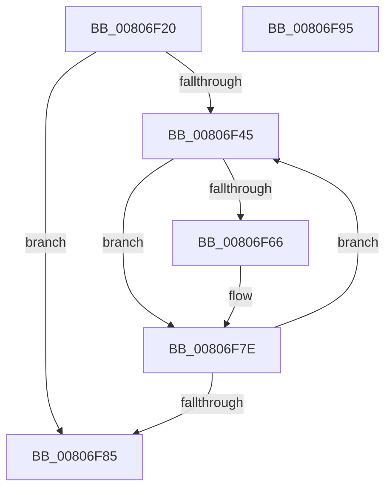

# MiProcessHotPatchUndoTable

- RVA: `0x00806F20`–`0x00806F96` (길이 `118` bytes)
- VA: `0x0000000140806F20`
- 실행 섹션: `PAGE`
- PDB 이름 있음: `예`; PDB Function 태그: `아니요`
- unwind 정보 RVA: `0x000C3DF4`
- 디코드: `36`개 명령, `118/118` bytes 표시
- 미해석 바이트: `0` (있으면 어셈블리에 `.byte`로 보존)

> 이 문서는 커널 이미지의 기계어와 PDB 기호를 분석해 생성했습니다. 4번과 5번은 함수 원형과 자료형을 바이너리 사용 방식에서 추정한 C 해석이며 원본 소스 복구 결과는 아닙니다.

## 1. Dependencies

- 직접 호출 지점: **2**; 고유 호출 대상: **2**
- 직접 호출자로 확인된 함수: **1**
- RIP 상대 이미지 참조: **0**

### Outgoing calls
- `0x00806F5D` → [RtlDetermineHotPatchUndoExtent](../84/RtlDetermineHotPatchUndoExtent_function_00840D9C.md) (function, `0x00840D9C`)
- `0x00806F79` → [RtlClearBits](../../text/3E/RtlClearBits_function_003E1A90.md) (function, `0x003E1A90`)

### Direct callers
- [MiPrepareToHotPatchImage](MiPrepareToHotPatchImage_function_00806820.md) at `0x0080696E`
- [MiPrepareToHotPatchImage](MiPrepareToHotPatchImage_function_00806820.md) at `0x00806B87`

### Static image references
- 디코드된 RIP-relative 메모리 참조가 없습니다.

## 2. Other-region calls and transfers

- 다른 실행 섹션으로 향하는 call: **1**
  - `0x00806F79` → [RtlClearBits](../../text/3E/RtlClearBits_function_003E1A90.md) (`PAGE` → `.text`)
- 별도 외부 분기/꼬리 이동을 확인하지 못했습니다.

## 3. Assembly (complete function range)

```asm
00806F20  48 8B C4                        mov rax, rsp
00806F23  48 89 58 08                     mov qword ptr [rax + 8], rbx
00806F27  48 89 70 20                     mov qword ptr [rax + 0x20], rsi
00806F2B  57                              push rdi
00806F2C  48 83 EC 30                     sub rsp, 0x30
00806F30  83 60 18 00                     and dword ptr [rax + 0x18], 0
00806F34  33 DB                           xor ebx, ebx
00806F36  83 60 10 00                     and dword ptr [rax + 0x10], 0
00806F3A  48 8B FA                        mov rdi, rdx
00806F3D  48 8B F1                        mov rsi, rcx
00806F40  39 5A 10                        cmp dword ptr [rdx + 0x10], ebx
00806F43  76 40                           jbe 0x140806f85
00806F45  48 8B 4F 18                     mov rcx, qword ptr [rdi + 0x18]
00806F49  48 8D 44 24 48                  lea rax, [rsp + 0x48]
00806F4E  4C 8D 4C 24 50                  lea r9, [rsp + 0x50]
00806F53  48 89 44 24 20                  mov qword ptr [rsp + 0x20], rax
00806F58  44 8B C3                        mov r8d, ebx
00806F5B  33 D2                           xor edx, edx
00806F5D  E8 3A 9E 03 00                  call 0x140840d9c
00806F62  84 C0                           test al, al
00806F64  74 18                           je 0x140806f7e
00806F66  44 8B 44 24 48                  mov r8d, dword ptr [rsp + 0x48]
00806F6B  8B 54 24 50                     mov edx, dword ptr [rsp + 0x50]
00806F6F  44 2B C2                        sub r8d, edx
00806F72  48 8B 4E 30                     mov rcx, qword ptr [rsi + 0x30]
00806F76  41 FF C0                        inc r8d
00806F79  E8 12 AB BD FF                  call 0x1403e1a90
00806F7E  FF C3                           inc ebx
00806F80  3B 5F 10                        cmp ebx, dword ptr [rdi + 0x10]
00806F83  72 C0                           jb 0x140806f45
00806F85  48 8B 5C 24 40                  mov rbx, qword ptr [rsp + 0x40]
00806F8A  48 8B 74 24 58                  mov rsi, qword ptr [rsp + 0x58]
00806F8F  48 83 C4 30                     add rsp, 0x30
00806F93  5F                              pop rdi
00806F94  C3                              ret
00806F95  CC                              int3
```

## 4. C-style interpretation (structured pseudocode)

```c
__int64 __fastcall MiProcessHotPatchUndoTable(__int64 a1, __int64 a2)
{
    __int64 result;
    __int64 v_rbx;
    __int64 v_rsp;
    unsigned __int64 v_stack_m18;
    unsigned __int64 v_stack_p10;
    unsigned __int64 v_stack_p18;
    unsigned __int64 v_stack_p20;
    unsigned __int64 v_stack_p8;

    *(unsigned __int64 *)(v_rsp + 8) = v_rbx;
    *(unsigned __int64 *)(v_rsp + 32) = v_rsi;
    v_rsp = (v_rsp) - (48);
    v_rbx = 0;
    if ((*(unsigned int *)(a2 + 16)) <= 0) goto loc_00806F85;
loc_00806F45:
    v_stack_m18 = v_stack_p10;
    a2 = 0;
    result = RtlDetermineHotPatchUndoExtent(*(unsigned __int64 *)(a2 + 24), a2, 0, v_stack_p18);
    if ((unsigned __int8)(result) != 0) {
        a3 = v_stack_p10;
        a2 = v_stack_p18;
        a3 = (unsigned int)((a3) - ((unsigned int)(a2)));
        a1 = *(unsigned __int64 *)(a1 + 48);
        a3 = (unsigned int)((a3) + 1);
        result = RtlClearBits(a1, a2, a3, v_stack_p18);
    }
    v_rbx = (unsigned int)((v_rbx) + 1);
    if (((unsigned int)(v_rbx)) < (*(unsigned int *)(a2 + 16))) goto loc_00806F45;
loc_00806F85:
    v_rsp = (v_rsp) + (48);
    return result;
}
```

## 5. (Beta) C Style

```c
int64_t MiProcessHotPatchUndoTable(void *Arg1, void *Arg2)
{
    uint8_t *arg1 = (uint8_t *)Arg1;
    uint8_t *arg2 = (uint8_t *)Arg2;

    int64_t result;
    int64_t local_rbx;
    int64_t local_rsp;
    uint64_t v_stack_m18;
    uint64_t v_stack_p10;
    uint64_t v_stack_p18;
    uint64_t v_stack_p20;
    uint64_t v_stack_p8;

    *(uint64_t *)(local_rsp + 0x8) = local_rbx;
    *(uint64_t *)(local_rsp + 0x20) = local_rsi;
    local_rsp = (local_rsp) - (48);
    local_rbx = 0;
    if ((*(uint32_t *)(arg2 + 0x10)) <= 0) goto loc_00806F85;
loc_00806F45:
    v_stack_m18 = v_stack_p10;
    Arg2 = 0;
    result = RtlDetermineHotPatchUndoExtent(*(uint64_t *)(arg2 + 0x18), Arg2, 0, v_stack_p18);
    if ((uint8_t)(result) != 0) {
        a3 = v_stack_p10;
        Arg2 = v_stack_p18;
        a3 = (uint32_t)((a3) - ((uint32_t)(Arg2)));
        Arg1 = *(uint64_t *)(arg1 + 0x30);
        a3 = (uint32_t)((a3) + 1);
        result = RtlClearBits(Arg1, Arg2, a3, v_stack_p18);
    }
    local_rbx = (uint32_t)((local_rbx) + 1);
    if (((uint32_t)(local_rbx)) < (*(uint32_t *)(arg2 + 0x10))) goto loc_00806F45;
loc_00806F85:
    local_rsp = (local_rsp) + (48);
    return result;
}
```

### 관측된 메모리 오프셋

구조체 형식이 확인되지 않은 접근은 인자 기준의 오프셋으로만 기록했습니다.

| 기준 인자 | 오프셋 표현 | 폭 (bit) | 접근 |
|---|---:|---:|---|
| `Arg1` | `+ 0x30` | `64` | `R` |
| `Arg2` | `+ 0x10` | `32` | `R` |
| `Arg2` | `+ 0x18` | `64` | `R` |

## 6. Execution-region graph

[열기: 2D/3D 그래프와 함수 탐색 컨트롤 패널](../../../control-panel.html?section=page&rva=0x00806F20&view=graph)

- 2D 그래프는 위에서 아래로 흐르고, 3D 그래프는 빈 공간을 드래그해 회전합니다. Shift+드래그는 이동, 휠은 확대·축소, 함수 노드 선택은 대상 보고서 이동입니다.

### Static fallback


