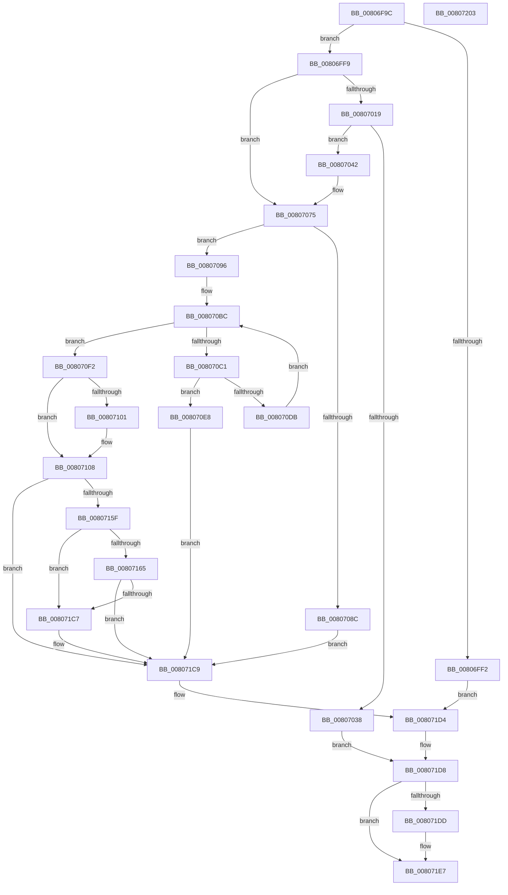

# MiProcessPatchImageCfg

- RVA: `0x00806F9C`–`0x00807204` (길이 `616` bytes)
- VA: `0x0000000140806F9C`
- 실행 섹션: `PAGE`
- PDB 이름 있음: `예`; PDB Function 태그: `아니요`
- unwind 정보 RVA: `0x000991EC`
- 디코드: `165`개 명령, `616/616` bytes 표시
- 미해석 바이트: `0` (있으면 어셈블리에 `.byte`로 보존)

> 이 문서는 커널 이미지의 기계어와 PDB 기호를 분석해 생성했습니다. 4번과 5번은 함수 원형과 자료형을 바이너리 사용 방식에서 추정한 C 해석이며 원본 소스 복구 결과는 아닙니다.

## 1. Dependencies

- 직접 호출 지점: **12**; 고유 호출 대상: **10**
- 직접 호출자로 확인된 함수: **1**
- RIP 상대 이미지 참조: **3**

### Outgoing calls
- `0x0080700A` → [RtlEnumerateHotPatchPatches](../84/RtlEnumerateHotPatchPatches_function_00840DE8.md) (function, `0x00840DE8`)
- `0x0080702A` → [MiAllocatePool](../../text/35/MiAllocatePool_function_0035B540.md) (function, `0x0035B540`)
- `0x00807057` → [RtlEnumerateHotPatchPatches](../84/RtlEnumerateHotPatchPatches_function_00840DE8.md) (function, `0x00840DE8`)
- `0x00807070` → [qsort](../../text/50/qsort_function_005009F0.md) (function, `0x005009F0`)
- `0x0080707B` → [MiLockVad](../../text/29/MiLockVad_function_00295810.md) (function, `0x00295810`)
- `0x00807083` → [MiVadDeleted](../../text/43/MiVadDeleted_function_00431350.md) (function, `0x00431350`)
- `0x008070B2` → [MiSelectCfgBitMap](../9F/MiSelectCfgBitMap_function_009F5244.md) (function, `0x009F5244`)
- `0x008070F8` → [MiReadVadFlags2](../../text/45/MiReadVadFlags2_function_00452C1C.md) (function, `0x00452C1C`)
- `0x00807154` → [MiPopulateCfgBitMap](../8D/MiPopulateCfgBitMap_function_008D0FA4.md) (function, `0x008D0FA4`)
- `0x008071BC` → [MiPopulateCfgBitMap](../8D/MiPopulateCfgBitMap_function_008D0FA4.md) (function, `0x008D0FA4`)
- `0x008071CF` → [MiUnlockVad](../../text/2A/MiUnlockVad_function_002A59C8.md) (function, `0x002A59C8`)
- `0x008071E2` → [ExFreePoolWithTag](../../poolcode/B8/ExFreePoolWithTag_function_00B82870.md) (function, `0x00B82870`)

### Direct callers
- [MiApplyImageHotPatchRequest](MiApplyImageHotPatchRequest_function_008025AC.md) at `0x00802D3D`

### Static image references
- `0x00807000` → RVA `0x00803590` (`MiFillPatchCallTargets`; read)
- `0x0080705F` → RVA `0x008065F0` (`MiPatchCfgCallTargetsSort`; read)
- `0x00807101` → RVA `0x00E2D8AC` (`.data`; read)

## 2. Other-region calls and transfers

- 다른 실행 섹션으로 향하는 call: **7**
  - `0x0080702A` → [MiAllocatePool](../../text/35/MiAllocatePool_function_0035B540.md) (`PAGE` → `.text`)
  - `0x00807070` → [qsort](../../text/50/qsort_function_005009F0.md) (`PAGE` → `.text`)
  - `0x0080707B` → [MiLockVad](../../text/29/MiLockVad_function_00295810.md) (`PAGE` → `.text`)
  - `0x00807083` → [MiVadDeleted](../../text/43/MiVadDeleted_function_00431350.md) (`PAGE` → `.text`)
  - `0x008070F8` → [MiReadVadFlags2](../../text/45/MiReadVadFlags2_function_00452C1C.md) (`PAGE` → `.text`)
  - `0x008071CF` → [MiUnlockVad](../../text/2A/MiUnlockVad_function_002A59C8.md) (`PAGE` → `.text`)
  - `0x008071E2` → [ExFreePoolWithTag](../../poolcode/B8/ExFreePoolWithTag_function_00B82870.md) (`PAGE` → `POOLCODE`)
- 별도 외부 분기/꼬리 이동을 확인하지 못했습니다.

## 3. Assembly (complete function range)

```asm
00806F9C  48 89 5C 24 08                  mov qword ptr [rsp + 8], rbx
00806FA1  48 89 74 24 10                  mov qword ptr [rsp + 0x10], rsi
00806FA6  48 89 7C 24 18                  mov qword ptr [rsp + 0x18], rdi
00806FAB  55                              push rbp
00806FAC  41 56                           push r14
00806FAE  41 57                           push r15
00806FB0  48 8B EC                        mov rbp, rsp
00806FB3  48 83 EC 60                     sub rsp, 0x60
00806FB7  83 65 38 00                     and dword ptr [rbp + 0x38], 0
00806FBB  33 C0                           xor eax, eax
00806FBD  48 89 45 F0                     mov qword ptr [rbp - 0x10], rax
00806FC1  0F 57 C0                        xorps xmm0, xmm0
00806FC4  0F 11 45 E0                     movups xmmword ptr [rbp - 0x20], xmm0
00806FC8  65 48 8B 34 25 88 01 00 00      mov rsi, qword ptr gs:[0x188]
00806FD1  49 8B D8                        mov rbx, r8
00806FD4  4C 8B F2                        mov r14, rdx
00806FD7  48 8B F9                        mov rdi, rcx
00806FDA  4C 8B BE B8 00 00 00            mov r15, qword ptr [rsi + 0xb8]
00806FE1  49 8B 87 10 04 00 00            mov rax, qword ptr [r15 + 0x410]
00806FE8  48 83 B8 A8 04 00 00 00         cmp qword ptr [rax + 0x4a8], 0
00806FF0  75 07                           jne 0x140806ff9
00806FF2  33 DB                           xor ebx, ebx
00806FF4  E9 DB 01 00 00                  jmp 0x1408071d4
00806FF9  4C 8D 4D E0                     lea r9, [rbp - 0x20]
00806FFD  48 8B D3                        mov rdx, rbx
00807000  4C 8D 05 89 C5 FF FF            lea r8, [rip - 0x3a77]
00807007  49 8B CE                        mov rcx, r14
0080700A  E8 D9 9D 03 00                  call 0x140840de8
0080700F  8B 45 E0                        mov eax, dword ptr [rbp - 0x20]
00807012  89 45 38                        mov dword ptr [rbp + 0x38], eax
00807015  85 C0                           test eax, eax
00807017  74 5C                           je 0x140807075
00807019  8B D0                           mov edx, eax
0080701B  B9 00 01 00 00                  mov ecx, 0x100
00807020  48 C1 E2 04                     shl rdx, 4
00807024  41 B8 4D 6D 48 63               mov r8d, 0x63486d4d
0080702A  E8 11 45 B5 FF                  call 0x14035b540
0080702F  48 89 45 E8                     mov qword ptr [rbp - 0x18], rax
00807033  48 85 C0                        test rax, rax
00807036  75 0A                           jne 0x140807042
00807038  BB 9A 00 00 C0                  mov ebx, 0xc000009a
0080703D  E9 96 01 00 00                  jmp 0x1408071d8
00807042  83 65 E0 00                     and dword ptr [rbp - 0x20], 0
00807046  4C 8D 4D E0                     lea r9, [rbp - 0x20]
0080704A  4C 8D 05 3F C5 FF FF            lea r8, [rip - 0x3ac1]
00807051  48 8B D3                        mov rdx, rbx
00807054  49 8B CE                        mov rcx, r14
00807057  E8 8C 9D 03 00                  call 0x140840de8
0080705C  8B 55 E0                        mov edx, dword ptr [rbp - 0x20]
0080705F  4C 8D 0D 8A F5 FF FF            lea r9, [rip - 0xa76]
00807066  48 8B 4D E8                     mov rcx, qword ptr [rbp - 0x18]
0080706A  41 B8 10 00 00 00               mov r8d, 0x10
00807070  E8 7B 99 CF FF                  call 0x1405009f0
00807075  48 8B D7                        mov rdx, rdi
00807078  48 8B CE                        mov rcx, rsi
0080707B  E8 90 E7 A8 FF                  call 0x140295810
00807080  48 8B CF                        mov rcx, rdi
00807083  E8 C8 A2 C2 FF                  call 0x140431350
00807088  85 C0                           test eax, eax
0080708A  74 0A                           je 0x140807096
0080708C  BB 18 00 00 C0                  mov ebx, 0xc0000018
00807091  E9 33 01 00 00                  jmp 0x1408071c9
00807096  8B 47 18                        mov eax, dword ptr [rdi + 0x18]
00807099  49 8B CF                        mov rcx, r15
0080709C  0F B6 57 20                     movzx edx, byte ptr [rdi + 0x20]
008070A0  4C 8B 47 48                     mov r8, qword ptr [rdi + 0x48]
008070A4  48 C1 E2 20                     shl rdx, 0x20
008070A8  48 0B D0                        or rdx, rax
008070AB  48 C1 E2 0C                     shl rdx, 0xc
008070AF  4D 8B 00                        mov r8, qword ptr [r8]
008070B2  E8 8D E1 1E 00                  call 0x1409f5244
008070B7  4C 8B F0                        mov r14, rax
008070BA  33 D2                           xor edx, edx
008070BC  3B 55 38                        cmp edx, dword ptr [rbp + 0x38]
008070BF  73 31                           jae 0x1408070f2
008070C1  4C 8B 4D E8                     mov r9, qword ptr [rbp - 0x18]
008070C5  41 8B 4E 18                     mov ecx, dword ptr [r14 + 0x18]
008070C9  44 8B C2                        mov r8d, edx
008070CC  4D 03 C0                        add r8, r8
008070CF  43 8B 04 C1                     mov eax, dword ptr [r9 + r8*8]
008070D3  83 E0 0F                        and eax, 0xf
008070D6  48 3B C1                        cmp rax, rcx
008070D9  75 0D                           jne 0x1408070e8
008070DB  4B C7 44 C1 08 01 00 00 00      mov qword ptr [r9 + r8*8 + 8], 1
008070E4  FF C2                           inc edx
008070E6  EB D4                           jmp 0x1408070bc
008070E8  BB AA 00 00 C0                  mov ebx, 0xc00000aa
008070ED  E9 D7 00 00 00                  jmp 0x1408071c9
008070F2  48 8B CF                        mov rcx, rdi
008070F5  45 33 C0                        xor r8d, r8d
008070F8  E8 1F BB C4 FF                  call 0x140452c1c
008070FD  A8 20                           test al, 0x20
008070FF  74 07                           je 0x140807108
00807101  44 8B 05 A4 67 62 00            mov r8d, dword ptr [rip + 0x6267a4]
00807108  8B 47 1C                        mov eax, dword ptr [rdi + 0x1c]
0080710B  45 8D 78 FF                     lea r15d, [r8 - 1]
0080710F  0F B6 57 21                     movzx edx, byte ptr [rdi + 0x21]
00807113  45 33 C9                        xor r9d, r9d
00807116  0F B6 4F 20                     movzx ecx, byte ptr [rdi + 0x20]
0080711A  48 83 64 24 30 00               and qword ptr [rsp + 0x30], 0
00807120  48 C1 E2 20                     shl rdx, 0x20
00807124  48 0B D0                        or rdx, rax
00807127  48 C1 E1 20                     shl rcx, 0x20
0080712B  8B 47 18                        mov eax, dword ptr [rdi + 0x18]
0080712E  48 C1 E2 0C                     shl rdx, 0xc
00807132  48 0B C8                        or rcx, rax
00807135  48 81 CA FF 0F 00 00            or rdx, 0xfff
0080713C  48 C1 E1 0C                     shl rcx, 0xc
00807140  49 2B D7                        sub rdx, r15
00807143  48 89 54 24 28                  mov qword ptr [rsp + 0x28], rdx
00807148  41 8D 51 01                     lea edx, [r9 + 1]
0080714C  48 89 4C 24 20                  mov qword ptr [rsp + 0x20], rcx
00807151  49 8B CE                        mov rcx, r14
00807154  E8 4B 9E 0C 00                  call 0x1408d0fa4
00807159  8B D8                           mov ebx, eax
0080715B  85 C0                           test eax, eax
0080715D  78 6A                           js 0x1408071c9
0080715F  83 7D 38 00                     cmp dword ptr [rbp + 0x38], 0
00807163  76 62                           jbe 0x1408071c7
00807165  0F B6 4F 21                     movzx ecx, byte ptr [rdi + 0x21]
00807169  48 8D 45 38                     lea rax, [rbp + 0x38]
0080716D  0F B6 57 20                     movzx edx, byte ptr [rdi + 0x20]
00807171  41 B9 01 00 00 00               mov r9d, 1
00807177  48 83 64 24 30 00               and qword ptr [rsp + 0x30], 0
0080717D  83 65 38 00                     and dword ptr [rbp + 0x38], 0
00807181  48 C1 E1 20                     shl rcx, 0x20
00807185  48 C1 E2 20                     shl rdx, 0x20
00807189  48 89 45 F0                     mov qword ptr [rbp - 0x10], rax
0080718D  8B 47 1C                        mov eax, dword ptr [rdi + 0x1c]
00807190  48 0B C8                        or rcx, rax
00807193  8B 47 18                        mov eax, dword ptr [rdi + 0x18]
00807196  48 C1 E1 0C                     shl rcx, 0xc
0080719A  48 0B D0                        or rdx, rax
0080719D  48 81 C9 FF 0F 00 00            or rcx, 0xfff
008071A4  48 C1 E2 0C                     shl rdx, 0xc
008071A8  49 2B CF                        sub rcx, r15
008071AB  48 89 4C 24 28                  mov qword ptr [rsp + 0x28], rcx
008071B0  49 8B CE                        mov rcx, r14
008071B3  48 89 54 24 20                  mov qword ptr [rsp + 0x20], rdx
008071B8  48 8D 55 E0                     lea rdx, [rbp - 0x20]
008071BC  E8 E3 9D 0C 00                  call 0x1408d0fa4
008071C1  8B D8                           mov ebx, eax
008071C3  85 C0                           test eax, eax
008071C5  78 02                           js 0x1408071c9
008071C7  33 DB                           xor ebx, ebx
008071C9  48 8B D7                        mov rdx, rdi
008071CC  48 8B CE                        mov rcx, rsi
008071CF  E8 F4 E7 A9 FF                  call 0x1402a59c8
008071D4  48 8B 45 E8                     mov rax, qword ptr [rbp - 0x18]
008071D8  48 85 C0                        test rax, rax
008071DB  74 0A                           je 0x1408071e7
008071DD  33 D2                           xor edx, edx
008071DF  48 8B C8                        mov rcx, rax
008071E2  E8 89 B6 37 00                  call 0x140b82870
008071E7  4C 8D 5C 24 60                  lea r11, [rsp + 0x60]
008071EC  8B C3                           mov eax, ebx
008071EE  49 8B 5B 20                     mov rbx, qword ptr [r11 + 0x20]
008071F2  49 8B 73 28                     mov rsi, qword ptr [r11 + 0x28]
008071F6  49 8B 7B 30                     mov rdi, qword ptr [r11 + 0x30]
008071FA  49 8B E3                        mov rsp, r11
008071FD  41 5F                           pop r15
008071FF  41 5E                           pop r14
00807201  5D                              pop rbp
00807202  C3                              ret
00807203  CC                              int3
```

## 4. C-style interpretation (structured pseudocode)

```c
__int64 __fastcall MiProcessPatchImageCfg(__int64 a1, __int64 a2, __int64 a3)
{
    __int64 result;
    __int64 v_rbx;
    __int64 v_rsp;
    unsigned __int64 v_stack_m18;
    unsigned __int64 v_stack_m28;
    unsigned __int64 v_stack_m30;
    unsigned __int64 v_stack_m38;
    unsigned __int64 v_stack_m48;
    unsigned __int64 v_stack_m50;
    unsigned __int64 v_stack_m58;
    unsigned __int64 v_stack_p10;
    unsigned __int64 v_stack_p18;
    unsigned int v_stack_p20;
    unsigned __int64 v_stack_p8;

    v_stack_p8 = v_rbx;
    v_stack_p10 = v_rsi;
    v_stack_p18 = v_rdi;
    v_rsp = (v_rsp) - (96);
    result = 0;
    v_stack_m28 = 0;
    v_stack_m38 = v_xmm0;
    if ((*(unsigned __int64 *)(*(unsigned __int64 *)(*(unsigned __int64 *)(*(unsigned __int64 *)(gs_base + (0 + 392)) + 184) + 1040) + 1192)) != 0) goto loc_00806FF9;
    v_rbx = 0;
    goto loc_008071D4;
loc_00806FF9:
    result = RtlEnumerateHotPatchPatches(a2, 0, v_rip - 14967, v_stack_m38);
    v_stack_p20 = (unsigned int)((unsigned int)(v_stack_m38));
    if ((unsigned int)((unsigned int)(v_stack_m38)) == 0) goto loc_00807075;
    a2 = ((unsigned int)((unsigned int)((unsigned int)(v_stack_m38)))) << (4);
    result = MiAllocatePool(256, a2, (unsigned int)(0x63486D4DULL), v_stack_m38);
    v_stack_m30 = result;
    if (result != 0) goto loc_00807042;
    goto loc_008071D8;
loc_00807042:
    result = RtlEnumerateHotPatchPatches(a2, (unsigned int)(0xC000009AULL), v_rip - 15041, v_stack_m38);
    result = qsort(v_stack_m30, (unsigned int)(v_stack_m38), 16, v_rip - 2678);
loc_00807075:
    result = MiLockVad(*(unsigned __int64 *)(gs_base + (0 + 392)), a1, 16, v_rip - 2678);
    result = MiVadDeleted(a1, a1, 16, v_rip - 2678);
    if ((unsigned int)(result) == 0) goto loc_00807096;
    goto loc_008071C9;
loc_00807096:
    a2 = (*(unsigned __int8 *)(a1 + 32)) << (32);
    a2 = (a2) | ((unsigned int)(*(unsigned int *)(a1 + 24)));
    a2 = (a2) << (12);
    result = MiSelectCfgBitMap(*(unsigned __int64 *)(*(unsigned __int64 *)(gs_base + (0 + 392)) + 184), a2, *(unsigned __int64 *)(*(unsigned __int64 *)(a1 + 72)), v_rip - 2678);
    a2 = 0;
loc_008070BC:
    if (0 >= v_stack_p20) goto loc_008070F2;
    a3 = (0) + (0);
    result = (unsigned int)(((unsigned int)(*(unsigned int *)(v_stack_m30 + a3 * 8))) & (15));
    if (result != ((unsigned int)(*(unsigned int *)(result + 24)))) goto loc_008070E8;
    *(unsigned __int64 *)(v_stack_m30 + a3 * 8 + 8) = 1;
    a2 = (unsigned int)((a2) + 1);
    goto loc_008070BC;
loc_008070E8:
    goto loc_008071C9;
loc_008070F2:
    a3 = 0;
    result = MiReadVadFlags2(a1, a2, a3, v_stack_m30);
    if ((((unsigned __int8)(result)) & (32)) != 0) {
        a3 = *(unsigned int *)(v_rip + 6449060);
    }
    a4 = 0;
    a2 = (*(unsigned __int8 *)(a1 + 33)) << (32);
    a2 = (a2) | ((unsigned int)(*(unsigned int *)(a1 + 28)));
    a1 = (*(unsigned __int8 *)(a1 + 32)) << (32);
    a2 = (a2) << (12);
    a1 = (a1) | ((unsigned int)(*(unsigned int *)(a1 + 24)));
    a2 = (a2) | (0xFFFULL);
    a1 = (a1) << (12);
    a2 = (a2) - (a3 - 1);
    v_stack_m50 = a2;
    v_stack_m58 = a1;
    result = MiPopulateCfgBitMap(result, a4 + 1, a3, a4);
    if (sign_flag) goto loc_008071C9;
    if (v_stack_p20 <= 0) goto loc_008071C7;
    a1 = (*(unsigned __int8 *)(a1 + 33)) << (32);
    a2 = (*(unsigned __int8 *)(a1 + 32)) << (32);
    v_stack_m28 = v_stack_p20;
    a1 = (a1) | ((unsigned int)(*(unsigned int *)(a1 + 28)));
    a1 = (a1) << (12);
    a2 = (a2) | ((unsigned int)(*(unsigned int *)(a1 + 24)));
    a1 = (a1) | (0xFFFULL);
    a2 = (a2) << (12);
    a1 = (a1) - (a3 - 1);
    v_stack_m50 = a1;
    v_stack_m58 = a2;
    result = MiPopulateCfgBitMap(result, v_stack_m38, a3, 1);
    v_rbx = (unsigned int)((unsigned int)(result));
    if (!(sign_flag)) {
        v_rbx = 0;
    }
    result = MiUnlockVad(*(unsigned __int64 *)(gs_base + (0 + 392)), a1, a3, 1);
loc_008071D4:
loc_008071D8:
    result = v_stack_m30;
    if (v_stack_m30 != 0) {
        a2 = 0;
        a1 = v_stack_m30;
        result = ExFreePoolWithTag(a1, a2, a3, 1);
    }
    return 0;
}
```

## 5. (Beta) C Style

```c
int64_t MiProcessPatchImageCfg(void *Arg1, int64_t Arg2, int64_t Arg3)
{
    uint8_t *arg1 = (uint8_t *)Arg1;

    int64_t result;
    int64_t local_rbx;
    int64_t local_rsp;
    uint64_t v_stack_m18;
    uint64_t v_stack_m28;
    uint64_t v_stack_m30;
    uint64_t v_stack_m38;
    uint64_t v_stack_m48;
    uint64_t v_stack_m50;
    uint64_t v_stack_m58;
    uint64_t v_stack_p10;
    uint64_t v_stack_p18;
    uint32_t v_stack_p20;
    uint64_t v_stack_p8;

    v_stack_p8 = local_rbx;
    v_stack_p10 = local_rsi;
    v_stack_p18 = local_rdi;
    local_rsp = (local_rsp) - (96);
    result = 0;
    v_stack_m28 = 0;
    v_stack_m38 = v_xmm0;
    if ((*(uint64_t *)(*(uint64_t *)(*(uint64_t *)(*(uint64_t *)(gs_base + (0 + 0x188)) + 0xB8) + 0x410) + 0x4A8)) != 0) goto loc_00806FF9;
    local_rbx = 0;
    goto loc_008071D4;
loc_00806FF9:
    result = RtlEnumerateHotPatchPatches(Arg2, 0, v_rip - 14967, v_stack_m38);
    v_stack_p20 = (uint32_t)((uint32_t)(v_stack_m38));
    if ((uint32_t)((uint32_t)(v_stack_m38)) == 0) goto loc_00807075;
    Arg2 = ((uint32_t)((uint32_t)((uint32_t)(v_stack_m38)))) << (4);
    result = MiAllocatePool(256, Arg2, (uint32_t)(0x63486D4DULL), v_stack_m38);
    v_stack_m30 = result;
    if (result != 0) goto loc_00807042;
    goto loc_008071D8;
loc_00807042:
    result = RtlEnumerateHotPatchPatches(Arg2, (uint32_t)(0xC000009AULL), v_rip - 15041, v_stack_m38);
    result = qsort(v_stack_m30, (uint32_t)(v_stack_m38), 16, v_rip - 2678);
loc_00807075:
    result = MiLockVad(*(uint64_t *)(gs_base + (0 + 0x188)), Arg1, 16, v_rip - 2678);
    result = MiVadDeleted(Arg1, Arg1, 16, v_rip - 2678);
    if ((uint32_t)(result) == 0) goto loc_00807096;
    goto loc_008071C9;
loc_00807096:
    Arg2 = (*(uint8_t *)(arg1 + 0x20)) << (32);
    Arg2 = (Arg2) | ((uint32_t)(*(uint32_t *)(arg1 + 0x18)));
    Arg2 = (Arg2) << (12);
    result = MiSelectCfgBitMap(*(uint64_t *)(*(uint64_t *)(gs_base + (0 + 0x188)) + 0xB8), Arg2, *(uint64_t *)(*(uint64_t *)(arg1 + 0x48)), v_rip - 2678);
    Arg2 = 0;
loc_008070BC:
    if (0 >= v_stack_p20) goto loc_008070F2;
    Arg3 = (0) + (0);
    result = (uint32_t)(((uint32_t)(*(uint32_t *)(v_stack_m30 + Arg3 * 8))) & (15));
    if (result != ((uint32_t)(*(uint32_t *)(result + 0x18)))) goto loc_008070E8;
    *(uint64_t *)(v_stack_m30 + Arg3 * 8 + 0x8) = 1;
    Arg2 = (uint32_t)((Arg2) + 1);
    goto loc_008070BC;
loc_008070E8:
    goto loc_008071C9;
loc_008070F2:
    Arg3 = 0;
    result = MiReadVadFlags2(Arg1, Arg2, Arg3, v_stack_m30);
    if ((((uint8_t)(result)) & (32)) != 0) {
        Arg3 = *(uint32_t *)(v_rip + 0x6267A4);
    }
    a4 = 0;
    Arg2 = (*(uint8_t *)(arg1 + 0x21)) << (32);
    Arg2 = (Arg2) | ((uint32_t)(*(uint32_t *)(arg1 + 0x1C)));
    Arg1 = (*(uint8_t *)(arg1 + 0x20)) << (32);
    Arg2 = (Arg2) << (12);
    Arg1 = (Arg1) | ((uint32_t)(*(uint32_t *)(arg1 + 0x18)));
    Arg2 = (Arg2) | (0xFFFULL);
    Arg1 = (Arg1) << (12);
    Arg2 = (Arg2) - (Arg3 - 1);
    v_stack_m50 = Arg2;
    v_stack_m58 = Arg1;
    result = MiPopulateCfgBitMap(result, a4 + 1, Arg3, a4);
    if (sign_flag) goto loc_008071C9;
    if (v_stack_p20 <= 0) goto loc_008071C7;
    Arg1 = (*(uint8_t *)(arg1 + 0x21)) << (32);
    Arg2 = (*(uint8_t *)(arg1 + 0x20)) << (32);
    v_stack_m28 = v_stack_p20;
    Arg1 = (Arg1) | ((uint32_t)(*(uint32_t *)(arg1 + 0x1C)));
    Arg1 = (Arg1) << (12);
    Arg2 = (Arg2) | ((uint32_t)(*(uint32_t *)(arg1 + 0x18)));
    Arg1 = (Arg1) | (0xFFFULL);
    Arg2 = (Arg2) << (12);
    Arg1 = (Arg1) - (Arg3 - 1);
    v_stack_m50 = Arg1;
    v_stack_m58 = Arg2;
    result = MiPopulateCfgBitMap(result, v_stack_m38, Arg3, 1);
    local_rbx = (uint32_t)((uint32_t)(result));
    if (!(sign_flag)) {
        local_rbx = 0;
    }
    result = MiUnlockVad(*(uint64_t *)(gs_base + (0 + 0x188)), Arg1, Arg3, 1);
loc_008071D4:
loc_008071D8:
    result = v_stack_m30;
    if (v_stack_m30 != 0) {
        Arg2 = 0;
        Arg1 = v_stack_m30;
        result = ExFreePoolWithTag(Arg1, Arg2, Arg3, 1);
    }
    return 0;
}
```

### 관측된 메모리 오프셋

구조체 형식이 확인되지 않은 접근은 인자 기준의 오프셋으로만 기록했습니다.

| 기준 인자 | 오프셋 표현 | 폭 (bit) | 접근 |
|---|---:|---:|---|
| `Arg1` | `+ 0x18` | `32` | `R` |
| `Arg1` | `+ 0x1C` | `32` | `R` |
| `Arg1` | `+ 0x20` | `8` | `R` |
| `Arg1` | `+ 0x21` | `8` | `R` |
| `Arg1` | `+ 0x48` | `64` | `R` |

## 6. Execution-region graph

[열기: 2D/3D 그래프와 함수 탐색 컨트롤 패널](../../../control-panel.html?section=page&rva=0x00806F9C&view=graph)

- 2D 그래프는 위에서 아래로 흐르고, 3D 그래프는 빈 공간을 드래그해 회전합니다. Shift+드래그는 이동, 휠은 확대·축소, 함수 노드 선택은 대상 보고서 이동입니다.

### Static fallback


