# MiQuerySpecialPurposeMemoryInformation

- RVA: `0x0080FBC8`–`0x0080FEC8` (길이 `768` bytes)
- VA: `0x000000014080FBC8`
- 실행 섹션: `PAGE`
- PDB 이름 있음: `예`; PDB Function 태그: `아니요`
- unwind 정보 RVA: `0x000D93C4`
- 디코드: `211`개 명령, `768/768` bytes 표시
- 미해석 바이트: `0` (있으면 어셈블리에 `.byte`로 보존)

> 이 문서는 커널 이미지의 기계어와 PDB 기호를 분석해 생성했습니다. 4번과 5번은 함수 원형과 자료형을 바이너리 사용 방식에서 추정한 C 해석이며 원본 소스 복구 결과는 아닙니다.

## 1. Dependencies

- 직접 호출 지점: **10**; 고유 호출 대상: **9**
- 직접 호출자로 확인된 함수: **1**
- RIP 상대 이미지 참조: **1**

### Outgoing calls
- `0x0080FC35` → [ProbeForWrite](../8E/ProbeForWrite_function_008E91C0.md) (function, `0x008E91C0`)
- `0x0080FC83` → [KeAbPreAcquire](../../text/21/KeAbPreAcquire_function_00210230.md) (function, `0x00210230`)
- `0x0080FCA4` → [ExfAcquirePushLockSharedEx](../../text/21/ExfAcquirePushLockSharedEx_function_0021044C.md) (function, `0x0021044C`)
- `0x0080FD58` → [MiAllocatePool](../../text/35/MiAllocatePool_function_0035B540.md) (function, `0x0035B540`)
- `0x0080FE39` → [ExfReleasePushLockShared](../../text/26/ExfReleasePushLockShared_function_00263440.md) (function, `0x00263440`)
- `0x0080FE45` → [KeAbPostRelease](../../text/2E/KeAbPostRelease_function_002E1600.md) (function, `0x002E1600`)
- `0x0080FE62` → [KiCheckForKernelApcDelivery](../../text/2E/KiCheckForKernelApcDelivery_function_002E2C80.md) (function, `0x002E2C80`)
- `0x0080FE83` → [memcpy](../../text/6C/memcpy_function_006C6840.md) (function, `0x006C6840`)
- `0x0080FEA1` → [memcpy](../../text/6C/memcpy_function_006C6840.md) (function, `0x006C6840`)
- `0x0080FEB0` → [ExFreePoolWithTag](../../poolcode/B8/ExFreePoolWithTag_function_00B82870.md) (function, `0x00B82870`)

### Direct callers
- [sub_00B2095C](../B2/Unknown_function_00B2095C.md) at `0x00B20A1E`

### Static image references
- `0x0080FCB7` → RVA `0x00E2EE80` (`.data`; read)

## 2. Other-region calls and transfers

- 다른 실행 섹션으로 향하는 call: **9**
  - `0x0080FC83` → [KeAbPreAcquire](../../text/21/KeAbPreAcquire_function_00210230.md) (`PAGE` → `.text`)
  - `0x0080FCA4` → [ExfAcquirePushLockSharedEx](../../text/21/ExfAcquirePushLockSharedEx_function_0021044C.md) (`PAGE` → `.text`)
  - `0x0080FD58` → [MiAllocatePool](../../text/35/MiAllocatePool_function_0035B540.md) (`PAGE` → `.text`)
  - `0x0080FE39` → [ExfReleasePushLockShared](../../text/26/ExfReleasePushLockShared_function_00263440.md) (`PAGE` → `.text`)
  - `0x0080FE45` → [KeAbPostRelease](../../text/2E/KeAbPostRelease_function_002E1600.md) (`PAGE` → `.text`)
  - `0x0080FE62` → [KiCheckForKernelApcDelivery](../../text/2E/KiCheckForKernelApcDelivery_function_002E2C80.md) (`PAGE` → `.text`)
  - `0x0080FE83` → [memcpy](../../text/6C/memcpy_function_006C6840.md) (`PAGE` → `.text`)
  - `0x0080FEA1` → [memcpy](../../text/6C/memcpy_function_006C6840.md) (`PAGE` → `.text`)
  - `0x0080FEB0` → [ExFreePoolWithTag](../../poolcode/B8/ExFreePoolWithTag_function_00B82870.md) (`PAGE` → `POOLCODE`)
- 별도 외부 분기/꼬리 이동을 확인하지 못했습니다.

## 3. Assembly (complete function range)

```asm
0080FBC8  48 8B C4                        mov rax, rsp
0080FBCB  44 88 48 20                     mov byte ptr [rax + 0x20], r9b
0080FBCF  44 89 40 18                     mov dword ptr [rax + 0x18], r8d
0080FBD3  48 89 50 10                     mov qword ptr [rax + 0x10], rdx
0080FBD7  48 89 48 08                     mov qword ptr [rax + 8], rcx
0080FBDB  53                              push rbx
0080FBDC  56                              push rsi
0080FBDD  57                              push rdi
0080FBDE  41 54                           push r12
0080FBE0  41 55                           push r13
0080FBE2  41 56                           push r14
0080FBE4  41 57                           push r15
0080FBE6  48 83 EC 50                     sub rsp, 0x50
0080FBEA  48 8B C2                        mov rax, rdx
0080FBED  4C 8B F9                        mov r15, rcx
0080FBF0  33 DB                           xor ebx, ebx
0080FBF2  8B F3                           mov esi, ebx
0080FBF4  48 89 5C 24 38                  mov qword ptr [rsp + 0x38], rbx
0080FBF9  44 8B F3                        mov r14d, ebx
0080FBFC  89 5C 24 24                     mov dword ptr [rsp + 0x24], ebx
0080FC00  65 4C 8B 2C 25 88 01 00 00      mov r13, qword ptr gs:[0x188]
0080FC09  4C 89 6C 24 40                  mov qword ptr [rsp + 0x40], r13
0080FC0E  41 83 F8 04                     cmp r8d, 4
0080FC12  73 10                           jae 0x14080fc24
0080FC14  BF 04 00 00 C0                  mov edi, 0xc0000004
0080FC19  44 8D 63 01                     lea r12d, [rbx + 1]
0080FC1D  8B C3                           mov eax, ebx
0080FC1F  E9 F6 01 00 00                  jmp 0x14080fe1a
0080FC24  45 84 C9                        test r9b, r9b
0080FC27  74 38                           je 0x14080fc61
0080FC29  41 8B D0                        mov edx, r8d
0080FC2C  41 B8 08 00 00 00               mov r8d, 8
0080FC32  48 8B C8                        mov rcx, rax
0080FC35  E8 86 95 0D 00                  call 0x1408e91c0
0080FC3A  EB 25                           jmp 0x14080fc61
0080FC3C  8B F8                           mov edi, eax
0080FC3E  33 DB                           xor ebx, ebx
0080FC40  44 8D 63 01                     lea r12d, [rbx + 1]
0080FC44  44 8D 53 11                     lea r10d, [rbx + 0x11]
0080FC48  8B F3                           mov esi, ebx
0080FC4A  44 8B F3                        mov r14d, ebx
0080FC4D  4C 8B 6C 24 40                  mov r13, qword ptr [rsp + 0x40]
0080FC52  8B C3                           mov eax, ebx
0080FC54  4C 8B BC 24 90 00 00 00         mov r15, qword ptr [rsp + 0x90]
0080FC5C  E9 BF 01 00 00                  jmp 0x14080fe20
0080FC61  41 BC 01 00 00 00               mov r12d, 1
0080FC67  48 83 C8 FF                     or rax, 0xffffffffffffffff
0080FC6B  66 41 01 85 E6 01 00 00         add word ptr [r13 + 0x1e6], ax
0080FC73  90                              nop
0080FC74  49 8D BF 08 45 00 00            lea rdi, [r15 + 0x4508]
0080FC7B  45 33 C0                        xor r8d, r8d
0080FC7E  33 D2                           xor edx, edx
0080FC80  48 8B CF                        mov rcx, rdi
0080FC83  E8 A8 05 A0 FF                  call 0x140210230
0080FC88  4C 8B F8                        mov r15, rax
0080FC8B  33 C0                           xor eax, eax
0080FC8D  45 8D 54 24 10                  lea r10d, [r12 + 0x10]
0080FC92  F0 4C 0F B1 17                  lock cmpxchg qword ptr [rdi], r10
0080FC97  74 15                           je 0x14080fcae
0080FC99  4C 8B CF                        mov r9, rdi
0080FC9C  4D 8B C7                        mov r8, r15
0080FC9F  33 D2                           xor edx, edx
0080FCA1  48 8B CF                        mov rcx, rdi
0080FCA4  E8 A3 07 A0 FF                  call 0x14021044c
0080FCA9  45 8D 54 24 10                  lea r10d, [r12 + 0x10]
0080FCAE  4D 85 FF                        test r15, r15
0080FCB1  74 04                           je 0x14080fcb7
0080FCB3  45 88 67 0A                     mov byte ptr [r15 + 0xa], r12b
0080FCB7  8B 05 C3 F1 61 00               mov eax, dword ptr [rip + 0x61f1c3]
0080FCBD  83 C0 20                        add eax, 0x20
0080FCC0  48 89 44 24 48                  mov qword ptr [rsp + 0x48], rax
0080FCC5  8B F8                           mov edi, eax
0080FCC7  48 89 44 24 30                  mov qword ptr [rsp + 0x30], rax
0080FCCC  4C 8B BC 24 90 00 00 00         mov r15, qword ptr [rsp + 0x90]
0080FCD4  49 81 C7 D8 44 00 00            add r15, 0x44d8
0080FCDB  49 8B 0F                        mov rcx, qword ptr [r15]
0080FCDE  49 3B CF                        cmp rcx, r15
0080FCE1  74 42                           je 0x14080fd25
0080FCE3  44 8B E8                        mov r13d, eax
0080FCE6  48 03 F8                        add rdi, rax
0080FCE9  4C 03 E8                        add r13, rax
0080FCEC  4C 8D 41 18                     lea r8, [rcx + 0x18]
0080FCF0  41 B9 04 00 00 00               mov r9d, 4
0080FCF6  48 8D 57 10                     lea rdx, [rdi + 0x10]
0080FCFA  49 83 38 FF                     cmp qword ptr [r8], -1
0080FCFE  48 0F 44 D7                     cmove rdx, rdi
0080FD02  4D 8D 40 08                     lea r8, [r8 + 8]
0080FD06  4D 2B CC                        sub r9, r12
0080FD09  48 8B FA                        mov rdi, rdx
0080FD0C  75 E8                           jne 0x14080fcf6
0080FD0E  48 8B 09                        mov rcx, qword ptr [rcx]
0080FD11  49 3B CF                        cmp rcx, r15
0080FD14  75 D0                           jne 0x14080fce6
0080FD16  4C 89 6C 24 30                  mov qword ptr [rsp + 0x30], r13
0080FD1B  44 8B 74 24 24                  mov r14d, dword ptr [rsp + 0x24]
0080FD20  4C 8B 6C 24 40                  mov r13, qword ptr [rsp + 0x40]
0080FD25  B8 FF FF FF FF                  mov eax, 0xffffffff
0080FD2A  48 3B F8                        cmp rdi, rax
0080FD2D  76 15                           jbe 0x14080fd44
0080FD2F  BF 95 00 00 C0                  mov edi, 0xc0000095
0080FD34  41 8B C4                        mov eax, r12d
0080FD37  4C 8B BC 24 90 00 00 00         mov r15, qword ptr [rsp + 0x90]
0080FD3F  E9 DC 00 00 00                  jmp 0x14080fe20
0080FD44  8B C7                           mov eax, edi
0080FD46  48 89 44 24 40                  mov qword ptr [rsp + 0x40], rax
0080FD4B  8B D7                           mov edx, edi
0080FD4D  B9 00 01 00 00                  mov ecx, 0x100
0080FD52  41 B8 4D 69 53 71               mov r8d, 0x7153694d
0080FD58  E8 E3 B7 B4 FF                  call 0x14035b540
0080FD5D  48 8B F0                        mov rsi, rax
0080FD60  48 89 44 24 38                  mov qword ptr [rsp + 0x38], rax
0080FD65  48 85 C0                        test rax, rax
0080FD68  75 0A                           jne 0x14080fd74
0080FD6A  BF 9A 00 00 C0                  mov edi, 0xc000009a
0080FD6F  E9 9B 00 00 00                  jmp 0x14080fe0f
0080FD74  8B 84 24 A0 00 00 00            mov eax, dword ptr [rsp + 0xa0]
0080FD7B  48 3B F8                        cmp rdi, rax
0080FD7E  76 15                           jbe 0x14080fd95
0080FD80  4C 8B 74 24 40                  mov r14, qword ptr [rsp + 0x40]
0080FD85  44 89 36                        mov dword ptr [rsi], r14d
0080FD88  BF 23 00 00 C0                  mov edi, 0xc0000023
0080FD8D  41 BE 04 00 00 00               mov r14d, 4
0080FD93  EB 7A                           jmp 0x14080fe0f
0080FD95  48 8B CE                        mov rcx, rsi
0080FD98  44 8B 44 24 30                  mov r8d, dword ptr [rsp + 0x30]
0080FD9D  4C 03 C6                        add r8, rsi
0080FDA0  49 8B 17                        mov rdx, qword ptr [r15]
0080FDA3  49 3B D7                        cmp rdx, r15
0080FDA6  74 60                           je 0x14080fe08
0080FDA8  4C 8B 5C 24 48                  mov r11, qword ptr [rsp + 0x48]
0080FDAD  44 89 19                        mov dword ptr [rcx], r11d
0080FDB0  C7 41 04 20 00 00 00            mov dword ptr [rcx + 4], 0x20
0080FDB7  41 8B C0                        mov eax, r8d
0080FDBA  2B C1                           sub eax, ecx
0080FDBC  89 41 0C                        mov dword ptr [rcx + 0xc], eax
0080FDBF  48 8B 42 10                     mov rax, qword ptr [rdx + 0x10]
0080FDC3  48 89 41 18                     mov qword ptr [rcx + 0x18], rax
0080FDC7  48 39 5A 48                     cmp qword ptr [rdx + 0x48], rbx
0080FDCB  74 04                           je 0x14080fdd1
0080FDCD  44 09 61 08                     or dword ptr [rcx + 8], r12d
0080FDD1  44 8B D3                        mov r10d, ebx
0080FDD4  4C 8D 4A 18                     lea r9, [rdx + 0x18]
0080FDD8  49 83 39 FF                     cmp qword ptr [r9], -1
0080FDDC  74 12                           je 0x14080fdf0
0080FDDE  45 89 10                        mov dword ptr [r8], r10d
0080FDE1  49 8B 01                        mov rax, qword ptr [r9]
0080FDE4  49 89 40 08                     mov qword ptr [r8 + 8], rax
0080FDE8  44 01 61 10                     add dword ptr [rcx + 0x10], r12d
0080FDEC  49 83 C0 10                     add r8, 0x10
0080FDF0  45 03 D4                        add r10d, r12d
0080FDF3  49 83 C1 08                     add r9, 8
0080FDF7  41 83 FA 04                     cmp r10d, 4
0080FDFB  72 DB                           jb 0x14080fdd8
0080FDFD  49 03 CB                        add rcx, r11
0080FE00  48 8B 12                        mov rdx, qword ptr [rdx]
0080FE03  49 3B D7                        cmp rdx, r15
0080FE06  75 A5                           jne 0x14080fdad
0080FE08  4C 8B 74 24 40                  mov r14, qword ptr [rsp + 0x40]
0080FE0D  8B FB                           mov edi, ebx
0080FE0F  41 8B C4                        mov eax, r12d
0080FE12  4C 8B BC 24 90 00 00 00         mov r15, qword ptr [rsp + 0x90]
0080FE1A  41 BA 11 00 00 00               mov r10d, 0x11
0080FE20  85 C0                           test eax, eax
0080FE22  74 43                           je 0x14080fe67
0080FE24  49 8B C2                        mov rax, r10
0080FE27  F0 49 0F B1 9F 08 45 00 00      lock cmpxchg qword ptr [r15 + 0x4508], rbx
0080FE30  74 0C                           je 0x14080fe3e
0080FE32  49 8D 8F 08 45 00 00            lea rcx, [r15 + 0x4508]
0080FE39  E8 02 36 A5 FF                  call 0x140263440
0080FE3E  49 8D 8F 08 45 00 00            lea rcx, [r15 + 0x4508]
0080FE45  E8 B6 17 AD FF                  call 0x1402e1600
0080FE4A  90                              nop
0080FE4B  66 45 01 A5 E6 01 00 00         add word ptr [r13 + 0x1e6], r12w
0080FE53  75 12                           jne 0x14080fe67
0080FE55  90                              nop
0080FE56  49 8D 85 98 00 00 00            lea rax, [r13 + 0x98]
0080FE5D  48 39 00                        cmp qword ptr [rax], rax
0080FE60  74 05                           je 0x14080fe67
0080FE62  E8 19 2E AD FF                  call 0x1402e2c80
0080FE67  45 85 F6                        test r14d, r14d
0080FE6A  74 3A                           je 0x14080fea6
0080FE6C  38 9C 24 A8 00 00 00            cmp byte ptr [rsp + 0xa8], bl
0080FE73  74 1E                           je 0x14080fe93
0080FE75  45 8B C6                        mov r8d, r14d
0080FE78  48 8B D6                        mov rdx, rsi
0080FE7B  48 8B 8C 24 98 00 00 00         mov rcx, qword ptr [rsp + 0x98]
0080FE83  E8 B8 69 EB FF                  call 0x1406c6840
0080FE88  EB 1C                           jmp 0x14080fea6
0080FE8A  8B F8                           mov edi, eax
0080FE8C  48 8B 74 24 38                  mov rsi, qword ptr [rsp + 0x38]
0080FE91  EB 13                           jmp 0x14080fea6
0080FE93  45 8B C6                        mov r8d, r14d
0080FE96  48 8B D6                        mov rdx, rsi
0080FE99  48 8B 8C 24 98 00 00 00         mov rcx, qword ptr [rsp + 0x98]
0080FEA1  E8 9A 69 EB FF                  call 0x1406c6840
0080FEA6  48 85 F6                        test rsi, rsi
0080FEA9  74 0A                           je 0x14080feb5
0080FEAB  33 D2                           xor edx, edx
0080FEAD  48 8B CE                        mov rcx, rsi
0080FEB0  E8 BB 29 37 00                  call 0x140b82870
0080FEB5  8B C7                           mov eax, edi
0080FEB7  48 83 C4 50                     add rsp, 0x50
0080FEBB  41 5F                           pop r15
0080FEBD  41 5E                           pop r14
0080FEBF  41 5D                           pop r13
0080FEC1  41 5C                           pop r12
0080FEC3  5F                              pop rdi
0080FEC4  5E                              pop rsi
0080FEC5  5B                              pop rbx
0080FEC6  C3                              ret
0080FEC7  CC                              int3
```

## 4. C-style interpretation (structured pseudocode)

```c
__int64 __fastcall MiQuerySpecialPurposeMemoryInformation(__int64 a1, __int64 a2, int a3, unsigned __int8 a4)
{
    __int64 result;
    __int64 v_r10;
    __int64 v_r13;
    __int64 v_r15;
    __int64 v_rbx;
    __int64 v_rdi;
    __int64 v_rsp;
    unsigned __int64 v_stack_m40;
    unsigned __int64 v_stack_m48;
    unsigned __int64 v_stack_m50;
    unsigned __int64 v_stack_m58;
    unsigned int v_stack_m64;
    unsigned __int64 v_stack_p10;
    unsigned int v_stack_p18;
    unsigned __int8 v_stack_p20;
    unsigned __int64 v_stack_p8;

    *(unsigned __int8 *)(v_rsp + 32) = a4;
    *(unsigned int *)(v_rsp + 24) = a3;
    *(unsigned __int64 *)(v_rsp + 16) = a2;
    *(unsigned __int64 *)(v_rsp + 8) = a1;
    v_rsp = (v_rsp) - (80);
    v_rbx = 0;
    v_stack_m50 = 0;
    v_stack_m64 = 0;
    v_stack_m48 = *(unsigned __int64 *)(gs_base + (0 + 392));
    if (a3 >= 4) goto loc_0080FC24;
    goto loc_0080FE1A;
loc_0080FC24:
    if (a4 == 0) goto loc_0080FC61;
    result = ProbeForWrite(0, (unsigned int)(a3), 8, a4);
    goto loc_0080FC61;
loc_0080FC61:
    result = (result) | (-1);
    a3 = 0;
    a2 = 0;
    result = KeAbPreAcquire(a1 + 17672, a2, a3, a4);
    result = 0;
    v_r10 = 1 + 16;
    if (!(condition_is_equal)) {
        a4 = a1 + 17672;
        a3 = 0;
        a2 = 0;
        a1 = a1 + 17672;
        result = ExfAcquirePushLockSharedEx(a1, a2, a3, a4);
        v_r10 = 1 + 16;
    }
    if (result != 0) {
        *(unsigned __int8 *)(result + 10) = 1;
    }
    result = (unsigned int)(((unsigned int)(*(unsigned int *)(v_rip + 6418883))) + (32));
    v_stack_m40 = result;
    v_stack_m58 = result;
    v_r15 = (v_stack_p8) + (0x44D8ULL);
    if ((*(unsigned __int64 *)(v_r15)) == v_r15) goto loc_0080FD25;
loc_0080FCE6:
    v_rdi = ((unsigned int)((unsigned int)(result))) + (result);
    v_r13 = ((unsigned int)((unsigned int)(result))) + (result);
loc_0080FCF6:
    a2 = v_rdi + 16;
    if ((*(unsigned __int64 *)(*(unsigned __int64 *)(v_r15) + 24)) == -1) { a2 = v_rdi; }
    a4 = (4) - (1);
    if (condition_is_not_equal) goto loc_0080FCF6;
    if ((*(unsigned __int64 *)(*(unsigned __int64 *)(v_r15))) != v_r15) goto loc_0080FCE6;
    v_stack_m58 = v_r13;
loc_0080FD25:
    if (a2 <= ((unsigned int)(0xFFFFFFFFULL))) goto loc_0080FD44;
    goto loc_0080FE20;
loc_0080FD44:
    v_stack_m48 = (unsigned int)((unsigned int)((unsigned int)(0xC0000095ULL)));
    result = MiAllocatePool(256, (unsigned int)((unsigned int)((unsigned int)(0xC0000095ULL))), (unsigned int)(0x7153694DULL), a4);
    v_stack_m50 = result;
    if (result != 0) goto loc_0080FD74;
    goto loc_0080FE0F;
loc_0080FD74:
    if (((unsigned int)(0xC000009AULL)) <= ((unsigned int)(v_stack_p18))) goto loc_0080FD95;
    *(unsigned int *)(result) = (unsigned int)(v_stack_m48);
    goto loc_0080FE0F;
loc_0080FD95:
    a3 = ((unsigned int)(v_stack_m58)) + (result);
    if ((*(unsigned __int64 *)(v_stack_p8)) == v_stack_p8) goto loc_0080FE08;
loc_0080FDAD:
    *(unsigned int *)(result) = (unsigned int)(v_stack_m40);
    *(unsigned int *)(result + 4) = 32;
    result = (unsigned int)(((unsigned int)(a3)) - ((unsigned int)(result)));
    *(unsigned int *)(result + 12) = (unsigned int)(result);
    *(unsigned __int64 *)(result + 24) = *(unsigned __int64 *)(*(unsigned __int64 *)(v_stack_p8) + 16);
    if ((*(unsigned __int64 *)(*(unsigned __int64 *)(v_stack_p8) + 72)) != 0) {
    }
loc_0080FDD8:
    result = *(unsigned __int64 *)(*(unsigned __int64 *)(v_stack_p8) + 16);
    if ((*(unsigned __int64 *)(*(unsigned __int64 *)(v_stack_p8) + 24)) != -1) {
        *(unsigned int *)(a3) = 0;
        result = *(unsigned __int64 *)(*(unsigned __int64 *)(v_stack_p8) + 24);
        *(unsigned __int64 *)(a3 + 8) = result;
        a3 = (a3) + (16);
    }
    v_r10 = (unsigned int)((0) + (1));
    a4 = (*(unsigned __int64 *)(v_stack_p8) + 24) + (8);
    if (((unsigned int)(v_r10)) < 4) goto loc_0080FDD8;
    a1 = (result) + (v_stack_m40);
    if ((*(unsigned __int64 *)(*(unsigned __int64 *)(v_stack_p8))) != v_stack_p8) goto loc_0080FDAD;
loc_0080FE08:
loc_0080FE0F:
loc_0080FE1A:
loc_0080FE20:
    if (1 == 0) goto loc_0080FE67;
    result = 17;
    if (1 != 0) {
        a1 = v_stack_p8 + 17672;
        result = ExfReleasePushLockShared(a1, *(unsigned __int64 *)(*(unsigned __int64 *)(v_stack_p8)), a3, a4);
    }
    result = KeAbPostRelease(v_stack_p8 + 17672, *(unsigned __int64 *)(*(unsigned __int64 *)(v_stack_p8)), a3, a4);
    if (1 != 0) goto loc_0080FE67;
    result = v_stack_m48 + 152;
    if ((*(unsigned __int64 *)(v_stack_m48 + 152)) != (v_stack_m48 + 152)) {
        result = KiCheckForKernelApcDelivery(v_stack_p8 + 17672, *(unsigned __int64 *)(*(unsigned __int64 *)(v_stack_p8)), a3, a4);
    }
    if ((unsigned int)(v_stack_m48) == 0) goto loc_0080FEA6;
    if (v_stack_p20 == 0) goto loc_0080FE93;
    result = memcpy(v_stack_p10, result, (unsigned int)((unsigned int)(v_stack_m48)), a4);
    goto loc_0080FEA6;
loc_0080FE93:
    result = memcpy(v_stack_p10, result, (unsigned int)((unsigned int)(v_stack_m48)), a4);
loc_0080FEA6:
    if (result != 0) {
        a2 = 0;
        a1 = result;
        result = ExFreePoolWithTag(a1, a2, (unsigned int)((unsigned int)(v_stack_m48)), a4);
    }
    v_rsp = (v_rsp) + (80);
    return 0;
}
```

## 5. (Beta) C Style

```c
int64_t MiQuerySpecialPurposeMemoryInformation(void *Arg1, int64_t Arg2, int32_t Arg3, uint8_t Arg4)
{
    uint8_t *arg1 = (uint8_t *)Arg1;

    int64_t result;
    int64_t local_r10;
    int64_t local_r13;
    int64_t local_r15;
    int64_t local_rbx;
    int64_t local_rdi;
    int64_t local_rsp;
    uint64_t v_stack_m40;
    uint64_t v_stack_m48;
    uint64_t v_stack_m50;
    uint64_t v_stack_m58;
    uint32_t v_stack_m64;
    uint64_t v_stack_p10;
    uint32_t v_stack_p18;
    uint8_t v_stack_p20;
    uint64_t v_stack_p8;

    *(uint8_t *)(local_rsp + 0x20) = Arg4;
    *(uint32_t *)(local_rsp + 0x18) = Arg3;
    *(uint64_t *)(local_rsp + 0x10) = Arg2;
    *(void **)(local_rsp + 0x8) = Arg1;
    local_rsp = (local_rsp) - (80);
    local_rbx = 0;
    v_stack_m50 = 0;
    v_stack_m64 = 0;
    v_stack_m48 = *(uint64_t *)(gs_base + (0 + 0x188));
    if (Arg3 >= 4) goto loc_0080FC24;
    goto loc_0080FE1A;
loc_0080FC24:
    if (Arg4 == 0) goto loc_0080FC61;
    result = ProbeForWrite(0, (uint32_t)(Arg3), 8, Arg4);
    goto loc_0080FC61;
loc_0080FC61:
    result = (result) | (-1);
    Arg3 = 0;
    Arg2 = 0;
    result = KeAbPreAcquire(Arg1 + 17672, Arg2, Arg3, Arg4);
    result = 0;
    local_r10 = 1 + 16;
    if (!(condition_is_equal)) {
        Arg4 = Arg1 + 17672;
        Arg3 = 0;
        Arg2 = 0;
        Arg1 = Arg1 + 17672;
        result = ExfAcquirePushLockSharedEx(Arg1, Arg2, Arg3, Arg4);
        local_r10 = 1 + 16;
    }
    if (result != 0) {
        *(uint8_t *)(result + 0xA) = 1;
    }
    result = (uint32_t)(((uint32_t)(*(uint32_t *)(v_rip + 0x61F1C3))) + (32));
    v_stack_m40 = result;
    v_stack_m58 = result;
    local_r15 = (v_stack_p8) + (0x44D8ULL);
    if ((*(uint64_t *)(local_r15)) == local_r15) goto loc_0080FD25;
loc_0080FCE6:
    local_rdi = ((uint32_t)((uint32_t)(result))) + (result);
    local_r13 = ((uint32_t)((uint32_t)(result))) + (result);
loc_0080FCF6:
    Arg2 = local_rdi + 16;
    if ((*(uint64_t *)(*(uint64_t *)(local_r15) + 0x18)) == -1) { Arg2 = local_rdi; }
    Arg4 = (4) - (1);
    if (condition_is_not_equal) goto loc_0080FCF6;
    if ((*(uint64_t *)(*(uint64_t *)(local_r15))) != local_r15) goto loc_0080FCE6;
    v_stack_m58 = local_r13;
loc_0080FD25:
    if (Arg2 <= ((uint32_t)(0xFFFFFFFFULL))) goto loc_0080FD44;
    goto loc_0080FE20;
loc_0080FD44:
    v_stack_m48 = (uint32_t)((uint32_t)((uint32_t)(0xC0000095ULL)));
    result = MiAllocatePool(256, (uint32_t)((uint32_t)((uint32_t)(0xC0000095ULL))), (uint32_t)(0x7153694DULL), Arg4);
    v_stack_m50 = result;
    if (result != 0) goto loc_0080FD74;
    goto loc_0080FE0F;
loc_0080FD74:
    if (((uint32_t)(0xC000009AULL)) <= ((uint32_t)(v_stack_p18))) goto loc_0080FD95;
    *(uint32_t *)(result) = (uint32_t)(v_stack_m48);
    goto loc_0080FE0F;
loc_0080FD95:
    Arg3 = ((uint32_t)(v_stack_m58)) + (result);
    if ((*(uint64_t *)(v_stack_p8)) == v_stack_p8) goto loc_0080FE08;
loc_0080FDAD:
    *(uint32_t *)(result) = (uint32_t)(v_stack_m40);
    *(uint32_t *)(result + 0x4) = 32;
    result = (uint32_t)(((uint32_t)(Arg3)) - ((uint32_t)(result)));
    *(uint32_t *)(result + 0xC) = (uint32_t)(result);
    *(uint64_t *)(result + 0x18) = *(uint64_t *)(*(uint64_t *)(v_stack_p8) + 0x10);
    if ((*(uint64_t *)(*(uint64_t *)(v_stack_p8) + 0x48)) != 0) {
    }
loc_0080FDD8:
    result = *(uint64_t *)(*(uint64_t *)(v_stack_p8) + 0x10);
    if ((*(uint64_t *)(*(uint64_t *)(v_stack_p8) + 0x18)) != -1) {
        *(uint32_t *)(Arg3) = 0;
        result = *(uint64_t *)(*(uint64_t *)(v_stack_p8) + 0x18);
        *(uint64_t *)(Arg3 + 0x8) = result;
        Arg3 = (Arg3) + (16);
    }
    local_r10 = (uint32_t)((0) + (1));
    Arg4 = (*(uint64_t *)(v_stack_p8) + 24) + (8);
    if (((uint32_t)(local_r10)) < 4) goto loc_0080FDD8;
    Arg1 = (result) + (v_stack_m40);
    if ((*(uint64_t *)(*(uint64_t *)(v_stack_p8))) != v_stack_p8) goto loc_0080FDAD;
loc_0080FE08:
loc_0080FE0F:
loc_0080FE1A:
loc_0080FE20:
    if (1 == 0) goto loc_0080FE67;
    result = 17;
    if (1 != 0) {
        Arg1 = v_stack_p8 + 17672;
        result = ExfReleasePushLockShared(Arg1, *(uint64_t *)(*(uint64_t *)(v_stack_p8)), Arg3, Arg4);
    }
    result = KeAbPostRelease(v_stack_p8 + 17672, *(uint64_t *)(*(uint64_t *)(v_stack_p8)), Arg3, Arg4);
    if (1 != 0) goto loc_0080FE67;
    result = v_stack_m48 + 152;
    if ((*(uint64_t *)(v_stack_m48 + 0x98)) != (v_stack_m48 + 152)) {
        result = KiCheckForKernelApcDelivery(v_stack_p8 + 17672, *(uint64_t *)(*(uint64_t *)(v_stack_p8)), Arg3, Arg4);
    }
    if ((uint32_t)(v_stack_m48) == 0) goto loc_0080FEA6;
    if (v_stack_p20 == 0) goto loc_0080FE93;
    result = memcpy(v_stack_p10, result, (uint32_t)((uint32_t)(v_stack_m48)), Arg4);
    goto loc_0080FEA6;
loc_0080FE93:
    result = memcpy(v_stack_p10, result, (uint32_t)((uint32_t)(v_stack_m48)), Arg4);
loc_0080FEA6:
    if (result != 0) {
        Arg2 = 0;
        Arg1 = result;
        result = ExFreePoolWithTag(Arg1, Arg2, (uint32_t)((uint32_t)(v_stack_m48)), Arg4);
    }
    local_rsp = (local_rsp) + (80);
    return 0;
}
```

### 관측된 메모리 오프셋

구조체 형식이 확인되지 않은 접근은 인자 기준의 오프셋으로만 기록했습니다.

| 기준 인자 | 오프셋 표현 | 폭 (bit) | 접근 |
|---|---:|---:|---|
| `Arg1` | `+ 0x0` | `64` | `R` |
| `Arg1` | `+ 0x4508` | `64` | `R` |

## 6. Execution-region graph

[열기: 2D/3D 그래프와 함수 탐색 컨트롤 패널](../../../control-panel.html?section=page&rva=0x0080FBC8&view=graph)

- 2D 그래프는 위에서 아래로 흐르고, 3D 그래프는 빈 공간을 드래그해 회전합니다. Shift+드래그는 이동, 휠은 확대·축소, 함수 노드 선택은 대상 보고서 이동입니다.

### Static fallback

```mermaid
flowchart TD
  bb_0080FBC8[BB_0080FBC8]
  bb_0080FC14[BB_0080FC14]
  bb_0080FC24[BB_0080FC24]
  bb_0080FC29[BB_0080FC29]
  bb_0080FC3C[BB_0080FC3C]
  bb_0080FC61[BB_0080FC61]
  bb_0080FC99[BB_0080FC99]
  bb_0080FCAE[BB_0080FCAE]
  bb_0080FCB3[BB_0080FCB3]
  bb_0080FCB7[BB_0080FCB7]
  bb_0080FCE3[BB_0080FCE3]
  bb_0080FCE6[BB_0080FCE6]
  bb_0080FCF6[BB_0080FCF6]
  bb_0080FD0E[BB_0080FD0E]
  bb_0080FD16[BB_0080FD16]
  bb_0080FD25[BB_0080FD25]
  bb_0080FD2F[BB_0080FD2F]
  bb_0080FD44[BB_0080FD44]
  bb_0080FD6A[BB_0080FD6A]
  bb_0080FD74[BB_0080FD74]
  bb_0080FD80[BB_0080FD80]
  bb_0080FD95[BB_0080FD95]
  bb_0080FDA8[BB_0080FDA8]
  bb_0080FDAD[BB_0080FDAD]
  bb_0080FDCD[BB_0080FDCD]
  bb_0080FDD1[BB_0080FDD1]
  bb_0080FDD8[BB_0080FDD8]
  bb_0080FDDE[BB_0080FDDE]
  bb_0080FDF0[BB_0080FDF0]
  bb_0080FDFD[BB_0080FDFD]
  bb_0080FE08[BB_0080FE08]
  bb_0080FE0F[BB_0080FE0F]
  bb_0080FE1A[BB_0080FE1A]
  bb_0080FE20[BB_0080FE20]
  bb_0080FE24[BB_0080FE24]
  bb_0080FE32[BB_0080FE32]
  bb_0080FE3E[BB_0080FE3E]
  bb_0080FE55[BB_0080FE55]
  bb_0080FE62[BB_0080FE62]
  bb_0080FE67[BB_0080FE67]
  bb_0080FE6C[BB_0080FE6C]
  bb_0080FE75[BB_0080FE75]
  bb_0080FE8A[BB_0080FE8A]
  bb_0080FE93[BB_0080FE93]
  bb_0080FEA6[BB_0080FEA6]
  bb_0080FEAB[BB_0080FEAB]
  bb_0080FEB5[BB_0080FEB5]
  bb_0080FEC7[BB_0080FEC7]
  bb_0080FBC8 -->|branch| bb_0080FC24
  bb_0080FBC8 -->|fallthrough| bb_0080FC14
  bb_0080FC14 -->|branch| bb_0080FE1A
  bb_0080FC24 -->|branch| bb_0080FC61
  bb_0080FC24 -->|fallthrough| bb_0080FC29
  bb_0080FC29 -->|branch| bb_0080FC61
  bb_0080FC3C -->|branch| bb_0080FE20
  bb_0080FC61 -->|branch| bb_0080FCAE
  bb_0080FC61 -->|fallthrough| bb_0080FC99
  bb_0080FC99 -->|flow| bb_0080FCAE
  bb_0080FCAE -->|branch| bb_0080FCB7
  bb_0080FCAE -->|fallthrough| bb_0080FCB3
  bb_0080FCB3 -->|flow| bb_0080FCB7
  bb_0080FCB7 -->|branch| bb_0080FD25
  bb_0080FCB7 -->|fallthrough| bb_0080FCE3
  bb_0080FCE3 -->|flow| bb_0080FCE6
  bb_0080FCE6 -->|flow| bb_0080FCF6
  bb_0080FCF6 -->|branch| bb_0080FCF6
  bb_0080FCF6 -->|fallthrough| bb_0080FD0E
  bb_0080FD0E -->|branch| bb_0080FCE6
  bb_0080FD0E -->|fallthrough| bb_0080FD16
  bb_0080FD16 -->|flow| bb_0080FD25
  bb_0080FD25 -->|branch| bb_0080FD44
  bb_0080FD25 -->|fallthrough| bb_0080FD2F
  bb_0080FD2F -->|branch| bb_0080FE20
  bb_0080FD44 -->|branch| bb_0080FD74
  bb_0080FD44 -->|fallthrough| bb_0080FD6A
  bb_0080FD6A -->|branch| bb_0080FE0F
  bb_0080FD74 -->|branch| bb_0080FD95
  bb_0080FD74 -->|fallthrough| bb_0080FD80
  bb_0080FD80 -->|branch| bb_0080FE0F
  bb_0080FD95 -->|branch| bb_0080FE08
  bb_0080FD95 -->|fallthrough| bb_0080FDA8
  bb_0080FDA8 -->|flow| bb_0080FDAD
  bb_0080FDAD -->|branch| bb_0080FDD1
  bb_0080FDAD -->|fallthrough| bb_0080FDCD
  bb_0080FDCD -->|flow| bb_0080FDD1
  bb_0080FDD1 -->|flow| bb_0080FDD8
  bb_0080FDD8 -->|branch| bb_0080FDF0
  bb_0080FDD8 -->|fallthrough| bb_0080FDDE
  bb_0080FDDE -->|flow| bb_0080FDF0
  bb_0080FDF0 -->|branch| bb_0080FDD8
  bb_0080FDF0 -->|fallthrough| bb_0080FDFD
  bb_0080FDFD -->|branch| bb_0080FDAD
  bb_0080FDFD -->|fallthrough| bb_0080FE08
  bb_0080FE08 -->|flow| bb_0080FE0F
  bb_0080FE0F -->|flow| bb_0080FE1A
  bb_0080FE1A -->|flow| bb_0080FE20
  bb_0080FE20 -->|branch| bb_0080FE67
  bb_0080FE20 -->|fallthrough| bb_0080FE24
  bb_0080FE24 -->|branch| bb_0080FE3E
  bb_0080FE24 -->|fallthrough| bb_0080FE32
  bb_0080FE32 -->|flow| bb_0080FE3E
  bb_0080FE3E -->|branch| bb_0080FE67
  bb_0080FE3E -->|fallthrough| bb_0080FE55
  bb_0080FE55 -->|branch| bb_0080FE67
  bb_0080FE55 -->|fallthrough| bb_0080FE62
  bb_0080FE62 -->|flow| bb_0080FE67
  bb_0080FE67 -->|branch| bb_0080FEA6
  bb_0080FE67 -->|fallthrough| bb_0080FE6C
  bb_0080FE6C -->|branch| bb_0080FE93
  bb_0080FE6C -->|fallthrough| bb_0080FE75
  bb_0080FE75 -->|branch| bb_0080FEA6
  bb_0080FE8A -->|branch| bb_0080FEA6
  bb_0080FE93 -->|flow| bb_0080FEA6
  bb_0080FEA6 -->|branch| bb_0080FEB5
  bb_0080FEA6 -->|fallthrough| bb_0080FEAB
  bb_0080FEAB -->|flow| bb_0080FEB5
```


