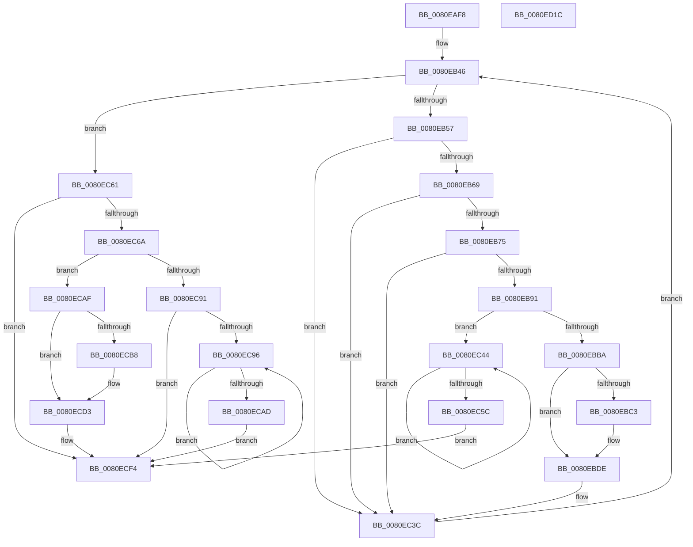

# MiReferenceNonPagedMemoryProcessList

- RVA: `0x0080EAF8`–`0x0080ED1D` (길이 `549` bytes)
- VA: `0x000000014080EAF8`
- 실행 섹션: `PAGE`
- PDB 이름 있음: `예`; PDB Function 태그: `아니요`
- unwind 정보 RVA: `0x000D929C`
- 디코드: `137`개 명령, `549/549` bytes 표시
- 미해석 바이트: `0` (있으면 어셈블리에 `.byte`로 보존)

> 이 문서는 커널 이미지의 기계어와 PDB 기호를 분석해 생성했습니다. 4번과 5번은 함수 원형과 자료형을 바이너리 사용 방식에서 추정한 C 해석이며 원본 소스 복구 결과는 아닙니다.

## 1. Dependencies

- 직접 호출 지점: **14**; 고유 호출 대상: **9**
- 직접 호출자로 확인된 함수: **1**
- RIP 상대 이미지 참조: **1**

### Outgoing calls
- `0x0080EB33` → [memset](../../text/6C/memset_function_006C6C40.md) (function, `0x006C6C40`)
- `0x0080EB46` → [PsGetNextProcess](../91/PsGetNextProcess_function_0091C900.md) (function, `0x0091C900`)
- `0x0080EB5A` → [MiGetProcessPartition](../../text/44/MiGetProcessPartition_function_00443B10.md) (function, `0x00443B10`)
- `0x0080EB7A` → [ObfReferenceObjectWithTag](../../text/21/ObfReferenceObjectWithTag_function_00210710.md) (function, `0x00210710`)
- `0x0080EBA9` → [MiAllocatePool](../../text/35/MiAllocatePool_function_0035B540.md) (function, `0x0035B540`)
- `0x0080EBCE` → [memcpy](../../text/6C/memcpy_function_006C6840.md) (function, `0x006C6840`)
- `0x0080EBD9` → [ExFreePoolWithTag](../../poolcode/B8/ExFreePoolWithTag_function_00B82870.md) (function, `0x00B82870`)
- `0x0080EC4E` → [ObfDereferenceObjectWithTag](../../text/2F/ObfDereferenceObjectWithTag_function_002F78E0.md) (function, `0x002F78E0`)
- `0x0080EC84` → [MiAllocatePool](../../text/35/MiAllocatePool_function_0035B540.md) (function, `0x0035B540`)
- `0x0080ECA0` → [ObfDereferenceObjectWithTag](../../text/2F/ObfDereferenceObjectWithTag_function_002F78E0.md) (function, `0x002F78E0`)
- `0x0080ECC3` → [memcpy](../../text/6C/memcpy_function_006C6840.md) (function, `0x006C6840`)
- `0x0080ECCE` → [ExFreePoolWithTag](../../poolcode/B8/ExFreePoolWithTag_function_00B82870.md) (function, `0x00B82870`)
- `0x0080ECE7` → [memcpy](../../text/6C/memcpy_function_006C6840.md) (function, `0x006C6840`)
- `0x0080ECFB` → [_security_check_cookie](../../text/6A/_security_check_cookie_function_006AC640.md) (function, `0x006AC640`)

### Direct callers
- [MmScrubMemory](MmScrubMemory_function_0080EFA0.md) at `0x0080F065`

### Static image references
- `0x0080EB16` → RVA `0x00E0A740` (`.data`; read)

## 2. Other-region calls and transfers

- 다른 실행 섹션으로 향하는 call: **13**
  - `0x0080EB33` → [memset](../../text/6C/memset_function_006C6C40.md) (`PAGE` → `.text`)
  - `0x0080EB5A` → [MiGetProcessPartition](../../text/44/MiGetProcessPartition_function_00443B10.md) (`PAGE` → `.text`)
  - `0x0080EB7A` → [ObfReferenceObjectWithTag](../../text/21/ObfReferenceObjectWithTag_function_00210710.md) (`PAGE` → `.text`)
  - `0x0080EBA9` → [MiAllocatePool](../../text/35/MiAllocatePool_function_0035B540.md) (`PAGE` → `.text`)
  - `0x0080EBCE` → [memcpy](../../text/6C/memcpy_function_006C6840.md) (`PAGE` → `.text`)
  - `0x0080EBD9` → [ExFreePoolWithTag](../../poolcode/B8/ExFreePoolWithTag_function_00B82870.md) (`PAGE` → `POOLCODE`)
  - `0x0080EC4E` → [ObfDereferenceObjectWithTag](../../text/2F/ObfDereferenceObjectWithTag_function_002F78E0.md) (`PAGE` → `.text`)
  - `0x0080EC84` → [MiAllocatePool](../../text/35/MiAllocatePool_function_0035B540.md) (`PAGE` → `.text`)
  - `0x0080ECA0` → [ObfDereferenceObjectWithTag](../../text/2F/ObfDereferenceObjectWithTag_function_002F78E0.md) (`PAGE` → `.text`)
  - `0x0080ECC3` → [memcpy](../../text/6C/memcpy_function_006C6840.md) (`PAGE` → `.text`)
  - `0x0080ECCE` → [ExFreePoolWithTag](../../poolcode/B8/ExFreePoolWithTag_function_00B82870.md) (`PAGE` → `POOLCODE`)
  - `0x0080ECE7` → [memcpy](../../text/6C/memcpy_function_006C6840.md) (`PAGE` → `.text`)
  - `0x0080ECFB` → [_security_check_cookie](../../text/6A/_security_check_cookie_function_006AC640.md) (`PAGE` → `.text`)
- 별도 외부 분기/꼬리 이동을 확인하지 못했습니다.

## 3. Assembly (complete function range)

```asm
0080EAF8  48 89 5C 24 10                  mov qword ptr [rsp + 0x10], rbx
0080EAFD  48 89 74 24 18                  mov qword ptr [rsp + 0x18], rsi
0080EB02  55                              push rbp
0080EB03  57                              push rdi
0080EB04  41 54                           push r12
0080EB06  41 56                           push r14
0080EB08  41 57                           push r15
0080EB0A  48 8D 6C 24 C9                  lea rbp, [rsp - 0x37]
0080EB0F  48 81 EC B0 00 00 00            sub rsp, 0xb0
0080EB16  48 8B 05 23 BC 5F 00            mov rax, qword ptr [rip + 0x5fbc23]
0080EB1D  48 33 C4                        xor rax, rsp
0080EB20  48 89 45 27                     mov qword ptr [rbp + 0x27], rax
0080EB24  48 8B F9                        mov rdi, rcx
0080EB27  33 D2                           xor edx, edx
0080EB29  48 8D 4D A7                     lea rcx, [rbp - 0x59]
0080EB2D  41 B8 80 00 00 00               mov r8d, 0x80
0080EB33  E8 08 81 EB FF                  call 0x1406c6c40
0080EB38  33 DB                           xor ebx, ebx
0080EB3A  8B F3                           mov esi, ebx
0080EB3C  48 89 5F 40                     mov qword ptr [rdi + 0x40], rbx
0080EB40  48 89 5F 48                     mov qword ptr [rdi + 0x48], rbx
0080EB44  33 C9                           xor ecx, ecx
0080EB46  E8 B5 DD 10 00                  call 0x14091c900
0080EB4B  4C 8B F0                        mov r14, rax
0080EB4E  48 85 C0                        test rax, rax
0080EB51  0F 84 0A 01 00 00               je 0x14080ec61
0080EB57  48 8B C8                        mov rcx, rax
0080EB5A  E8 B1 4F C3 FF                  call 0x140443b10
0080EB5F  48 3B 47 30                     cmp rax, qword ptr [rdi + 0x30]
0080EB63  0F 85 D3 00 00 00               jne 0x14080ec3c
0080EB69  39 99 DC 05 00 00               cmp dword ptr [rcx + 0x5dc], ebx
0080EB6F  0F 84 C7 00 00 00               je 0x14080ec3c
0080EB75  BA 4D 6D 50 72                  mov edx, 0x72506d4d
0080EB7A  E8 91 1B A0 FF                  call 0x140210710
0080EB7F  4C 89 74 F5 A7                  mov qword ptr [rbp + rsi*8 - 0x59], r14
0080EB84  48 FF C6                        inc rsi
0080EB87  48 83 FE 10                     cmp rsi, 0x10
0080EB8B  0F 85 AB 00 00 00               jne 0x14080ec3c
0080EB91  4C 8B 67 40                     mov r12, qword ptr [rdi + 0x40]
0080EB95  8D 4E 30                        lea ecx, [rsi + 0x30]
0080EB98  4C 03 E6                        add r12, rsi
0080EB9B  41 B8 4D 45 63 63               mov r8d, 0x6363454d
0080EBA1  4A 8D 14 E5 00 00 00 00         lea rdx, [r12*8]
0080EBA9  E8 92 C9 B4 FF                  call 0x14035b540
0080EBAE  4C 8B F8                        mov r15, rax
0080EBB1  48 85 C0                        test rax, rax
0080EBB4  0F 84 8A 00 00 00               je 0x14080ec44
0080EBBA  4C 8B 47 40                     mov r8, qword ptr [rdi + 0x40]
0080EBBE  4D 85 C0                        test r8, r8
0080EBC1  74 1B                           je 0x14080ebde
0080EBC3  48 8B 57 48                     mov rdx, qword ptr [rdi + 0x48]
0080EBC7  48 8B C8                        mov rcx, rax
0080EBCA  49 C1 E0 03                     shl r8, 3
0080EBCE  E8 6D 7C EB FF                  call 0x1406c6840
0080EBD3  48 8B 4F 48                     mov rcx, qword ptr [rdi + 0x48]
0080EBD7  33 D2                           xor edx, edx
0080EBD9  E8 92 3C 37 00                  call 0x140b82870
0080EBDE  48 8B 47 40                     mov rax, qword ptr [rdi + 0x40]
0080EBE2  48 8B F3                        mov rsi, rbx
0080EBE5  0F 28 45 A7                     movaps xmm0, xmmword ptr [rbp - 0x59]
0080EBE9  0F 28 4D B7                     movaps xmm1, xmmword ptr [rbp - 0x49]
0080EBED  41 0F 11 04 C7                  movups xmmword ptr [r15 + rax*8], xmm0
0080EBF2  0F 28 45 C7                     movaps xmm0, xmmword ptr [rbp - 0x39]
0080EBF6  41 0F 11 4C C7 10               movups xmmword ptr [r15 + rax*8 + 0x10], xmm1
0080EBFC  0F 28 4D D7                     movaps xmm1, xmmword ptr [rbp - 0x29]
0080EC00  41 0F 11 44 C7 20               movups xmmword ptr [r15 + rax*8 + 0x20], xmm0
0080EC06  0F 28 45 E7                     movaps xmm0, xmmword ptr [rbp - 0x19]
0080EC0A  41 0F 11 4C C7 30               movups xmmword ptr [r15 + rax*8 + 0x30], xmm1
0080EC10  0F 28 4D F7                     movaps xmm1, xmmword ptr [rbp - 9]
0080EC14  41 0F 11 44 C7 40               movups xmmword ptr [r15 + rax*8 + 0x40], xmm0
0080EC1A  0F 28 45 07                     movaps xmm0, xmmword ptr [rbp + 7]
0080EC1E  41 0F 11 4C C7 50               movups xmmword ptr [r15 + rax*8 + 0x50], xmm1
0080EC24  0F 28 4D 17                     movaps xmm1, xmmword ptr [rbp + 0x17]
0080EC28  41 0F 11 44 C7 60               movups xmmword ptr [r15 + rax*8 + 0x60], xmm0
0080EC2E  41 0F 11 4C C7 70               movups xmmword ptr [r15 + rax*8 + 0x70], xmm1
0080EC34  4C 89 67 40                     mov qword ptr [rdi + 0x40], r12
0080EC38  4C 89 7F 48                     mov qword ptr [rdi + 0x48], r15
0080EC3C  49 8B CE                        mov rcx, r14
0080EC3F  E9 02 FF FF FF                  jmp 0x14080eb46
0080EC44  48 8B 4C DD A7                  mov rcx, qword ptr [rbp + rbx*8 - 0x59]
0080EC49  BA 4D 6D 50 72                  mov edx, 0x72506d4d
0080EC4E  E8 8D 8C AE FF                  call 0x1402f78e0
0080EC53  48 FF C3                        inc rbx
0080EC56  48 83 FB 10                     cmp rbx, 0x10
0080EC5A  72 E8                           jb 0x14080ec44
0080EC5C  E9 93 00 00 00                  jmp 0x14080ecf4
0080EC61  48 85 F6                        test rsi, rsi
0080EC64  0F 84 8A 00 00 00               je 0x14080ecf4
0080EC6A  4C 8B 7F 40                     mov r15, qword ptr [rdi + 0x40]
0080EC6E  B9 40 00 00 00                  mov ecx, 0x40
0080EC73  4C 03 FE                        add r15, rsi
0080EC76  41 B8 4D 45 63 63               mov r8d, 0x6363454d
0080EC7C  4A 8D 14 FD 00 00 00 00         lea rdx, [r15*8]
0080EC84  E8 B7 C8 B4 FF                  call 0x14035b540
0080EC89  4C 8B F0                        mov r14, rax
0080EC8C  48 85 C0                        test rax, rax
0080EC8F  75 1E                           jne 0x14080ecaf
0080EC91  48 85 F6                        test rsi, rsi
0080EC94  74 5E                           je 0x14080ecf4
0080EC96  48 8B 4C DD A7                  mov rcx, qword ptr [rbp + rbx*8 - 0x59]
0080EC9B  BA 4D 6D 50 72                  mov edx, 0x72506d4d
0080ECA0  E8 3B 8C AE FF                  call 0x1402f78e0
0080ECA5  48 FF C3                        inc rbx
0080ECA8  48 3B DE                        cmp rbx, rsi
0080ECAB  72 E9                           jb 0x14080ec96
0080ECAD  EB 45                           jmp 0x14080ecf4
0080ECAF  4C 8B 47 40                     mov r8, qword ptr [rdi + 0x40]
0080ECB3  4D 85 C0                        test r8, r8
0080ECB6  74 1B                           je 0x14080ecd3
0080ECB8  48 8B 57 48                     mov rdx, qword ptr [rdi + 0x48]
0080ECBC  49 8B CE                        mov rcx, r14
0080ECBF  49 C1 E0 03                     shl r8, 3
0080ECC3  E8 78 7B EB FF                  call 0x1406c6840
0080ECC8  48 8B 4F 48                     mov rcx, qword ptr [rdi + 0x48]
0080ECCC  33 D2                           xor edx, edx
0080ECCE  E8 9D 3B 37 00                  call 0x140b82870
0080ECD3  48 8B 47 40                     mov rax, qword ptr [rdi + 0x40]
0080ECD7  4C 8D 04 F5 00 00 00 00         lea r8, [rsi*8]
0080ECDF  48 8D 55 A7                     lea rdx, [rbp - 0x59]
0080ECE3  49 8D 0C C6                     lea rcx, [r14 + rax*8]
0080ECE7  E8 54 7B EB FF                  call 0x1406c6840
0080ECEC  4C 89 7F 40                     mov qword ptr [rdi + 0x40], r15
0080ECF0  4C 89 77 48                     mov qword ptr [rdi + 0x48], r14
0080ECF4  48 8B 4D 27                     mov rcx, qword ptr [rbp + 0x27]
0080ECF8  48 33 CC                        xor rcx, rsp
0080ECFB  E8 40 D9 E9 FF                  call 0x1406ac640
0080ED00  4C 8D 9C 24 B0 00 00 00         lea r11, [rsp + 0xb0]
0080ED08  49 8B 5B 38                     mov rbx, qword ptr [r11 + 0x38]
0080ED0C  49 8B 73 40                     mov rsi, qword ptr [r11 + 0x40]
0080ED10  49 8B E3                        mov rsp, r11
0080ED13  41 5F                           pop r15
0080ED15  41 5E                           pop r14
0080ED17  41 5C                           pop r12
0080ED19  5F                              pop rdi
0080ED1A  5D                              pop rbp
0080ED1B  C3                              ret
0080ED1C  CC                              int3
```

## 4. C-style interpretation (structured pseudocode)

```c
__int64 __fastcall MiReferenceNonPagedMemoryProcessList(__int64 a1, int a2)
{
    __int64 result;
    __int64 v_r12;
    __int64 v_r15;
    __int64 v_rbx;
    __int64 v_rsi;
    __int64 v_rsp;
    unsigned __int64 v_stack_m28;
    unsigned __int64 v_stack_m38;
    unsigned __int64 v_stack_m48;
    unsigned __int64 v_stack_m58;
    unsigned __int64 v_stack_m5F;
    unsigned __int64 v_stack_m68;
    unsigned __int64 v_stack_m78;
    unsigned __int64 v_stack_m88;
    unsigned __int64 v_stack_m98;
    unsigned __int64 v_stack_mA8;
    unsigned __int64 v_stack_mB8;
    unsigned __int64 v_stack_p10;
    unsigned __int64 v_stack_p18;

    v_stack_p10 = v_rbx;
    v_stack_p18 = v_rsi;
    v_rsp = (v_rsp) - (176);
    result = (*(unsigned __int64 *)(v_rip + 6274083)) ^ (v_rsp);
    v_stack_m38 = result;
    a2 = 0;
    result = memset(v_stack_mB8, a2, 128, a4);
    v_rbx = 0;
    *(unsigned __int64 *)(a1 + 64) = 0;
    *(unsigned __int64 *)(a1 + 72) = 0;
    a1 = 0;
loc_0080EB46:
    result = PsGetNextProcess(a1, a2, 128, a4);
    if (result == 0) goto loc_0080EC61;
    result = MiGetProcessPartition(result, a2, 128, a4);
    if (result != (*(unsigned __int64 *)(a1 + 48))) goto loc_0080EC3C;
    if ((*(unsigned int *)(result + 1500)) == 0) goto loc_0080EC3C;
    result = ObfReferenceObjectWithTag(result, (unsigned int)(0x72506D4DULL), 128, a4);
    *(unsigned __int64 *)(v_stack_m5F + 0 * 8 - 89) = result;
    v_rsi = (0) + 1;
    if (v_rsi != 16) goto loc_0080EC3C;
    v_r12 = (*(unsigned __int64 *)(a1 + 64)) + (v_rsi);
    result = MiAllocatePool(v_rsi + 48, v_r12 * 8, (unsigned int)(0x6363454DULL), a4);
    if (result == 0) goto loc_0080EC44;
    if (*(unsigned __int64 *)(a1 + 64) != 0) {
        a2 = *(unsigned __int64 *)(a1 + 72);
        a1 = result;
        a3 = (*(unsigned __int64 *)(a1 + 64)) << (3);
        result = memcpy(a1, a2, a3, a4);
        a1 = *(unsigned __int64 *)(a1 + 72);
        a2 = 0;
        result = ExFreePoolWithTag(a1, a2, a3, a4);
    }
    *(unsigned __int64 *)(result + *(unsigned __int64 *)(a1 + 64) * 8) = v_xmm0;
    *(unsigned __int64 *)(result + *(unsigned __int64 *)(a1 + 64) * 8 + 16) = v_xmm1;
    *(unsigned __int64 *)(result + *(unsigned __int64 *)(a1 + 64) * 8 + 32) = v_xmm0;
    *(unsigned __int64 *)(result + *(unsigned __int64 *)(a1 + 64) * 8 + 48) = v_xmm1;
    *(unsigned __int64 *)(result + *(unsigned __int64 *)(a1 + 64) * 8 + 64) = v_xmm0;
    *(unsigned __int64 *)(result + *(unsigned __int64 *)(a1 + 64) * 8 + 80) = v_xmm1;
    *(unsigned __int64 *)(result + *(unsigned __int64 *)(a1 + 64) * 8 + 96) = v_xmm0;
    *(unsigned __int64 *)(result + *(unsigned __int64 *)(a1 + 64) * 8 + 112) = v_xmm1;
    *(unsigned __int64 *)(a1 + 64) = v_r12;
    *(unsigned __int64 *)(a1 + 72) = result;
loc_0080EC3C:
    goto loc_0080EB46;
loc_0080EC44:
    result = ObfDereferenceObjectWithTag(*(unsigned __int64 *)(v_stack_m5F + v_rbx * 8 - 89), (unsigned int)(0x72506D4DULL), a3, a4);
    v_rbx = (v_rbx) + 1;
    if (v_rbx < 16) goto loc_0080EC44;
    goto loc_0080ECF4;
loc_0080EC61:
    if (0 == 0) goto loc_0080ECF4;
    v_r15 = (*(unsigned __int64 *)(a1 + 64)) + (0);
    result = MiAllocatePool(64, v_r15 * 8, (unsigned int)(0x6363454DULL), a4);
    if (result != 0) goto loc_0080ECAF;
    if (0 == 0) goto loc_0080ECF4;
loc_0080EC96:
    result = ObfDereferenceObjectWithTag(*(unsigned __int64 *)(v_stack_m5F + v_rbx * 8 - 89), (unsigned int)(0x72506D4DULL), (unsigned int)(0x6363454DULL), a4);
    v_rbx = (v_rbx) + 1;
    if (v_rbx < 0) goto loc_0080EC96;
    goto loc_0080ECF4;
loc_0080ECAF:
    if (*(unsigned __int64 *)(a1 + 64) != 0) {
        a2 = *(unsigned __int64 *)(a1 + 72);
        a1 = result;
        a3 = (*(unsigned __int64 *)(a1 + 64)) << (3);
        result = memcpy(a1, a2, a3, a4);
        a1 = *(unsigned __int64 *)(a1 + 72);
        a2 = 0;
        result = ExFreePoolWithTag(a1, a2, a3, a4);
    }
    result = memcpy(result + *(unsigned __int64 *)(a1 + 64) * 8, v_stack_mB8, 0 * 8, a4);
    *(unsigned __int64 *)(a1 + 64) = v_r15;
    *(unsigned __int64 *)(a1 + 72) = result;
loc_0080ECF4:
    a1 = (v_stack_m38) ^ (v_rsp);
    result = _security_check_cookie(a1, v_stack_mB8, 0 * 8, a4);
    return result;
}
```

## 5. (Beta) C Style

```c
int64_t MiReferenceNonPagedMemoryProcessList(void *Arg1, int32_t Arg2)
{
    uint8_t *arg1 = (uint8_t *)Arg1;

    int64_t result;
    int64_t local_r12;
    int64_t local_r15;
    int64_t local_rbx;
    int64_t local_rsi;
    int64_t local_rsp;
    uint64_t v_stack_m28;
    uint64_t v_stack_m38;
    uint64_t v_stack_m48;
    uint64_t v_stack_m58;
    uint64_t v_stack_m5F;
    uint64_t v_stack_m68;
    uint64_t v_stack_m78;
    uint64_t v_stack_m88;
    uint64_t v_stack_m98;
    uint64_t v_stack_mA8;
    uint64_t v_stack_mB8;
    uint64_t v_stack_p10;
    uint64_t v_stack_p18;

    v_stack_p10 = local_rbx;
    v_stack_p18 = local_rsi;
    local_rsp = (local_rsp) - (176);
    result = (*(uint64_t *)(v_rip + 0x5FBC23)) ^ (local_rsp);
    v_stack_m38 = result;
    Arg2 = 0;
    result = memset(v_stack_mB8, Arg2, 128, a4);
    local_rbx = 0;
    *(uint64_t *)(arg1 + 0x40) = 0;
    *(uint64_t *)(arg1 + 0x48) = 0;
    Arg1 = 0;
loc_0080EB46:
    result = PsGetNextProcess(Arg1, Arg2, 128, a4);
    if (result == 0) goto loc_0080EC61;
    result = MiGetProcessPartition(result, Arg2, 128, a4);
    if (result != (*(uint64_t *)(arg1 + 0x30))) goto loc_0080EC3C;
    if ((*(uint32_t *)(result + 0x5DC)) == 0) goto loc_0080EC3C;
    result = ObfReferenceObjectWithTag(result, (uint32_t)(0x72506D4DULL), 128, a4);
    *(uint64_t *)(v_stack_m5F + 0x0 * 8 - 0x59) = result;
    local_rsi = (0) + 1;
    if (local_rsi != 16) goto loc_0080EC3C;
    local_r12 = (*(uint64_t *)(arg1 + 0x40)) + (local_rsi);
    result = MiAllocatePool(local_rsi + 48, local_r12 * 8, (uint32_t)(0x6363454DULL), a4);
    if (result == 0) goto loc_0080EC44;
    if (*(uint64_t *)(arg1 + 0x40) != 0) {
        Arg2 = *(uint64_t *)(arg1 + 0x48);
        Arg1 = result;
        a3 = (*(uint64_t *)(arg1 + 0x40)) << (3);
        result = memcpy(Arg1, Arg2, a3, a4);
        Arg1 = *(uint64_t *)(arg1 + 0x48);
        Arg2 = 0;
        result = ExFreePoolWithTag(Arg1, Arg2, a3, a4);
    }
    *(uint64_t *)(result + *(uint64_t *)(arg1 + 0x40) * 8) = v_xmm0;
    *(uint64_t *)(result + *(uint64_t *)(arg1 + 0x40) * 8 + 0x10) = v_xmm1;
    *(uint64_t *)(result + *(uint64_t *)(arg1 + 0x40) * 8 + 0x20) = v_xmm0;
    *(uint64_t *)(result + *(uint64_t *)(arg1 + 0x40) * 8 + 0x30) = v_xmm1;
    *(uint64_t *)(result + *(uint64_t *)(arg1 + 0x40) * 8 + 0x40) = v_xmm0;
    *(uint64_t *)(result + *(uint64_t *)(arg1 + 0x40) * 8 + 0x50) = v_xmm1;
    *(uint64_t *)(result + *(uint64_t *)(arg1 + 0x40) * 8 + 0x60) = v_xmm0;
    *(uint64_t *)(result + *(uint64_t *)(arg1 + 0x40) * 8 + 0x70) = v_xmm1;
    *(uint64_t *)(arg1 + 0x40) = local_r12;
    *(uint64_t *)(arg1 + 0x48) = result;
loc_0080EC3C:
    goto loc_0080EB46;
loc_0080EC44:
    result = ObfDereferenceObjectWithTag(*(uint64_t *)(v_stack_m5F + local_rbx * 8 - 0x59), (uint32_t)(0x72506D4DULL), a3, a4);
    local_rbx = (local_rbx) + 1;
    if (local_rbx < 16) goto loc_0080EC44;
    goto loc_0080ECF4;
loc_0080EC61:
    if (0 == 0) goto loc_0080ECF4;
    local_r15 = (*(uint64_t *)(arg1 + 0x40)) + (0);
    result = MiAllocatePool(64, local_r15 * 8, (uint32_t)(0x6363454DULL), a4);
    if (result != 0) goto loc_0080ECAF;
    if (0 == 0) goto loc_0080ECF4;
loc_0080EC96:
    result = ObfDereferenceObjectWithTag(*(uint64_t *)(v_stack_m5F + local_rbx * 8 - 0x59), (uint32_t)(0x72506D4DULL), (uint32_t)(0x6363454DULL), a4);
    local_rbx = (local_rbx) + 1;
    if (local_rbx < 0) goto loc_0080EC96;
    goto loc_0080ECF4;
loc_0080ECAF:
    if (*(uint64_t *)(arg1 + 0x40) != 0) {
        Arg2 = *(uint64_t *)(arg1 + 0x48);
        Arg1 = result;
        a3 = (*(uint64_t *)(arg1 + 0x40)) << (3);
        result = memcpy(Arg1, Arg2, a3, a4);
        Arg1 = *(uint64_t *)(arg1 + 0x48);
        Arg2 = 0;
        result = ExFreePoolWithTag(Arg1, Arg2, a3, a4);
    }
    result = memcpy(result + *(uint64_t *)(arg1 + 0x40) * 8, v_stack_mB8, 0 * 8, a4);
    *(uint64_t *)(arg1 + 0x40) = local_r15;
    *(uint64_t *)(arg1 + 0x48) = result;
loc_0080ECF4:
    Arg1 = (v_stack_m38) ^ (local_rsp);
    result = _security_check_cookie(Arg1, v_stack_mB8, 0 * 8, a4);
    return result;
}
```

### 관측된 메모리 오프셋

구조체 형식이 확인되지 않은 접근은 인자 기준의 오프셋으로만 기록했습니다.

| 기준 인자 | 오프셋 표현 | 폭 (bit) | 접근 |
|---|---:|---:|---|
| `Arg1` | `+ 0x30` | `64` | `R` |
| `Arg1` | `+ 0x40` | `64` | `R` |
| `Arg1` | `+ 0x40` | `64` | `W` |
| `Arg1` | `+ 0x48` | `64` | `R` |
| `Arg1` | `+ 0x48` | `64` | `W` |

## 6. Execution-region graph

[열기: 2D/3D 그래프와 함수 탐색 컨트롤 패널](../../../control-panel.html?section=page&rva=0x0080EAF8&view=graph)

- 2D 그래프는 위에서 아래로 흐르고, 3D 그래프는 빈 공간을 드래그해 회전합니다. Shift+드래그는 이동, 휠은 확대·축소, 함수 노드 선택은 대상 보고서 이동입니다.

### Static fallback


