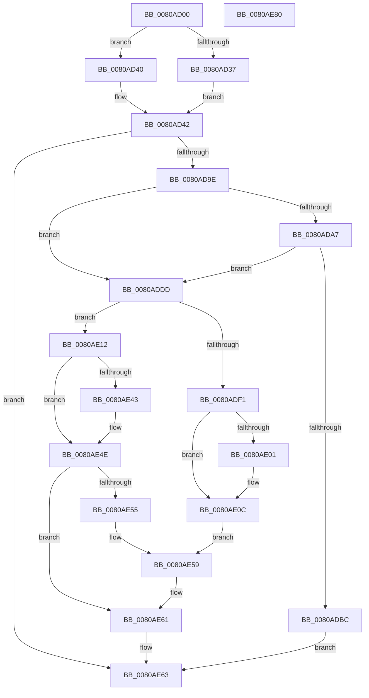

# MiResizeAweBitMap

- RVA: `0x0080AD00`–`0x0080AE81` (길이 `385` bytes)
- VA: `0x000000014080AD00`
- 실행 섹션: `PAGE`
- PDB 이름 있음: `예`; PDB Function 태그: `아니요`
- unwind 정보 RVA: `0x000D8BB0`
- 디코드: `101`개 명령, `385/385` bytes 표시
- 미해석 바이트: `0` (있으면 어셈블리에 `.byte`로 보존)

> 이 문서는 커널 이미지의 기계어와 PDB 기호를 분석해 생성했습니다. 4번과 5번은 함수 원형과 자료형을 바이너리 사용 방식에서 추정한 C 해석이며 원본 소스 복구 결과는 아닙니다.

## 1. Dependencies

- 직접 호출 지점: **11**; 고유 호출 대상: **7**
- 직접 호출자로 확인된 함수: **1**
- RIP 상대 이미지 참조: **0**

### Outgoing calls
- `0x0080AD91` → [MiCreateAweInfoBitMap](MiCreateAweInfoBitMap_function_0080A770.md) (function, `0x0080A770`)
- `0x0080ADAD` → [LOCK_ADDRESS_SPACE](../../text/2A/LOCK_ADDRESS_SPACE_function_002A4944.md) (function, `0x002A4944`)
- `0x0080ADC2` → [UNLOCK_ADDRESS_SPACE](../../text/2A/UNLOCK_ADDRESS_SPACE_function_002A4844.md) (function, `0x002A4844`)
- `0x0080ADCE` → [MiDeleteAweBitMap](MiDeleteAweBitMap_function_0080A9A8.md) (function, `0x0080A9A8`)
- `0x0080ADE3` → [MiLockAwePagesExclusive](../../text/68/MiLockAwePagesExclusive_function_00689080.md) (function, `0x00689080`)
- `0x0080ADF7` → [MiUnlockAwePagesExclusive](../../text/68/MiUnlockAwePagesExclusive_function_006898FC.md) (function, `0x006898FC`)
- `0x0080AE07` → [UNLOCK_ADDRESS_SPACE](../../text/2A/UNLOCK_ADDRESS_SPACE_function_002A4844.md) (function, `0x002A4844`)
- `0x0080AE1C` → [RtlCopyBitMapEx](../../text/41/RtlCopyBitMapEx_function_0041DEF0.md) (function, `0x0041DEF0`)
- `0x0080AE39` → [MiUnlockAwePagesExclusive](../../text/68/MiUnlockAwePagesExclusive_function_006898FC.md) (function, `0x006898FC`)
- `0x0080AE49` → [UNLOCK_ADDRESS_SPACE](../../text/2A/UNLOCK_ADDRESS_SPACE_function_002A4844.md) (function, `0x002A4844`)
- `0x0080AE5C` → [MiDeleteAweBitMap](MiDeleteAweBitMap_function_0080A9A8.md) (function, `0x0080A9A8`)

### Direct callers
- [MiAllocateUserPhysicalPages](MiAllocateUserPhysicalPages_function_00809828.md) at `0x0080A222`

### Static image references
- 디코드된 RIP-relative 메모리 참조가 없습니다.

## 2. Other-region calls and transfers

- 다른 실행 섹션으로 향하는 call: **8**
  - `0x0080ADAD` → [LOCK_ADDRESS_SPACE](../../text/2A/LOCK_ADDRESS_SPACE_function_002A4944.md) (`PAGE` → `.text`)
  - `0x0080ADC2` → [UNLOCK_ADDRESS_SPACE](../../text/2A/UNLOCK_ADDRESS_SPACE_function_002A4844.md) (`PAGE` → `.text`)
  - `0x0080ADE3` → [MiLockAwePagesExclusive](../../text/68/MiLockAwePagesExclusive_function_00689080.md) (`PAGE` → `.text`)
  - `0x0080ADF7` → [MiUnlockAwePagesExclusive](../../text/68/MiUnlockAwePagesExclusive_function_006898FC.md) (`PAGE` → `.text`)
  - `0x0080AE07` → [UNLOCK_ADDRESS_SPACE](../../text/2A/UNLOCK_ADDRESS_SPACE_function_002A4844.md) (`PAGE` → `.text`)
  - `0x0080AE1C` → [RtlCopyBitMapEx](../../text/41/RtlCopyBitMapEx_function_0041DEF0.md) (`PAGE` → `.text`)
  - `0x0080AE39` → [MiUnlockAwePagesExclusive](../../text/68/MiUnlockAwePagesExclusive_function_006898FC.md) (`PAGE` → `.text`)
  - `0x0080AE49` → [UNLOCK_ADDRESS_SPACE](../../text/2A/UNLOCK_ADDRESS_SPACE_function_002A4844.md) (`PAGE` → `.text`)
- 별도 외부 분기/꼬리 이동을 확인하지 못했습니다.

## 3. Assembly (complete function range)

```asm
0080AD00  48 8B C4                        mov rax, rsp
0080AD03  48 89 58 08                     mov qword ptr [rax + 8], rbx
0080AD07  48 89 70 10                     mov qword ptr [rax + 0x10], rsi
0080AD0B  48 89 78 18                     mov qword ptr [rax + 0x18], rdi
0080AD0F  4C 89 70 20                     mov qword ptr [rax + 0x20], r14
0080AD13  55                              push rbp
0080AD14  48 81 EC 20 01 00 00            sub rsp, 0x120
0080AD1B  48 8D 6C 24 60                  lea rbp, [rsp + 0x60]
0080AD20  48 83 E5 C0                     and rbp, 0xffffffffffffffc0
0080AD24  65 48 8B 3C 25 88 01 00 00      mov rdi, qword ptr gs:[0x188]
0080AD2D  48 8B F1                        mov rsi, rcx
0080AD30  8B 41 08                        mov eax, dword ptr [rcx + 8]
0080AD33  A8 01                           test al, 1
0080AD35  74 09                           je 0x14080ad40
0080AD37  48 8B 9F B8 00 00 00            mov rbx, qword ptr [rdi + 0xb8]
0080AD3E  EB 02                           jmp 0x14080ad42
0080AD40  33 DB                           xor ebx, ebx
0080AD42  0F 10 01                        movups xmm0, xmmword ptr [rcx]
0080AD45  0F 10 49 10                     movups xmm1, xmmword ptr [rcx + 0x10]
0080AD49  0F 29 45 40                     movaps xmmword ptr [rbp + 0x40], xmm0
0080AD4D  0F 10 41 20                     movups xmm0, xmmword ptr [rcx + 0x20]
0080AD51  0F 29 4D 50                     movaps xmmword ptr [rbp + 0x50], xmm1
0080AD55  0F 10 49 30                     movups xmm1, xmmword ptr [rcx + 0x30]
0080AD59  0F 29 45 60                     movaps xmmword ptr [rbp + 0x60], xmm0
0080AD5D  0F 10 41 40                     movups xmm0, xmmword ptr [rcx + 0x40]
0080AD61  0F 29 4D 70                     movaps xmmword ptr [rbp + 0x70], xmm1
0080AD65  0F 10 49 50                     movups xmm1, xmmword ptr [rcx + 0x50]
0080AD69  0F 29 85 80 00 00 00            movaps xmmword ptr [rbp + 0x80], xmm0
0080AD70  0F 10 41 60                     movups xmm0, xmmword ptr [rcx + 0x60]
0080AD74  0F 29 8D 90 00 00 00            movaps xmmword ptr [rbp + 0x90], xmm1
0080AD7B  0F 10 49 70                     movups xmm1, xmmword ptr [rcx + 0x70]
0080AD7F  48 8D 4D 40                     lea rcx, [rbp + 0x40]
0080AD83  0F 29 85 A0 00 00 00            movaps xmmword ptr [rbp + 0xa0], xmm0
0080AD8A  0F 29 8D B0 00 00 00            movaps xmmword ptr [rbp + 0xb0], xmm1
0080AD91  E8 DA F9 FF FF                  call 0x14080a770
0080AD96  85 C0                           test eax, eax
0080AD98  0F 88 C5 00 00 00               js 0x14080ae63
0080AD9E  4C 8D 76 18                     lea r14, [rsi + 0x18]
0080ADA2  48 85 DB                        test rbx, rbx
0080ADA5  74 36                           je 0x14080addd
0080ADA7  48 8B D3                        mov rdx, rbx
0080ADAA  48 8B CF                        mov rcx, rdi
0080ADAD  E8 92 9B A9 FF                  call 0x1402a4944
0080ADB2  8B 83 F4 01 00 00               mov eax, dword ptr [rbx + 0x1f4]
0080ADB8  A8 20                           test al, 0x20
0080ADBA  74 21                           je 0x14080addd
0080ADBC  48 8B D3                        mov rdx, rbx
0080ADBF  48 8B CF                        mov rcx, rdi
0080ADC2  E8 7D 9A A9 FF                  call 0x1402a4844
0080ADC7  48 8D 55 58                     lea rdx, [rbp + 0x58]
0080ADCB  48 8B CB                        mov rcx, rbx
0080ADCE  E8 D5 FB FF FF                  call 0x14080a9a8
0080ADD3  B8 0A 01 00 C0                  mov eax, 0xc000010a
0080ADD8  E9 86 00 00 00                  jmp 0x14080ae63
0080ADDD  48 8B D7                        mov rdx, rdi
0080ADE0  48 8B CE                        mov rcx, rsi
0080ADE3  E8 98 E2 E7 FF                  call 0x140689080
0080ADE8  49 8B 06                        mov rax, qword ptr [r14]
0080ADEB  48 39 45 58                     cmp qword ptr [rbp + 0x58], rax
0080ADEF  77 21                           ja 0x14080ae12
0080ADF1  48 8B D7                        mov rdx, rdi
0080ADF4  48 8B CE                        mov rcx, rsi
0080ADF7  E8 00 EB E7 FF                  call 0x1406898fc
0080ADFC  48 85 DB                        test rbx, rbx
0080ADFF  74 0B                           je 0x14080ae0c
0080AE01  48 8B D3                        mov rdx, rbx
0080AE04  48 8B CF                        mov rcx, rdi
0080AE07  E8 38 9A A9 FF                  call 0x1402a4844
0080AE0C  48 8D 55 58                     lea rdx, [rbp + 0x58]
0080AE10  EB 47                           jmp 0x14080ae59
0080AE12  45 33 C0                        xor r8d, r8d
0080AE15  48 8D 55 58                     lea rdx, [rbp + 0x58]
0080AE19  49 8B CE                        mov rcx, r14
0080AE1C  E8 CF 30 C1 FF                  call 0x14041def0
0080AE21  41 0F 10 06                     movups xmm0, xmmword ptr [r14]
0080AE25  48 8B D7                        mov rdx, rdi
0080AE28  48 8B CE                        mov rcx, rsi
0080AE2B  0F 10 4D 58                     movups xmm1, xmmword ptr [rbp + 0x58]
0080AE2F  F3 0F 7F 45 00                  movdqu xmmword ptr [rbp], xmm0
0080AE34  F3 41 0F 7F 0E                  movdqu xmmword ptr [r14], xmm1
0080AE39  E8 BE EA E7 FF                  call 0x1406898fc
0080AE3E  48 85 DB                        test rbx, rbx
0080AE41  74 0B                           je 0x14080ae4e
0080AE43  48 8B D3                        mov rdx, rbx
0080AE46  48 8B CF                        mov rcx, rdi
0080AE49  E8 F6 99 A9 FF                  call 0x1402a4844
0080AE4E  48 83 7D 08 00                  cmp qword ptr [rbp + 8], 0
0080AE53  74 0C                           je 0x14080ae61
0080AE55  48 8D 55 00                     lea rdx, [rbp]
0080AE59  48 8B CB                        mov rcx, rbx
0080AE5C  E8 47 FB FF FF                  call 0x14080a9a8
0080AE61  33 C0                           xor eax, eax
0080AE63  4C 8D 9C 24 20 01 00 00         lea r11, [rsp + 0x120]
0080AE6B  49 8B 5B 10                     mov rbx, qword ptr [r11 + 0x10]
0080AE6F  49 8B 73 18                     mov rsi, qword ptr [r11 + 0x18]
0080AE73  49 8B 7B 20                     mov rdi, qword ptr [r11 + 0x20]
0080AE77  4D 8B 73 28                     mov r14, qword ptr [r11 + 0x28]
0080AE7B  49 8B E3                        mov rsp, r11
0080AE7E  5D                              pop rbp
0080AE7F  C3                              ret
0080AE80  CC                              int3
```

## 4. C-style interpretation (structured pseudocode)

```c
__int64 __fastcall MiResizeAweBitMap(__int64 a1, __int64 a2, int a3)
{
    __int64 result;
    __int64 v_rbp;
    __int64 v_rbx;
    __int64 v_rsp;
    unsigned __int64 v_stack_m18;
    unsigned __int64 v_stack_m28;
    unsigned __int64 v_stack_m38;
    unsigned __int64 v_stack_m48;
    unsigned __int64 v_stack_m58;
    unsigned __int64 v_stack_m68;
    unsigned __int64 v_stack_m70;
    unsigned __int64 v_stack_m78;
    unsigned __int64 v_stack_m8;
    unsigned __int64 v_stack_m88;
    unsigned __int64 v_stack_mC0;
    unsigned __int64 v_stack_mC8;

    *(unsigned __int64 *)(v_rsp + 8) = v_rbx;
    *(unsigned __int64 *)(v_rsp + 16) = v_rsi;
    *(unsigned __int64 *)(v_rsp + 24) = v_rdi;
    *(unsigned __int64 *)(v_rsp + 32) = v_r14;
    v_rsp = (v_rsp) - (288);
    v_rbp = (v_stack_mC8) & (-64);
    if ((((unsigned __int8)((unsigned int)(*(unsigned int *)(a1 + 8)))) & (1)) == 0) goto loc_0080AD40;
    goto loc_0080AD42;
loc_0080AD40:
    v_rbx = 0;
loc_0080AD42:
    v_stack_m88 = v_xmm0;
    v_stack_m78 = v_xmm1;
    v_stack_m68 = v_xmm0;
    v_stack_m58 = v_xmm1;
    v_stack_m48 = v_xmm0;
    v_stack_m38 = v_xmm1;
    v_stack_m28 = v_xmm0;
    v_stack_m18 = v_xmm1;
    result = MiCreateAweInfoBitMap(v_stack_m88, a2, a3, a4);
    if (sign_flag) goto loc_0080AE63;
    if (0 == 0) goto loc_0080ADDD;
    result = LOCK_ADDRESS_SPACE(*(unsigned __int64 *)(gs_base + (0 + 392)), 0, a3, a4);
    if ((((unsigned __int8)((unsigned int)(*(unsigned int *)(v_rbx + 500)))) & (32)) == 0) goto loc_0080ADDD;
    result = UNLOCK_ADDRESS_SPACE(*(unsigned __int64 *)(gs_base + (0 + 392)), 0, a3, a4);
    result = MiDeleteAweBitMap(0, v_stack_m70, a3, a4);
    goto loc_0080AE63;
loc_0080ADDD:
    result = MiLockAwePagesExclusive(a1, *(unsigned __int64 *)(gs_base + (0 + 392)), a3, a4);
    if (v_stack_m70 > (*(unsigned __int64 *)(a1 + 24))) goto loc_0080AE12;
    result = MiUnlockAwePagesExclusive(a1, *(unsigned __int64 *)(gs_base + (0 + 392)), a3, a4);
    if (0 != 0) {
        a2 = 0;
        a1 = *(unsigned __int64 *)(gs_base + (0 + 392));
        result = UNLOCK_ADDRESS_SPACE(a1, a2, a3, a4);
    }
    goto loc_0080AE59;
loc_0080AE12:
    a3 = 0;
    result = RtlCopyBitMapEx(a1 + 24, v_stack_m70, a3, a4);
    v_stack_mC8 = v_xmm0;
    *(unsigned __int64 *)(a1 + 24) = v_xmm1;
    result = MiUnlockAwePagesExclusive(a1, *(unsigned __int64 *)(gs_base + (0 + 392)), a3, a4);
    if (0 != 0) {
        a2 = 0;
        a1 = *(unsigned __int64 *)(gs_base + (0 + 392));
        result = UNLOCK_ADDRESS_SPACE(a1, a2, a3, a4);
    }
    if (v_stack_mC0 == 0) goto loc_0080AE61;
loc_0080AE59:
    result = MiDeleteAweBitMap(0, v_stack_mC8, a3, a4);
loc_0080AE61:
    result = 0;
loc_0080AE63:
    return result;
}
```

## 5. (Beta) C Style

```c
int64_t MiResizeAweBitMap(void *Arg1, int64_t Arg2, int32_t Arg3)
{
    uint8_t *arg1 = (uint8_t *)Arg1;

    int64_t result;
    int64_t local_rbp;
    int64_t local_rbx;
    int64_t local_rsp;
    uint64_t v_stack_m18;
    uint64_t v_stack_m28;
    uint64_t v_stack_m38;
    uint64_t v_stack_m48;
    uint64_t v_stack_m58;
    uint64_t v_stack_m68;
    uint64_t v_stack_m70;
    uint64_t v_stack_m78;
    uint64_t v_stack_m8;
    uint64_t v_stack_m88;
    uint64_t v_stack_mC0;
    uint64_t v_stack_mC8;

    *(uint64_t *)(local_rsp + 0x8) = local_rbx;
    *(uint64_t *)(local_rsp + 0x10) = local_rsi;
    *(uint64_t *)(local_rsp + 0x18) = local_rdi;
    *(uint64_t *)(local_rsp + 0x20) = local_r14;
    local_rsp = (local_rsp) - (288);
    local_rbp = (v_stack_mC8) & (-64);
    if ((((uint8_t)((uint32_t)(*(uint32_t *)(arg1 + 0x8)))) & (1)) == 0) goto loc_0080AD40;
    goto loc_0080AD42;
loc_0080AD40:
    local_rbx = 0;
loc_0080AD42:
    v_stack_m88 = v_xmm0;
    v_stack_m78 = v_xmm1;
    v_stack_m68 = v_xmm0;
    v_stack_m58 = v_xmm1;
    v_stack_m48 = v_xmm0;
    v_stack_m38 = v_xmm1;
    v_stack_m28 = v_xmm0;
    v_stack_m18 = v_xmm1;
    result = MiCreateAweInfoBitMap(v_stack_m88, Arg2, Arg3, a4);
    if (sign_flag) goto loc_0080AE63;
    if (0 == 0) goto loc_0080ADDD;
    result = LOCK_ADDRESS_SPACE(*(uint64_t *)(gs_base + (0 + 0x188)), 0, Arg3, a4);
    if ((((uint8_t)((uint32_t)(*(uint32_t *)(local_rbx + 0x1F4)))) & (32)) == 0) goto loc_0080ADDD;
    result = UNLOCK_ADDRESS_SPACE(*(uint64_t *)(gs_base + (0 + 0x188)), 0, Arg3, a4);
    result = MiDeleteAweBitMap(0, v_stack_m70, Arg3, a4);
    goto loc_0080AE63;
loc_0080ADDD:
    result = MiLockAwePagesExclusive(Arg1, *(uint64_t *)(gs_base + (0 + 0x188)), Arg3, a4);
    if (v_stack_m70 > (*(uint64_t *)(arg1 + 0x18))) goto loc_0080AE12;
    result = MiUnlockAwePagesExclusive(Arg1, *(uint64_t *)(gs_base + (0 + 0x188)), Arg3, a4);
    if (0 != 0) {
        Arg2 = 0;
        Arg1 = *(uint64_t *)(gs_base + (0 + 0x188));
        result = UNLOCK_ADDRESS_SPACE(Arg1, Arg2, Arg3, a4);
    }
    goto loc_0080AE59;
loc_0080AE12:
    Arg3 = 0;
    result = RtlCopyBitMapEx(Arg1 + 24, v_stack_m70, Arg3, a4);
    v_stack_mC8 = v_xmm0;
    *(uint64_t *)(arg1 + 0x18) = v_xmm1;
    result = MiUnlockAwePagesExclusive(Arg1, *(uint64_t *)(gs_base + (0 + 0x188)), Arg3, a4);
    if (0 != 0) {
        Arg2 = 0;
        Arg1 = *(uint64_t *)(gs_base + (0 + 0x188));
        result = UNLOCK_ADDRESS_SPACE(Arg1, Arg2, Arg3, a4);
    }
    if (v_stack_mC0 == 0) goto loc_0080AE61;
loc_0080AE59:
    result = MiDeleteAweBitMap(0, v_stack_mC8, Arg3, a4);
loc_0080AE61:
    result = 0;
loc_0080AE63:
    return result;
}
```

### 관측된 메모리 오프셋

구조체 형식이 확인되지 않은 접근은 인자 기준의 오프셋으로만 기록했습니다.

| 기준 인자 | 오프셋 표현 | 폭 (bit) | 접근 |
|---|---:|---:|---|
| `Arg1` | `+ 0x0` | `64` | `R` |
| `Arg1` | `+ 0x0` | `128` | `R` |
| `Arg1` | `+ 0x0` | `128` | `W` |
| `Arg1` | `+ 0x8` | `32` | `R` |
| `Arg1` | `+ 0x10` | `128` | `R` |
| `Arg1` | `+ 0x18` | `64` | `R` |
| `Arg1` | `+ 0x20` | `128` | `R` |
| `Arg1` | `+ 0x30` | `128` | `R` |
| `Arg1` | `+ 0x40` | `128` | `R` |
| `Arg1` | `+ 0x50` | `128` | `R` |
| `Arg1` | `+ 0x60` | `128` | `R` |
| `Arg1` | `+ 0x70` | `128` | `R` |

## 6. Execution-region graph

[열기: 2D/3D 그래프와 함수 탐색 컨트롤 패널](../../../control-panel.html?section=page&rva=0x0080AD00&view=graph)

- 2D 그래프는 위에서 아래로 흐르고, 3D 그래프는 빈 공간을 드래그해 회전합니다. Shift+드래그는 이동, 휠은 확대·축소, 함수 노드 선택은 대상 보고서 이동입니다.

### Static fallback


