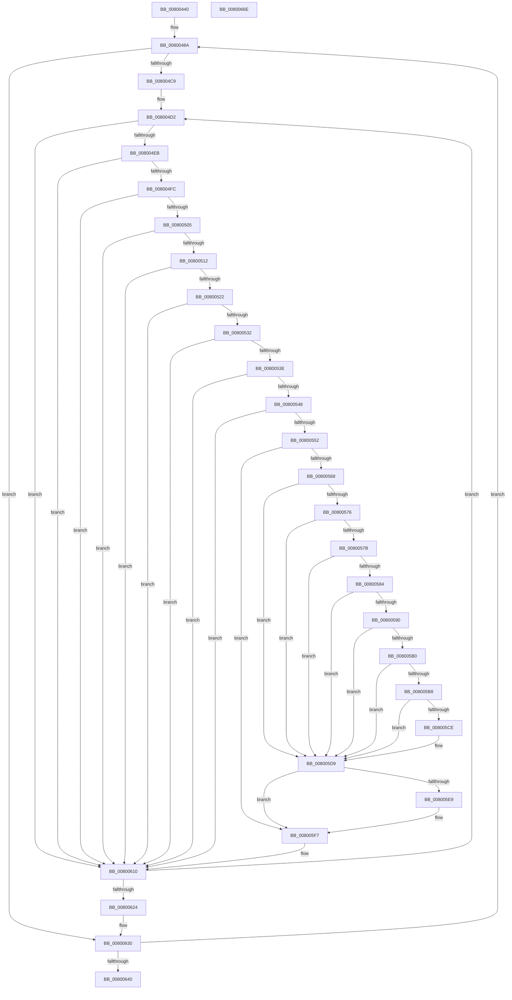

# MiScanPagefileSpace

- RVA: `0x00800440`–`0x0080066F` (길이 `559` bytes)
- VA: `0x0000000140800440`
- 실행 섹션: `PAGE`
- PDB 이름 있음: `예`; PDB Function 태그: `아니요`
- unwind 정보 RVA: `0x000A315C`
- 디코드: `149`개 명령, `559/559` bytes 표시
- 미해석 바이트: `0` (있으면 어셈블리에 `.byte`로 보존)

> 이 문서는 커널 이미지의 기계어와 PDB 기호를 분석해 생성했습니다. 4번과 5번은 함수 원형과 자료형을 바이너리 사용 방식에서 추정한 C 해석이며 원본 소스 복구 결과는 아닙니다.

## 1. Dependencies

- 직접 호출 지점: **9**; 고유 호출 대상: **8**
- 직접 호출자로 확인된 함수: **0**
- RIP 상대 이미지 참조: **0**

### Outgoing calls
- `0x00800466` → [MiReferencePageRuns](../../text/37/MiReferencePageRuns_function_00379540.md) (function, `0x00379540`)
- `0x00800515` → [MiGetPagingFileOffset](../../text/36/MiGetPagingFileOffset_function_0036F530.md) (function, `0x0036F530`)
- `0x00800558` → [MiSafeLockPage](../../text/32/MiSafeLockPage_function_00321620.md) (function, `0x00321620`)
- `0x00800587` → [MiGetPagingFileOffset](../../text/36/MiGetPagingFileOffset_function_0036F530.md) (function, `0x0036F530`)
- `0x008005D1` → [MiCaptureDirtyBitToPfn](../../text/37/MiCaptureDirtyBitToPfn_function_00370DD0.md) (function, `0x00370DD0`)
- `0x008005DF` → [MiUnlockPage](../../text/31/MiUnlockPage_function_0031A3E0.md) (function, `0x0031A3E0`)
- `0x008005F2` → [MiReleasePageFileInfo](../../text/28/MiReleasePageFileInfo_function_00283FD0.md) (function, `0x00283FD0`)
- `0x00800643` → [MiDereferencePageRuns](../../text/3B/MiDereferencePageRuns_function_003BD388.md) (function, `0x003BD388`)
- `0x00800658` → [PsDereferencePartition](../../text/34/PsDereferencePartition_function_00342E70.md) (function, `0x00342E70`)

### Direct callers
- 이 함수 시작 RVA로 연결되는 직접 call은 확인되지 않았습니다. 간접 호출은 완전히 역산할 수 없습니다.

### Static image references
- 디코드된 RIP-relative 메모리 참조가 없습니다.

## 2. Other-region calls and transfers

- 다른 실행 섹션으로 향하는 call: **9**
  - `0x00800466` → [MiReferencePageRuns](../../text/37/MiReferencePageRuns_function_00379540.md) (`PAGE` → `.text`)
  - `0x00800515` → [MiGetPagingFileOffset](../../text/36/MiGetPagingFileOffset_function_0036F530.md) (`PAGE` → `.text`)
  - `0x00800558` → [MiSafeLockPage](../../text/32/MiSafeLockPage_function_00321620.md) (`PAGE` → `.text`)
  - `0x00800587` → [MiGetPagingFileOffset](../../text/36/MiGetPagingFileOffset_function_0036F530.md) (`PAGE` → `.text`)
  - `0x008005D1` → [MiCaptureDirtyBitToPfn](../../text/37/MiCaptureDirtyBitToPfn_function_00370DD0.md) (`PAGE` → `.text`)
  - `0x008005DF` → [MiUnlockPage](../../text/31/MiUnlockPage_function_0031A3E0.md) (`PAGE` → `.text`)
  - `0x008005F2` → [MiReleasePageFileInfo](../../text/28/MiReleasePageFileInfo_function_00283FD0.md) (`PAGE` → `.text`)
  - `0x00800643` → [MiDereferencePageRuns](../../text/3B/MiDereferencePageRuns_function_003BD388.md) (`PAGE` → `.text`)
  - `0x00800658` → [PsDereferencePartition](../../text/34/PsDereferencePartition_function_00342E70.md) (`PAGE` → `.text`)
- 별도 외부 분기/꼬리 이동을 확인하지 못했습니다.

## 3. Assembly (complete function range)

```asm
00800440  40 53                           push rbx
00800442  55                              push rbp
00800443  56                              push rsi
00800444  57                              push rdi
00800445  41 54                           push r12
00800447  41 55                           push r13
00800449  41 56                           push r14
0080044B  41 57                           push r15
0080044D  48 83 EC 28                     sub rsp, 0x28
00800451  0F B7 19                        movzx ebx, word ptr [rcx]
00800454  33 C0                           xor eax, eax
00800456  33 D2                           xor edx, edx
00800458  66 89 5C 24 70                  mov word ptr [rsp + 0x70], bx
0080045D  8B E8                           mov ebp, eax
0080045F  89 44 24 78                     mov dword ptr [rsp + 0x78], eax
00800463  4C 8B F1                        mov r14, rcx
00800466  E8 D5 90 B7 FF                  call 0x140379540
0080046B  4C 8B E0                        mov r12, rax
0080046E  48 89 84 24 88 00 00 00         mov qword ptr [rsp + 0x88], rax
00800476  48 BA FF FF FF FF FF 00 00 00   movabs rdx, 0xffffffffff
00800480  49 B8 FE FF FF FF 3F 00 00 00   movabs r8, 0x3ffffffffe
0080048A  8B C5                           mov eax, ebp
0080048C  48 03 C0                        add rax, rax
0080048F  4D 8B 6C C4 10                  mov r13, qword ptr [r12 + rax*8 + 0x10]
00800494  4A 8D 34 6D 00 00 00 00         lea rsi, [r13*2]
0080049C  49 03 F5                        add rsi, r13
0080049F  48 C1 E6 04                     shl rsi, 4
008004A3  48 B9 00 00 00 00 00 DE FF FF   movabs rcx, 0xffffde0000000000
008004AD  49 8B 44 C4 18                  mov rax, qword ptr [r12 + rax*8 + 0x18]
008004B2  48 03 F1                        add rsi, rcx
008004B5  48 8D 04 40                     lea rax, [rax + rax*2]
008004B9  48 C1 E0 04                     shl rax, 4
008004BD  48 03 C6                        add rax, rsi
008004C0  48 3B F0                        cmp rsi, rax
008004C3  0F 83 67 01 00 00               jae 0x140800630
008004C9  48 8D 7E 10                     lea rdi, [rsi + 0x10]
008004CD  4C 8B E0                        mov r12, rax
008004D0  33 ED                           xor ebp, ebp
008004D2  48 8B 47 18                     mov rax, qword ptr [rdi + 0x18]
008004D6  B9 FF 03 00 00                  mov ecx, 0x3ff
008004DB  48 C1 E8 2B                     shr rax, 0x2b
008004DF  66 23 C1                        and ax, cx
008004E2  66 3B C3                        cmp ax, bx
008004E5  0F 85 25 01 00 00               jne 0x140800610
008004EB  8A 4F 12                        mov cl, byte ptr [rdi + 0x12]
008004EE  80 E1 07                        and cl, 7
008004F1  8D 41 FE                        lea eax, [rcx - 2]
008004F4  A8 FA                           test al, 0xfa
008004F6  0F 85 14 01 00 00               jne 0x140800610
008004FC  80 F9 06                        cmp cl, 6
008004FF  0F 84 0B 01 00 00               je 0x140800610
00800505  8B 07                           mov eax, dword ptr [rdi]
00800507  48 0F BA E0 0A                  bt rax, 0xa
0080050C  0F 82 FE 00 00 00               jb 0x140800610
00800512  48 8B 0F                        mov rcx, qword ptr [rdi]
00800515  E8 16 F0 B6 FF                  call 0x14036f530
0080051A  85 C0                           test eax, eax
0080051C  0F 84 EE 00 00 00               je 0x140800610
00800522  48 8B 47 18                     mov rax, qword ptr [rdi + 0x18]
00800526  48 23 C2                        and rax, rdx
00800529  49 3B C0                        cmp rax, r8
0080052C  0F 84 DE 00 00 00               je 0x140800610
00800532  8B 47 10                        mov eax, dword ptr [rdi + 0x10]
00800535  66 85 C0                        test ax, ax
00800538  0F 84 D2 00 00 00               je 0x140800610
0080053E  F6 47 12 28                     test byte ptr [rdi + 0x12], 0x28
00800542  0F 85 C8 00 00 00               jne 0x140800610
00800548  F6 47 13 10                     test byte ptr [rdi + 0x13], 0x10
0080054C  0F 85 BE 00 00 00               jne 0x140800610
00800552  49 8B CD                        mov rcx, r13
00800555  48 8B DD                        mov rbx, rbp
00800558  E8 C3 10 B2 FF                  call 0x140321620
0080055D  44 8A F8                        mov r15b, al
00800560  3C 11                           cmp al, 0x11
00800562  0F 84 8F 00 00 00               je 0x1408005f7
00800568  8A 57 12                        mov dl, byte ptr [rdi + 0x12]
0080056B  80 E2 07                        and dl, 7
0080056E  8D 4A FE                        lea ecx, [rdx - 2]
00800571  F6 C1 FA                        test cl, 0xfa
00800574  75 63                           jne 0x1408005d9
00800576  80 FA 06                        cmp dl, 6
00800579  74 5E                           je 0x1408005d9
0080057B  8B 07                           mov eax, dword ptr [rdi]
0080057D  48 0F BA E0 0A                  bt rax, 0xa
00800582  72 55                           jb 0x1408005d9
00800584  48 8B 0F                        mov rcx, qword ptr [rdi]
00800587  E8 A4 EF B6 FF                  call 0x14036f530
0080058C  85 C0                           test eax, eax
0080058E  74 49                           je 0x1408005d9
00800590  48 8B 47 18                     mov rax, qword ptr [rdi + 0x18]
00800594  48 B9 FF FF FF FF FF 00 00 00   movabs rcx, 0xffffffffff
0080059E  48 23 C1                        and rax, rcx
008005A1  48 B9 FE FF FF FF 3F 00 00 00   movabs rcx, 0x3ffffffffe
008005AB  48 3B C1                        cmp rax, rcx
008005AE  74 29                           je 0x1408005d9
008005B0  8B 47 10                        mov eax, dword ptr [rdi + 0x10]
008005B3  66 85 C0                        test ax, ax
008005B6  74 21                           je 0x1408005d9
008005B8  F6 47 12 28                     test byte ptr [rdi + 0x12], 0x28
008005BC  8A 47 13                        mov al, byte ptr [rdi + 0x13]
008005BF  0F 94 C1                        sete cl
008005C2  C0 E8 04                        shr al, 4
008005C5  F6 D0                           not al
008005C7  22 C8                           and cl, al
008005C9  F6 C1 01                        test cl, 1
008005CC  74 0B                           je 0x1408005d9
008005CE  48 8B CE                        mov rcx, rsi
008005D1  E8 FA 07 B7 FF                  call 0x140370dd0
008005D6  48 8B D8                        mov rbx, rax
008005D9  41 8A D7                        mov dl, r15b
008005DC  48 8B CE                        mov rcx, rsi
008005DF  E8 FC 9D B1 FF                  call 0x14031a3e0
008005E4  48 85 DB                        test rbx, rbx
008005E7  74 0E                           je 0x1408005f7
008005E9  45 33 C0                        xor r8d, r8d
008005EC  48 8B D3                        mov rdx, rbx
008005EF  49 8B CE                        mov rcx, r14
008005F2  E8 D9 39 A8 FF                  call 0x140283fd0
008005F7  0F B7 5C 24 70                  movzx ebx, word ptr [rsp + 0x70]
008005FC  48 BA FF FF FF FF FF 00 00 00   movabs rdx, 0xffffffffff
00800606  49 B8 FE FF FF FF 3F 00 00 00   movabs r8, 0x3ffffffffe
00800610  48 83 C6 30                     add rsi, 0x30
00800614  48 83 C7 30                     add rdi, 0x30
00800618  49 FF C5                        inc r13
0080061B  49 3B F4                        cmp rsi, r12
0080061E  0F 82 AE FE FF FF               jb 0x1408004d2
00800624  8B 6C 24 78                     mov ebp, dword ptr [rsp + 0x78]
00800628  4C 8B A4 24 88 00 00 00         mov r12, qword ptr [rsp + 0x88]
00800630  FF C5                           inc ebp
00800632  89 6C 24 78                     mov dword ptr [rsp + 0x78], ebp
00800636  41 3B 2C 24                     cmp ebp, dword ptr [r12]
0080063A  0F 85 4A FE FF FF               jne 0x14080048a
00800640  49 8B CC                        mov rcx, r12
00800643  E8 40 CD BB FF                  call 0x1403bd388
00800648  49 8B 8E B8 00 00 00            mov rcx, qword ptr [r14 + 0xb8]
0080064F  33 C0                           xor eax, eax
00800651  49 89 86 08 04 00 00            mov qword ptr [r14 + 0x408], rax
00800658  E8 13 28 B4 FF                  call 0x140342e70
0080065D  48 83 C4 28                     add rsp, 0x28
00800661  41 5F                           pop r15
00800663  41 5E                           pop r14
00800665  41 5D                           pop r13
00800667  41 5C                           pop r12
00800669  5F                              pop rdi
0080066A  5E                              pop rsi
0080066B  5D                              pop rbp
0080066C  5B                              pop rbx
0080066D  C3                              ret
0080066E  CC                              int3
```

## 4. C-style interpretation (structured pseudocode)

```c
__int64 __fastcall MiScanPagefileSpace(__int64 a1, int a2)
{
    __int64 result;
    __int64 v_r13;
    __int64 v_rbp;
    __int64 v_rbx;
    __int64 v_rdi;
    __int64 v_rsi;
    __int64 v_rsp;
    unsigned int v_stack_p10;
    unsigned __int64 v_stack_p20;
    unsigned __int16 v_stack_p8;

    v_rsp = (v_rsp) - (40);
    result = 0;
    a2 = 0;
    v_stack_p8 = (unsigned __int16)(*(unsigned __int16 *)(a1));
    v_stack_p10 = 0;
    result = MiReferencePageRuns(a1, a2, a3, a4);
    v_stack_p20 = result;
loc_0080048A:
    result = (0) + (0);
    v_rsi = (*(unsigned __int64 *)(result + result * 8 + 16) * 2) + (*(unsigned __int64 *)(result + result * 8 + 16));
    v_rsi = (v_rsi) << (4);
    v_rsi = (v_rsi) + (a1);
    result = (*(unsigned __int64 *)(result + result * 8 + 24) + *(unsigned __int64 *)(result + result * 8 + 24) * 2) << (4);
    result = (result) + (v_rsi);
    if (v_rsi >= result) goto loc_00800630;
    v_rbp = 0;
loc_008004D2:
    result = (*(unsigned __int64 *)(v_rsi + 16 + 24)) >> (43);
    result = (unsigned __int16)((result) & ((unsigned __int16)((unsigned int)(0x3FFULL))));
    if (((unsigned __int16)(result)) != ((unsigned __int16)(*(unsigned __int16 *)(a1)))) goto loc_00800610;
    a1 = (unsigned __int8)((*(unsigned __int8 *)(v_rsi + 16 + 18)) & (7));
    if ((((unsigned __int8)(a1 - 2)) & (250)) != 0) goto loc_00800610;
    if (((unsigned __int8)(a1)) == 6) goto loc_00800610;
    if (((unsigned __int8)(a1)) < 6) goto loc_00800610;
    result = MiGetPagingFileOffset(*(unsigned __int64 *)(v_rsi + 16), a2, a3, a4);
    if ((unsigned int)(result) == 0) goto loc_00800610;
    result = (*(unsigned __int64 *)(v_rsi + 16 + 24)) & (0);
    if (result == a3) goto loc_00800610;
    if ((unsigned __int16)((unsigned int)(*(unsigned int *)(v_rsi + 16 + 16))) == 0) goto loc_00800610;
    if (((*(unsigned __int8 *)(v_rsi + 16 + 18)) & (40)) != 0) goto loc_00800610;
    if (((*(unsigned __int8 *)(v_rsi + 16 + 19)) & (16)) != 0) goto loc_00800610;
    result = MiSafeLockPage(*(unsigned __int64 *)(result + result * 8 + 16), a2, a3, a4);
    if (((unsigned __int8)(result)) == 17) goto loc_008005F7;
    a2 = (unsigned __int8)((*(unsigned __int8 *)(v_rsi + 16 + 18)) & (7));
    if ((((unsigned __int8)(a2 - 2)) & (250)) != 0) goto loc_008005D9;
    if (((unsigned __int8)(a2)) == 6) goto loc_008005D9;
    if (((unsigned __int8)(a2)) < 6) goto loc_008005D9;
    result = MiGetPagingFileOffset(*(unsigned __int64 *)(v_rsi + 16), a2, a3, a4);
    if ((unsigned int)(result) == 0) goto loc_008005D9;
    result = (*(unsigned __int64 *)(v_rsi + 16 + 24)) & (*(unsigned __int64 *)(v_rsi + 16));
    if (result == (*(unsigned __int64 *)(v_rsi + 16))) goto loc_008005D9;
    if ((unsigned __int16)((unsigned int)(*(unsigned int *)(v_rsi + 16 + 16))) == 0) goto loc_008005D9;
    a1 = (((*(unsigned __int8 *)(v_rsi + 16 + 18)) & (40)) == 0) ? 1 : 0;
    result = (unsigned __int8)((*(unsigned __int8 *)(v_rsi + 16 + 19)) >> (4));
    result = (unsigned __int8)(~(result));
    a1 = (unsigned __int8)((a1) & ((unsigned __int8)(result)));
    v_rbx = 0;
    if ((((unsigned __int8)(a1)) & (1)) != 0) {
        a1 = v_rsi;
        result = MiCaptureDirtyBitToPfn(a1, a2, a3, a4);
        v_rbx = result;
    }
    result = MiUnlockPage(v_rsi, (unsigned __int8)((unsigned __int8)(result)), a3, a4);
    if (v_rbx != 0) {
        a3 = 0;
        a2 = v_rbx;
        a1 = a1;
        result = MiReleasePageFileInfo(a1, a2, a3, a4);
    }
loc_00800610:
    v_rsi = (v_rsi) + (48);
    v_rdi = (v_rsi + 16) + (48);
    v_r13 = (*(unsigned __int64 *)(result + result * 8 + 16)) + 1;
    if (v_rsi < result) goto loc_008004D2;
loc_00800630:
    v_rbp = (unsigned int)(((unsigned int)(v_stack_p10)) + 1);
    v_stack_p10 = (unsigned int)(v_rbp);
    if (((unsigned int)(v_rbp)) != (*(unsigned int *)(v_stack_p20))) goto loc_0080048A;
    result = MiDereferencePageRuns(v_stack_p20, a2, a3, a4);
    result = 0;
    *(unsigned __int64 *)(a1 + 1032) = 0;
    result = PsDereferencePartition(*(unsigned __int64 *)(a1 + 184), a2, a3, a4);
    v_rsp = (v_rsp) + (40);
    return result;
}
```

## 5. (Beta) C Style

```c
int64_t MiScanPagefileSpace(void *Arg1, int32_t Arg2)
{
    uint8_t *arg1 = (uint8_t *)Arg1;

    int64_t result;
    int64_t local_r13;
    int64_t local_rbp;
    int64_t local_rbx;
    int64_t local_rdi;
    int64_t local_rsi;
    int64_t local_rsp;
    uint32_t v_stack_p10;
    uint64_t v_stack_p20;
    uint16_t v_stack_p8;

    local_rsp = (local_rsp) - (40);
    result = 0;
    Arg2 = 0;
    v_stack_p8 = (uint16_t)(*(uint16_t *)(arg1));
    v_stack_p10 = 0;
    result = MiReferencePageRuns(Arg1, Arg2, a3, a4);
    v_stack_p20 = result;
loc_0080048A:
    result = (0) + (0);
    local_rsi = (*(uint64_t *)(result + result * 8 + 0x10) * 2) + (*(uint64_t *)(result + result * 8 + 0x10));
    local_rsi = (local_rsi) << (4);
    local_rsi = (local_rsi) + (Arg1);
    result = (*(uint64_t *)(result + result * 8 + 0x18) + *(uint64_t *)(result + result * 8 + 0x18) * 2) << (4);
    result = (result) + (local_rsi);
    if (local_rsi >= result) goto loc_00800630;
    local_rbp = 0;
loc_008004D2:
    result = (*(uint64_t *)(local_rsi + 0x10 + 0x18)) >> (43);
    result = (uint16_t)((result) & ((uint16_t)((uint32_t)(0x3FFULL))));
    if (((uint16_t)(result)) != ((uint16_t)(*(uint16_t *)(arg1)))) goto loc_00800610;
    Arg1 = (uint8_t)((*(uint8_t *)(local_rsi + 0x10 + 0x12)) & (7));
    if ((((uint8_t)(Arg1 - 2)) & (250)) != 0) goto loc_00800610;
    if (((uint8_t)(Arg1)) == 6) goto loc_00800610;
    if (((uint8_t)(Arg1)) < 6) goto loc_00800610;
    result = MiGetPagingFileOffset(*(uint64_t *)(local_rsi + 0x10), Arg2, a3, a4);
    if ((uint32_t)(result) == 0) goto loc_00800610;
    result = (*(uint64_t *)(local_rsi + 0x10 + 0x18)) & (0);
    if (result == a3) goto loc_00800610;
    if ((uint16_t)((uint32_t)(*(uint32_t *)(local_rsi + 0x10 + 0x10))) == 0) goto loc_00800610;
    if (((*(uint8_t *)(local_rsi + 0x10 + 0x12)) & (40)) != 0) goto loc_00800610;
    if (((*(uint8_t *)(local_rsi + 0x10 + 0x13)) & (16)) != 0) goto loc_00800610;
    result = MiSafeLockPage(*(uint64_t *)(result + result * 8 + 0x10), Arg2, a3, a4);
    if (((uint8_t)(result)) == 17) goto loc_008005F7;
    Arg2 = (uint8_t)((*(uint8_t *)(local_rsi + 0x10 + 0x12)) & (7));
    if ((((uint8_t)(Arg2 - 2)) & (250)) != 0) goto loc_008005D9;
    if (((uint8_t)(Arg2)) == 6) goto loc_008005D9;
    if (((uint8_t)(Arg2)) < 6) goto loc_008005D9;
    result = MiGetPagingFileOffset(*(uint64_t *)(local_rsi + 0x10), Arg2, a3, a4);
    if ((uint32_t)(result) == 0) goto loc_008005D9;
    result = (*(uint64_t *)(local_rsi + 0x10 + 0x18)) & (*(uint64_t *)(local_rsi + 0x10));
    if (result == (*(uint64_t *)(local_rsi + 0x10))) goto loc_008005D9;
    if ((uint16_t)((uint32_t)(*(uint32_t *)(local_rsi + 0x10 + 0x10))) == 0) goto loc_008005D9;
    Arg1 = (((*(uint8_t *)(local_rsi + 0x10 + 0x12)) & (40)) == 0) ? 1 : 0;
    result = (uint8_t)((*(uint8_t *)(local_rsi + 0x10 + 0x13)) >> (4));
    result = (uint8_t)(~(result));
    Arg1 = (uint8_t)((Arg1) & ((uint8_t)(result)));
    local_rbx = 0;
    if ((((uint8_t)(Arg1)) & (1)) != 0) {
        Arg1 = local_rsi;
        result = MiCaptureDirtyBitToPfn(Arg1, Arg2, a3, a4);
        local_rbx = result;
    }
    result = MiUnlockPage(local_rsi, (uint8_t)((uint8_t)(result)), a3, a4);
    if (local_rbx != 0) {
        a3 = 0;
        Arg2 = local_rbx;
        Arg1 = Arg1;
        result = MiReleasePageFileInfo(Arg1, Arg2, a3, a4);
    }
loc_00800610:
    local_rsi = (local_rsi) + (48);
    local_rdi = (local_rsi + 16) + (48);
    local_r13 = (*(uint64_t *)(result + result * 8 + 0x10)) + 1;
    if (local_rsi < result) goto loc_008004D2;
loc_00800630:
    local_rbp = (uint32_t)(((uint32_t)(v_stack_p10)) + 1);
    v_stack_p10 = (uint32_t)(local_rbp);
    if (((uint32_t)(local_rbp)) != (*(uint32_t *)(v_stack_p20))) goto loc_0080048A;
    result = MiDereferencePageRuns(v_stack_p20, Arg2, a3, a4);
    result = 0;
    *(uint64_t *)(arg1 + 0x408) = 0;
    result = PsDereferencePartition(*(uint64_t *)(arg1 + 0xB8), Arg2, a3, a4);
    local_rsp = (local_rsp) + (40);
    return result;
}
```

### 관측된 메모리 오프셋

구조체 형식이 확인되지 않은 접근은 인자 기준의 오프셋으로만 기록했습니다.

| 기준 인자 | 오프셋 표현 | 폭 (bit) | 접근 |
|---|---:|---:|---|
| `Arg1` | `+ 0x0` | `16` | `R` |
| `Arg1` | `+ 0xB8` | `64` | `R` |
| `Arg1` | `+ 0x408` | `64` | `W` |

## 6. Execution-region graph

[열기: 2D/3D 그래프와 함수 탐색 컨트롤 패널](../../../control-panel.html?section=page&rva=0x00800440&view=graph)

- 2D 그래프는 위에서 아래로 흐르고, 3D 그래프는 빈 공간을 드래그해 회전합니다. Shift+드래그는 이동, 휠은 확대·축소, 함수 노드 선택은 대상 보고서 이동입니다.

### Static fallback


