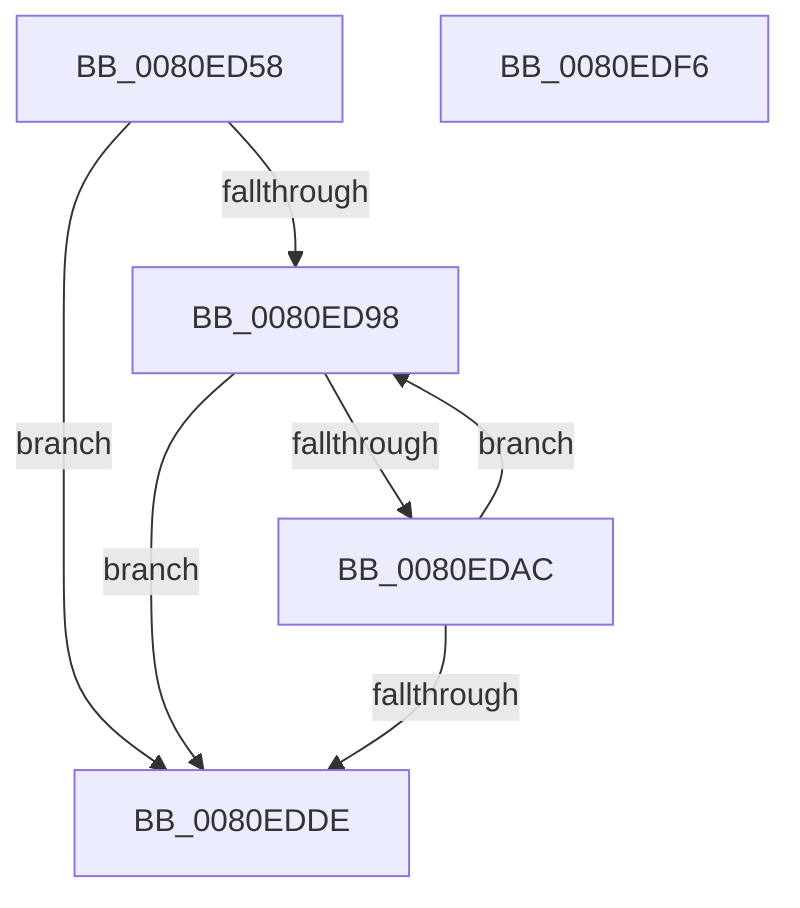

# MiScrubActiveLargePage

- RVA: `0x0080ED58`–`0x0080EDF7` (길이 `159` bytes)
- VA: `0x000000014080ED58`
- 실행 섹션: `PAGE`
- PDB 이름 있음: `예`; PDB Function 태그: `아니요`
- unwind 정보 RVA: `0x000D2B60`
- 디코드: `51`개 명령, `159/159` bytes 표시
- 미해석 바이트: `0` (있으면 어셈블리에 `.byte`로 보존)

> 이 문서는 커널 이미지의 기계어와 PDB 기호를 분석해 생성했습니다. 4번과 5번은 함수 원형과 자료형을 바이너리 사용 방식에서 추정한 C 해석이며 원본 소스 복구 결과는 아닙니다.

## 1. Dependencies

- 직접 호출 지점: **5**; 고유 호출 대상: **5**
- 직접 호출자로 확인된 함수: **1**
- RIP 상대 이미지 참조: **1**

### Outgoing calls
- `0x0080EDA3` → [MiScrubInterrupted](../../text/49/MiScrubInterrupted_function_00495894.md) (function, `0x00495894`)
- `0x0080EDB6` → [KiStackAttachProcess](../../text/21/KiStackAttachProcess_function_00216820.md) (function, `0x00216820`)
- `0x0080EDC4` → [MiScrubProcessLargePage](MiScrubProcessLargePage_function_0080EE70.md) (function, `0x0080EE70`)
- `0x0080EDD0` → [KiUnstackDetachProcess](../../text/21/KiUnstackDetachProcess_function_00217D30.md) (function, `0x00217D30`)
- `0x0080EDE6` → [_security_check_cookie](../../text/6A/_security_check_cookie_function_006AC640.md) (function, `0x006AC640`)

### Direct callers
- [MiScrubLargePageRegions](../70/MiScrubLargePageRegions_function_007011B4.md) at `0x00701357`

### Static image references
- `0x0080ED63` → RVA `0x00E0A740` (`.data`; read)

## 2. Other-region calls and transfers

- 다른 실행 섹션으로 향하는 call: **4**
  - `0x0080EDA3` → [MiScrubInterrupted](../../text/49/MiScrubInterrupted_function_00495894.md) (`PAGE` → `.text`)
  - `0x0080EDB6` → [KiStackAttachProcess](../../text/21/KiStackAttachProcess_function_00216820.md) (`PAGE` → `.text`)
  - `0x0080EDD0` → [KiUnstackDetachProcess](../../text/21/KiUnstackDetachProcess_function_00217D30.md) (`PAGE` → `.text`)
  - `0x0080EDE6` → [_security_check_cookie](../../text/6A/_security_check_cookie_function_006AC640.md) (`PAGE` → `.text`)
- 별도 외부 분기/꼬리 이동을 확인하지 못했습니다.

## 3. Assembly (complete function range)

```asm
0080ED58  40 53                           push rbx
0080ED5A  55                              push rbp
0080ED5B  56                              push rsi
0080ED5C  57                              push rdi
0080ED5D  41 56                           push r14
0080ED5F  48 83 EC 60                     sub rsp, 0x60
0080ED63  48 8B 05 D6 B9 5F 00            mov rax, qword ptr [rip + 0x5fb9d6]
0080ED6A  48 33 C4                        xor rax, rsp
0080ED6D  48 89 44 24 50                  mov qword ptr [rsp + 0x50], rax
0080ED72  48 8B 31                        mov rsi, qword ptr [rcx]
0080ED75  0F 57 C0                        xorps xmm0, xmm0
0080ED78  33 DB                           xor ebx, ebx
0080ED7A  45 8B F0                        mov r14d, r8d
0080ED7D  0F 11 44 24 20                  movups xmmword ptr [rsp + 0x20], xmm0
0080ED82  48 8B EA                        mov rbp, rdx
0080ED85  48 8B F9                        mov rdi, rcx
0080ED88  0F 11 44 24 30                  movups xmmword ptr [rsp + 0x30], xmm0
0080ED8D  0F 11 44 24 40                  movups xmmword ptr [rsp + 0x40], xmm0
0080ED92  48 39 5E 40                     cmp qword ptr [rsi + 0x40], rbx
0080ED96  76 46                           jbe 0x14080edde
0080ED98  48 8B 46 48                     mov rax, qword ptr [rsi + 0x48]
0080ED9C  48 8B CF                        mov rcx, rdi
0080ED9F  4C 8B 0C D8                     mov r9, qword ptr [rax + rbx*8]
0080EDA3  E8 EC 6A C8 FF                  call 0x140495894
0080EDA8  85 C0                           test eax, eax
0080EDAA  75 32                           jne 0x14080edde
0080EDAC  4C 8D 44 24 20                  lea r8, [rsp + 0x20]
0080EDB1  33 D2                           xor edx, edx
0080EDB3  49 8B C9                        mov rcx, r9
0080EDB6  E8 65 7A A0 FF                  call 0x140216820
0080EDBB  45 8B C6                        mov r8d, r14d
0080EDBE  48 8B D5                        mov rdx, rbp
0080EDC1  48 8B CF                        mov rcx, rdi
0080EDC4  E8 A7 00 00 00                  call 0x14080ee70
0080EDC9  33 D2                           xor edx, edx
0080EDCB  48 8D 4C 24 20                  lea rcx, [rsp + 0x20]
0080EDD0  E8 5B 8F A0 FF                  call 0x140217d30
0080EDD5  48 FF C3                        inc rbx
0080EDD8  48 3B 5E 40                     cmp rbx, qword ptr [rsi + 0x40]
0080EDDC  72 BA                           jb 0x14080ed98
0080EDDE  48 8B 4C 24 50                  mov rcx, qword ptr [rsp + 0x50]
0080EDE3  48 33 CC                        xor rcx, rsp
0080EDE6  E8 55 D8 E9 FF                  call 0x1406ac640
0080EDEB  48 83 C4 60                     add rsp, 0x60
0080EDEF  41 5E                           pop r14
0080EDF1  5F                              pop rdi
0080EDF2  5E                              pop rsi
0080EDF3  5D                              pop rbp
0080EDF4  5B                              pop rbx
0080EDF5  C3                              ret
0080EDF6  CC                              int3
```

## 4. C-style interpretation (structured pseudocode)

```c
__int64 __fastcall MiScrubActiveLargePage(__int64 a1, __int64 a2, int a3)
{
    __int64 result;
    __int64 v_rbx;
    __int64 v_rsp;
    unsigned __int64 v_stack_m38;
    unsigned __int64 v_stack_m48;
    unsigned __int64 v_stack_m58;
    unsigned __int64 v_stack_m68;

    v_rsp = (v_rsp) - (96);
    result = (*(unsigned __int64 *)(v_rip + 6273494)) ^ (v_rsp);
    v_stack_m38 = result;
    v_rbx = 0;
    v_stack_m68 = v_xmm0;
    v_stack_m58 = v_xmm0;
    v_stack_m48 = v_xmm0;
    if ((*(unsigned __int64 *)(*(unsigned __int64 *)(a1) + 64)) <= 0) goto loc_0080EDDE;
loc_0080ED98:
    result = MiScrubInterrupted(a1, a2, a3, *(unsigned __int64 *)(*(unsigned __int64 *)(*(unsigned __int64 *)(a1) + 72) + v_rbx * 8));
    if ((unsigned int)(result) != 0) goto loc_0080EDDE;
    a2 = 0;
    result = KiStackAttachProcess(*(unsigned __int64 *)(*(unsigned __int64 *)(*(unsigned __int64 *)(a1) + 72) + v_rbx * 8), a2, v_stack_m68, *(unsigned __int64 *)(*(unsigned __int64 *)(*(unsigned __int64 *)(a1) + 72) + v_rbx * 8));
    result = MiScrubProcessLargePage(a1, 0, (unsigned int)((unsigned int)((unsigned int)(a3))), *(unsigned __int64 *)(*(unsigned __int64 *)(*(unsigned __int64 *)(a1) + 72) + v_rbx * 8));
    a2 = 0;
    result = KiUnstackDetachProcess(v_stack_m68, a2, (unsigned int)((unsigned int)((unsigned int)(a3))), *(unsigned __int64 *)(*(unsigned __int64 *)(*(unsigned __int64 *)(a1) + 72) + v_rbx * 8));
    v_rbx = (v_rbx) + 1;
    if (v_rbx < (*(unsigned __int64 *)(*(unsigned __int64 *)(a1) + 64))) goto loc_0080ED98;
loc_0080EDDE:
    a1 = (v_stack_m38) ^ (v_rsp);
    result = _security_check_cookie(a1, a2, (unsigned int)((unsigned int)((unsigned int)(a3))), *(unsigned __int64 *)(*(unsigned __int64 *)(*(unsigned __int64 *)(a1) + 72) + v_rbx * 8));
    v_rsp = (v_rsp) + (96);
    return result;
}
```

## 5. (Beta) C Style

```c
int64_t MiScrubActiveLargePage(void *Arg1, int64_t Arg2, int32_t Arg3)
{
    uint8_t *arg1 = (uint8_t *)Arg1;

    int64_t result;
    int64_t local_rbx;
    int64_t local_rsp;
    uint64_t v_stack_m38;
    uint64_t v_stack_m48;
    uint64_t v_stack_m58;
    uint64_t v_stack_m68;

    local_rsp = (local_rsp) - (96);
    result = (*(uint64_t *)(v_rip + 0x5FB9D6)) ^ (local_rsp);
    v_stack_m38 = result;
    local_rbx = 0;
    v_stack_m68 = v_xmm0;
    v_stack_m58 = v_xmm0;
    v_stack_m48 = v_xmm0;
    if ((*(uint64_t *)(*(uint64_t *)(arg1) + 0x40)) <= 0) goto loc_0080EDDE;
loc_0080ED98:
    result = MiScrubInterrupted(Arg1, Arg2, Arg3, *(uint64_t *)(*(uint64_t *)(*(uint64_t *)(arg1) + 0x48) + local_rbx * 8));
    if ((uint32_t)(result) != 0) goto loc_0080EDDE;
    Arg2 = 0;
    result = KiStackAttachProcess(*(uint64_t *)(*(uint64_t *)(*(uint64_t *)(arg1) + 0x48) + local_rbx * 8), Arg2, v_stack_m68, *(uint64_t *)(*(uint64_t *)(*(uint64_t *)(arg1) + 0x48) + local_rbx * 8));
    result = MiScrubProcessLargePage(Arg1, 0, (uint32_t)((uint32_t)((uint32_t)(Arg3))), *(uint64_t *)(*(uint64_t *)(*(uint64_t *)(arg1) + 0x48) + local_rbx * 8));
    Arg2 = 0;
    result = KiUnstackDetachProcess(v_stack_m68, Arg2, (uint32_t)((uint32_t)((uint32_t)(Arg3))), *(uint64_t *)(*(uint64_t *)(*(uint64_t *)(arg1) + 0x48) + local_rbx * 8));
    local_rbx = (local_rbx) + 1;
    if (local_rbx < (*(uint64_t *)(*(uint64_t *)(arg1) + 0x40))) goto loc_0080ED98;
loc_0080EDDE:
    Arg1 = (v_stack_m38) ^ (local_rsp);
    result = _security_check_cookie(Arg1, Arg2, (uint32_t)((uint32_t)((uint32_t)(Arg3))), *(uint64_t *)(*(uint64_t *)(*(uint64_t *)(arg1) + 0x48) + local_rbx * 8));
    local_rsp = (local_rsp) + (96);
    return result;
}
```

### 관측된 메모리 오프셋

구조체 형식이 확인되지 않은 접근은 인자 기준의 오프셋으로만 기록했습니다.

| 기준 인자 | 오프셋 표현 | 폭 (bit) | 접근 |
|---|---:|---:|---|
| `Arg1` | `+ 0x0` | `64` | `R` |

## 6. Execution-region graph

[열기: 2D/3D 그래프와 함수 탐색 컨트롤 패널](../../../control-panel.html?section=page&rva=0x0080ED58&view=graph)

- 2D 그래프는 위에서 아래로 흐르고, 3D 그래프는 빈 공간을 드래그해 회전합니다. Shift+드래그는 이동, 휠은 확대·축소, 함수 노드 선택은 대상 보고서 이동입니다.

### Static fallback


