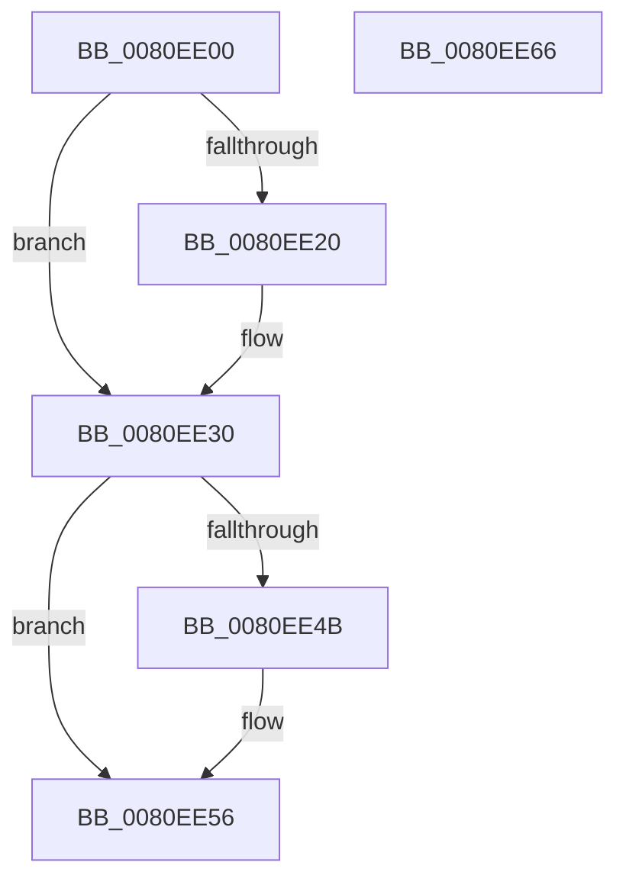

# MiScrubMemoryWorker

- RVA: `0x0080EE00`–`0x0080EE67` (길이 `103` bytes)
- VA: `0x000000014080EE00`
- 실행 섹션: `PAGE`
- PDB 이름 있음: `예`; PDB Function 태그: `아니요`
- unwind 정보 RVA: `0x00060BC4`
- 디코드: `30`개 명령, `103/103` bytes 표시
- 미해석 바이트: `0` (있으면 어셈블리에 `.byte`로 보존)

> 이 문서는 커널 이미지의 기계어와 PDB 기호를 분석해 생성했습니다. 4번과 5번은 함수 원형과 자료형을 바이너리 사용 방식에서 추정한 C 해석이며 원본 소스 복구 결과는 아닙니다.

## 1. Dependencies

- 직접 호출 지점: **4**; 고유 호출 대상: **4**
- 직접 호출자로 확인된 함수: **0**
- RIP 상대 이미지 참조: **0**

### Outgoing calls
- `0x0080EE15` → [MiInitializeScrubPacket](MiInitializeScrubPacket_function_0080EA10.md) (function, `0x0080EA10`)
- `0x0080EE23` → [MiScrubNode](../A4/MiScrubNode_function_00A46098.md) (function, `0x00A46098`)
- `0x0080EE2B` → [MiReleaseScrubPacket](MiReleaseScrubPacket_function_0080ED24.md) (function, `0x0080ED24`)
- `0x0080EE51` → [KeSignalGate](../../text/2C/KeSignalGate_function_002C748C.md) (function, `0x002C748C`)

### Direct callers
- 이 함수 시작 RVA로 연결되는 직접 call은 확인되지 않았습니다. 간접 호출은 완전히 역산할 수 없습니다.

### Static image references
- 디코드된 RIP-relative 메모리 참조가 없습니다.

## 2. Other-region calls and transfers

- 다른 실행 섹션으로 향하는 call: **1**
  - `0x0080EE51` → [KeSignalGate](../../text/2C/KeSignalGate_function_002C748C.md) (`PAGE` → `.text`)
- 별도 외부 분기/꼬리 이동을 확인하지 못했습니다.

## 3. Assembly (complete function range)

```asm
0080EE00  48 89 5C 24 08                  mov qword ptr [rsp + 8], rbx
0080EE05  48 89 74 24 10                  mov qword ptr [rsp + 0x10], rsi
0080EE0A  57                              push rdi
0080EE0B  48 83 EC 20                     sub rsp, 0x20
0080EE0F  48 8B 39                        mov rdi, qword ptr [rcx]
0080EE12  48 8B D9                        mov rbx, rcx
0080EE15  E8 F6 FB FF FF                  call 0x14080ea10
0080EE1A  8B F0                           mov esi, eax
0080EE1C  85 C0                           test eax, eax
0080EE1E  78 10                           js 0x14080ee30
0080EE20  48 8B CB                        mov rcx, rbx
0080EE23  E8 70 72 23 00                  call 0x140a46098
0080EE28  48 8B CB                        mov rcx, rbx
0080EE2B  E8 F4 FE FF FF                  call 0x14080ed24
0080EE30  48 8B 83 B8 00 00 00            mov rax, qword ptr [rbx + 0xb8]
0080EE37  89 73 0C                        mov dword ptr [rbx + 0xc], esi
0080EE3A  F0 48 01 47 28                  lock add qword ptr [rdi + 0x28], rax
0080EE3F  83 C8 FF                        or eax, 0xffffffff
0080EE42  F0 0F C1 07                     lock xadd dword ptr [rdi], eax
0080EE46  83 F8 01                        cmp eax, 1
0080EE49  75 0B                           jne 0x14080ee56
0080EE4B  48 8D 4F 08                     lea rcx, [rdi + 8]
0080EE4F  8B D0                           mov edx, eax
0080EE51  E8 36 86 AB FF                  call 0x1402c748c
0080EE56  48 8B 5C 24 30                  mov rbx, qword ptr [rsp + 0x30]
0080EE5B  48 8B 74 24 38                  mov rsi, qword ptr [rsp + 0x38]
0080EE60  48 83 C4 20                     add rsp, 0x20
0080EE64  5F                              pop rdi
0080EE65  C3                              ret
0080EE66  CC                              int3
```

## 4. C-style interpretation (structured pseudocode)

```c
__int64 __fastcall MiScrubMemoryWorker(__int64 a1)
{
    __int64 result;
    __int64 v_rsp;
    unsigned __int64 v_stack_p10;
    unsigned __int64 v_stack_p8;

    v_stack_p8 = v_rbx;
    v_stack_p10 = v_rsi;
    v_rsp = (v_rsp) - (32);
    result = MiInitializeScrubPacket(a1, a2, a3, a4);
    if (!(sign_flag)) {
        a1 = a1;
        result = MiScrubNode(a1, a2, a3, a4);
        a1 = a1;
        result = MiReleaseScrubPacket(a1, a2, a3, a4);
    }
    *(unsigned int *)(a1 + 12) = (unsigned int)((unsigned int)((unsigned int)(result)));
    result = (unsigned int)((*(unsigned __int64 *)(a1 + 184)) | (0xFFFFFFFFULL));
    if (((unsigned int)(result)) == 1) {
        a1 = *(unsigned __int64 *)(a1) + 8;
        a2 = (unsigned int)(result);
        result = KeSignalGate(a1, a2, a3, a4);
    }
    v_rsp = (v_rsp) + (32);
    return result;
}
```

## 5. (Beta) C Style

```c
int64_t MiScrubMemoryWorker(void *Arg1)
{
    uint8_t *arg1 = (uint8_t *)Arg1;

    int64_t result;
    int64_t local_rsp;
    uint64_t v_stack_p10;
    uint64_t v_stack_p8;

    v_stack_p8 = local_rbx;
    v_stack_p10 = local_rsi;
    local_rsp = (local_rsp) - (32);
    result = MiInitializeScrubPacket(Arg1, a2, a3, a4);
    if (!(sign_flag)) {
        Arg1 = Arg1;
        result = MiScrubNode(Arg1, a2, a3, a4);
        Arg1 = Arg1;
        result = MiReleaseScrubPacket(Arg1, a2, a3, a4);
    }
    *(uint32_t *)(arg1 + 0xC) = (uint32_t)((uint32_t)((uint32_t)(result)));
    result = (uint32_t)((*(uint64_t *)(arg1 + 0xB8)) | (0xFFFFFFFFULL));
    if (((uint32_t)(result)) == 1) {
        Arg1 = *(uint64_t *)(arg1) + 8;
        a2 = (uint32_t)(result);
        result = KeSignalGate(Arg1, a2, a3, a4);
    }
    local_rsp = (local_rsp) + (32);
    return result;
}
```

### 관측된 메모리 오프셋

구조체 형식이 확인되지 않은 접근은 인자 기준의 오프셋으로만 기록했습니다.

| 기준 인자 | 오프셋 표현 | 폭 (bit) | 접근 |
|---|---:|---:|---|
| `Arg1` | `+ 0x0` | `64` | `R` |
| `Arg1` | `+ 0xC` | `32` | `W` |
| `Arg1` | `+ 0xB8` | `64` | `R` |

## 6. Execution-region graph

[열기: 2D/3D 그래프와 함수 탐색 컨트롤 패널](../../../control-panel.html?section=page&rva=0x0080EE00&view=graph)

- 2D 그래프는 위에서 아래로 흐르고, 3D 그래프는 빈 공간을 드래그해 회전합니다. Shift+드래그는 이동, 휠은 확대·축소, 함수 노드 선택은 대상 보고서 이동입니다.

### Static fallback


