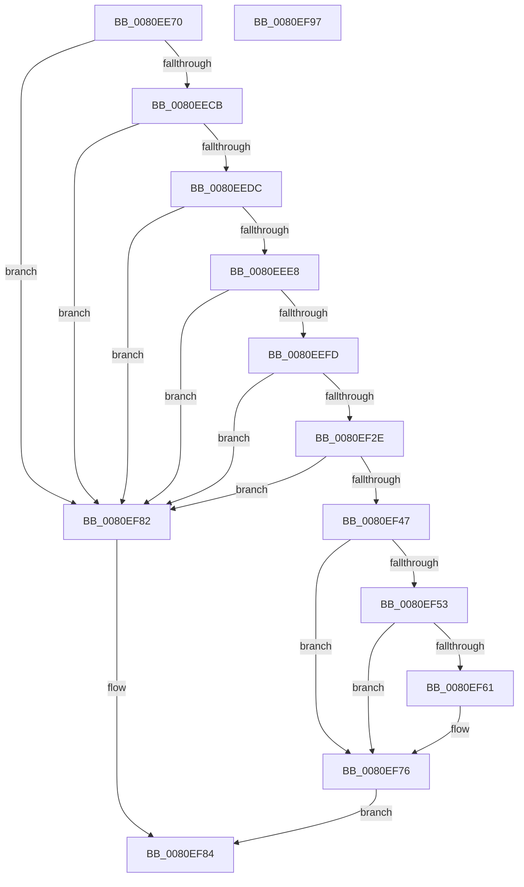

# MiScrubProcessLargePage

- RVA: `0x0080EE70`–`0x0080EF98` (길이 `296` bytes)
- VA: `0x000000014080EE70`
- 실행 섹션: `PAGE`
- PDB 이름 있음: `예`; PDB Function 태그: `아니요`
- unwind 정보 RVA: `0x000AB20C`
- 디코드: `79`개 명령, `296/296` bytes 표시
- 미해석 바이트: `0` (있으면 어셈블리에 `.byte`로 보존)

> 이 문서는 커널 이미지의 기계어와 PDB 기호를 분석해 생성했습니다. 4번과 5번은 함수 원형과 자료형을 바이너리 사용 방식에서 추정한 C 해석이며 원본 소스 복구 결과는 아닙니다.

## 1. Dependencies

- 직접 호출 지점: **5**; 고유 호출 대상: **5**
- 직접 호출자로 확인된 함수: **1**
- RIP 상대 이미지 참조: **1**

### Outgoing calls
- `0x0080EEB5` → [MiIdentifyPfnWrapper](../../text/31/MiIdentifyPfnWrapper_function_0031C8F0.md) (function, `0x0031C8F0`)
- `0x0080EF3A` → [MiObtainReferencedVadEx](../../text/31/MiObtainReferencedVadEx_function_00316690.md) (function, `0x00316690`)
- `0x0080EF4A` → [MiIsVadLargePrivate](../../text/32/MiIsVadLargePrivate_function_0032F720.md) (function, `0x0032F720`)
- `0x0080EF6F` → [MiScrubLargeMappedPage](../../text/69/MiScrubLargeMappedPage_function_00693E2C.md) (function, `0x00693E2C`)
- `0x0080EF79` → [MiUnlockAndDereferenceVad](../../text/31/MiUnlockAndDereferenceVad_function_00316E60.md) (function, `0x00316E60`)

### Direct callers
- [MiScrubActiveLargePage](MiScrubActiveLargePage_function_0080ED58.md) at `0x0080EDC4`

### Static image references
- `0x0080EEBA` → RVA `0x00011C60` (`.rdata`; read)

## 2. Other-region calls and transfers

- 다른 실행 섹션으로 향하는 call: **5**
  - `0x0080EEB5` → [MiIdentifyPfnWrapper](../../text/31/MiIdentifyPfnWrapper_function_0031C8F0.md) (`PAGE` → `.text`)
  - `0x0080EF3A` → [MiObtainReferencedVadEx](../../text/31/MiObtainReferencedVadEx_function_00316690.md) (`PAGE` → `.text`)
  - `0x0080EF4A` → [MiIsVadLargePrivate](../../text/32/MiIsVadLargePrivate_function_0032F720.md) (`PAGE` → `.text`)
  - `0x0080EF6F` → [MiScrubLargeMappedPage](../../text/69/MiScrubLargeMappedPage_function_00693E2C.md) (`PAGE` → `.text`)
  - `0x0080EF79` → [MiUnlockAndDereferenceVad](../../text/31/MiUnlockAndDereferenceVad_function_00316E60.md) (`PAGE` → `.text`)
- 별도 외부 분기/꼬리 이동을 확인하지 못했습니다.

## 3. Assembly (complete function range)

```asm
0080EE70  4C 8B DC                        mov r11, rsp
0080EE73  49 89 5B 08                     mov qword ptr [r11 + 8], rbx
0080EE77  49 89 6B 10                     mov qword ptr [r11 + 0x10], rbp
0080EE7B  56                              push rsi
0080EE7C  57                              push rdi
0080EE7D  41 56                           push r14
0080EE7F  48 83 EC 40                     sub rsp, 0x40
0080EE83  4C 8B F1                        mov r14, rcx
0080EE86  41 8B E8                        mov ebp, r8d
0080EE89  0F 57 C0                        xorps xmm0, xmm0
0080EE8C  48 8D 0C 52                     lea rcx, [rdx + rdx*2]
0080EE90  33 C0                           xor eax, eax
0080EE92  48 C1 E1 04                     shl rcx, 4
0080EE96  0F 11 44 24 20                  movups xmmword ptr [rsp + 0x20], xmm0
0080EE9B  49 89 43 D8                     mov qword ptr [r11 - 0x28], rax
0080EE9F  48 8B F2                        mov rsi, rdx
0080EEA2  33 FF                           xor edi, edi
0080EEA4  48 B8 00 00 00 00 00 DE FF FF   movabs rax, 0xffffde0000000000
0080EEAE  48 03 C8                        add rcx, rax
0080EEB1  49 8D 53 C8                     lea rdx, [r11 - 0x38]
0080EEB5  E8 36 DA B0 FF                  call 0x14031c8f0
0080EEBA  48 8D 15 9F 2D 80 FF            lea rdx, [rip - 0x7fd261]
0080EEC1  48 3B 04 EA                     cmp rax, qword ptr [rdx + rbp*8]
0080EEC5  0F 85 B7 00 00 00               jne 0x14080ef82
0080EECB  48 8B 4C 24 20                  mov rcx, qword ptr [rsp + 0x20]
0080EED0  8A C1                           mov al, cl
0080EED2  24 70                           and al, 0x70
0080EED4  3C 60                           cmp al, 0x60
0080EED6  0F 85 A6 00 00 00               jne 0x14080ef82
0080EEDC  80 E1 0F                        and cl, 0xf
0080EEDF  80 F9 0D                        cmp cl, 0xd
0080EEE2  0F 85 9A 00 00 00               jne 0x14080ef82
0080EEE8  48 B8 FF FF FE FF FF 7F 00 00   movabs rax, 0x7ffffffeffff
0080EEF2  48 39 44 24 30                  cmp qword ptr [rsp + 0x30], rax
0080EEF7  0F 87 85 00 00 00               ja 0x14080ef82
0080EEFD  65 48 8B 04 25 88 01 00 00      mov rax, qword ptr gs:[0x188]
0080EF06  48 8B 88 B8 00 00 00            mov rcx, qword ptr [rax + 0xb8]
0080EF0D  48 8B 44 24 20                  mov rax, qword ptr [rsp + 0x20]
0080EF12  48 C1 E8 09                     shr rax, 9
0080EF16  8B 91 D0 01 00 00               mov edx, dword ptr [rcx + 0x1d0]
0080EF1C  48 B9 FF FF FF FF FF FF 00 00   movabs rcx, 0xffffffffffff
0080EF26  48 23 C1                        and rax, rcx
0080EF29  48 3B D0                        cmp rdx, rax
0080EF2C  75 54                           jne 0x14080ef82
0080EF2E  48 8B 4C 24 30                  mov rcx, qword ptr [rsp + 0x30]
0080EF33  4C 8D 44 24 70                  lea r8, [rsp + 0x70]
0080EF38  33 D2                           xor edx, edx
0080EF3A  E8 51 77 B0 FF                  call 0x140316690
0080EF3F  48 8B D8                        mov rbx, rax
0080EF42  48 85 C0                        test rax, rax
0080EF45  74 3B                           je 0x14080ef82
0080EF47  48 8B C8                        mov rcx, rax
0080EF4A  E8 D1 07 B2 FF                  call 0x14032f720
0080EF4F  85 C0                           test eax, eax
0080EF51  74 23                           je 0x14080ef76
0080EF53  8B 49 30                        mov ecx, dword ptr [rcx + 0x30]
0080EF56  B8 00 00 20 04                  mov eax, 0x4200000
0080EF5B  23 C8                           and ecx, eax
0080EF5D  3B C8                           cmp ecx, eax
0080EF5F  74 15                           je 0x14080ef76
0080EF61  4C 8D 4C 24 20                  lea r9, [rsp + 0x20]
0080EF66  44 8B C5                        mov r8d, ebp
0080EF69  48 8B D6                        mov rdx, rsi
0080EF6C  49 8B CE                        mov rcx, r14
0080EF6F  E8 B8 4E E8 FF                  call 0x140693e2c
0080EF74  8B F8                           mov edi, eax
0080EF76  48 8B CB                        mov rcx, rbx
0080EF79  E8 E2 7E B0 FF                  call 0x140316e60
0080EF7E  8B C7                           mov eax, edi
0080EF80  EB 02                           jmp 0x14080ef84
0080EF82  33 C0                           xor eax, eax
0080EF84  48 8B 5C 24 60                  mov rbx, qword ptr [rsp + 0x60]
0080EF89  48 8B 6C 24 68                  mov rbp, qword ptr [rsp + 0x68]
0080EF8E  48 83 C4 40                     add rsp, 0x40
0080EF92  41 5E                           pop r14
0080EF94  5F                              pop rdi
0080EF95  5E                              pop rsi
0080EF96  C3                              ret
0080EF97  CC                              int3
```

## 4. C-style interpretation (structured pseudocode)

```c
__int64 __fastcall MiScrubProcessLargePage(__int64 a1, __int64 a2, int a3)
{
    __int64 result;
    __int64 v_rdi;
    __int64 v_rsp;
    unsigned __int64 v_stack_m28;
    unsigned __int64 v_stack_m38;
    unsigned __int64 v_stack_p10;
    unsigned __int64 v_stack_p18;
    unsigned __int64 v_stack_p8;

    *(unsigned __int64 *)(v_rsp + 8) = v_rbx;
    *(unsigned __int64 *)(v_rsp + 16) = v_rbp;
    v_rsp = (v_rsp) - (64);
    result = 0;
    a1 = (a2 + a2 * 2) << (4);
    v_stack_m38 = v_xmm0;
    *(unsigned __int64 *)(v_rsp - 40) = 0;
    v_rdi = 0;
    a1 = (a1) + (0);
    result = MiIdentifyPfnWrapper(a1, v_rsp - 56, a3, a4);
    if (result != (*(unsigned __int64 *)(v_rip - 8376929 + (unsigned int)(a3) * 8))) goto loc_0080EF82;
    result = (unsigned __int8)(((unsigned __int8)(v_stack_m38)) & (112));
    if (((unsigned __int8)(result)) != 96) goto loc_0080EF82;
    a1 = (unsigned __int8)((v_stack_m38) & (15));
    if (((unsigned __int8)(a1)) != 13) goto loc_0080EF82;
    if (v_stack_m28 > result) goto loc_0080EF82;
    result = (v_stack_m38) >> (9);
    result = (result) & (*(unsigned __int64 *)(*(unsigned __int64 *)(gs_base + (0 + 392)) + 184));
    if (((unsigned int)(*(unsigned int *)(*(unsigned __int64 *)(*(unsigned __int64 *)(gs_base + (0 + 392)) + 184) + 464))) != result) goto loc_0080EF82;
    a2 = 0;
    result = MiObtainReferencedVadEx(v_stack_m28, a2, v_stack_p18, a4);
    if (result == 0) goto loc_0080EF82;
    result = MiIsVadLargePrivate(result, a2, v_stack_p18, a4);
    if ((unsigned int)(result) == 0) goto loc_0080EF76;
    a1 = (unsigned int)(((unsigned int)(*(unsigned int *)(result + 48))) & ((unsigned int)((unsigned int)(0x4200000ULL))));
    result = (unsigned int)(0x4200000ULL);
    if (((unsigned int)(a1)) != ((unsigned int)((unsigned int)(0x4200000ULL)))) {
        a4 = v_stack_m38;
        a3 = (unsigned int)((unsigned int)(a3));
        a2 = 0;
        a1 = a1;
        result = MiScrubLargeMappedPage(a1, a2, a3, a4);
        v_rdi = (unsigned int)(result);
    }
    result = MiUnlockAndDereferenceVad(result, a2, a3, a4);
    goto loc_0080EF84;
loc_0080EF82:
    result = 0;
loc_0080EF84:
    v_rsp = (v_rsp) + (64);
    return result;
}
```

## 5. (Beta) C Style

```c
int64_t MiScrubProcessLargePage(int64_t Arg1, void *Arg2, int32_t Arg3)
{
    uint8_t *arg2 = (uint8_t *)Arg2;

    int64_t result;
    int64_t local_rdi;
    int64_t local_rsp;
    uint64_t v_stack_m28;
    uint64_t v_stack_m38;
    uint64_t v_stack_p10;
    uint64_t v_stack_p18;
    uint64_t v_stack_p8;

    *(uint64_t *)(local_rsp + 0x8) = local_rbx;
    *(uint64_t *)(local_rsp + 0x10) = local_rbp;
    local_rsp = (local_rsp) - (64);
    result = 0;
    Arg1 = (Arg2 + Arg2 * 2) << (4);
    v_stack_m38 = v_xmm0;
    *(uint64_t *)(local_rsp - 0x28) = 0;
    local_rdi = 0;
    Arg1 = (Arg1) + (0);
    result = MiIdentifyPfnWrapper(Arg1, local_rsp - 56, Arg3, a4);
    if (result != (*(uint64_t *)(v_rip - 0x7FD261 + (uint32_t)(Arg3) * 8))) goto loc_0080EF82;
    result = (uint8_t)(((uint8_t)(v_stack_m38)) & (112));
    if (((uint8_t)(result)) != 96) goto loc_0080EF82;
    Arg1 = (uint8_t)((v_stack_m38) & (15));
    if (((uint8_t)(Arg1)) != 13) goto loc_0080EF82;
    if (v_stack_m28 > result) goto loc_0080EF82;
    result = (v_stack_m38) >> (9);
    result = (result) & (*(uint64_t *)(*(uint64_t *)(gs_base + (0 + 0x188)) + 0xB8));
    if (((uint32_t)(*(uint32_t *)(*(uint64_t *)(*(uint64_t *)(gs_base + (0 + 0x188)) + 0xB8) + 0x1D0))) != result) goto loc_0080EF82;
    Arg2 = 0;
    result = MiObtainReferencedVadEx(v_stack_m28, Arg2, v_stack_p18, a4);
    if (result == 0) goto loc_0080EF82;
    result = MiIsVadLargePrivate(result, Arg2, v_stack_p18, a4);
    if ((uint32_t)(result) == 0) goto loc_0080EF76;
    Arg1 = (uint32_t)(((uint32_t)(*(uint32_t *)(result + 0x30))) & ((uint32_t)((uint32_t)(0x4200000ULL))));
    result = (uint32_t)(0x4200000ULL);
    if (((uint32_t)(Arg1)) != ((uint32_t)((uint32_t)(0x4200000ULL)))) {
        a4 = v_stack_m38;
        Arg3 = (uint32_t)((uint32_t)(Arg3));
        Arg2 = 0;
        Arg1 = Arg1;
        result = MiScrubLargeMappedPage(Arg1, Arg2, Arg3, a4);
        local_rdi = (uint32_t)(result);
    }
    result = MiUnlockAndDereferenceVad(result, Arg2, Arg3, a4);
    goto loc_0080EF84;
loc_0080EF82:
    result = 0;
loc_0080EF84:
    local_rsp = (local_rsp) + (64);
    return result;
}
```

### 관측된 메모리 오프셋

구조체 형식이 확인되지 않은 접근은 인자 기준의 오프셋으로만 기록했습니다.

| 기준 인자 | 오프셋 표현 | 폭 (bit) | 접근 |
|---|---:|---:|---|
| `Arg2` | `+ 0x0 + rdx*2` | `64` | `R` |

## 6. Execution-region graph

[열기: 2D/3D 그래프와 함수 탐색 컨트롤 패널](../../../control-panel.html?section=page&rva=0x0080EE70&view=graph)

- 2D 그래프는 위에서 아래로 흐르고, 3D 그래프는 빈 공간을 드래그해 회전합니다. Shift+드래그는 이동, 휠은 확대·축소, 함수 노드 선택은 대상 보고서 이동입니다.

### Static fallback


