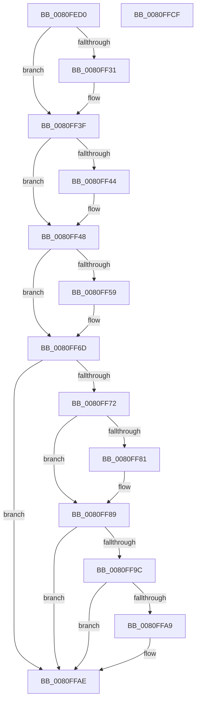

# MiSpecialPurposeMemoryChangePrepare

- RVA: `0x0080FED0`–`0x0080FFD0` (길이 `256` bytes)
- VA: `0x000000014080FED0`
- 실행 섹션: `PAGE`
- PDB 이름 있음: `예`; PDB Function 태그: `아니요`
- unwind 정보 RVA: `0x0005FEF8`
- 디코드: `74`개 명령, `256/256` bytes 표시
- 미해석 바이트: `0` (있으면 어셈블리에 `.byte`로 보존)

> 이 문서는 커널 이미지의 기계어와 PDB 기호를 분석해 생성했습니다. 4번과 5번은 함수 원형과 자료형을 바이너리 사용 방식에서 추정한 C 해석이며 원본 소스 복구 결과는 아닙니다.

## 1. Dependencies

- 직접 호출 지점: **7**; 고유 호출 대상: **7**
- 직접 호출자로 확인된 함수: **2**
- RIP 상대 이미지 참조: **0**

### Outgoing calls
- `0x0080FF21` → [KeAbPreAcquire](../../text/21/KeAbPreAcquire_function_00210230.md) (function, `0x00210230`)
- `0x0080FF3A` → [ExfAcquirePushLockExclusiveEx](../../text/20/ExfAcquirePushLockExclusiveEx_function_0020FC90.md) (function, `0x0020FC90`)
- `0x0080FF4E` → [MiInitializePartitionSpecialPurposeMemory](MiInitializePartitionSpecialPurposeMemory_function_0080F704.md) (function, `0x0080F704`)
- `0x0080FF5F` → [MiFindSpecialPurposeMemoryType](../../text/69/MiFindSpecialPurposeMemoryType_function_0069503C.md) (function, `0x0069503C`)
- `0x0080FF84` → [ExfTryToWakePushLock](../../text/26/ExfTryToWakePushLock_function_00265DD0.md) (function, `0x00265DD0`)
- `0x0080FF8C` → [KeAbPostRelease](../../text/2E/KeAbPostRelease_function_002E1600.md) (function, `0x002E1600`)
- `0x0080FFA9` → [KiCheckForKernelApcDelivery](../../text/2E/KiCheckForKernelApcDelivery_function_002E2C80.md) (function, `0x002E2C80`)

### Direct callers
- [MmManagePartitionInitialAddMemory](MmManagePartitionInitialAddMemory_function_0080E144.md) at `0x0080E198`
- [MmManagePartitionMoveMemory](MmManagePartitionMoveMemory_function_0080E1F4.md) at `0x0080E425`

### Static image references
- 디코드된 RIP-relative 메모리 참조가 없습니다.

## 2. Other-region calls and transfers

- 다른 실행 섹션으로 향하는 call: **6**
  - `0x0080FF21` → [KeAbPreAcquire](../../text/21/KeAbPreAcquire_function_00210230.md) (`PAGE` → `.text`)
  - `0x0080FF3A` → [ExfAcquirePushLockExclusiveEx](../../text/20/ExfAcquirePushLockExclusiveEx_function_0020FC90.md) (`PAGE` → `.text`)
  - `0x0080FF5F` → [MiFindSpecialPurposeMemoryType](../../text/69/MiFindSpecialPurposeMemoryType_function_0069503C.md) (`PAGE` → `.text`)
  - `0x0080FF84` → [ExfTryToWakePushLock](../../text/26/ExfTryToWakePushLock_function_00265DD0.md) (`PAGE` → `.text`)
  - `0x0080FF8C` → [KeAbPostRelease](../../text/2E/KeAbPostRelease_function_002E1600.md) (`PAGE` → `.text`)
  - `0x0080FFA9` → [KiCheckForKernelApcDelivery](../../text/2E/KiCheckForKernelApcDelivery_function_002E2C80.md) (`PAGE` → `.text`)
- 별도 외부 분기/꼬리 이동을 확인하지 못했습니다.

## 3. Assembly (complete function range)

```asm
0080FED0  48 8B C4                        mov rax, rsp
0080FED3  48 89 58 08                     mov qword ptr [rax + 8], rbx
0080FED7  48 89 68 10                     mov qword ptr [rax + 0x10], rbp
0080FEDB  48 89 70 18                     mov qword ptr [rax + 0x18], rsi
0080FEDF  48 89 78 20                     mov qword ptr [rax + 0x20], rdi
0080FEE3  41 54                           push r12
0080FEE5  41 56                           push r14
0080FEE7  41 57                           push r15
0080FEE9  48 83 EC 20                     sub rsp, 0x20
0080FEED  65 48 8B 3C 25 88 01 00 00      mov rdi, qword ptr gs:[0x188]
0080FEF6  48 8D 99 08 45 00 00            lea rbx, [rcx + 0x4508]
0080FEFD  49 83 20 00                     and qword ptr [r8], 0
0080FF01  4D 8B F8                        mov r15, r8
0080FF04  4C 8B F2                        mov r14, rdx
0080FF07  48 8B E9                        mov rbp, rcx
0080FF0A  41 BC 01 00 00 00               mov r12d, 1
0080FF10  45 33 C0                        xor r8d, r8d
0080FF13  66 44 29 A7 E6 01 00 00         sub word ptr [rdi + 0x1e6], r12w
0080FF1B  33 D2                           xor edx, edx
0080FF1D  48 8B CB                        mov rcx, rbx
0080FF20  90                              nop
0080FF21  E8 0A 03 A0 FF                  call 0x140210230
0080FF26  F0 48 0F BA 2B 00               lock bts qword ptr [rbx], 0
0080FF2C  48 8B F0                        mov rsi, rax
0080FF2F  73 0E                           jae 0x14080ff3f
0080FF31  4C 8B C3                        mov r8, rbx
0080FF34  48 8B D0                        mov rdx, rax
0080FF37  48 8B CB                        mov rcx, rbx
0080FF3A  E8 51 FD 9F FF                  call 0x14020fc90
0080FF3F  48 85 F6                        test rsi, rsi
0080FF42  74 04                           je 0x14080ff48
0080FF44  44 88 66 0A                     mov byte ptr [rsi + 0xa], r12b
0080FF48  49 8B D6                        mov rdx, r14
0080FF4B  48 8B CD                        mov rcx, rbp
0080FF4E  E8 B1 F7 FF FF                  call 0x14080f704
0080FF53  8B F0                           mov esi, eax
0080FF55  85 C0                           test eax, eax
0080FF57  78 14                           js 0x14080ff6d
0080FF59  49 8B D6                        mov rdx, r14
0080FF5C  48 8B CD                        mov rcx, rbp
0080FF5F  E8 D8 50 E8 FF                  call 0x14069503c
0080FF64  49 89 07                        mov qword ptr [r15], rax
0080FF67  4C 01 60 58                     add qword ptr [rax + 0x58], r12
0080FF6B  33 F6                           xor esi, esi
0080FF6D  48 85 DB                        test rbx, rbx
0080FF70  74 3C                           je 0x14080ffae
0080FF72  48 83 C8 FF                     or rax, 0xffffffffffffffff
0080FF76  F0 48 0F C1 03                  lock xadd qword ptr [rbx], rax
0080FF7B  24 06                           and al, 6
0080FF7D  3C 02                           cmp al, 2
0080FF7F  75 08                           jne 0x14080ff89
0080FF81  48 8B CB                        mov rcx, rbx
0080FF84  E8 47 5E A5 FF                  call 0x140265dd0
0080FF89  48 8B CB                        mov rcx, rbx
0080FF8C  E8 6F 16 AD FF                  call 0x1402e1600
0080FF91  90                              nop
0080FF92  66 44 01 A7 E6 01 00 00         add word ptr [rdi + 0x1e6], r12w
0080FF9A  75 12                           jne 0x14080ffae
0080FF9C  48 8D 87 98 00 00 00            lea rax, [rdi + 0x98]
0080FFA3  90                              nop
0080FFA4  48 39 00                        cmp qword ptr [rax], rax
0080FFA7  74 05                           je 0x14080ffae
0080FFA9  E8 D2 2C AD FF                  call 0x1402e2c80
0080FFAE  48 8B 5C 24 40                  mov rbx, qword ptr [rsp + 0x40]
0080FFB3  8B C6                           mov eax, esi
0080FFB5  48 8B 74 24 50                  mov rsi, qword ptr [rsp + 0x50]
0080FFBA  48 8B 6C 24 48                  mov rbp, qword ptr [rsp + 0x48]
0080FFBF  48 8B 7C 24 58                  mov rdi, qword ptr [rsp + 0x58]
0080FFC4  48 83 C4 20                     add rsp, 0x20
0080FFC8  41 5F                           pop r15
0080FFCA  41 5E                           pop r14
0080FFCC  41 5C                           pop r12
0080FFCE  C3                              ret
0080FFCF  CC                              int3
```

## 4. C-style interpretation (structured pseudocode)

```c
__int64 __fastcall MiSpecialPurposeMemoryChangePrepare(__int64 a1, __int64 a2, __int64 a3)
{
    __int64 result;
    __int64 v_rsi;
    __int64 v_rsp;
    unsigned __int64 v_stack_p10;
    unsigned __int64 v_stack_p18;
    unsigned __int64 v_stack_p20;
    unsigned __int64 v_stack_p8;

    *(unsigned __int64 *)(v_rsp + 8) = v_rbx;
    *(unsigned __int64 *)(v_rsp + 16) = v_rbp;
    *(unsigned __int64 *)(v_rsp + 24) = v_rsi;
    *(unsigned __int64 *)(v_rsp + 32) = v_rdi;
    v_rsp = (v_rsp) - (32);
    a3 = 0;
    a2 = 0;
    result = KeAbPreAcquire(a1 + 17672, a2, a3, a4);
    if (!(condition_is_above_or_equal)) {
        a3 = a1 + 17672;
        a2 = result;
        a1 = a1 + 17672;
        result = ExfAcquirePushLockExclusiveEx(a1, a2, a3, a4);
    }
    if (result != 0) {
        *(unsigned __int8 *)(result + 10) = 1;
    }
    result = MiInitializePartitionSpecialPurposeMemory(a1, a2, a3, a4);
    v_rsi = (unsigned int)((unsigned int)(result));
    if (!(sign_flag)) {
        a2 = a2;
        a1 = a1;
        result = MiFindSpecialPurposeMemoryType(a1, a2, a3, a4);
        *(unsigned __int64 *)(a3) = result;
        v_rsi = 0;
    }
    if (a1 + 17672 == 0) goto loc_0080FFAE;
    result = (result) | (-1);
    result = (unsigned __int8)((result) & (6));
    if (((unsigned __int8)(result)) == 2) {
        a1 = a1 + 17672;
        result = ExfTryToWakePushLock(a1, a2, a3, a4);
    }
    result = KeAbPostRelease(a1 + 17672, a2, a3, a4);
    if (((unsigned __int8)(result)) != 2) goto loc_0080FFAE;
    result = *(unsigned __int64 *)(gs_base + (0 + 392)) + 152;
    if ((*(unsigned __int64 *)(*(unsigned __int64 *)(gs_base + (0 + 392)) + 152)) != (*(unsigned __int64 *)(gs_base + (0 + 392)) + 152)) {
        result = KiCheckForKernelApcDelivery(a1 + 17672, a2, a3, a4);
    }
    v_rsp = (v_rsp) + (32);
    return 0;
}
```

## 5. (Beta) C Style

```c
int64_t MiSpecialPurposeMemoryChangePrepare(void *Arg1, int64_t Arg2, void *Arg3)
{
    uint8_t *arg1 = (uint8_t *)Arg1;
    uint8_t *arg3 = (uint8_t *)Arg3;

    int64_t result;
    int64_t local_rsi;
    int64_t local_rsp;
    uint64_t v_stack_p10;
    uint64_t v_stack_p18;
    uint64_t v_stack_p20;
    uint64_t v_stack_p8;

    *(uint64_t *)(local_rsp + 0x8) = local_rbx;
    *(uint64_t *)(local_rsp + 0x10) = local_rbp;
    *(uint64_t *)(local_rsp + 0x18) = local_rsi;
    *(uint64_t *)(local_rsp + 0x20) = local_rdi;
    local_rsp = (local_rsp) - (32);
    Arg3 = 0;
    Arg2 = 0;
    result = KeAbPreAcquire(Arg1 + 17672, Arg2, Arg3, a4);
    if (!(condition_is_above_or_equal)) {
        Arg3 = Arg1 + 17672;
        Arg2 = result;
        Arg1 = Arg1 + 17672;
        result = ExfAcquirePushLockExclusiveEx(Arg1, Arg2, Arg3, a4);
    }
    if (result != 0) {
        *(uint8_t *)(result + 0xA) = 1;
    }
    result = MiInitializePartitionSpecialPurposeMemory(Arg1, Arg2, Arg3, a4);
    local_rsi = (uint32_t)((uint32_t)(result));
    if (!(sign_flag)) {
        Arg2 = Arg2;
        Arg1 = Arg1;
        result = MiFindSpecialPurposeMemoryType(Arg1, Arg2, Arg3, a4);
        *(uint64_t *)(arg3) = result;
        local_rsi = 0;
    }
    if (Arg1 + 17672 == 0) goto loc_0080FFAE;
    result = (result) | (-1);
    result = (uint8_t)((result) & (6));
    if (((uint8_t)(result)) == 2) {
        Arg1 = Arg1 + 17672;
        result = ExfTryToWakePushLock(Arg1, Arg2, Arg3, a4);
    }
    result = KeAbPostRelease(Arg1 + 17672, Arg2, Arg3, a4);
    if (((uint8_t)(result)) != 2) goto loc_0080FFAE;
    result = *(uint64_t *)(gs_base + (0 + 0x188)) + 152;
    if ((*(uint64_t *)(*(uint64_t *)(gs_base + (0 + 0x188)) + 0x98)) != (*(uint64_t *)(gs_base + (0 + 0x188)) + 152)) {
        result = KiCheckForKernelApcDelivery(Arg1 + 17672, Arg2, Arg3, a4);
    }
    local_rsp = (local_rsp) + (32);
    return 0;
}
```

### 관측된 메모리 오프셋

구조체 형식이 확인되지 않은 접근은 인자 기준의 오프셋으로만 기록했습니다.

| 기준 인자 | 오프셋 표현 | 폭 (bit) | 접근 |
|---|---:|---:|---|
| `Arg1` | `+ 0x0` | `64` | `R/W` |
| `Arg1` | `+ 0x4508` | `64` | `R` |
| `Arg3` | `+ 0x0` | `64` | `R/W` |
| `Arg3` | `+ 0x0` | `64` | `W` |

## 6. Execution-region graph

[열기: 2D/3D 그래프와 함수 탐색 컨트롤 패널](../../../control-panel.html?section=page&rva=0x0080FED0&view=graph)

- 2D 그래프는 위에서 아래로 흐르고, 3D 그래프는 빈 공간을 드래그해 회전합니다. Shift+드래그는 이동, 휠은 확대·축소, 함수 노드 선택은 대상 보고서 이동입니다.

### Static fallback


