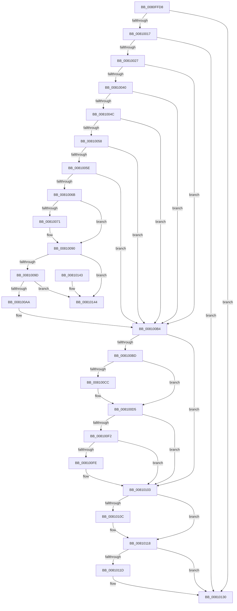

# MiSpecialPurposeMemoryRemoved

- RVA: `0x0080FFD8`–`0x0081014B` (길이 `371` bytes)
- VA: `0x000000014080FFD8`
- 실행 섹션: `PAGE`
- PDB 이름 있음: `예`; PDB Function 태그: `아니요`
- unwind 정보 RVA: `0x000D9404`
- 디코드: `100`개 명령, `371/371` bytes 표시
- 미해석 바이트: `0` (있으면 어셈블리에 `.byte`로 보존)

> 이 문서는 커널 이미지의 기계어와 PDB 기호를 분석해 생성했습니다. 4번과 5번은 함수 원형과 자료형을 바이너리 사용 방식에서 추정한 C 해석이며 원본 소스 복구 결과는 아닙니다.

## 1. Dependencies

- 직접 호출 지점: **8**; 고유 호출 대상: **8**
- 직접 호출자로 확인된 함수: **2**
- RIP 상대 이미지 참조: **1**

### Outgoing calls
- `0x0081002F` → [MiFindSpecialPurposeMemoryTypeByPartition](MiFindSpecialPurposeMemoryTypeByPartition_function_0080F5D8.md) (function, `0x0080F5D8`)
- `0x0081008B` → [KeGenericCallDpcEx](../../text/2C/KeGenericCallDpcEx_function_002C99F4.md) (function, `0x002C99F4`)
- `0x008100D0` → [ExfTryToWakePushLock](../../text/26/ExfTryToWakePushLock_function_00265DD0.md) (function, `0x00265DD0`)
- `0x008100D9` → [KeAbPostRelease](../../text/2E/KeAbPostRelease_function_002E1600.md) (function, `0x002E1600`)
- `0x008100FE` → [KiCheckForKernelApcDelivery](../../text/2E/KiCheckForKernelApcDelivery_function_002E2C80.md) (function, `0x002E2C80`)
- `0x00810113` → [PsDereferencePartition](../../text/34/PsDereferencePartition_function_00342E70.md) (function, `0x00342E70`)
- `0x00810121` → [ZwClose](../../text/6A/ZwClose_function_006AD2B0.md) (function, `0x006AD2B0`)
- `0x0081012B` → [ExFreePoolWithTag](../../poolcode/B8/ExFreePoolWithTag_function_00B82870.md) (function, `0x00B82870`)

### Direct callers
- [MmRemovePhysicalMemory](../7F/MmRemovePhysicalMemory_function_007FB560.md) at `0x007FB79D`
- [MiSpecialPurposeMemoryTypeDereference](../81/MiSpecialPurposeMemoryTypeDereference_function_00810154.md) at `0x00810241`

### Static image references
- `0x0081007C` → RVA `0x00695240` (`MiSpecialPurposeMemoryCacheUpdateDpc`; read)

## 2. Other-region calls and transfers

- 다른 실행 섹션으로 향하는 call: **7**
  - `0x0081008B` → [KeGenericCallDpcEx](../../text/2C/KeGenericCallDpcEx_function_002C99F4.md) (`PAGE` → `.text`)
  - `0x008100D0` → [ExfTryToWakePushLock](../../text/26/ExfTryToWakePushLock_function_00265DD0.md) (`PAGE` → `.text`)
  - `0x008100D9` → [KeAbPostRelease](../../text/2E/KeAbPostRelease_function_002E1600.md) (`PAGE` → `.text`)
  - `0x008100FE` → [KiCheckForKernelApcDelivery](../../text/2E/KiCheckForKernelApcDelivery_function_002E2C80.md) (`PAGE` → `.text`)
  - `0x00810113` → [PsDereferencePartition](../../text/34/PsDereferencePartition_function_00342E70.md) (`PAGE` → `.text`)
  - `0x00810121` → [ZwClose](../../text/6A/ZwClose_function_006AD2B0.md) (`PAGE` → `.text`)
  - `0x0081012B` → [ExFreePoolWithTag](../../poolcode/B8/ExFreePoolWithTag_function_00B82870.md) (`PAGE` → `POOLCODE`)
- 별도 외부 분기/꼬리 이동을 확인하지 못했습니다.

## 3. Assembly (complete function range)

```asm
0080FFD8  48 89 5C 24 18                  mov qword ptr [rsp + 0x18], rbx
0080FFDD  48 89 74 24 20                  mov qword ptr [rsp + 0x20], rsi
0080FFE2  55                              push rbp
0080FFE3  57                              push rdi
0080FFE4  41 57                           push r15
0080FFE6  48 8B EC                        mov rbp, rsp
0080FFE9  48 83 EC 40                     sub rsp, 0x40
0080FFED  33 C0                           xor eax, eax
0080FFEF  33 F6                           xor esi, esi
0080FFF1  48 21 45 20                     and qword ptr [rbp + 0x20], rax
0080FFF5  0F 57 C0                        xorps xmm0, xmm0
0080FFF8  48 21 45 28                     and qword ptr [rbp + 0x28], rax
0080FFFC  48 8B F9                        mov rdi, rcx
0080FFFF  48 89 45 F0                     mov qword ptr [rbp - 0x10], rax
00810003  48 8B 81 50 48 00 00            mov rax, qword ptr [rcx + 0x4850]
0081000A  0F 11 45 E0                     movups xmmword ptr [rbp - 0x20], xmm0
0081000E  48 85 C0                        test rax, rax
00810011  0F 85 19 01 00 00               jne 0x140810130
00810017  48 8B 81 A8 01 00 00            mov rax, qword ptr [rcx + 0x1a8]
0081001E  48 85 C0                        test rax, rax
00810021  0F 85 09 01 00 00               jne 0x140810130
00810027  4C 8D 45 20                     lea r8, [rbp + 0x20]
0081002B  48 8D 55 28                     lea rdx, [rbp + 0x28]
0081002F  E8 A4 F5 FF FF                  call 0x14080f5d8
00810034  44 8D 7E 01                     lea r15d, [rsi + 1]
00810038  48 8B D8                        mov rbx, rax
0081003B  48 85 C0                        test rax, rax
0081003E  74 74                           je 0x1408100b4
00810040  48 8B 8F 50 48 00 00            mov rcx, qword ptr [rdi + 0x4850]
00810047  48 85 C9                        test rcx, rcx
0081004A  75 68                           jne 0x1408100b4
0081004C  48 8B 8F A8 01 00 00            mov rcx, qword ptr [rdi + 0x1a8]
00810053  48 85 C9                        test rcx, rcx
00810056  75 5C                           jne 0x1408100b4
00810058  48 39 70 58                     cmp qword ptr [rax + 0x58], rsi
0081005C  75 56                           jne 0x1408100b4
0081005E  48 8B 87 B8 00 00 00            mov rax, qword ptr [rdi + 0xb8]
00810065  4C 39 78 30                     cmp qword ptr [rax + 0x30], r15
00810069  77 49                           ja 0x1408100b4
0081006B  48 39 73 48                     cmp qword ptr [rbx + 0x48], rsi
0081006F  74 1F                           je 0x140810090
00810071  48 8B 45 28                     mov rax, qword ptr [rbp + 0x28]
00810075  48 8D 55 E0                     lea rdx, [rbp - 0x20]
00810079  21 75 F4                        and dword ptr [rbp - 0xc], esi
0081007C  48 8D 0D BD 51 E8 FF            lea rcx, [rip - 0x17ae43]
00810083  48 89 45 E8                     mov qword ptr [rbp - 0x18], rax
00810087  48 89 5D E0                     mov qword ptr [rbp - 0x20], rbx
0081008B  E8 64 99 AB FF                  call 0x1402c99f4
00810090  48 8B 0B                        mov rcx, qword ptr [rbx]
00810093  48 39 59 08                     cmp qword ptr [rcx + 8], rbx
00810097  0F 85 A7 00 00 00               jne 0x140810144
0081009D  48 8B 43 08                     mov rax, qword ptr [rbx + 8]
008100A1  48 39 18                        cmp qword ptr [rax], rbx
008100A4  0F 85 9A 00 00 00               jne 0x140810144
008100AA  48 89 08                        mov qword ptr [rax], rcx
008100AD  48 8B F3                        mov rsi, rbx
008100B0  48 89 41 08                     mov qword ptr [rcx + 8], rax
008100B4  48 8B 4D 20                     mov rcx, qword ptr [rbp + 0x20]
008100B8  48 85 C9                        test rcx, rcx
008100BB  74 46                           je 0x140810103
008100BD  48 83 C8 FF                     or rax, 0xffffffffffffffff
008100C1  F0 48 0F C1 01                  lock xadd qword ptr [rcx], rax
008100C6  24 06                           and al, 6
008100C8  3C 02                           cmp al, 2
008100CA  75 09                           jne 0x1408100d5
008100CC  48 8B 4D 20                     mov rcx, qword ptr [rbp + 0x20]
008100D0  E8 FB 5C A5 FF                  call 0x140265dd0
008100D5  48 8B 4D 20                     mov rcx, qword ptr [rbp + 0x20]
008100D9  E8 22 15 AD FF                  call 0x1402e1600
008100DE  65 48 8B 04 25 88 01 00 00      mov rax, qword ptr gs:[0x188]
008100E7  90                              nop
008100E8  66 44 01 B8 E6 01 00 00         add word ptr [rax + 0x1e6], r15w
008100F0  75 11                           jne 0x140810103
008100F2  48 05 98 00 00 00               add rax, 0x98
008100F8  90                              nop
008100F9  48 39 00                        cmp qword ptr [rax], rax
008100FC  74 05                           je 0x140810103
008100FE  E8 7D 2B AD FF                  call 0x1402e2c80
00810103  48 8B 4D 28                     mov rcx, qword ptr [rbp + 0x28]
00810107  48 85 C9                        test rcx, rcx
0081010A  74 0C                           je 0x140810118
0081010C  48 8B 89 B8 00 00 00            mov rcx, qword ptr [rcx + 0xb8]
00810113  E8 58 2D B3 FF                  call 0x140342e70
00810118  48 85 F6                        test rsi, rsi
0081011B  74 13                           je 0x140810130
0081011D  48 8B 4E 38                     mov rcx, qword ptr [rsi + 0x38]
00810121  E8 8A D1 E9 FF                  call 0x1406ad2b0
00810126  33 D2                           xor edx, edx
00810128  48 8B CE                        mov rcx, rsi
0081012B  E8 40 27 37 00                  call 0x140b82870
00810130  48 8B 5C 24 70                  mov rbx, qword ptr [rsp + 0x70]
00810135  48 8B 74 24 78                  mov rsi, qword ptr [rsp + 0x78]
0081013A  48 83 C4 40                     add rsp, 0x40
0081013E  41 5F                           pop r15
00810140  5F                              pop rdi
00810141  5D                              pop rbp
00810142  C3                              ret
00810143  CC                              int3
00810144  B9 03 00 00 00                  mov ecx, 3
00810149  CD 29                           int 0x29
```

## 4. C-style interpretation (structured pseudocode)

```c
__int64 __fastcall MiSpecialPurposeMemoryRemoved(__int64 a1)
{
    __int64 result;
    __int64 v_rsi;
    __int64 v_rsp;
    unsigned int v_stack_m24;
    unsigned __int64 v_stack_m28;
    unsigned __int64 v_stack_m30;
    unsigned __int64 v_stack_m38;
    unsigned __int64 v_stack_p10;
    unsigned __int64 v_stack_p18;
    unsigned __int64 v_stack_p20;
    unsigned __int64 v_stack_p8;

    v_stack_p18 = v_rbx;
    v_stack_p20 = v_rsi;
    v_rsp = (v_rsp) - (64);
    result = 0;
    v_rsi = 0;
    v_stack_m28 = 0;
    v_stack_m38 = v_xmm0;
    if (*(unsigned __int64 *)(a1 + 18512) != 0) goto loc_00810130;
    if (*(unsigned __int64 *)(a1 + 424) != 0) goto loc_00810130;
    result = MiFindSpecialPurposeMemoryTypeByPartition(a1, v_stack_p10, v_stack_p8, a4);
    if (result == 0) goto loc_008100B4;
    if (*(unsigned __int64 *)(a1 + 18512) != 0) goto loc_008100B4;
    if (*(unsigned __int64 *)(a1 + 424) != 0) goto loc_008100B4;
    if ((*(unsigned __int64 *)(result + 88)) != 0) goto loc_008100B4;
    if ((*(unsigned __int64 *)(*(unsigned __int64 *)(a1 + 184) + 48)) > (v_rsi + 1)) goto loc_008100B4;
    result = *(unsigned __int64 *)(a1 + 184);
    if ((*(unsigned __int64 *)(result + 72)) != 0) {
        result = v_stack_p10;
        a2 = v_stack_m38;
        a1 = v_rip - 1551939;
        v_stack_m30 = result;
        v_stack_m38 = result;
        result = KeGenericCallDpcEx(a1, a2, v_stack_p8, a4);
    }
    if ((*(unsigned __int64 *)(*(unsigned __int64 *)(result) + 8)) != result) goto loc_00810144;
    if ((*(unsigned __int64 *)(*(unsigned __int64 *)(result + 8))) != result) goto loc_00810144;
    *(unsigned __int64 *)(*(unsigned __int64 *)(result + 8)) = *(unsigned __int64 *)(result);
    *(unsigned __int64 *)(*(unsigned __int64 *)(result) + 8) = *(unsigned __int64 *)(result + 8);
loc_008100B4:
    if (v_stack_p8 == 0) goto loc_00810103;
    result = (*(unsigned __int64 *)(result + 8)) | (-1);
    result = (unsigned __int8)((result) & (6));
    if (((unsigned __int8)(result)) == 2) {
        a1 = v_stack_p8;
        result = ExfTryToWakePushLock(a1, a2, v_stack_p8, a4);
    }
    result = KeAbPostRelease(v_stack_p8, a2, v_stack_p8, a4);
    if (((unsigned __int8)(result)) != 2) goto loc_00810103;
    result = (*(unsigned __int64 *)(gs_base + (0 + 392))) + (152);
    if ((*(unsigned __int64 *)(result)) != result) {
        result = KiCheckForKernelApcDelivery(v_stack_p8, a2, v_stack_p8, a4);
    }
    if (v_stack_p10 != 0) {
        a1 = *(unsigned __int64 *)(v_stack_p10 + 184);
        result = PsDereferencePartition(a1, a2, v_stack_p8, a4);
    }
    if (result != 0) {
        a1 = *(unsigned __int64 *)(result + 56);
        result = ZwClose(a1, a2, v_stack_p8, a4);
        a2 = 0;
        a1 = result;
        result = ExFreePoolWithTag(a1, a2, v_stack_p8, a4);
    }
    v_rsp = (v_rsp) + (64);
    return result;
loc_00810144:
    return result;
}
```

## 5. (Beta) C Style

```c
int64_t MiSpecialPurposeMemoryRemoved(void *Arg1)
{
    uint8_t *arg1 = (uint8_t *)Arg1;

    int64_t result;
    int64_t local_rsi;
    int64_t local_rsp;
    uint32_t v_stack_m24;
    uint64_t v_stack_m28;
    uint64_t v_stack_m30;
    uint64_t v_stack_m38;
    uint64_t v_stack_p10;
    uint64_t v_stack_p18;
    uint64_t v_stack_p20;
    uint64_t v_stack_p8;

    v_stack_p18 = local_rbx;
    v_stack_p20 = local_rsi;
    local_rsp = (local_rsp) - (64);
    result = 0;
    local_rsi = 0;
    v_stack_m28 = 0;
    v_stack_m38 = v_xmm0;
    if (*(uint64_t *)(arg1 + 0x4850) != 0) goto loc_00810130;
    if (*(uint64_t *)(arg1 + 0x1A8) != 0) goto loc_00810130;
    result = MiFindSpecialPurposeMemoryTypeByPartition(Arg1, v_stack_p10, v_stack_p8, a4);
    if (result == 0) goto loc_008100B4;
    if (*(uint64_t *)(arg1 + 0x4850) != 0) goto loc_008100B4;
    if (*(uint64_t *)(arg1 + 0x1A8) != 0) goto loc_008100B4;
    if ((*(uint64_t *)(result + 0x58)) != 0) goto loc_008100B4;
    if ((*(uint64_t *)(*(uint64_t *)(arg1 + 0xB8) + 0x30)) > (local_rsi + 1)) goto loc_008100B4;
    result = *(uint64_t *)(arg1 + 0xB8);
    if ((*(uint64_t *)(result + 0x48)) != 0) {
        result = v_stack_p10;
        a2 = v_stack_m38;
        Arg1 = v_rip - 1551939;
        v_stack_m30 = result;
        v_stack_m38 = result;
        result = KeGenericCallDpcEx(Arg1, a2, v_stack_p8, a4);
    }
    if ((*(uint64_t *)(*(uint64_t *)(result) + 0x8)) != result) goto loc_00810144;
    if ((*(uint64_t *)(*(uint64_t *)(result + 0x8))) != result) goto loc_00810144;
    *(uint64_t *)(*(uint64_t *)(result + 0x8)) = *(uint64_t *)(result);
    *(uint64_t *)(*(uint64_t *)(result) + 0x8) = *(uint64_t *)(result + 0x8);
loc_008100B4:
    if (v_stack_p8 == 0) goto loc_00810103;
    result = (*(uint64_t *)(result + 0x8)) | (-1);
    result = (uint8_t)((result) & (6));
    if (((uint8_t)(result)) == 2) {
        Arg1 = v_stack_p8;
        result = ExfTryToWakePushLock(Arg1, a2, v_stack_p8, a4);
    }
    result = KeAbPostRelease(v_stack_p8, a2, v_stack_p8, a4);
    if (((uint8_t)(result)) != 2) goto loc_00810103;
    result = (*(uint64_t *)(gs_base + (0 + 0x188))) + (152);
    if ((*(uint64_t *)(result)) != result) {
        result = KiCheckForKernelApcDelivery(v_stack_p8, a2, v_stack_p8, a4);
    }
    if (v_stack_p10 != 0) {
        Arg1 = *(uint64_t *)(v_stack_p10 + 0xB8);
        result = PsDereferencePartition(Arg1, a2, v_stack_p8, a4);
    }
    if (result != 0) {
        Arg1 = *(uint64_t *)(result + 0x38);
        result = ZwClose(Arg1, a2, v_stack_p8, a4);
        a2 = 0;
        Arg1 = result;
        result = ExFreePoolWithTag(Arg1, a2, v_stack_p8, a4);
    }
    local_rsp = (local_rsp) + (64);
    return result;
loc_00810144:
    return result;
}
```

### 관측된 메모리 오프셋

구조체 형식이 확인되지 않은 접근은 인자 기준의 오프셋으로만 기록했습니다.

| 기준 인자 | 오프셋 표현 | 폭 (bit) | 접근 |
|---|---:|---:|---|
| `Arg1` | `+ 0xB8` | `64` | `R` |
| `Arg1` | `+ 0x1A8` | `64` | `R` |
| `Arg1` | `+ 0x4850` | `64` | `R` |

## 6. Execution-region graph

[열기: 2D/3D 그래프와 함수 탐색 컨트롤 패널](../../../control-panel.html?section=page&rva=0x0080FFD8&view=graph)

- 2D 그래프는 위에서 아래로 흐르고, 3D 그래프는 빈 공간을 드래그해 회전합니다. Shift+드래그는 이동, 휠은 확대·축소, 함수 노드 선택은 대상 보고서 이동입니다.

### Static fallback


