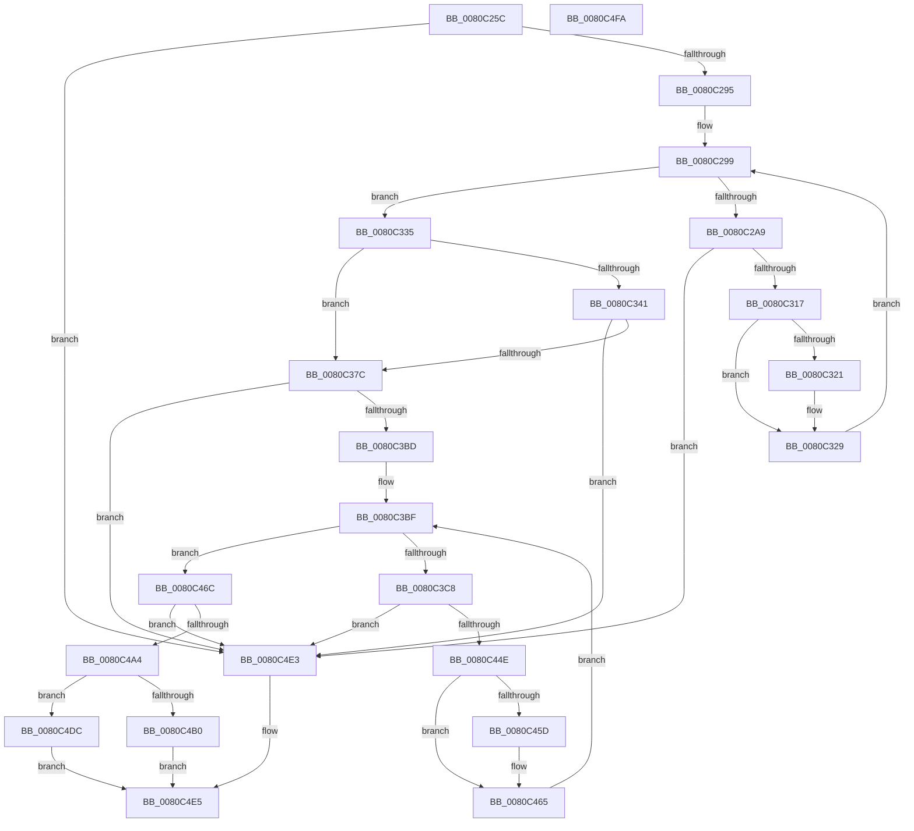

# MiSplitPfnBitMaps

- RVA: `0x0080C25C`–`0x0080C4FB` (길이 `671` bytes)
- VA: `0x000000014080C25C`
- 실행 섹션: `PAGE`
- PDB 이름 있음: `예`; PDB Function 태그: `아니요`
- unwind 정보 RVA: `0x000B7714`
- 디코드: `181`개 명령, `671/671` bytes 표시
- 미해석 바이트: `0` (있으면 어셈블리에 `.byte`로 보존)

> 이 문서는 커널 이미지의 기계어와 PDB 기호를 분석해 생성했습니다. 4번과 5번은 함수 원형과 자료형을 바이너리 사용 방식에서 추정한 C 해석이며 원본 소스 복구 결과는 아닙니다.

## 1. Dependencies

- 직접 호출 지점: **6**; 고유 호출 대상: **1**
- 직접 호출자로 확인된 함수: **2**
- RIP 상대 이미지 참조: **3**

### Outgoing calls
- `0x0080C30A` → [MiSplitBitmapPages](../../text/3B/MiSplitBitmapPages_function_003B4A34.md) (function, `0x003B4A34`)
- `0x0080C36F` → [MiSplitBitmapPages](../../text/3B/MiSplitBitmapPages_function_003B4A34.md) (function, `0x003B4A34`)
- `0x0080C3B0` → [MiSplitBitmapPages](../../text/3B/MiSplitBitmapPages_function_003B4A34.md) (function, `0x003B4A34`)
- `0x0080C441` → [MiSplitBitmapPages](../../text/3B/MiSplitBitmapPages_function_003B4A34.md) (function, `0x003B4A34`)
- `0x0080C49B` → [MiSplitBitmapPages](../../text/3B/MiSplitBitmapPages_function_003B4A34.md) (function, `0x003B4A34`)
- `0x0080C4CD` → [MiSplitBitmapPages](../../text/3B/MiSplitBitmapPages_function_003B4A34.md) (function, `0x003B4A34`)

### Direct callers
- [MiSplitPfnBitMapsForPartitionHierarchy](../../text/69/MiSplitPfnBitMapsForPartitionHierarchy_function_00691D64.md) at `0x00691D85`
- [MiCreatePfnBitMaps](MiCreatePfnBitMaps_function_0080BBC8.md) at `0x0080BFC1`

### Static image references
- `0x0080C275` → RVA `0x00E2DCE0` (`.data`; read)
- `0x0080C299` → RVA `0x00000000` (`image boundary/outside`; read)
- `0x0080C335` → RVA `0x00E38D00` (`.data`; read)

## 2. Other-region calls and transfers

- 다른 실행 섹션으로 향하는 call: **6**
  - `0x0080C30A` → [MiSplitBitmapPages](../../text/3B/MiSplitBitmapPages_function_003B4A34.md) (`PAGE` → `.text`)
  - `0x0080C36F` → [MiSplitBitmapPages](../../text/3B/MiSplitBitmapPages_function_003B4A34.md) (`PAGE` → `.text`)
  - `0x0080C3B0` → [MiSplitBitmapPages](../../text/3B/MiSplitBitmapPages_function_003B4A34.md) (`PAGE` → `.text`)
  - `0x0080C441` → [MiSplitBitmapPages](../../text/3B/MiSplitBitmapPages_function_003B4A34.md) (`PAGE` → `.text`)
  - `0x0080C49B` → [MiSplitBitmapPages](../../text/3B/MiSplitBitmapPages_function_003B4A34.md) (`PAGE` → `.text`)
  - `0x0080C4CD` → [MiSplitBitmapPages](../../text/3B/MiSplitBitmapPages_function_003B4A34.md) (`PAGE` → `.text`)
- 별도 외부 분기/꼬리 이동을 확인하지 못했습니다.

## 3. Assembly (complete function range)

```asm
0080C25C  48 89 5C 24 08                  mov qword ptr [rsp + 8], rbx
0080C261  4C 89 44 24 18                  mov qword ptr [rsp + 0x18], r8
0080C266  55                              push rbp
0080C267  56                              push rsi
0080C268  57                              push rdi
0080C269  41 54                           push r12
0080C26B  41 55                           push r13
0080C26D  41 56                           push r14
0080C26F  41 57                           push r15
0080C271  48 83 EC 20                     sub rsp, 0x20
0080C275  48 8B 05 64 1A 62 00            mov rax, qword ptr [rip + 0x621a64]
0080C27C  4E 8D 3C 02                     lea r15, [rdx + r8]
0080C280  48 FF C0                        inc rax
0080C283  4D 8B D8                        mov r11, r8
0080C286  4C 8B F2                        mov r14, rdx
0080C289  48 8B D9                        mov rbx, rcx
0080C28C  4C 3B F8                        cmp r15, rax
0080C28F  0F 87 4E 02 00 00               ja 0x14080c4e3
0080C295  33 F6                           xor esi, esi
0080C297  8B FE                           mov edi, esi
0080C299  48 8D 0D 60 3D 7F FF            lea rcx, [rip - 0x80c2a0]
0080C2A0  83 FF 02                        cmp edi, 2
0080C2A3  0F 83 8C 00 00 00               jae 0x14080c335
0080C2A9  33 D2                           xor edx, edx
0080C2AB  8B C7                           mov eax, edi
0080C2AD  49 FF CB                        dec r11
0080C2B0  8B EF                           mov ebp, edi
0080C2B2  48 03 ED                        add rbp, rbp
0080C2B5  4C 8B 84 C1 60 1C 01 00         mov r8, qword ptr [rcx + rax*8 + 0x11c60]
0080C2BD  49 8B C6                        mov rax, r14
0080C2C0  49 F7 F0                        div r8
0080C2C3  4C 8B 8C EB D0 3F 00 00         mov r9, qword ptr [rbx + rbp*8 + 0x3fd0]
0080C2CB  4B 8D 0C 30                     lea rcx, [r8 + r14]
0080C2CF  4C 8B D0                        mov r10, rax
0080C2D2  33 D2                           xor edx, edx
0080C2D4  49 8D 40 FF                     lea rax, [r8 - 1]
0080C2D8  49 C1 EA 03                     shr r10, 3
0080C2DC  48 F7 D0                        not rax
0080C2DF  49 03 CB                        add rcx, r11
0080C2E2  48 23 C1                        and rax, rcx
0080C2E5  4D 03 D1                        add r10, r9
0080C2E8  49 F7 F0                        div r8
0080C2EB  49 8B D2                        mov rdx, r10
0080C2EE  4C 8B E8                        mov r13, rax
0080C2F1  4C 8D 40 07                     lea r8, [rax + 7]
0080C2F5  49 C1 E8 03                     shr r8, 3
0080C2F9  4D 2B C2                        sub r8, r10
0080C2FC  4D 03 C1                        add r8, r9
0080C2FF  45 33 C9                        xor r9d, r9d
0080C302  49 C1 E0 03                     shl r8, 3
0080C306  41 8D 49 08                     lea ecx, [r9 + 8]
0080C30A  E8 25 87 BA FF                  call 0x1403b4a34
0080C30F  85 C0                           test eax, eax
0080C311  0F 84 CC 01 00 00               je 0x14080c4e3
0080C317  4C 3B AC EB C8 3F 00 00         cmp r13, qword ptr [rbx + rbp*8 + 0x3fc8]
0080C31F  76 08                           jbe 0x14080c329
0080C321  4C 89 AC EB C8 3F 00 00         mov qword ptr [rbx + rbp*8 + 0x3fc8], r13
0080C329  4C 8B 5C 24 70                  mov r11, qword ptr [rsp + 0x70]
0080C32E  FF C7                           inc edi
0080C330  E9 64 FF FF FF                  jmp 0x14080c299
0080C335  4C 8D 2D C4 C9 62 00            lea r13, [rip + 0x62c9c4]
0080C33C  49 3B DD                        cmp rbx, r13
0080C33F  75 3B                           jne 0x14080c37c
0080C341  48 8B 8B F8 3F 00 00            mov rcx, qword ptr [rbx + 0x3ff8]
0080C348  4D 8D 47 0F                     lea r8, [r15 + 0xf]
0080C34C  49 C1 E8 04                     shr r8, 4
0080C350  45 33 C9                        xor r9d, r9d
0080C353  4D 03 C0                        add r8, r8
0080C356  49 8B C6                        mov rax, r14
0080C359  48 C1 E8 04                     shr rax, 4
0080C35D  48 8D 14 41                     lea rdx, [rcx + rax*2]
0080C361  4C 2B C2                        sub r8, rdx
0080C364  4C 03 C1                        add r8, rcx
0080C367  41 8D 49 08                     lea ecx, [r9 + 8]
0080C36B  49 C1 E0 03                     shl r8, 3
0080C36F  E8 C0 86 BA FF                  call 0x1403b4a34
0080C374  85 C0                           test eax, eax
0080C376  0F 84 67 01 00 00               je 0x14080c4e3
0080C37C  48 8B 83 00 40 00 00            mov rax, qword ptr [rbx + 0x4000]
0080C383  49 8D BF FF 01 00 00            lea rdi, [r15 + 0x1ff]
0080C38A  45 33 C9                        xor r9d, r9d
0080C38D  48 C1 EF 09                     shr rdi, 9
0080C391  4D 8B E6                        mov r12, r14
0080C394  48 03 FF                        add rdi, rdi
0080C397  49 C1 EC 09                     shr r12, 9
0080C39B  4C 8B C7                        mov r8, rdi
0080C39E  41 8D 49 08                     lea ecx, [r9 + 8]
0080C3A2  4A 8D 14 60                     lea rdx, [rax + r12*2]
0080C3A6  4C 2B C2                        sub r8, rdx
0080C3A9  4C 03 C0                        add r8, rax
0080C3AC  49 C1 E0 03                     shl r8, 3
0080C3B0  E8 7F 86 BA FF                  call 0x1403b4a34
0080C3B5  85 C0                           test eax, eax
0080C3B7  0F 84 26 01 00 00               je 0x14080c4e3
0080C3BD  8B EE                           mov ebp, esi
0080C3BF  83 FD 03                        cmp ebp, 3
0080C3C2  0F 83 A4 00 00 00               jae 0x14080c46c
0080C3C8  33 D2                           xor edx, edx
0080C3CA  8B CD                           mov ecx, ebp
0080C3CC  48 8D 05 2D 3C 7F FF            lea rax, [rip - 0x80c3d3]
0080C3D3  44 8B ED                        mov r13d, ebp
0080C3D6  41 B8 01 00 00 00               mov r8d, 1
0080C3DC  4D 03 ED                        add r13, r13
0080C3DF  48 8B 8C C8 28 11 01 00         mov rcx, qword ptr [rax + rcx*8 + 0x11128]
0080C3E7  49 8B C6                        mov rax, r14
0080C3EA  49 D3 E0                        shl r8, cl
0080C3ED  48 8B 4C 24 70                  mov rcx, qword ptr [rsp + 0x70]
0080C3F2  4E 8B 8C EB 10 40 00 00         mov r9, qword ptr [rbx + r13*8 + 0x4010]
0080C3FA  48 FF C9                        dec rcx
0080C3FD  49 F7 F0                        div r8
0080C400  33 D2                           xor edx, edx
0080C402  4C 8B D0                        mov r10, rax
0080C405  4B 8D 04 30                     lea rax, [r8 + r14]
0080C409  48 03 C8                        add rcx, rax
0080C40C  49 C1 EA 03                     shr r10, 3
0080C410  49 8D 40 FF                     lea rax, [r8 - 1]
0080C414  4D 03 D1                        add r10, r9
0080C417  48 F7 D0                        not rax
0080C41A  48 23 C1                        and rax, rcx
0080C41D  49 F7 F0                        div r8
0080C420  49 8B D2                        mov rdx, r10
0080C423  48 89 44 24 68                  mov qword ptr [rsp + 0x68], rax
0080C428  4C 8D 40 07                     lea r8, [rax + 7]
0080C42C  49 C1 E8 03                     shr r8, 3
0080C430  4D 2B C2                        sub r8, r10
0080C433  4D 03 C1                        add r8, r9
0080C436  45 33 C9                        xor r9d, r9d
0080C439  49 C1 E0 03                     shl r8, 3
0080C43D  41 8D 49 08                     lea ecx, [r9 + 8]
0080C441  E8 EE 85 BA FF                  call 0x1403b4a34
0080C446  85 C0                           test eax, eax
0080C448  0F 84 95 00 00 00               je 0x14080c4e3
0080C44E  48 8B 44 24 68                  mov rax, qword ptr [rsp + 0x68]
0080C453  4A 3B 84 EB 08 40 00 00         cmp rax, qword ptr [rbx + r13*8 + 0x4008]
0080C45B  76 08                           jbe 0x14080c465
0080C45D  4A 89 84 EB 08 40 00 00         mov qword ptr [rbx + r13*8 + 0x4008], rax
0080C465  FF C5                           inc ebp
0080C467  E9 53 FF FF FF                  jmp 0x14080c3bf
0080C46C  48 8B 83 38 40 00 00            mov rax, qword ptr [rbx + 0x4038]
0080C473  4D 8D 87 FF FF 03 00            lea r8, [r15 + 0x3ffff]
0080C47A  49 C1 E8 12                     shr r8, 0x12
0080C47E  45 33 C9                        xor r9d, r9d
0080C481  49 C1 E0 02                     shl r8, 2
0080C485  49 C1 EE 12                     shr r14, 0x12
0080C489  41 8D 49 08                     lea ecx, [r9 + 8]
0080C48D  4A 8D 14 B0                     lea rdx, [rax + r14*4]
0080C491  4C 2B C2                        sub r8, rdx
0080C494  4C 03 C0                        add r8, rax
0080C497  49 C1 E0 03                     shl r8, 3
0080C49B  E8 94 85 BA FF                  call 0x1403b4a34
0080C4A0  85 C0                           test eax, eax
0080C4A2  74 3F                           je 0x14080c4e3
0080C4A4  48 8D 05 55 C8 62 00            lea rax, [rip + 0x62c855]
0080C4AB  48 3B D8                        cmp rbx, rax
0080C4AE  75 2C                           jne 0x14080c4dc
0080C4B0  4C 8B 8B 40 45 00 00            mov r9, qword ptr [rbx + 0x4540]
0080C4B7  4B 8D 14 61                     lea rdx, [r9 + r12*2]
0080C4BB  48 2B FA                        sub rdi, rdx
0080C4BE  4D 8D 04 39                     lea r8, [r9 + rdi]
0080C4C2  45 33 C9                        xor r9d, r9d
0080C4C5  49 C1 E0 03                     shl r8, 3
0080C4C9  41 8D 49 08                     lea ecx, [r9 + 8]
0080C4CD  E8 62 85 BA FF                  call 0x1403b4a34
0080C4D2  85 C0                           test eax, eax
0080C4D4  40 0F 95 C6                     setne sil
0080C4D8  8B C6                           mov eax, esi
0080C4DA  EB 09                           jmp 0x14080c4e5
0080C4DC  B8 01 00 00 00                  mov eax, 1
0080C4E1  EB 02                           jmp 0x14080c4e5
0080C4E3  33 C0                           xor eax, eax
0080C4E5  48 8B 5C 24 60                  mov rbx, qword ptr [rsp + 0x60]
0080C4EA  48 83 C4 20                     add rsp, 0x20
0080C4EE  41 5F                           pop r15
0080C4F0  41 5E                           pop r14
0080C4F2  41 5D                           pop r13
0080C4F4  41 5C                           pop r12
0080C4F6  5F                              pop rdi
0080C4F7  5E                              pop rsi
0080C4F8  5D                              pop rbp
0080C4F9  C3                              ret
0080C4FA  CC                              int3
```

## 4. C-style interpretation (structured pseudocode)

```c
__int64 __fastcall MiSplitPfnBitMaps(__int64 a1, __int64 a2, __int64 a3)
{
    __int64 result;
    __int64 v_r10;
    __int64 v_r11;
    __int64 v_r12;
    __int64 v_r13;
    __int64 v_r14;
    __int64 v_rbp;
    __int64 v_rdi;
    __int64 v_rsi;
    __int64 v_rsp;
    unsigned __int64 v_stack_p10;
    unsigned __int64 v_stack_p18;
    unsigned __int64 v_stack_p8;

    v_stack_p8 = v_rbx;
    v_stack_p18 = a3;
    v_rsp = (v_rsp) - (32);
    result = (*(unsigned __int64 *)(v_rip + 6429284)) + 1;
    if ((a2 + a3 * 1) > result) goto loc_0080C4E3;
    v_rsi = 0;
loc_0080C299:
    if (0 >= 2) goto loc_0080C335;
    a2 = 0;
    v_r11 = (a3) - 1;
    v_rbp = (0) + (0);
    a2 = 0;
    v_r10 = (0) >> (3);
    result = ~(*(unsigned __int64 *)(v_rip - 8438432 + 0 * 8 + 72800) - 1);
    a1 = (*(unsigned __int64 *)(v_rip - 8438432 + 0 * 8 + 72800) + a2 * 1) + (v_r11);
    result = (result) & (a1);
    v_r10 = (v_r10) + (*(unsigned __int64 *)(a1 + v_rbp * 8 + 16336));
    a3 = (result + 7) >> (3);
    a3 = (a3) - (v_r10);
    a3 = (a3) + (*(unsigned __int64 *)(a1 + v_rbp * 8 + 16336));
    a4 = 0;
    a3 = (a3) << (3);
    result = MiSplitBitmapPages(a4 + 8, v_r10, a3, a4);
    if ((unsigned int)(result) == 0) goto loc_0080C4E3;
    if (result >= = (*(unsigned __int64 *)(a1 + v_rbp * 8 + 16328))) {
        *(unsigned __int64 *)(a1 + v_rbp * 8 + 16328) = result;
    }
    v_rdi = (unsigned int)((0) + 1);
    goto loc_0080C299;
loc_0080C335:
    if (a1 != (v_rip + 6474180)) goto loc_0080C37C;
    a3 = (a2 + a3 * 1 + 15) >> (4);
    a4 = 0;
    a3 = (a3) + (a3);
    result = (0) >> (4);
    a3 = (a3) - (*(unsigned __int64 *)(a1 + 16376) + result * 2);
    a3 = (a3) + (*(unsigned __int64 *)(a1 + 16376));
    a3 = (a3) << (3);
    result = MiSplitBitmapPages(a4 + 8, *(unsigned __int64 *)(a1 + 16376) + result * 2, a3, a4);
    if ((unsigned int)(result) == 0) goto loc_0080C4E3;
loc_0080C37C:
    a4 = 0;
    v_rdi = (a2 + a3 * 1 + 511) >> (9);
    v_rdi = (v_rdi) + (v_rdi);
    v_r12 = (0) >> (9);
    a3 = (v_rdi) - (*(unsigned __int64 *)(a1 + 16384) + v_r12 * 2);
    a3 = (a3) + (*(unsigned __int64 *)(a1 + 16384));
    a3 = (a3) << (3);
    result = MiSplitBitmapPages(a4 + 8, *(unsigned __int64 *)(a1 + 16384) + v_r12 * 2, a3, a4);
    if ((unsigned int)(result) == 0) goto loc_0080C4E3;
loc_0080C3BF:
    if (0 >= 3) goto loc_0080C46C;
    a2 = 0;
    v_r13 = (0) + (0);
    a3 = (1) << ((unsigned __int8)(*(unsigned __int64 *)(v_rip - 8438739 + 0 * 8 + 69928)));
    a1 = (v_stack_p18) - 1;
    a2 = 0;
    a1 = (a1) + (a3 + a2 * 1);
    v_r10 = (0) >> (3);
    v_r10 = (v_r10) + (*(unsigned __int64 *)(a1 + v_r13 * 8 + 16400));
    result = ~(a3 - 1);
    result = (result) & (a1);
    v_stack_p10 = result;
    a3 = (result + 7) >> (3);
    a3 = (a3) - (v_r10);
    a3 = (a3) + (*(unsigned __int64 *)(a1 + v_r13 * 8 + 16400));
    a4 = 0;
    a3 = (a3) << (3);
    result = MiSplitBitmapPages(a4 + 8, v_r10, a3, a4);
    if ((unsigned int)(result) == 0) goto loc_0080C4E3;
    if (v_stack_p10 >= = (*(unsigned __int64 *)(a1 + v_r13 * 8 + 16392))) {
        *(unsigned __int64 *)(a1 + v_r13 * 8 + 16392) = v_stack_p10;
    }
    v_rbp = (unsigned int)((0) + 1);
    goto loc_0080C3BF;
loc_0080C46C:
    a3 = (a2 + a3 * 1 + 262143) >> (18);
    a4 = 0;
    a3 = (a3) << (2);
    v_r14 = (a2) >> (18);
    a3 = (a3) - (*(unsigned __int64 *)(a1 + 16440) + v_r14 * 4);
    a3 = (a3) + (*(unsigned __int64 *)(a1 + 16440));
    a3 = (a3) << (3);
    result = MiSplitBitmapPages(a4 + 8, *(unsigned __int64 *)(a1 + 16440) + v_r14 * 4, a3, a4);
    if ((unsigned int)(result) == 0) goto loc_0080C4E3;
    if (a1 != (v_rip + 6473813)) goto loc_0080C4DC;
    v_rdi = (v_rdi) - (*(unsigned __int64 *)(a1 + 17728) + v_r12 * 2);
    a4 = 0;
    a3 = (*(unsigned __int64 *)(a1 + 17728) + v_rdi * 1) << (3);
    result = MiSplitBitmapPages(a4 + 8, *(unsigned __int64 *)(a1 + 17728) + v_r12 * 2, a3, a4);
    v_rsi = ((unsigned int)(result) != 0) ? 1 : 0;
    goto loc_0080C4E5;
loc_0080C4DC:
    goto loc_0080C4E5;
loc_0080C4E3:
    result = 0;
loc_0080C4E5:
    v_rsp = (v_rsp) + (32);
    return result;
}
```

## 5. (Beta) C Style

```c
int64_t MiSplitPfnBitMaps(void *Arg1, void *Arg2, int64_t Arg3)
{
    uint8_t *arg1 = (uint8_t *)Arg1;
    uint8_t *arg2 = (uint8_t *)Arg2;

    int64_t result;
    int64_t local_r10;
    int64_t local_r11;
    int64_t local_r12;
    int64_t local_r13;
    int64_t local_r14;
    int64_t local_rbp;
    int64_t local_rdi;
    int64_t local_rsi;
    int64_t local_rsp;
    uint64_t v_stack_p10;
    uint64_t v_stack_p18;
    uint64_t v_stack_p8;

    v_stack_p8 = local_rbx;
    v_stack_p18 = Arg3;
    local_rsp = (local_rsp) - (32);
    result = (*(uint64_t *)(v_rip + 0x621A64)) + 1;
    if ((Arg2 + Arg3 * 1) > result) goto loc_0080C4E3;
    local_rsi = 0;
loc_0080C299:
    if (0 >= 2) goto loc_0080C335;
    Arg2 = 0;
    local_r11 = (Arg3) - 1;
    local_rbp = (0) + (0);
    Arg2 = 0;
    local_r10 = (0) >> (3);
    result = ~(*(uint64_t *)(v_rip - 0x80C2A0 + 0x0 * 8 + 0x11C60) - 1);
    Arg1 = (*(uint64_t *)(v_rip - 0x80C2A0 + 0x0 * 8 + 0x11C60) + Arg2 * 1) + (local_r11);
    result = (result) & (Arg1);
    local_r10 = (local_r10) + (*(uint64_t *)(arg1 + local_rbp * 8 + 0x3FD0));
    Arg3 = (result + 7) >> (3);
    Arg3 = (Arg3) - (local_r10);
    Arg3 = (Arg3) + (*(uint64_t *)(arg1 + local_rbp * 8 + 0x3FD0));
    a4 = 0;
    Arg3 = (Arg3) << (3);
    result = MiSplitBitmapPages(a4 + 8, local_r10, Arg3, a4);
    if ((uint32_t)(result) == 0) goto loc_0080C4E3;
    if (result >= = (*(uint64_t *)(arg1 + local_rbp * 8 + 0x3FC8))) {
        *(uint64_t *)(arg1 + local_rbp * 8 + 0x3FC8) = result;
    }
    local_rdi = (uint32_t)((0) + 1);
    goto loc_0080C299;
loc_0080C335:
    if (Arg1 != (v_rip + 6474180)) goto loc_0080C37C;
    Arg3 = (Arg2 + Arg3 * 1 + 15) >> (4);
    a4 = 0;
    Arg3 = (Arg3) + (Arg3);
    result = (0) >> (4);
    Arg3 = (Arg3) - (*(uint64_t *)(arg1 + 0x3FF8) + result * 2);
    Arg3 = (Arg3) + (*(uint64_t *)(arg1 + 0x3FF8));
    Arg3 = (Arg3) << (3);
    result = MiSplitBitmapPages(a4 + 8, *(uint64_t *)(arg1 + 0x3FF8) + result * 2, Arg3, a4);
    if ((uint32_t)(result) == 0) goto loc_0080C4E3;
loc_0080C37C:
    a4 = 0;
    local_rdi = (Arg2 + Arg3 * 1 + 511) >> (9);
    local_rdi = (local_rdi) + (local_rdi);
    local_r12 = (0) >> (9);
    Arg3 = (local_rdi) - (*(uint64_t *)(arg1 + 0x4000) + local_r12 * 2);
    Arg3 = (Arg3) + (*(uint64_t *)(arg1 + 0x4000));
    Arg3 = (Arg3) << (3);
    result = MiSplitBitmapPages(a4 + 8, *(uint64_t *)(arg1 + 0x4000) + local_r12 * 2, Arg3, a4);
    if ((uint32_t)(result) == 0) goto loc_0080C4E3;
loc_0080C3BF:
    if (0 >= 3) goto loc_0080C46C;
    Arg2 = 0;
    local_r13 = (0) + (0);
    Arg3 = (1) << ((uint8_t)(*(uint64_t *)(v_rip - 0x80C3D3 + 0x0 * 8 + 0x11128)));
    Arg1 = (v_stack_p18) - 1;
    Arg2 = 0;
    Arg1 = (Arg1) + (Arg3 + Arg2 * 1);
    local_r10 = (0) >> (3);
    local_r10 = (local_r10) + (*(uint64_t *)(arg1 + local_r13 * 8 + 0x4010));
    result = ~(Arg3 - 1);
    result = (result) & (Arg1);
    v_stack_p10 = result;
    Arg3 = (result + 7) >> (3);
    Arg3 = (Arg3) - (local_r10);
    Arg3 = (Arg3) + (*(uint64_t *)(arg1 + local_r13 * 8 + 0x4010));
    a4 = 0;
    Arg3 = (Arg3) << (3);
    result = MiSplitBitmapPages(a4 + 8, local_r10, Arg3, a4);
    if ((uint32_t)(result) == 0) goto loc_0080C4E3;
    if (v_stack_p10 >= = (*(uint64_t *)(arg1 + local_r13 * 8 + 0x4008))) {
        *(uint64_t *)(arg1 + local_r13 * 8 + 0x4008) = v_stack_p10;
    }
    local_rbp = (uint32_t)((0) + 1);
    goto loc_0080C3BF;
loc_0080C46C:
    Arg3 = (Arg2 + Arg3 * 1 + 262143) >> (18);
    a4 = 0;
    Arg3 = (Arg3) << (2);
    local_r14 = (Arg2) >> (18);
    Arg3 = (Arg3) - (*(uint64_t *)(arg1 + 0x4038) + local_r14 * 4);
    Arg3 = (Arg3) + (*(uint64_t *)(arg1 + 0x4038));
    Arg3 = (Arg3) << (3);
    result = MiSplitBitmapPages(a4 + 8, *(uint64_t *)(arg1 + 0x4038) + local_r14 * 4, Arg3, a4);
    if ((uint32_t)(result) == 0) goto loc_0080C4E3;
    if (Arg1 != (v_rip + 6473813)) goto loc_0080C4DC;
    local_rdi = (local_rdi) - (*(uint64_t *)(arg1 + 0x4540) + local_r12 * 2);
    a4 = 0;
    Arg3 = (*(uint64_t *)(arg1 + 0x4540) + local_rdi * 1) << (3);
    result = MiSplitBitmapPages(a4 + 8, *(uint64_t *)(arg1 + 0x4540) + local_r12 * 2, Arg3, a4);
    local_rsi = ((uint32_t)(result) != 0) ? 1 : 0;
    goto loc_0080C4E5;
loc_0080C4DC:
    goto loc_0080C4E5;
loc_0080C4E3:
    result = 0;
loc_0080C4E5:
    local_rsp = (local_rsp) + (32);
    return result;
}
```

### 관측된 메모리 오프셋

구조체 형식이 확인되지 않은 접근은 인자 기준의 오프셋으로만 기록했습니다.

| 기준 인자 | 오프셋 표현 | 폭 (bit) | 접근 |
|---|---:|---:|---|
| `Arg1` | `+ 0x3FC8 + rbp*8` | `64` | `R` |
| `Arg1` | `+ 0x3FC8 + rbp*8` | `64` | `W` |
| `Arg1` | `+ 0x3FD0 + rbp*8` | `64` | `R` |
| `Arg2` | `+ 0x0 + r8*1` | `64` | `R` |

## 6. Execution-region graph

[열기: 2D/3D 그래프와 함수 탐색 컨트롤 패널](../../../control-panel.html?section=page&rva=0x0080C25C&view=graph)

- 2D 그래프는 위에서 아래로 흐르고, 3D 그래프는 빈 공간을 드래그해 회전합니다. Shift+드래그는 이동, 휠은 확대·축소, 함수 노드 선택은 대상 보고서 이동입니다.

### Static fallback


