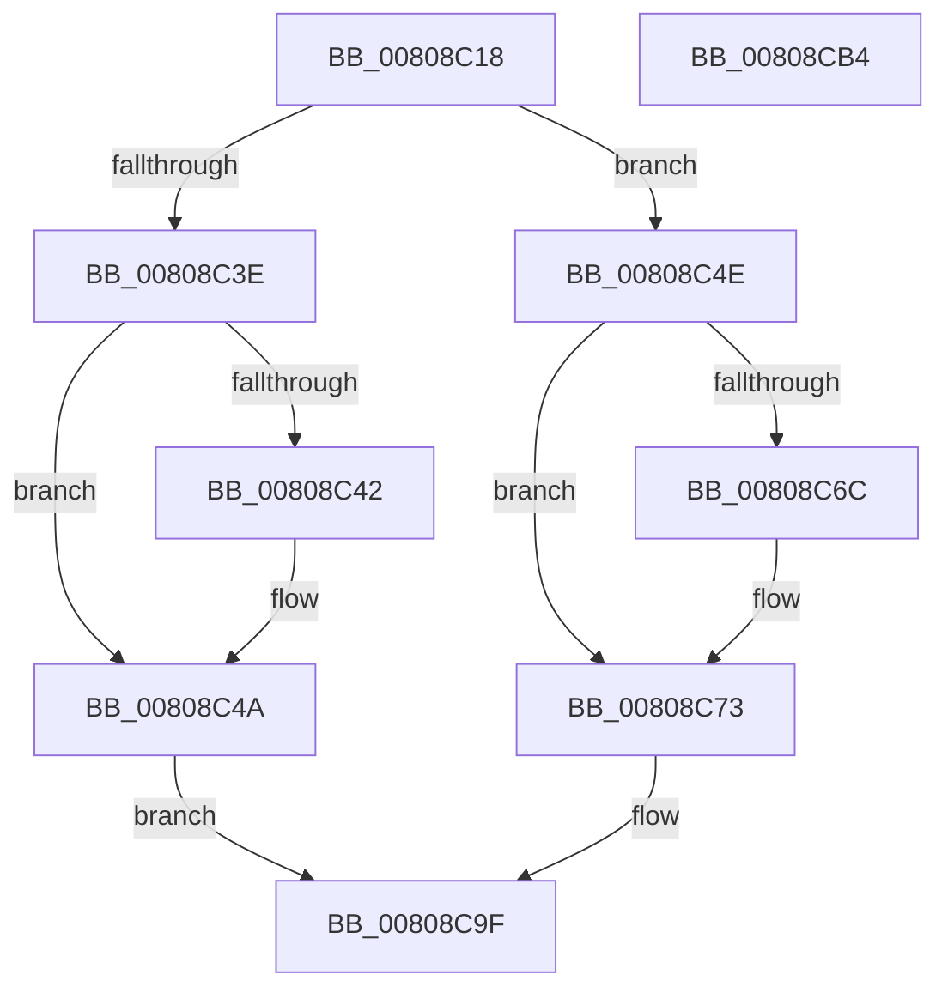

# MiTerminateEnclave

- RVA: `0x00808C18`–`0x00808CB5` (길이 `157` bytes)
- VA: `0x0000000140808C18`
- 실행 섹션: `PAGE`
- PDB 이름 있음: `예`; PDB Function 태그: `아니요`
- unwind 정보 RVA: `0x0005C954`
- 디코드: `46`개 명령, `157/157` bytes 표시
- 미해석 바이트: `0` (있으면 어셈블리에 `.byte`로 보존)

> 이 문서는 커널 이미지의 기계어와 PDB 기호를 분석해 생성했습니다. 4번과 5번은 함수 원형과 자료형을 바이너리 사용 방식에서 추정한 C 해석이며 원본 소스 복구 결과는 아닙니다.

## 1. Dependencies

- 직접 호출 지점: **5**; 고유 호출 대상: **5**
- 직접 호출자로 확인된 함수: **1**
- RIP 상대 이미지 참조: **0**

### Outgoing calls
- `0x00808C45` → [MiTerminateHardwareEnclave](../../pagelk/B7/MiTerminateHardwareEnclave_function_00B75030.md) (function, `0x00B75030`)
- `0x00808C79` → [MiUnlockVad](../../text/2A/MiUnlockVad_function_002A59C8.md) (function, `0x002A59C8`)
- `0x00808C83` → [PsTerminateVsmEnclave](../78/PsTerminateVsmEnclave_function_00788A64.md) (function, `0x00788A64`)
- `0x00808C8D` → [PsDereferenceVsmEnclave](../A0/PsDereferenceVsmEnclave_function_00A0D7D4.md) (function, `0x00A0D7D4`)
- `0x00808C98` → [MiLockVad](../../text/29/MiLockVad_function_00295810.md) (function, `0x00295810`)

### Direct callers
- [NtTerminateEnclave](NtTerminateEnclave_function_00809320.md) at `0x008093A5`

### Static image references
- 디코드된 RIP-relative 메모리 참조가 없습니다.

## 2. Other-region calls and transfers

- 다른 실행 섹션으로 향하는 call: **3**
  - `0x00808C45` → [MiTerminateHardwareEnclave](../../pagelk/B7/MiTerminateHardwareEnclave_function_00B75030.md) (`PAGE` → `PAGELK`)
  - `0x00808C79` → [MiUnlockVad](../../text/2A/MiUnlockVad_function_002A59C8.md) (`PAGE` → `.text`)
  - `0x00808C98` → [MiLockVad](../../text/29/MiLockVad_function_00295810.md) (`PAGE` → `.text`)
- 별도 외부 분기/꼬리 이동을 확인하지 못했습니다.

## 3. Assembly (complete function range)

```asm
00808C18  48 89 5C 24 08                  mov qword ptr [rsp + 8], rbx
00808C1D  48 89 6C 24 10                  mov qword ptr [rsp + 0x10], rbp
00808C22  48 89 74 24 18                  mov qword ptr [rsp + 0x18], rsi
00808C27  57                              push rdi
00808C28  48 83 EC 20                     sub rsp, 0x20
00808C2C  8B 42 40                        mov eax, dword ptr [rdx + 0x40]
00808C2F  48 8B FA                        mov rdi, rdx
00808C32  BA 01 00 00 00                  mov edx, 1
00808C37  41 8B D8                        mov ebx, r8d
00808C3A  84 C2                           test dl, al
00808C3C  74 10                           je 0x140808c4e
00808C3E  A8 08                           test al, 8
00808C40  75 08                           jne 0x140808c4a
00808C42  48 8B D7                        mov rdx, rdi
00808C45  E8 E6 C3 36 00                  call 0x140b75030
00808C4A  33 C0                           xor eax, eax
00808C4C  EB 51                           jmp 0x140808c9f
00808C4E  65 48 8B 2C 25 88 01 00 00      mov rbp, qword ptr gs:[0x188]
00808C57  48 8B C2                        mov rax, rdx
00808C5A  48 8B 77 48                     mov rsi, qword ptr [rdi + 0x48]
00808C5E  F0 48 0F C1 46 10               lock xadd qword ptr [rsi + 0x10], rax
00808C64  48 03 C2                        add rax, rdx
00808C67  48 3B C2                        cmp rax, rdx
00808C6A  7F 07                           jg 0x140808c73
00808C6C  B9 0E 00 00 00                  mov ecx, 0xe
00808C71  CD 29                           int 0x29
00808C73  48 8B D7                        mov rdx, rdi
00808C76  48 8B CD                        mov rcx, rbp
00808C79  E8 4A CD A9 FF                  call 0x1402a59c8
00808C7E  8B D3                           mov edx, ebx
00808C80  48 8B CE                        mov rcx, rsi
00808C83  E8 DC FD F7 FF                  call 0x140788a64
00808C88  48 8B CE                        mov rcx, rsi
00808C8B  8B D8                           mov ebx, eax
00808C8D  E8 42 4B 20 00                  call 0x140a0d7d4
00808C92  48 8B D7                        mov rdx, rdi
00808C95  48 8B CD                        mov rcx, rbp
00808C98  E8 73 CB A8 FF                  call 0x140295810
00808C9D  8B C3                           mov eax, ebx
00808C9F  48 8B 5C 24 30                  mov rbx, qword ptr [rsp + 0x30]
00808CA4  48 8B 6C 24 38                  mov rbp, qword ptr [rsp + 0x38]
00808CA9  48 8B 74 24 40                  mov rsi, qword ptr [rsp + 0x40]
00808CAE  48 83 C4 20                     add rsp, 0x20
00808CB2  5F                              pop rdi
00808CB3  C3                              ret
00808CB4  CC                              int3
```

## 4. C-style interpretation (structured pseudocode)

```c
__int64 __fastcall MiTerminateEnclave(__int64 a1, __int64 a2, int a3)
{
    __int64 result;
    __int64 v_rsp;
    unsigned __int64 v_stack_p10;
    unsigned __int64 v_stack_p18;
    unsigned __int64 v_stack_p8;

    v_stack_p8 = v_rbx;
    v_stack_p10 = v_rbp;
    v_stack_p18 = v_rsi;
    v_rsp = (v_rsp) - (32);
    if (((1) & ((unsigned __int8)((unsigned int)(*(unsigned int *)(a2 + 64))))) == 0) goto loc_00808C4E;
    result = (unsigned int)(*(unsigned int *)(a2 + 64));
    if ((((unsigned __int8)((unsigned int)(*(unsigned int *)(a2 + 64)))) & (8)) == 0) {
        a2 = a2;
        result = MiTerminateHardwareEnclave(a1, a2, a3, a4);
    }
    result = 0;
    goto loc_00808C9F;
loc_00808C4E:
    result = (a2) + (a2);
    if (result <= a2) {
        a1 = 14;
    }
    result = MiUnlockVad(*(unsigned __int64 *)(gs_base + (0 + 392)), a2, a3, a4);
    result = PsTerminateVsmEnclave(*(unsigned __int64 *)(a2 + 72), (unsigned int)((unsigned int)((unsigned int)(a3))), a3, a4);
    result = PsDereferenceVsmEnclave(*(unsigned __int64 *)(a2 + 72), (unsigned int)((unsigned int)((unsigned int)(a3))), a3, a4);
    result = MiLockVad(*(unsigned __int64 *)(gs_base + (0 + 392)), a2, a3, a4);
loc_00808C9F:
    v_rsp = (v_rsp) + (32);
    return (unsigned int)((unsigned int)((unsigned int)((unsigned int)(result))));
}
```

## 5. (Beta) C Style

```c
int64_t MiTerminateEnclave(int64_t Arg1, void *Arg2, int32_t Arg3)
{
    uint8_t *arg2 = (uint8_t *)Arg2;

    int64_t result;
    int64_t local_rsp;
    uint64_t v_stack_p10;
    uint64_t v_stack_p18;
    uint64_t v_stack_p8;

    v_stack_p8 = local_rbx;
    v_stack_p10 = local_rbp;
    v_stack_p18 = local_rsi;
    local_rsp = (local_rsp) - (32);
    if (((1) & ((uint8_t)((uint32_t)(*(uint32_t *)(arg2 + 0x40))))) == 0) goto loc_00808C4E;
    result = (uint32_t)(*(uint32_t *)(arg2 + 0x40));
    if ((((uint8_t)((uint32_t)(*(uint32_t *)(arg2 + 0x40)))) & (8)) == 0) {
        Arg2 = Arg2;
        result = MiTerminateHardwareEnclave(Arg1, Arg2, Arg3, a4);
    }
    result = 0;
    goto loc_00808C9F;
loc_00808C4E:
    result = (Arg2) + (Arg2);
    if (result <= Arg2) {
        Arg1 = 14;
    }
    result = MiUnlockVad(*(uint64_t *)(gs_base + (0 + 0x188)), Arg2, Arg3, a4);
    result = PsTerminateVsmEnclave(*(uint64_t *)(arg2 + 0x48), (uint32_t)((uint32_t)((uint32_t)(Arg3))), Arg3, a4);
    result = PsDereferenceVsmEnclave(*(uint64_t *)(arg2 + 0x48), (uint32_t)((uint32_t)((uint32_t)(Arg3))), Arg3, a4);
    result = MiLockVad(*(uint64_t *)(gs_base + (0 + 0x188)), Arg2, Arg3, a4);
loc_00808C9F:
    local_rsp = (local_rsp) + (32);
    return (uint32_t)((uint32_t)((uint32_t)((uint32_t)(result))));
}
```

### 관측된 메모리 오프셋

구조체 형식이 확인되지 않은 접근은 인자 기준의 오프셋으로만 기록했습니다.

| 기준 인자 | 오프셋 표현 | 폭 (bit) | 접근 |
|---|---:|---:|---|
| `Arg2` | `+ 0x40` | `32` | `R` |
| `Arg2` | `+ 0x48` | `64` | `R` |

## 6. Execution-region graph

[열기: 2D/3D 그래프와 함수 탐색 컨트롤 패널](../../../control-panel.html?section=page&rva=0x00808C18&view=graph)

- 2D 그래프는 위에서 아래로 흐르고, 3D 그래프는 빈 공간을 드래그해 회전합니다. Shift+드래그는 이동, 휠은 확대·축소, 함수 노드 선택은 대상 보고서 이동입니다.

### Static fallback


