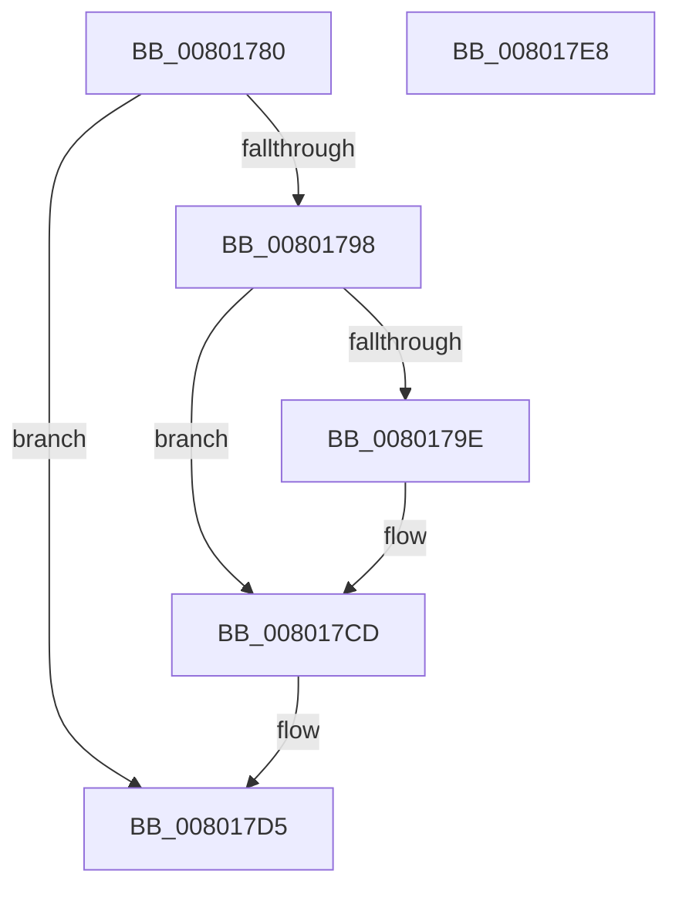

# MiUnlockEntireDriver

- RVA: `0x00801780`–`0x008017E9` (길이 `105` bytes)
- VA: `0x0000000140801780`
- 실행 섹션: `PAGE`
- PDB 이름 있음: `예`; PDB Function 태그: `아니요`
- unwind 정보 RVA: `0x0005CAAC`
- 디코드: `30`개 명령, `105/105` bytes 표시
- 미해석 바이트: `0` (있으면 어셈블리에 `.byte`로 보존)

> 이 문서는 커널 이미지의 기계어와 PDB 기호를 분석해 생성했습니다. 4번과 5번은 함수 원형과 자료형을 바이너리 사용 방식에서 추정한 C 해석이며 원본 소스 복구 결과는 아닙니다.

## 1. Dependencies

- 직접 호출 지점: **4**; 고유 호출 대상: **4**
- 직접 호출자로 확인된 함수: **1**
- RIP 상대 이미지 참조: **1**

### Outgoing calls
- `0x008017B4` → [MiGetPteAddress](../../text/43/MiGetPteAddress_function_0043E130.md) (function, `0x0043E130`)
- `0x008017C3` → [MiReleasePtes](../../text/24/MiReleasePtes_function_00247240.md) (function, `0x00247240`)
- `0x008017D0` → [IoFreeMdl](../../text/29/IoFreeMdl_function_0029EA80.md) (function, `0x0029EA80`)
- `0x008017D8` → [MiUnlockDriverPages](../A4/MiUnlockDriverPages_function_00A4BA6C.md) (function, `0x00A4BA6C`)

### Direct callers
- [MiReapplyImportOptimizationForDriverVerifier](../../text/68/MiReapplyImportOptimizationForDriverVerifier_function_00682268.md) at `0x006826A2`

### Static image references
- `0x008017BC` → RVA `0x00E37668` (`.data`; read)

## 2. Other-region calls and transfers

- 다른 실행 섹션으로 향하는 call: **3**
  - `0x008017B4` → [MiGetPteAddress](../../text/43/MiGetPteAddress_function_0043E130.md) (`PAGE` → `.text`)
  - `0x008017C3` → [MiReleasePtes](../../text/24/MiReleasePtes_function_00247240.md) (`PAGE` → `.text`)
  - `0x008017D0` → [IoFreeMdl](../../text/29/IoFreeMdl_function_0029EA80.md) (`PAGE` → `.text`)
- 별도 외부 분기/꼬리 이동을 확인하지 못했습니다.

## 3. Assembly (complete function range)

```asm
00801780  48 89 5C 24 08                  mov qword ptr [rsp + 8], rbx
00801785  57                              push rdi
00801786  48 83 EC 20                     sub rsp, 0x20
0080178A  45 33 C0                        xor r8d, r8d
0080178D  48 8B DA                        mov rbx, rdx
00801790  48 8B F9                        mov rdi, rcx
00801793  48 85 D2                        test rdx, rdx
00801796  74 3D                           je 0x1408017d5
00801798  F6 42 0A 01                     test byte ptr [rdx + 0xa], 1
0080179C  74 2F                           je 0x1408017cd
0080179E  8B 42 28                        mov eax, dword ptr [rdx + 0x28]
008017A1  A9 FF 0F 00 00                  test eax, 0xfff
008017A6  48 8B 4A 18                     mov rcx, qword ptr [rdx + 0x18]
008017AA  41 0F 95 C0                     setne r8b
008017AE  C1 E8 0C                        shr eax, 0xc
008017B1  44 03 C0                        add r8d, eax
008017B4  E8 77 C9 C3 FF                  call 0x14043e130
008017B9  48 8B D0                        mov rdx, rax
008017BC  48 8D 0D A5 5E 63 00            lea rcx, [rip + 0x635ea5]
008017C3  E8 78 5A A4 FF                  call 0x140247240
008017C8  66 83 63 0A FE                  and word ptr [rbx + 0xa], 0xfffe
008017CD  48 8B CB                        mov rcx, rbx
008017D0  E8 AB D2 A9 FF                  call 0x14029ea80
008017D5  48 8B CF                        mov rcx, rdi
008017D8  E8 8F A2 24 00                  call 0x140a4ba6c
008017DD  48 8B 5C 24 30                  mov rbx, qword ptr [rsp + 0x30]
008017E2  48 83 C4 20                     add rsp, 0x20
008017E6  5F                              pop rdi
008017E7  C3                              ret
008017E8  CC                              int3
```

## 4. C-style interpretation (structured pseudocode)

```c
__int64 __fastcall MiUnlockEntireDriver(__int64 a1, __int64 a2, int a3)
{
    __int64 result;
    __int64 v_rsp;
    unsigned __int64 v_stack_p8;

    v_stack_p8 = v_rbx;
    v_rsp = (v_rsp) - (32);
    a3 = 0;
    if (a2 == 0) goto loc_008017D5;
    if (((*(unsigned __int8 *)(a2 + 10)) & (1)) != 0) {
        result = *(unsigned int *)(a2 + 40);
        a1 = *(unsigned __int64 *)(a2 + 24);
        a3 = ((((unsigned int)(result)) & (0xFFFULL)) != 0) ? 1 : 0;
        result = (unsigned int)((result) >> (12));
        a3 = (unsigned int)((a3) + ((unsigned int)(result)));
        result = MiGetPteAddress(a1, a2, a3, a4);
        a2 = result;
        a1 = v_rip + 6512293;
        result = MiReleasePtes(a1, a2, a3, a4);
    }
    result = IoFreeMdl(a2, a2, a3, a4);
loc_008017D5:
    result = MiUnlockDriverPages(a1, a2, a3, a4);
    v_rsp = (v_rsp) + (32);
    return result;
}
```

## 5. (Beta) C Style

```c
int64_t MiUnlockEntireDriver(int64_t Arg1, void *Arg2, int32_t Arg3)
{
    uint8_t *arg2 = (uint8_t *)Arg2;

    int64_t result;
    int64_t local_rsp;
    uint64_t v_stack_p8;

    v_stack_p8 = local_rbx;
    local_rsp = (local_rsp) - (32);
    Arg3 = 0;
    if (Arg2 == NULL) goto loc_008017D5;
    if (((*(uint8_t *)(arg2 + 0xA)) & (1)) != 0) {
        result = *(uint32_t *)(arg2 + 0x28);
        Arg1 = *(uint64_t *)(arg2 + 0x18);
        Arg3 = ((((uint32_t)(result)) & (0xFFFULL)) != 0) ? 1 : 0;
        result = (uint32_t)((result) >> (12));
        Arg3 = (uint32_t)((Arg3) + ((uint32_t)(result)));
        result = MiGetPteAddress(Arg1, Arg2, Arg3, a4);
        Arg2 = result;
        Arg1 = v_rip + 6512293;
        result = MiReleasePtes(Arg1, Arg2, Arg3, a4);
    }
    result = IoFreeMdl(Arg2, Arg2, Arg3, a4);
loc_008017D5:
    result = MiUnlockDriverPages(Arg1, Arg2, Arg3, a4);
    local_rsp = (local_rsp) + (32);
    return result;
}
```

### 관측된 메모리 오프셋

구조체 형식이 확인되지 않은 접근은 인자 기준의 오프셋으로만 기록했습니다.

| 기준 인자 | 오프셋 표현 | 폭 (bit) | 접근 |
|---|---:|---:|---|
| `Arg2` | `+ 0xA` | `16` | `R/W` |

## 6. Execution-region graph

[열기: 2D/3D 그래프와 함수 탐색 컨트롤 패널](../../../control-panel.html?section=page&rva=0x00801780&view=graph)

- 2D 그래프는 위에서 아래로 흐르고, 3D 그래프는 빈 공간을 드래그해 회전합니다. Shift+드래그는 이동, 휠은 확대·축소, 함수 노드 선택은 대상 보고서 이동입니다.

### Static fallback


