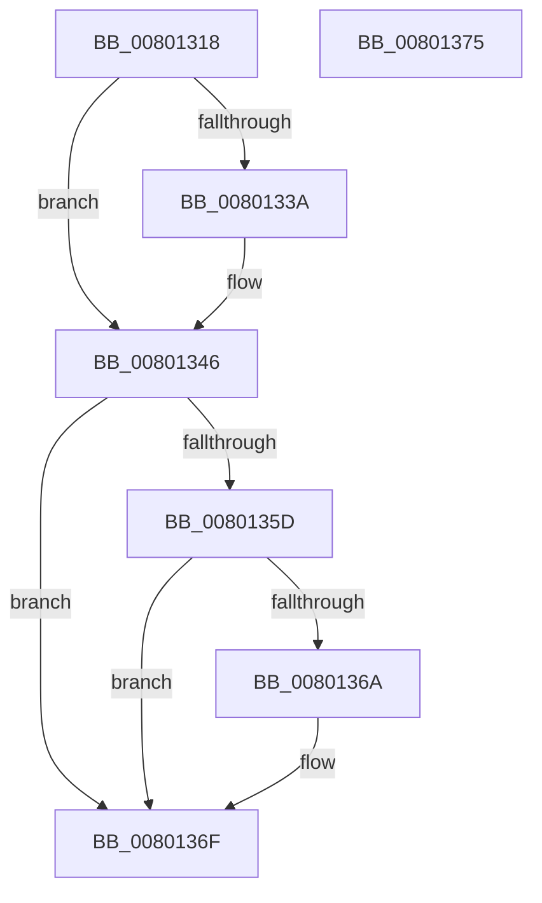

# MiUnlockFileExtentsExclusive

- RVA: `0x00801318`–`0x00801376` (길이 `94` bytes)
- VA: `0x0000000140801318`
- 실행 섹션: `PAGE`
- PDB 이름 있음: `예`; PDB Function 태그: `아니요`
- unwind 정보 RVA: `0x0005CF00`
- 디코드: `24`개 명령, `94/94` bytes 표시
- 미해석 바이트: `0` (있으면 어셈블리에 `.byte`로 보존)

> 이 문서는 커널 이미지의 기계어와 PDB 기호를 분석해 생성했습니다. 4번과 5번은 함수 원형과 자료형을 바이너리 사용 방식에서 추정한 C 해석이며 원본 소스 복구 결과는 아닙니다.

## 1. Dependencies

- 직접 호출 지점: **3**; 고유 호출 대상: **3**
- 직접 호출자로 확인된 함수: **3**
- RIP 상대 이미지 참조: **2**

### Outgoing calls
- `0x00801341` → [ExfTryToWakePushLock](../../text/26/ExfTryToWakePushLock_function_00265DD0.md) (function, `0x00265DD0`)
- `0x0080134D` → [KeAbPostRelease](../../text/2E/KeAbPostRelease_function_002E1600.md) (function, `0x002E1600`)
- `0x0080136A` → [KiCheckForKernelApcDelivery](../../text/2E/KiCheckForKernelApcDelivery_function_002E2C80.md) (function, `0x002E2C80`)

### Direct callers
- [MiInsertCopyExtents](../../text/68/MiInsertCopyExtents_function_00681440.md) at `0x006814B9`
- [MiMergeCopyExtents](../../text/68/MiMergeCopyExtents_function_00681844.md) at `0x00681A05`
- [MiDeleteFileExtentList](MiDeleteFileExtentList_function_00800F6C.md) at `0x00800FC1`

### Static image references
- `0x0080132B` → RVA `0x00E2D898` (`.data`; read/write)
- `0x0080133A` → RVA `0x00E2D898` (`.data`; read)

## 2. Other-region calls and transfers

- 다른 실행 섹션으로 향하는 call: **3**
  - `0x00801341` → [ExfTryToWakePushLock](../../text/26/ExfTryToWakePushLock_function_00265DD0.md) (`PAGE` → `.text`)
  - `0x0080134D` → [KeAbPostRelease](../../text/2E/KeAbPostRelease_function_002E1600.md) (`PAGE` → `.text`)
  - `0x0080136A` → [KiCheckForKernelApcDelivery](../../text/2E/KiCheckForKernelApcDelivery_function_002E2C80.md) (`PAGE` → `.text`)
- 별도 외부 분기/꼬리 이동을 확인하지 못했습니다.

## 3. Assembly (complete function range)

```asm
00801318  40 53                           push rbx
0080131A  48 83 EC 20                     sub rsp, 0x20
0080131E  65 48 8B 1C 25 88 01 00 00      mov rbx, qword ptr gs:[0x188]
00801327  48 83 C8 FF                     or rax, 0xffffffffffffffff
0080132B  F0 48 0F C1 05 64 C5 62 00      lock xadd qword ptr [rip + 0x62c564], rax
00801334  24 06                           and al, 6
00801336  3C 02                           cmp al, 2
00801338  75 0C                           jne 0x140801346
0080133A  48 8D 0D 57 C5 62 00            lea rcx, [rip + 0x62c557]
00801341  E8 8A 4A A6 FF                  call 0x140265dd0
00801346  48 8D 0D 4B C5 62 00            lea rcx, [rip + 0x62c54b]
0080134D  E8 AE 02 AE FF                  call 0x1402e1600
00801352  90                              nop
00801353  66 83 83 E6 01 00 00 01         add word ptr [rbx + 0x1e6], 1
0080135B  75 12                           jne 0x14080136f
0080135D  48 8D 83 98 00 00 00            lea rax, [rbx + 0x98]
00801364  90                              nop
00801365  48 39 00                        cmp qword ptr [rax], rax
00801368  74 05                           je 0x14080136f
0080136A  E8 11 19 AE FF                  call 0x1402e2c80
0080136F  48 83 C4 20                     add rsp, 0x20
00801373  5B                              pop rbx
00801374  C3                              ret
00801375  CC                              int3
```

## 4. C-style interpretation (structured pseudocode)

```c
__int64 __fastcall MiUnlockFileExtentsExclusive(void)
{
    __int64 result;
    __int64 v_rsp;

    v_rsp = (v_rsp) - (32);
    result = (result) | (-1);
    result = (unsigned __int8)((result) & (6));
    if (((unsigned __int8)(result)) == 2) {
        a1 = v_rip + 6473047;
        result = ExfTryToWakePushLock(a1, a2, a3, a4);
    }
    result = KeAbPostRelease(v_rip + 6473035, a2, a3, a4);
    if (((unsigned __int8)(result)) != 2) goto loc_0080136F;
    result = *(unsigned __int64 *)(gs_base + (0 + 392)) + 152;
    if ((*(unsigned __int64 *)(*(unsigned __int64 *)(gs_base + (0 + 392)) + 152)) != (*(unsigned __int64 *)(gs_base + (0 + 392)) + 152)) {
        result = KiCheckForKernelApcDelivery(v_rip + 6473035, a2, a3, a4);
    }
    v_rsp = (v_rsp) + (32);
    return result;
}
```

## 5. (Beta) C Style

```c
void MiUnlockFileExtentsExclusive(void)
{
    int64_t result;
    int64_t local_rsp;

    local_rsp = (local_rsp) - (32);
    result = (result) | (-1);
    result = (uint8_t)((result) & (6));
    if (((uint8_t)(result)) == 2) {
        a1 = v_rip + 6473047;
        result = ExfTryToWakePushLock(a1, a2, a3, a4);
    }
    result = KeAbPostRelease(v_rip + 6473035, a2, a3, a4);
    if (((uint8_t)(result)) != 2) goto loc_0080136F;
    result = *(uint64_t *)(gs_base + (0 + 0x188)) + 152;
    if ((*(uint64_t *)(*(uint64_t *)(gs_base + (0 + 0x188)) + 0x98)) != (*(uint64_t *)(gs_base + (0 + 0x188)) + 152)) {
        result = KiCheckForKernelApcDelivery(v_rip + 6473035, a2, a3, a4);
    }
    local_rsp = (local_rsp) + (32);
    return result;
}
```

## 6. Execution-region graph

[열기: 2D/3D 그래프와 함수 탐색 컨트롤 패널](../../../control-panel.html?section=page&rva=0x00801318&view=graph)

- 2D 그래프는 위에서 아래로 흐르고, 3D 그래프는 빈 공간을 드래그해 회전합니다. Shift+드래그는 이동, 휠은 확대·축소, 함수 노드 선택은 대상 보고서 이동입니다.

### Static fallback


