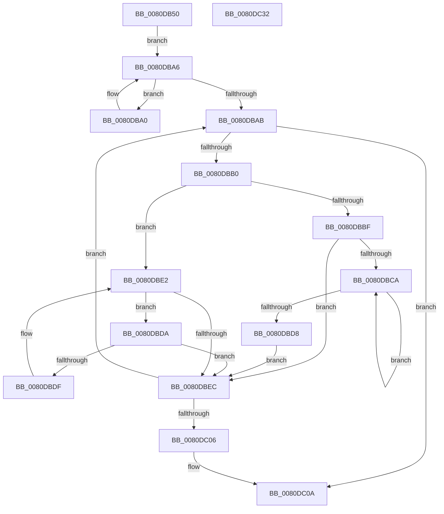

# MiUpdatePartitionLargePfnBitMap

- RVA: `0x0080DB50`–`0x0080DC33` (길이 `227` bytes)
- VA: `0x000000014080DB50`
- 실행 섹션: `PAGE`
- PDB 이름 있음: `예`; PDB Function 태그: `아니요`
- unwind 정보 RVA: `0x000D175C`
- 디코드: `70`개 명령, `227/227` bytes 표시
- 미해석 바이트: `0` (있으면 어셈블리에 `.byte`로 보존)

> 이 문서는 커널 이미지의 기계어와 PDB 기호를 분석해 생성했습니다. 4번과 5번은 함수 원형과 자료형을 바이너리 사용 방식에서 추정한 C 해석이며 원본 소스 복구 결과는 아닙니다.

## 1. Dependencies

- 직접 호출 지점: **4**; 고유 호출 대상: **4**
- 직접 호출자로 확인된 함수: **3**
- RIP 상대 이미지 참조: **0**

### Outgoing calls
- `0x0080DB79` → [memset](../../text/6C/memset_function_006C6C40.md) (function, `0x006C6C40`)
- `0x0080DB94` → [MiLockDynamicMemoryExclusive](../../text/67/MiLockDynamicMemoryExclusive_function_006730F8.md) (function, `0x006730F8`)
- `0x0080DBFB` → [MiActOnPartitionNodePages](../../text/68/MiActOnPartitionNodePages_function_0068F7F4.md) (function, `0x0068F7F4`)
- `0x0080DC10` → [MiUnlockDynamicMemoryExclusive](../../text/67/MiUnlockDynamicMemoryExclusive_function_00673C5C.md) (function, `0x00673C5C`)

### Direct callers
- [MiInsertPartitionPages](../../text/69/MiInsertPartitionPages_function_006911A0.md) at `0x006912D8`
- [MiAllocatePartitionPhysicalPages](MiAllocatePartitionPhysicalPages_function_0080C9D4.md) at `0x0080CFBE`
- [MiHotAddPartitionMemory](MiHotAddPartitionMemory_function_0080D5B4.md) at `0x0080D70F`

### Static image references
- 디코드된 RIP-relative 메모리 참조가 없습니다.

## 2. Other-region calls and transfers

- 다른 실행 섹션으로 향하는 call: **4**
  - `0x0080DB79` → [memset](../../text/6C/memset_function_006C6C40.md) (`PAGE` → `.text`)
  - `0x0080DB94` → [MiLockDynamicMemoryExclusive](../../text/67/MiLockDynamicMemoryExclusive_function_006730F8.md) (`PAGE` → `.text`)
  - `0x0080DBFB` → [MiActOnPartitionNodePages](../../text/68/MiActOnPartitionNodePages_function_0068F7F4.md) (`PAGE` → `.text`)
  - `0x0080DC10` → [MiUnlockDynamicMemoryExclusive](../../text/67/MiUnlockDynamicMemoryExclusive_function_00673C5C.md) (`PAGE` → `.text`)
- 별도 외부 분기/꼬리 이동을 확인하지 못했습니다.

## 3. Assembly (complete function range)

```asm
0080DB50  48 8B C4                        mov rax, rsp
0080DB53  48 89 58 08                     mov qword ptr [rax + 8], rbx
0080DB57  48 89 68 10                     mov qword ptr [rax + 0x10], rbp
0080DB5B  48 89 70 18                     mov qword ptr [rax + 0x18], rsi
0080DB5F  48 89 78 20                     mov qword ptr [rax + 0x20], rdi
0080DB63  41 56                           push r14
0080DB65  48 83 EC 70                     sub rsp, 0x70
0080DB69  48 8B DA                        mov rbx, rdx
0080DB6C  48 8B E9                        mov rbp, rcx
0080DB6F  33 D2                           xor edx, edx
0080DB71  48 8D 48 A8                     lea rcx, [rax - 0x58]
0080DB75  44 8D 42 48                     lea r8d, [rdx + 0x48]
0080DB79  E8 C2 90 EB FF                  call 0x1406c6c40
0080DB7E  48 89 6C 24 20                  mov qword ptr [rsp + 0x20], rbp
0080DB83  33 F6                           xor esi, esi
0080DB85  65 4C 8B 34 25 88 01 00 00      mov r14, qword ptr gs:[0x188]
0080DB8E  48 8B CD                        mov rcx, rbp
0080DB91  49 8B D6                        mov rdx, r14
0080DB94  E8 5F 55 E6 FF                  call 0x1406730f8
0080DB99  48 8B 03                        mov rax, qword ptr [rbx]
0080DB9C  8B FE                           mov edi, esi
0080DB9E  EB 06                           jmp 0x14080dba6
0080DBA0  48 8B F8                        mov rdi, rax
0080DBA3  48 8B 00                        mov rax, qword ptr [rax]
0080DBA6  48 85 C0                        test rax, rax
0080DBA9  75 F5                           jne 0x14080dba0
0080DBAB  48 85 FF                        test rdi, rdi
0080DBAE  74 5A                           je 0x14080dc0a
0080DBB0  48 8B 47 08                     mov rax, qword ptr [rdi + 8]
0080DBB4  4C 8B D7                        mov r10, rdi
0080DBB7  48 8B CF                        mov rcx, rdi
0080DBBA  48 85 C0                        test rax, rax
0080DBBD  74 23                           je 0x14080dbe2
0080DBBF  48 8B 08                        mov rcx, qword ptr [rax]
0080DBC2  48 8B F8                        mov rdi, rax
0080DBC5  48 85 C9                        test rcx, rcx
0080DBC8  74 22                           je 0x14080dbec
0080DBCA  48 8B 01                        mov rax, qword ptr [rcx]
0080DBCD  48 8B F9                        mov rdi, rcx
0080DBD0  48 8B C8                        mov rcx, rax
0080DBD3  48 85 C0                        test rax, rax
0080DBD6  75 F2                           jne 0x14080dbca
0080DBD8  EB 12                           jmp 0x14080dbec
0080DBDA  48 39 0F                        cmp qword ptr [rdi], rcx
0080DBDD  74 0D                           je 0x14080dbec
0080DBDF  48 8B CF                        mov rcx, rdi
0080DBE2  48 8B 7F 10                     mov rdi, qword ptr [rdi + 0x10]
0080DBE6  48 83 E7 FC                     and rdi, 0xfffffffffffffffc
0080DBEA  75 EE                           jne 0x14080dbda
0080DBEC  45 33 C0                        xor r8d, r8d
0080DBEF  4C 8D 4C 24 20                  lea r9, [rsp + 0x20]
0080DBF4  49 8B CA                        mov rcx, r10
0080DBF7  41 8D 50 05                     lea edx, [r8 + 5]
0080DBFB  E8 F4 1B E8 FF                  call 0x14068f7f4
0080DC00  39 74 24 38                     cmp dword ptr [rsp + 0x38], esi
0080DC04  7D A5                           jge 0x14080dbab
0080DC06  8B 74 24 38                     mov esi, dword ptr [rsp + 0x38]
0080DC0A  49 8B D6                        mov rdx, r14
0080DC0D  48 8B CD                        mov rcx, rbp
0080DC10  E8 47 60 E6 FF                  call 0x140673c5c
0080DC15  4C 8D 5C 24 70                  lea r11, [rsp + 0x70]
0080DC1A  8B C6                           mov eax, esi
0080DC1C  49 8B 5B 10                     mov rbx, qword ptr [r11 + 0x10]
0080DC20  49 8B 6B 18                     mov rbp, qword ptr [r11 + 0x18]
0080DC24  49 8B 73 20                     mov rsi, qword ptr [r11 + 0x20]
0080DC28  49 8B 7B 28                     mov rdi, qword ptr [r11 + 0x28]
0080DC2C  49 8B E3                        mov rsp, r11
0080DC2F  41 5E                           pop r14
0080DC31  C3                              ret
0080DC32  CC                              int3
```

## 4. C-style interpretation (structured pseudocode)

```c
__int64 __fastcall MiUpdatePartitionLargePfnBitMap(__int64 a1, __int64 a2)
{
    __int64 result;
    __int64 v_rdi;
    __int64 v_rsi;
    __int64 v_rsp;
    unsigned int v_stack_m40;
    unsigned __int64 v_stack_m58;
    unsigned __int64 v_stack_m8;

    *(unsigned __int64 *)(v_rsp + 8) = v_rbx;
    *(unsigned __int64 *)(v_rsp + 16) = v_rbp;
    *(unsigned __int64 *)(v_rsp + 24) = v_rsi;
    *(unsigned __int64 *)(v_rsp + 32) = v_rdi;
    v_rsp = (v_rsp) - (112);
    a2 = 0;
    result = memset(v_rsp - 88, a2, a2 + 72, a4);
    v_stack_m58 = a1;
    v_rsi = 0;
    result = MiLockDynamicMemoryExclusive(a1, *(unsigned __int64 *)(gs_base + (0 + 392)), a2 + 72, a4);
    goto loc_0080DBA6;
loc_0080DBA0:
loc_0080DBA6:
    if (*(unsigned __int64 *)(*(unsigned __int64 *)(a2)) != 0) goto loc_0080DBA0;
loc_0080DBAB:
    if (*(unsigned __int64 *)(a2) == 0) goto loc_0080DC0A;
    if (*(unsigned __int64 *)(*(unsigned __int64 *)(a2) + 8) == 0) goto loc_0080DBE2;
    if (*(unsigned __int64 *)(*(unsigned __int64 *)(*(unsigned __int64 *)(a2) + 8)) == 0) goto loc_0080DBEC;
loc_0080DBCA:
    if (*(unsigned __int64 *)(*(unsigned __int64 *)(*(unsigned __int64 *)(*(unsigned __int64 *)(a2) + 8))) != 0) goto loc_0080DBCA;
    goto loc_0080DBEC;
loc_0080DBDA:
    if ((*(unsigned __int64 *)(*(unsigned __int64 *)(*(unsigned __int64 *)(*(unsigned __int64 *)(a2) + 8)))) == (*(unsigned __int64 *)(*(unsigned __int64 *)(*(unsigned __int64 *)(*(unsigned __int64 *)(a2) + 8))))) goto loc_0080DBEC;
loc_0080DBE2:
    v_rdi = (*(unsigned __int64 *)(*(unsigned __int64 *)(*(unsigned __int64 *)(*(unsigned __int64 *)(a2) + 8)) + 16)) & (-4);
    if (condition_is_not_equal) goto loc_0080DBDA;
loc_0080DBEC:
    a3 = 0;
    result = MiActOnPartitionNodePages(*(unsigned __int64 *)(a2), a3 + 5, a3, v_stack_m58);
    if (v_stack_m40 >= 0) goto loc_0080DBAB;
loc_0080DC0A:
    result = MiUnlockDynamicMemoryExclusive(a1, *(unsigned __int64 *)(gs_base + (0 + 392)), a3, v_stack_m58);
    return (unsigned int)((unsigned int)((unsigned int)(v_stack_m40)));
}
```

## 5. (Beta) C Style

```c
int64_t MiUpdatePartitionLargePfnBitMap(int64_t Arg1, void *Arg2)
{
    uint8_t *arg2 = (uint8_t *)Arg2;

    int64_t result;
    int64_t local_rdi;
    int64_t local_rsi;
    int64_t local_rsp;
    uint32_t v_stack_m40;
    uint64_t v_stack_m58;
    uint64_t v_stack_m8;

    *(uint64_t *)(local_rsp + 0x8) = local_rbx;
    *(uint64_t *)(local_rsp + 0x10) = local_rbp;
    *(uint64_t *)(local_rsp + 0x18) = local_rsi;
    *(uint64_t *)(local_rsp + 0x20) = local_rdi;
    local_rsp = (local_rsp) - (112);
    Arg2 = 0;
    result = memset(local_rsp - 88, Arg2, Arg2 + 72, a4);
    v_stack_m58 = Arg1;
    local_rsi = 0;
    result = MiLockDynamicMemoryExclusive(Arg1, *(uint64_t *)(gs_base + (0 + 0x188)), Arg2 + 72, a4);
    goto loc_0080DBA6;
loc_0080DBA0:
loc_0080DBA6:
    if (*(uint64_t *)(*(uint64_t *)(arg2)) != 0) goto loc_0080DBA0;
loc_0080DBAB:
    if (*(uint64_t *)(arg2) == 0) goto loc_0080DC0A;
    if (*(uint64_t *)(*(uint64_t *)(arg2) + 0x8) == 0) goto loc_0080DBE2;
    if (*(uint64_t *)(*(uint64_t *)(*(uint64_t *)(arg2) + 0x8)) == 0) goto loc_0080DBEC;
loc_0080DBCA:
    if (*(uint64_t *)(*(uint64_t *)(*(uint64_t *)(*(uint64_t *)(arg2) + 0x8))) != 0) goto loc_0080DBCA;
    goto loc_0080DBEC;
loc_0080DBDA:
    if ((*(uint64_t *)(*(uint64_t *)(*(uint64_t *)(*(uint64_t *)(arg2) + 0x8)))) == (*(uint64_t *)(*(uint64_t *)(*(uint64_t *)(*(uint64_t *)(arg2) + 0x8))))) goto loc_0080DBEC;
loc_0080DBE2:
    local_rdi = (*(uint64_t *)(*(uint64_t *)(*(uint64_t *)(*(uint64_t *)(arg2) + 0x8)) + 0x10)) & (-4);
    if (condition_is_not_equal) goto loc_0080DBDA;
loc_0080DBEC:
    a3 = 0;
    result = MiActOnPartitionNodePages(*(uint64_t *)(arg2), a3 + 5, a3, v_stack_m58);
    if (v_stack_m40 >= 0) goto loc_0080DBAB;
loc_0080DC0A:
    result = MiUnlockDynamicMemoryExclusive(Arg1, *(uint64_t *)(gs_base + (0 + 0x188)), a3, v_stack_m58);
    return (uint32_t)((uint32_t)((uint32_t)(v_stack_m40)));
}
```

### 관측된 메모리 오프셋

구조체 형식이 확인되지 않은 접근은 인자 기준의 오프셋으로만 기록했습니다.

| 기준 인자 | 오프셋 표현 | 폭 (bit) | 접근 |
|---|---:|---:|---|
| `Arg2` | `+ 0x0` | `64` | `R` |

## 6. Execution-region graph

[열기: 2D/3D 그래프와 함수 탐색 컨트롤 패널](../../../control-panel.html?section=page&rva=0x0080DB50&view=graph)

- 2D 그래프는 위에서 아래로 흐르고, 3D 그래프는 빈 공간을 드래그해 회전합니다. Shift+드래그는 이동, 휠은 확대·축소, 함수 노드 선택은 대상 보고서 이동입니다.

### Static fallback


